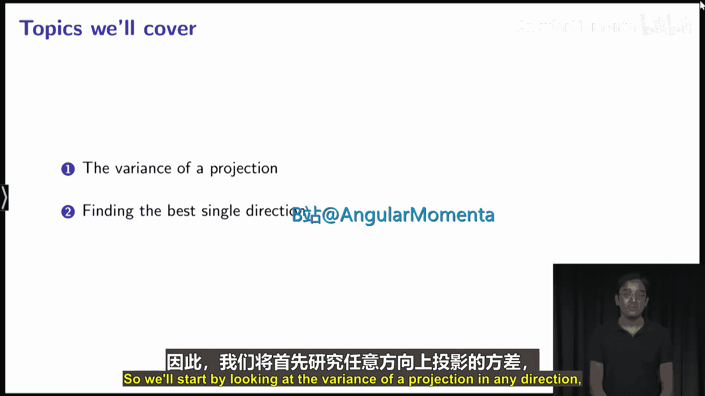
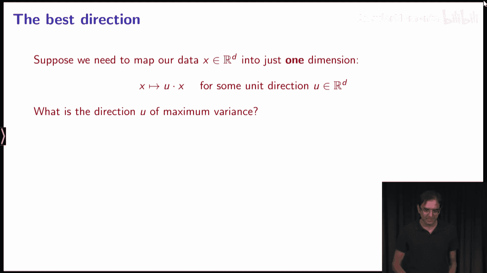
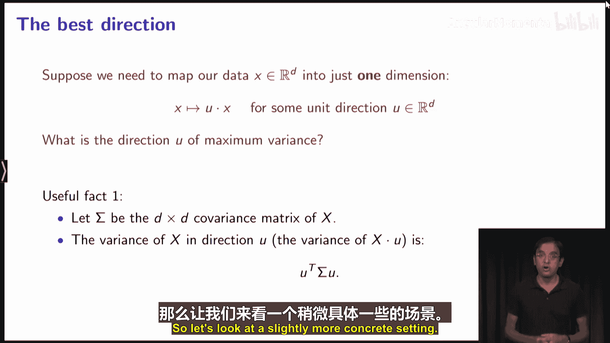
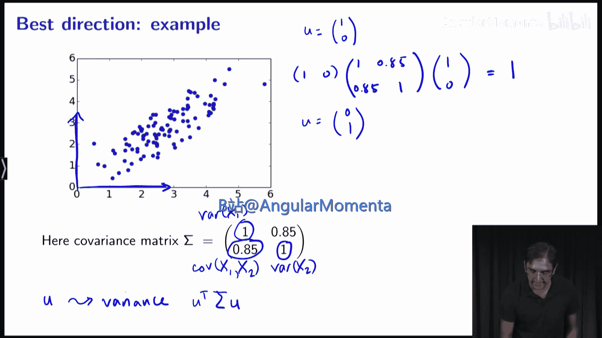
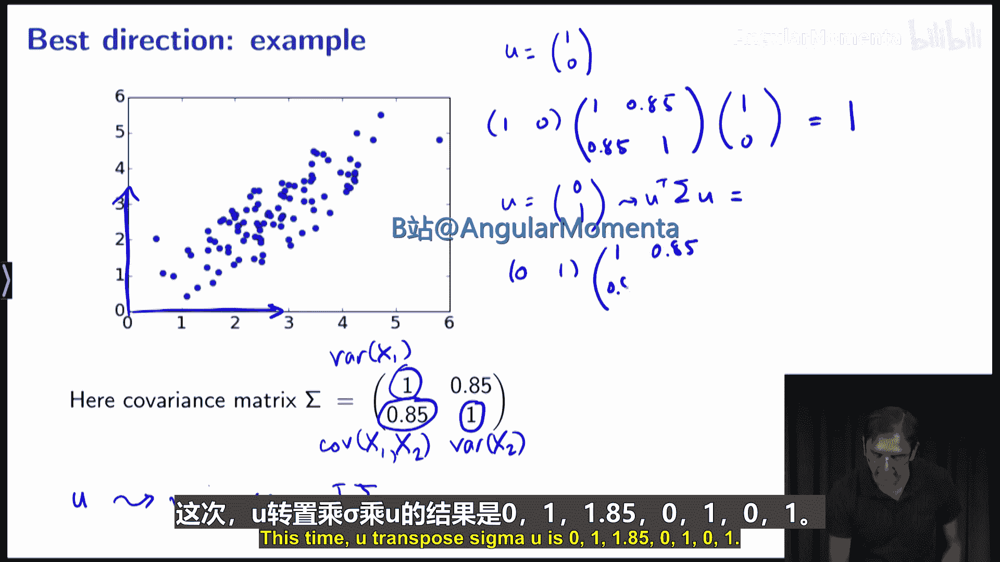
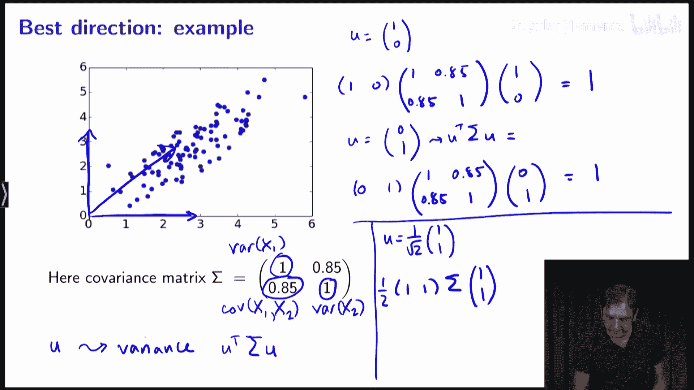
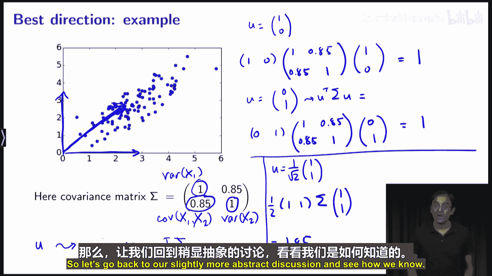
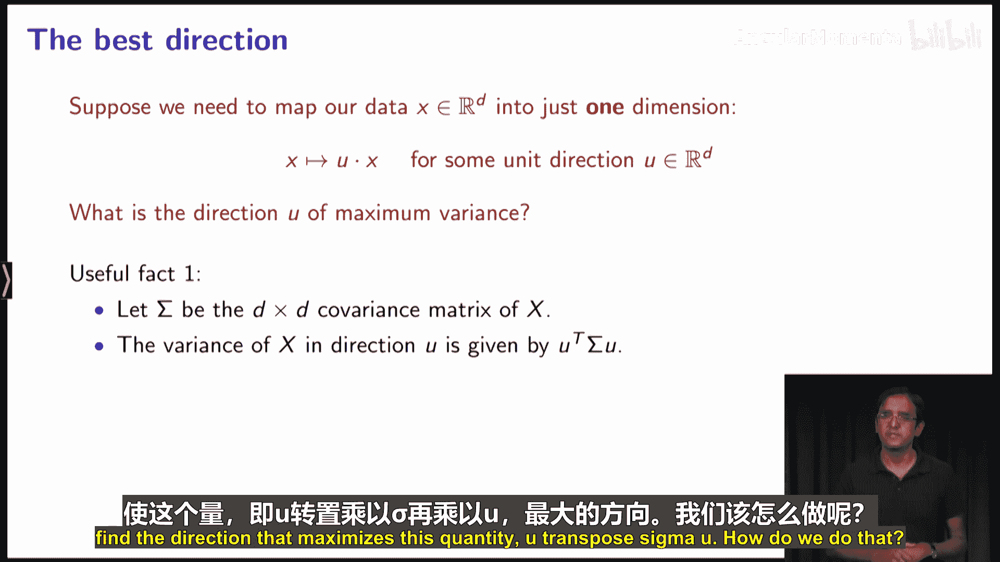
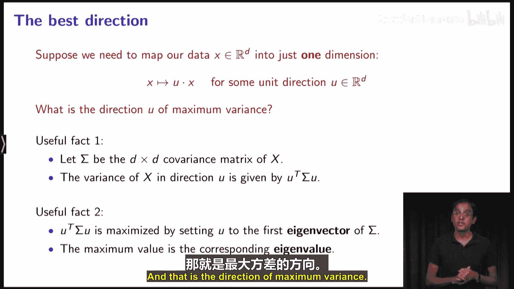
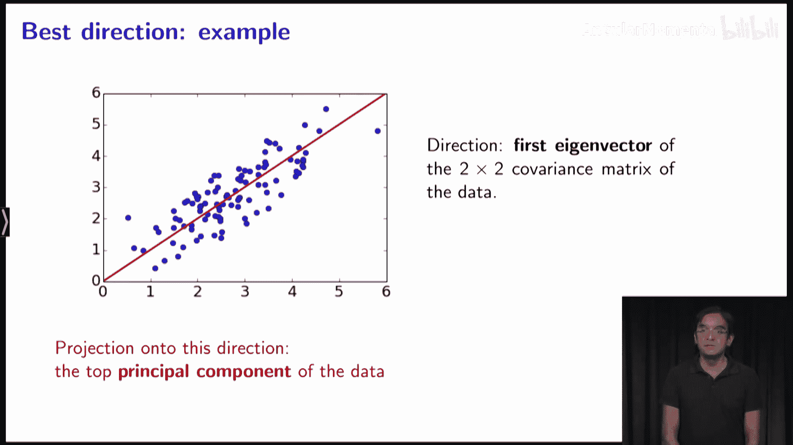

# 机器学习基础：10-02-02：主成分分析 I - 寻找最大方差方向 🔍






在本节课中，我们将要学习主成分分析（PCA）的核心思想：如何为数据找到一个最佳的投影方向，使得投影后的数据方差最大。方差越大，意味着数据在该方向上包含的信息量越多。

上一节我们介绍了投影的基本概念，本节中我们来看看如何找到这个“最佳”方向。

## 投影的方差公式 📐

假设我们有一个D维数据集，我们希望将其映射（投影）到一维空间。我们需要找到一个单位向量 **u**，数据点 **x** 在该方向上的投影值就是点积 **u** · **x**。我们的目标是找到那个能让投影数据方差最大的方向 **u**。



那么，如何计算在任意方向 **u** 上的投影方差呢？有一个非常简洁的公式。

**核心公式**：如果数据 **x** 的协方差矩阵是 **Σ**，那么在方向 **u** 上的投影方差为：
`方差 = u^T Σ u`

这个公式虽然抽象，但非常强大。接下来，我们通过一个具体例子来理解它。

## 一个二维示例 📈

考虑一个熟悉的二维数据集，其协方差矩阵 **Σ** 是一个2x2的对称矩阵：
```
Σ = [ 1.0,  0.85
      0.85, 1.0 ]
```
矩阵对角线上的元素（1.0）分别是特征x1和x2各自的方差。非对角线元素（0.85）是x1和x2的协方差，表示这两个特征之间存在正相关关系。





现在，让我们使用公式计算在不同投影方向上的方差。

以下是几个投影方向的尝试：
*   **投影到x1轴**：方向向量 **u** = [1, 0]。计算方差：`[1, 0] Σ [1, 0]^T = 1.0`。这正是x1本身的方差。
*   **投影到x2轴**：方向向量 **u** = [0, 1]。计算方差同样为 `1.0`。
*   **投影到对角线方向**：方向向量 **u** = [1/√2, 1/√2]（这是一个单位向量）。计算方差：`[1/√2, 1/√2] Σ [1/√2, 1/√2]^T = 1.85`。



可以看到，投影到对角线方向（[1, 1]方向）时，数据的方差（1.85）远大于投影到坐标轴方向（1.0）。这确实是一个更优的投影方向。

## 如何找到最大方差方向？ 🎯



现在回到一般情况。我们的目标是最大化投影方差 `u^T Σ u`。如何找到这个使方差最大化的方向 **u** 呢？



答案非常简单：**这个最优方向就是协方差矩阵 Σ 的第一个（或称为“主”）特征向量**。

那么，什么是特征向量？这是一个在机器学习中极其重要的概念。简单来说，对于一个像协方差矩阵这样性质良好（对称、半正定）的方阵，存在一组特殊的向量（特征向量）和对应的值（特征值）。特征向量指示了矩阵作用的“特殊方向”，而特征值则描述了矩阵在该方向上的“拉伸”程度。

目前，你只需要记住两点：
1.  最大方差方向就是 **Σ** 的最大特征值所对应的特征向量。
2.  在实际操作中，我们可以轻松地通过计算工具（如Python的NumPy库）来获得协方差矩阵的特征向量和特征值。

回到我们的二维例子，图中红色的箭头方向正是协方差矩阵 **Σ** 的第一个特征向量方向，也就是数据方差最大的方向。将数据投影到这个方向上，就得到了数据的**第一主成分**。这就是主成分分析（PCA）最基础的形式。



## 总结与预告 📚

本节课中我们一起学习了主成分分析的第一步：如何为数据寻找一个最佳的投影方向以最大化方差。我们掌握了计算任意方向投影方差的公式 `u^T Σ u`，并了解到最大方差方向就是数据协方差矩阵的主特征向量。



今天我们看到的是投影到单个方向（一维）的情况。下一次，我们将把这个概念推广开来，探讨如果我们想将数据投影到K个方向上（降维到K维），应该如何设置这些方向。