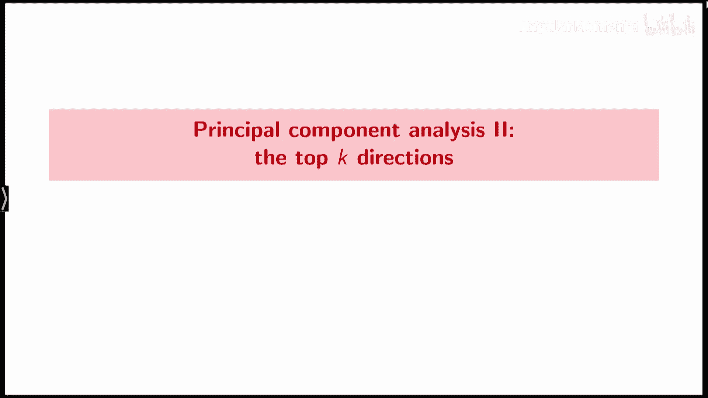
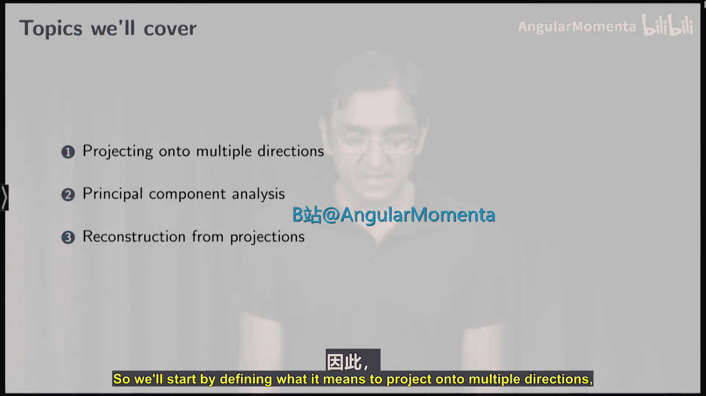
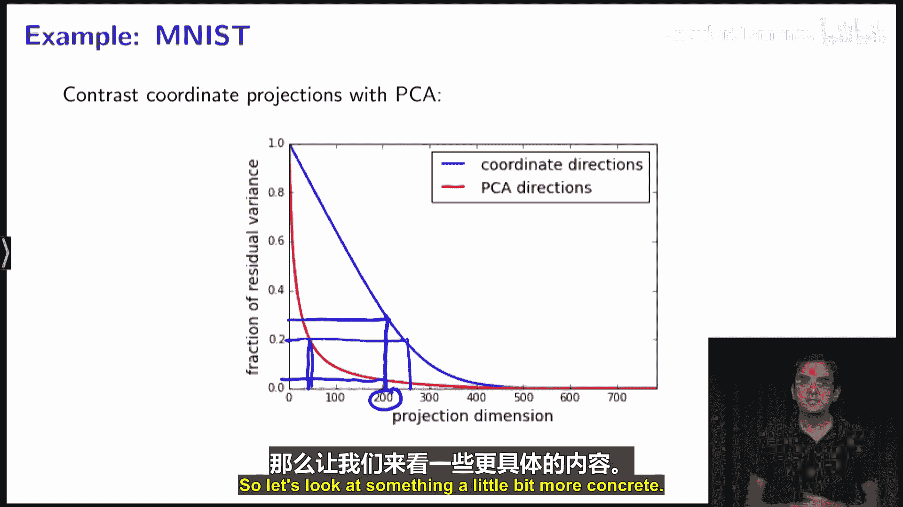
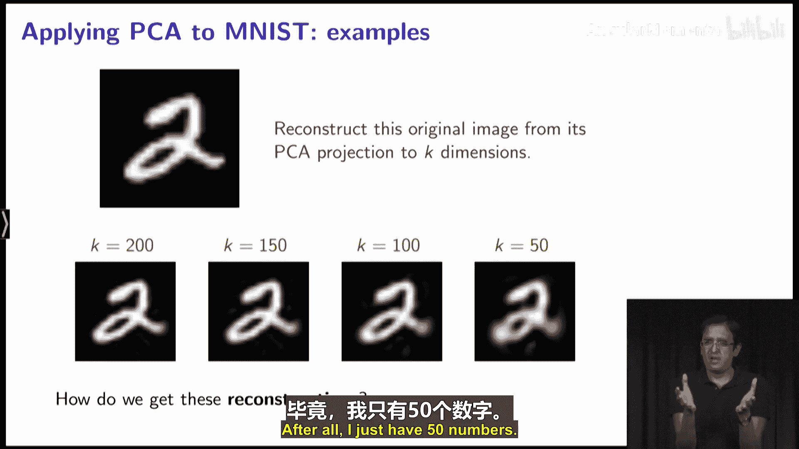
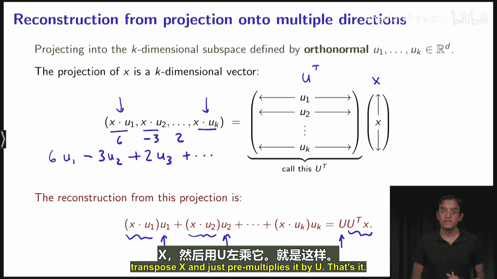
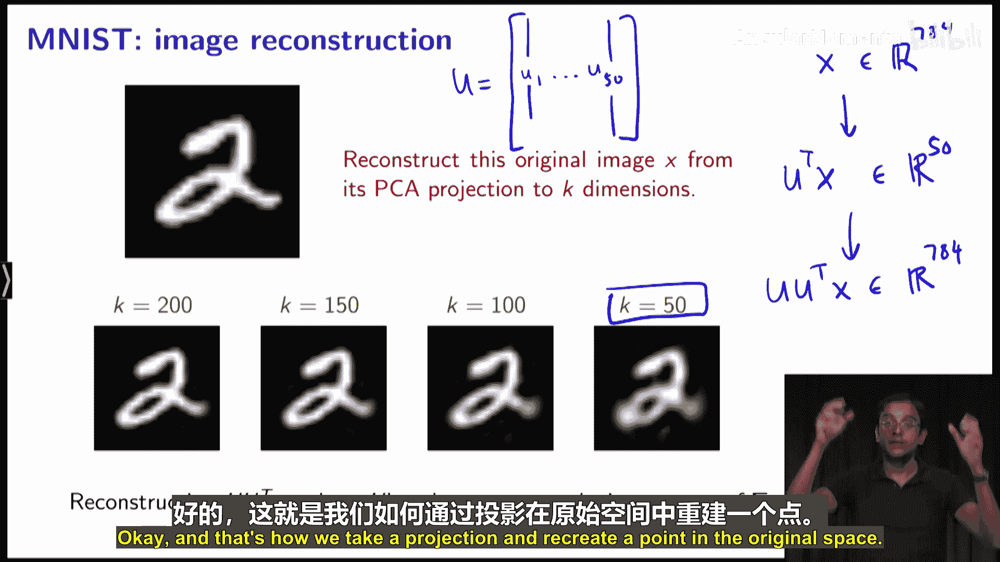

# 【加州大学圣地亚哥分校】机器学习基础  Machine Learning Fundamentals p51 10-03-02-主成分分析_II -BV1TyFSziEZb_p51-

Last time we talked about the best single direction on which to project a data set。

 and the answer was the top eigenvector of the covariance matrix of the data。

Today well look at projections onto several directions。

So we'll start by defining what it means to project onto multiple directions。

And then we'll look at the optimal solution， which is called principal component analysis。Finally。

 we'll look at the reconstruction question， when you're given just a projection of data。

 how do you reconstruct in the original space？Okay。

 so we are in a situation where we have a data set that's de dimensionsal and we wish to reduce the dimension。

What we discussed last time was reducing down to one dimension by projecting onto a single direction。

 and we looked at an optimal solution for doing this， according to a natural measure of loss。Now。

 generally， one dimension is not going to be enough。

 no matter how carefully you choose that direction。

 it's unlikely that just one number is going to capture everything you need from the original high dimensional data。

So we usually need to project onto multiple directions。

We need to create a representation that's K dimensional where K is something more than one。

And so let's see what that means exactly。So suppose we choose K different directions now。

 U1 through UK， what does it mean to project onto those directions？

So this question is easiest to answer if the directions satisfy certain properties。

 in particular if they are ortho normalmal， so this means two things， first of all。

 the directions you want through UK should all have length one that's easy to manage。And second。

 they should be at right angles to each other， they should be autogonal to each other。

 that dot products should be zero， and that's also something that's easy to generically manage。

If these conditions hold， then the projection is very simple。

The projection of a point x onto these K directions just consists of K numbers now。

The first number is the projection onto you1。X dot1。

 the second number is the projection onto U2 x dot U2 all the way to the last number。

 the projection onto UK x dot UK， very simple。We can also write this in matrix form。

 so suppose we take these k different directions， U1， U2 U3， U。

 and stick them together into a matrix， we make them columns of a matrix。

Then let's call that matrix U U transpose looks like this thing over here。

 U transpose has these directions along the rows。And then the projection of x is simply u transpose times x。

 It's a simple matrix vector product so the projection of a vector x is simply u transpose times x。

 so we have this vector that's originally in de dimensional space。

And it gets projected down to something that's in K dimensions。Okay。

So how do we find the optimal such projection？Okay。

Let's start by looking at a small example just to kind of get the notation straight。

Let's say we have data in four dimensional space and we want to project it down to two dimensions okay and let's do something really simple let's just project onto the first two coordinates now this is trivial we have a point x1 x2 x3 x4 and we just want to spit out x1 x2 okay so we know exactly how to do this that's nothing to it but let's just go through anyway and see what the notation looks like in this case okay and that will help us as we gear up towards the optimal projection。

So in this case。We are projecting onto two directions。 Okay。

 the first direction is just the x1 direction， so it looks like this1，0，0，0。

And the second direction is the x2 direction， so it's 0100。

 so these are the two directions we're projecting onto u1 and U2。

And we want to check that these are autonormal。 So are they unit length， Yes。

 they're both unit vectors， Are they orthogonal to each other。

So let's see that dot product is indeed zero okay， so these vectors are orthonormal。

 so we are good to go。And what we do is we just put these vectors together into a matrix U。

And then you transpose looks like this。It's this matrix over here。

And that's going to be our projection matrix to project the point we just multiplied by u transpose。

So when we take this matrix and we multiply by any given point， x1， x2， x3， x4。

What do we get back just the first two coordinates x1 and x2 as expected。 Okay。

 so this is what the various quantities refer to。 We have these individual directions you want you to that are oral that are unit length and autogonal to each other。

 and then we put them together into a matrix。Okay， so let's move on to the optimal projection now。

And as before， this is given by the eigenvectors of the covariance matrix。

 so we have a Ddimensional data set that means its covariance is a D by D matrix。😊，And。

This matrix has an associated set of eigenvectors。 These are special directions associated with the matrix。

Now this is something we're going to discuss in a little bit more detail soon。

 but for the time being these eigenvectors are something that are fairly easy to compute。

 we can ask Python to do it for us， we just give it the covariance matrix and it gives us back these eigenvectors。

So once we have these eigenvectors， these d directions。

What do we project onto and the answer is simply to project onto the top K eigenvectors so it's very simple。

It's a very simple way to proceed， and it's called principal component analysis。

 so we compute the covariance matrix。😊，We asked Python to give us the eigenvectors。

 we take the top K eigenvectors called them U1 through UK。

And our projection is simply a dot product with these。So let's go ahead and see this at work。

So this is the MIS data set and if you recall this is a data set that's 784 dimensional so if we want to reduce the dimension。

 we can reduce it to anything from0 to 784 and that's what's shown along the x axis over here now the two lines。

 the blue line shows what happens if you choose coordinate projections that is if you just select a few coordinates。

 you select pixels。 you select the K pixels with the highest variance okay the red line shows what happens if you use principal component analysis so let's interpret this a little bit okay so suppose we want to project the 200 dimensions。

Let's see what happens on the blue line， so we go up here。If we。

Project to 200 dimensions by simply picking the 200 pixels that have highest variances。Then。

 we end up。Losing about 30% of the overall variance of the data。

But if we project to 200 dimensions by doing principal component analysis。

Then we lose less than 5% of the original variance of the data， so it's a huge difference。嗯。

Another way to think about it is suppose that we are willing to give up on 20% of the variance in the original data set Okay。

 so that corresponds to this value on the y axis， so now we just draw a line across。

If we're going to do coordinate projections， we're just going to pick pixels。

Then it turns out we're going to have to pick about 250 pixels。

 so we'll be able to reduce the dimension to 250。If we are using principal component analysis。

 however， which picks arbitrary directions。Then we can reduce the dimension to something below 50。

So again， a huge difference。Now these numbers can be a little bit hard to interpret。

 like what does it mean to lose 20% of the variance in the data， is that good or bad。

 is that too little or too much？So let's look at something a little bit more concrete。

 let's look at some pictures。

So what's happened over here is that we've taken the MNIS data。

 we've computed its covariance matrix for the entire dataset。

We recovered the top P eigenvectors and we're going to project onto the top K directions where k is here either 200 or 150 or 100 or 50。

Now in these pictures， I've picked a particular digit， the one you see on the top。

 and I've shown what its projection looks like for different values of k so if we project the 200 dimensions。

 you get this one over here。And it looks just like the original okay。

 the one at 150 dimensions also looks just like the original。Once you get to 100 dimensions。

 there's a slight blurring that's sitting in。And when you go down to 50 dimensions。

 it's slightly more blurred， but it's still obvious what digit it is。

 so even projecting down to 50 dimensions is retaining more than enough information。

 at least for a human to be able to classify this digit。So using this method。

 we can really reduce the dimension pretty significantly。😊，Now。

 what exactly are these pictures though， you know so if we look at this last one， for example。

We are projecting， so we have something that's in 784 dimensions， and we're projecting down to 50。

 So what is this thing that I'm displaying over here。Okay， what is this reconstruction？How did I。

 what is this picture after all， I just had 5 numbers。

So lets let's see how to do that how do you take a 50 dimensional projection and reconstruct something in the original 784 dimensional space so let's start with a simpler example just from going down from two dimensions to one dimension Okay so here we have a two dimensional data set。

We go ahead， and we pick。A direction to project onto， let's say that's direction U。

So we're projecting every point x onto u dot x or u transpose x。Okay。

So that's how we project the points and over here you see the projections。

 the projections are just single numbers， okay， and so the points are all。Laid out on the line。

Now we want to reconstruct how do we do that， what reconstruction do we use for this point。

 for example？So that point has got a value of 6。5。That's just a single number。

 How do we reconstruct it in 2D Well， this is what we do we just say move 6。

5 units in the direction U。Okay， and so we find this point over here， which is 6。5 times u。

U is a 2D vector， and so this gives us the point in 2D space。And in this way。

 we take those one dimensional projections and map them back up into 2D。Now。

 all these reconstructions happen to lie along this line。

 but they are points in two dimensional space。Okay， let's go ahead and generalize this now。

 so now we have data and D dimensions。And we projected them down to K dimensions。 Okay。

 so these are the directions we're projecting onto U1 through UK。 And the projection was。

 as we saw before， we just take the dot product with these directions。So given these projections。

 how do we reconstruct？Okay，And again， the reconstruction is very simple。

 We just look at the K numbers in our projection。 Okay， let's say the numbers are。I don't know 6。

 minus 3，2， and so on。The reconstruction for the reconstruction， we say this， okay。

 move six units in direction you want。Then move minus three units in direction U2。

Then move two units in direction U3 and so on。Each of these vectors， u1， U2 U3。

 these are vectors in the original D dimensional space， so this givess us a vector in D dimensions。

Okay。More generally， what we have is we have a projection that looks like this。

And for the reconstruction， we say， okay， move x。 u1 direction units in direction U1。

Move X dot U2 units in direction U2 and so on。Now， this looks especially simple if we write it in matrix vector form。

 Okay， so if you recall。We have our vector x。And we can take our K directions and stack them as columns of a matrix。

 that's matrix U， in which case this is u transpose。

And so the projection is just u transpose times x。The reconstruction takes this projection。

 u transpose x。And just premplies it by you。That's it。그。

So now let's return to those emist pictures and see exactly what was going on over here。

So we compute the covariance matrix of this data set。And we picked。

 let's say we're looking at k equals 50。We picked the top 50 eigenvectors of this covariance matrix。

 so let's call them U1 through U50。And this is our matrix U。Okay。Now。

 the way we projected data is that we started with a point in 784 dimensional space。

And the projection was simply etransposics。So this is a point in 50 dimensional space。

Just 50 numbers。Now， when we want to reconstruct something in the original space。

 we just multiply by the matrix U。And that's again， in 784 dimensional space。

And that's how we take a projection and recreate a point in the original space。

Okay， that's it for today。If one had to pick a small handful of the absolute most important primitives for statistics and machine learning。

Priinciipple component analysis would certainly be on that list。 It's an oldie， but a goldie。

