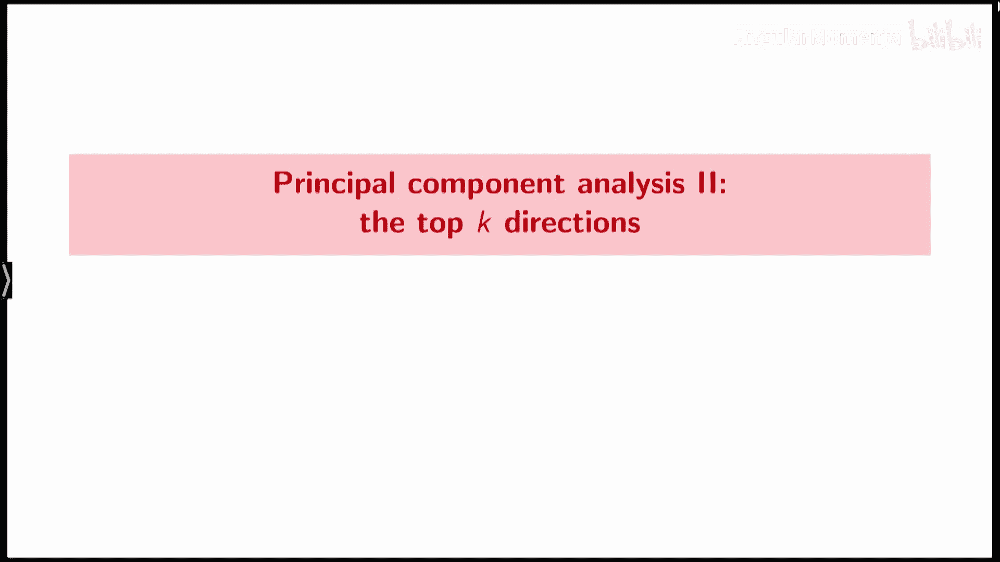
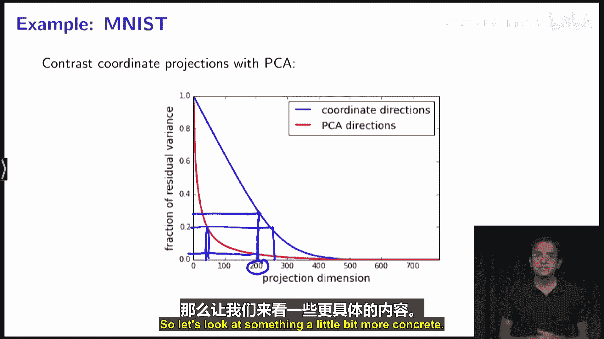
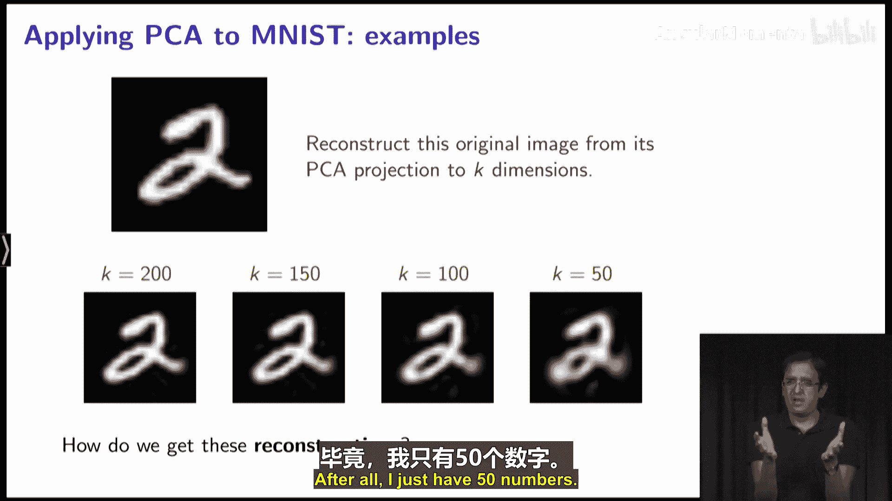
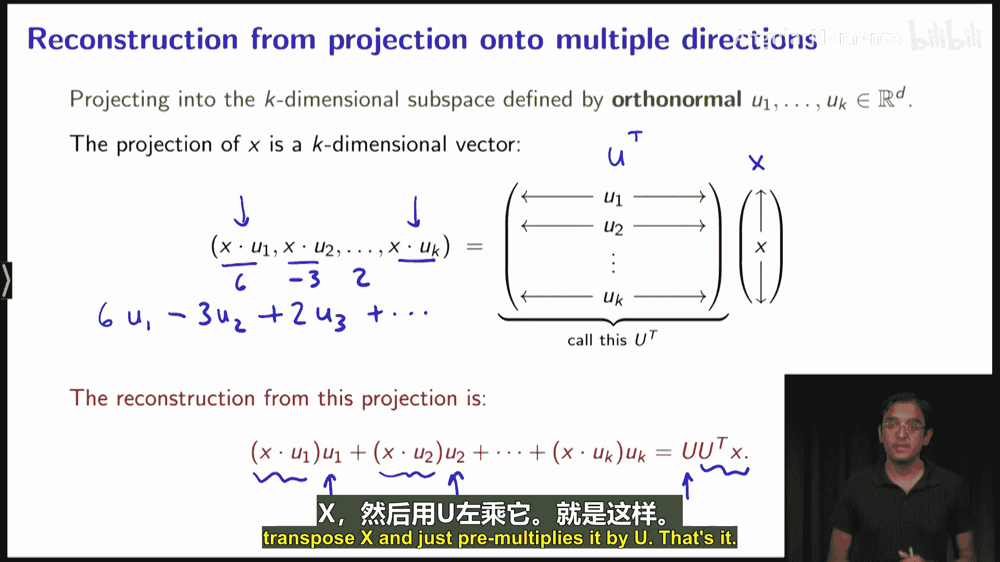
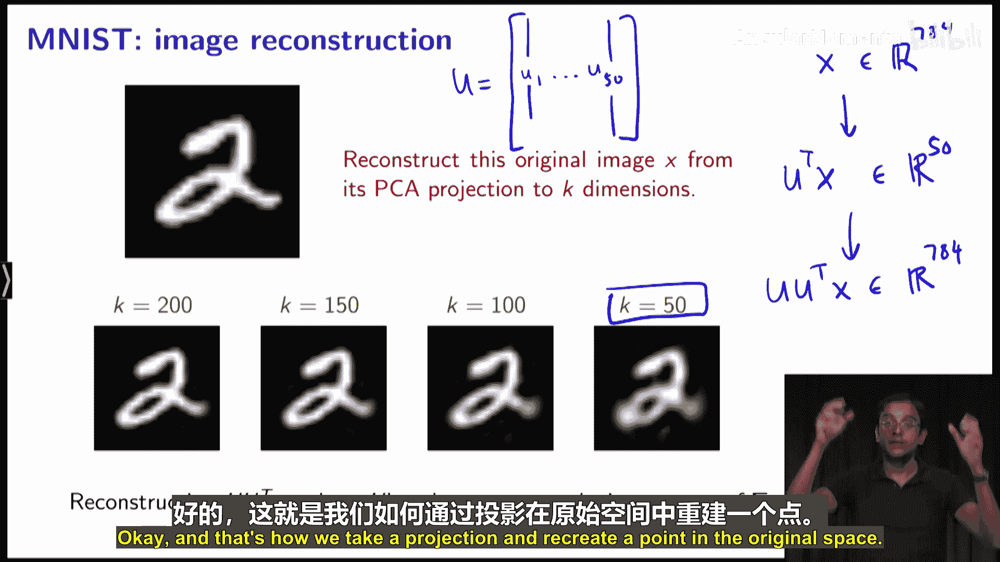

# 机器学习基础：10-03-02：主成分分析 II

在本节课中，我们将学习如何将高维数据投影到多个方向上，以进行有效的降维。我们将介绍多方向投影的定义、最优解（即主成分分析），以及如何从降维后的数据重建原始数据。

上一节我们讨论了将数据集投影到单一最佳方向上的方法。本节中，我们来看看如何投影到多个方向上。

## 多方向投影的定义

首先，我们需要定义将数据投影到多个方向上的含义。

假设我们选择了K个不同的方向，记作 **U1** 到 **UK**。投影的含义在这些方向满足特定属性时最容易理解，特别是当它们是**标准正交**的时候。这意味着两点：首先，所有方向向量的长度均为1；其次，它们彼此**正交**，即点积为零。

如果满足这些条件，投影就非常简单。一个点 **x** 在这K个方向上的投影就是K个数字：第一个数字是 **x** 在 **U1** 方向上的投影（即 **x · U1**），第二个数字是 **x · U2**，依此类推，直到最后一个数字 **x · UK**。

我们也可以用矩阵形式表示。将这K个方向向量作为列向量组合成一个矩阵 **U**。那么，**x** 的投影就是 **U^T x**（即 **U** 的转置乘以 **x**）。这样，一个原本在D维空间中的向量就被投影到了K维空间。

## 最优投影：主成分分析

接下来，我们探讨如何找到最优的投影方向。

与寻找单一最佳方向类似，最优的多方向投影也由数据的协方差矩阵的特征向量给出。我们有一个D维数据集，其协方差矩阵是一个 **D × D** 的矩阵。这个矩阵有一组对应的特征向量，这些是与之相关的特殊方向。

最优解非常简单：我们只需投影到**前K个特征向量**上。这个过程被称为**主成分分析**。

具体步骤如下：
1.  计算数据集的协方差矩阵。
2.  使用工具（如Python）计算该协方差矩阵的所有特征向量。
3.  选取特征值最大的前K个特征向量，记作 **U1** 到 **UK**。
4.  数据的投影即为与这些向量的点积：**U^T x**。

为了直观理解其效果，让我们看一个MNIST手写数字数据集的例子。该数据集是784维的（即28x28像素的图像）。下图展示了使用不同方法将数据降到不同维度时，所保留的数据方差比例。

*   **蓝线**：通过简单地选择方差最大的K个像素（即坐标轴投影）进行降维。
*   **红线**：使用主成分分析进行降维。

结果显示，要达到相同的方差保留率，主成分分析所需的维度远低于简单的像素选择法。例如，要保留80%的方差，PCA只需不到50维，而像素选择法则需要约250维。

以下是使用PCA将单个数字图像投影到不同维度（K=200, 150, 100, 50）后再重建回原始空间的视觉效果。可以看到，即使降到50维，重建的图像依然清晰可辨。

## 从投影重建原始数据

现在，我们解决另一个关键问题：当你只拥有数据的低维投影时，如何重建出原始高维空间中的近似表示？

让我们从一个简单的例子开始：将二维数据投影到一维。假设我们选择了一个方向 **U** 进行投影。投影后，每个点 **x** 变成了一个标量值 **U^T x**。为了重建，我们只需将这个标量值乘以方向向量 **U**，即 `重建点 = (U^T x) * U`。这样，我们就把一维线上的点映射回了二维空间（尽管它们都落在通过原点的直线 **U** 上）。

将这个逻辑推广到多方向投影。假设我们将D维数据投影到了K个标准正交方向 **U1, ..., UK** 上，得到了投影向量 **z = U^T x**（其中 **z** 是一个K维向量，`z_i = x · Ui`）。

重建过程同样直接：
`重建点 = z1 * U1 + z2 * U2 + ... + zK * UK`

用矩阵形式表示则更为简洁。我们的投影是 **z = U^T x**。那么，重建就是 **U z**。因为 **U** 的列是 **U1** 到 **UK**，所以 **U z** 正好就是上面那个求和公式。

回到之前MNIST的例子，那些重建图像正是通过这个过程得到的：将50维的投影向量 **z** 乘以由前50个特征向量组成的矩阵 **U**，从而得到了一个784维的向量，并将其重新排列成28x28的图像。

## 总结

本节课中我们一起学习了主成分分析的核心内容。我们首先定义了将数据投影到多个标准正交方向上的方法。接着，我们了解到最优的投影方向是数据协方差矩阵的前K个特征向量，这一过程即为主成分分析。最后，我们探讨了如何从低维投影重建出原始高维数据的近似表示，其核心操作是 `重建点 = U * (U^T x)`。

主成分分析是统计学和机器学习中最重要的基础工具之一。它通过捕捉数据中方差最大的方向，为我们提供了一种强大而高效的降维和数据压缩手段。