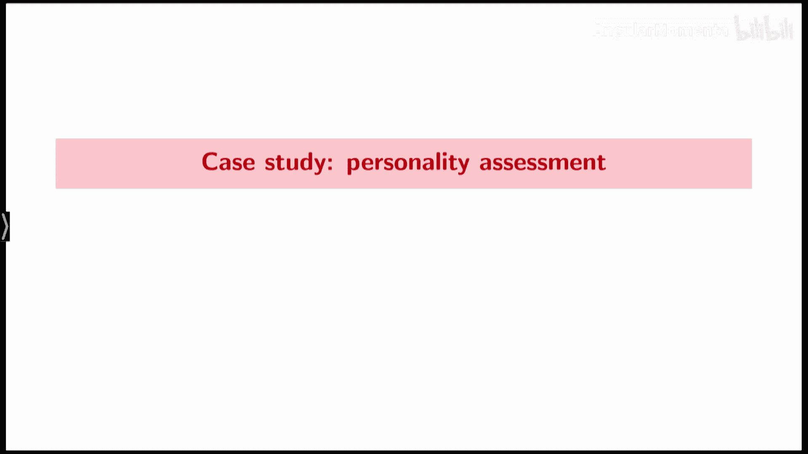
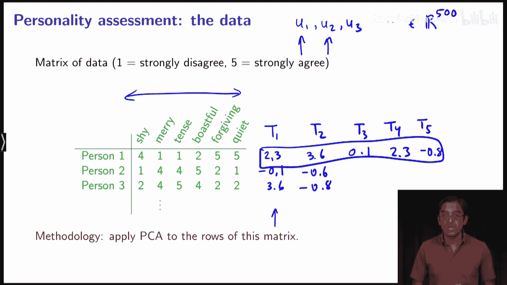
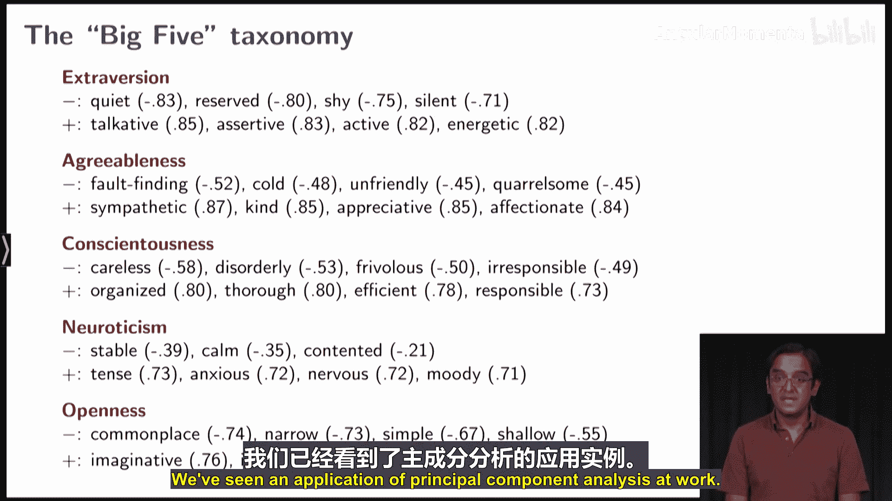

# 【加州大学圣地亚哥分校】机器学习基础  Machine Learning Fundamentals p52 10-04-02-案例研究-人格评估 -BV1TyFSziEZb_p52-

Priinciipple component analysis or PCA has been around a very long time， at least a century。

 and it's a basic tool in essentially any domain that uses statistics。

What we'll do today is to look at a case study of a particular application of PCA for quantifying personality。

So we all have different personalities， and these personalities seem to be multidimensional。

 Any two people differ in some ways and are similar in other ways。

Is there a way to quantify all this， For instance， can we represent each person's personality as a point in some low dimensional space。

This kind of question has occupied people forever。And some of the brightest minds people like Carl Young have weighed in with partial answers and usually qualitative criteria of various sorts。

But now that we live in an era of data collection， it seems plausible that we might be able to make this quantitative and what I'll be talking about today is some progress in this direction。

So the starting point is what is usually called the lexical hypothesis。And this is the simple idea。

That any personality trait that's of even the remotest interest must have a corresponding English word。

Like brave or sensitive or malicious。So with this in mind， two researchers in the 1930s。

 Oldport and A。SAT down with the English dictionary and just went through it carefully。

 looking for all words that could be used to differentiate between people。And they found 18。

000 such words。Now， not all of these referred to personality traits。

 some of them were things like short and tall。And so a second pass was made。

In which this list of 18000 was further refined to pull out personality traits。

 and that yielded 4500 words。Now that's still a pretty large list。And it turned out， though。

 that a lot of these words were synonymous， things like Jolly， Mary， Beppy。

And so a different group of researchers in the 1960s manually clustered these words into groups of synonyms。

😊，And this boiled the list down to about 500 distinct personality words。At that point。

 it was time for data collection。And this was done in a very interesting way。 People were brought in。

And each person was shown the list of 500 words and asked， which of these words describes you。

So actually， this was done in a slightly more graded way。So each person was given the 500 words。

 one at a time， say one of the words was shy， and asked， does the word shy describe you， say one。

 if you strongly disagree， five if you strongly agree。Or something in between， two， three， or four。

And in this way， an entire matrix of data was collected。 There were 500 words，500 columns。

 and each row were the responses for a particular person。Okay， so given data of this kind。

How can we get a low dimensional representation for personality？

And there are actually many ways to proceed。So one idea is to think of the columns as being data points and to cluster them。

This would give us clusters of similar personality words， for example。

 suppose it turns out that people who are shy also tend to be forgiving。

Then those two words would end up in the same cluster。Alternatively。

 we could think of the data points as being the rows， so there's one data point per person。

 and then we could apply principal component analysis to this data or factor analysis or some other form of representation learning。

Researchers basically tried all of these。And it turned out that to some extent。

 the results were fairly consistent。And so what I'll do is describe the PCA approach today。

So let's start with a little bit of intuition。Suppose there are two traits like generosity and trust that happen to be very strongly correlated now I don't know if that's actually the case for generosity and trust。

 this is just a hypothetical example。But if they were perfectly correlated。

 then what would happen is that everybody's answer to generosity would be exactly the same as their answer to trust。

 And so the answers would all lie along this line， the y equals X line。😊。

If we then asked principal component analysis to find important directions in the data。

 which direction would find that direction。And from that one PCA direction， from that one number。

 we would be able to perfectly reconstruct the generosity value as well as the trust value。😊，Okay。

 so this is sort of the intuition that we're trying to get at， okay。

 but let's see what happens in practice。So we have this matrix of data。

And what we'll do is to think of each row as a data point， so we have 500 words。

 and so we have data points in 500 dimensional space。

We now apply principal component analysis and we get the principal components， let's say they are U1。

 U2， U3， and so on。These are directions in 500 dimensional space。Okay。Okay。

 so let's pick the first direction you won。The first principle component。

What we can do is to project the first person onto this component how well we just take that person's row and take its dot product with U1。

 This gives us some number like you know， maybe 2。3。

And then we look at the projection of the second person onto U1。

 we take the second person's row and take its dot product with U1。

 and this gives us some other number， maybe negative 01。And then the third person and so on。

And in this way， we get an entire column of numbers。😊。

That is essentially a new synthetic personality trait。 let's call it T1。For trait number one。

And then we can do the same thing with the second principal component。

We take everybody's dot product with the direction you to and we get another bunch of numbers。

AndWe call this T2。And then we can do T3 and T4 and T5 and so on。 And if we go out to T5。Then。😊。

We get five numbers。For each person， five new numbers。Essentially。

 an embedding of that person into a five dimensional space。A quantification of their personality。

So what exactly do these traits refer to how do we understand what they mean， what is trade T1。

 so this is a trait that was automatically extracted from data， it's something synthetic。

How do we understand what aspect of personality it is capturing？Well， in order to figure that out。

 what we can do is to just look at that is to just look at that particular column。

And then go through the 500 columns that correspond to English words。

 so we go through these 500 columns。And we see which of them is closest to T1。

 which of them has the smallest angle with T1 or the largest dot product with T1。

By seeing what those words are， we'll get an idea of what aspect of personality T1 is capturing。

 and then we do this for T2， T3， T4 and T5。

And when we do this， we get what is often called the big five taxonomy。

So the first principal component。T1。Turns out to be to have a high positive dot product with words like doative。

 assertive， active， energetic。It has a high negative dot product with words like quiet， reserved。

 shy and silent。 So just looking at those， we get an intuitive sense for what this particular principal component is capturing。

And researchers decided to call this extraversion Okay。

 so this is a name that they cooked up for this synthetically derived trait。

The second principle component。Turned out to be highly correlated with sympathetic。

 kind appreciative。And negatively correlated with fault finding cold quarrelsome。

So this got called agreeableness。The third tree。Was。Highly correlated with organized， thorough。

 efficient， responsible。And negatively correlated with frivolous， careless and so on。

So it got called conscientiousness。The third one had a。

 the fourth one had a large dot product with tensets， anxious， nervous， moody。

And so that got called neuroticism。 And the final one。

 the fifth one turned out to have a fairly large dot product。

 maybe not quite as large as the previous ones。With imaginative， intelligent， original。

And a negative correlation with words like narrow and shallow。 And so this was called openness。嗯。

So these all seem quite reasonable。 And then one might wonder， why not keep going。

 Why did we stop at 5， Why not go to the sixth principal component and the seventh and the8。 Well。

 it turned out that at that point， the results started becoming a little less compelling。

 One of the nice things about the first five traits here or at least the first four of them is that similar results were obtained when using other kinds of data analysis like clustering or factor analysis。

That kind of consistency went away， though beyond the fifth trade or so。

 and so this is really the subset that people were able to agree upon。

And this kind of quantification is now used in many contexts， for example。

 in computerized matchmaking。So that's it for today。

We've seen an application of principal component analysis at work。

 we've seen how data and PCA can be used to answer some very fundamental questions about human beings。

See you next time。