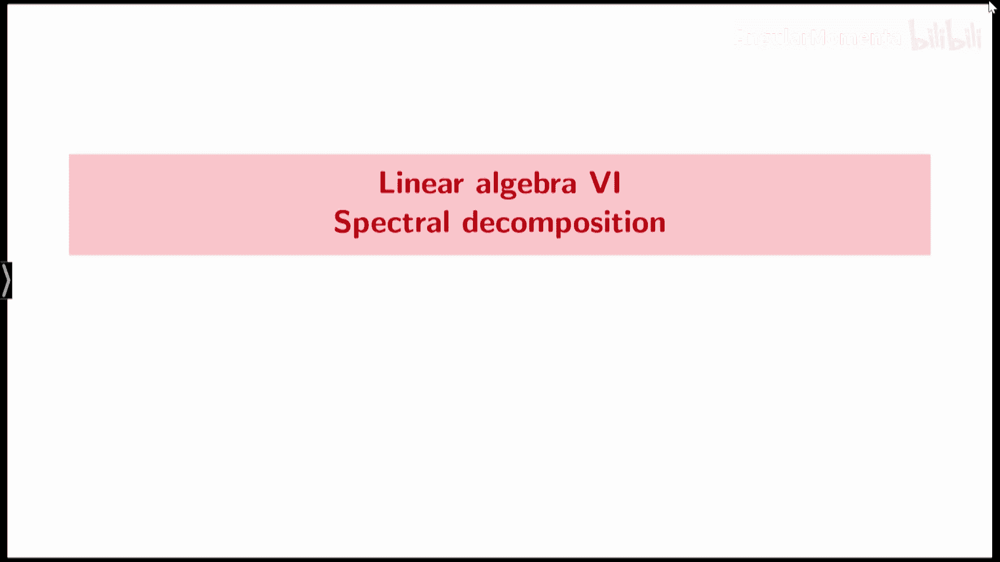
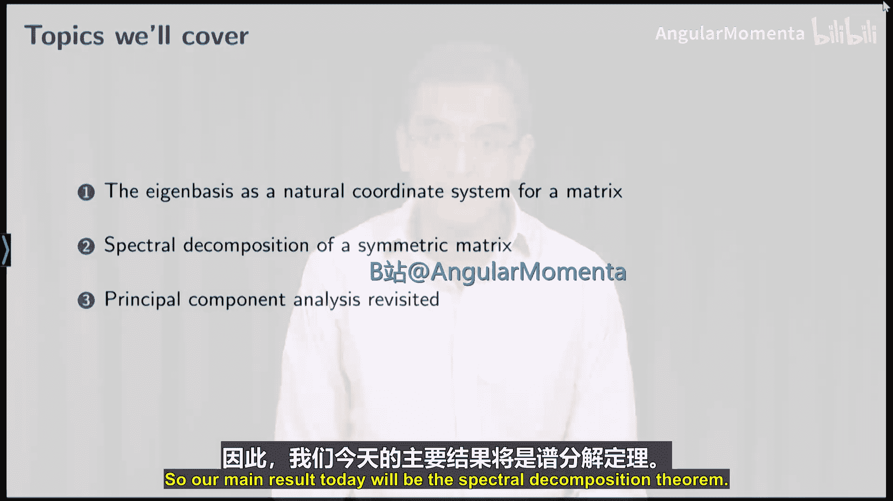
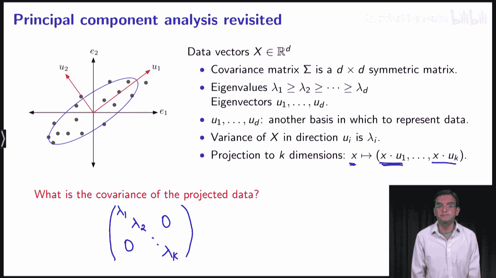

# 【加州大学圣地亚哥分校】机器学习基础  Machine Learning Fundamentals p54 10-06-02-谱分解 -BV1TyFSziEZb_p54-

Last time， we introduced eigenvectors and eigenvalues。Today we'll see how these can be used。

To understand matrices in a simple and intuitive way and how this leads to principal component analysis。

So our main result today will be the spectral decomposition theorem。

Which tells you how a matrix can be rewritten in a different way。

 solely in terms of its eigenvectors and eigenvalues。This is a very powerful tool of data analysis。

So let's start by quickly reviewing our motivation。Here's a simple 2D dataset set。

And the two features are correlated， which is a little bit of a complication。

But what if we switch to a different coordinate system？Something like this one。

What if we switch to these axes？So， first of all， what would this entail。Well， let's take a point。

 say this one。In the original coordinate system， this might be something like 11。

In the new coordinate system。What would this be， Well， it would be。This length over here。

 which maybe is something like 1。4。And this height over here， which is approximately 0。

Two different representations for the same point。Now。

 the way we move back and forth between these representations is in this case。

 just a simple rotation。It's a simple linear transformation。

What is the advantage of this alternative coordinate system， why might we want to work in that basis？

Well， if you tilt your head a little bit， you' will see that in this alternative representation。

 the two coordinates are actually uncorrelated。That correlation goes away。In some sense。

 the data becomes a little bit simpler in this alternative coordinate system。And therefore。

 this alternative basis might be a natural place in which to do data analysis。

So what are these natural coordinates？So this led us last time to the notion of an eigenvector。

For any D by D matrix M。An eigenvector is a vector U。That is sent by N。

To another vector in exactly the same direction。And the scaling factor。

Lambda is called the eigenvalue associated with you。Now what we saw。

Is that the eigenvectors constitute a basis。 Okay， so specifically。

 if we take any symmetric matrix M。O size D a D by D matrix。

Then it has d eigenvectors that are orthonormal， so each of them is a unit length。

And they are at right angles to each other。 Their dot products are zero。

 and we can therefore think of U1 through UD。As the axes of an alternative coordinate system。嗯。

It turns out that a matrix becomes quite simple if rewritten using this coordinate system。

 and let me explain what this means。Okay， so we take any symmetric matrix M。As we've seen。

 it has these orthonormal eigenbacterctoroids U1 through UD。What we can do。2。Create a D by D matrix。

 U。Whose columns are the eigenvectors， so the first column is use of1。

 the second column is use of two all the way to use of D。And in that case。

 u transpose looks like this， its rows are the eigenvectors。Okay， so you and your transpose。

We can also write down a diagonal matrix Lada of all the eigenvalues。If we do that。

 then it turns out that M is exactly u times lambda times u transpose。So first off。

 this means that n can be recovered exactly from its eigenvectors and eigenvalues。

The eigenvectors and eigenvalues contain all the information in it。

But the second thing and the more remarkable thing。

Is that M is much simpler when expressed in this form。Okay， so in what sense is it simpler。

 I mean we started with a D by D matrix and now we have three D by D matrices， how is that simpler？

Well， just look at these matrices。Each of them is very understandable。

 It's very clear what each of them is doing。U transpose。This is simply a basis change matrix。

It's converting from the regular coordinate basis。To the basis of the eigenvectors you want through Ud。

U is the basis change in the opposite direction from the eigenvector basis to the regular coordinate basis。

And lambda， well， that's just a diagonal matrix。 So it's just scaling each coordinate separately。

M is simply the composition of these three elementary operations。

So here is exactly what M is doing to any vector x。It starts by applying u transpose to it。

 so it takes x， which is a vector in our regular coordinate system and then it applies u transpose to it。

 which basically converts it。Into its own basis， the basis of the eigenvectors。So that's step one。

 u transpose x。Then it applies this simple scaling。

Now that the point is in its own coordinate system。

 it simply scales each of the coordinates separately， Lambda1 through Lambda D。And then finally。

 takes that answer。And converts it back into the base we understand， the regular coordinate basis。그。

So any matrix can be expressed simply in this way。Okay。

 so let's see how the spectral decomposition theorem applies to this matrix M that we saw last time。

 this 2 by2 matrix。So what we did last time is to figure out its eigenvectors and eigenvalues and this is what they turned out to be。

嗯。So now let's go ahead and apply this theorem， so we construct the matrix U。

Whose columns are the eigenvectors， so let's pull that square root root is that one of a square root2 out。

Okay the first column is the first Digenvector， the second column is the second diigenvector。

Now you transpose。Just the transpose of this。 So itss rows are the eigenvectors。And Lambda。

It's just the matrix， the diagonal matrix of eigenvalues， so it is minus1，3，0，0。

Now let's go ahead and compute the spectral decomposition。U Lambda， U transpose。So as usual。

 we can bring the constants in front， so we have two square rootoo that just becomes a half。

And our matrices are1， negative 1，1，1。Negative 1，0，0，3。And one， negative 1，1，1。

Let's start by doing these two。What do we get？We have negative one。Negative one。Negative 3。And。3。

And now let's multiply those two matrices。 So we get。inus1 plus3，2。We get minus1 minus3 and minus4。

-1 minus3 minus4。And-1 plus 3，2。And so we indeed get back in。Okay。So we had this matrix here。

We had this matrix M， and we were able to rewrite it in this intuitive way。

In terms of these three elementary operations， a basis change， a scaling。

 and moving back to the original basis。So now let's break the operation of the matrix as a linear function down into these three components。

 the basis change， the scaling and then the basis change back Okay。

 so suppose we are applying the matrix m to a vector 12。 What exactly is going on。Because。So。

We can also write n as U Lada U transpose。And the first step is to apply u transpose to this vector。

12。What that does is to take the vector1 to and rewrite it in this alternative eigenvector basis。

Okay， so the eigenvector basis in this case has。Vectctor u1， which is 11 and the vector u2。

 which is negative 11， all divided by square root 2 to normalize them to unit length。

And what we're going to do is to take this point one two and rewrite it in this spaces。😊。

And so these will be the values we get。The first coordinate will be that length and the second coordinate will be that length。

So what are these values， well we just need to compute u transpose times 12 Okay。

 so let's figure that out。U transpoems 1，2 is。3 over square root2。And。

Make it on one over square root2。Okay so this distance here is 3 over square root 2。

 and this distance here is one over square root 2。And that is the representation of this point in the new basis。

Okay。So we've done this part so far。Now we're in the natural basis for the matrix。

And in this natural basis， all we need to do is to scale the coordinate separately and that's what the matrix Lada is doing So what it's saying is take the first coordinate and multiply by negative  one。

So we get negative 3 over square root 2。And take the second coordinator multiply by3。

 so we get three of a square root2。So in this direction we go negative 3 over square root 2。

 and in this direction we go3 over square root2， so we're going to end up somewhere over there。对。And。

 finally。We turn we will return to the original basis by multiplying by you。

And let's see what that gives us。 Okay， so here's you over here。One of the square root2。Times one。

 negative  one，1，1。And then we multiply the vector we have over there， Ne 3 over square root 2。

3 over square root 2。 And what do we get。Let's see， we get negative3 over square root 2。

Negative 3 over square root 2。 So that's negative 6 over square root 2。Okay， so we get negative 3。

And3 negative 30。And that's the answer in our original coordinate axes。Okay。

 so now let's see exactly what principal component analysis is doing。

So we begin with a bunch of data vectors X， and our first step is to compute that covariance matrix。

 The vectors are indeed D dimensions， and this covariance matrix is a D by D symmetric matrix。

And this matrix captures all the correlations between the features。

Then we go ahead and find the eigenvectors and eigenvalues。

How do we do that Well we basically ask the computer to do it for us。

 there are standard packages that just take the matrix and give us back the eigenvectors and eigenvalues。

Okay。And since it's a D by D matrix， we get back d eigenvectors you want through UD and the corresponding eigenvalues。

Now these eenvectors。Are the axes of the natural coordinate system for this data。

 they are an alternative basis in which we can represent this data。And in this alternative basis。

 the coordinates are uncorrelated。Moreover。In terms of what these eigenvalues mean。

The variance in the direction you subi is exactly the eigenvalue lambmbda subi。

Now what we want to do in principle component analysis is to project down to a certain number of directions。

 say K directions， while keeping as much of the variance as possible。

 so what we do is to sort the eigenvalues into decreasing order， the largest eigenvalues。

 second largest eigenvalue and we just keep the top k directions。

 U1 through UK and that's our projection， we projective vector x indeed dimensional space to x dot u1 all the way to x dot UK onto the first k of these directions。

Okay。So what is the covariance of the projected data？Let's see。

So the first coordinate of the projection is the projection onto u1。

 and we've seen that the variance in that direction is lambmbda 1。The variance in direction。

U2 is Lambda 2。The variance in direction UK is Lambda K。And in these directions， these directions。

 u1， U2 and so on， in these directions， the data is uncorrelated。

So the off diagonal entries are zero。And so this is the projection。

 the projected data has this K by K covariarance matrix。

Okay， so that's it for today。We've finally seen the spectral decomposition theorem。

 which is a very powerful tool of data analysis。 it gets used in many different ways。

 some of them very creative， and what we've tried to do today is to communicate a basic sense of what it's about。

😊，See you next time。