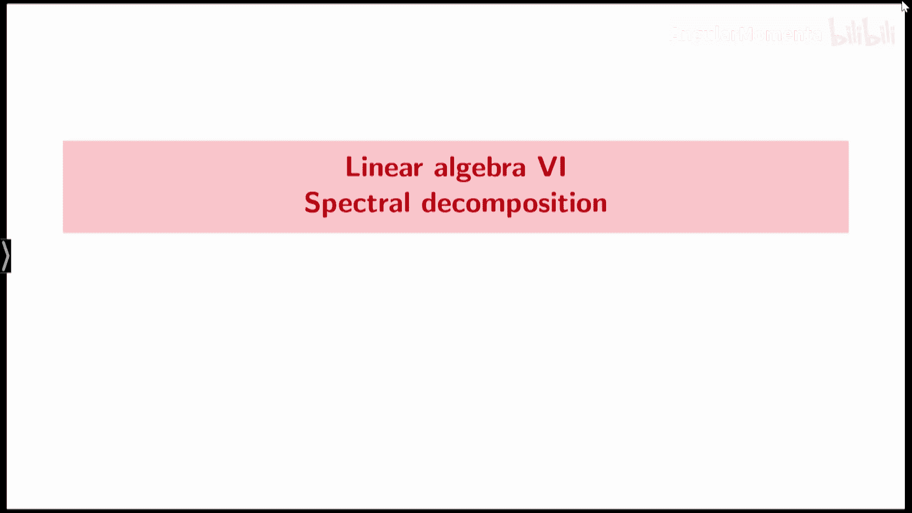
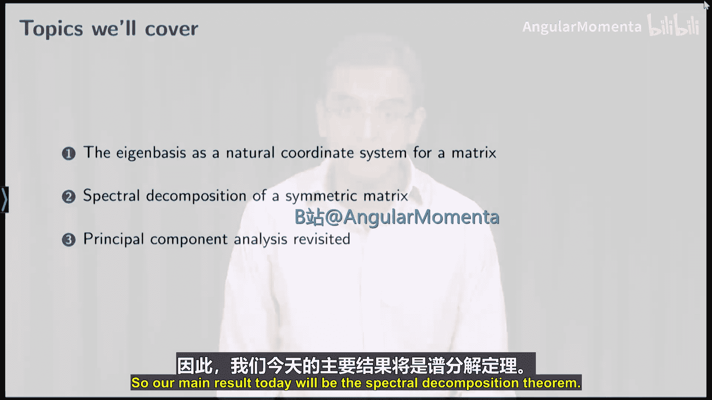
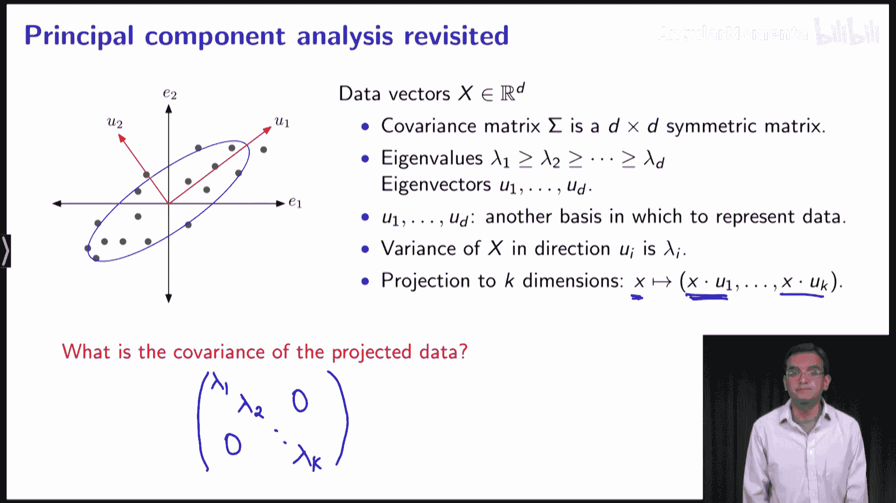

# 机器学习基础：10-06-02：谱分解





在本节课中，我们将学习谱分解定理。这是一个强大的数据分析工具，它告诉我们如何仅使用矩阵的特征向量和特征值来重新表示矩阵。我们将看到这个定理如何为理解矩阵提供一种简单直观的方式，并最终引出主成分分析（PCA）的核心思想。

## 回顾：特征向量与特征值

上一节我们介绍了特征向量和特征值。本节中，我们将看看如何利用它们来直观地理解矩阵。

特征向量和特征值可以帮助我们找到数据的“自然”坐标系。考虑一个简单的二维数据集，其两个特征之间存在相关性。如果我们切换到一组新的坐标轴，数据可能会变得更简单——相关性可能会消失。这些新的坐标轴方向，就是数据的“自然”坐标。

## 特征向量与特征值定义

对于任意一个 D×D 的矩阵 **M**，一个特征向量 **u** 是一个满足以下条件的向量：当 **M** 作用于 **u** 时，结果向量与 **u** 方向相同，仅被缩放。这个缩放因子 λ 被称为与 **u** 对应的特征值。

公式表示为：
**M u = λ u**

对于一个对称矩阵 **M**，它存在 D 个相互正交且长度为 1（即标准正交）的特征向量 **u₁, u₂, ..., u_D**。这些特征向量构成了一个新的坐标系的基础。

## 谱分解定理

谱分解定理是本节课的核心结果。它指出，任何对称矩阵 **M** 都可以用其特征向量和特征值重新表示。

具体来说，我们构造三个矩阵：
1.  **U**：一个 D×D 矩阵，其每一列是一个特征向量。
2.  **Λ**：一个对角矩阵，对角线上的元素是相应的特征值 λ₁, λ₂, ..., λ_D。
3.  **Uᵀ**：矩阵 **U** 的转置。

谱分解定理表明：
**M = U Λ Uᵀ**

这个分解非常强大。它意味着矩阵 **M** 的全部信息都包含在其特征向量和特征值中。更重要的是，它将 **M** 的复杂操作分解为三个简单易懂的步骤。

## 理解矩阵操作的三步分解

现在，我们来看看矩阵 **M** 对任意向量 **x** 的操作如何被分解为三个直观的步骤。

**M x = (U Λ Uᵀ) x**

以下是每一步的解释：
1.  **Uᵀ x**：这是一个基变换。它将向量 **x** 从原始坐标系转换到由特征向量构成的新坐标系中。结果向量 **x'** 的每个坐标是 **x** 在各个特征向量方向上的投影。
2.  **Λ (Uᵀ x)**：这是一个缩放操作。在新的特征向量坐标系下，矩阵 **Λ** 只是简单地对每个坐标（即每个特征向量方向上的分量）进行独立的缩放，缩放因子就是对应的特征值。
3.  **U (Λ Uᵀ x)**：这是逆基变换。它将缩放后的结果从特征向量坐标系转换回我们熟悉的原始坐标系。

通过这种方式，任何对称矩阵的线性变换都可以被理解为“换到自然坐标系 -> 在各个方向上独立缩放 -> 换回原坐标系”的过程。

## 实例演算

让我们通过一个具体的 2×2 矩阵例子来应用谱分解定理。

假设矩阵 **M** 为：
```
M = [[2, -4],
     [-4, 2]]
```
（注：视频中使用的具体数值在转录中不完整，此处为说明性示例，原理相同）

其计算出的特征向量和特征值为：
*   特征向量 **u₁** = [1/√2, -1/√2]ᵀ， 特征值 λ₁ = -2
*   特征向量 **u₂** = [1/√2, 1/√2]ᵀ， 特征值 λ₂ = 6

根据定理构造矩阵：
*   **U** = [[1/√2, 1/√2], [-1/√2, 1/√2]]
*   **Λ** = [[-2, 0], [0, 6]]
*   **Uᵀ** = [[1/√2, -1/√2], [1/√2, 1/√2]]

可以验证 **M = U Λ Uᵀ** 成立。现在，如果我们用 **M** 乘以向量 **x** = [1, 2]ᵀ：
1.  **Uᵀ x** = [ -1/√2, 3/√2 ]ᵀ。这表示 **x** 在新坐标系下的坐标。
2.  **Λ (Uᵀ x)** = [ (-2)*(-1/√2), 6*(3/√2) ]ᵀ = [ 2/√2, 18/√2 ]ᵀ。这是在自然坐标系下的缩放。
3.  **U (Λ Uᵀ x)** = [ (2/√2 + 18/√2)/√2, (-2/√2 + 18/√2)/√2 ]ᵀ = [10, 8]ᵀ。这是最终在原始坐标系下的结果。

## 与主成分分析（PCA）的联系

谱分解定理是主成分分析（PCA）的数学基础。以下是PCA的步骤，它们直接建立在谱分解之上：

我们从一组 D 维数据向量 **X** 开始。
1.  **计算协方差矩阵**：首先计算数据的 D×D 协方差矩阵。这个对称矩阵捕获了所有特征之间的相关性。
2.  **特征分解**：计算协方差矩阵的特征向量和特征值。这通常由标准软件包完成。
    *   特征向量 **u₁, u₂, ..., u_D** 定义了数据的“自然”坐标系（主成分方向）。在这个坐标系下，数据的各个坐标是不相关的。
    *   特征值 λ₁, λ₂, ..., λ_D 具有明确的统计意义：**在方向 u_i 上的方差恰好等于 λ_i**。
3.  **选择与投影**：为了降维，我们将特征值按从大到小排序（λ₁ ≥ λ₂ ≥ ... ≥ λ_D）。保留前 K 个最大特征值对应的特征向量 **u₁, ..., u_K**。
4.  **数据转换**：将原始 D 维数据向量 **x** 投影到这 K 个主成分方向上，得到 K 维的新表示：**[ x·u₁, x·u₂, ..., x·u_K ]**。

投影后数据的协方差矩阵是一个 K×K 的对角矩阵：
```
[[λ₁, 0, ..., 0],
 [0, λ₂, ..., 0],
 ...,
 [0, 0, ..., λ_K]]
```
对角线上的方差被最大程度地保留，而非对角线上的协方差为零，意味着降维后的特征是不相关的。

## 总结



本节课中我们一起学习了谱分解定理。我们了解到，任何对称矩阵都可以分解为 **M = U Λ Uᵀ** 的形式，这相当于将矩阵的操作解释为“变换到特征向量基 -> 独立缩放 -> 变换回原基”三个步骤。这个定理不仅是理解线性变换的有力工具，更是主成分分析（PCA）等众多数据降维与特征提取技术的核心数学基础。通过切换到数据的“自然”坐标系（主成分），我们可以简化数据结构，消除特征间的相关性，并专注于保留最重要的方差信息。