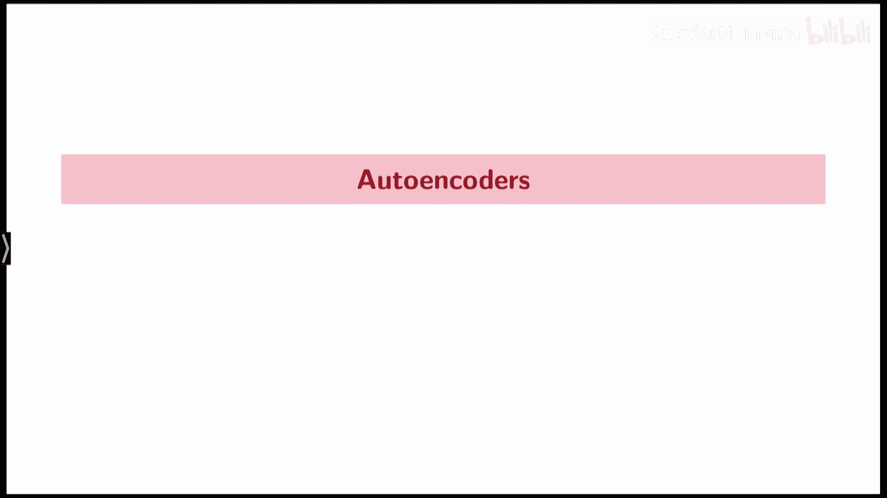
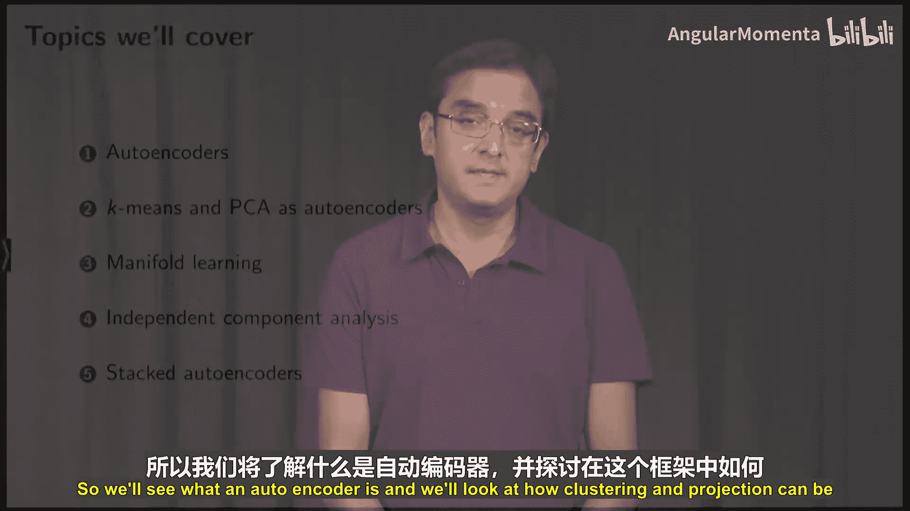
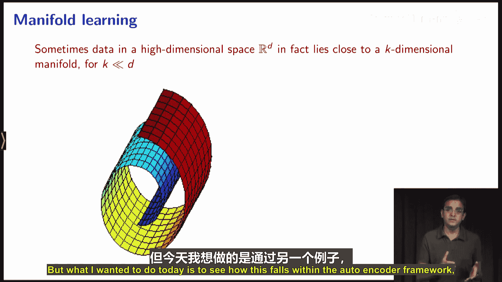
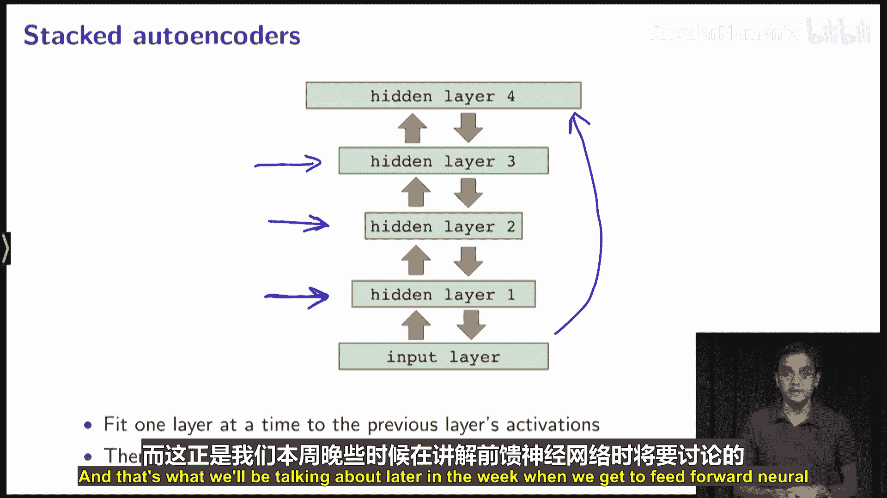

# 【加州大学圣地亚哥分校】机器学习基础  Machine Learning Fundamentals p55 12-01-02-自编码器 -BV1TyFSziEZb_p55-

This week， we will be studying deep learning。The models we'll be looking at are neural networks。

 this is a very expressive class of functions that can capture arbitrary nonlinear decision boundaries。

Now we've already covered most of the technology that we'll be needing for deep learning。

Things like using stochastic gradient descent to minimize a loss function。

But there are two additional themes or concepts that would be good to go over before we delve into the nuts and bolts of neural networks。

These are auto encoders and distributed representations。And today we'll talk about auto encoding。

So we'll see what an auto encodecor is。

And we'll look at how clustering and projection can be expressed in this framework。

We'll then turn to some other kinds of auto encoders that are also commonly used。

 Manifold learning and independent component analysis。Finally。

 we'll end by looking at the prospects for stacking auto encoders in order to arrive at a multi scale hierarchical representation of data。

So an auto encodecor in a nutshell。It's something that brings out some of the underlying degrees of freedom of data。

It produces a representation of data that brings out some of these degrees of freedom。

And a generic code of encoder is shown over here pictorially。Do so on the left。We have a data point。

 which is D dimensionsional， so it has these features x1 through Xd。And on the right。

 we have the representation produced by the auto encodecoder。This contains M numbers， H1 through HM。

And these numbers contain some of the signal in the data。

 some aspect of the data that is useful to us。嗯。Now this representation。

Is something that needs to be discovered， something that needs to be learned。And as such。

 it's often called a latent representation or a hidden representation。

so we'll sometimes refer to the vector on the right as being a latent or hidden vector composed of hidden units。

 in this case， m hidden units。Now the mapping from the original data point。

To this latent representation， H1 through HM can be thought of as an encoding。

Given by some function E。And going in the opposite direction。

We often have some vector in the latent space。And want to send this back into the original space。

That can be thought of as a decoding operation given by some function D。你推。Now， ideally。This autoenr。

 this encoding process， would not lose too much of the information in the data。Okay。

 so if we take a data point X。And then we encode it。To get its hidden or latent representation。

And then we decode that。Ideally， we'd get back something that's close to the original X。Okay。

 and so this will be an optimality criterion that repeatedly surfaces when we are discussing auto encoders。

Okay， all this has been rather abstract， so let's get a little bit more concrete and look at some specific clustering and projection problems that can be expressed in this way。

So we've talked about the K means clustering problem。

 okay so what happens here is that we have n data points。

And we want to group them into K clusters and also to find a representative or center for each of these clusters。

 so in this picture， for example， there are 10 data points。

And we want to group them into three clusters as well as to find a center for each cluster。

 so this center is mu 1。This red center here is mu 2， and this center here is mu 3。Good。

And we can approximate each of the data points。By replacing it with its nearest center。

What is the approximation error induced in this way， Well， for this point， for example。

 the approximation error is this distance。And as is often the case。

 it will be more convenient for us to work with squared distances。Okay， so in general。

 for the I data point。The approximation error is simply the square distance to its nearest center。

And the goal of K means clustering is to find the K clusters and the K centers that produce the smallest approximation error possible。

Now， in what sense is this an auto encodecor？So in this case。

 the left hand side is the original data points， okay， we have D dimensional data points over here。

And the latent representation in this case is simply the cluster label。Okay。

 we send each point to one of these clusters1 through K。

So one way of doing this is to have these units on the right H1 through HK represent individual clusters。

 and we could say， for example， that Hj of x。That unit gets turned on if x belongs to cluster J。

 so aj of x is1 if x is in cluster J。And it's zero otherwise。So if we do things this way。

Then the hidden representation is a binary vector， a vector of zeros and ones， and in fact。

 all of it is zeros， except for a one at one position。

 the position that identifies the cluster that x belongs to。Okay。

 so if we wanted to write this invective form， what we would say is that。

The vector H is a binary vector。 It is the encoding of x。Okay。And。😊，It is E sub J。

Which means the 01 vector with a1 in position J。If。X is in cluster J。That's the encoding function。

Okay。Now what about decoding？So all we know is the cluster label， how do we decode。

 how do we send back to the original space？Well， we would just send back to the mean of that cluster to mus of J for that cluster。

 Okay， so the decoding。Of a specific vector E sub J is simply mu sub J。Okay。

And what is the error induced by this auto encodecor？Well， if we take a vector x and we look at。

The error induced by first encoding it and then decoding it。We look at that square distance。

It's exactly the distance from x to its nearest center， muive J。Squired。Okay。

And so what we see is that the Kmine solution is actually an optimal autoencoder of this particular type。

Okay。So now let's see how something similar holds a principal component analysis。So in PCA。

 if you recall， we have a bunch of data points。And what we want to do is to find a projection from the original data space。

 say RD to some lower dimensional space， say RK， and we want to find a projection。

That maximizes the variance of the projected data。And we saw that this can be done quite easily。

 okay， there's just a few simple steps to follow。The first thing we need to do is to compute the covariance matrix of the data。

 a D by D covariance matrix。Then we find the top K eigenvectors of this matrix。

 and those are the directions we project onto。Okay， so if we want to express this in matrix form。

 what we can say is that let's define a matrix U。Whose columns are these stop K eigenvectors？

You want through UK。So this is a matrix that's D by K。And now what we do。

The projection sends a vector x in the original space to u transpose x。Now。

 if we have a vector in the projected space and we want to map it back to the original space。

 that's easy as well， that reconstruction is done by sending a vector Z in R subK。To use it。

 which lies in aeny。Okay， so that's PCA in a nutshell。Now， what kind of auto encodecor is this？Okay。

So on the left hand side of the auto encoder， as usual。

 we have the original data representation so we have。X， a D dimensional vector。

On the right hand side， we have K hidden units。And in this case。

 these are simply the projections onto different directions。Okay， so H J of x。

Is simply the projection of x onto the J eigenvector， It's x dot U of J。

And if we want to write this in vector form。Then H， which is the embedding of x。

Is simply you transpose X。Now， if we have a K dimensional vector in this latent space and we want to send it back up to the original space。

 we also saw how to do that， that decoding operation。Sense age。To the matrix U times age。Okay。

 so this is clearly an auto encoder。And what is the error induced by this encoding and decoding process Okay。

 so what happens？We take a point x and what we're effectively approximating it by is the result of first encoding it and then decoding it。

Okay， so this is x minus U U transpose x， that's square distance。

And it turns out that what PCA is doing is finding the projection that minimizes this reconstruction error。

So once again， PCA is an optimal auto encoder of this particular form。Okay。

 so we've already seen the Ka means clustering and PCA fall readily within the autoencoder framework。

 and in fact， there are all sorts of other types of unsupervised learning that can be expressed easily in this way。

Let's just look at a couple of examples， Manifold learning。An independent component analysis。

So the idea in manifold learning is that it's often the case that you have data that's high dimensional。

 there are lots of features， D features。But the data points lie on or close to a much lower dimensional surface。

They lie on or close to a manifold whose dimension is some number K that's much smaller than the。

We saw one example of this with speech signals okay， so as we discussed。

 when you have a speech signal and you want to represent it on the computer。😊。

You can make the representation as high dimensional as you like by using lots and lots of different filters。

But at the end of the day， the speech was produced by somebody's vocal tract。

And that's a physical system with just a few degrees of freedom。

So it's the sort of case where you would have a high dimensional data set that lies close to a low dimensional manifold。

Here is a toy example Okay， so here we have data that's in three dimensions， or maybe higher。

But the data all lies on this two dimensional surface， this thing that is a Swiss roll。

So the question is， if we are given data of this kind， can we automatically determine the surface？😊。

And can we map the higher dimensional representation into the 2D coordinates？

Shown over here by grid lines。Can we in a sense， unroll this surface？嗯。Now。

 there are several algorithms that attempt to do exactly this。

 and unfortunately we won't have time to really get into them。

But what I wanted to do today is to see how this falls within the auto encodecor framework just by ways of another example。

So here is the auto encodecor picture again。What we have on the left。

Is the original D dimensional data。These get represented or these get sent to the K numbers on the right。

 which are simply the coordinates on the manifold。So the encoding process sends data in the original space to its manifold coordinates and the decoding process goes from the coordinate system on the manifold。

Back to the original space in which the manifold happens to lie。So it's clearly again。

 an auto encoder。Let's do one more example。This is independent component analysis。

 which is a form of unsupervised learning that has been very popular in signal processing and in neuroscience。

It's a way of solving among other things， the cocktail party problem Okay， so when we are at a party。

And there are lots of people who are talkingking and mingling。At any given time。

 there are a lot of different conversations that are reaching our ear。

What we're hearing is a mixture of all these different threads of conversation。😊，How are we able？

To sort these out and somehow focus on just one conversation， maybe the person we are speaking to。

 or maybe some other conversation somewhere else in the room that we are interested in。

How do we unmix all of these conversations？Okay。Now， if we were trying to get a computer to do this。

 what we might do。Is to set up the microphones around the room at different locations in the room。

And each microphone receives a sound signal， which is a mixture of a bunch of different conversations。

😊，行く。So that's what's shown on the left over here， we have D input units。One per microphone。

And each of these units is receiving a mixture of different conversations。

 it's a time series of speech data okay。😊，Now let's say that there are actually only K distinct conversations taking place。

 what we would like to do is to take these D mixed up sound signals and recover the K pure conversations。

 one from each source。😊，Okay that's the right hand side of the auto encoder。

And the process of doing this is called independent component analysis， or in this case。

 sometimes blind source separation。And clearly， it's another form of auto encoding。Now， the。

Current revolution in deep learning was， in some sense， spurred。

When researchers found ways of stacking auto encoders。

 of somehow using multiple auto encoders hierarchically in order to get a multi scale representation。

Okay， so the idea here is that at the bottom。You have the original data， that's the input layer。

And then you apply an auto encodecor in it to find some structure in the data。

 to pull out some interesting structure in the data。

Then you apply an auto encodecor to that to find structure in the structure okay so in other words。

 a sort of higher level structure and then even higher level structure and so on and so forth。

 and so you get a hierarchy of features that are at an increasingly higher level。Of generality。Okay。

So for example， imagine that the input layer is an image。

Then the first hidden layer over here might consist of some very low level structure。

 tiny fragments of edges or little blobs。The next layer might contain structure at just a slightly higher level。

 bona fide edges， for example， and then as you go higher up the chain。

 you get things like little boxes or other standard shapes of which more complicated objects are constituted。

Indeed， the human visual cortex has hierarchical processing of this kind。

 and that's been an inspiration in designing models of this sort。😊，Okay。

So how could we train a model like this， how could we automatically learn this kind of stacked auto encoder？

Well， one very natural approach is to do it level by level， bottom up， okay。

 so we start with the input level。And then we learn an auto encoder that gives us the first hidden layer。

Then we think of the values in that hidden layer as being the new inputs。

And we fit another auto encoder that gives us the second hidden layer。

 and we get the third hidden layer and so on。And in this way， we get the entire hierarchy。

 at which point we can think of the mapping from the input to the final layer。

As also being an auto encoder， and we can then fine tune there。Okay。Now。

 we've been talking about doing this in a purely unsupervised manner。

But it turns out that given the current state of technology。

Things work out better if we actually do this in a supervised way with a lot of label data。

And that's what we'll be talking about later in the week when we get to feed forward neural networks。

Okay， so that's it for our treatment of autoencoderrs。

We've seen how auto encoding is a very general framework that lets us unify many many types of unsupervised learning。

 things like clustering and projection。It's a very useful framework， first of all。

 it lets us identify similarities and differences between these different kinds of representation learning。

😊，And second， it also suggests ways in which we can modularly combine different types of representation learning。

 as we saw with stacked auto encoders。