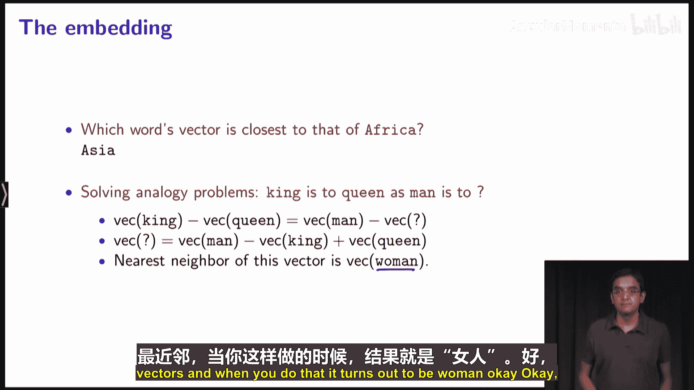

# 【加州大学圣地亚哥分校】机器学习基础  Machine Learning Fundamentals p56 12-02-02-分布式表征 -BV1TyFSziEZb_p56-

In studies of the brain and in studies of artificial neural networks。

A central theme is distributed representation。Today we'll look at what this means。

So we'll start by introducing distributed encodings by contrasting them with one hot encodings。

And then we look specifically at how a distributed encoding can be constructed for words。

So last time we saw how both came means clustering and principal component analysis can be treated within the framework of autoenrs。

It was interesting how two rather different forms of unsupervised learning could be unified in this way。

It turned out， however， that the encodings they produce are really fairly different。

Let's see how specifically。So let's start by looking at ks。On the left， we have the data point。

And a hidden representation。The latent encoding that Km means produces is the cluster label for that point。

Now， if a point x lies in cluster J。What we get is a binary vector that is all zero except for a one at position J。

Okay， so for example， let's say  point x lies in cluster number two。Then in K means。

 the latent representation on the right will be 0。One at position 2。

 and then a bunch of zeros at all the other positions。This is the K means encoding。

This is a one hot encoding。 It's all zero， except at one position。The encoding produced by PCA。

 by contrast， is a dense encoding。It takes a point x and maps it to its projections onto K different directions。

So it also produces k numbers。But now， these numbers are dense。Okay， this is a distributed encoding。

 the information in x is spread out or distributed amongst these k numbers and so a typical encoding might be something like negative 032。

6。1。Something of this form。Okay。So this is the distinction between a one hot encoding and a distributed encoding。

So it's rather a curious distinction。And let's see how this plays out in the case of words。

So we've talked a little bit about the bag of words representation of documents。😊。

The way we construct this is that we first start by fixing a vocabulary。

Say the 10000 most common words。We then represent a document by a 10，000 dimensional vector。

 which has a position。For each of the chosen words。

And the value at that position is the number of times that word occurs in the document。Now。

 how would a single word be represented under this scheme？Well， it would be represented by a 10。

000 dimensional vector。Which was0 everywhere， except for a one at the coordinate corresponding to that specific word。

In other words， a one hot encoding。Now， this encoding has got some disadvantages。Okay。

 so for example， okay consider these three words。Trilled。Delighted。And miserable。

Two of these words are very similar in meaning， they're almost synonyms。

 while the third word is almost an antonym。But this is not reflected anywhere in the encoding。

 to put it differently， the encoding seems insensitive to the semantics of words。

And this cannot be a good thing。Is there a different encoding。

 is there a way to assign words to vectors to have a vector for each word？

Such that words with similar meanings have vectors that are close together。 Okay， so， for example。

 for these three words。嗯。We'd have a vector for each of them。

 let's say the vector for thrilled looks like this。

We'd want the vector for delighted to be close to that vector。 maybe something like this。😊。

And we'd want the vector miserable to be far away from either of those。Maybe something like this。

Is there a way to construct these sorts of embeddings of words。

It turns out there are several different ways to do this， and some of them are quite sophisticated。

And what we'll do today is to look at one very simple recipe for producing such word embeddings。😊。

So the general idea in word embeddings is captured by this famous quotation from the British linguist J。

 Rford。You shall know a word by the company it keeps。Okay。

So what this means is that the meaning of a word。Can， to a large extent。

 be captured by the words that it coacs with。By the other words that occur in its vicinity。Okay。

 so let's pick a particular word， call it W。Thank you。

And now let's look at all occurrences of this word in some corpus of text。

 say the collected works of Shakespeare。 we look at everywhere this wordW occurs。😊。

The company it keeps refers to words in its immediate vicinity。

 words that lie in some window around W。 we can define this window however however we like。

 for example， we could choose a very narrow window consisting of the three words before and the three words after so here's W and these are the context words that occur。

😊，In the vicinity of W。Okay。What we would like then。

Is to assess the distribution of these context words for each W。And to find a vector for words。

 so a vector for each word W that reflects this context information。😊。

Two words that have similar context distributions should also have vectors that are close together。

Okay。So let's look at a very simple and specific way in which this might be done。

So the first step is to fix a vocabulary， call it V， maybe a vocabulary of 10，000 words。

 maybe something much larger。We also need to fix a corpus of text we could， for example。

 use the Brown University corpus of American English。

 which is a corpus of moderate size or something that is orders of magnitude larger like the Wikipedia corpus。

😊，Okay， so we have a vocabulary and a corpus。We are going to construct a vector an embedding for every word in the vocabulary。

 and we're going to ignore the other words。😊，So look at each word W。In the vocabulary。

Go through the corpus and find all the occurrences of W。And for each occurrence。

 look at the surrounding context。In our case， maybe the three words before and the three words after。

By keeping counts of these context words， we can come up with the probability distribution over nearby words。

Okay， so the probability that word C occurs in the context of W。

This is a probability distribution over all words C。Okay， and so it's a vector of dimension V。

It's a way of formalizing the company that W keeps。And in fact， we could use this entire vector。です。

V dimensional vector as an embedding of W。Now， it turns out that there are two further transformations that improve this embedding someone。

Okay， the first is to look at the point wise mutual information， so what is this？Well。

 instead of looking at the probability， the frequency with which C occurs in the context of W。

Look at the frequency with which C occurs in the context of W relative to C's baseline frequently Okay。

 so this is something this is a form of normalization that's helpful。

We can also apply a logarithm to this， which tends to spread out the numbers a little bit。Okay。

So the result is a vector that's also v dimensional if we have a vocabulary of size 10，000。

 this is a 10，000 dimensional vector so for each W we get a 10，000 dimensional vector。

And we could use this as an embedding of W。Now the main downside is that this is a very high dimensional embedding。

 we are representing the wordW by a 10，000 dimensional vector。Can we reduce the dimension？Yes。

 for example， we could use principal component analysis。Okay。

And that's a final step that we could try。And it turns out that。

Ebeddings of just 100 or 200 or 300 dimensions are really very effective at capturing quite a bit about the meanings of words。

嗯。Now this is a particular scheme for word embedding that you can try out at home if you want to。

 but there are also standard word embeddings， word vectors。

 sets of word vectors that you can just download。Things like word tove or glove。Okay。

So let's finish by looking at a couple of examples that just illustrate the kind of information that's captured in these word vectors。

Okay， so we construct a word embedding and now let's look at a word like Africa。

 let's look at its vector， some 200 dimensional vector say。What is its nearest neighbor。

 what is the word whose vector is closest to that of Africa， how do we figure this out。

 Well using nearest neighbor search on our list of word vectors。And if you do that。

 then the results depend upon the specific embedding that you're using。On the one I have。

The result turns out to be Asia。That's perfectly sensible。

 both of these words Africa and Asia have a high overlap in their context words。

So it seems quite sensible and you can try this with a whole slew of other words。Communism， war。

 hysteria， and so on。 And the results typically turn out to be quite reasonable and understandable。

Okay， so this is a very reassuring aspect of these word embeddings， the nearest neighbors。

Tend to be something that is really quite sensible。Now。

 one cute way in which these embeddings have been used is in order to solve analogy problems。 Okay。

 so king is to queen as man is to what Well， woman， obviously。

But how can we do this on a computer using word embeddings？Well。

 the way we do this is by writing the analogy as a linear algebraic equation。

 so what we are saying is that there's some mystery word that we are looking for。😊。

And the vector for king minus the vector for queen equals the vector for man minus the vector for the mystery word。

What is this mystery word， Well， we have an equation。 We can rearrange it。

And then we have a precise expression。Fold the vector for the mystery word。

 And we have the vector for man。 We have it for king and for queen so we can compute this。

Expression on the right， okay。And now we look for the word whose vector is exactly that。 Well。

 chances are， there's no word whose vector is exactly that。 But once we construct that vector。

 we can look for its nearest neighbor in the list of word vectors。😊，And when you do that。

It turns out to be woman。Okay。

Okay， so that's it for our discussion of distributed representations。

We've looked specifically at the case of embeddings of words。

 and we've seen how this can be done in a way that both captures semantics of words。

 as well as keeping the dimensionality fairly low。See you next time。

