# 【加州大学圣地亚哥分校】机器学习基础  Machine Learning Fundamentals p58 12-04-02-神经网络训练 -BV1TyFSziEZb_p58-

DE 220X Week10 lecture on training a feed forward neural network。

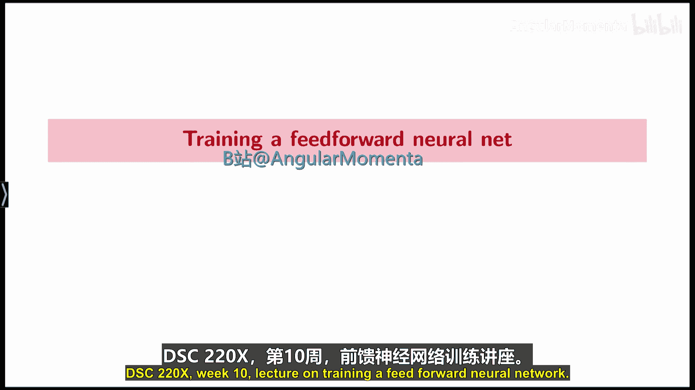

Action。Last time we introduced the feed forwardward neural network。

 a function class of great expressivity。Today， we'll see how to learn these models。

So we'll start by talking about a suitable loss function for learning neural networks。

And we'll see how to set up a stochastic gradient descent algorithm for minimizing this loss function by using a clever scheme called back propagation。

We'll also talk about some tricks that are very helpful in getting a model that generalizes well。

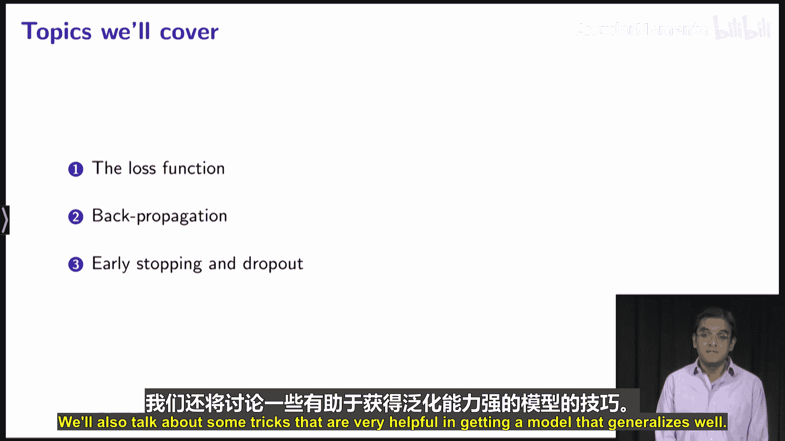

So here again is the architecture of a feet forward net。😊。

It contains a large number of units that are organized in layers at the bottom。

 there is the input layer where the input vector x is presented。

It goes through a computation that starts at the bottom and proceeds all the way to the top。

 ending in the output layer， Y。Each node is a simple function of its parents。Okay。

 so we have a node here， these are its parents in the previous layer。

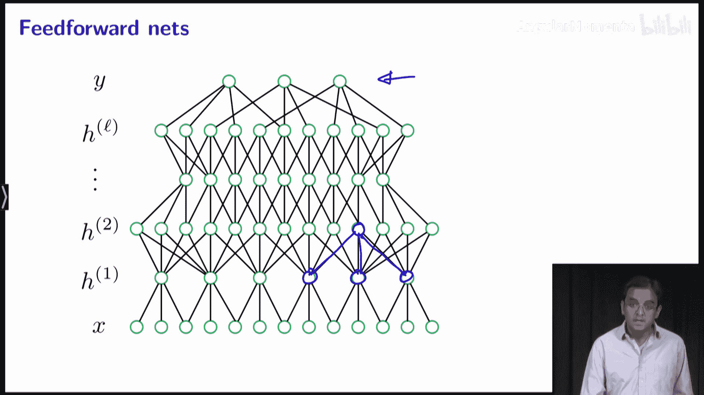

Each node is computed as a linear function of its parents， followed by a nonlinear activation。

 typically a rectified linear function。And in this way。

 the computations proceed upwards and reach the output。Now as we saw last time。😊。

Networks like this can easily have false numbers of parameters。

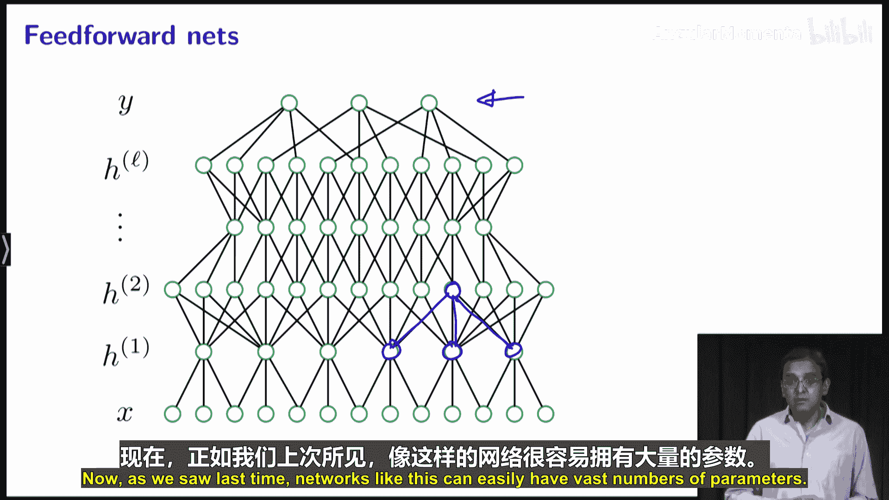

How do we learn these parameters using a training set？So the approach， as usual。

 will be to formulate learning as an optimization problem in which the goal is to find the parameters that minimize a suitable loss function。

😊，So for concreteness， let's say that we are using the neural net to solve a classification problem in which there are k labels so in this case。

 the final output layer will contain K units， one per label and we saw last time how we can generate probabilities for each label。

 essentially by having something like multiclass logistic regression at that very last layer。

By using a softm gate。Okay。So the parameters we want to learn。Are the parameters of the entire net。

 the parameters that specify all the different linear functions。

 the linear function at each and every different node。😊，Okay。Now， once we fix these parameters。

 we have a fully specified net， and what that gives us is for any input X。

 the probabilities of the various possible labels。Okay。This is a lot like logistic regression。

And indeed， we can follow some of the same methodology。So for each data point x。

 we get the probabilities over the K possible labels。

And so what we can do is to look for the parameters W， this vast number of parameters。

That maximize the probability of the training set。 That is to say the probability of 01s label。

Times the probability of 0。2's label。Times the probability of point3's label， and so on。

 we get a cost function， we get this thing we want to maximize。

 which is a product of the probabilities of each of the individual data points。嗯。Now， as usual。

 we can take the logarithm of this to make it a sum and put a minus sign in front of it to get something to minimize。

And if we do that， this is the loss function we end up with。😊，Okay， so give a data set。

Of end training points。We want to find the set of parameters W， the parameters for the entire net。

That minimize this loss function。And if you notice。

 this is exactly the loss function that we use in the case of logistic regression。

It's sometimes called the cross entropy。Now， in the case of logistic regression。

 it turned out that this was a convex optimization problem， a very nice problem。

Is that still the case when we're dealing with neural nets？Sadly， no。 In fact， it is very。

 very far from complexs。😔。

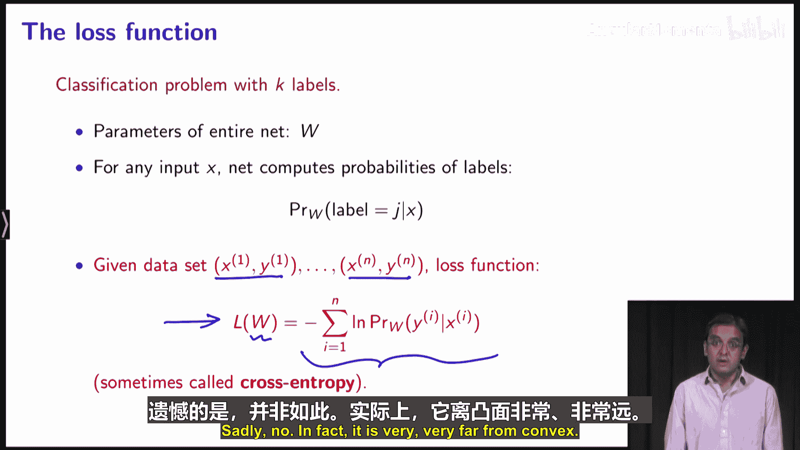

So in talking about loss functions， there are two cases that we have always distinguished。😊。

The case over here。Where the loss function is badly behaved。😔。

It has lots of little local optima that we can get trapped in。

And these local optima are are of widely varying quality， so if we end up in the wrong one。

 then it could be a pretty bad solution。The kind of loss functions we like are the ones that look like this on the right。

😊，Conveyx loss function。And in fact， almost every problem we've studied in the code so far has had a convex loss function。

 these squares， laso， support vector machines and so on。In fact。

 the only problem wed studied with this kind of cost function。Has been k meanss。

When we were talking about kine meanss， we noted that it's an NP hard optimization problem。

 okay we cannot hope to efficiently find the optimal kine solution。It turns out， however。

 that there are algorithms that are guaranteed to efficiently find a solution that is close to the optimal the Kaamine means。

Unfortunately， neural net optimization is a different beast altogether。It is highly non complex。

 and there really isn't much hope of even finding something that's necessarily close to optimal。

Nonetheless， it turns out that perhaps because of the extreme expressiveness of these models。😊。

We nevertheless， very often end up with functions， with networks that perform very well。😊。

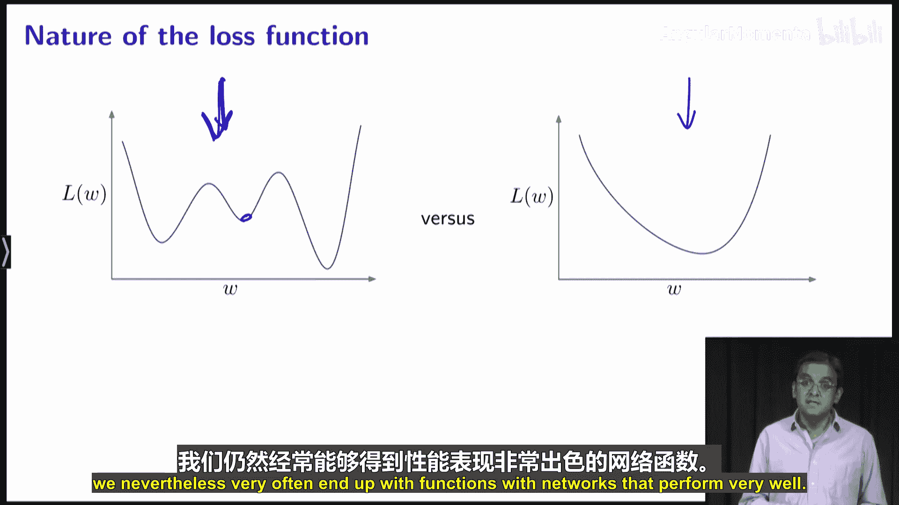

Okay。So how are we going to do this minimization？As usual。

 we will use some sort of gradient descent now we've looked at three variants of gradient descent。😊。

Vanilla gradient descent， stochastic gradient descent， and mini batch stochastic gradient descent。

And all three of them start by initializing the parameters W in some way and then doing a bunch of updates where W keeps getting adjusted and hopefully the loss function L of w is going down steadily the whole time Now all three variants are based on using the derivative of the loss with respect to W。

In gradient descent， each individual update involves using the entire dataset set。

This can be impractical if the data set is enormous as it frequently is in the case of neural networks。

The other extreme is stochastic gradient descent， where each update involves just one data point so that's much better。

 but in that case the updates can be quite noisy。😊。

A nice compromise is mini batch stochastic gradient descent。

 where the updates don't involve the full data set nor a single point。

 but they involve a modest number of data points， say10 data points at a time。Okay。

 so we can use any of these。😊，The most common option is some kind of mini batch stochastic gradient descent。

And for any of these， what we need to compute。Is the derivative of the loss with respect to each of the parameters in the network。

And as we know， there are a lot of parameters。

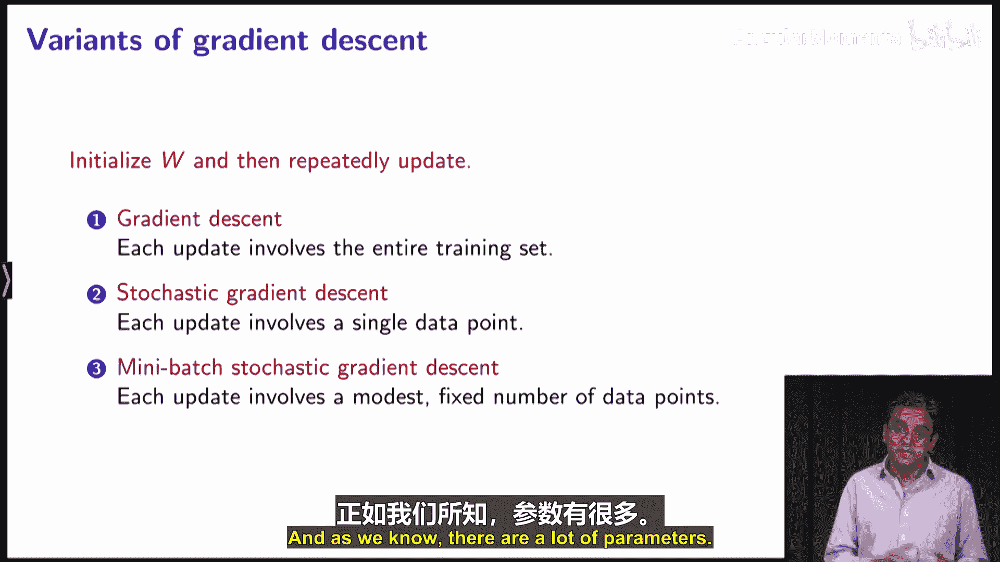

Okay， so here's our network。We present the input at the bottom， the x。We get a Y at the top。

 and once we get Y we can assess the loss， the probability of the correct label。

So we want the derivative of that loss with respect to every parameter in the network。Now。

 remember that there is a parameter for every edge in here okay， so every edge， for example。

 this edge has got an associated parameter W。We need the derivative of the loss with respect to every such parameter W。

Okay， why， because the way we're going to update W is using that derivative。

 we're going to move W in the opposite direction of that derivative。😊。

So how do we compute all these derivatives？Well， the ones that are easy to compute。

Or for the parameters in the very last layer， the ws along these edges。As we saw。

 the last layer is really just multi class logistic regression。

 and we already know how to do those derivatives。😊。

But what about parameters further down the networth， what about Ws like this？

How do we compute the derivative avail with respect to that W？It turns out that in order to do so。

 we rely heavily upon the chain rule of calculus。😊。

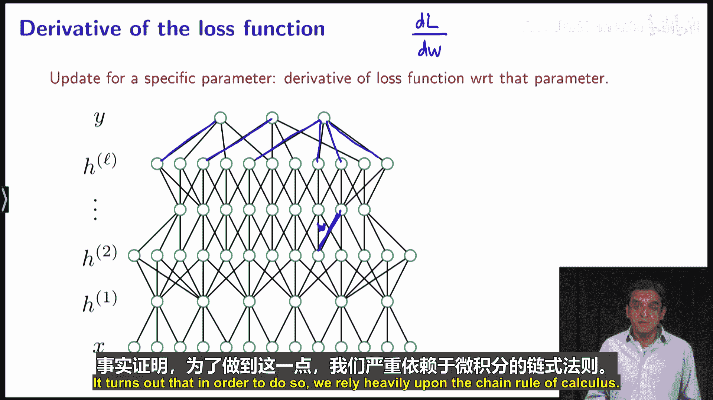

So here is the chain rule of calculus。Written out in full mathematical notation。But actually。

 this is a rule that we've been using all along in order to compute derivatives okay so for example。

 suppose I ask you to compute the derivative of 2 x plus 3。😊，Raace to the power of Tim。What isか？Well。

 the way you do it is you say， hm， let's take that expression，2 x plus3， and let's call it you。

So we are computing the derivative of U to the 10th， what is that that is 10 U to the ninth D。Good。

Now， what's do？Well， u is 2 x plus 3， so d U is 2， so it's 10 times 2 x plus 3 to the ninth times 2。

That's the derivative Okay， so more generally， let's say you have a function H。

 which is a composition of two functions。😊，H of x is the result of taking x and first applying function F to it。

 and then applying function G to the result， G of F of x。Then the derivative of H of x。

It's just the derivative of G applied at F of x。Times the derivative of F at x。Okay。

 and that's exactly the rule we used over here。The change。

Let's look at another way of writing the chain rule。Suppose we have three variables， x， Y， and z。

 where y is a function of x。😊，And Z is a function of y。Then the derivative of Z with respect to x。

It's just the derivative of z with respect to y times the derivative of y with respect to X。

To see how this is equivalent to the first formulation， okay， how do we do that well？

We're saying that y is a function of x， so let's write y is f of x。

And we're saying Z is a function of y， so let's write C as G of y。And so Z。Is also。G of F of x。

And then you'll see that this。Formulation over here is exactly what we got up here。Okay。

 so this is the chain rule。How do we apply this in neuralNe？Well， for simplicity。

These nets can be huge， so to prevent things from getting messy。

Let's just look at a case with each layer of the net。Contains just one node。Okay。

 so the input layer x is just one number x。Layer 1 just contains one node， H1。

 layerer 2 just contains one node H 2。 layer 3 contains one node H3。 And at the very end。

 we have the last layer H the be。 Okay， so the mural net now just looks like a single chain。

And in fact， to make the notation completely consistent， let's just call the input H。

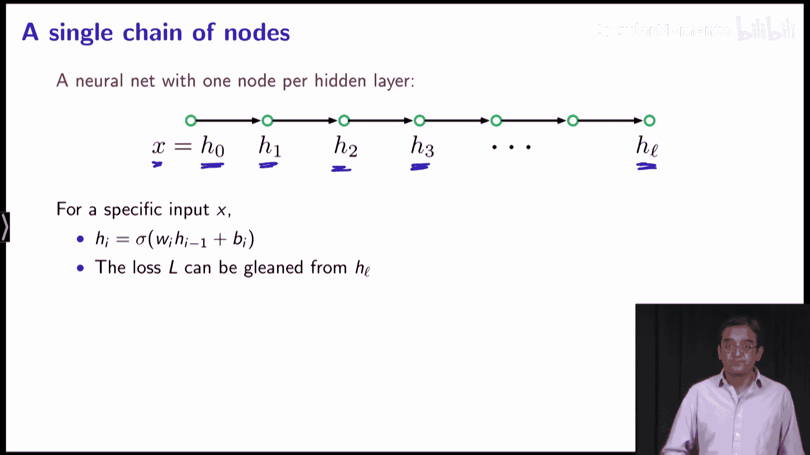

Okay， that leads to complete uniformity。Now， when we get an input， when we get x or equivalently H0。

 we compute H1， H2， H3 all the way to HL in a single feed forward box。

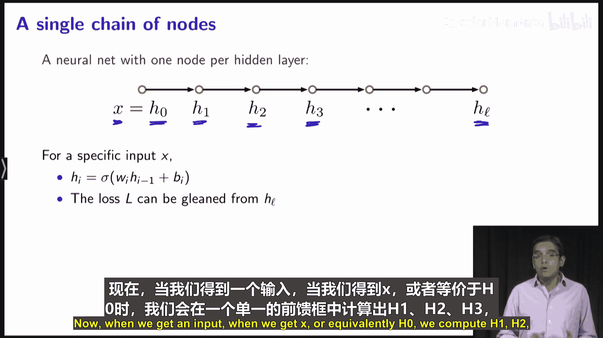

Okay케。Each value。A each value like H sub3 is a linear function of the previous node。

OkayAnd here's the formula for the linear function。Okay， so each change the bike。

Is some linear function of H sub i minus1？After which we apply the nonlinear activation， for example。

 the rectified linear activation function。Okay， so we start x and we compute H1， H2 H3， and so on。

Okay。So once we get to the end， once we get to Habbel。Then from that， we get the probability。

The probability of why， and we can assess the loss at that point。

 and what we need is the derivative of the loss。With respect to each of these parameters。

 in particular， with respect to each W sub。How do we obtain that？So there are two steps to this。

The first thing is to note that the loss is a function of a whole bunch of things over here， the Ws。

 the B's， the H's。

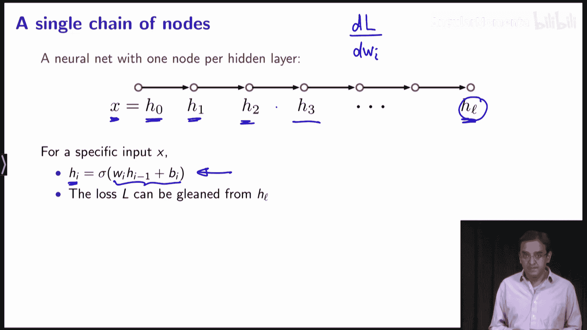

In order to compute the derivative of L， the derivative of the loss with W sub I。

 it turns out that it's enough to just have the derivative of the loss with respect to each of the hidden units H sub I。

Okay， and this is because of the chain rule， okay， so let's see how this works。😊。

So we want to compute the derivative of the loss with respect to WI because that's going to tell us how to adjust W sub I。

And to do that， let's look at this equation。😊，And apply the chain rule。

The derivative of the loss with respect to WI。Is the derivative of the lawsuit with respect to H？

Times the derivative of H with respect to W sub I。And to compute the derivative of H with respect to W sub I。

 well that's fairly simple， it's just the derivative of sigma。At that specific point， WI H+ BI。

Times the derivative of this inside stuff。With respect to H。With respect to WI， which is H minus1。

Okay。Okay， so we already know all these age values， we computed them in our feed forward path。

So we know everything over here and all we need is this derivative of the loss with respect to H。

 and if we have that， then we can compute the derivative with respect to WiI。Okay。

 so the first high level message is that we just need。The derivative。Offf the loss。

With respect to each of these hidden nodes， H1， H2， and so on。So how do we obtain them？😔。

And it turns out that we can obtain them quite easily。

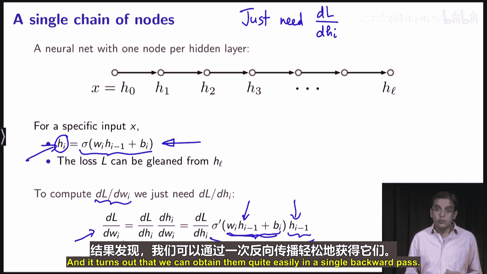

In a single backward pass。Through the chain。Okay。So let's see how that happens。

And this is the idea of back propagation。So to get the derivative of the loss at the very last unit。

Okay。That's easy since the loss is a direct function of that， okay？

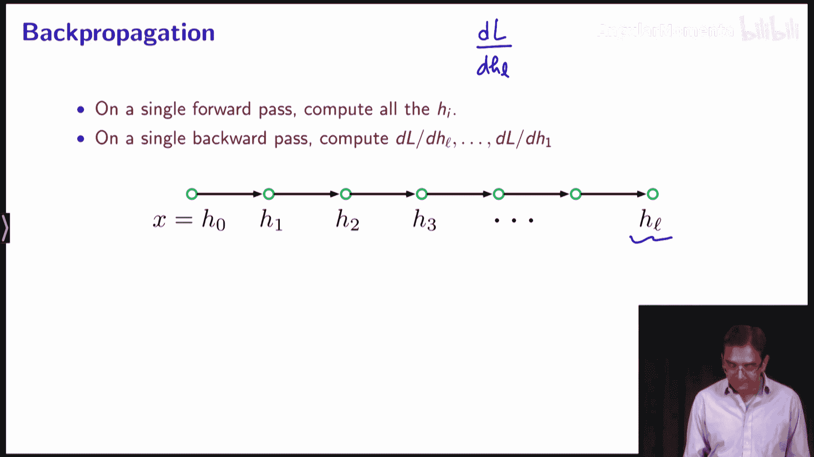

But let's say that we've gone a certain ways down， and now we want the derivative of the loss with respect to the next hidden unit。

Okay，So let's say we already have the derivative of the loss with respect to unit H sub plus one。

And now we want the derivative of the loss with respect to unit HI。

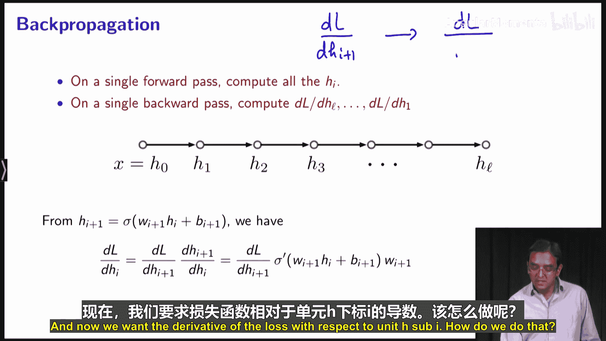

How do we do that？Well， we write down the formula for H the plus1， that's a linear function of H sub。

And then we apply the chamber。So the derivative with respect to H sub I is the derivative with respect to H sub plus1。

Times the derivative of h sub I plus1 with respect to h subi。

 and the second term is something we compute directly from this equation。

It is the derivative of sigma at that specific point， W plus1 H plus B plus1。

Times the derivative of this inside portion with respect to H， which is WY+1。And again。

 all these terms on the right over here are things we already have。😊。

The only thing we really need to compute is the Hs and we obtain them during the feed forward pause。

Okay。So given the derivative with respect to H+1， we easily get the derivative with respect to H。

 and as we saw， this gives us the derivatives with respect to all of the parameters of the model。

This is called back propagation， it's a very ingenious use of dynamic programming to efficiently compute all the derivatives we need。

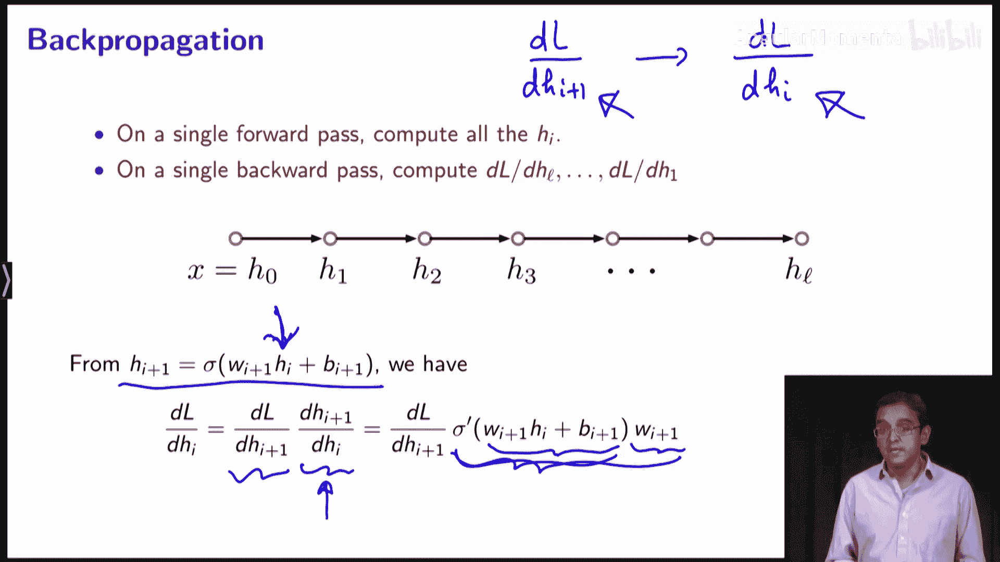

Now wait， if this was only for neural nets that look like a chain。

 for nets that have a single node for hidden layer。

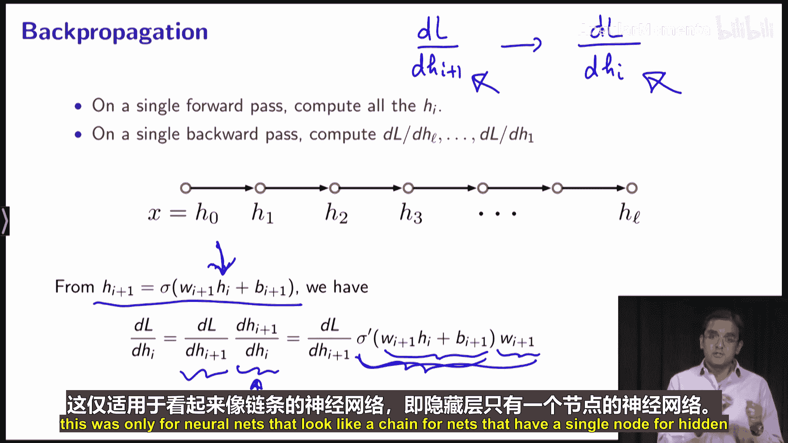

Okay。Well， it turns out that this case contains all the complexity of the full situation。

The only thing that really changes in moving to wide hidden layers is that things get more messy。

 The basic idea remains exactly the same。

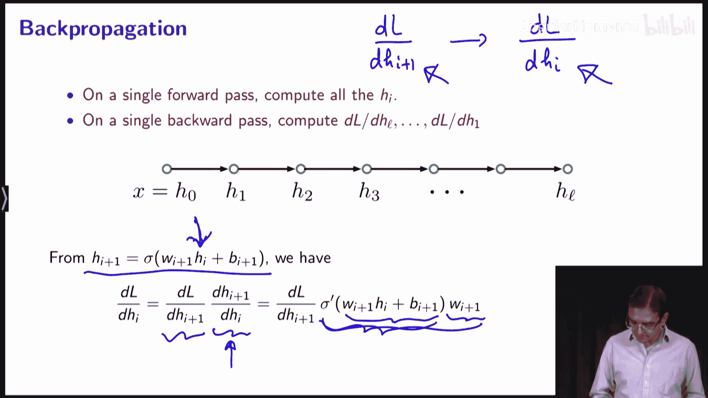

Okay。So we are dealing with models that have。A vast number of parameters。And where the function。

 the loss function that we're optimizing is highly non convex。So given these circumstances。

 we have to be a little bit careful in order to get a model that generalizes well， okay？😊，Now。

 we saw this situation to a much less extreme degree when we were talking about decision trees and random forests。

And indeed， some of the ideas from those settings have also made it over to neural nets okay and there are two particular ideas that we'll talk about now ideas for getting a model that generalize as well。

😊，The first is called early Start。Okay， so we have this training process in which we have our training data set。

And we're running iterations of mini batch stochastic gradient descent。

And as we're running these iterations， we can drive the training error down。

We have so many parameters that this is something we can reliably expect to do。😊，This doesn't mean。

 however， that the true error or test error， the thing we really care about is going on as well。😊。

In fact。😊，The test error could be behaving in some strange way。

 it might start going up at some point and then come back down again。

 who knows in order to better track it， it helps to have a special， separate validation set。Okay。

 so how can we use this？So here's one thing we can do。We run our iterations of training。

And after every say 100 iterations。😊，We move over to the validation set。😊。

And see how the current model is doing。Okay。So we get the validation error。

 which is a good proxy to the actual error。And we see， h， have we improved from 100 iterations ago。

 Do we have a better model now？If we've improved great， if we haven't。

 what we can do is to simply revert to that previous model， the model from 100 iterations ago。

 and restart the optimization at that point。This is a very handy trick。

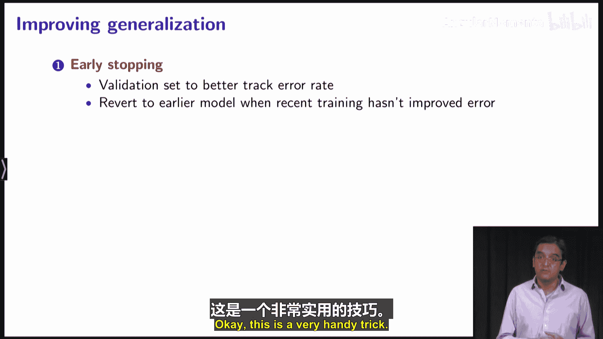

Another trick that's proved to be quite useful is something called dropout and this is somewhat reminiscent of random forests。

So what we do here is that during training。After presenting an input X。

 we randomly kill half of the hidden units。Okay，Or to be more precise？For each hidden unit。

 we delete it。With independently with some fixed probability like 0。

5 so we end up deleting a whole bunch of these hidden units。

 just removing them effectively from the graph。And now we still run the feed forward computation and get a label for light。

But get a label for X， and we want this label to be correct。Okay。So in this way。

 we are forcing the net to arrive at the correct label for x through a variety of different parts。

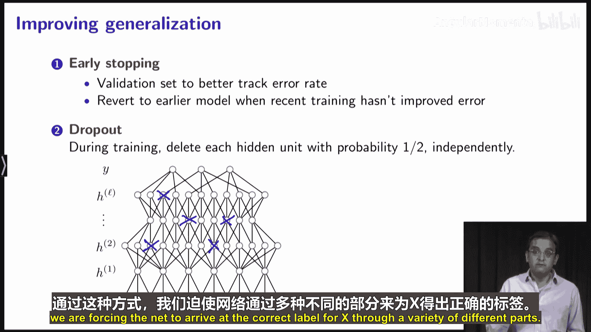

It induces a kind of robustness。Okay， so we've talked a lot about feedful witnesss。

 about what they are and how to train them。A lot of this is fairly straightforward。😊。

The use of the loss function， it's something very intuitive。

 the idea of using stochastic gradient descent， it's very natural。When it gets to the details。

 computing all the derivatives。Using back propagation。Doing things like early stopping and dropout。

These are things that in principle seem doable， but they really seem like in practice。

 they might get quite messy and quite hairy。😊，Luckily。

 you probably won't have to implement these all on your own。

There are now packages out there like TensorF that take care of a lot of the messy details。

All you have to do is to specify the architecture as well as the functional form of each of the individual nodes。

😊，And once you do that， the package takes care of the wrist。

It figures out what all the derivatives are， it takes care of the training。

 and in this way it makes neural nets much more accessible。Okay。Indeed。

 if you want to go further with neural nets， I'd say the best thing to do at this point is to just start playing with data using one of these packages。

You have the background knowledge you need， and so it's time to go out there and start experimenting。

See you next time。