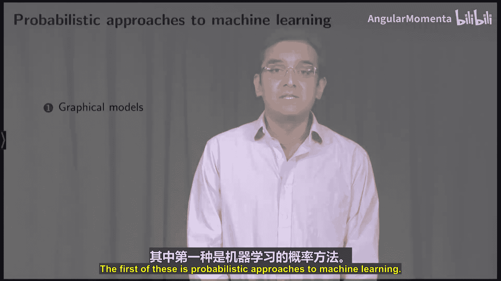
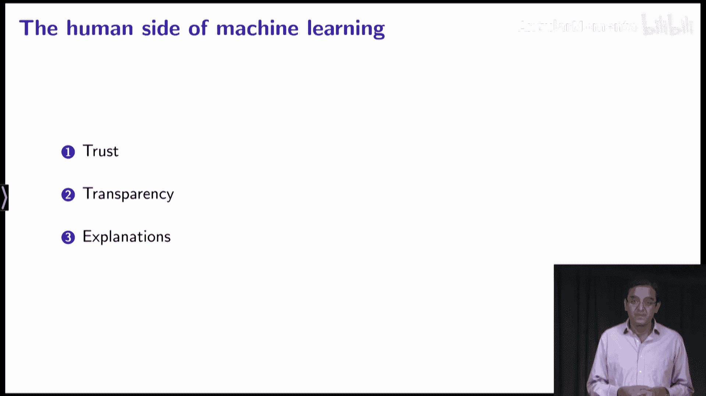

# 【加州大学圣地亚哥分校】机器学习基础  Machine Learning Fundamentals p59 12-05-02-我们所略过的内容 -BV1TyFSziEZb_p59-

This class is sadly， drawing to a close。We have certainly covered a lot of ground。

Lots of different approaches to making predictions and to representation learning。

 and quite a bit of the underlying mathematical foundations。

But there's also quite a lot that we ended up skipping for want of time。

And so what I'd like to do today to finish up is to mention just a few of these areas that we overlook。

The first of these is probabilistic approaches to machine learning。

Now we saw a little bit of this when we were talking about the generative approach to classification。

 and we saw how easy it is to build a classifier by just fitting a Gaussian to each class。😊。

The nice thing about Gaussians is that they are able to capture correlations between features。

 and it turned out that these models were frequently pretty effective。

This is just the tip of the iceberg， however。At the end of the day。

 Gaussians are a fairly restricted form of probability distribution； for instance。

 they all have these ellipsoidal shapes。The framework of graphical models allows us to capture any probability distribution。

😊，Over data in any dimension。A graphical model is specified by a graph in which there is a node for each feature。

A node for x1 for x2， x3。All the way to XD。And we put an edge between two nodes。

If we want to capture the dependence between those two features。Now， the size of the model。

 the number of parameters we need。Depends on the number of edges we choose， the more edges。

 the more parameters。If we put in no edges at all。Then we end up with a distribution in which the different features are all independent of each other。

 and we need very few parameters to do this。If we put in all possible edges。

 if we get a complete graph。Then we need a lot of parameters。

 but we are able to model to capture any distribution whatsoever。So in this way。

 we can trade off the accuracy of the model with the number of parameters we need。

This is a beautiful framework and in fact this area is full of beautiful algorithms。

 ingenious schemes， and rich underlying theory。😊，One of the things that these models help us do。

Is to capture various types of data that we really haven't had an opportunity to discuss。

For instance， sequence data， DNA sequences， sentences， speech。Or data that is spatial， for example。

The distribution of pollution levels across a certain region。So it's a very powerful methodology。

Another aspect of probabilistic approaches。Is that they can be used as the launching pad for understanding causality。

So causality is very important in the way we construct the world in our explanations， for example。

Okay， our reasoning is all about causes and effects。😊。

So is causal structure something that can be inferred automatically from data？And if so。

 what kinds of data do we need in order to do this？These are fascinating questions。

 and these are very important if we want machines to be able to reason about the world。

The third avenue of probabilistic modeling。Is Bayesian methods。Now this is a rich area。

 a whole field of statistics unto itself。In this class。

 we have focused on a kind of learning algorithm that takes a data set。And returns a single model。

 for example， a single linear regression function。Now。

 this function is not going to be perfect since we only have a finite amount of data。

And so we are in a bit of a strange situation where we have a model that's not quite right。

And yet we don't have a clear sense of which parts of the model are super reliable and which parts are a little bit more dicey。

In Bayesian methods， the learning algorithm doesn't just return a single model。

But rather a probability distribution over all possible models， okay， so it says。

This linear regressor has probability 0。2 and this linear reggressor has probability 01 and this linear reggressor has probability so and so。

 we get back this entire distribution。Now， one thing we can do with the distribution is to pick out the single most likely model and use that。

But what this gives us in addition is it lets us identify what parts of that model are somewhat more set in stone than the other parts。

And it lets us quantify the uncertainty in predictions that we make。

So it's a very powerful methodology。😊，A second area of machine learning that we completely overlooked is reinforcement learning。

嗯。Now， in this course， we have really been focusing upon training a machine to answer a very specific type of question over and over again。

What is the name of the animal in this picture， what is the name of the animal in this picture。

 what is the name of the animal in this picture， and so on， you get the idea。

But imagine what happens。When we move to a slightly broader scenario， for example。

 when we are training a robot to do something like pick up a cup of coffee， say。So at any given time。

 the robots in a particular configuration， okay， that's the state of the world， the environment。😊。

And it chooses an action that's suitable for that environment， okay， maybe it moves a little bit。

Okay。This action changes the state of the world， and the action it chooses subsequently has to adapt to this changed environment。

So we are in a situation where a machine。Is moving around。

 it's choosing actions that are suitable for the current environment， but at the same time。

 these actions are changing the environment。😊，A beautiful framework for modeling such situations is called reinforcement learning。

 and it was inspired by intuitions from behaviorist psychology。

So what happens in reinforcement learning？😊，It's essentially you think of all the possible states。

 all the possible environments as being some enormous graph。Okay， so here's one possible state。

Here's one possible state of the world， here's another possible state。

 and we have lots and lots of these。Okay。And they're connected by edges。Now， at any given time。

 we're in one of these states。The current state of things。Okay， so let's say we are in this state。

We then choose an action and the effect of that action is to move us to one of the neighboring states。

 in this case， either that state or this state。And in this way， we move around。😊。

Now the only feedback we ever get。Is that there is the occasional reward scattered around。

 some of these states have a little reward associated with them。

And so the goal of the learning machine is to behave in a way that maximizes the overall long term reward。

😊，So it's a beautiful framework that captures a lot of different situations。😊。

The third aspect of machine learning that we really should have talked about is the human side of all this。

Okay so machine learning is playing a growing role in our lives。For instance。

 machine learning systems are constantly monitoring us through our emails and social media and purchases。

And we also rely on these systems to make a whole lot of everyday decisions。

What does it take for a machine learning system to earn our trust。

 what kind of systems do we think of as trustworthy？

Is it enough that they just have high predictive accuracy？

Or does it help for them to have other important features as well， for example， the ability to say。

 I don't know"，Now， some of these systems are being used to make decisions that are really important。

For example， which loan applications get accepted or rejected？And for systems like these。

 it's really important。😊，For the reasoning of the machine learning system to be transparent。

 for it to be able to explain the decision in a way that makes sense to all the parties involved and that can。

Also， possibly stand up to scrutiny in court。Now， some of the methods we've studied are fairly transparent。

Decision trees， for example， they're quite understandable。But some of the other methods。

 like neural nets， are really pretty inscrutable。 What would it take to make these more transparent I there some。

 Is there some small fix that we can use。Or do we have to start from scratch and just redesign our models and methodologies from the ground up？

These are really interesting questions。So I'm afraid that we're going to have to end here machinech learning is a very rich field。

With powerful technology and beautiful underlying mathematics。

There's also no shortage of open problems and challenges for the future。

I hope that you found this course interesting and that it has piqued your curiosity to perhaps delve into this lovely area。

A tiny bit more。