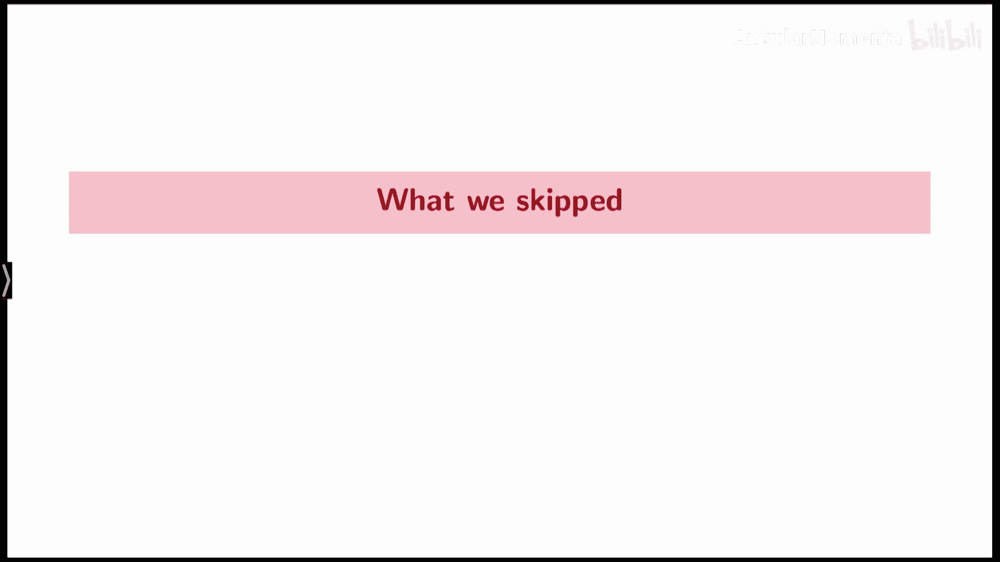
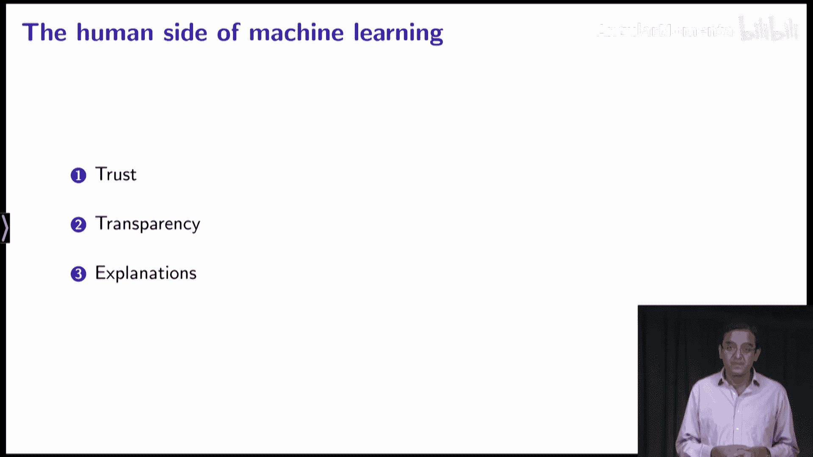

# 机器学习基础：12-05-02：我们所略过的内容 📚

在本节课中，我们将回顾课程中因时间限制而未能深入探讨的几个重要机器学习领域。我们将简要介绍概率方法、强化学习以及机器学习中的人本考量，为你的进一步学习提供方向。

## 概述

课程即将结束。我们涵盖了大量内容，包括多种预测和表征学习方法，以及许多数学基础。然而，由于时间有限，我们略过了许多其他重要领域。今天，我们将简要提及这些被我们忽略的领域。

## 概率机器学习方法

上一节我们介绍了分类的生成方法。本节中，我们来看看更广泛的概率机器学习框架。

我们曾在讨论分类的生成方法时，接触过一点概率方法。我们看到，通过为每个类别拟合一个高斯分布，可以轻松构建分类器。高斯分布的优势在于能够捕捉特征之间的相关性，并且这些模型通常相当有效。

然而，这只是冰山一角。归根结底，高斯分布是一种相当受限的概率分布形式；例如，它们都具有椭球形状。**图模型**框架允许我们捕捉任何维度数据上的任何概率分布。

图模型由一个图来定义，其中每个特征对应一个节点（例如，x1, x2, x3，一直到 XD）。如果希望捕捉两个特征之间的依赖关系，我们就在对应的两个节点之间添加一条边。

模型的大小，即我们所需的参数数量，取决于我们选择的边的数量。边越多，参数越多。如果我们完全不添加边，那么最终得到的分布中，不同特征彼此独立，这只需要很少的参数。如果我们添加所有可能的边，得到一个完全图，那么我们需要大量参数，但能够建模或捕捉任何分布。通过这种方式，我们可以在模型准确性和所需参数数量之间进行权衡。

这是一个优美的框架，充满了精妙的算法、巧妙的方案和丰富的理论基础。这些模型帮助我们捕捉各种我们尚未有机会讨论的数据类型。

以下是图模型能处理的数据类型示例：
*   **序列数据**：例如 DNA 序列、句子、语音。
*   **空间数据**：例如某个区域内污染水平的分布。

概率方法的另一个方面是，它们可以作为理解**因果关系**的起点。因果关系在我们构建世界和解释事物时非常重要，我们的推理都关乎原因和结果。那么，因果结构能否从数据中自动推断？如果可以，我们需要何种数据？这些都是引人入胜的问题，如果我们希望机器能够对世界进行推理，这些问题就非常重要。

概率建模的第三条途径是**贝叶斯方法**。这是一个丰富的领域，本身就是一个完整的统计学分支。在本课程中，我们主要关注一类学习算法，它接收一个数据集并返回一个单一的模型（例如，一个线性回归函数）。由于我们只有有限的数据，这个函数不会完美。因此，我们处于一个有点奇怪的情况：我们有一个不完全正确的模型，却不太清楚模型的哪些部分非常可靠，哪些部分更不确定。

在贝叶斯方法中，学习算法不仅返回一个单一模型，而是返回所有可能模型上的一个概率分布。例如，它可能表示这个线性回归器的概率是0.2，那个是0.1，另一个是多少等等，我们得到整个分布。我们可以从这个分布中挑选出最可能的单个模型并使用它。但此外，这还能让我们识别该模型的哪些部分比其他部分更确定，并量化我们做出预测时的不确定性。因此，这是一种非常强大的方法。

## 强化学习

在讨论了基于静态数据预测的概率方法后，本节我们转向一个动态交互的学习范式：强化学习。

在本课程中，我们主要专注于训练机器反复回答一种非常具体的问题（例如，“这张图片中的动物叫什么名字？”）。但想象一下，当我们转向一个更广泛的场景时会发生什么，例如训练机器人完成像拿起一杯咖啡这样的任务。

在任何给定时刻，机器人处于特定的配置状态，这就是世界或环境的状态。它选择一个适合该环境的动作（例如，稍微移动一下）。这个动作改变了世界的状态，它随后选择的动作必须适应这个变化了的环境。因此，我们处于这样一种情况：机器在移动，它选择适合当前环境的动作，但同时，这些动作也在改变环境。

一个用于对此类情况进行建模的优美框架称为**强化学习**，其灵感来源于行为主义心理学的直觉。

在强化学习中，你可以将所有可能的状态（所有可能的环境）想象成一个巨大的图。每个节点代表一个可能的世界状态，它们通过边连接。在任何给定时间，我们处于其中一个状态（当前状态）。然后我们选择一个动作，该动作的效果是将我们移动到相邻状态之一（例如，这个状态或那个状态）。通过这种方式，我们在图中移动。

我们获得的唯一反馈是，偶尔会有奖励散布在图中，其中一些状态关联着少量奖励。因此，学习机器的目标是以最大化长期总体奖励的方式行事。

这是一个优美的框架，能够捕捉许多不同的情境。

## 机器学习中的人本考量

在探讨了机器如何从数据和交互中学习之后，最后我们来看看机器学习系统与人和社会的关系。

机器学习在我们的生活中扮演着越来越重要的角色。例如，机器学习系统通过我们的电子邮件、社交媒体和购买行为不断监控我们。我们也依赖这些系统做出大量日常决策。

一个机器学习系统需要什么才能赢得我们的信任？我们认为什么样的系统是值得信赖的？仅仅具有高预测准确性就足够了吗？还是它们也需要具备其他重要特征，例如说“我不知道”的能力？

其中一些系统被用于做出真正重要的决策，例如哪些贷款申请被接受或拒绝。对于这类系统，机器学习系统的推理过程**透明**至关重要，它需要能够以对所有相关方都有意义的方式解释决策，并且可能需要在法庭上经受住审查。

我们研究过的一些方法相当透明，例如**决策树**，它们很容易理解。但其他一些方法，如**神经网络**，则相当难以理解。要使这些方法更透明需要什么？是存在一些小的修复方法可以使用，还是我们必须从头开始，从根本上重新设计我们的模型和方法？这些都是非常有趣的问题。

## 总结

本节课中我们一起学习了本课程未深入探讨的三个关键领域：概率机器学习方法（包括图模型和贝叶斯推理）、用于序列决策的强化学习，以及关乎信任、透明度和责任的机器学习人本与社会层面。机器学习是一个丰富的领域，拥有强大的技术和优美的底层数学，同时也充满了未来的开放性问题与挑战。希望本课程激发了你的兴趣，促使你进一步探索这个迷人的领域。