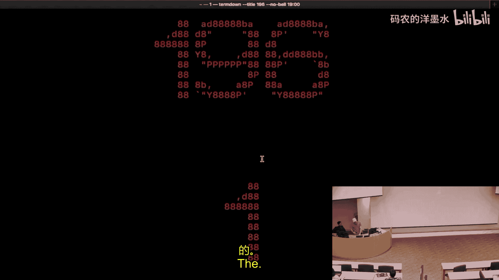
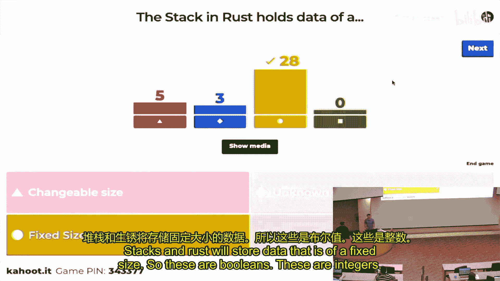
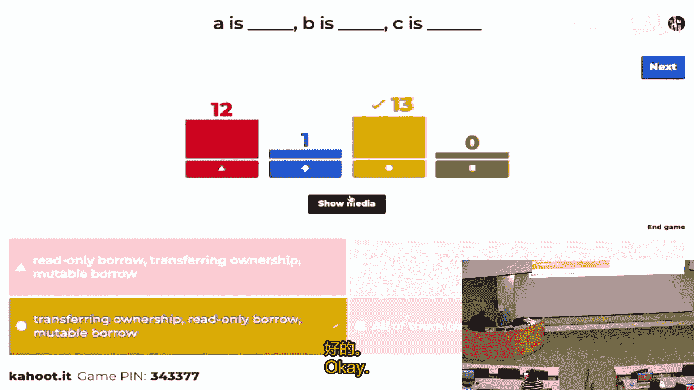
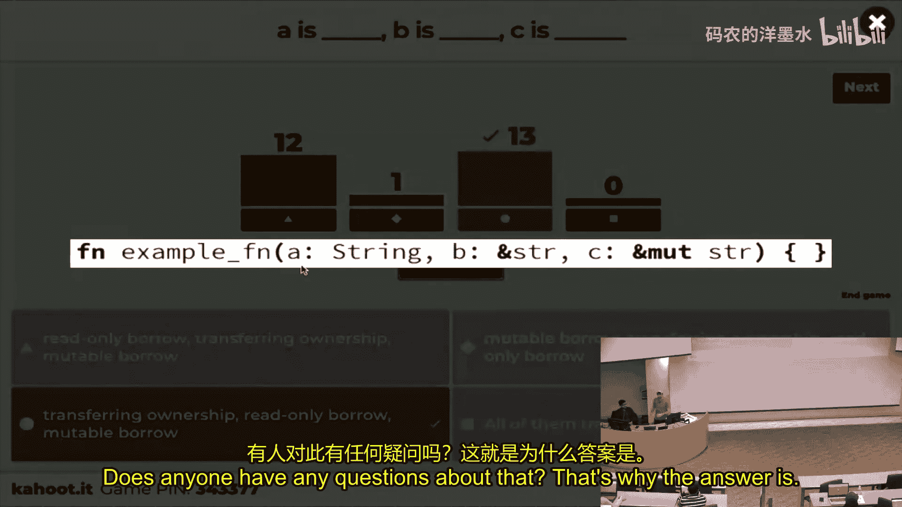

# 006：Rust - 内存、所有权与借用



在本节课中，我们将继续学习Rust编程语言。我们将首先快速回顾一些基础语法，然后深入探讨Rust语言中核心且独特的内存管理模型：所有权和借用。理解这些概念是编写安全、高效Rust程序的关键。

## 索引循环与函数

上一节我们介绍了Rust的基本语法，本节中我们来看看循环和函数的写法。

### 索引循环

在Java或C++等语言中，你可能会使用C风格的`for`循环。在Rust中，语法有所不同。

以下是Java中的C风格`for`循环：
```java
for (int i = 0; i < 10; i++) {
    // 使用 i 做一些事情
}
```

在Rust中，实现相同功能的代码如下：
```rust
for i in 0..10 {
    // 使用 i 做一些事情
}
```
这段代码从0开始，循环直到`i`小于10（即0到9）。虽然语法不同，但功能完全一致。多写几次就会习惯。

### 函数

函数用于执行特定任务。我们来看一个加法函数的例子。

在Java中，加法函数如下：
```java
int add(int firstNumber, int secondNumber) {
    return firstNumber + secondNumber;
}
```

在Rust中，写法如下：
```rust
fn add(first_number: i32, second_number: i32) -> i32 {
    first_number + second_number
}
```
两者区别在于：
1.  **声明**：Rust使用`fn`关键字。
2.  **参数类型**：Rust中类型声明更明确（例如`i32`表示32位有符号整数）。
3.  **返回值**：Rust在函数签名中使用箭头`->`指定返回类型。
4.  **隐式返回**：Rust函数中，最后一个没有分号的表达式会作为返回值。你也可以使用`return`关键字和分号显式返回，这在需要提前返回时很有用。
5.  **无返回值**：对于不返回值的函数（类似Java的`void`），Rust只需省略箭头和返回类型。
6.  **命名约定**：Rust使用蛇形命名法（`snake_case`），而非Java中常见的驼峰命名法（`camelCase`）。

## Rust内存模型

现在，让我们进入本节课的核心内容：Rust的内存模型。要理解它，我们需要先了解一些基础知识。

### 内存与十六进制

在高级语言如Java或Python中，内存管理是自动的。但在系统编程语言如Rust、C++中，你需要自己管理内存。

我们可以将内存想象成一系列存储信息的块，每个块都有一个地址。在计算机科学中，内存地址通常用**十六进制**表示。

十六进制使用0-9和A-F（代表10-15）这16个符号。例如，数字16在十六进制中表示为`0x10`（`1*16 + 0*1`）。在编程中，我们常用前缀`0x`来标识十六进制数。

### 栈数据结构

在讨论内存模型前，还需要理解**栈**这种数据结构。

栈就像一叠纸：你只能从顶部添加（**压入**）或移除（**弹出**）元素。它是“先进后出”的：第一个放入栈的元素将是最后一个被取出的，因为要访问它，必须先移除它上面的所有元素。

### Rust中的栈与堆

Rust在运行时使用**栈**和**堆**来管理内存，它们的结构不同。

*   **栈**：用于存储**大小固定且已知**的数据（如`i32`、`bool`）。它的操作快速，遵循后进先出的原则。
*   **堆**：用于存储**大小未知或可能变化**的数据（如`String`类型）。你可以向堆请求一块空间，并获得一个指向该位置的**指针**。

例如，一个整数的大小在编译时是已知的（32位），所以它存储在栈上。而一个字符串，由于用户输入的长度未知，所以存储在堆上，栈上只存储指向堆内存的指针、长度和容量信息。

## 所有权

Rust通过一套称为**所有权**的规则来管理堆内存，确保内存安全。

所有权的三条核心规则是：
1.  Rust中的每一个值都有一个被称为其**所有者**的变量。
2.  值在任一时刻有且只有一个所有者。
3.  当所有者离开作用域，这个值将被丢弃（内存被释放）。

### 所有权与数据交互

对于栈数据（固定大小），赋值会创建数据的副本。
```rust
let x = 5;
let y = x; // y 是 5 的一个副本
// x 和 y 都是有效的
```

对于堆数据（大小可变），赋值会**移动**所有权，而不是复制数据。
```rust
let s1 = String::from("hello");
let s2 = s1; // s1 的所有权移动给了 s2
// println!("{}", s1); // 错误！s1 不再有效
```
这样做是为了避免：
1.  **二次释放错误**：如果`s1`和`s2`都指向同一堆数据，离开作用域时两者都会尝试释放同一块内存。
2.  **性能开销**：复制大量堆数据效率低下。

如果你确实需要深度复制堆数据，可以使用`.clone()`方法。
```rust
let s1 = String::from("hello");
let s2 = s1.clone(); // 数据被完整复制
// s1 和 s2 都有效，但指向堆上不同的数据
```

### 函数与所有权

将值传递给函数时，所有权也会发生转移。

对于堆数据：
```rust
fn main() {
    let s = String::from("hello"); // s 进入作用域
    takes_ownership(s); // s 的所有权移动到函数里
    // s 在这里不再有效
}

fn takes_ownership(some_string: String) { // some_string 进入作用域
    println!("{}", some_string);
} // some_string 离开作用域，`drop`被调用，内存被释放
```

对于栈数据（固定大小）：
```rust
fn main() {
    let x = 5; // x 进入作用域
    makes_copy(x); // x 的值被复制到函数里
    // x 在这里仍然有效
}

fn makes_copy(some_integer: i32) { // some_integer 进入作用域
    println!("{}", some_integer);
} // some_integer 离开作用域，无事发生
```

函数也可以通过返回值转移所有权。
```rust
fn gives_ownership() -> String {
    let some_string = String::from("hello");
    some_string // 所有权被移动出函数
}
```

但是，如果函数需要操作一个值，同时还想在函数调用后继续使用原变量，每次都通过返回值交还所有权会很繁琐。这时就需要用到**借用**。

## 借用

**借用**允许你使用值但不获取其所有权，通过创建**引用**来实现。

### 不可变引用

我们使用`&`符号来创建引用。
```rust
fn main() {
    let s1 = String::from("hello");
    let len = calculate_length(&s1); // 传递 s1 的引用
    println!("The length of '{}' is {}.", s1, len); // s1 仍然有效
}

fn calculate_length(s: &String) -> usize { // s 是对 String 的引用
    s.len()
} // s 离开作用域，但因为它没有所有权，所以什么也不会发生
```
引用默认是**不可变的**，你不能通过它修改数据。

### 可变引用

如果你需要修改借用的数据，可以使用**可变引用**`&mut`。前提是原变量本身必须是可变的。
```rust
fn main() {
    let mut s = String::from("hello");
    change(&mut s); // 传递可变引用
}

fn change(some_string: &mut String) {
    some_string.push_str(", world");
}
```


### 引用规则

为了保证内存安全，引用遵循两条重要规则：
1.  在任意给定时间，**要么**只能有一个可变引用，**要么**只能有多个不可变引用。
2.  引用必须总是有效的。




规则1避免了**数据竞争**，这种竞争发生在：
*   两个或更多指针同时访问同一数据。
*   至少有一个指针被用来写入数据。
*   没有同步数据访问的机制。



例如，以下代码会编译错误：
```rust
let mut s = String::from("hello");
let r1 = &s; // 不可变引用，没问题
let r2 = &s; // 另一个不可变引用，没问题
let r3 = &mut s; // 错误！不能在拥有不可变引用的同时拥有可变引用
```




## 为何如此设计？


你可能会觉得这些规则很繁琐。Rust这样设计是为了在**安全**和**性能/控制力**之间取得最佳平衡。


*   **Java/Python**：使用垃圾回收器自动管理内存，安全但运行时有一定开销，控制力较低。
*   **C/C++**：手动管理内存，性能高、控制力强，但极易出现内存错误（如段错误、二次释放）。
*   **Rust**：通过所有权系统在编译期检查内存安全，无需垃圾回收，同时实现了高性能和强控制力。


不同的语言适用于不同的场景。Rust非常适合需要高性能和高可靠性的系统编程，例如操作系统、游戏引擎、浏览器组件等。


## 总结

本节课中我们一起学习了Rust内存管理的核心概念：
1.  **栈与堆**：栈用于固定大小数据，堆用于可变大小数据。
2.  **所有权**：三条规则确保内存安全，赋值操作对栈数据和堆数据有“复制”和“移动”的区别。
3.  **借用**：通过引用（`&`）允许访问数据而不获取所有权，分为不可变引用和可变引用，并遵循严格的规则以避免数据竞争。


理解所有权和借用是学习Rust最大的挑战之一，但也是它强大能力的源泉。掌握这些概念后，你就能编写出既安全又高效的Rust程序。