# 011：正则表达式 🧩

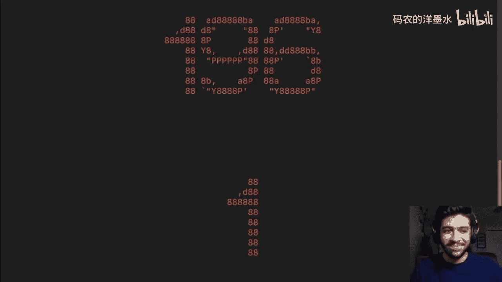

在本节课中，我们将要学习一种处理“混乱”数据的强大工具——正则表达式。现实世界中的数据往往格式不一，例如电话号码和日期就有多种书写方式。正则表达式能帮助我们定义文本模式，从而精确地查找、匹配和提取所需信息。

## 数据为何混乱？

上一节我们介绍了学习正则表达式的必要性，本节中我们来看看数据混乱的具体表现。在自由格式的数据中，人类可以按多种方式输入相同的信息。

以下是几种常见的数据混乱示例：

*   **电话号码**：`(734) 930-3030`、`734-930-3030`、`734.930.3030`
*   **日期**：`05/09/2017`、`2017-05-09`、`May 9th, 2017`

## 什么是正则表达式？

正则表达式（Regular Expression，常缩写为 **regex** 或 **re**）是一个由字符组成的序列，它定义了一个搜索模式。这个模式可用于字符串搜索、查找替换或输入验证。

简单来说，正则表达式允许你定义一个可以匹配文本的模式。然而，这些模式初看可能非常晦涩，例如：`^[a-zA-Z0-9._%+-]+@[a-zA-Z0-9.-]+\.[a-zA-Z]{2,}$`。但别担心，我们将从基础开始构建理解。

## 基础匹配：字符与数字

让我们从一个简单的文本开始练习：“Hello CS196 at Illinois... CS125... CS173... CS225...”。

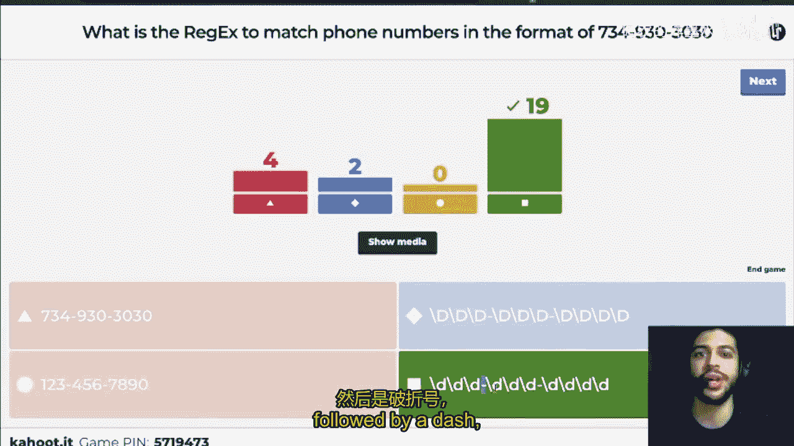

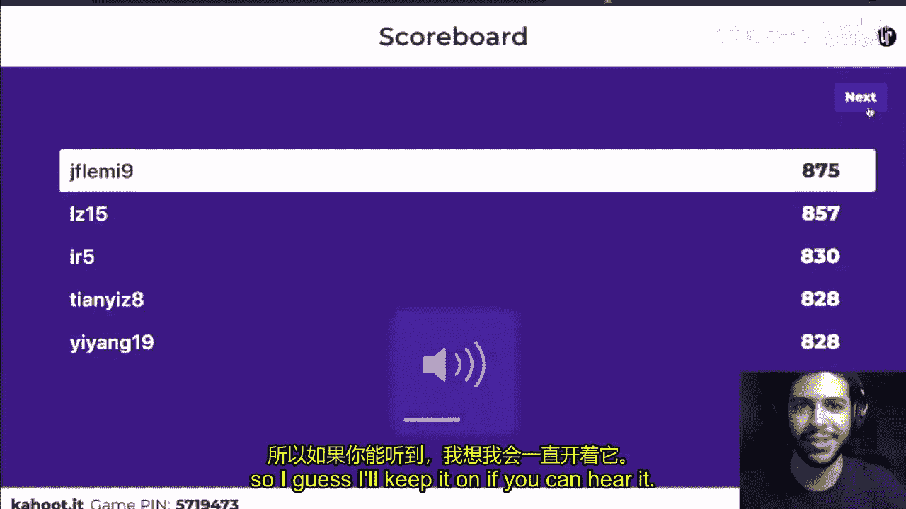

如果我们想匹配“CS196”，最简单的正则表达式就是 `CS196`。它表示按顺序匹配字符 C、S、1、9、6。

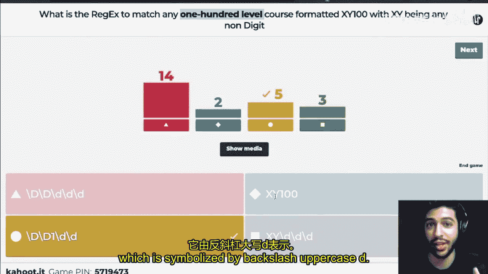

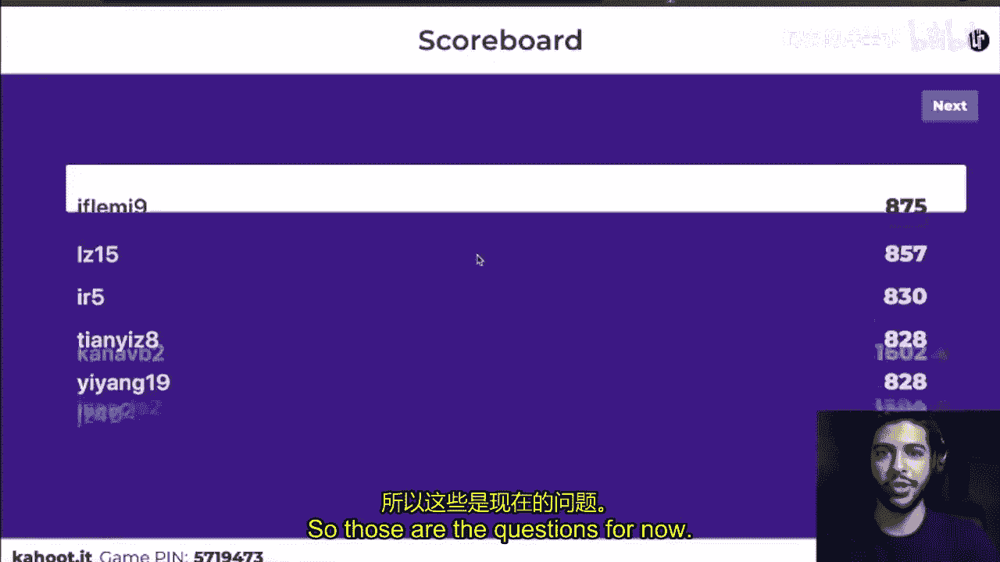

以下是两个最基本的规则：

*   **匹配特定字母**：直接书写该字母。例如 `C` 匹配字母 C。
*   **匹配特定数字**：直接书写该数字。例如 `1` 匹配数字 1。

## 匹配任意数字与“任何”字符

如果我们想匹配文本中所有类似“CSxxx”的课程编号（如CS196, CS125），而不是固定匹配“CS196”，该怎么办？我们需要匹配“CS”后面的任意三位数字。

这时可以使用元字符 `\d`，它匹配**任何单个数字**（0-9）。因此，模式 `CS\d\d\d` 就能匹配所有三位数的课程编号。

> **注意**：元字符 `\D`（大写D）是 `\d` 的**反义**，匹配**任何非数字**字符。

---

如果我们想匹配一个逗号前的所有内容（例如在“hello, world”中匹配“hello”），需要匹配“任何”字符，直到遇到逗号。

元字符 `.`（点号）作为**通配符**，可以匹配**任何单个字符**（换行符通常除外）。因此，模式 `.....，` 可以匹配逗号前的任意五个字符。

> **注意**：由于点号 `.` 已被用作通配符，如果你想匹配文本中实际的点号字符，需要使用反斜杠转义：`\.`。

## 匹配特定字符集合

有时通配符 `\.` 或 `\d` 过于宽泛，我们想限定只匹配几个特定字符。例如，在电话号码 `xxx-xxx-xxxx` 或 `xxx.xxx.xxxx` 中，分隔符只能是短横线 `-` 或点号 `.`，不能是其他字符。

我们可以使用**字符集** `[...]` 来定义某个位置允许出现的字符。例如，模式 `\d\d\d[-.]\d\d\d[-.]\d\d\d\d` 可以匹配用 `-` 或 `.` 分隔的电话号码。

我们还可以在字符集中使用**范围表示法**来简化。例如：
*   `[a-z]` 匹配任何小写字母。
*   `[0-9]` 匹配任何数字（等价于 `\d`）。
*   `[2-4]` 匹配数字2、3或4。

如果想匹配**不在**某个集合内的字符，可以在字符集开头使用脱字符 `^`。例如，`[^aeiou]` 匹配任何非元音字母。

## 控制重复次数

书写多个重复的元字符（如 `\d\d\d`）很繁琐。我们可以用花括号 `{}` 来指定前面元素重复的次数。

以下是控制重复的几种方式：

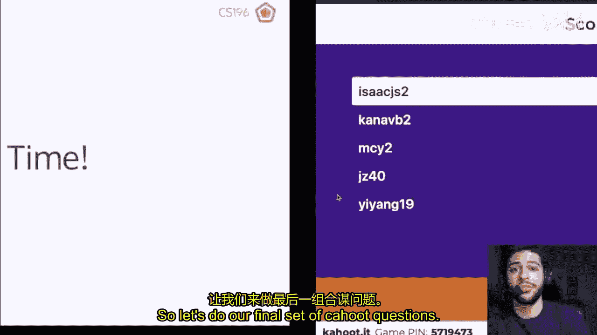

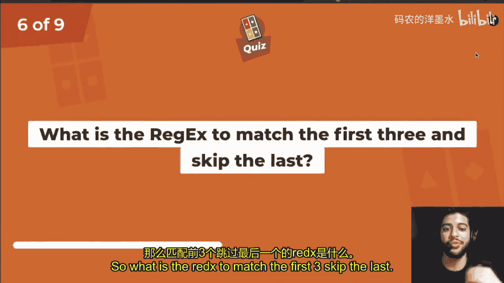

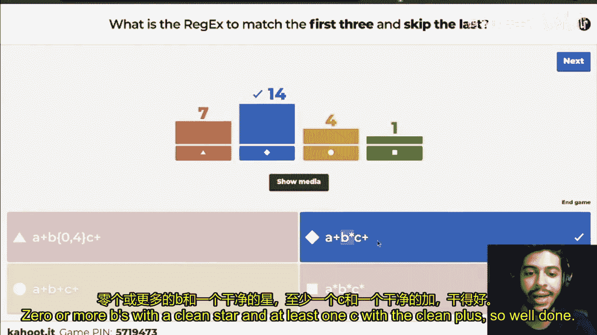

*   **精确重复**：`{n}` 重复恰好 n 次。例如 `\d{3}` 等价于 `\d\d\d`。
*   **范围重复**：`{m,n}` 重复 m 到 n 次（包含）。例如 `E{2,5}` 匹配连续出现2到5次的大写字母 E。
*   **至少一次**：`+`（加号）匹配前面的元素**一次或多次**。例如 `\d+` 匹配一个或多个数字。
*   **零次或多次**：`*`（星号）匹配前面的元素**零次或多次**。例如 `A*` 匹配零个或多个字母 A。
*   **零次或一次**：`?`（问号）匹配前面的元素**零次或一次**，即可选。例如 `-?` 匹配一个可选的短横线。

## 分组与选择

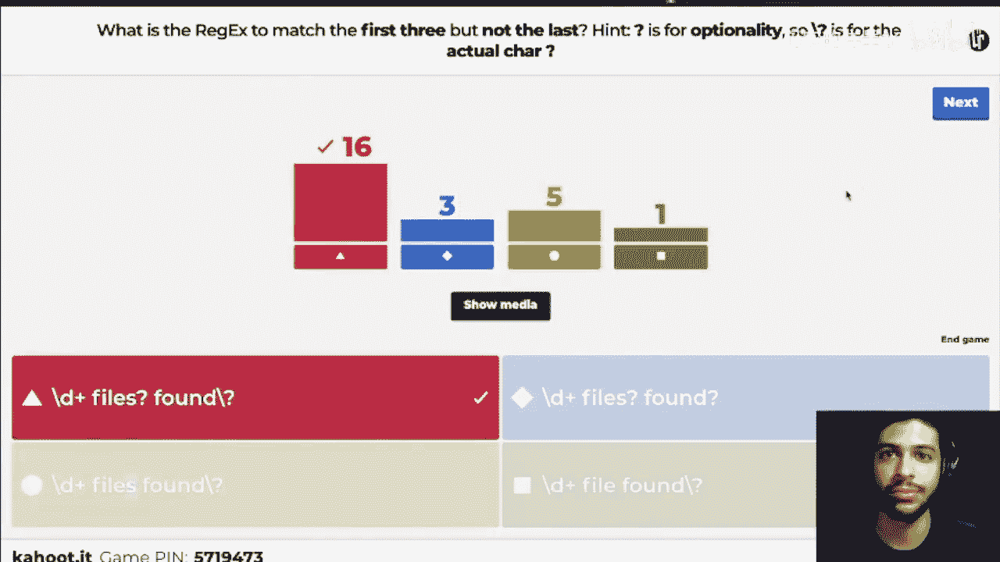

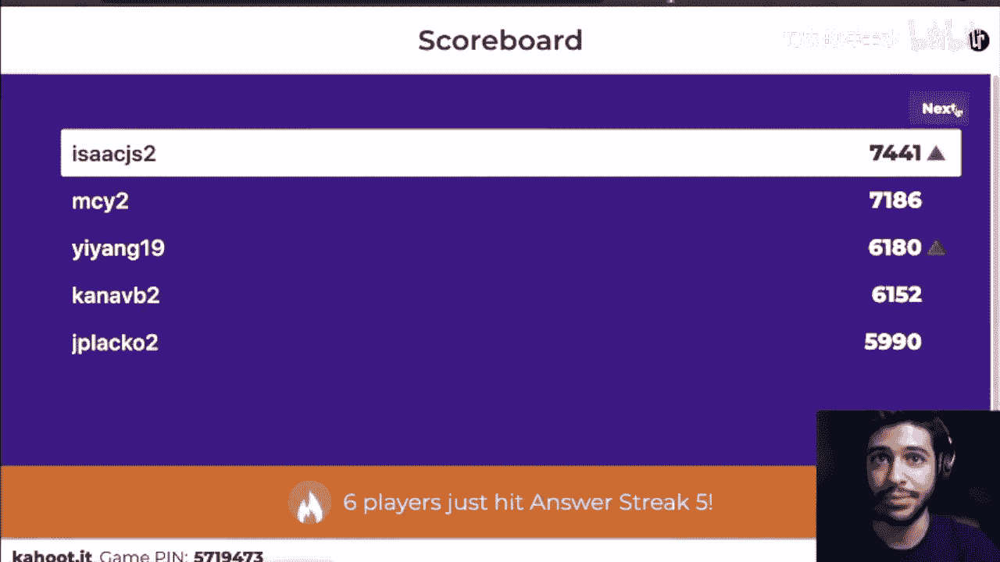

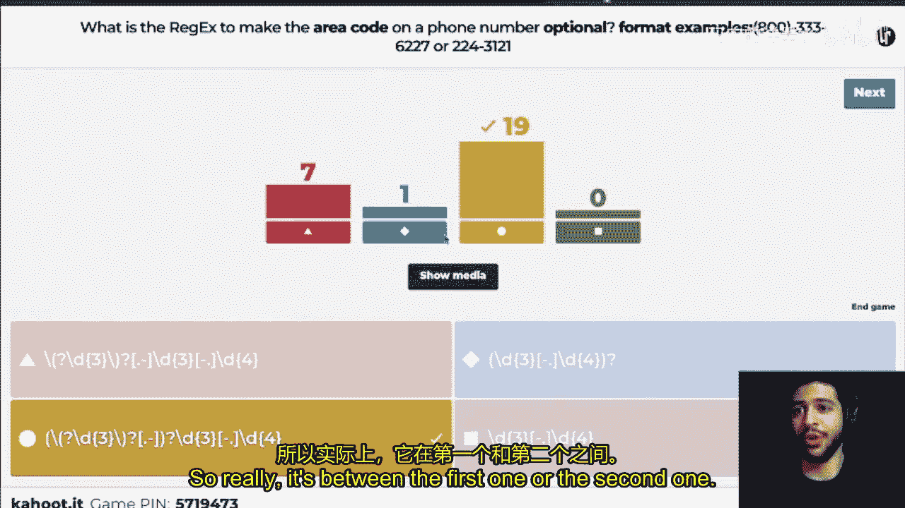

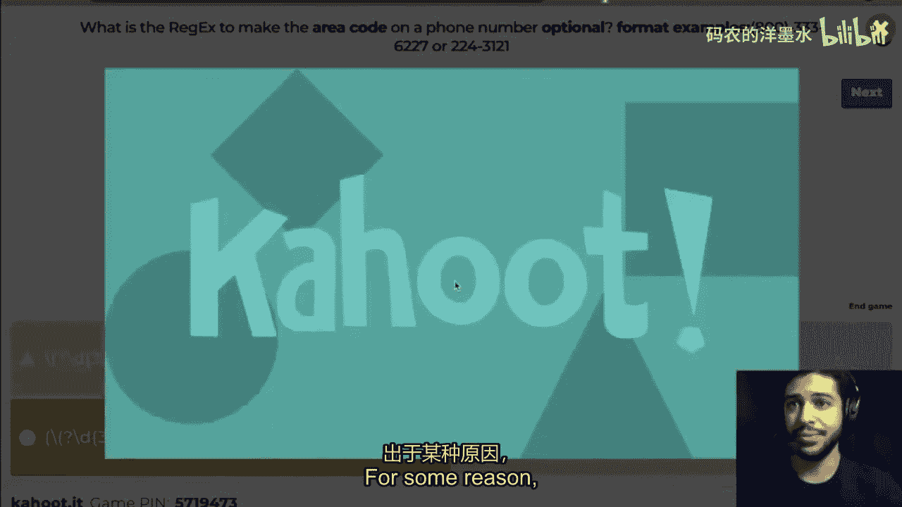

我们如何将量词（`+`, `*`, `?`, `{}`）应用到一组字符上，而不是单个字符？例如，匹配重复的“ABC”。

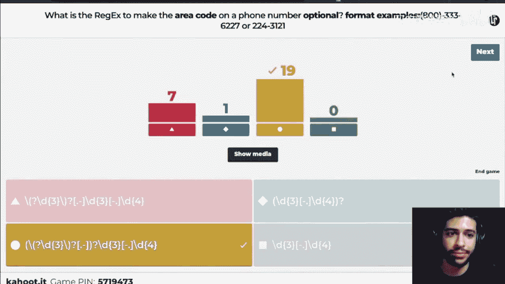

使用**圆括号** `()` 可以创建一个**捕获组**，将多个元素视为一个整体。例如，`(ABC)+` 可以匹配“ABC”、“ABCABC”等。

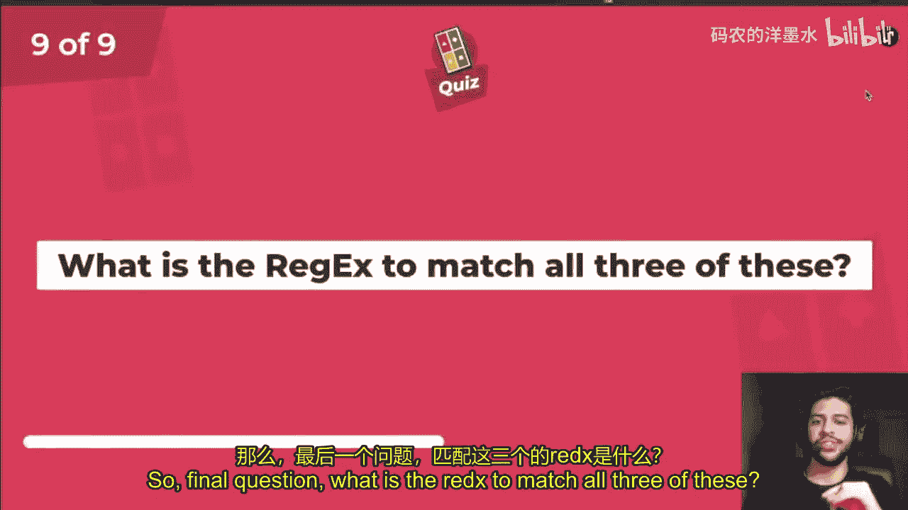

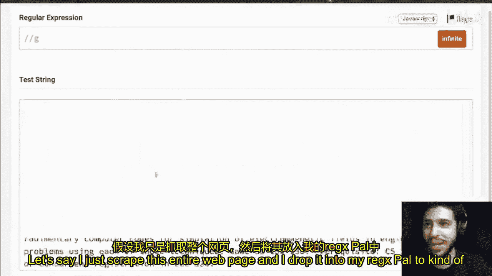

圆括号也用于实现**逻辑“或”** 操作。使用竖线 `|` 在组内分隔不同选项。例如，`(cat|dog)` 可以匹配“cat”或“dog”。

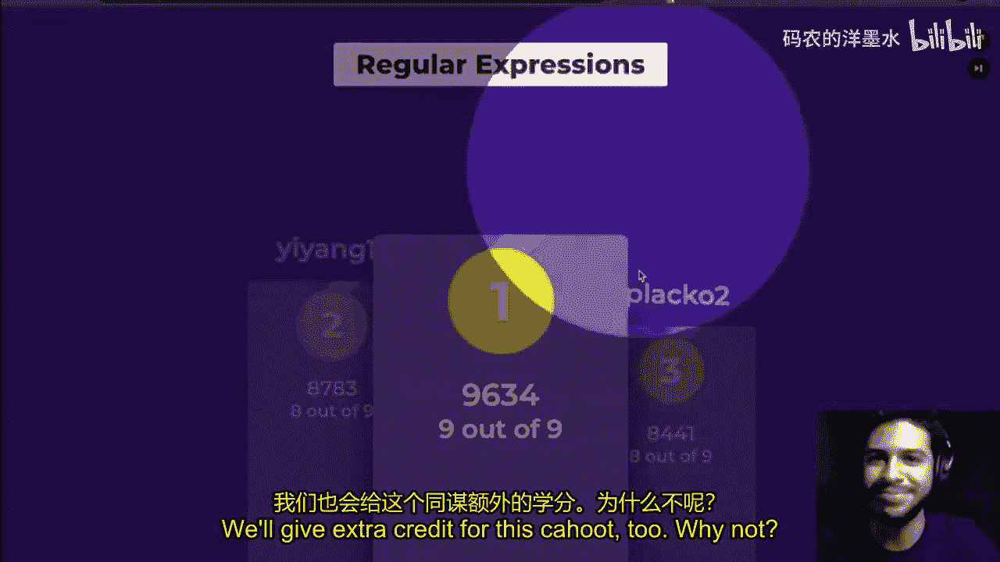

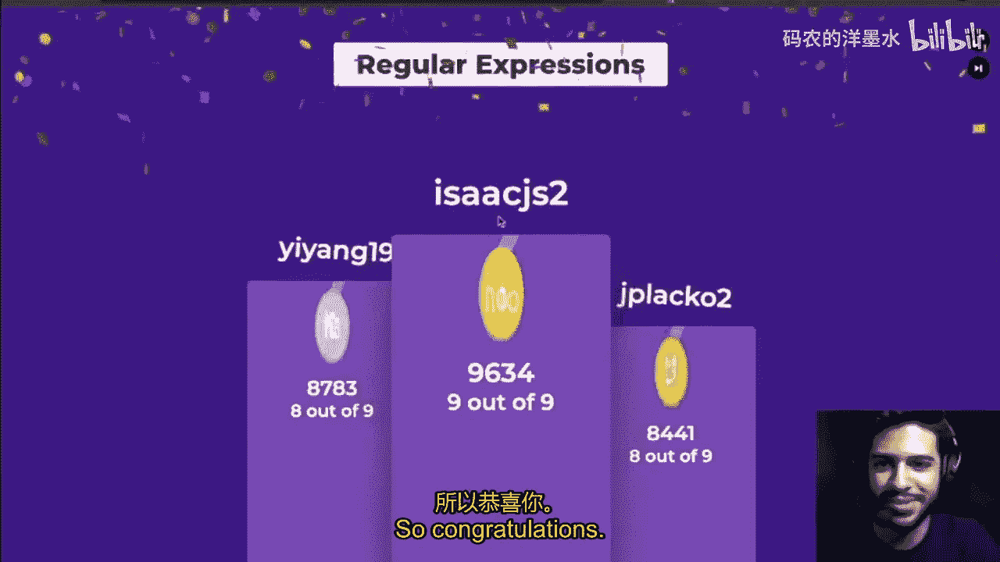

## 正则表达式应用与总结

正则表达式是语言无关的工具，几乎所有编程语言（如 Python, JavaScript, Java, Rust）都支持它。它主要用于：
1.  **数据验证**：检查输入格式（如邮箱、电话）。
2.  **数据提取**：从文本（如日志、网页）中抓取特定信息。
3.  **搜索与替换**：在文本编辑器或代码中执行复杂的模式替换。

本节课中我们一起学习了正则表达式的核心概念：从基础的字符、数字匹配，到使用元字符（`\d`, `.`），再到字符集 `[]`、量词（`+`, `*`, `?`, `{}`）以及分组 `()` 和选择 `|`。虽然正则表达式模式初看复杂，但通过分解和练习，你将能掌握这项处理文本数据的强大技能。建议使用在线工具（如 regex101.com）多加练习，并随时查阅速查表以巩固记忆。