# 013：Rust函数式编程与闭包 🦀


在本节课中，我们将要学习函数式编程的核心概念，特别是闭包和高阶函数在Rust中的应用。我们将从基本定义开始，逐步深入到具体的代码示例，帮助你理解如何利用这些强大的工具来编写更简洁、更可预测的代码。

## 什么是函数式编程？

上一节我们介绍了课程目标，本节中我们来看看函数式编程的具体定义。

函数式编程是一种通过组合**纯函数**来构建软件的过程，它避免共享状态、可变数据和副作用。这与面向对象编程形成对比，后者的应用状态通常是共享的，并与对象的方法共存。

以下是几个核心概念的定义：
*   **纯函数**：每个输入都精确对应一个输出。例如，数学函数 `f(x) = 2x` 是纯函数，因为输入 `2` 总是得到输出 `4`。
*   **副作用**：指在被调用函数返回值之外，任何可观察到的应用程序状态变化。例如，修改全局变量或在函数内部进行控制台日志输出。


函数式代码的优势在于它往往更简洁、更可预测且更容易测试。尽管相关的术语和模式对新手来说可能显得深奥，但其背后的思想实际上非常强大且实用。

## 一等函数与闭包

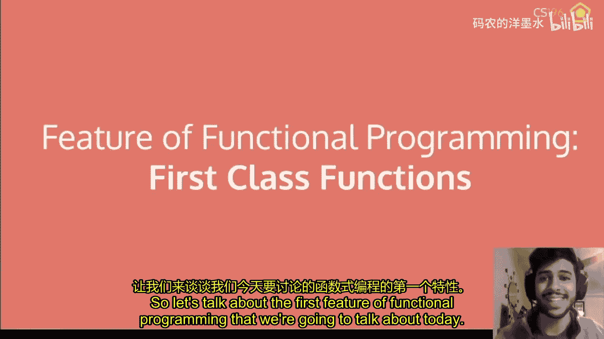

理解了函数式编程的基本理念后，本节中我们来看看实现它的第一个关键特性：一等函数。

**一等函数**是指函数可以像其他任何变量一样被对待。这意味着：
*   函数可以作为参数传递给其他函数。
*   函数可以作为另一个函数的返回值。
*   函数可以被赋值给一个变量。

**闭包**是一等函数的一个例子，它是**匿名函数**。你可以将其保存到变量或作为参数传递。闭包与普通函数的一个关键区别在于，它们可以捕获其定义所在作用域中的值。

以下是如何在Rust中定义一个闭包：

```rust
// 普通函数
fn add_two(x: i32) -> i32 {
    x + 2
}

// 等效的闭包（完整形式）
let add_two_closure = |x: i32| -> i32 { x + 2 };

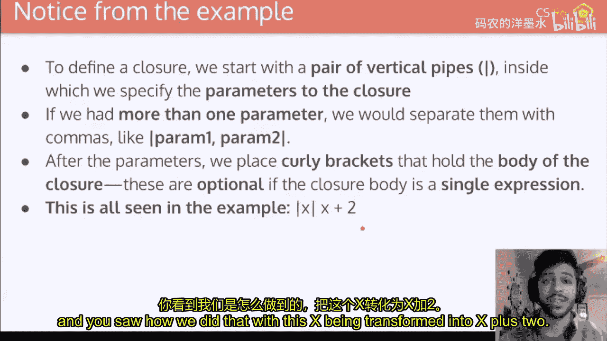

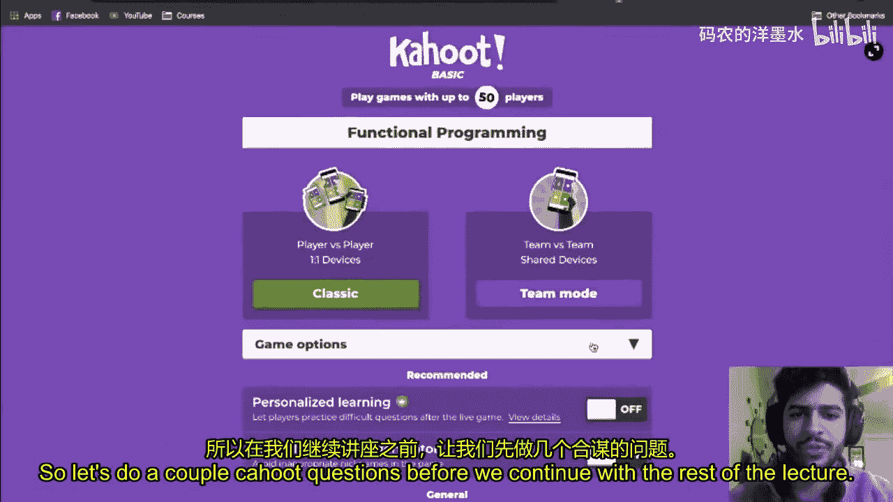


// 更简洁的闭包（Rust可以推断类型）
let add_two_closure = |x| { x + 2 };


// 最简洁的形式（单表达式可省略花括号）
let add_two_closure = |x| x + 2;
```

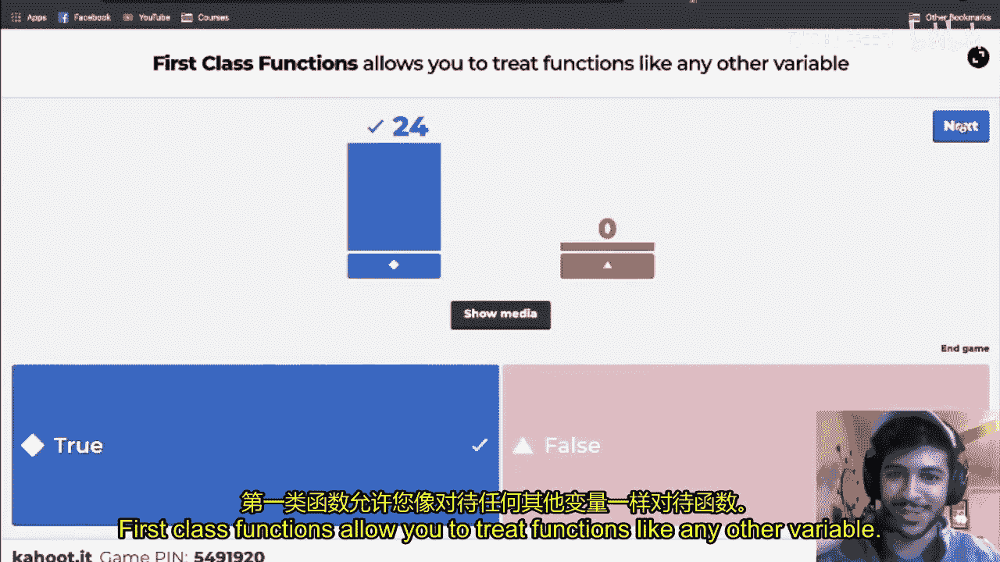


以下是定义闭包时的注意事项：
*   使用一对竖线 `|` 来指定参数。
*   参数后面可以放置包含闭包主体的花括号 `{}`。
*   如果闭包主体是单个表达式，花括号是可选的。

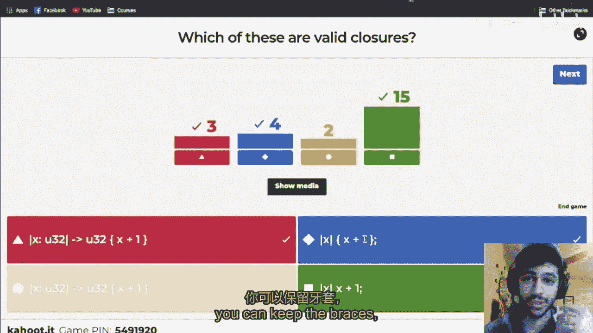

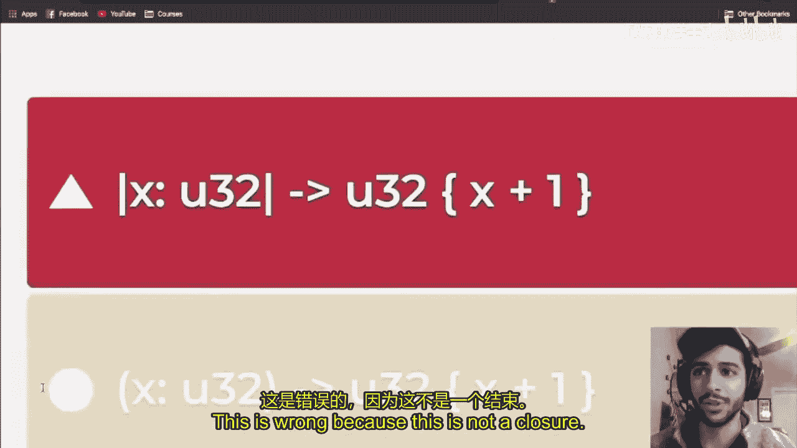

调用闭包的方式与调用命名函数相同，使用存储它的变量名：

```rust
let result = add_two_closure(5); // result 为 7
```

闭包可以访问其定义作用域中的变量，这是普通函数做不到的：

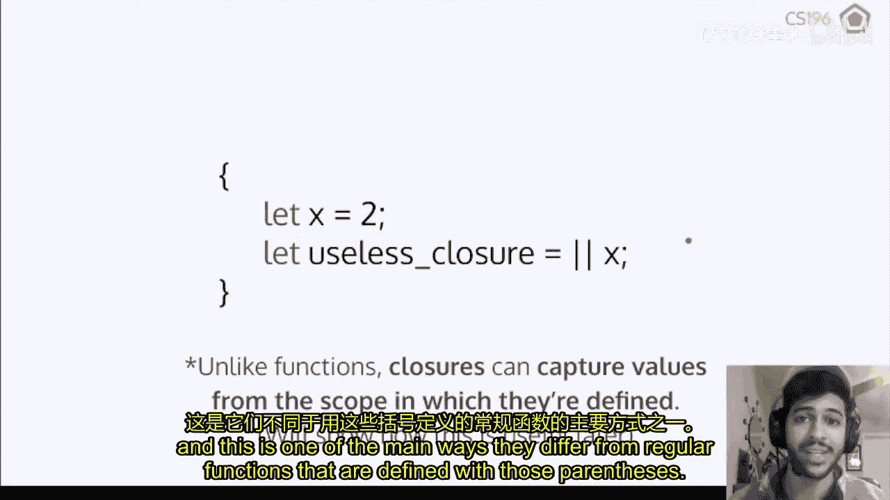

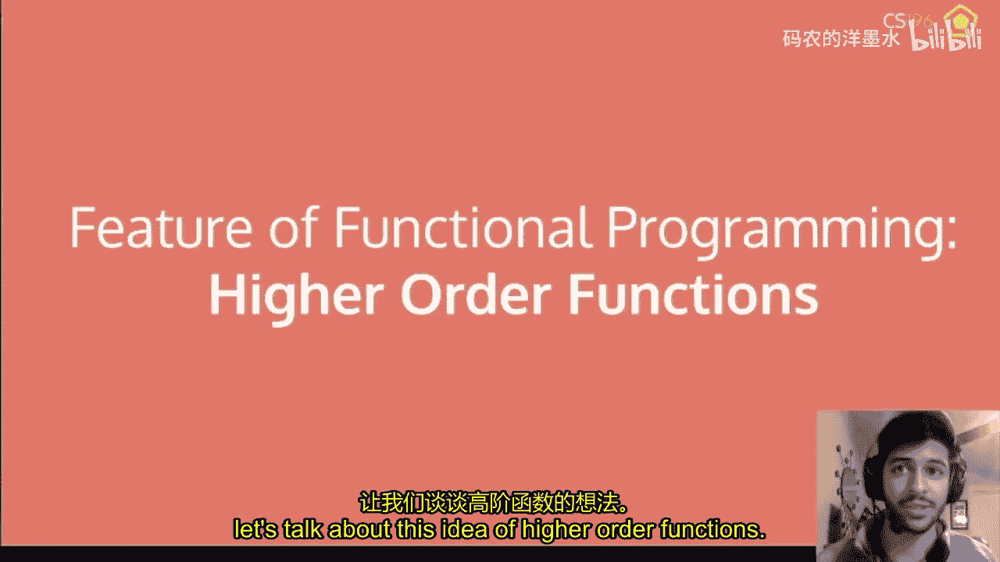

```rust
let y = 10;
let capture_closure = || y; // 闭包捕获了变量 y
println!("{}", capture_closure()); // 输出 10
```

## 高阶函数：Map, Filter, Fold

掌握了闭包之后，我们就可以利用它们来使用高阶函数了。高阶函数是指那些以函数为参数、或返回一个函数、或两者皆是的函数。

### Map 函数

`map` 函数接受一个函数（或闭包）和一个可迭代对象，并将该函数应用到可迭代对象的每个元素上，从而产生一个新的可迭代对象。

```rust
let numbers = vec![1, 2, 3];
let doubled: Vec<_> = numbers.iter().map(|x| x * 2).collect();
// doubled 现在是 [2, 4, 6]
```
在上面的代码中，`|x| x * 2` 这个闭包被 `map` 应用到了 `numbers` 列表的每一个元素上。`iter()` 方法创建一个迭代器，`collect()` 方法将结果迭代器收集回一个向量（Vec）。

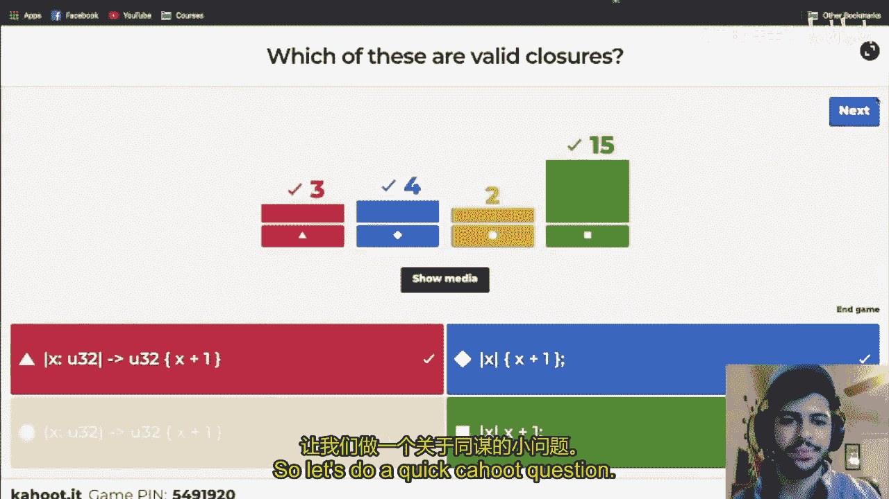


### Filter 函数

`filter` 函数根据一个返回布尔值的函数（或闭包）来筛选可迭代对象中的元素。只有使该函数返回 `true` 的元素会被保留在新的迭代器中。

```rust
struct Shoe {
    size: u32,
    style: String,
}

fn shoes_in_size(shoes: Vec<Shoe>, shoe_size: u32) -> Vec<Shoe> {
    shoes.into_iter().filter(|s| s.size == shoe_size).collect()
}
```
在这个例子中，闭包 `|s| s.size == shoe_size` 作为筛选条件。它捕获了外部变量 `shoe_size`，并检查每一只鞋的尺寸是否与之匹配。

### Fold 函数

`fold` 函数（在其他语言中常称为 `reduce`）将一个函数应用到一个可迭代对象上，并将其“折叠”或“缩减”为单个最终值。它接受一个初始值和一个带有两个参数（累加器和当前元素）的闭包。

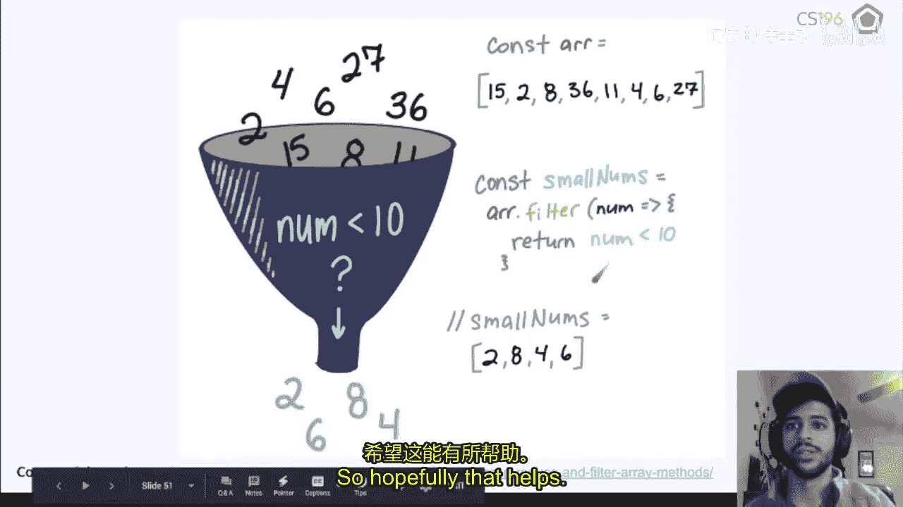


```rust
let numbers = vec![1, 2, 3];
let sum = numbers.iter().fold(0, |acc, x| acc + x);
// sum 现在是 6
```
执行过程如下：
1.  初始累加器 `acc` 为 `0`。
2.  第一个元素 `1`：`acc (0) + x (1) = 1`，成为新的 `acc`。
3.  第二个元素 `2`：`acc (1) + x (2) = 3`，成为新的 `acc`。
4.  第三个元素 `3`：`acc (3) + x (3) = 6`，作为最终结果返回。

## 组合使用高阶函数

Map、Filter 和 Fold 可以链式组合在一起，形成非常强大的数据处理模式。这种模式如此强大，以至于谷歌基于它构建了整个分布式数据处理系统（MapReduce）。

假设我们有一个篮球运动员列表，我们想计算所有全明星球员在本赛季为球队贡献的总分数（得分 + 助攻得分）：

```rust
struct Player {
    name: String,
    points: u32,
    assisted_points: u32,
    all_star: bool,
}

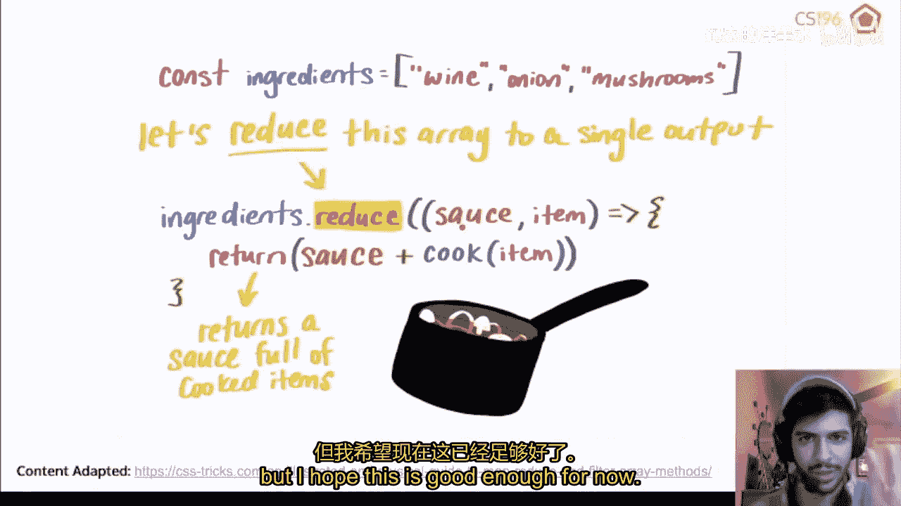


fn total_points_contributed_by_all_stars(players: Vec<Player>) -> u32 {
    players
        .into_iter() // 创建迭代器
        .filter(|p| p.all_star) // 1. 过滤出全明星球员
        .map(|p| p.points + p.assisted_points) // 2. 映射为每个球员的总贡献分
        .fold(0, |acc, points| acc + points) // 3. 将所有贡献分累加
}
```
这段代码清晰地展示了数据处理流程：
1.  **Filter**：从所有球员中筛选出全明星。
2.  **Map**：将每个全明星球员转换为其贡献的总分数。
3.  **Fold**：将所有总分数求和，得到最终结果。

这种声明式的风格让代码的意图非常明确，易于理解和维护。

## 总结

本节课中我们一起学习了Rust中的函数式编程核心概念。
我们首先了解了**函数式编程**是通过纯函数组合来避免副作用和共享状态的范式。
接着，我们学习了**一等函数**和**闭包**，闭包是匿名的、可以捕获其环境变量的函数，是函数式编程的基石。
然后，我们深入探讨了三个关键的**高阶函数**：`map`（转换每个元素）、`filter`（根据条件筛选元素）和`fold`/`reduce`（将序列缩减为单个值）。
最后，我们看到了如何将这些高阶函数链式组合，以清晰、强大的方式处理数据。

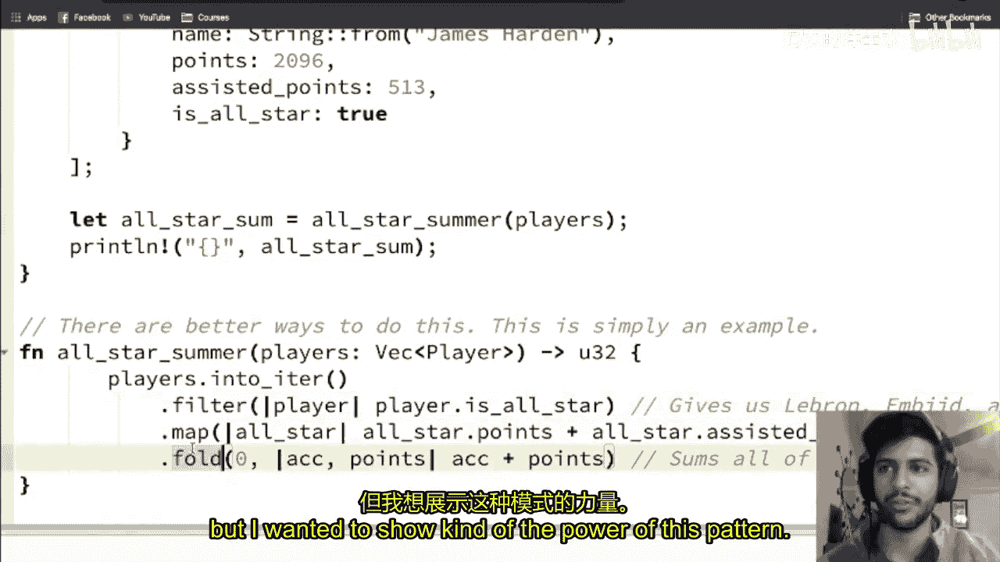

掌握这些概念将帮助你编写出更简洁、更模块化且更易于推理的Rust代码。