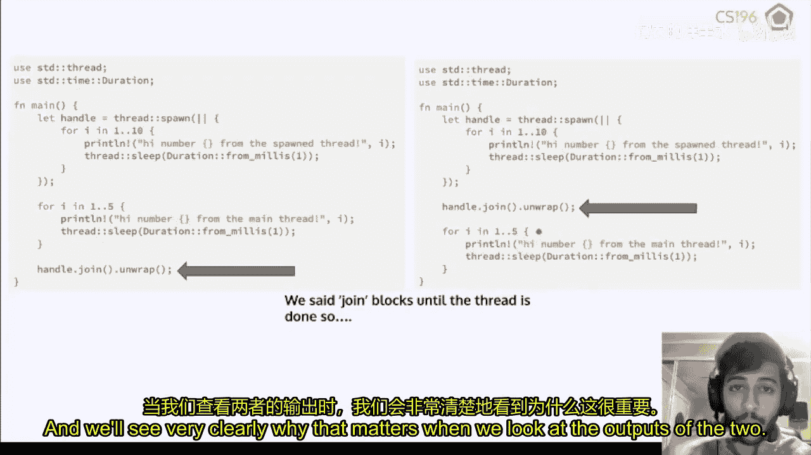
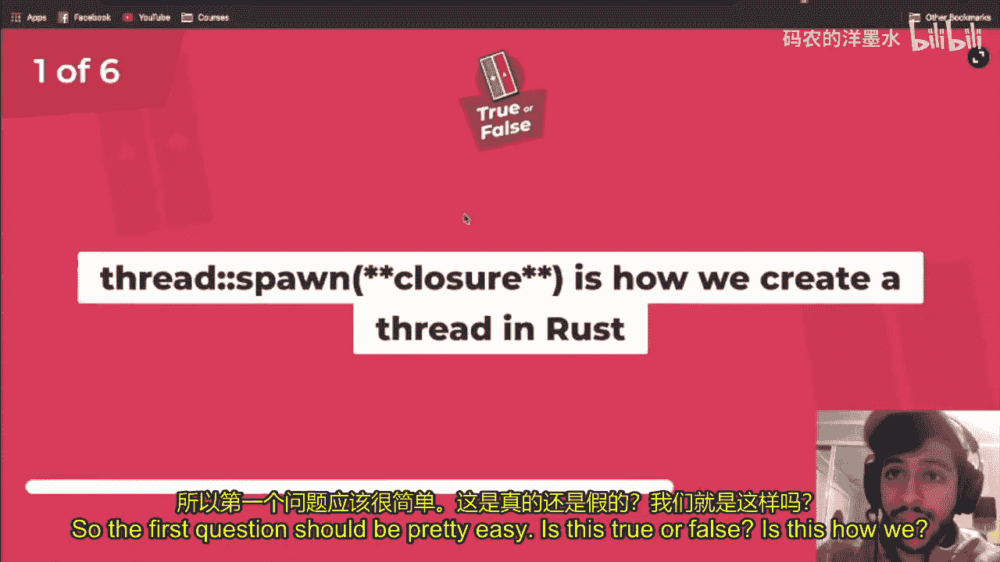
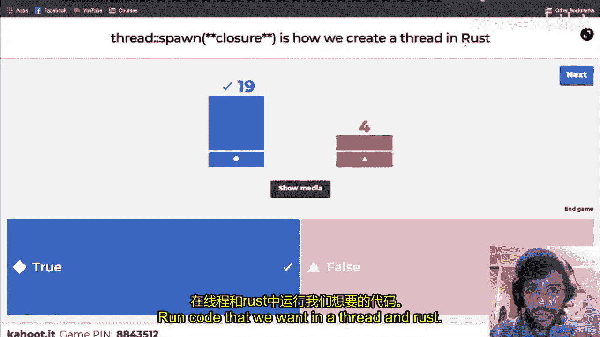
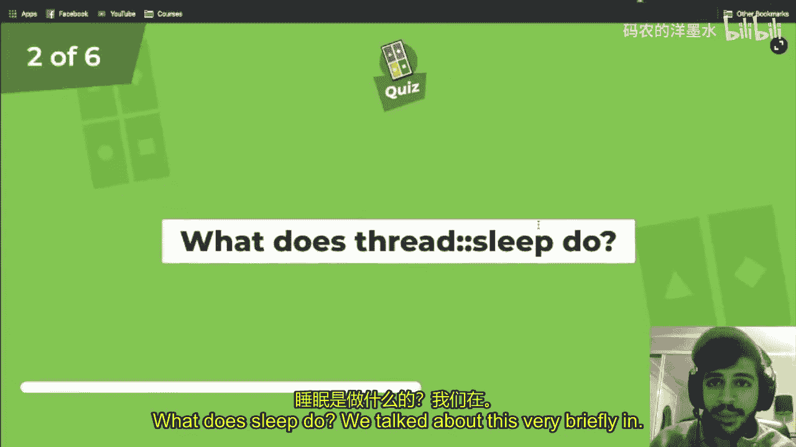
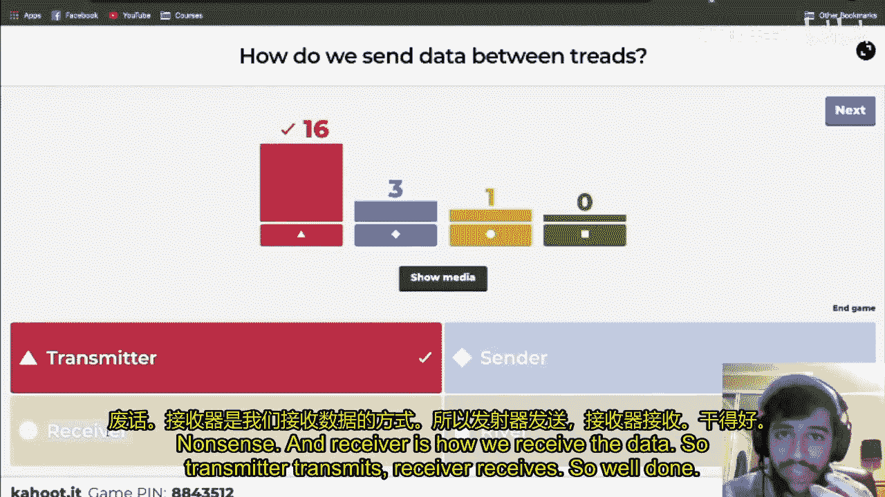
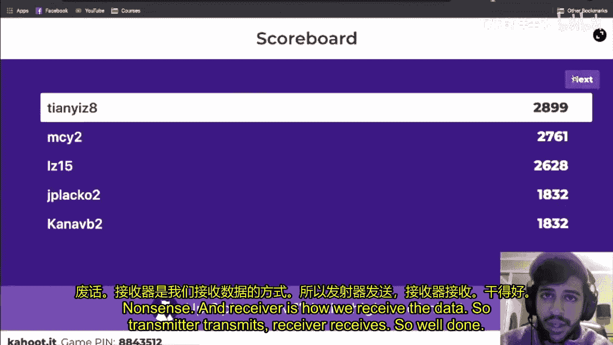
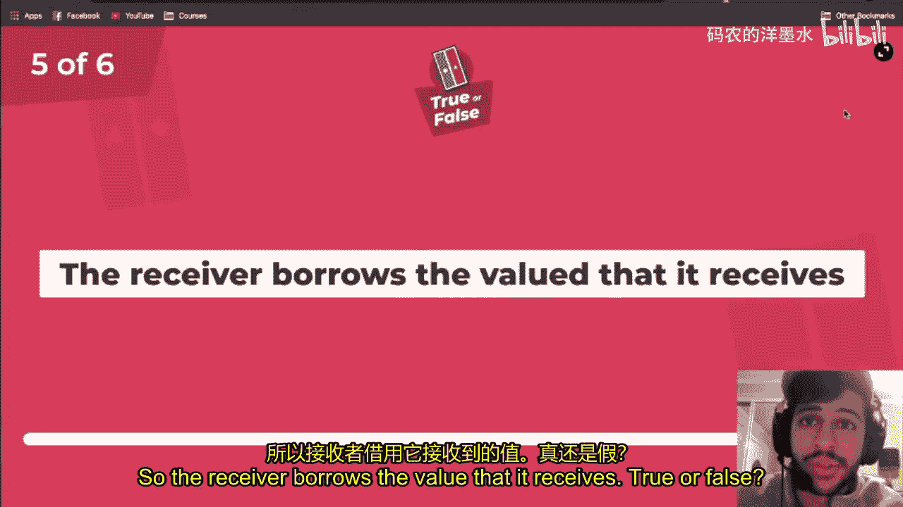

# 015：Rust并发、线程与通道 🧵


在本节课中，我们将学习Rust语言中关于并发编程的核心概念。我们将探讨什么是并发、为什么它很重要但同时又充满挑战，并学习如何在Rust中使用线程和通道来实现并发。

## 概述：什么是并发？

上一节我们介绍了课程的整体目标，本节中我们来看看并发的定义。

并发被定义为程序能够被分解为可以独立运行的部分的能力。

当我们谈论并发时，通常也会提到并行这个概念。以下是两者的定义对比：
*   **并发**：程序的不同部分可以独立执行。
*   **并行**：程序的不同部分在同一时刻执行。

为了帮助理解，可以考虑一些现实世界的例子。例如，人类处理日常任务时，通常不会等一件事彻底完成再开始另一件，而是以并发的方式工作：你可能在做作业，然后快速查看邮件，再回去做作业，接着回复短信。这就是并发。相比之下，并行就像是同时将四盘饼干放入烤箱并同时准备它们。

对于本讲座而言，我们将两者都归类为并发，不做过于精确的区分。

## 为什么使用并发？

上一节我们了解了并发的概念，本节中我们来看看为什么需要并发。

我们需要关注过去40年的微处理器数据趋势。处理器的速度增长开始趋于平缓，但我们拥有的核心数量却在急剧增加。这意味着我们无法单纯让处理器变得更快，但我们可以更好地利用已有的多个处理器。

并发允许我们利用计算机中的多个处理器，从而在许多情况下提升性能。

## 并发的挑战

尽管并发听起来很棒，但它也非常难以实现。一个挑战的例子是：Mozilla（开发Rust并创建Firefox的公司）曾有一个在Firefox网页渲染引擎中使用并发的议题。这个议题在C++代码库中开放了整整七年，因为在一个拥有数百万行代码的并发程序中添加功能极其复杂。

然而，当他们将代码迁移到Rust后，利用并发修复了那个问题，显著减少了渲染网页所需的时间。这清楚地展示了并发的益处。

那么，为什么并发如此困难？让我们通过一个简单的例子来了解并发程序中常见的挑战。

假设Jeff要从ATM取款2000美元，他的银行账户余额是5000美元。ATM的操作步骤是：
1.  从服务器读取余额（5000美元）。
2.  本地计算：5000 - 2000 = 3000美元。

与此同时，Jeff的公司向他的账户直接存款4000美元。银行的操作步骤是：
1.  从服务器读取余额（5000美元）。
2.  本地计算：5000 + 4000 = 9000美元。

如果这两个操作并发执行且没有正确处理，可能导致数据竞争。ATM可能将服务器余额更新为3000美元，而直接存款操作随后将余额更新为9000美元。最终，Jeff的账户余额错误地变成了9000美元，而不是正确的7000美元（5000 - 2000 + 4000）。

好消息是，Rust的所有权机制在很大程度上缓解了这类问题。并发中的常见问题，如内存安全问题和数据竞争，在Rust中通过所有权得到了解决。

## Rust中的线程

上一节我们探讨了并发的意义与挑战，本节中我们来看看Rust中实现并发的基础：线程。

在大多数现代操作系统中，执行的程序代码运行在进程中，操作系统同时管理多个进程。在你的程序内部，你也可以有同时运行的独立部分，运行这些独立部分的特性被称为**线程**。

将程序中的计算拆分为多个线程可以提高性能，因为程序可以同时执行多个任务，但这也增加了复杂性。

由于线程可以同时运行，无法保证不同线程上代码部分的执行顺序。

Rust试图减轻使用线程的负面影响，但在多线程上下文中编程仍然需要仔细思考，并且代码结构不同于单线程程序。Rust希望你在编写并发程序时更加无畏，但并发本身仍然具有挑战性。

### 创建线程

以下是如何在Rust中创建线程：

```rust
use std::thread;
use std::time::Duration;

fn main() {
    thread::spawn(|| {
        for i in 1..10 {
            println!("hi number {} from the spawned thread!", i);
            thread::sleep(Duration::from_millis(1));
        }
    });

    for i in 1..5 {
        println!("hi number {} from the main thread!", i);
        thread::sleep(Duration::from_millis(1));
    }
}
```

我们使用 `thread::spawn` 函数并传入一个闭包，该闭包包含我们想要在新线程中运行的代码。

在这个程序中，有两个线程：主线程和新创建的派生线程。派生线程打印数字1到9，主线程打印数字1到4。由于线程调度顺序无法保证，输出顺序可能每次运行都不同。



此外，注意派生线程可能无法打印到9，因为一旦主线程结束，程序就会终止，派生线程也可能被强制结束。


### 使用 Join 句柄等待线程




为了解决派生线程可能无法完成的问题，我们可以保存 `spawn` 的返回值。






`spawn` 返回一个 `JoinHandle`。当我们调用其 `join` 方法时，它会**阻塞**当前线程（这里是主线程），直到对应的派生线程执行完毕。


```rust
use std::thread;
use std::time::Duration;

fn main() {
    let handle = thread::spawn(|| {
        for i in 1..10 {
            println!("hi number {} from the spawned thread!", i);
            thread::sleep(Duration::from_millis(1));
        }
    });

    for i in 1..5 {
        println!("hi number {} from the main thread!", i);
        thread::sleep(Duration::from_millis(1));
    }

    handle.join().unwrap();
}
```

现在，即使主线程的循环先结束，它也会在最后被 `handle.join()` 阻塞，等待派生线程完成所有9次迭代。

`join` 方法放置的位置很重要。如果将它放在主线程工作之前，那么主线程会先等待派生线程完成，然后才开始自己的工作。

## 使用 Move 关键字实现线程安全

上一节我们学习了如何创建和控制线程，本节中我们来看看Rust如何通过所有权确保线程安全。

闭包可以捕获其所在环境中的值。但在多线程环境中，如果闭包捕获了值的引用，而该值在线程使用过程中可能被修改或丢弃，就会引发问题。

Rust通过强制闭包使用 `move` 关键字来获取其所用值的**所有权**来解决这个问题。这会将值的所有权转移到新线程中，原线程则无法再使用该值，从而防止了数据竞争。

```rust
use std::thread;

fn main() {
    let v = vec![1, 2, 3];

    let handle = thread::spawn(move || {
        println!("Here's a vector: {:?}", v);
    });

    // 此处不能再使用 `v`，因为所有权已移入闭包。
    // drop(v); // 如果取消注释，将会编译错误。

    handle.join().unwrap();
}
```

## 使用通道在线程间传递消息

线程间需要通信。Rust标准库提供了**通道**来实现基于消息传递的并发。

可以将通道想象成一条河流。通道有两端：**发送者**和**接收者**。发送者（上游）将数据放入“小船”并送入河流，接收者（下游）则在终点接收这些“小船”。

### 创建通道

Rust的标准通道是 **MPSC**（多生产者，单消费者）通道，意味着可以有多个发送者，但只有一个接收者。

```rust
use std::sync::mpsc;
use std::thread;

fn main() {
    let (tx, rx) = mpsc::channel();

    thread::spawn(move || {
        let val = String::from("hi");
        tx.send(val).unwrap();
        // 此处不能再使用 `val`，因为所有权已随 `send` 转移。
    });

    let received = rx.recv().unwrap();
    println!("Got: {}", received);
}
```

1.  `mpsc::channel()` 创建一个通道，返回一个元组 `(发送者, 接收者)`。
2.  在新线程中，我们使用 `tx.send(val)` 发送一个值。
3.  在主线程中，我们使用 `rx.recv()` 阻塞等待并接收发送过来的值。`recv()` 会返回一个 `Result<T, E>`，成功时包含接收到的值。

### 通道与所有权

发送操作 `send` 会获取参数的所有权，并将所有权转移给接收端。这意味着发送后，原始发送者不能再使用该值。这是Rust防止数据竞争的又一机制。

### 多个发送者


通过克隆发送者，可以实现多个生产者向同一个消费者发送消息。







```rust
use std::sync::mpsc;
use std::thread;

fn main() {
    let (tx, rx) = mpsc::channel();
    let tx1 = tx.clone(); // 克隆发送者

    thread::spawn(move || {
        let vals = vec![
            String::from("hi"),
            String::from("from"),
            String::from("the"),
            String::from("thread"),
        ];
        for val in vals {
            tx1.send(val).unwrap();
            thread::sleep(Duration::from_millis(1));
        }
    });

    thread::spawn(move || {
        let vals = vec![
            String::from("more"),
            String::from("messages"),
            String::from("for"),
            String::from("you"),
        ];
        for val in vals {
            tx.send(val).unwrap();
            thread::sleep(Duration::from_millis(1));
        }
    });

    // 将接收者当作迭代器使用，无需显式调用 recv
    for received in rx {
        println!("Got: {}", received);
    }
}
```


两个派生线程分别使用原始的 `tx` 和克隆的 `tx1` 向同一个接收者 `rx` 发送消息。主线程通过迭代 `rx` 来接收所有消息。由于线程执行顺序不确定，输出消息的顺序也可能是交错的。

## 总结


本节课中我们一起学习了Rust并发编程的基础知识。


我们首先了解了**并发**的概念及其与并行的区别，并探讨了使用并发的原因（利用多核）和挑战（数据竞争、复杂性）。

接着，我们深入学习了Rust中实现并发的两个核心工具：
1.  **线程**：使用 `thread::spawn` 创建新线程，通过 `JoinHandle` 的 `join` 方法等待线程完成。Rust利用所有权和 `move` 关键字确保线程间数据访问的安全。
2.  **通道**：使用 `mpsc::channel` 创建用于线程间通信的通道。发送者 (`tx`) 和接收者 (`rx`) 通过消息传递进行通信，`send` 操作会转移数据的所有权，从而在编译期防止数据竞争。MPSC通道支持多个发送者。


Rust的所有权系统为编写安全、高效的并发程序提供了强大的编译时保障，使得开发者能够更自信地处理多线程任务。