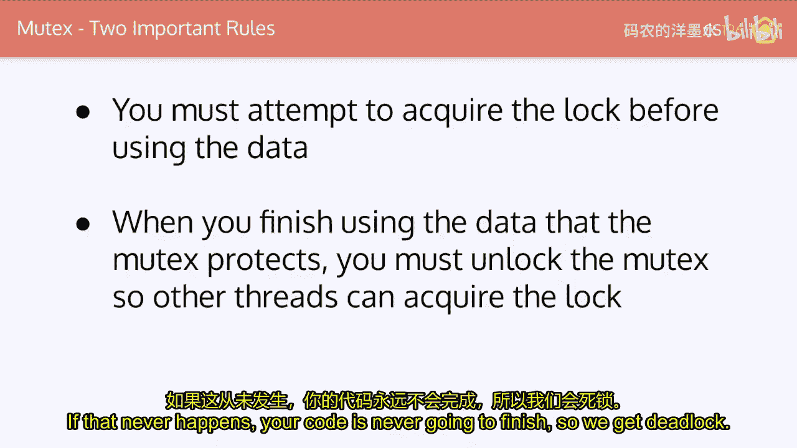
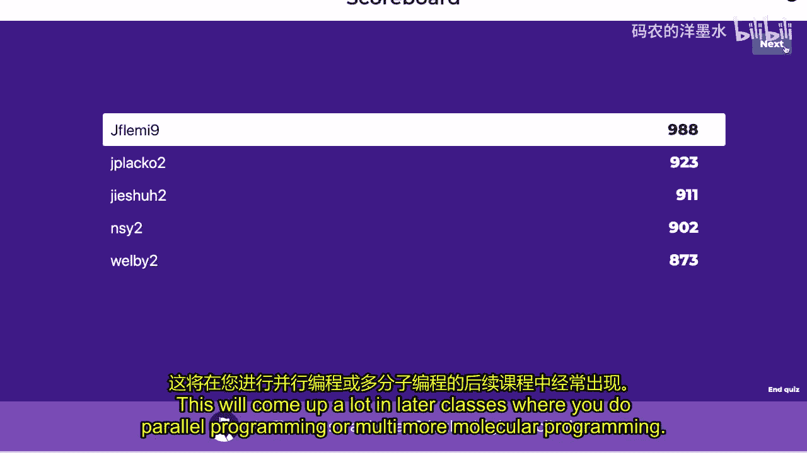
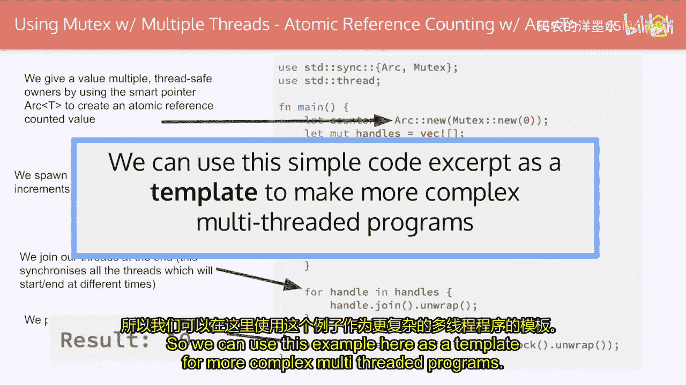
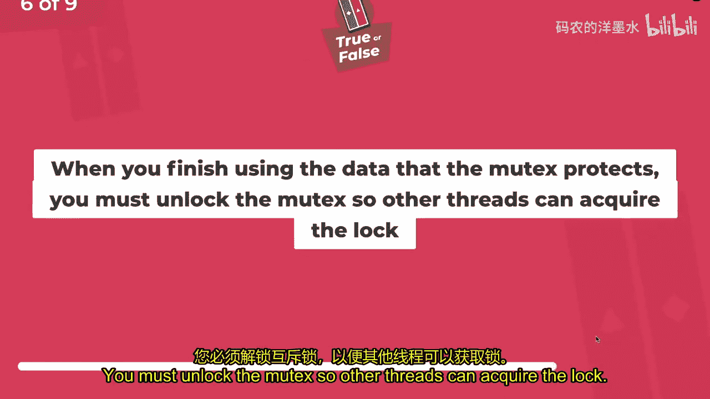

# 016：共享状态并发与互斥锁

在本节课中，我们将要学习共享状态并发的基本概念，理解其潜在问题，并探索如何使用互斥锁来解决这些问题。我们还将了解Rust语言如何独特地处理互斥锁，以帮助开发者避免常见的并发陷阱，如死锁。

## 共享状态并发及其问题

上一节我们介绍了使用通道进行线程间通信。本节中我们来看看另一种并发模型：共享状态并发。

共享内存并发类似于多重所有权，即多个线程可以同时访问同一内存位置。这听起来可能带来问题，让我们通过一个例子来理解原因。

以下是线程访问数据时可能出现的问题的一个典型示例。这是一段伪代码，类似于Rust代码：

```rust
static mut GLOBAL_VAR: i32 = 0;

for i in 0..10 {
    GLOBAL_VAR += 1;
}
```

实现变量递增时会发生三个重要步骤：
1.  线程首先读取变量的当前值。
2.  线程递增该值。
3.  线程将新值写回变量。

在单线程程序中，这个过程是顺序的：0, 1, 2, 3, 4, 5, 6, 7, 8, 9。最终 `GLOBAL_VAR` 的值是10。

然而，在两个线程同时运行的情况下，情况就变得复杂了。假设每个线程循环5次（总计10次递增）。我们的目标仍然是最终得到10，并且因为有两个线程同时工作，速度应该更快。

但实际执行过程取决于CPU调度器如何分配时间给这些进程，无法保证按我们期望的顺序执行。可能出现以下交错执行的情况：
*   线程1读取0，递增为1并写入。
*   线程2读取1，递增为2并写入。
*   线程1读取2，递增为3（但在写入前）...
*   线程2也读取了2，递增为3并写入。
*   此时，两个线程都认为它们将值从2递增到了3，但实际只增加了一次，值变成了3而不是4。

由于线程可能在同一时刻读取相同的值，然后分别递增并写回，导致实际递增次数少于预期。多次运行此代码可能会得到不同的最终结果，这是不可接受的。




## 互斥锁：解决方案


互斥锁是“相互排斥”的缩写。互斥锁通过确保在任何给定时间只有一个线程可以访问数据，来解决我们之前遇到的问题。

要访问互斥锁中的数据，线程必须首先请求互斥锁的**锁**。锁是一种数据结构，用于跟踪当前谁拥有数据的独占访问权。拥有锁的线程可以自由访问和读取数据。其他试图获取锁的线程将被阻塞，必须等待锁被释放。


可以用一个会议室的比喻来理解：
*   **线程**是演讲者。
*   **互斥锁**是唯一的麦克风。
*   **数据**是听众。
*   一个演讲者拿到麦克风（**锁定**互斥锁），只有他能对听众讲话（访问数据）。
*   演讲结束后，他放下麦克风（**解锁**互斥锁）。
*   然后下一个演讲者可以来拿麦克风。


通过这种方式，任何时刻都只有一个人可以访问数据。





## 互斥锁的规则与死锁


互斥锁有两个重要规则：
1.  在使用数据之前，必须尝试获取锁。
2.  当使用完互斥锁保护的数据后，必须解锁互斥锁，以便其他线程可以获取锁。

然而，在多线程编程的复杂性中，遵循这些规则可能很困难。一个常见的问题是**死锁**。


死锁发生在当一个线程忘记解锁互斥锁时。其他线程在尝试访问该互斥锁时会被阻塞，等待锁被释放。由于锁永远不会被释放，代码无法继续执行，程序“冻结”在此状态。调试死锁非常困难。


## Rust中的互斥锁

Rust通过其所有权系统帮助我们避免死锁。让我们看看Rust中互斥锁的基本用法。

以下是一个简单的单线程程序中使用互斥锁的例子：

```rust
use std::sync::Mutex;

fn main() {
    // 使用 new 函数创建一个新的 Mutex，初始值为 5
    let m = Mutex::new(5);

    {
        // 使用 lock 方法获取锁，返回一个 Result，我们使用 unwrap
        let mut num = m.lock().unwrap();
        // num 可以视为指向互斥锁内部数据的可变引用
        *num = 6;
        // 当 num 离开作用域时，Drop trait 会自动调用，释放锁
    }

    println!("m = {:?}", m);
}
```

关键点在于：
*   `m.lock()` 会返回一个 `MutexGuard` 智能指针。
*   我们可以通过解引用来访问或修改内部数据（如 `*num = 6`）。
*   当 `MutexGuard` 离开作用域时，Rust会自动调用其 `Drop` 实现来**释放锁**。这意味着在Rust中，你几乎不需要手动解锁，从而极大地减少了死锁的可能性。

## 多线程与 `Arc<T>`

然而，要在多个线程间共享互斥锁，我们需要更多的步骤。Rust的所有权规则要求我们使用 `Arc<T>`（原子引用计数）智能指针类型。

`Arc<T>` 允许数据拥有多个所有者，并且是线程安全的（但会带来一些性能开销）。我们只在多线程程序中需要它。



以下是一个在多线程中使用 `Mutex` 和 `Arc` 的示例：





```rust
use std::sync::{Arc, Mutex};
use std::thread;


fn main() {
    // 使用 Arc 包装 Mutex，使其可以安全地在多个线程间共享
    let counter = Arc::new(Mutex::new(0));
    let mut handles = vec![];

    for _ in 0..10 {
        // 克隆 Arc 指针，增加引用计数
        let counter = Arc::clone(&counter);
        // 创建新线程
        let handle = thread::spawn(move || {
            // 在线程内获取锁
            let mut num = counter.lock().unwrap();
            // 修改数据
            *num += 1;
            // 锁在 num 离开作用域时自动释放
        });
        handles.push(handle);
    }

    // 等待所有线程结束
    for handle in handles {
        handle.join().unwrap();
    }

    // 打印最终结果
    println!("Result: {}", *counter.lock().unwrap());
}
```


这段代码创建了10个线程，每个线程都将计数器增加1。通过使用 `Arc<Mutex<T>>` 模式，我们安全地实现了多线程间的共享状态修改。最终结果将是10。


这个简单的代码模板可以用于构建更复杂的并发程序。

## 并发的用途

最后，我们来谈谈并发的实际用途。并发并不仅限于特定任务，它可以优化许多任务。任何可以并发完成的事情也可以线性完成，但并发能在以下方面帮助我们：
*   **提高程序吞吐量**：它允许在给定时间内完成的任务数量随着处理器数量的增加而增加，从而更充分地利用多核硬件。
*   **改善程序结构**：有些任务本质上是并发的，用并发方式建模更自然（例如，Web服务器同时处理多个请求）。
*   **更好地利用硬件**：非并发程序可能只使用一个CPU核心，而并发程序可以利用所有可用的核心，最大化硬件性能。

## 总结


本节课中我们一起学习了共享状态并发的核心概念。我们了解到多个线程直接访问共享内存会导致数据竞争和不一致的结果。互斥锁通过提供独占访问机制来解决这个问题。我们探讨了互斥锁的基本规则以及忘记解锁导致的死锁问题。重要的是，我们看到了Rust如何通过其所有权系统和 `MutexGuard` 的自动 `Drop` 机制，极大地简化了互斥锁的使用并帮助开发者避免死锁。最后，我们通过 `Arc<Mutex<T>>` 模式实现了多线程间的安全数据共享，并讨论了并发编程在提升吞吐量和硬件利用率方面的价值。