# 【全集 春季版】伊利诺伊大学 计算机编程：从Bash到Rust 中英字幕 p03 Lecture 3 - git和github -BV188rDBFEUY_p3-

So hands。

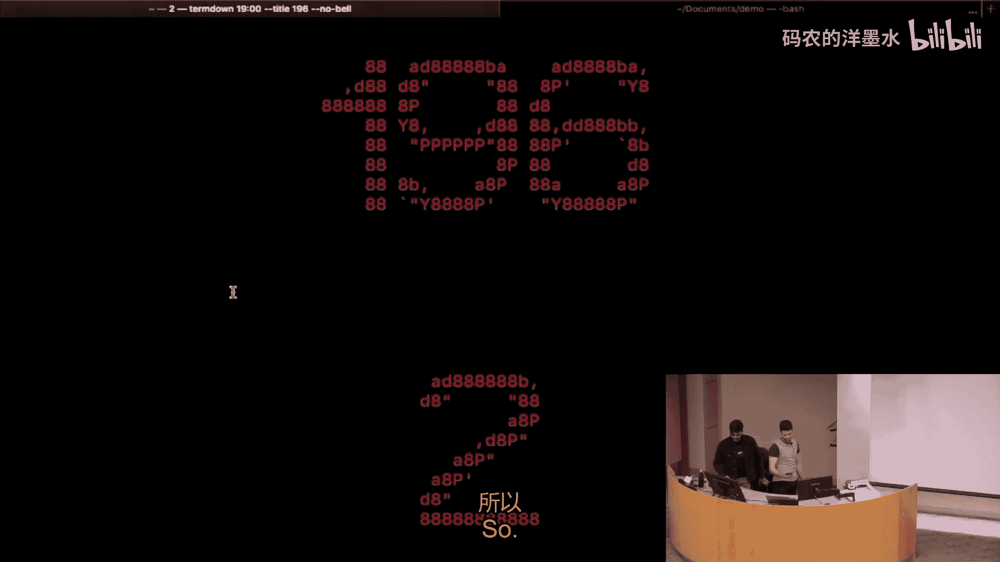

Alright， welcome back to CS S 196。 So we have a bunch of announcements for you guys today。

 but we're gonna actually save that for the end of the class。

 It's related to filling out a bunch of forms。 We're gonna be starting up projects pretty soon so we can actually go ahead and get straight into the lecture for today。

 So that's gonna be on our intro to Git。 And so the introduction to get that I'm gonna give to you guys today is going be the best conceptual overview that I can give you of the foundational topics in Git。

😊，And so。😊，Without further ado， what exactly even is Git and why do we use it。

 So Git is what we call a viin control system and a virgin control system， what it allows you to do。

Its track changes in computer files。 And as a result of that。

 you can use that to recover previous versions of your work， and you can also use another use case。

 which is being able to collaborate with other developers on your team in the same project。

Git itself is the most commonly used version control system at the moment。

 There's older versions of Virgin control that are still being used today。

 but Git is the most popular one。 And it's the one that you're going to encounter a lot in your career。

So it's extremely important to make sure that you understand it thoroughly。

 And that's because you're gonna be able to use it in your internships。

 in your classes here at the University of Illinois。

 if you're taking computer science classes and for the rest of your career。

So the thing about Git is that it can seem very， very scary。

 I'm sure many of you guys have heard these stories of people losing their entire code base because they made some weird mistake or they missed the past four weeks of their progress because someone on their team ran some weird commands。

These are very， very rare encounters that you'll have when using Git。 And， you know。

 this is actually a real error message。 You are now in a detached head state。 It's terrifying。

 If I got this message， then I'd probably file for unemployment or something。

And what is important to understand， though。Is that with a good understanding of a gi and all of its good practices。

 you'll make sure that you will never have these issues。 They're all very， very preventable。

And even if you end up making these mistakes， they're all fixable。😡。

That is why you need to make sure you understand Gi thoroughly。

So we can go ahead and start off with a conceptual overview of what Git is。

Git is a distributed version control system。 Now， the word distributed。

 you don't need to focus too much on it。 Just know that previously。

 we used to use what are called centralized version control systems。

I'm not gonna go too much into the differences between centralized and distributed version control systems。

 If you want to look into it in on your own time， you can go ahead and do that。

 But Git is a distributed versionin control system。And so let's say there's a person。

 His name is John， and he wants to go ahead and start up a project for some sort of Android app。

So what he can do is he can create what is called a repository。

 So don't get very scared about this word repository。 It's just basically a fancy word for folder。😰。

And so let's say John starts off with his Android app and he creates like a homep page。

So he can save this change to his local repository by doing what is called a commit。

 And that's exactly what a commit is。 It is a save to your local repository。

 And it's best practice to make sure that you commit with every small piece of functionality that you implement。

😊，So let's go ahead and say John's friend Matt wants to join in on this project with him。

So Mac can go ahead and create his own repository。 And the way that he can get the project files that are in John's repository is by running a command called cloneone。

 Clne does exactly what it sounds like。 It'll copy a repository into your own local repository。😊。

So now， if you notice， I'm representing the changes in the state of the file by the color of the folder on the computers。

 So just make sure you keep that in mind。 I'm going be using that throughout all of these slides。

So here we have John's repository and Mats repository。 And then the example that I'm using。

 they both have an Android app with a home page implemented。

So what's important to understand is that while these repositories have the same exact content。

 they are not the exact same， meaning if Matt goes ahead and commits to his own repository。

 let's say Matt goes ahead and adds a navigation bar on top of the homep page in the Android app。

 What you can realize is that Matt's repository isn't impacting John's repository。

 These repositories are in two different states， right。So if Matt goes ahead， or rather。

 if John goes ahead and makes another change to his repository。

 let's say he has an Android app with a home page。 and now he has a friend's page。

These two repositories are in different states。 They are not affecting each other。

And let's go ahead and say that Matt wants to go ahead and pull in John's changes。

So the command that I just ran is pull。 Po does exactly what it sounds like。

 It pulls in all of the changes from another branch。And if John， or sorry。

 if Me wants to go ahead and push all of his commits to John's repository。

 he can run the opposite command， which is push。So now both of these repositories are in the same state。

 They both have the Android app with all of the combined merged features， homepage， navigation bar。

 friendss page， and they were able to collaborate with each other。

This is not how we use get in practice。 If you noticed in the example we were pushing and pulling directly to each other's computers。

 This is not how we use gett in practice。 because if you think about it， it would make you。

 It would require you to like， open your hard drive up to the world and enable others to read and write to your local computer。

 That's unsafe。Very stupid， right。 So what is the solution to this。

 The solution to this is to use what is called a remote repository。 And so in this case。

 the remote repository is going to be Github。 It doesn't have to be Github。

 There's many other versions of a remote repository。 There's Gitlab in companies。

 they run their own servers internally。 But for this example， we're gonna go ahead and use Github。

So with the use of a remote repository， what we can go ahead and do is directly from the remote clone into John and Matt repository。

 So in this example， we can go ahead and say that this is an Android app。

 just a plain old Android app with like a navigation bar。 for example。

 And so the the benefit of using a remote repository。 is that now John。

 let's say he adds a new piece of functionality。 Let's say he adds a button。😊。

This doesn't affect Mats repository。 And we still have a version of the Android app on the remote repository。

 And if John wants to go ahead and push his changes。

 he can send it to the remote and make it available for Matt to pull in the changes into his。

 And so with this use of the remote repository， we aren't gonna to have any visibility between the local repositories。

 much safer and much more scalable， If you think about the other example of using get without Github or a remote repository。

 If you think of how that would scale with3，4 or n repositories， it wouldn't scale very nicely。

 But with this， it's important to understand that let's say a new person joins the team。

 she can easily go ahead and clone the version of the Android app into her repository and so on and so forth。

 It scales very nicely。So with that， we're going to go ahead。And get into a Kaahooo question。

Kooot dot I T。 or if you have the app， open the app。I'm going to give you guys like two minutes。

🎼Join in。Use your Net ID so we can give you attendance， don't worry about winning or something。

No benefits of placing top five we're just using it for attendanceance。🎼。🎼。🎼，🎼，うん。🎼え。🎼。🎼All right。

 does anyone not and raise your hand。🎼，🎼Yeah。🎼Theyre run good， okay。

 someone go ahead and get started。🎼First question is。

 if you want to send local repository commits to the remote repository， you should run。🎼あた。🎼，🎼But。🎼。

Okay。Yeah， so this is definitely false。 If you remember from the example。

Push takes all of your commits， and it'll push it to the remote repository。

 Poll does the exact opposite。 If there's changes in your remote repository。

 you can use pull to pull in those changes to your own local repository。

And you'll have basically downloaded all those changess。

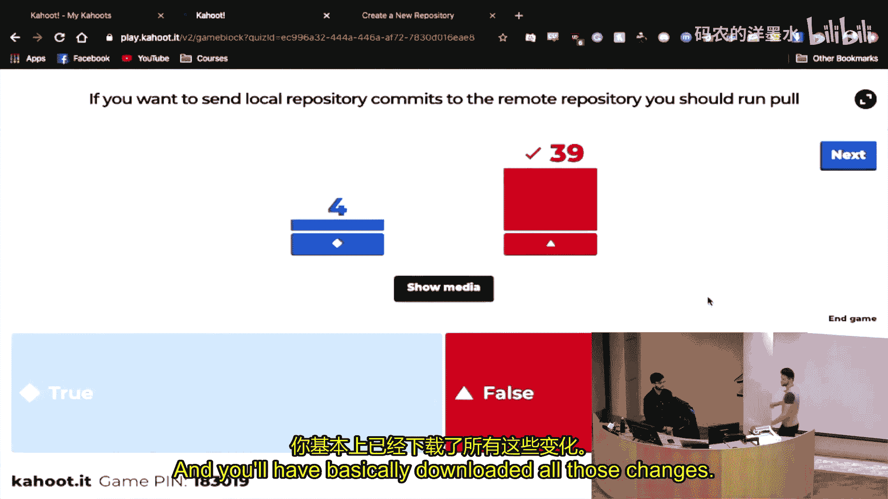

So very good， one or two more questions。

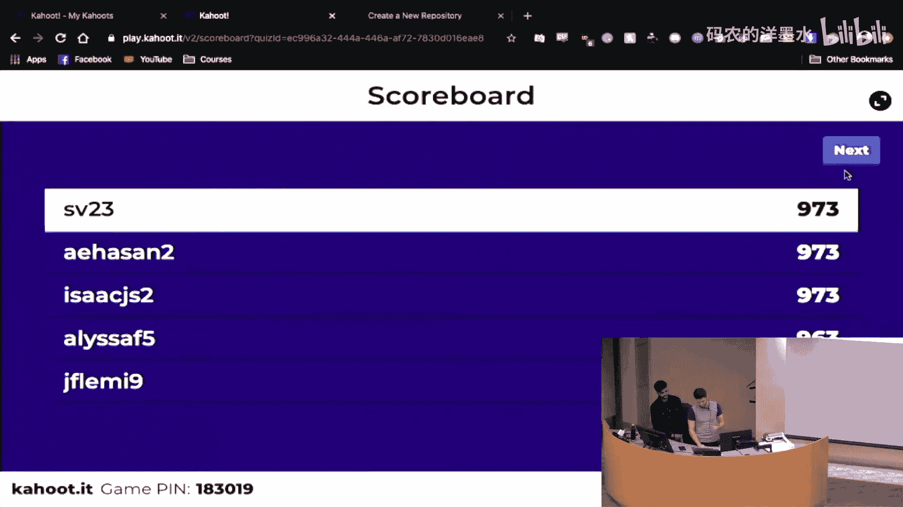

So you just joined a development team that uses Git。

 What Git operation would you most likely use first。

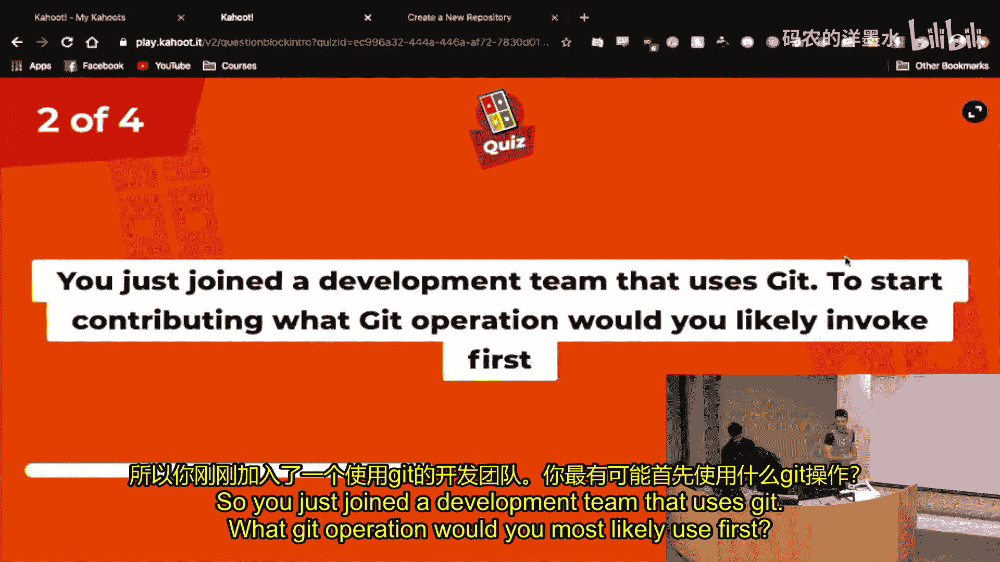

🎼，🎼う。🎼。🎼The。🎼。Okay。So remember。Hoole and clone are not the same exact thing。

Clone does exactly what it sounds like， is what you do to copy another repository into your own local repository。

 So when you pull something， you're you're gonna to use pull when you want to pull in the changes that are made on the remote。

 Clone is where you're gonna run first to get the version or the copy of the repository into your own so you can start contributing to it。

So good for the most part。But just make sure you know that cloneum pole are not the same thing。

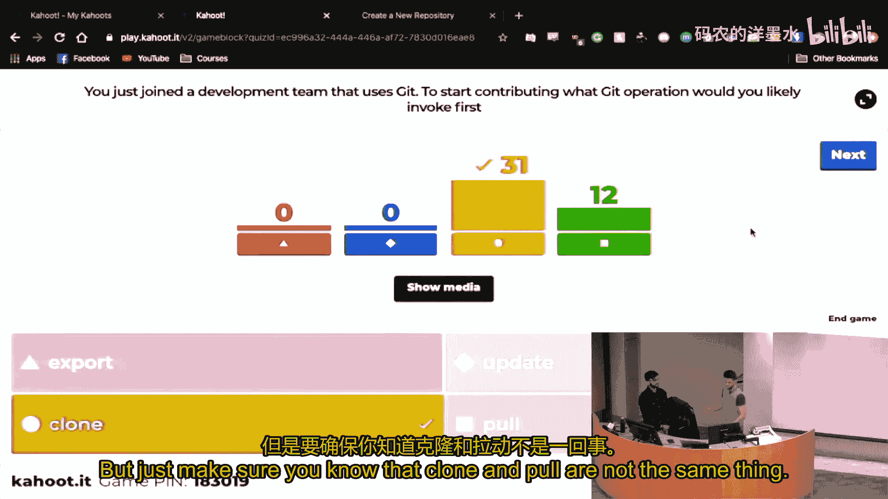

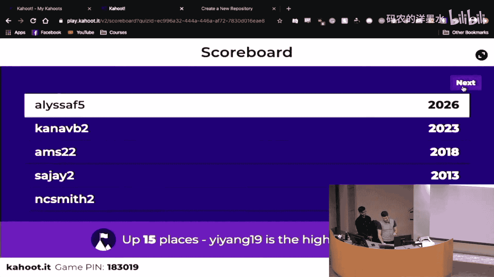

And。

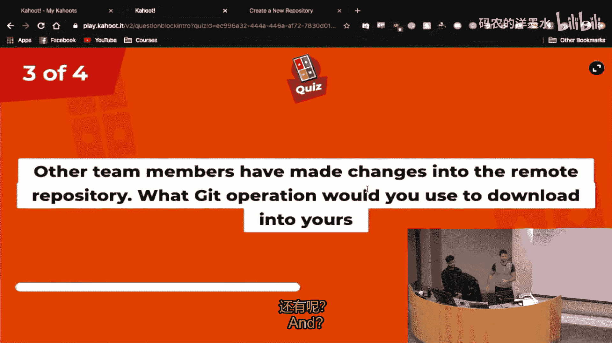

I probably gave away the answer to this one。🎼，🎼，🎼因为。Very good。嗯。Yeah。

 Ive went over this a couple times， so。啊。Alright， so I went through that pretty fast。

 I want to make sure that we go ahead and clarify some of the terminology that we've already said。

 But while we're at it， I want to introduce some new terminology into the mix。So。With Git。

 there are four environments。 we have a working directory， a staging area， a local repository。

 and a remote repository。So some of these from the example that I went through。

 you probably already know what they are， some of them， you already know。

 but you don't think you know。 So we'll start off with a working directory。So the working directory。

 if you remember from the example， this is just basically the plain old folder。

 Nothing special about it。The working directory is exactly what your operating system knows。

 It's gonna have all the files， whether they're tracked or untracked by Git。

 It's just a plain folder。A staging area。 So this is something that I didn't mention。

 So Git can only track what it knows about。 You can't just create a repository and start committing and pushing and pulling without actually telling Git what files it needs to track what files it needs to know about。

 So in the example， it's just that little area that I have grade out there。

So any additional files that you add， any changes that you make。

 you want to put them in the staging area so that way Git actually knows what to do with them and that Git can actually track them when you're making these commits。

 pushing and pulling， etc。啊， wrong柜。So oh， wrong way again， local repository。

So I said this a couple times in the example that the local repository is just basically the repository that's on your computer。

 So it contains all of the changes that you want to eventually mirror into the remote repository。

Nothing very fancy about this。 It's exactly what it seems。啊。Remote repository。

 So the remote repository， I use the example of Github。 It doesn't have to be Github。

 It can be Gitlab， for example， or whatever you want to use in your project。

 whatever you guys decide on， The remote repository is going to be a mirror of your local repository。

 It contains a history of all of the changes that you made in your local repository。

 It's another place for your changes to live。 And this is actually something that the world can see unless you make it private。

 right， unlike the local repositories， there is no visibility between them。

 The remote repository is a bit different。And so with that， we can go ahead。

And introduce our first batch of Git commands。So we have six commands here。 We have get in it。

 get clone， gett add， get commit， get push， and get pull。

 Most of these you already understand from the example that I gave the conceptual overview。

 But some of them， you don't。 So get in it。 Basically。

 all it does is it'll add a dot gi folder into your repository。

 And this is the way that you summon git into your folder。Gt clone， like we said earlier。

 it'll copy a Git repository from a remote source into your own。Getit add。

 it'll add the files to the staging area so that way Git can essentially know about them。

 It can track them， and it can do things with them。Git commit with Git commit。

 you can go ahead and save your changes to the local repository。 And with every commit you make。

 essentially a snapshot。 So you can bundle up commits。

 let's say one commit has a button that you introduced into the program。

 Let's say another commit has a home page that you introduced into the program。 every single version。

 every single commit， you'll create a snapshot of some sort。

 And you can take advantage of this when you're developing because you can backtrack very easily。😊。

Get push。 What it does is it'll transfer all of your commits to your local repository。

 from your local repository to your remote repository。

And so it is important to understand that with a gi push。

 you can push more than one commit at a time。 So if you wanted sue。

 you could commit and then push or you could commit 20 times and then push。

 It's best practice to make sure that you push fairly often。

 You don't want to push 100 commits at the same time。

 because you want to keep your remote repository fairly updated。Gt pull。

 So if your remote has updated and you want those latest changes with Git push or sorry， Git pull。

 you can pull in those changes that way you can interact with them on your own repository。

So with that。We're going to have just one more kooo question。

And so what I introduced to you guys here is how we move between the four environments。

 Those commands make it easy for us to do。

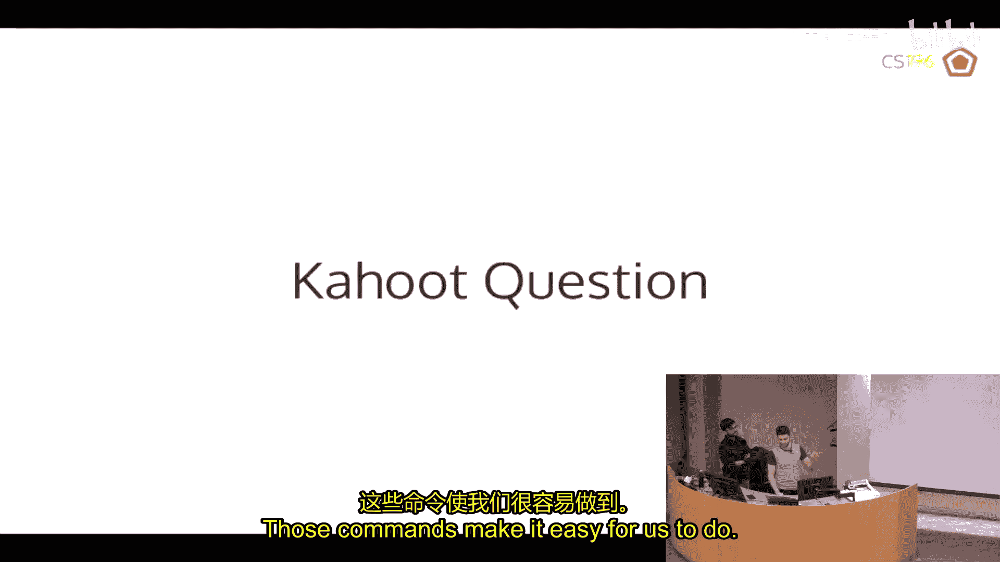

And this question is going be on exactly that。

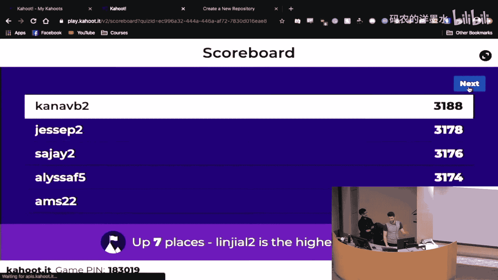

You'll have a little bit more time on this question。I don't know if all of you will need it， but。

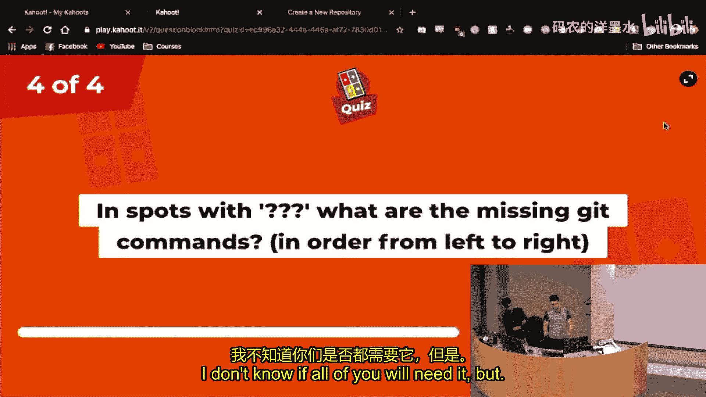

On this diagram。Three question marks。What are the commands that are missing from those question mark。

 don't worry too much about reset and reset commit。That will cover at a later date。🎼，🎼，🎼。All right。

Thank God， Nolan Pickering。嗯。So if you remember from the slides。

 the way that we move between environments is by using the commands that I showed you at the end。

And so， if I can show the。

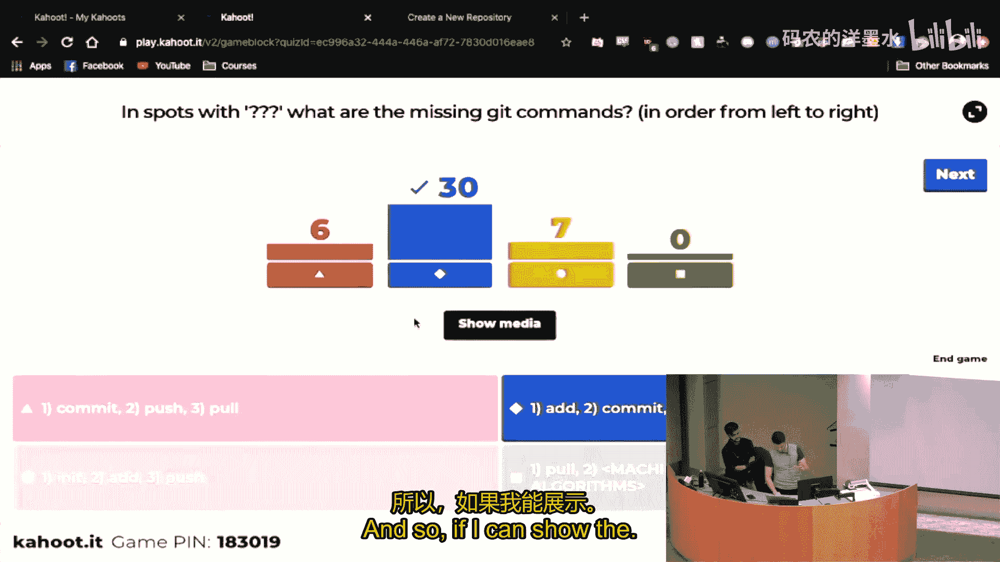

There we go。So to go from our working directory to our staging area， we want to use ad。

 This will add all of the changes。 whether it was added files or changes in those files。

 we can use the ad command to go from our working directory to our staging area。

Then from our staging area。To our local repository， this is where we can go ahead and use commit。

And with those two commands ran， we can use Git push to go from our local repository to our remote repository。

 It'll take all of our commits and send it to the remote。So this is how we move between environments。

And it's important to understand some of this terminology。

 because you'll use it when it comes to debugging in your error messages。

 you'll see this kind of terminology。 This helps you understand what's going on more。

 And it'll give you a better understanding overall。

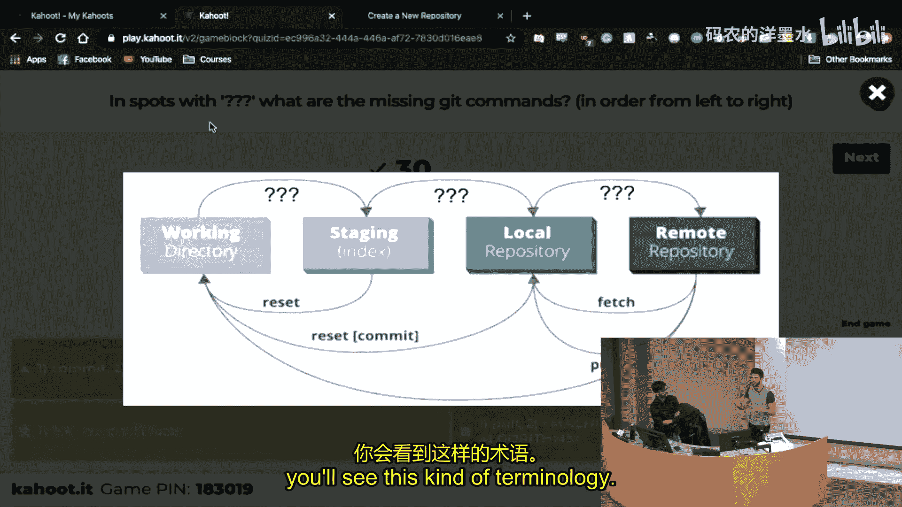

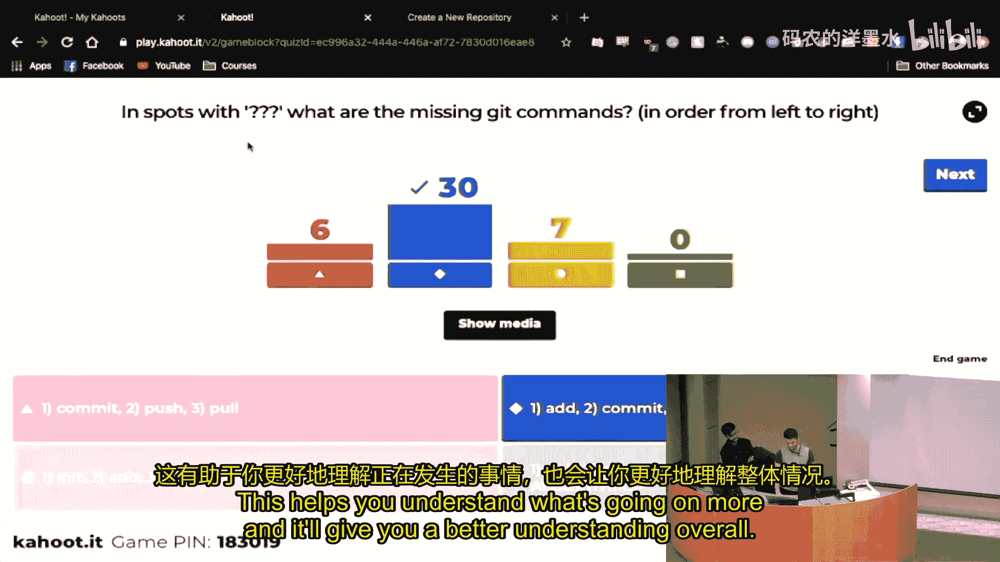

So those are all the questions。I don't know， this is the leader board if you guys care。

Congratulations to Vi guy。

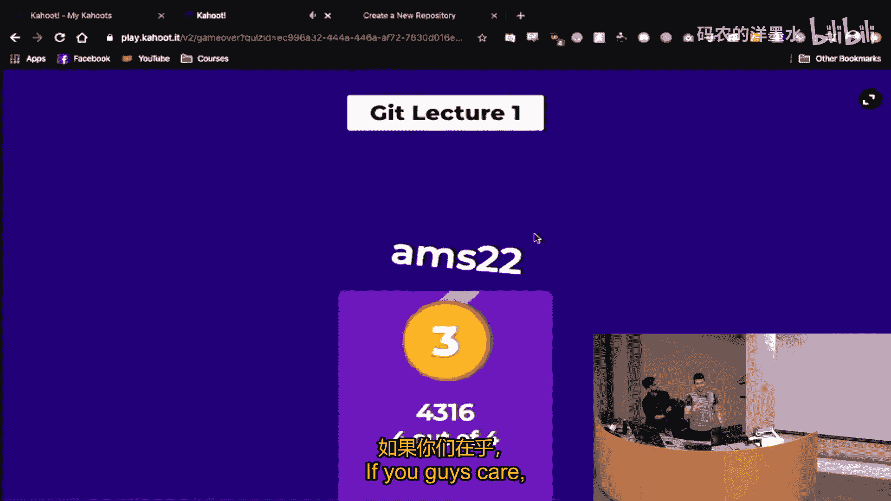

Third place。Second place。First place， none of this means anything。

 you guys don't get any extra points。

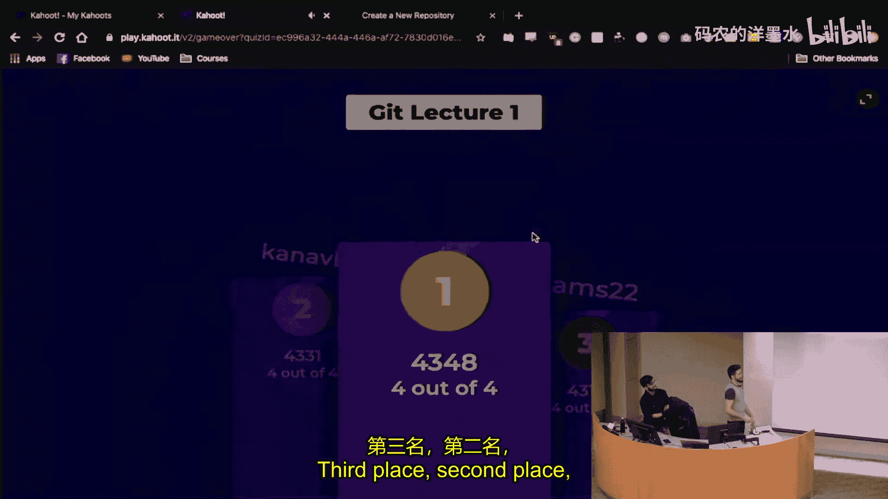

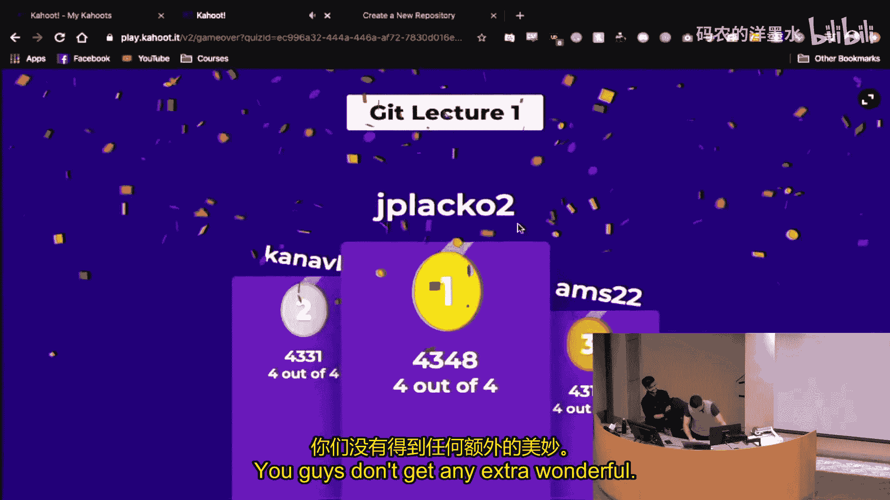

Wonderful。So with that， I'm going introduce your very first workflow。Now。

 if you were paying attention in the whole lecture so far。

 this workflow is gonna to be pretty obvious。So the first thing you want to do is add the files to your staging area。

 Let's say that you made a change。 Let's say you added a new piece of functionality and you want to send it to the remote。

 This is the first step you take。 Now， you're not always going to need to use this command。

 And I'll show you that in the live demo。 But the two commands they you can do is get add dot or get add dash dash all。

 If you remember from the bash lectures。 dot is how we represent our current directory dot dot is how we represent our parent directory。

 So in this case， get add dot or get add dash all is going to take all of the untraracked files in our in our current directory and it's going to put it in the staging area。

Now， sometimes you don't want to do this。 Sometimes you want to go ahead and be a little bit more specific with what files you add to your staging area。

 Let's say you make some changes in four different files。

 But the only thing that you want to put in your staging area are two of those files。

You can be a little bit more specific and do Git add file name。

 or you can go ahead and add multiple in the same command。 So Git add file name， file name。

 and so on and so forth。So this is the first step in your first very simple workflow。

 And I'll put this workflow to life once we actually get into the live demo。

So the second is Git commit。 Now， you're always gonna run Git commit because like I said。

 this is how we save those changes to our local repository。 You make a change， Git add， Git commitm。

 And the way that we do this in the terminal is we'll do Git commit。😊，Dash M。

 this is a flag to basically tell the terminal， hey， there's a message coming。

 And that's what comes right after。 And so it's important to keep in mind that your git commit messages。

 you want to make sure that they're concise， They're simple。

 but they're very descriptive of what you did。For example， in the conceptual overview that we had。

 we had an Android app。 If you add a new button， you don't want to have your commit message say。

 you know， A S D A F。1，2，3。 That makes no sense if someone on your team is looking at the last commit that you made。

 they won't be able to understand what your commit is by just looking at the commit message。

 So a better commit message would be implemented the functionality for a button on the homeage。

So that way， if someone's working with you， they can actually understand what's going on。

Get commit dash a dash M is another way of running commit very， very similar。

 But the dash a flag will go ahead and actually take all of the un take all of the saved changes in your repository and commit them immediately。

 I' will get a little bit more into this into the demo currently won't make too much sense。

 But once we hit the demo I'll go over them。😊，And then the last step is Git push。

 So when you want to send the commits off， this is when you run Git push。Like I said。

 you can run git push whether you sent one commit， two commits，10 commits。

But you want to make sure you do this relatively often So you keep your remote repository updated。So。

With that。

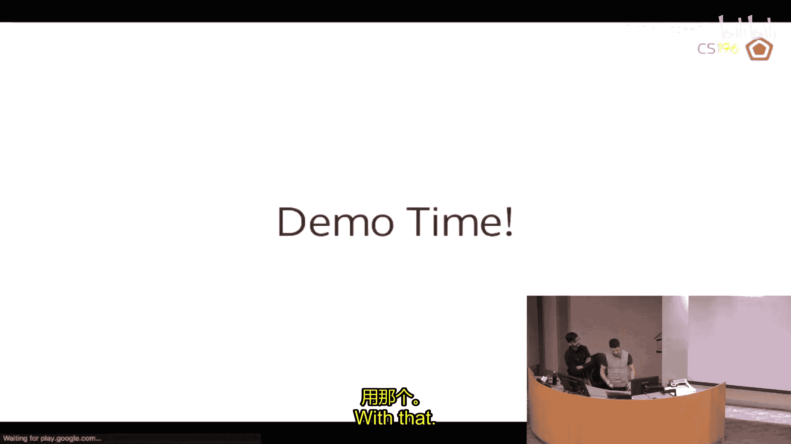

It's demo time。So I'm going to open up my batch terminal。If you were here for last week's lectures。

 this should look very familiar for you。

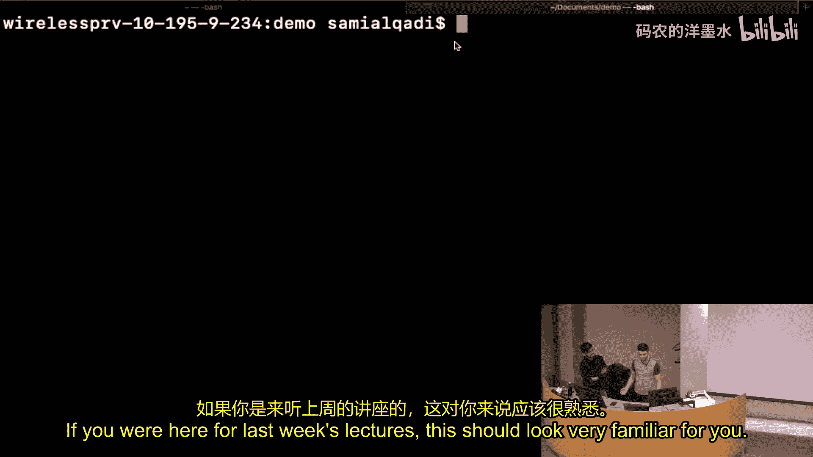

I'm gonna go ahead and create。The new repository， straight on Github。And I'll go ahead。

And call the repository something like 1，96 lecture。For you guys， the repository name would be。

 you know， the name of your project or whatever it may be。

And I don't want it to be public on my rep on my Github。 So I'm gonna make it private。

I'm gonna initialize it with a readme。 And I just created a repository。

 So I actually made it straight on the remote。 If I wanted to do this locally。

 I would just run gett in it。 But instead， here it is on the website。So this is my repository。

 This is what Github looks like。 There's a lot of features on this website。

 We'll go into it more later。 But for now， we just created a repository。So now。

 if you notice here where it says cloner download， it'll give us this link。

And I can go ahead and copy it。

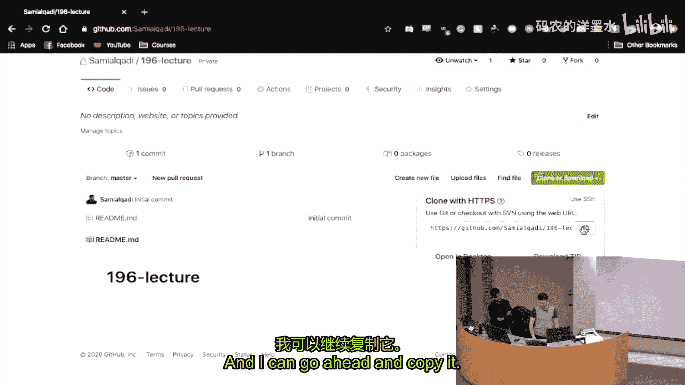

It's on my clipboard。And。Here。I'm going to be using the Git command。

 So this allows us to interact with the Git C I， which stands for the Git command line interface。

 This isn't the only way to interact with Git on your computer。

 There are graphical user interfaces that you can use。 But in this class。

 we're gonna be using the command line interface， because I think it's important for everyone to be comfortable with the C I before they go on to use。

 you know， builtin features on Ides or various graphical interfaces。 So this is the Git C I。😊。

And the way that we commit is we'll say gi commit。And it'll paste then the link of the repository。

 Gitthub gave me this link。哦。Sorry， clear。I misspo at clone。There we go。Getit clone。

 When you're up here， you lose like 50 IQ points。 So git clone and then the repository link。

 So now if I hit L S。You'll see that we have a 1，96 lecture directory。In the directory that I'm in。

 So I'm gonna C D into it。

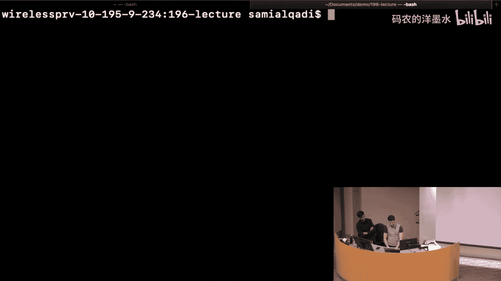

And now you can see that there's a readme in it， so。If you look at the remote。

 this is exactly what we have on the remote。

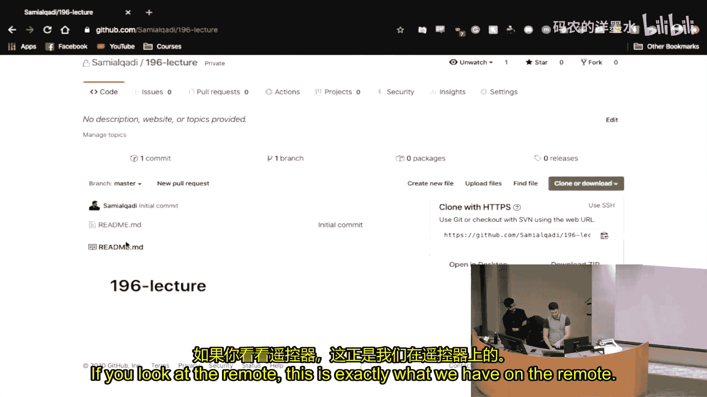

And this is exactly what we have on our local repository。

 So now let's say I want to create a new file。So touch demo dot text。

And you can see that here it is in our local repository。 But if。

 if I went onto the remote and I refreshed， obviously。

 it's not there because it's still sitting in our local repository。😊。

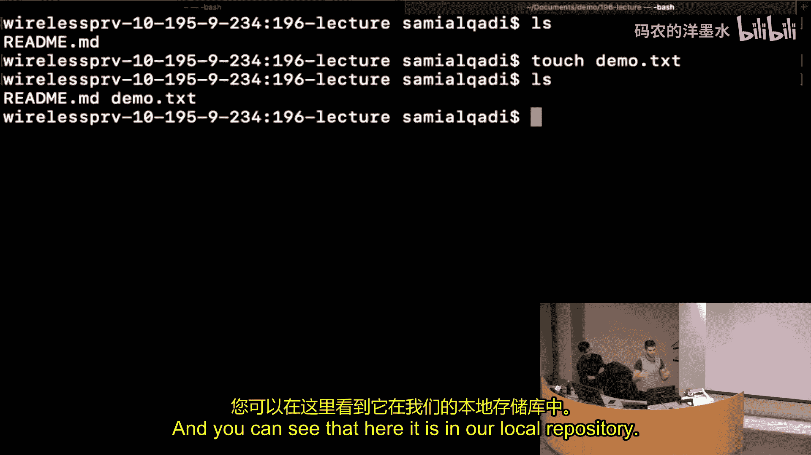

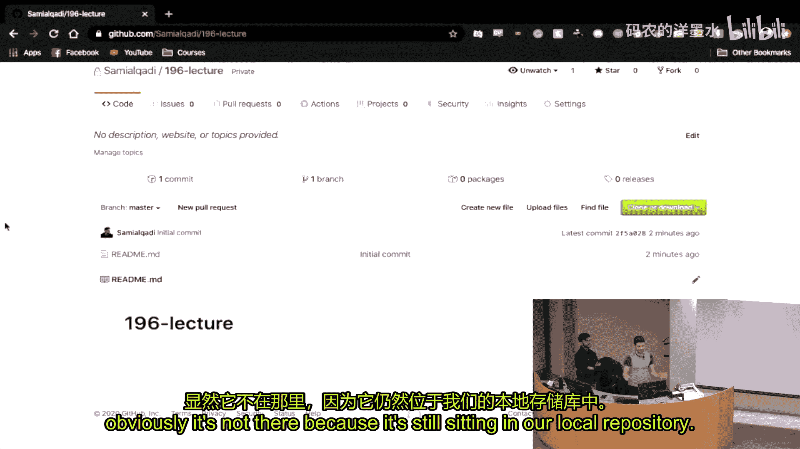

So now let's say I opened it up in a text editor。 If you were here for the batchche lectures。

 you can use Fm。 you can use nano。Eax， I'm just gonna use V S code to make it nice and pretty。

Here's V S code， and here's our empty demo dot text that we just created。

So let's say I want to make like a shopping list。 I can put shopping list in here。

I'll add watermelon。Onions。There we go。So these are the changes that I made to the file。

 So if I went ahead and I gi commit。Immediately， would this work。Yes or no。

 Someone just raise their hand and let me know。Any brave souls？It's up。Exactly， so she said， no。

 because we didn't add anything to the staging area。That's exactly it。

 So what I can do is I can either do Git add dot， which will add all of the untraed files in our current directory。

 I can do git add dash dash all， which will do exactly the same thing。

 or I can be a little bit more specific and do git add demo dot text。 So I'll go ahead and do that。😊。

Now I've just added demo dot text to the staging area。So。If I run Git commitm now。

 it'll work because we actually have something in the staging area。And I'll go ahead and say。

Create a shopping list。With two items。So now we've done a commit。

 The command line tells us a couple of things。That we've changed some files。

 We've made some insertion into the file。 But now we have commit to our local repository。 So again。

 if we check our remote， it's still not going to be there。 Why， because we haven't ran Git push。

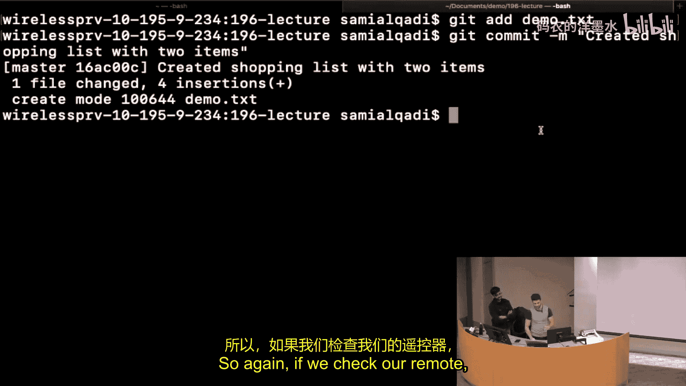

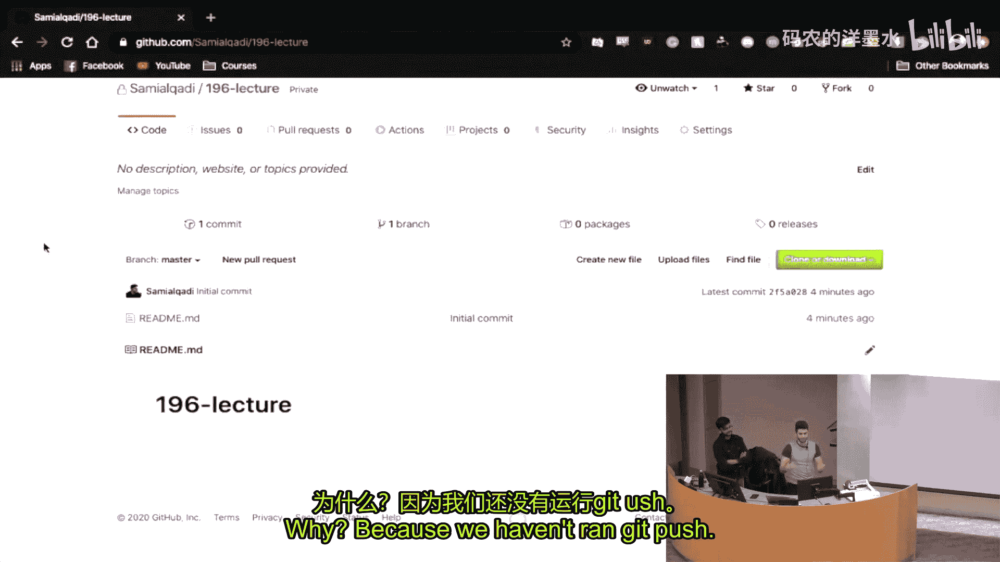

So we want to send off our commits to the remote repository， get push。So， now。

It'll say that we've pushed it to our Github。

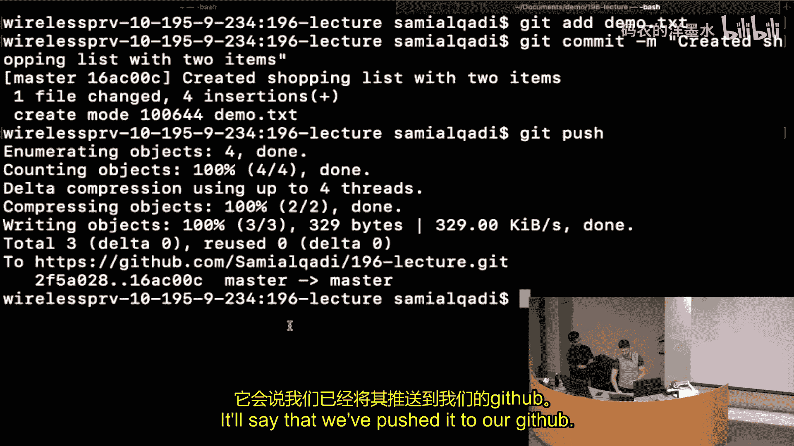

If I go here and I refresh。

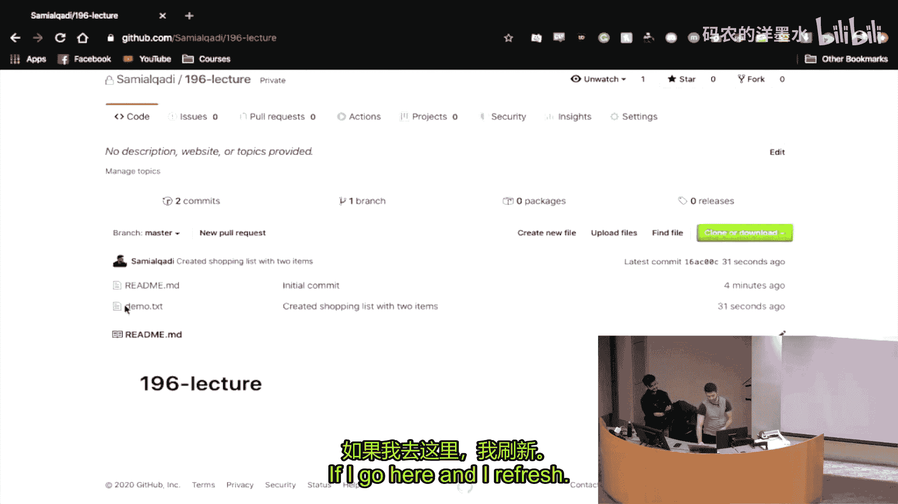

Here it is， demo dot text， shopping list， watermelon， onions。So。

Let's say I go ahead and add some more。Let's say I want a clipboard。And a marker。Same thing here。

 So the only difference。 And this is what I was saying in our workflow slide。

 If I went ahead and I get commit。Straight away， we already added the file to the staging area。

 right， but the staging area contains more than just the file。

 It also contains all of the changes that we made to files。 So what we can do here。

Just for the sake of demonstration， if I did get commit dash M， and I'll say added two more items。

It's not going to let us because it says there are changes that we have not yet staged for commit。

 What does this mean， Git is just telling us we've made some changes to the shopping list。

 but we haven't put them in the staging area yet。 So what can we do， Well， we can do Git add again。

Or we can do a shortcut。With the dash a flag like this。 So dash A dash M。

 and I'll do the same exact thing。Added to more items。So this go ahead。

 goes ahead and creates that commit that I wanted to do。 Should we always use dash A， not really。

Why is that？ Well， Because if you wanted to create， again， many changes at the same time。

 but you only wanted to commit some of them， because sometimes let's say you edit 10 files。

 but only four of those files are what you want to actually send to the remote branch。

 dasht wouldn't let you to be， wouldn't let you be specific about those changes that you're sending。

While， if you were to be a bit more specific and actually added using GitA。You can do that。

 dashache is just a nice little shortcut that basically says。

 if I don't care about what I'm sending off to the remote， if I change 10 files。

 I want to send all 10 files to the remote， We can do dashache。So again， get push。

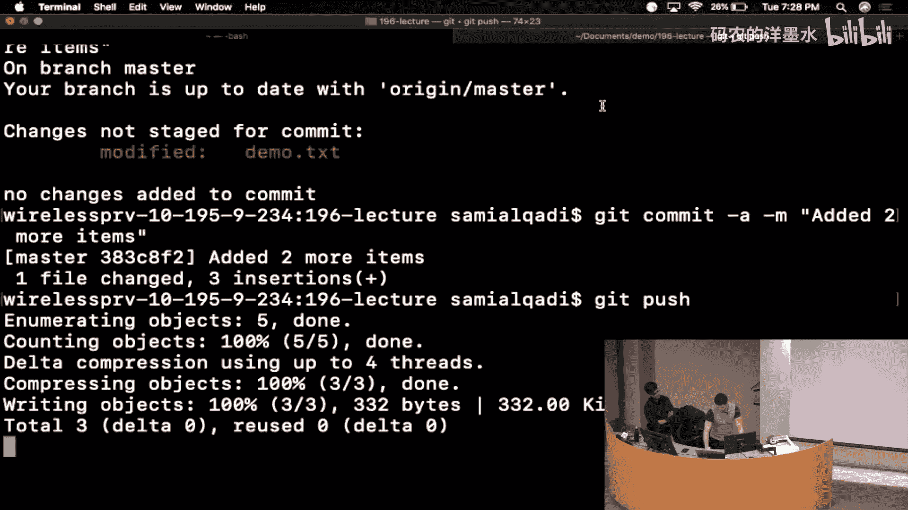

And if I refresh here。We can see the changes have been updated on the remote。

So now I'd like to show this as an example， but I'm gonna to do a bit of a modified version of it。

 Let's say Rohan joined in on my team。 and he wants to add his own items to the shopping list。

 What he would do is he would clone this repository。

 and he would change shopping list or demo do text。 He would add his items， he'd add。

 commit and push。 And then from my end， I'd pull it in。

 and I'd be able to see the changes that he made to the remote。😊。

Rohan doesn't have this computer out right now。 So instead。

 what I'm gonna do is I'm going to just edit it straight on the remote。

 But this is just for the sake of showing。Changes that we can pull in。So on Github， again。

 we can make these changes straight here。 Let's say I added a laptop to my shopping list。

 and I committed these changes straight on the website。Now， we have some changes on the remote。

 How do I get them in on my local repository？ Well， if you remember from our commands， what I can do。

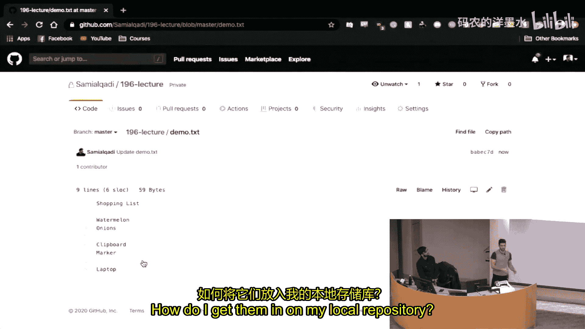

Is just run a get pull。

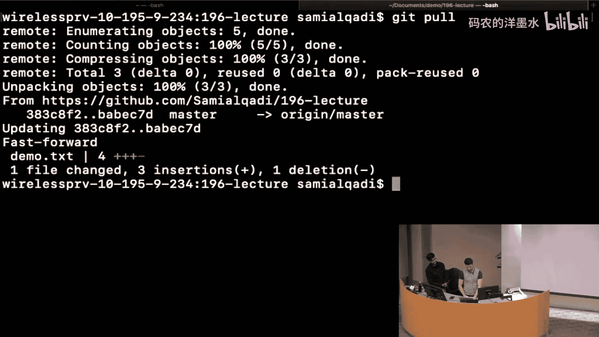

So we made some changes on the remote。 We pulled them in。

Git is just basically saying there is a file that was changed。 There was some insertions。

 some deletions。 And if you check your text editor， here we are laptop。

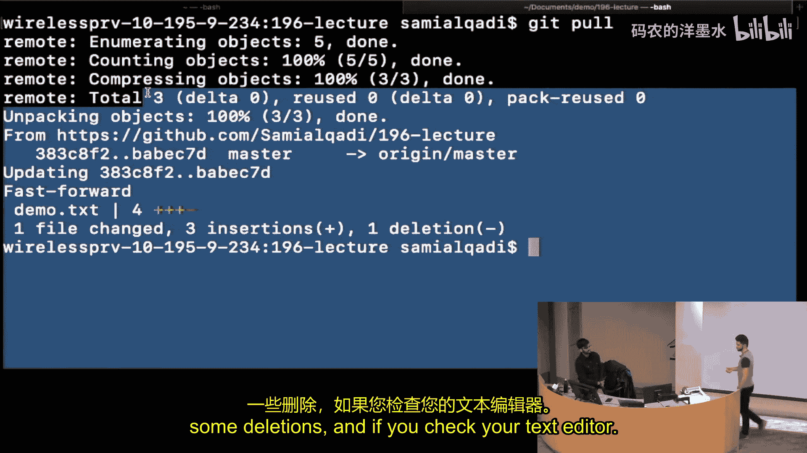

So does anyone have any questions about。Get。GitHub。Commands。Anything。Raise your hand。No questions。

That's very good。Okay。

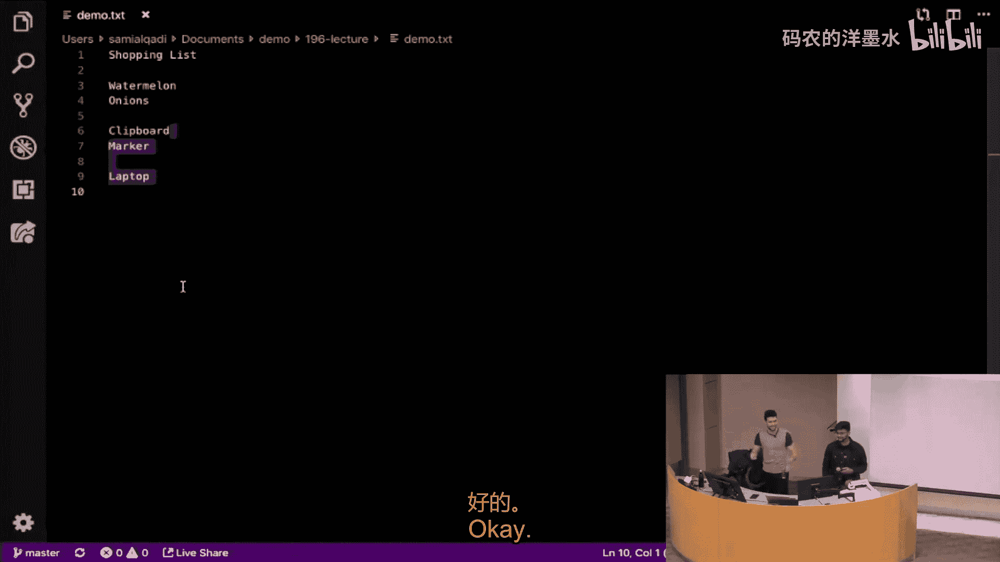

嗯。So then， in that case。I'll let you guys off on a little bit of a meme before I hand it off to Rohan in honor of our first workflow。

Here's a nice little joke。And also。I left this in here because I don't know。 Not all of you guys。

I don't want any lawyers， you know， in my life， so。Rhan， take it away。F announcements。

 we just have a few announcements for this week， is this really loud？Fels very loud Okay， so firstly。

 if you're near the class， join the piazza， you can just go and search for CS 196。

 we'll find us there。 we'll be posting announcements there。 There'll be things like homework。

 question and answer。 that's how you can get in touch with us very quickly because we'll be checking Piazza a lot Secondly。

 on Piazza as a form by an instructor called Brett to set up your Git reos。

 if you do that as soon as possible you'll get your Git repo for the projects up very quickly。😊。

Homework one the early deadline is today at midnight。

 it's on parallel alert and it's on baash Ive know a lot of you finished already so well done with that if you haven't try and get it done by tonight。

 if not you hatch till Friday， midnight to get that done。Finally。

 off start next we'll have office hours。 Office hours are finally set up。

 It'll be Wednesday and Friday from 5 to 8 PM。 and we'll be starting this Friday。 So the room。

 it's no a weird spot。 It doesn't have a room number， but it says CS S 1，96 outside。

 It's directly behind the CS S 25 office hours in the Cbel basement。😊。

So if you have any questions about that， put a post on Piazza and we'll try and direct you without the room numbers。

Finally， if you're new to the class you want to catch up what you missed。

 all the lectures can be found on echocho360。com once you' registered they should just appear there automatically and that's everything for the announcement if you have any questions you can come down and ask Sammy or I if not you're free to go next guys。

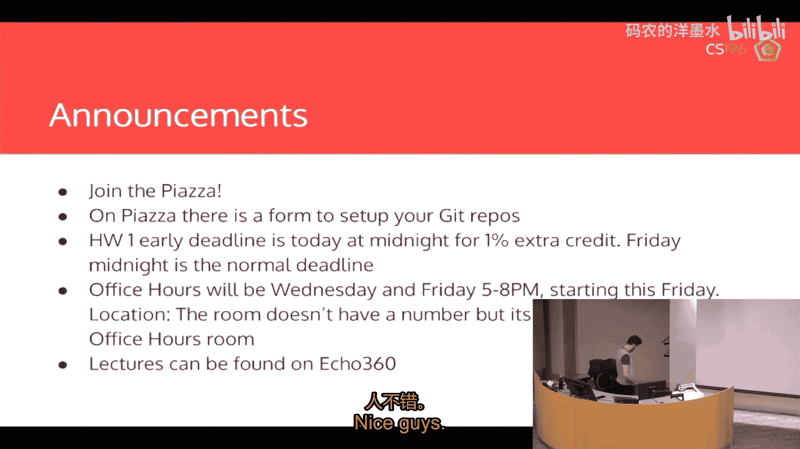