# 【全集 春季版】伊利诺伊大学 计算机编程：从Bash到Rust 中英字幕 p04 Lecture 4 - Git：合并冲突、分支、重置 、恢复 -BV188rDBFEUY_p4-

🎼せ you。🎼对不起。🎼back you what。

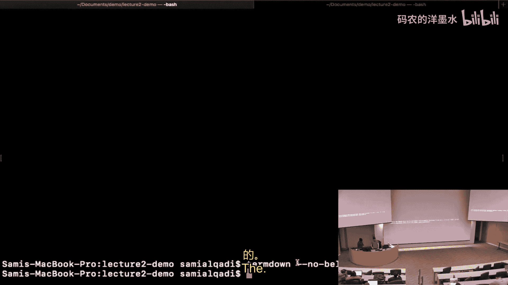

Alright， welcome back to CS 196。 So last lecture， we started off with the foundational topics of Git。

 and we're going to take today to build off of those foundational concepts。

 but we'll start off with a little bit of a review。 and we'll do a bunch of announcements at the end。

 Rohan will take care of those。😊，So what did we talk about last lecture。

 We talked about how Git is a distributed versionin control system。 And what exactly does this mean。

 Well， the big idea that we took from last lecture is that in Git。

 there are four different environments。 We have a working directory， staging directory。

 local repository and remote repository。AndSo let's say someone wants to make a change and go from the working directory to the remote。

 We know that the way that we do this is through Git operations。

 So to go from the working directory to the staging area， we use the ad command。

To go from staging to local， we'll make a commit。 And then from local to remote。

 we'll push it through。 So this is the big idea from last lecture。

 And there was one more thing that we really hit home on。 And that was the poll command。

 So if there's changes on the remote repository。 and you want to pull them back into your local repository。

 you use the poll command。So I want to actually go ahead and keep going with the pull command and build off of it。

 So last lecture， I gave you guys a little bit of a live demo at the end where Rohan pulled in my remote from the remote repository。

 and we had a shopping list。 He added his items。 He added， committed and pushed。

 and then I was able to take the changes that he made and pulled it in to my own local repository。😊。

So I want to keep going with that example。 So here's the example that I went through。 I said。

 here is my shopping list and my local repository。 Here's the same exact shopping list in the remote repository。

 And then Rohan， we said he pulled it in or sorry， he made changes to the remote repository。

 and he added a laptop to it。And so if I wanted the changes from the remote to go to my local。

 I just made a pull， and I was able to perfectly bring those changes in。😊。

But the thing is about Git pull is that not everything is perfect in the real world。

 We're not always able to just perfectly pull it in， because if we think about it。

 what did Git have to do to bring in the changes from the remote repository to the local repository。

 Well， if we look at this， it's pretty obvious。 Gis able to say， well， in the right side。

 we have the same exact thing as the left， except there's just the laptop appended at the end。

 So getss able to say， Well， if I want to pull these changes in， I can just put in laptop at the end。

😊，Getit is pretty smart about this。 If you make some changes to the top of the file。

 to the bottom of the file or anywhere in between， as long as you're not changing the same places。

 Git can pretty smartly just merge the things together。But what happens if things aren't so perfect？

 So let's go ahead and say。That I change the marker in my local repository to a pen。

And so let's say I make a commit。 And Rohan on the remote repository。

 pushes some changes where not only does he change the marker to a pencil。

 but he also adds a charger。So now， notice。How pen and pencil are being changed on the same exact line。

So what exactly happens now， if I want to pull in the changes from the remote repository to the local repository。

 how is Git supposed to know what exactly we should do with the pen and pencil。 We can say that sure。

 the charger should go at the end of the file in the local repository because that's pretty obvious。

 but getss going to have a lot of trouble between the pen and the pencil because we're making a change on the same exact line in the same exact area。

So what now？This is where we hit the infamous merge conflict。

 So merge conflicts can sound extremely scary。 Why， I mean， the word conflict is scary。 And also。

 if we look at what get does to your code， it's terrifying。

 We add a bunch of equal signs less than in greater than symbols。 We see a hash code。

 head and all caps。 So people tend to get very scared of these merge conflicts。

 But the fact of the matter is， even if you do things perfectly。

 you're going to run into merge conflicts， because that's just the nature of how development works。

 You're going to end up changing things in similar places， and you'll run into these merge conflicts。

 But the good news is is that they're actually fairly simple to resolve。

 So how do we resolve a merge conflict。 Well， the way that we can read this little cryptic thing that get put in our code is we can first notice。

😊，That the one on the top is your changes。 pen is what I originally put in my local repository。

And then the one on the bottom， pencil。 This is what we pulled in from the remote repository。

 This is what Rohan ended up adding to the shopping list。And so basically， what Git is saying is。

 well， I knew to put charger at the end of the file。

 but how am I supposed to know what to do between pen and pencil。

 Gi is asking you to please pick one of the two so that way you can end up resolving the conflict and pushing it back to the remote repository。

So how do we resolve the conflict？ It's quite simple。 Just delete what it added to your code。

 So take away the less than and greater than symbols， the equal signs， all of this stuff。

 And now let's say I just want to keep the pen。 So I'll take the pencil out and boom。

 We have resolved the merge conflict。And so now if I want to send it back to the remote。

 we know how to do this。 We just do a commit， and we push。So we have just resolved a merge conflict。

 And now both of our local and remote repositories are in the same exact state。

Does anyone have any questions on this？Do we understand this。Yeah。Yes， so。So she， the question was。

 if you push from the local repository to the remote repository。

 are you going to run into merge conflicts？ No， you're only gonna really run into merge conflicts when you do the poll command。

 because what I'll get into later on in the lecture is that the poll command essentially what it does is first。

 it grabs all of the changes from the remote repository and then it merges it in with what you have in your local repository。

 you're going to run into merge conflicts when you have that merge operation。

 there's no merge operation happening when you push into the remote that makes sense okay。

Any other questions about this？Okay。So I'm going go ahead and display exactly what I went through in a live demo。

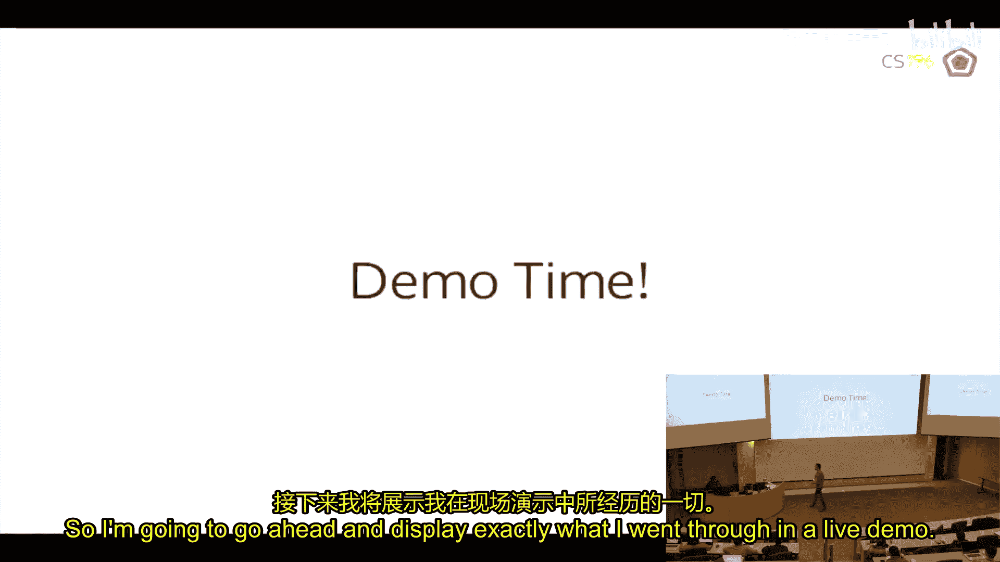

So here。I have the shopping list dot text。

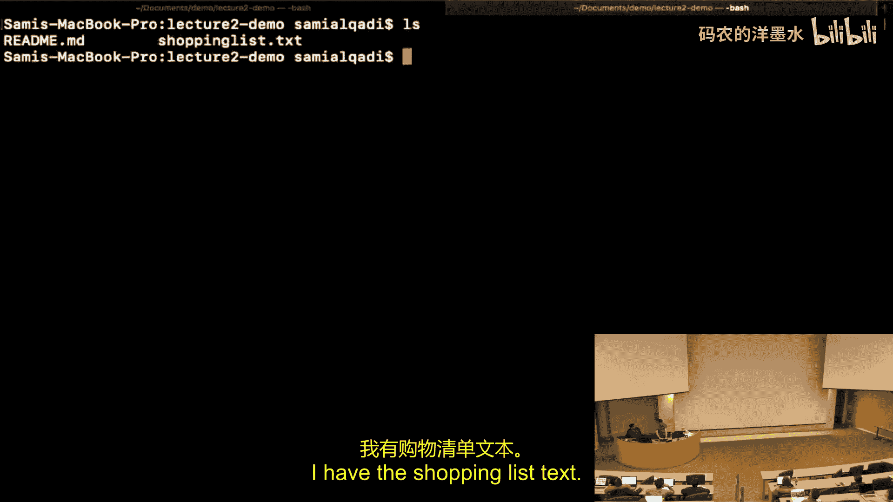

And I'll go ahead and open in the remote repository。

 This is basically exactly where we left off last time。 So I have my remote。

 It has shopping list dot text。 This is all the changes that we have there。

 And then we also have our local repository with shopping list do text。

 It's going to be the same exact version。 and I have it open in V S code。

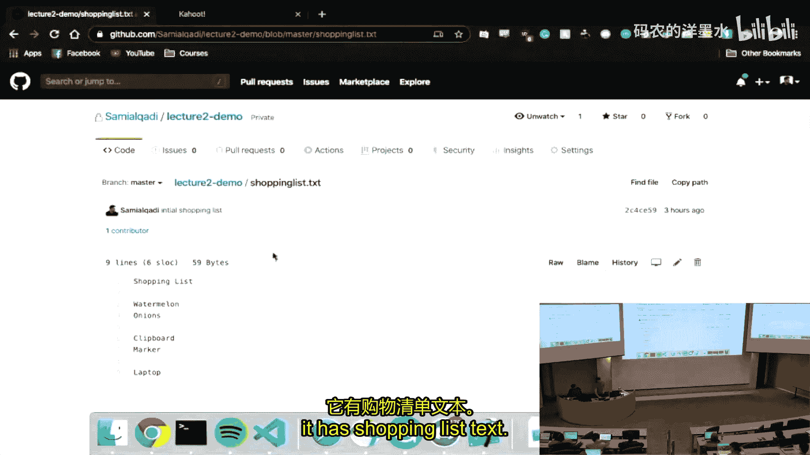

So same example as last time， but things are a little bit less perfect。

So let's go ahead and say that I change the marker from marker to a pen。And I saved that。

 and I committed it。So I'll do get commit。And I'll say changed marker。2 pen。And then get， actually。

 I won't push it yet because I want to be able to show you guys the conflict where I pull in the conflicting changes。

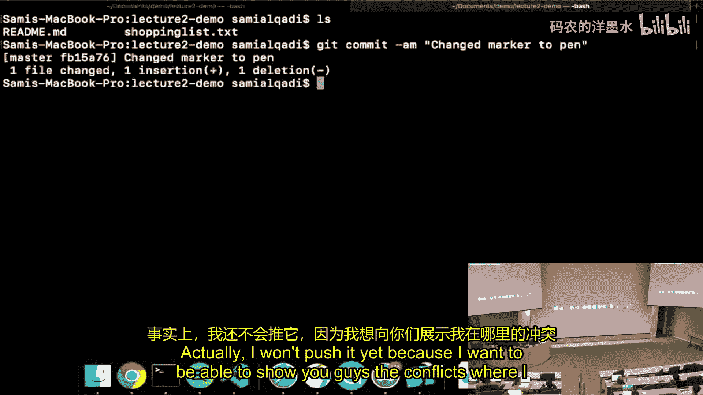

So here's the remote。 So again， this is a bit of a modified example。

 The what I'm trying to show you guys here is， let's say Rohan takes the remote repository。

 clones it into his own， and he makes the changes。 And then he does get ad， get commit， get push。

So the changes that he would make is changing marker to pencil。

 and then he adds charger all the way at the end。And we'll make these changes here。

 So we'll just say Rohan did this， but I'm just directly editing the remote。

So now in my local repository， I have this list， in my remote repository。

 I have this list exactly like what we saw in the slides。😡。

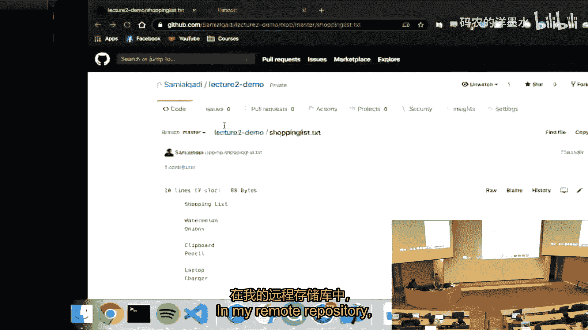

What's going to happen when I run Git pull？Is this terrifying message。

Git is going to say automatic merge failed， fix conflicts， and then commit the result。

 So it's just basically telling us， I'm Git。 I tried merging your files。

 but I don't know what you want to do with the pen and the pencil。 Why。

 because you edited it on the same line。So。This is what it looks like in virtual studio code。 Now。

 V S code does a really nice job of doing some syntax highlighting。

 but it doesn't really help that much because really。

 what's important is that you're able to notice the less than and greater than symbols in the equal sign。

 If you open this up in vim or emax or nano。 unless you have plugins enabled。

 you're not gonna have this syntax highlighting。 So it's important to understand what's actually happening here。

 So as I said in the slides。😊，We see that at the top。The pen is the change that I made。

 and the pencil is the change that Rohan made。 How do I resolve this conflict， exactly like we said。

 Just take this out。Take this out。And take this one out。Which one do I want to keep。

 let's say I want to keep the pen。I save。And then I'll do a git commit。And say resolved。

 merge conflict。

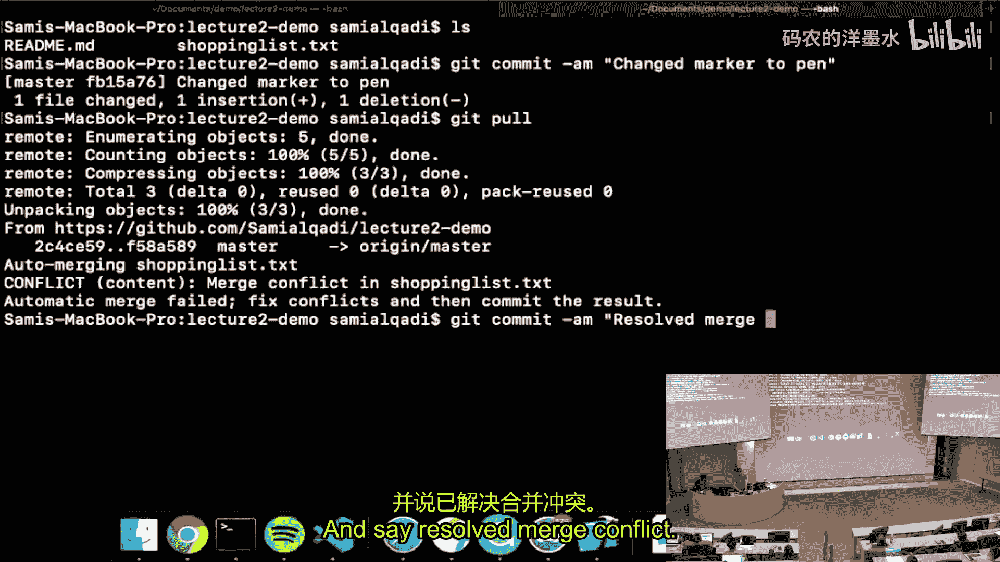

Get push。And now we're good。Does anyone have any questions about that。And actually。

 let me go ahead and show you in the remote repository that these conflicts were fixed。So again。

 the reason why we had that is because we had to change on the same exact line。

 Merch conflicts will happen。 Don't let them terrify you。 It's a part of the game。

 Just resolve them as they come。 You can get more than one conflict at a time。

 You can have multiple in the same file。 You can have。Conflicts in five files at a time。

 They're very normal。 So just don't get terrified over them。So with that。

 we'll have a nice little caooot question。嗯。Join in。Once I get the product up。

🎼Joining us that ideas to you can get attendance。I'll give you guys like two minutes。

can put that itT and have the app to save the app。🎼The。🎼，🎼。う。🎼The。🎼。🎼，🎼。Anyone not in？🎼一ふ。

🎼I'll get the done。🎼，🎼。🎼All right， they don't want still matter。JustRaise your hand okay。

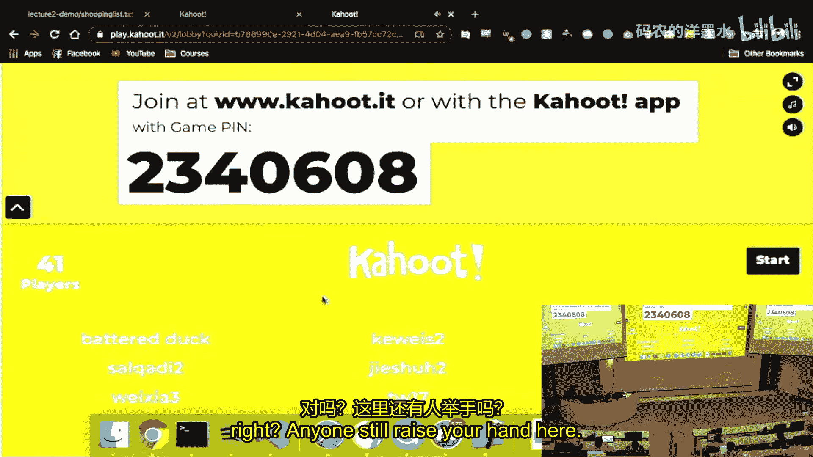

🎼这个。Let get started。Oh， you're not him。

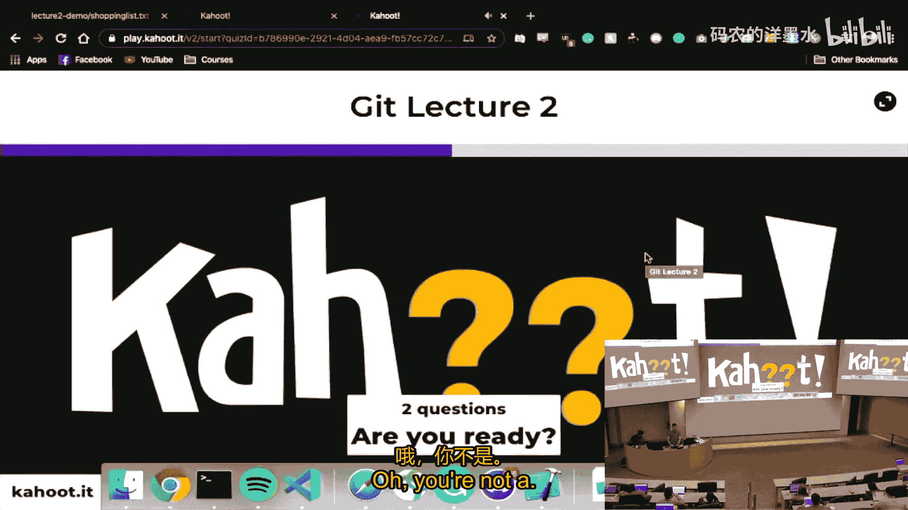

那个那个。

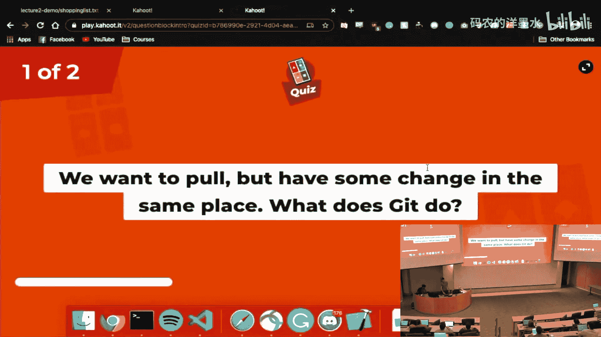

🎼So the first question is， we want to pull the page in the same place。 What does it。🎼Yeah。🎼，🎼，🎼，🎼あ。🎼。

Yeah。Okay so overall pretty good。 red is incorrect。

 It will merge it for you if you don't have changes in the same exact place。

 that is what a merge conflict is。 If they are in the same place。

 you just basically need to choose what you want to keep because Git is just not smart enough to know whether you want a penny or a pencil。

 that's a trivial example or in the real world whether you want some strip of code versus another strip of code。

And it definitely won't reject the poll。You want to have merge conflicts， because。That way。

 you can resolve them。And merge what you wanted to merge。So。Let's get this。 Okay。

 so I'm gonna go ahead and go and shift in a different direction。 I want to talk about branches。

 So branches are an extremely powerful tool that you can use in Git。

I want to just note that up until now， we've basically made all of our changes in the same exact branch。

 And what I mean by that is everyone is directly pushing their changes to the same location on the remote repository。

 So if I wanted to add a new feature， I would push it to the same place that Rohan is adding his new features。

 And so， for example， let's say we start off with our first commit。

 And we want to build an application。 We'll continue with the Android app that we were talking about in the first lecture。

 So we make our first commit。😊，And then we make some more changes。 Let's say we add a login page。

And then we make some more changes。We add a friendss page。 Notice how this is very linear。

 We are adding everything to the same branch。So in industry。

 this is not really how we do things and in the normal developing world。

 And the reason why that is is because sometimes you want to be able to develop in parallel。

 So what we can do is we can branch off。 So let's say a branch off in a different direction。

 and we want to in this direction make a settings page。

 usually whenever you're implementing a new feature。

 you branch off And so with this new branch in this well call it feature branch。

 we have an exact copy of the code that it's previously connected to。

 So the version where we have a friendss page， now in this new branch。

 we have the same exact copy this version where you have a friendss page and I can continue by adding the settings page with further commits in that branch。

 but we can still develop in parallel。 So in the master branch will call it the one on the bottom。

Let's say I'm working on this new feature in my feature branch where I'm adding a settings page。

 but I noticed that there's a bug in the code。 And I noticed that the bug comes from the version of the code right here where we added a friends page。

 So what I can do is go back to the master branch。 fix that bug。 And at the very end。

 I can merge these two back in together。 And now we have an app with a login page。

 friends page and settings page。😊，And again， we're merging things back together。 So in this case。

 yes， we are able to get merge conflicts。But what's important is that with this。

 we branch off in a different direction whenever we add a new feature so that we can merge it back into the master branch。

So it'll look like this。😡，And so the whole point of this， actually。

 let me go ahead and get this bottom part off。 That's kind of annoying。嗯。If I can， there we go。

Sorry about that。 So now with doinging these two branches。

 what's important to understand is that master is going to be the most current updated version of the code。

 We want master to be the version of the code that passes all the tests。 It builds， it compiles。

 And whenever someone pulls in。The master branch is the one that's the most current working version of the app。

 This is the version of the app that you could say is almost production ready， right。

 You don't want to directly develop onto master because let's say someone pushes some malicious code into the code base。

 If you're directly pushing that into the master branch。

 then things will break and you won't have a version of the code that you could fall back on basically。

 So the master branch is what we keep clean。 So the reason why we're making this feature branch is because we are not afraid to mess up or possibly push some malicious code into the codeb because that's the whole point。

 That's a part of the process with the feature branch。 I'm going to continue going with this。

 Does anyone have any questions。😊，I will go further into detail。

 but are we good with what we did so far。O。So another thing to note is that we have what is called a head pointer。

 And so the head pointer is basically pointing to where we are in our working directory。

So if I'm currently working on the commit where we're merging everything back together。

 the version of the code where we have the login， friendsend and settings page。

 our head pointer is going to point there。If I'm on another branch， for example。

 the commit where we're working on a new feature， my head is going to point there。

 The head is going to point to where we're currently developing。

 And we'll go ahead and bring that back later on when we use this terminology in different areas。

So why are we doing this again， Branches are isolating the work in progress from the completed work in the master branch。

😡，This is the best way I could possibly explain it。

 Our master branch is what we've already completed。 It works。 It passes tests。Well。

 the work in progress goes in a different branch。So with that， I'm gonna do a quick question。

 This is actually going to be the only the second and last question of the day。

 And then we'll do some more demos。And some further explanation。

So before you make a radical change to your team's project that would impact the rest of the team。

 you should make your changes where。🎼，🎼，🎼，🎼。🎼，Okay， perfect。

 so that is the big idea that I just hit home a minute ago。

 you're not going to use a different repository because that's not very clean。

 you're not going to use a different folder because other people can't access that and you're not going to use a different computer because that wouldn't change anything。

I'm not going to show the leaderboard。We'll just keep on going。

 So the best practices when it comes to branching is， again。

 you want to keep the master branch clean。 I already talked about this。

But also want to name your branch as well。 So let's say I'm at a version of a code。

 and I want to branch off in a different direction。

 The better way to name it is rather than saying something like branch 1。

 we can say features slash the feature name。So with the shopping list example， it's a bit trivial。

 But if I wanted to add， for example， a running total of how much money the shopping list is gonna cost。

 that is a new feature。 So I would branch off in another direction。

 I would call it features slash feature name。 And I would later on merge that back into my master branch。

And this is a very important part of the branching idea。

 You want to be able to review your code before you merge it back into master。

 This is very important because， again， you don't want to put malicious code in your master branch。

 The master branch is the version of the code that you want to be good， basically。

And so these are the first few git commands that I'm going to show you for branching。

 We have Gi branch。 So that's going to just basically list all of the branches that you have in your repository。

 We're gonna have Git checkout。 This is how we navigate between the branches。

 So we're gonna move the head pointser around。And whenever we switch to another branch。

 it's going to update our working directory with all of the files on that branch。

 And I'll show you what I mean by that a bit more in the demo。 If you want to make a new branch。

 you can just put in the dash B flag and then the name of the new branch and then get merge。

 So this is what you'll use when you want to merge it back together。😊，So， with that。

I'll just go ahead and go into a quick demomo， where I put。Exactly what I talked to。

 It talked about to life。

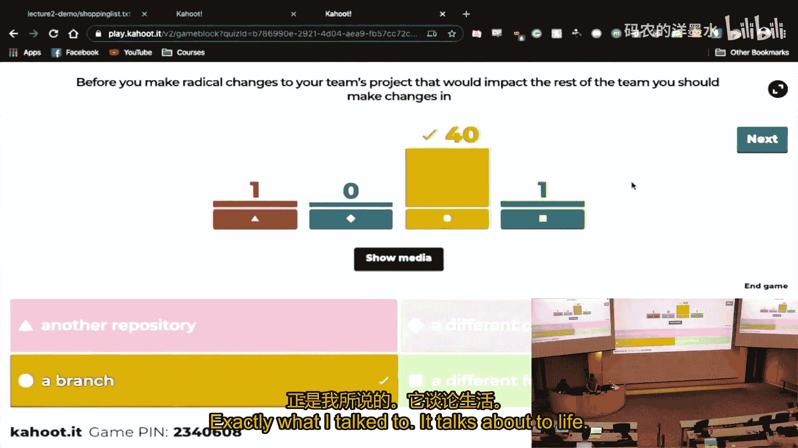

So we're still in the same exact repository。 right， If I hit Git branch。

We'll see that we only have one branch in this repository， the master branch。

 And the star is just basically saying， you are in the master branch。

So if I want to make a new branch。All I'll do。 all I have to do is say， get check out dash B。

 And let's say I want to go through that idea。 I want to add a running total of how much the shopping list is going to cost。

So I'll call it feature。Slash。Running total。Again， this is a trivial example for how we。

 how we would use branching， but in the real world， we'll branch off on larger features。

So I'll go ahead and make the new branch。And you'll see that we've switched to that branch and created it。

 So if I type in Git branch， this lists all the branches that we have and notice that the star is currently pointing to feature slash running total rather than master。

So what did this do， but when we branched off， so if I go back to VS code。

We are now in a different branch， but we have the same exact copy of the code that was on the master branch。

 We've branched off to a different direction， but we still have that copy of the code。

So here I can add in my new feature without worrying about breaking the code in the master branch。

 and I can commit and push freely。So if I add in just the simple feature， money total。

 and I say that this is going to cost $300 or something。And I save it。If I go ahead。And switch back。

To the master branch， So get check out master。It's。嗯。好的。Let me actually push the code。There we go。

So if I go ahead and commit it。Created。Running total feature。And I push。

So it's going to tell me this line of code。 It's going to say Git push set upstream origin feature running total。

 Don't get terrified over this。 Basically， all it's saying is on the remote branch。

 we don't know about the local repositororyiess branches because currently I made this branch on the local repository。

 So it's basically saying， I want to create this upstream where I send the running total branch upstream to the origin。

 The origin is just Github。And also， another thing to note is if Giub。

 if Git tells you to run certain commands， usually if you run those commands。

 you'll do what you want to do。 So here。If I push this。

This will send our new branch to the remote repository。And if I get check out our master branch。

It's gone。That's because the version of the running total is not on our master branch。

 It is on our new feature branch。So here， we don't have to worry about any malicious code in that other branch。

 But let's say I'm happy with where my running total branch is。

 And I want to merge it back into master。 what I can do。😊，Is just say。

As long as I'm on the master branch， I can get merge。

And then the name of the branch that I want to merge into master。

So the name of it was feature slash running total。And if we go back here。

 we're still on the master branch。 V S codes nice right here。

 It tells us we're still on the master branch。 But now we have the feature that we merged back in called the moneyney To。

So again， this is a trivial example， but if you can imagine how we can apply this concept to features in larger scale apps where we have multiple branches in different directions for each new feature that we want to make。

Does this make sense， Does anyone have any questions？I went through a lot of material。Yeah。

Can you repeat that。嗯哼。Okay， so sorry to confuse you。What text editor you use or what IDE you use。

 it doesn't matter。 The only important thing that you need to keep in mind is when I'm doing this git checkout。

 it's updating my working directory。 So it's nothing to do with the text editor that I'm using。

 Just know that it's replacing the files in my working directory with the files of that branch So whether I was in VS code or Emax or Vim。

 It would still do the same exact thing。 It would bring in those new changes。

 Does that answer your question， okay。😡，Does anyone have any other questions？Yeah， I mean。

 so I only made one branch， but I could make as many as I want。 Is that what you mean。

You can't have them locally。 Yeah， I mean， ideally， you want to keep your remote repository updated。

 Another thing to mention is that。Once I'm done， merging a feature back in。

 I can delete the branch if I'm done with it。So yeah。

 you don't necessarily need to push it to Github。 I was just showing that to demonstrate what I'm about to go to next。

Any other questions？We're good。

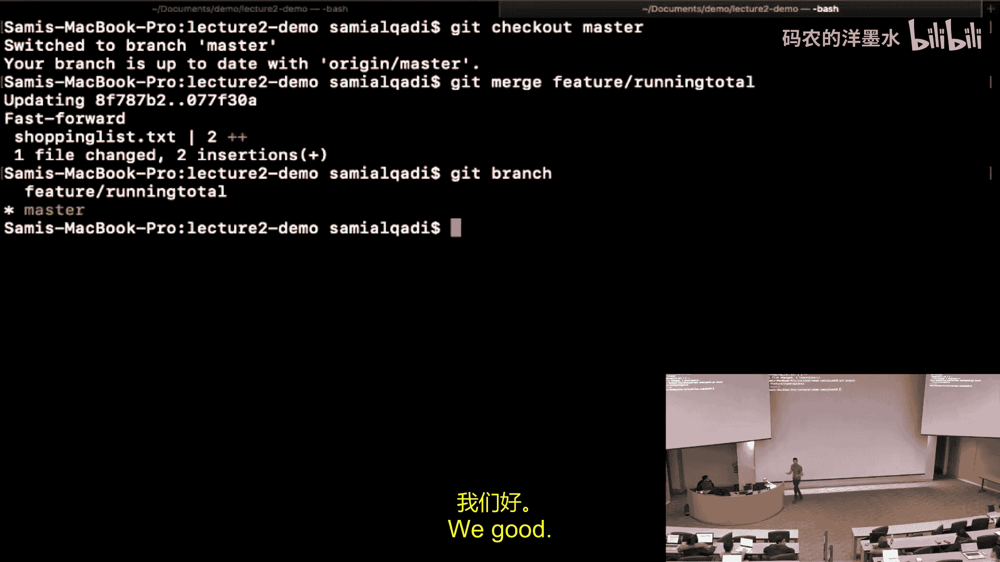

Okay。So another thing that I hit on。In my。Conceptual overview。Or actually， sorry。

 So this is actually another point that I want to touch on。 get fetch。 So this is another command。

 So like you were saying。We made these branches on the local repository。Gt fetch。

 what it allows us to do is if we make those changes on the remote， we can bring those in。

 So in the example， in my local repository， I made some new branches。

 but the remote repository didn't know about them。 So I had to push those upstream。

 So what's the opposite。 What if I make the branches on the remote repository。

 And I want to bring those into my local repository。 We have this Git fetch command。

 So Git fetch is actually pretty similar to Git pull。But one of the first points of the lecture is。

 what does Git pullll actually do。What Git pull actually does is a combination of git fetch。

 and then Git merge。All Git fetchch does is it'll pull in the changes from the remote repository。

 but it won't do any merging。And so this is nice for being able to pull in the new branches from the remote repository。

So I'm gonna go ahead and show this。In the live demo。If I just go ahead and go to our repository。

Here。And I make a new branch。 Let's just say for demonstration。So， here。

I branched off not in my local directory， but rather in my remote remote repository。

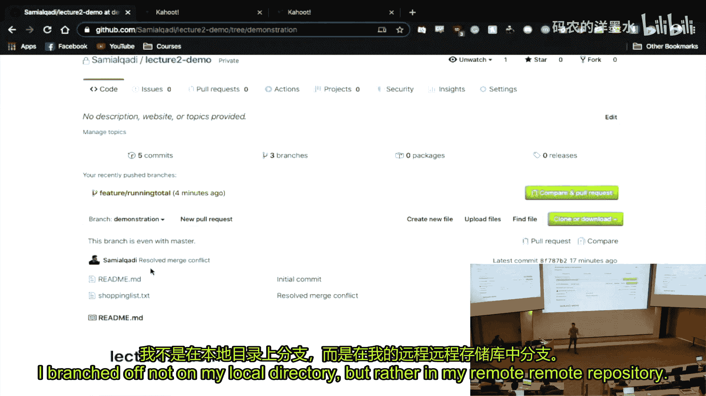

How do I bring this into my local repository， I can just run Git fetch， or actually。

 just for demonstration。These are the current branches that I have。 If I run Git fetchch。

We'll see that it pulls in that new branch。But instead it's not merging any files that we have。

 it's not changing our working directory。And if I get check out the demonstration branch。

And run Git branch。We can see that we've switched to it， and it's in our list of branches。

In our local repository。DoesThat make sense？

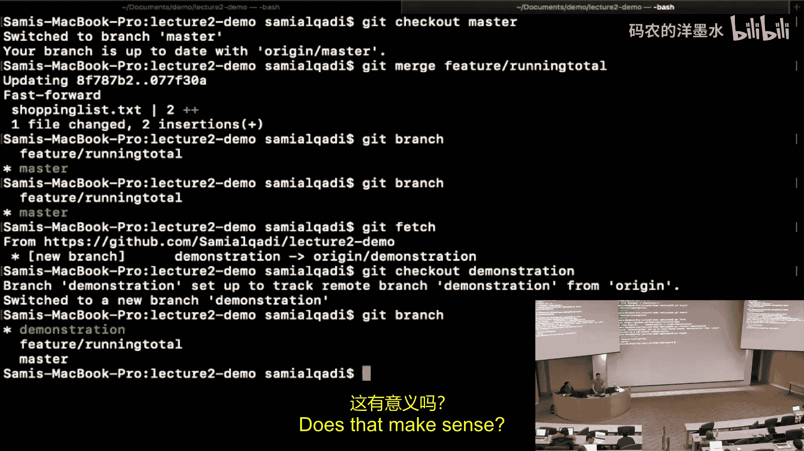

So again， this isn't exclusively a branch in command。

 but it's very useful for bringing in the changes that we made on the remote repository。

Especially when it comes to new branches that our local repository does not know about。

So I already showed that。So okay， one of the most important features of this whole branching idea is that we want to be able to make sure that no malicious code gets into our master branch。

 And so one important way that we can do this is by reviewing the code before it comes into our master branch。

So how do we do this， How can we review the， the feature code before merging it back into our master branch。

Well， we can use this idea of pull requests and with pull requests。

 we can branch off and we can on the website， this is a feature that GitHub gives us。

 We can just go ahead and say I propose a change to the master branch and you can require certain people to approve it so you'll be able to see all the differences on the GitHub page and a person。

 let's say your project manager in this class for example。

 or in your industry example you have like a senior software engineer they can view your pull request。

 which is basically a side by side view of what you're changing in the codebase and he can improve it to make sure that what you're doing is not malicious to your master branch。

So we are requesting to pull code in the code base， and I can go ahead and show that as well。So。

 here。

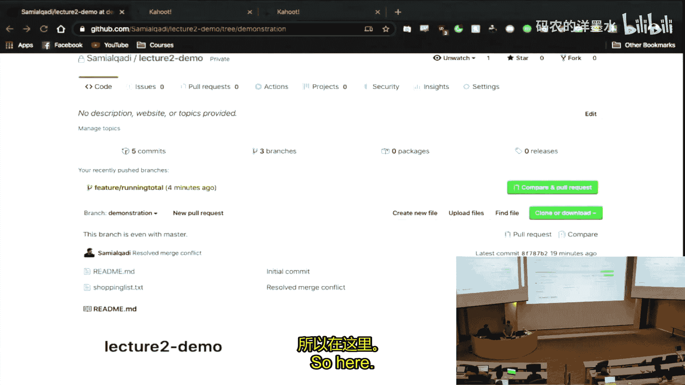

I can go ahead and check out。Master branchch。I'll just do a quick get push， because we have some。

Changes here that aren't on the remote， I want to get everything updated。

And so let's say I check out a new branch。And we'll call this a new feature for locations， if I want。

To say， hey， Rohan， there are some good locations for our shopping list。

 We can add this to our locations。Vs list。So now we are on this new branch。

And if I add this new feature。We'll just call it locations。We'll say Walmart。All these。

And we can add later on。So if I go ahead and I commit。And we'll call this added locations feature。

And I push it。So I'll do the same exact thing as last time。 So， again。

 the remote repository does not know that the local repository made this new branch。

 So the way that I can tell the， the remote repository about this is I can push it upstream to our origin。

 The origin is Github。So I can just go ahead and take the command directly。 It'll make that push。

And so now， on our remote repository。

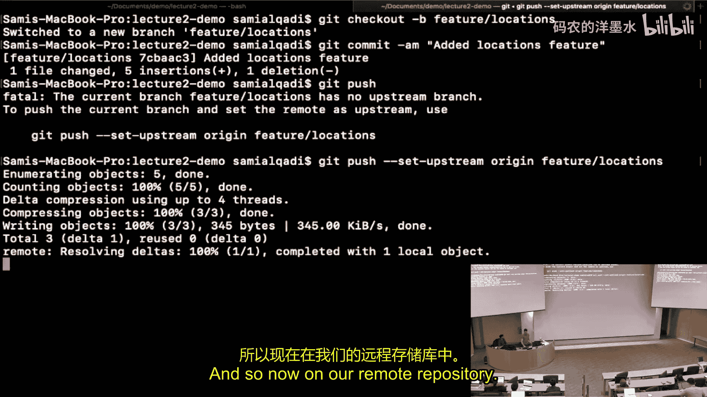

As long as I refresh。We'll see that not only is the locations branch on there， but also。

 if you look above that， it'll say feature slash locations was pushed less than a minute ago。

So I can go ahead and compare and make the pull request there。And I'll actually do that。

And right here， it's saying we are pushing or rather merging feature locations into master。

 And Gi is telling us that we can automatically merge this。

 There aren't going to be any merge conflicts。 because if you think about it。

 the version of the code on the master branch is just the simple list with the added money total。

 While the code on the locations branch is the list with the added locations。List as well。

 So when we merge it， Git is able to just freely add it to the end of the file。

So I can create this pull request。And so now it's going to check if we can automatically merge。

 It can。And if we go back to the repository， we'll see that on the pull request tab。

 we have this list of pull requests。And so in industry。

 this is important because what you can do on Gitthub is you can set up certain permissions to say that certain people are able to approve merge requests。

 I own this repository， and I'm confident that the code is fine。

 We're not pushing anything malicious into the master branch。😊，So what I'll actually do first。

Is this is a nice feature that GitHub provides， I can review the code。

So I can see that all we're doing is we're adding in this new locations list in place of the money total that we had before。

 We're adding this new feature。😊，Now， again， trivial example。

 but we can apply this on a much larger scale。 if someone's adding a new page into the app。

 we can review the changes， let's say a minimum of two people have to approve it before we actually push it into the master branch this way we can add new features without breaking anything in the version of our code that we want to be clean so I can go ahead。

And go here。We'll see that it says that we want to merge one commit。And I can just merge it。

Confirm the merge。And。We see that it's successfully merged and closed。

So does anyone have any questions about pull requests， merging branches together。

 branching offer features， anything that we've talked about so far？Any questions about Git fetchch？O。

So just for the sake of demonstration， I go here。We'll see that on our master branch。

We have the locations list with Walmart and all these added to it， because we were able to。

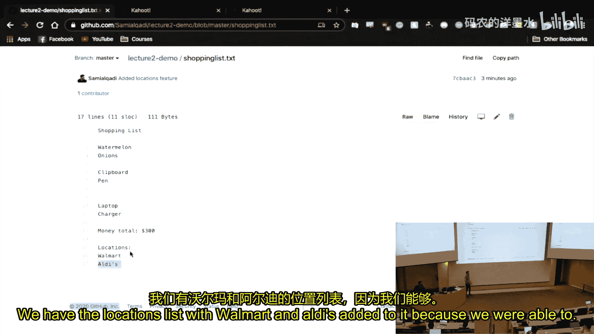

Without too many problems， merge it together。

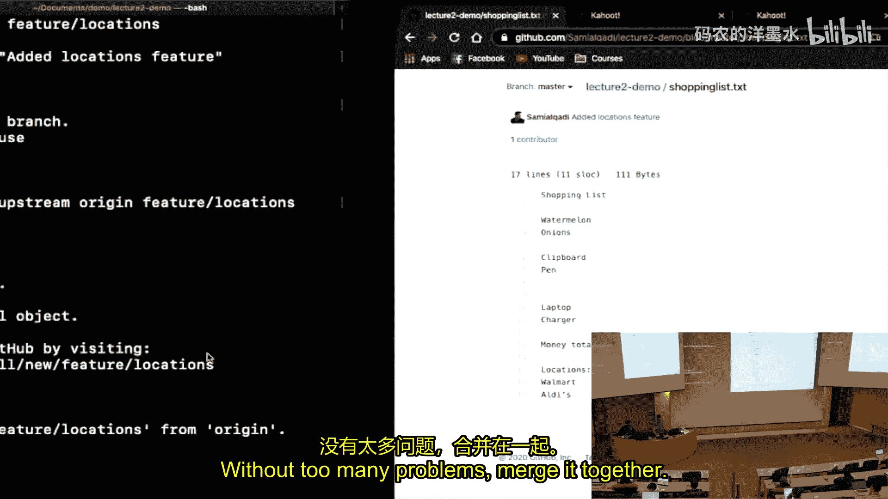

So this is a workflow that I want to propose。 So last Tuesday。

 we were able to tell you guys your first very simple workflow。 where if you make a change。

 you want to just add it to the staging area， make the commit。

 and then push it to the remote repository。😊，So this is another workflow that you're going to use a lot。

 one in your projects in this class。 And also， if you end up getting any internships。

 this is a very common workflow for being able to efficiently work together with your team。

So if you want to make a new feature， if you want to fix a bug， whatever it may be， you branch off。

 just like I showed you for all the features that we made to our shopping list and also in the example of the Android app in that visual conceptual overview。

So you branch off。 and on this branch， you're comfortable。 You can make the changes as you please。

 You're not worried about breaking anything。You can submit a pull request and then you get your code reviewed by a senior software engineer。

 let's say your coworkerworkers in this class， your project manager。

 and then you just merge it in and while you're at it， if you get any merger conflicts。

 we know how to resolve those and you likely will get merge conflicts because it's just the nature of how development works。

So with that， I can give you guys a couple more useful commands for Git。We've covered branching。

 we've covered merge conflicts， and we've covered the basic foundations。

 but these are some nice commands that you can use in the terminal whenever you're developing。

 So the first one is get status。 And what this allows us to do is you can compare the working head。

 So again， the head is pointing to where we're currently developing。

 And we can look at that version of the code with the latest commit and see what's changed。

 So this gives you the status。Of your repository。I can go to type this in real quick and just show you what it looks like。

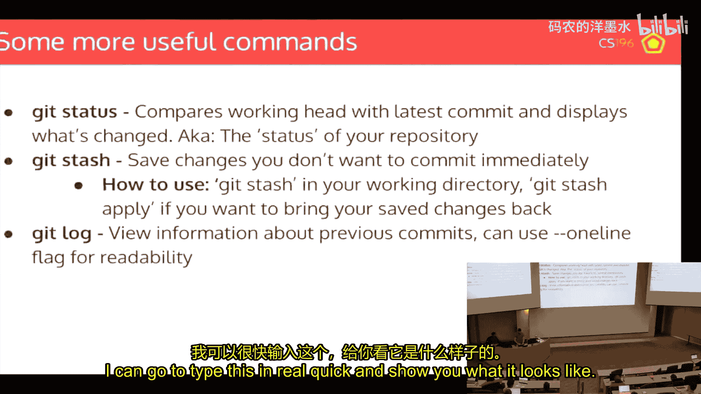

So it gets status。So it basically is just giving us the status of our repository。 If I make a change。

And I commit it。So let's say。I'll add in just another location here。 we'll say。Myers。So。

If I hit get status here。我 see。That we've modified shopping list do text。 This is the。

 the current status of our repository。 and it says that we have not staged the changes for a commit。

 And so we went over this last Tuesday where we said that the changes that we make。

 we want to put them in the staging area with Git ad。So if I just do Git add。And then， get commit。

And I do get status again。We'll see that again， we have nothing to commit。 the working tree is clean。

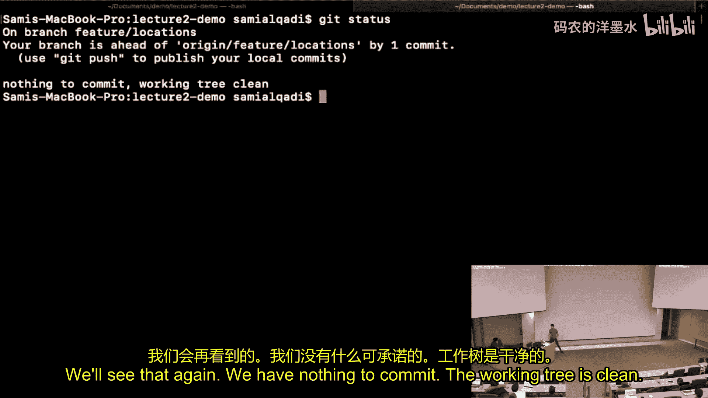

But that is the status of our repository， and it's useful to check from time to time。When we're。

 you know， in the middle of our development with Git。So another command that we have is Git thatash。

And let me get this bottom thing out of the way。Git stashed。

 what it basically does is if you have some changes that you've made。

 but you don't want to commit them immediately， you can put them in a stash。 And basically。

 what a stash is， is it somewhere in memory， You just stash it away。 And if you want to use it。

 you can， if you don't want to use it， that's fine。

 And if you want to bring it back the code that you。😊，That the code that you saved in the stash。

 you can just use Git staash apply。

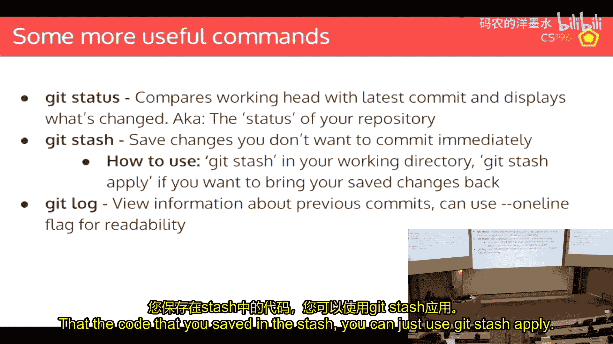

So， let's say。I make some more changes here。So I haven't committed this code。

 but let's say I still want this code just stashed away somewhere。I can just do git dashash。

And now if I go back， we see that the changes that I made aren't here。

That's because we moved it over to the stash。And so sometimes Git stash is useful。

 Git will tell you when you might want to use it， but it's useful to understand what it does。

 because。You don't want to be lost when Git tells you you might want to stash this away before you make a commit。

And if I want to bring it back。The content that's in the stash， I'll just do git staash apply。

And we'll see that it's here。And it also tell us that we haven't staged these changes for commit。

 And that's because we still have a version of the code that isn't in the staging area in case we want to go backwards。

If that makes sense。

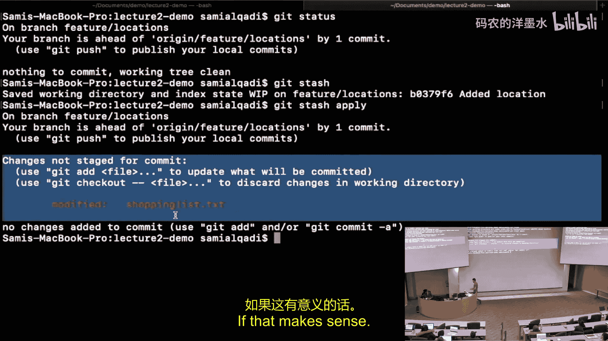

So。Another very useful command is Git Lo。 This will just basically tell you all of your previous commits。

 And I also added in this flag for readability。😊，Call dash dash 1 line。

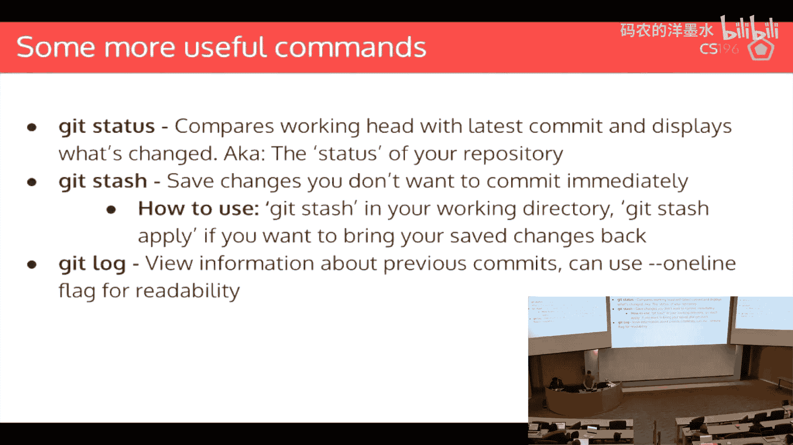

And the reason why I mentioned that is because if you say git log。

It gives you a lot of information about your previous commits who。

 who made them when they were made and the commit message associated with it。

 If you want a little bit less information。 So let's say。get。Log dash dash1 line。We'll see that。

Under the command， not all of that on top。 everything is just on one line。

 And it's a bit easier to read and a bit nicer to work with sometimes。

 And I'll actually bring this up in our next slide when I talk about。

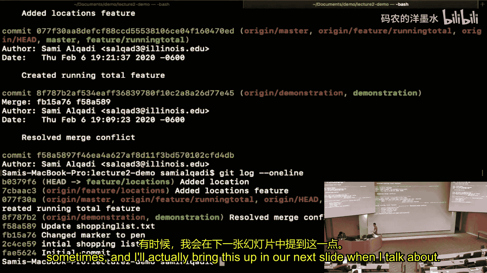

SomeSome useful commands for Robacks。So these are some commands that you might use occasionally。

 And one of the benefits of virgin control that I gave you a couple days ago on Tuesday is that you're able to fix things pretty easily。

 If you make a change that you didn't want， you can revert and you can reset。😊，Now。

 the first command revert is a bit safer， actually a lot safer than the reset command。

 And that's because what Git revert does is it will simply revert you back to a previous state。

 but it won't delete any commits。 It'll just basically take the previous state that you were at and make another commit with that state。

 And I'll show you what I mean by that in a second。While Git reset actually deletes certain commits。

 So if you want to backtrack with Git reset， what it'll do is it'll delete all of the commits that came after that。

And get reset hard。 The only difference between reset and the hard flag is it'll actually on top of deleting the commits。

 it'll stage the changes。And I'll show you exactly what I mean by that。

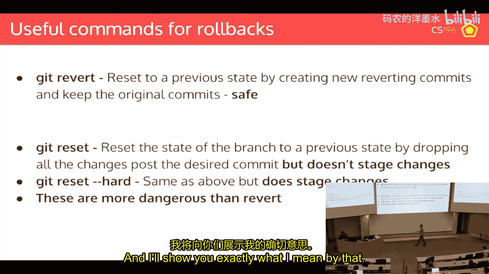

So。First all I'm going to do。I I'm going to。Get our log on one line。

 so this shows the list of our previous commits。Let's say I just want to revert to a commit that I made。

Just a second ago。 So get reverb。And let's say I want to revert back to when I change the marker to a pen。

So these are unique hash codes that gi generates for each commit。

 You don't have to worry about how they're generated。 You'll learn that in 125 a little bit。

 but just know that they're each unique。To the hash code。Gid is telling me。

 please commit your changes or stash them before you merge。So， actually。

Let me listen to G for just a moment before I do the revert。I'll do。I'll just push my changes。Okay。

And now let me just do the same thing that I was demonstrating。

So if I want to revert back to this commit。I change the market to a pen。

We can see that it'll open up this Vm file for us。 So a lot of people get terrified when this file opens。

 Sometimes you'll see it when you're merging things in this case。

 you'll see it because all it's just telling us is that we're making a new commit。

 Do you want to put a commit message in。So what I could do is if we know them。

 I could turn into the insert mode。Go down at our commit message。 But we don't have to。

 I can just exit by doing W Q， which will save and quit。 So it'll make that commit。

 And so this commit is a bit different than then what we'd see with Git reset。

 because if I do Git log one line。Well'll see。That here is the commit that we wanted to revert to。

But all of the commits that came after that are still there。 We didn't remove them from our history。

 And the top commit revert。Changed marker to pen。 We just。

 again took the state of the commit where we updated or rather changed the marking list marker to pen。

 And we were able to just create that commit again。😊，So what does Git reset do in comparison。

Get reset。Let's say I want to do the same exact thing。 I want to revert back to this state。

 but instead I do it with Git reset。I can copy and paste the hash into the terminal。And if I do git。

Log。One line again。We'll see that our list is much shorter than last time。 Why is that。

 Well we did revert back to the state that we wanted to。

 But the difference here is that everything that came after it。Is now deleted。

 And you can see why this is a bit dangerous。 If you're deleting commits， things can likely go wrong。

Now， there was one more thing about Gi reset called the D dashash hard flag。

All that does is if you notice here， we see that it says unstd changes after reset and it basically is saying that。

 okay， you've deleted all these commits， but I'm going to give you one last chance to get these the contents back before they're removed forever so get reset without the dash dash hard flag will simply delete those commits that come after。

 it'll revert to the commit that you wanted to， but it'll also keep the changes unstd so that way if you want to technically here I can make another commit and save myself。

 but if I do。Instead。So what I mean by that is。This is still here。

 The contents before I reverted back to that commit are still in my text editor。

Because we haven't staged them to be committed。So instead， if I do get reset。Har儿。And I go back。

 let's say all the way to the initial commit。It should。With gett Lo one line。

We're all the way back at the initial commit， everything else that came after it is gone。

And this is deleted。 If you can see at the top there， the contents。Shouldn't be showing， but。

The reason why it is showing is because。Technically， V S code is remembering the state。

 So if I actually close out of this， it won't be there at all。Because we deleted it。

 We went back to our initial commit。So if I hit L S。It's gone because in our， in our initial commit。

 that file wasn't there。 So it's only showing because V S code is smart。

 Does anyone have any questions。About gett reset， gett revert。

 or the commands that I showed previous to that。Yeah。Technically， yeah， you could。

 Branches are pretty inexpensive， but Gi stash is a little bit different from a branch because。

Branching is going to create a copy and gi stash is just basically going to store your changes somewhere。

 So that way， if you want to， you can use them， yes， you could use a branch。

 but it's just not like great great practice to do so。Any other questions？Okay。So。

I showed you guys a lot of commands。

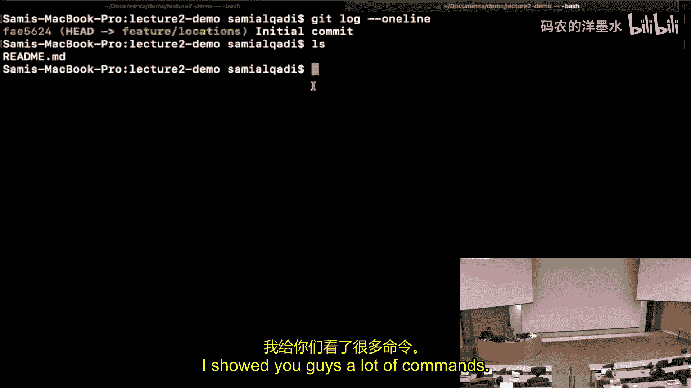

I showed you an entirely new workflow。When you're working with your team。

 some of it might have stuck， some of it， you might need some more practice with it。 The point is。

 is that I didn't teach you everything there is about Git。 I taught you a lot。

 but it's not everything。 There are some more commands out there。 And when you're using Git。

 you're gonna run into certain errors And you're gonna realize that there be there might be some more commands that you still have to know。

 And you can learn those， but it'll take some time。 It'll take some practice。

 and it'll take some Googling to just get comfortable with everything。

But with an great understanding of the foundations。

 So everything that we went over in lecture 1 and all the concepts here in lecture 2。

 you should be able to pick up these new concepts if you ever run into them pretty quickly， so。

If you want to learn some new。Get commands。 There's a lot of great tutorials。 I like this one。

 They go pretty far in depth。😊，But again， everything that I showed you in these lectures are things that you're going to see in industry。

 There' are things that you're going to see in your group projects。

 and there are things that you're going to like even developing by yourself。

 You don't need to necessarily do them with a team。So。

Does anyone have any questions before I hand it off to Rohan for some announcements。Okay。

 so take it away。All right， can hear me Okay， so a few things for me firstly。

 if you're not in the piazza yet， please join that because we're sending a lot of announcements on there。

 things about projects and homework， so please join the Piazza ASAP if you're not already on there Secondly。

 please fill up the project for we send that on Piazza。 we have a lot of response already。

 but not everyone， so please get that done。😊，Let's say by tomorrow midnight it was the deadline。

 so when that done as soon as possible because on Tuesday we're going to have all groups meet up for the first time so we need time to organize everyone together。

Finally， we have office hours starting tomorrow， so office hours is going to be Wednesdays。

 5 to 8 pm then the Sebel basement in the room directly behind CS2 25 there's a sign outside but no room number so it's a little hard to navigate to。

 but you'll find it。We'll be there tomorrow from 5 to 80 of any questions about the homework。

 about any lecture content about general logistics or project stuff will be there， so come through。

 that's all the announcements for this week。😊。

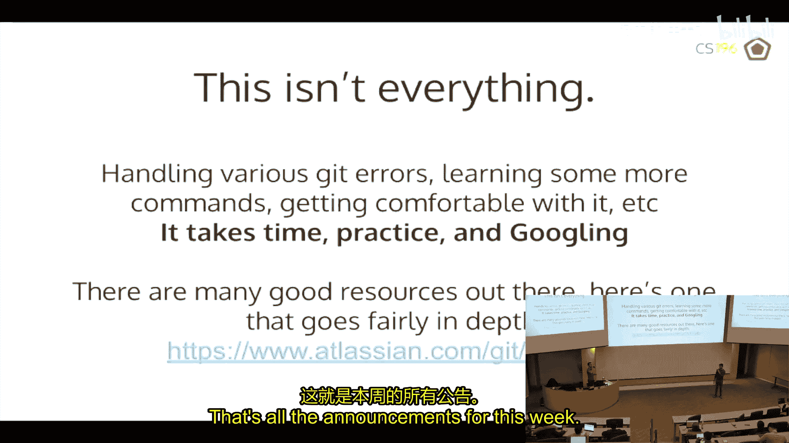