# 【全集 春季版】伊利诺伊大学 计算机编程：从Bash到Rust 中英字幕 p05 Lecture 5 - Rust：变量、类型、函数、控制 -BV188rDBFEUY_p5-

Al right， welcome back to CS 196， so I'm gonna to do a couple quick announcements to start lecture last week we or sorry last Tuesday we started our project kickoff so if you guys weren't here on Tuesday。

 please come talk to me or Rohan after lecture and for those of you who were here on Tuesday make sure you keep in touch with your PMs because the start of the projects are always where communications is the most important So make sure you're in the Discord。

 talk to your PMs get everything settled your meeting times etc cetera so that way the projects can go smoothly so we'll go ahead and start off the lecture。

Gys， so before we start lecture， can you join the Kahoot so that we can get right into that when we do because we have a lot of stuff to cover today。

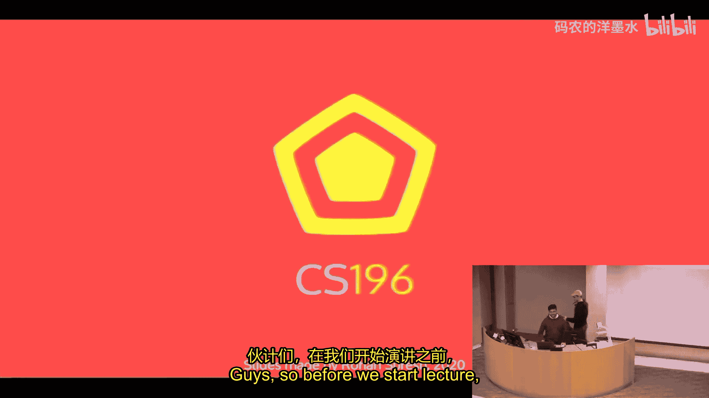

There's the code， remember to join with your Ne ID so we can give you credit for coming to lecturer and getting anything correct。

Yeah， also for today， because it's an intro to rush。

 anyone who's in the top five will get extra credit on your overall grade。

 so make sure you're paying attention because a lot of points is available today。

One whole percent of extra credit。All right， one whole percent of extra credit。🎼Yeah。🎼。🎼The。🎼，🎼，う。🎼。

Just reminder， please your NI when you log in。Howeverever that person was。🎼，🎼，🎼，Okay。

 I'm going to give it like another minute if youll just walked in， join the Kaooot。

 and we're going to get started。🎼あ。🎼。🎼，🎼，🎼。Okay， if you're not the kahhoot， raise your hand。Okay。

 wait another minute。🎼Yeah。🎼，う。🎼哎。🎼。🎼，All right， is everybody in the Kaahooot。

 if you're not in the caahooot， raise your hand and we'll wait。🎼Okay， great。🎼。

🎼，All right。Okay， so welcome to our first lecture in Ru。

 So Ru is a programming language that we're gonna be using for the rest of the semester。

 just as a note， you won't have to use this for your project unless you want to。

 but we're gonna teach it too， because it's a really powerful language that you can do a lot with。😊。

So first， let's start off with what is rust？😡，So these are all really great examples of rust。

 But unfortunately， now we're working on today。 So what are we gonna do。

We're in the programming language。 We're in a C， S class。 I'll be honest guys。

 I spend a lot of time finding the league of pictures of rust。 Okay， what is rust。

 So Ru is a multipar systems programming language。 So what do those words mean。😊。

 let's go paradigm for its programming paradigms。 So like paradigm is a way of categorizing a programming language based on their features。

 So you're probably familiar with object oriented programming。 So this is like Java。

 A lot of other languages use this， but you might not have heard of like decative programming or functional programming like Haskell。

 So what multipar programming means is that Ru doesn't restrict you to a single kind of paradigm。

 You can program several different paradigms。 And Ru will allow you to do that。😊。

Now we have systems programming language。 So what is assistance programming language。 Well。

 it's a language use for systems programming。 That makes sense。 It's in the name。

 But what does that mean。 So systems programming is used for system software。

 and system software is different from application software because it's not generally for a user to use。

 It's a platform for other programs to run on。And a different。

 a key difference with systems programming application programming is that systems programming languages will focus on performance。

 A key thing here is want things to be fast， very fast， very safe。

 And we also want to have easy access to underlying a hardware that we work on。 So as you know。

 your computers running hardware。 if we get access to the hardware easily and directly。

 we can optimize it。 Hey， your question。😊，So the question was， is something L C3。To some extent， yes。

 we will be reading it's a high level language。 So L C3 is pretty low level。

 Ru is like C plus plus or Java。 It's like a high level language。

 but it's similar to C in that you can access low level systems and mess with the bits and like really optimize your programs。

😊，Okay。And Ru focuses on safety。Kind of so rust can be used both safely and unsafely。

 And we don't have to worry with unsafe rust at the moment。

 But essentially what that means is with things like in language like C， C is an unsafe language。

 because you can make an array and era a list of numbers and say it's of length4。

 But if you try to read the  fifth or sixth or even the 50th element， C will let you do that。

 Even though you're not allowed to see that memory， C will let you do things like that。

 which is very unsafe。 So safe rust will help you not again any memory errors or type errors like that。

 So Sa rust from the documentation is the true rust programming language。

 So this so using safe rust is not going to hinder your programs at all or your applications at all。

😊，And Safefor will still allow you to write higher performance applications without need to worry about memory safety or type safety。

So let me talk about memory safety and type safety very quickly。I can't go back。

 Thank you leave back a slide。哎过。So memory safety essentially means what I said before。

 like only accessing memory that you allocated or that you're allowed to use。 and type safety is。

 let's say I have a character。 That's1 by that's 1 by in size。 If I give an integer， which is 4 B。

 It has something called overflow。 And you can do a lot of bad things。 if you have overflow。

 So rest will protect you from those kind of things。

 So its safe for us protect texture from those kind of issues。😊。

And the key feature of rust is safe concurrency。 So what is concurrency。 Concurrency is a really。

 really powerful tool that you can use an application to process multiple tasks at once。😊。

And this makes highly efficient applications。 So concurrency is very complex。

 and we're not gonna go super in depth into it， but we definitely will touch on it because it's a key feature of rust and something that can make your apps very。

 very powerful。And syntically， rust is similar to C plus plus。

 but it's safer while maintaining a high performance。

 So if you've ever written a C plus plus or similar to Java。

 you'll see a lot of features like that in rust， but it's safer。

 So you won't have to worry about memory， like memory errors and things like that as much。😊。

And Russon voted the most love programminging language in the stack overflow developer survey since 2016。

 So we're not teaching a totally random language。 Rus is used a lot。

 And I'm going to talk about that in a sec。 So is Rus used anywhere。 Well， yes， Rus used a lot。

 actually， So several parts of the core file system and dropropbox are written in rust because it's highly efficient and very safe。

😊，Yelp developed a real time A B testing framework in which rust is used。

And that's used all over Elp for their Yelp， Sorry for their Web applications， their mobile apps。

 etcter。And Mozilla's parallel web processor engine Servo is also written in Ru because of that concurrency。

 easy and safecurrency。So the basics。First and foremost， the documentation for rust is。

Your go to for any issues that you have。 It's incredibly well documented。And it lets you。

 it'll teach you everything you know about us。 I taught myself for us purely to the documentation。

A great thing about the rust documentation as well is that lot has a lot of code snippets that you can run inside the documentation。

 So if youve any questions about rust， know that the documentation is the first place to go。

 please if， if you learn anything from today， learn that。 that's the most useful thing。

 And the compiler is also a really great tool， because unlike other languages。

 which gives you very arbitrary error messages， the compiler in rust is very useful and smart。

 and will tell you quite specifically what the issues are。😊。

So your first program set up files and stuff。 So if you want to install Rus on your Mac or your Windows or Linux。

 you can find old info the documentation。 I'm not gonna cover that right now。

 but it's very self explanatory。R files ends with dot R C。 So if you make a rust file。

 you wanted to end a dot RRC so that your terminal knows what it's working with to compile the rust file。

 you write write R C and the file name and the command line。

 And this generates what's called an executable。 So the compiler will take the code and generate an executable file。

 and an executable file is a file that can be run。 And the key thing to mention is that if there's an error in your code。

 the compiler cannot make an executable。 And it'll said tell you that there's an error。

 And then you can debug that and then make executable。

So let's do a very quick recap of what of a function is。

 So function is a name chunk of code that does a specific job。

An important thing with rust that the main function will always run first。

So you always have a main function in all your rest programs。 And that's always gonna run first。

So I'm gonna step over here because we will demo this。So this is going to be your first function。

 It's going to be in main like this。 So if you notice here this F N。

 F N identifies the main function with main being the function name。

 And F N tells you that this is a function。You can see that this parentheses after main。

 that's where you put parameters into your function。

And then the function itself is wrapped in curli braces， like so。

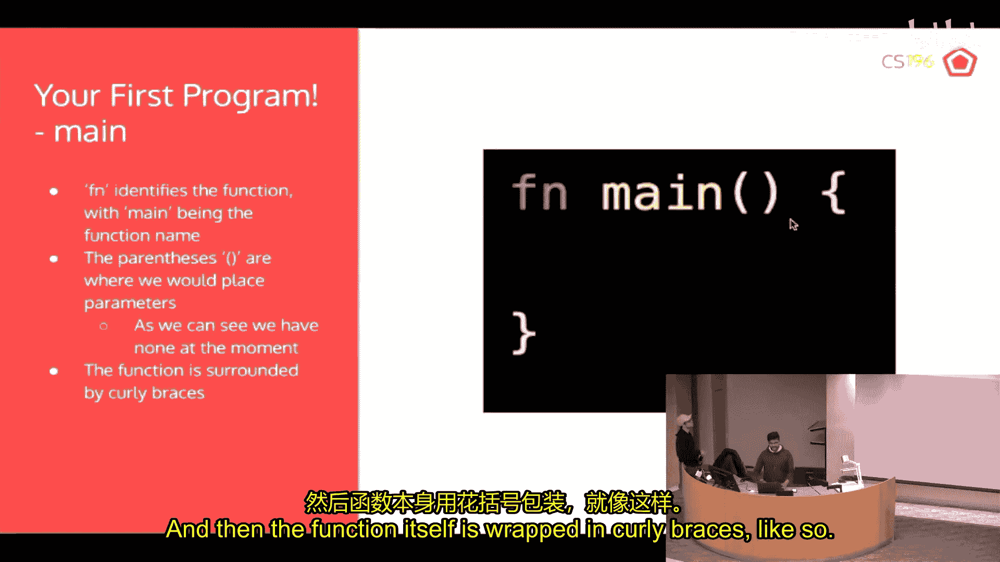

So let's go and do that。 Let's start off with our main function。

 So I'm just going to go to my desktop。So the first function program I'm going to write is Hello world。

 So let's make a directory called Hello world。And let's make a file。 So let's call it。Hello， world。

Dot RC。入。And I'm going to use V S code just gets easier to work with than Vim， and looks nicer。

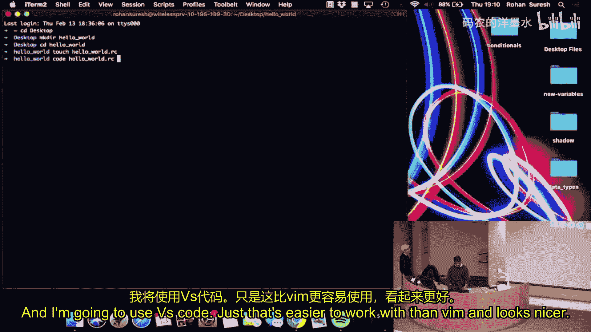

Alright， so FN。Ind case that we have a function。 Let's call it main。And do that right。

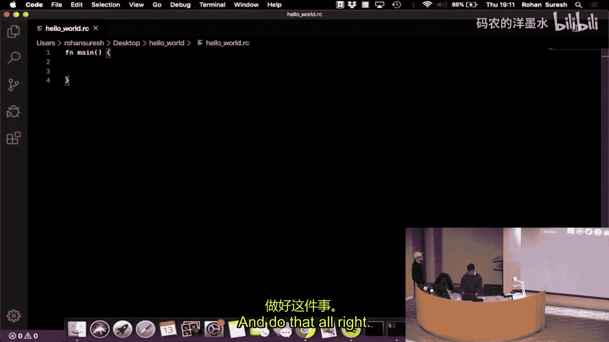

So now we're going to do hellello world。We have F N main， but let's do something here。

 So we're gonna use the command print L N。 So that's print line。

 Notice that it's an exclamation mark after L N。 So the exclamation mark shows that we're not using one of our own functions。

 We're using a rust macro。 So this isn't actually a commander function。 This is a rust macro。

 and it's built into rust。😊，A function call will not use exclamation by mark。

 So now let's go over here， Let's do。

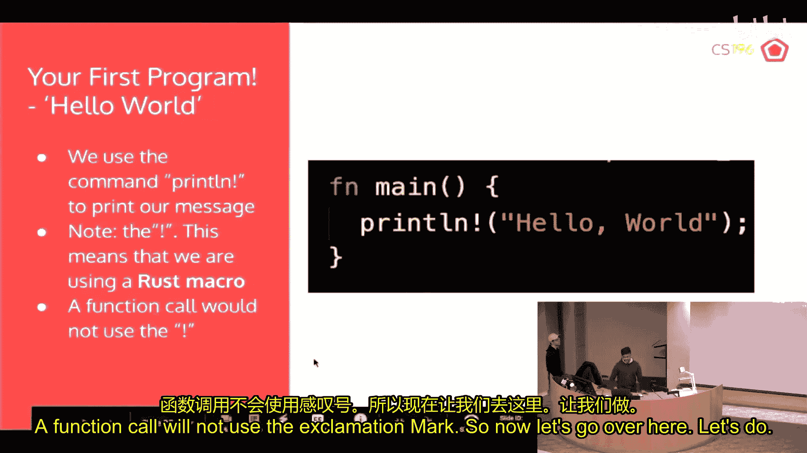

欢lan。Hello， world。A key spelling world wrong。And notice that you have to end all your lines with a semicolon。

 So that indicates that you're the end of a line。

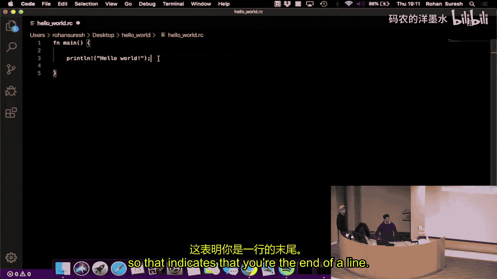

Okay。Let's do rest C。Okay， so now I'm gonna list the files here。 Now。

 notice we have the file that we made， but we also have this new file here。 That's the executable。

 So on Linux and Mac to run the executable， we just do doc slash， and then we write in。😊。

The executable name。 So when I hit enter。There we go。 that， Can everyone see that actually。

 I that too small。That fine。Alright， and you can see it printed out this message。

There is our first Ru program done。

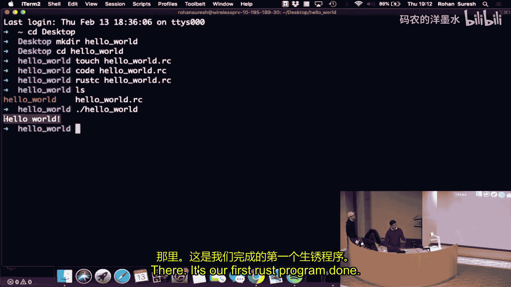

So we pass， So if you look at this， this is a function of macro call inside the parentheses。

 We pass what's known as an argument。 And the argument in this case is a string hello world。

 which the macro then processes and prints the terminal。

And this is a small thing additionally matter a whole lot。 But in Ru。

 the styling uses four spaces instead of a tab。 So if you notice。

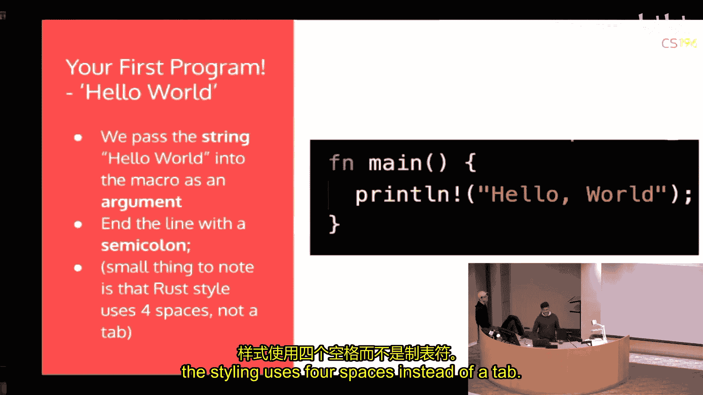

After。F N here， there's four spaces here， not a tab。 And it may， it might look the same。

 but that's just what Ru follows。

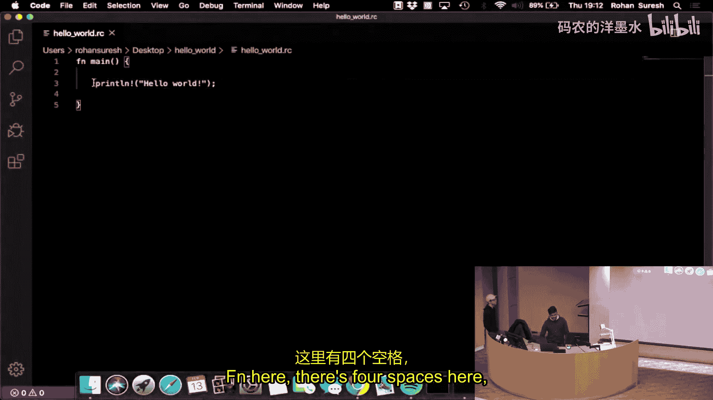

So now I'm going to talk about cargo。 So cargo is Ru built in build system and package manager。

 So why do we need this， Well， sometimes we have very big programs， which have a lot of libraries。

 like imported libraries， which we'll call dependencies。

Cargos do a lot of things like it'll build your code automatically。

 It'll download libraries that your program is using。 It'll build these libraries。

 It's a great way to manage very large projects automatically。😊，And it's really good。

 How do we get cargo， Well， if you follow installation in the documentation。

 you already have cargo installed。😊，So check your cargo。

 you just write cargo dash dash version in your terminal。 And if the number appears。

 then you have cargo， if there's an error message， then you don't have cargo。 So let's try that。

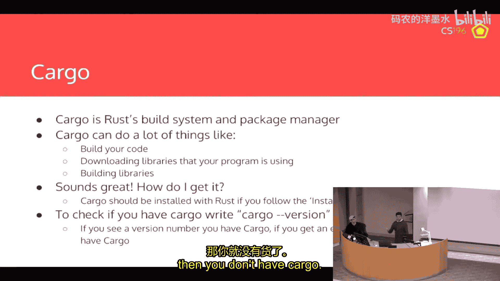

So if I do cargo dash dash version。There we go， we have a number here， so we have cargo。

 we're all good。

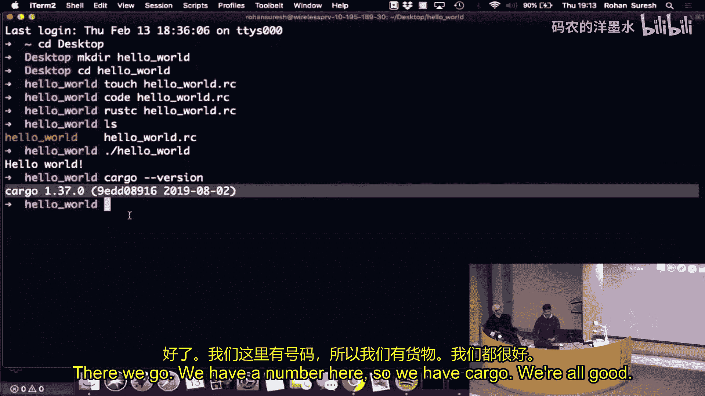

So how do we create a project in cargo。 So all we have to do is write cargo new and then give it a project name。

 So this will create a directory which will have three things inside it。

 It'll firstly have a source directory and inside which will have our main file。

 So the file that we write all our code in。😊，We'll also have cargo dot T O M L。

 and this file is general information other the project details。 And finally。

 it will also initialize a Gi repository and a dot get ignore so that we can push our code to Git from inside the current directory。

😊。

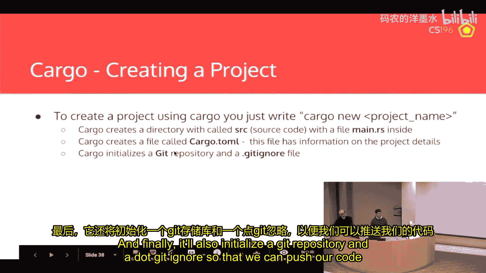

So let's now on our desktop。Let's make our first cargo hello world。So let's go cargo， new。

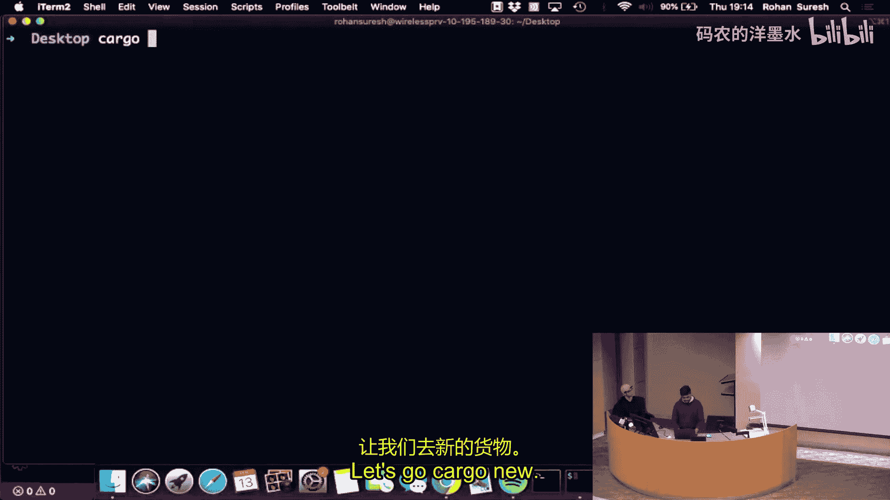

Hello， world cargo。All right， so if you look at my desktop now， there's a new directory here。

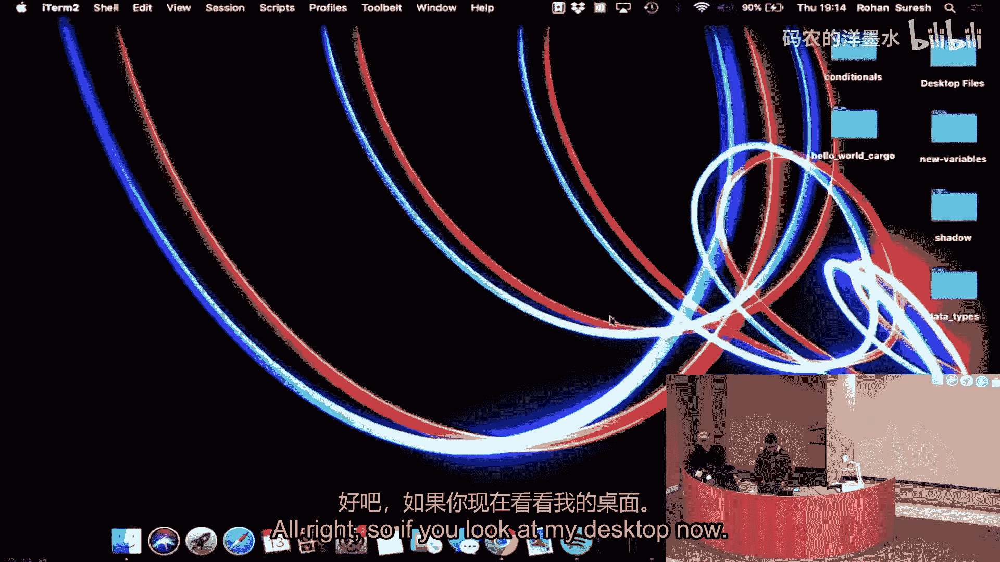

So let's go into that directory。Now let me actually list A。

So you can see there's a directory here called source。 We have the cargo dot U M L。

 And there's also the Git repo here。Any questions so far about cargo。は。So let's go into。

 let's first look at。

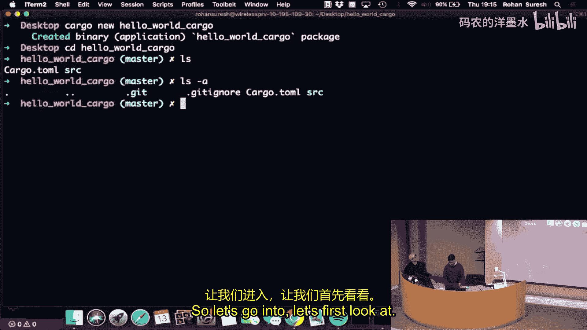

This file here。So as you can see， it has a bunch of information about the projects're working in。

 So it has the project name， the version。 It has the Ru edition and even has the author。

 which is me at the moment。And underneath， you see， there's nothing in the dependencies。

 But if we were importing a lot of different libraries with different tools。

 there will be more stuff there。And we don't have to touch this file。

 It's just for us to keep track of what we have at the moment。

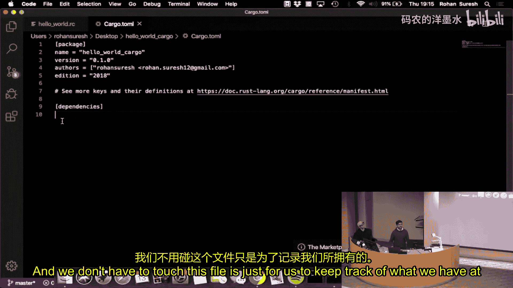

So now let's go into the source file。What's really good about cargo is that itll automatically give us our first hello world。

 So let's list the files in source。 We have main dot R S。😊，So if I do code， main dot RRS。

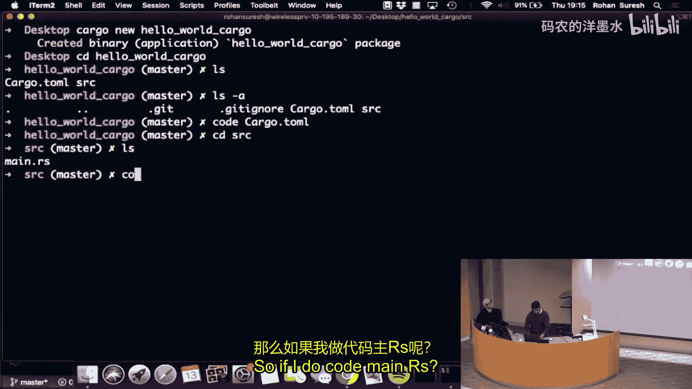

We have our。OfProgram here。So this is a Ru program。 It's very similar one we had previously。

 It's almost identical。 actually。 And to run this， we do different things。

 So let's first go over here。 So cargo。😊。

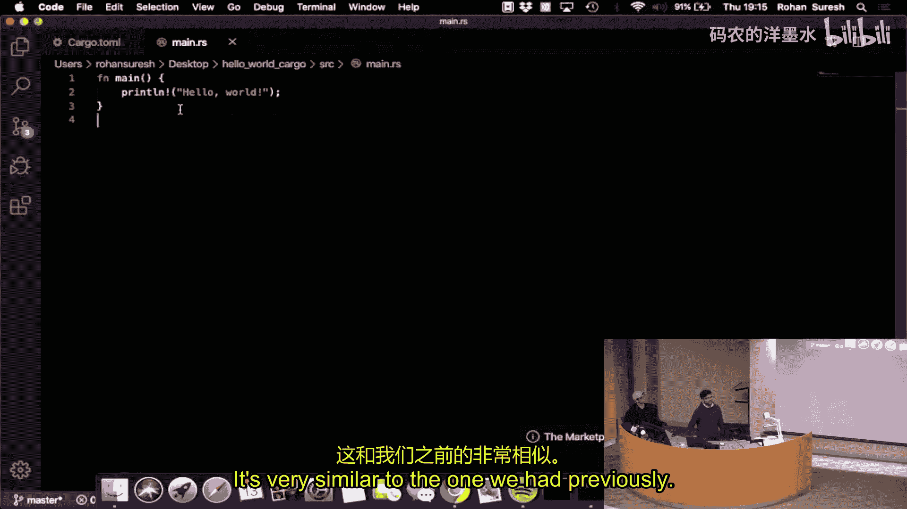

Hello world Cargo gives us a hello world function。 start off with。So building and running。

 So cargo actually handles all the building for you。 So if you're going to build using cargo。

 you just write cargo build in the working directory。So let's try that right now。

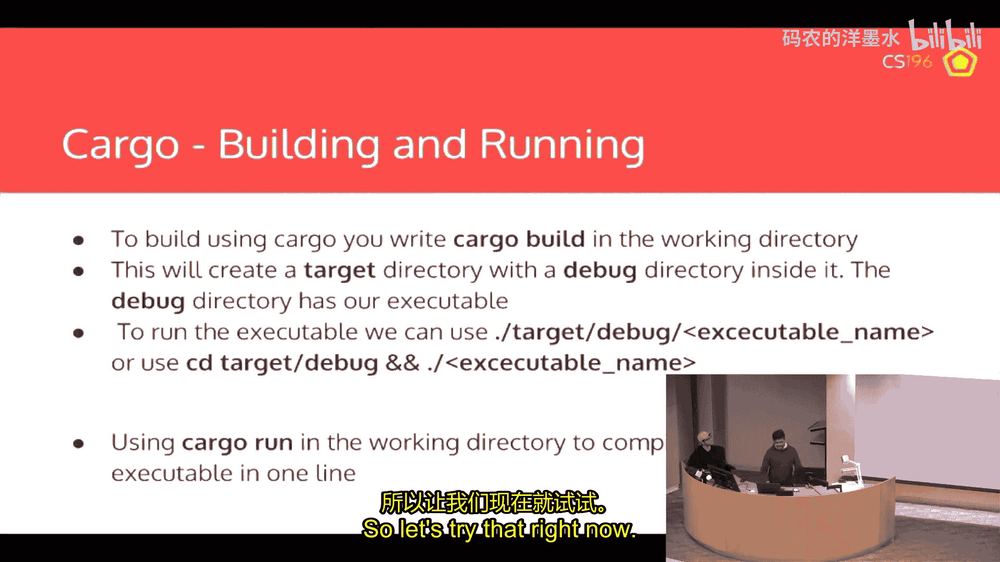

We can do。Cargo， build。Now， what does this do。 So if I list the files again。

 we now have a new directory called Targ。 and in targetrg， we'll have all our executables。

 So let's go into targetrg and list the files。 So then right now， we have a debug folder。

 We have debug because we haven't sent cargo our completed project yet。

 So if I go to the debug folder。I'll find our executable here， which is right there。

So if I do dot slash hellello world cargo， it prints hello world。Does that make sense。

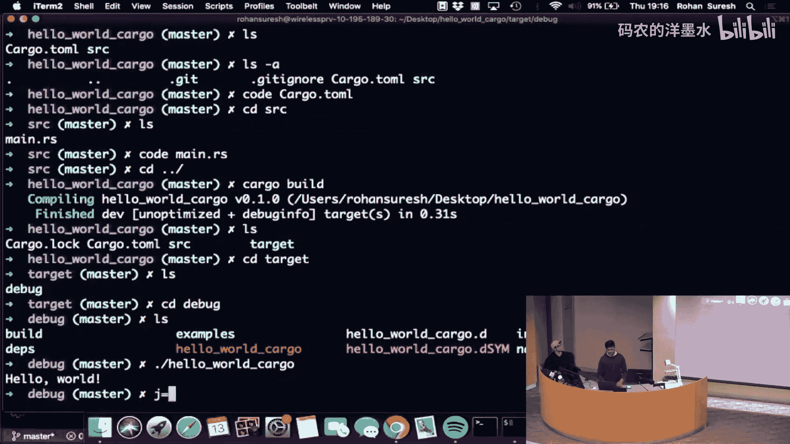

Okay。So that's how you run it。 You can either go directly into the folder and run it。

 or you can run it from inside the cargo folder by doing this long string over here。

And if you don't want to do build then execute， you can do cargo run in the working directory to compile and run the executable in one line。

Cargo also creates a file called Cargo dot lock， which keeps track of libraries and which is the textbook they refer to as dependencies。

 And you don't need to worry about this file because it Cargo automatically updates it with all your dependencies at the moment。

Another command I want to talk about is cargo check。

 So cargo check will check if your code can compile。 So essentially， it builds it。

 but it won't create a new executable。 And you're probably wondering， why would I want to use that。

 Well， if you're writing a lot of rust code， you want to check if it's working。

 So one way to do that is by building it。 And the compiler will tell you there's any issues。

 But to actually build the executable takes a lot of time。 So if you just do cargo check。

 it'll just tell you where there's any errors without wasting time。 building executable。

Any questions about cargo so far。Okay。

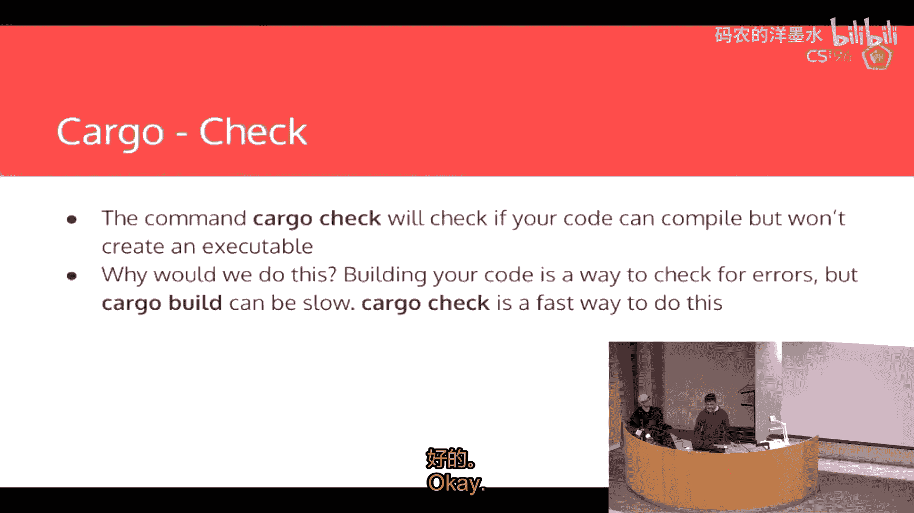

And finally， we can build for a lease。 So 1 I step before is that if we go into。Our target folder。

And list the files。 We have a debug directory at the moment。

 So the debug directory is good because it creates debugable files。

 And that means Bru will compile files very quickly without optimizing it。

 If we are done making our file， we can make it for a lease。😊。

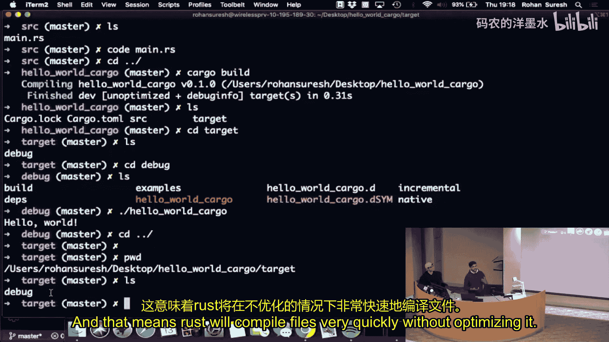

So using the command， cargo build dash dash release。

It will build a code for release for a production。 So the compiler。

 the compiler will provide extra optimizations in the target slash release folder。

 and youll have an executable bit very fast。 The issue with using target target release is that sorry cargo release。

Is that it takes a very long time to compile， because the compiler will take time to optimize your code。

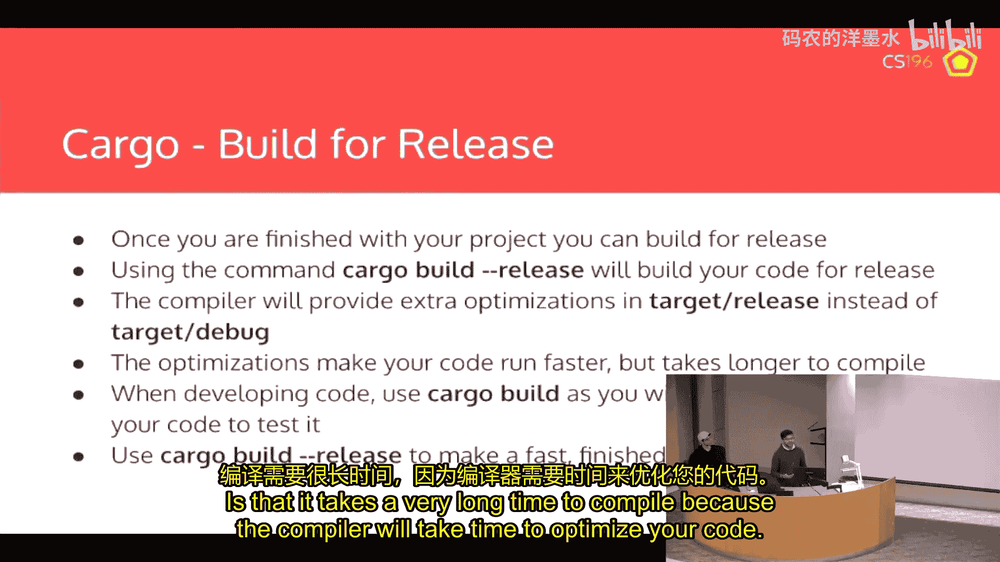

So we can do that right now。 New cargo only me clear this first。Cargo， build dash dash release。

And now you can see the release directory here inside which。Is another executable with the same name。

And obviously， hellello world is not going to be much faster because it's a very simple program。

 But if you're working on a much bigger project， the release virtually much faster。

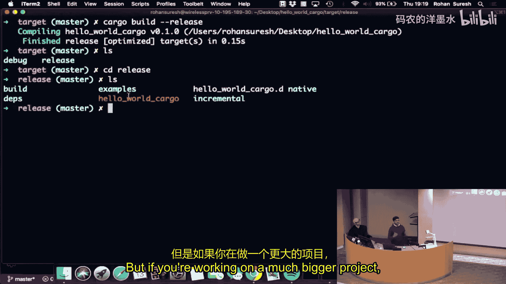

Okay， so now we're going to start talking about actually coding and rust。

So's talk about variables in mutability。 So variables in rust are immutable by default。嗯。

So what does immutable mean， An immutable variable means that once you give the variable of value。

 you can't change anymore。So the reason Rus does it is to have improved safety and make it easier to do concurrent programs。

So， let's have an example。So right now， we've declared a variable in this code。So in our main。

 we have。We use the keyword let to declare a variable called change me。And in this。

 and we assigned the number 5 to change me。So we also have this print line， print L N line here。

 So the variable has value， bracket bracket。 So the the curly brackets here will be replaced by the variable。

Does that make sense。So does anyone want to guess what this code does？Anyone。Okay。Well。

 the code will。Say that the variable has value 5。And it'll print that out to your terminal。

 prettyt straightforward stuff。But let's say we tried this now。

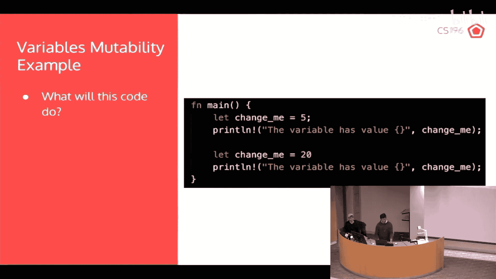

I'm actually going to do this over here so you guys can see that。So we declare a variable。

 let's print this variable out。And now let's change this， the value of this。

Sayve 20 and try printing it again。 Does anyone guess what this will do。

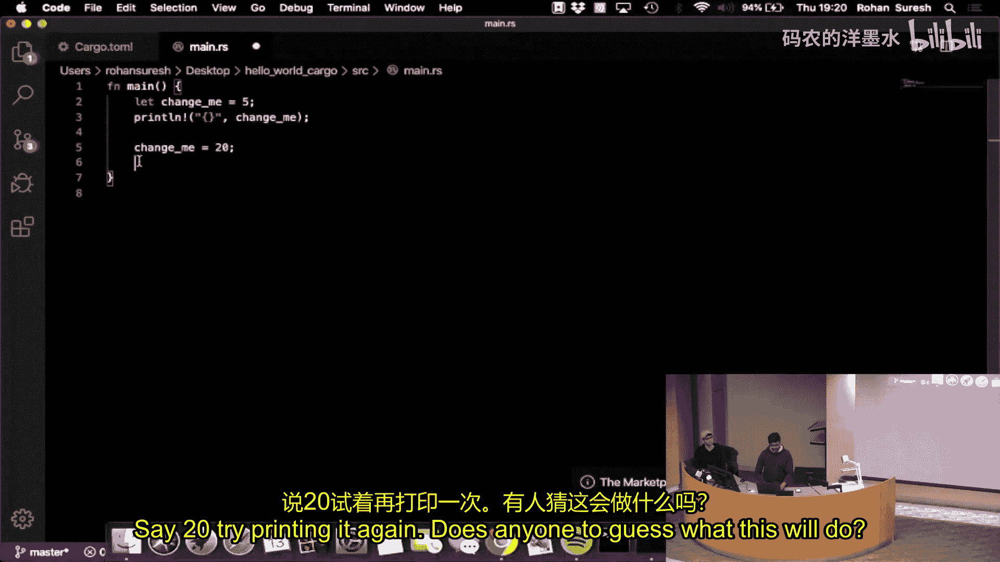

Well， if I try to run this or compile this。嗯。Cargo run。

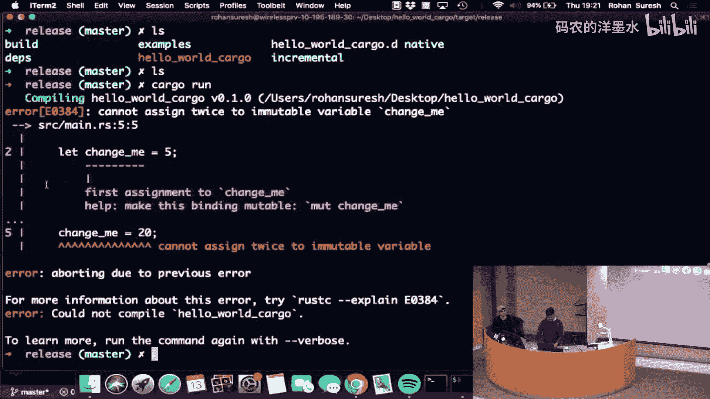

We get an error message。So let's take a look at error message in detail。

So it says cannot assign twice to immutable variable change me。 So as you can see。

 the compiler is actually very helpful in debugging your code。So because the variable is immutable。

 we can change its value。We get an error if we try to。So it also gives us a way to fix this error。

 We can make this binding mutable。 So mutable means that it's a variable that can be changed。

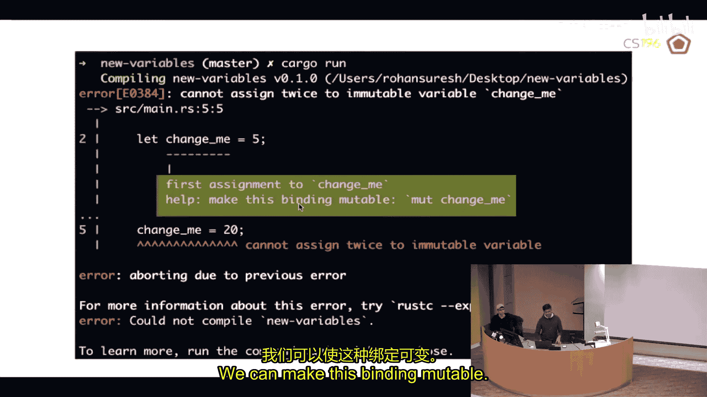

So what we do that is by using the keyword mute M UT。

And this will indicate that the variable is mutable and allow us to change its value and also indicates to other programmers who look at our code that we're gonna change the value of this variable throughout the program。

So all this code do。Well， it's gonna print out what we expect。

 It's gonna print out the value 5 and the value 20。Okay， and now I'm going to talk about shadowing。

 So in rust， unlike other languages， you can declare a variable with the same name as a previous variable。

 And we say that the new variable shadows original variable。 So in this code here。

We declare the variable var is 10， and we print out the variable here。

So now we're gonna increment the variable by one。 But we just learned that variables in rust are immutable。

 But because we're using the let the let keyword again。

 that means we're declaring the variable as a new variable。 Therefore， when we run this。

 we won't get an error， we'll just be incremented by one。

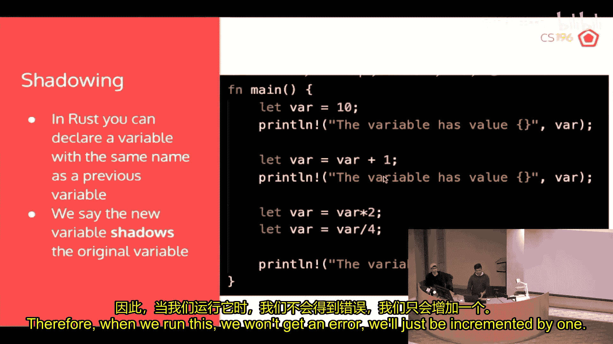

想啊。I have this file opened up。Or made in advance。

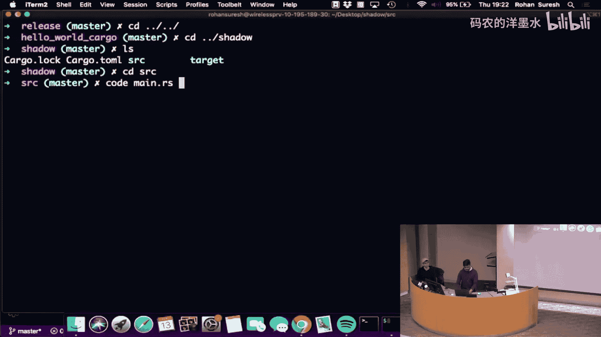

So I have this file here。So does anyone have a guess at what this file is going print out。

Third trick question。

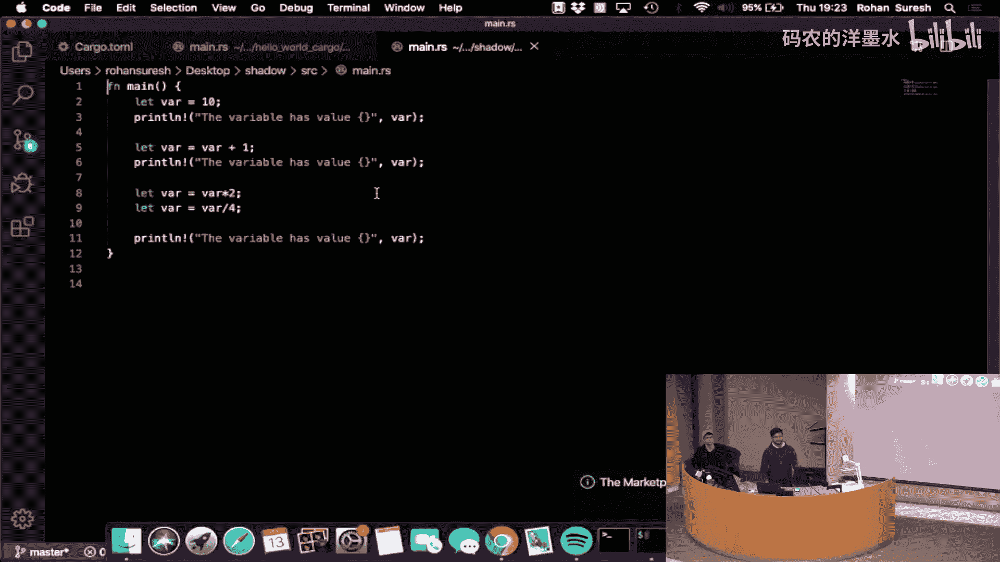

Okay， I'll just run it then。 Why do cargo run。We see that it prints out。The variable is value 10。

11 and then 5， which makes sense because those are the operations that we did to the variable。

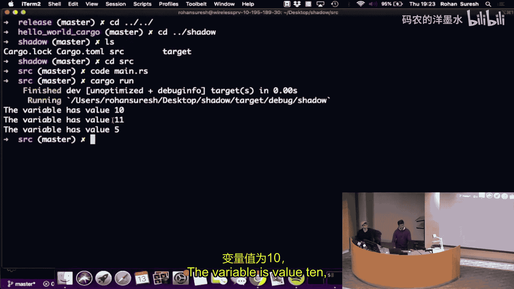

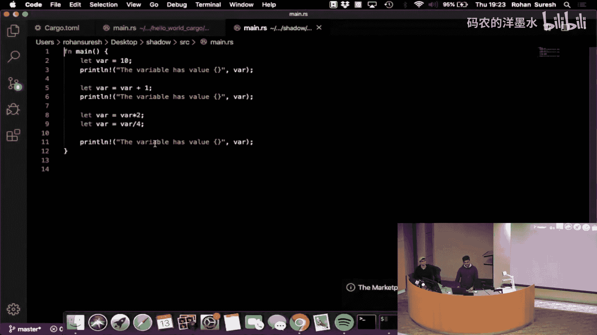

So why is this different than using the mute keyword。

Is different because we're indicating that we still want to keep an immutable variable。

 We are making a few transformations to it。 But when another programmer looks at our code。

 we want them to know that this is still。Imutable， and they shouldn't be changing it unless they're doing a transformation like the ones we listed before。

And because we're essentially declaring a new variable， we can change its type。 If I said。

 change the integer over here。

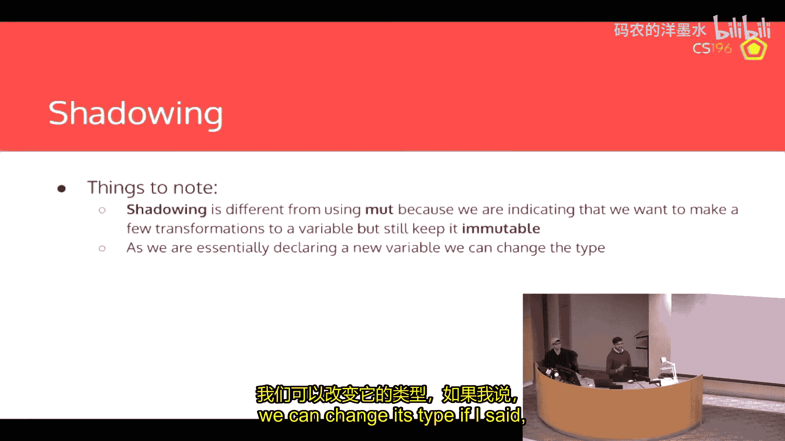

To be a string or an emoji， we can do that。 It won't throw any errors。

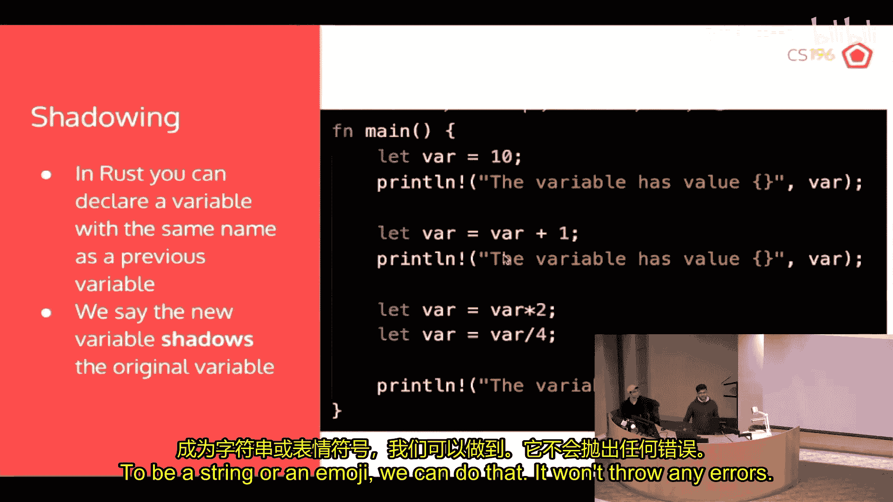

So now I want to talk about data types。 So all values and rust are a specific data type。

 What you might have noticed that when when we declare a variable。

 we don't have to list that beforehand。 That's because the rust compiler is very smart and we will infer what the data type is without you having to manual explicitly say that。

But。Having this with day lets Rus know how to work with the data that we're giving it。

So there are scalar types and compound types。 Let's talk about scalar types first。

 So rust has four primary scalar types。 That's integers， floating point numbers。

 Booleions and characters。So scalartype may are variables that hold one value。 That's it。

So start with an integer。 So integers are whole numbers。 That means they have no decimal part。

 and we can use signed and unsigned integers here。So this is the diagram。 Ex how we can declare it。

 I'll talk more about this in a second。 But if we have a bit。If you look at the numbers here。

 like I 8， I 16， that number indicates the number of bits we can use to allocate space for that variable。

 So this is a little confusing。 I want to try to explain it here。 So if we have I N as the data type。

 that means we want to have 2 to the n number of bits to allocate for that。

 So if that's an unsigned bit， that means we'll have 0 to2 to the n -1。Numbers available for us。

And if we're using a sign bit， we'll have negative 2 to n -1 to2 to the n-1，-1 inclusive。

So that is a little confusing。 for the most part， you want to worry about it because you won't be explicitly labeling your variables。

 but it's just good to know how this works。 And finally， if you use arch。

 it'll just give you the number of bits based on your machine。😊，We also have floating point numbers。

 So floating points are numbers was a decimal part。

 And Ru has two ways to declare a floating point number。 You can do F 32 or F 64。

 F 64 is a default in Ru。 And that means you had 64 Bs to represent that number。

So here's numerical operations， pretty basic stuff， stuff that use other languages。

 One nuance to you might be the modulus function。 So modulus is essentially the remainder after you do division。

 So if you do 5 mod 3， the remainder is2。 So you'll get two back。It at bullolean。

 so bullolean is just true， false， nothing more than that。And when you write true falses。

 make you write in lowercase。And finally， we have characters。 So Rus uses Unicode characters。

 He can only hold one of these in a， in a single character variable。😊。

We use single quotes to represent a character。 And an interesting thing with Rus is that you aren't limited。

 just AScii， like numbers， dashes， English alphabet。 You can also use Chinese， Japanese。

 Korean characters， accent characters and even emojis in what you're in what you're assigning to your character。

😊，So before I move into compound types， I'm just going to pull up a file that has all the data types we just talked about。

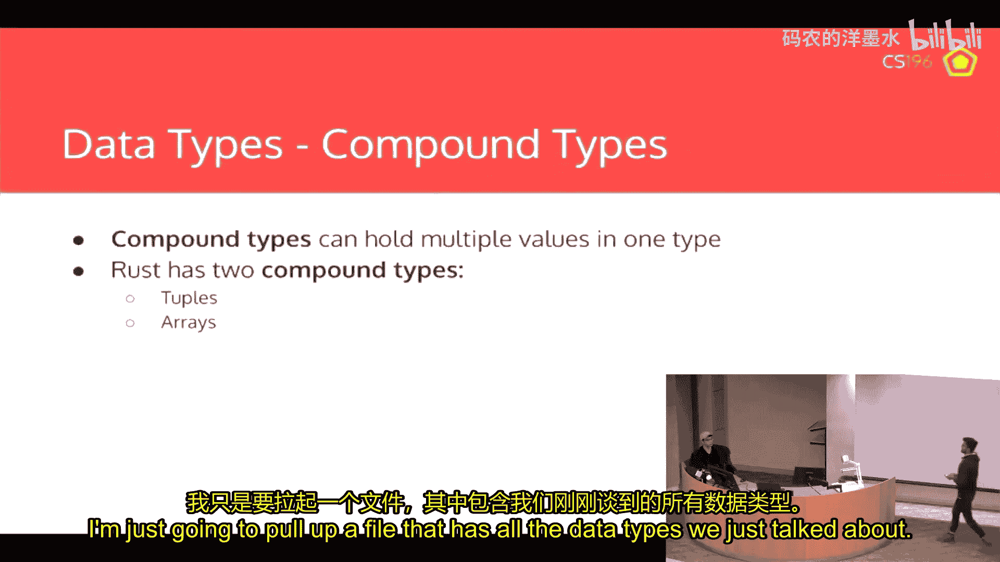

And we will share this so you guys have access to it。

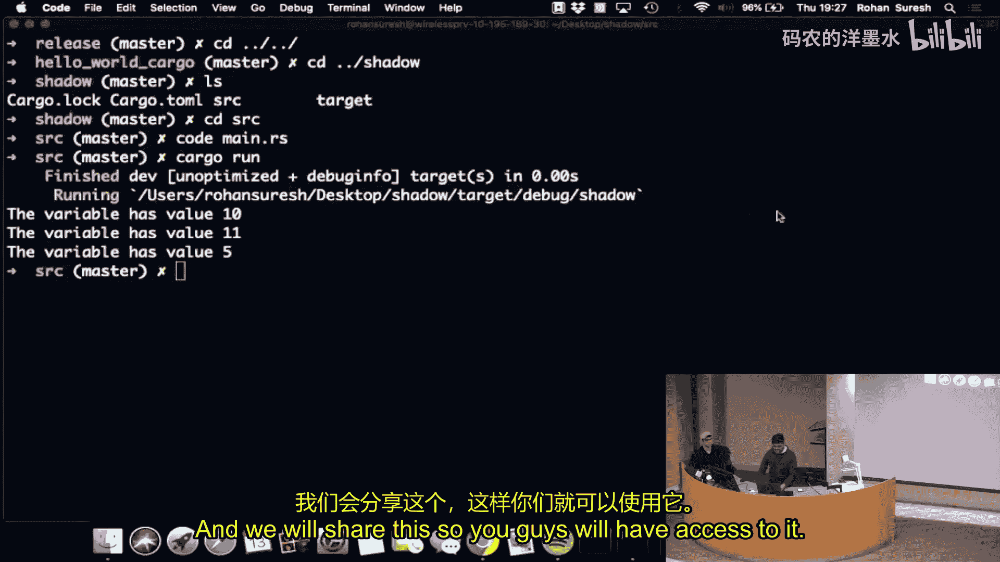

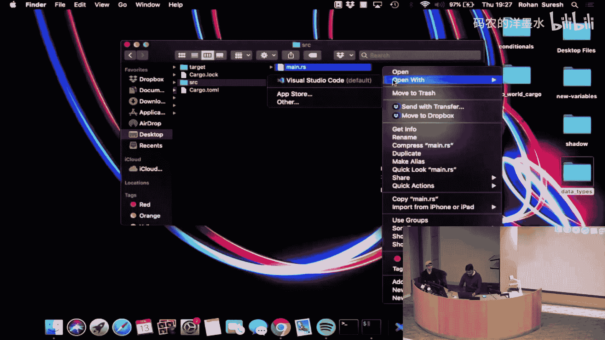

So as you can see， there's a bunch of data types here。 So， here we have our integers。

 the way we assign the data type is by putting a colon after declaring the variable and then putting the data type in。

 So this is a unsigned 32 B。 the sine integer is assigned 32 B。Et cetera， et cetera。

And as you can see with characters， you can give it letters， numbers。 So although this is a number。

 it's not an integer。 It's a character and even emojis， because Unicodeode allows us to have emojis。

😊，As well as regular numbers and characters。So I'm gonna comment this out so we can run the other stuff。

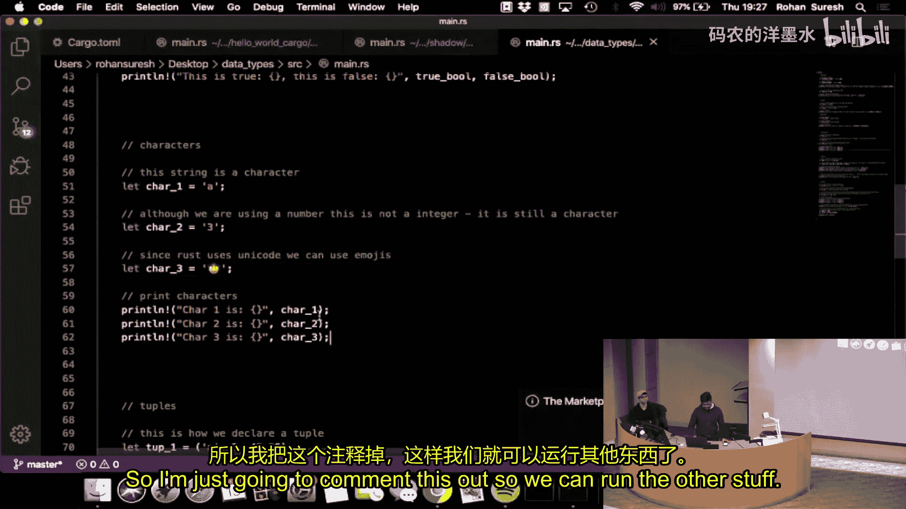

Now， we also have compound data types。 So Rus has two compound data types。

 Those are two pools in arrays， and compound types can hold multiple values in a single type。

So let's talk with that a little bit more。 So firstly， we have tus。 So tus are a compound type。

 which can hold several values in a single variable。

 So we can create a tuple using a comma separated list parentheses。 And tus have a fixed length。

 That means we can once we make a tuple， we can make it bigger or smaller。

 We're stuck with that size。😊，So this cell a tuple looks。

 So we have the let keyword to declare the tuple， and then we put as many values as we want of as many different types we want between two parentheses separated by commas。

And now we have something called destructing destructuring。 sorry。

 So if we want to like access each of these values individually， we just give it a a tuple back。

 So we create another tu of the same length。 And for each character here or each value here。

We give it a variable name。So that's a little confusing。 but let me go to the example here。

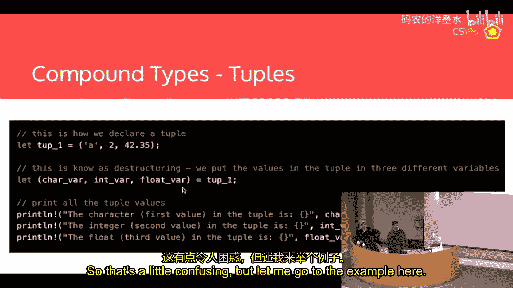

When I print this out。It's going to print out。Carvaar， which is the first value in 2ple1。

And that's the letter A。And when I print out int var， that's the second value in the tubal。

 which is2。 And then the third one is float v， which is the third value in the tuult。

 which is this float over here。 So if I run that。

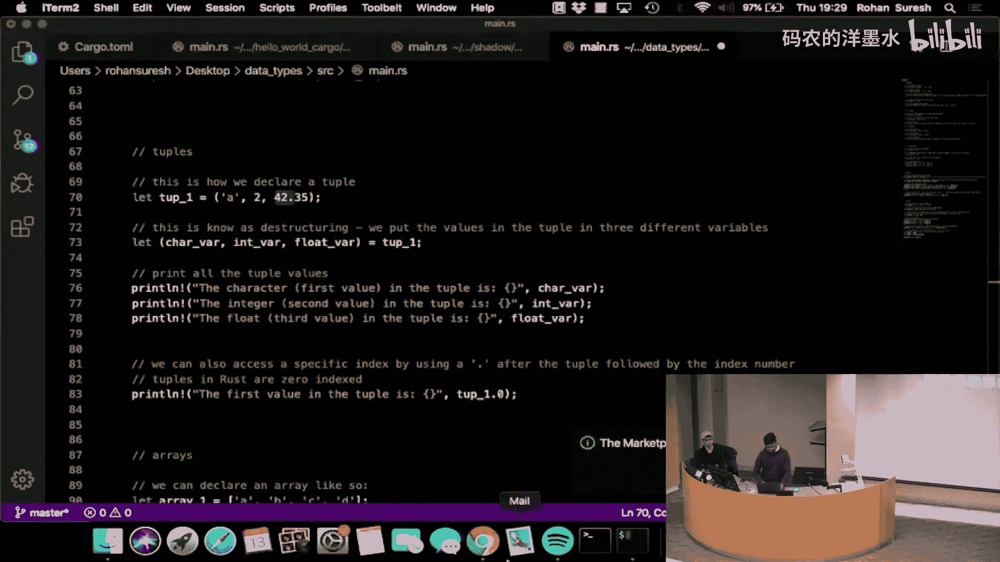

I hope I'm in the wrong directory。

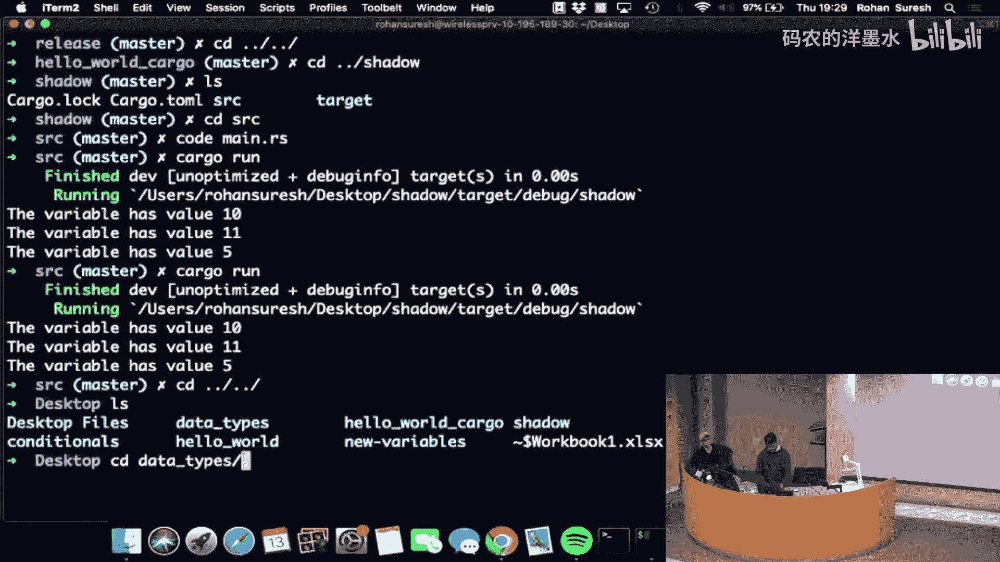

So we've know at the bottom step there， but we can see。That we have the values up here。Oh。

 where is that。Over here， the story we just we wanted to look at。

Does that make sense Any questions about what just came out or output， yeah。sorrry。No， other。

 I'm gonna talk about that actually。 So we can also use index， like you mentioned。

So if we wanted to get like the first value， the second value。

 we can just do the tuple followed by a dot and then the index number that we want。

 And important to notice is that rust is 0 index。 So we started 0 and we ended one less than the length。

 So we want to proud the first value in the tuple， we do21 dot 0。😊。

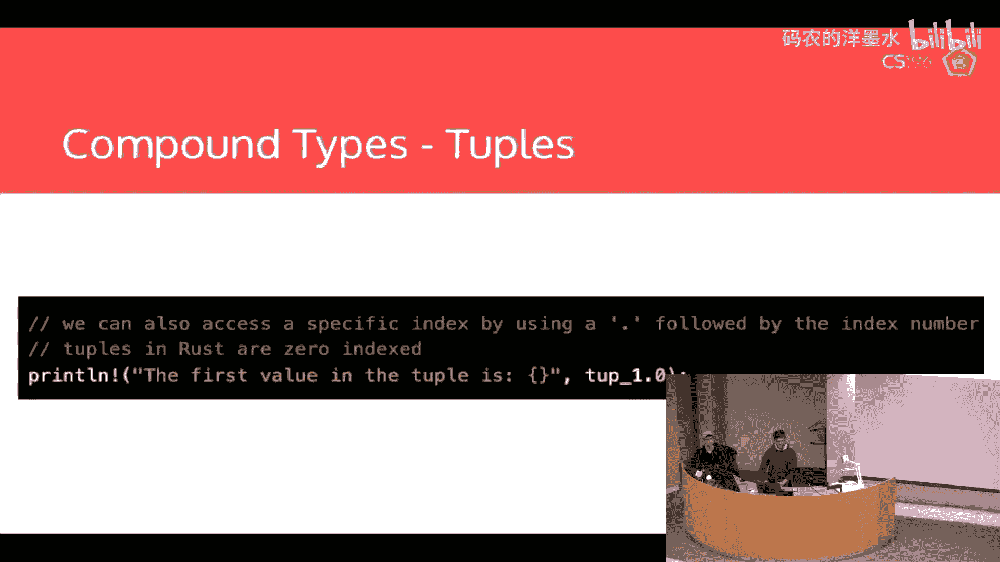

As you can see over here。So I'm going to comment this out。And comment the stuff out。And now。

 when I run this。Oh， my bad。

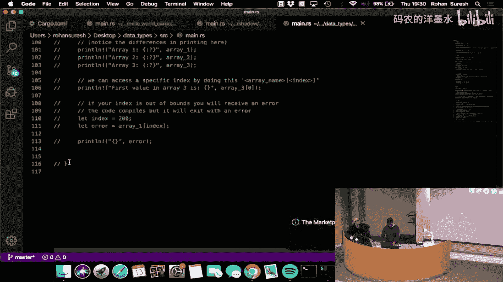

We say the first value in the tuple is a， which is what。

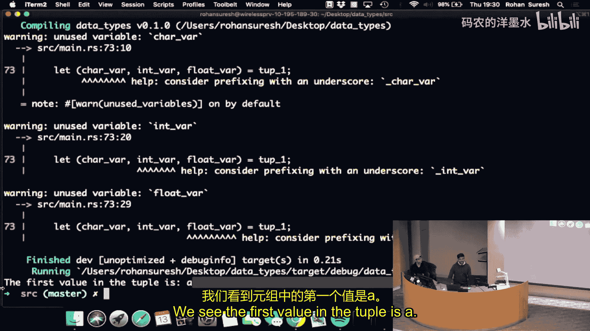

The first value is。Does that make sense， Any questions about tus。Alright， let's go on to arrays。

So arrays are another compound data type in rust。 and the very similar tus except they're fixed。

 So theyre fixed lines like tus， but they only hold values with the same data type。

 And we create an array in a similar way we create a tuple， except we use square brackets。

 not parentheses。😊，And important thing is arrays aren't really that useful because they're fixed length。

 but well cover vectors later on， which can grow and shrink in size。

 And that's much more useful for the projects we'll be working on。😊。

So if we want to declare an array， we can do it like this。 We say。

 let give an array name and then follow it up by whatever we want， a bunch of characters。

We can also specify the type and the size beforehand。 So similarly。

 we put a colon after the variable name， and we give it the type and then the size。

 and we give it the values we want。And finally， if you want to initialize an array with the same value for every index。

 you can say the array equals the value that you want。 Put a semicolon and then the size。😊。

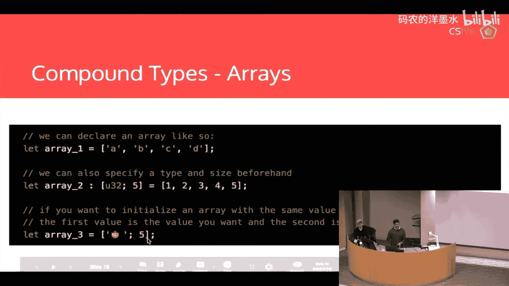

So to demonstrate that， I'm going to run the code over here。Let's comment out the old stuff。Right。

 so this is the code we just saw previously。 And now let's print that out。

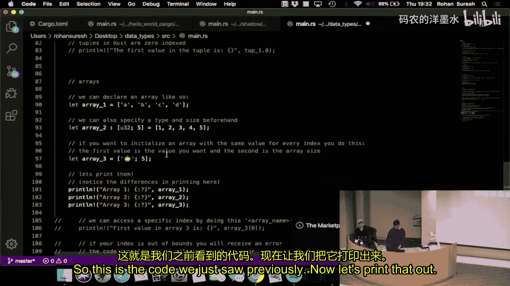

So arrayray 1 has these values。 Array 2 has those， and arrayray 3 has five cowboy emojis。

 because that's how we specified over here。

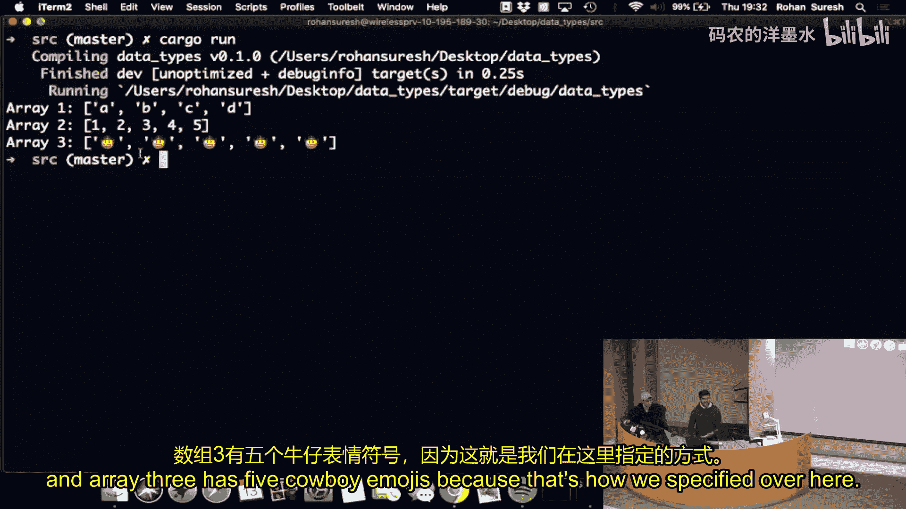

That makes sense。Okay。And to access a specific index in an array， we just do array name。

 give it a square bracket， give the index that we want， and then close the square bracket。 And again。

 arrays are0 index。 So if won the first value， we give it 0， the integer 0。Okay。

So in our code over here。

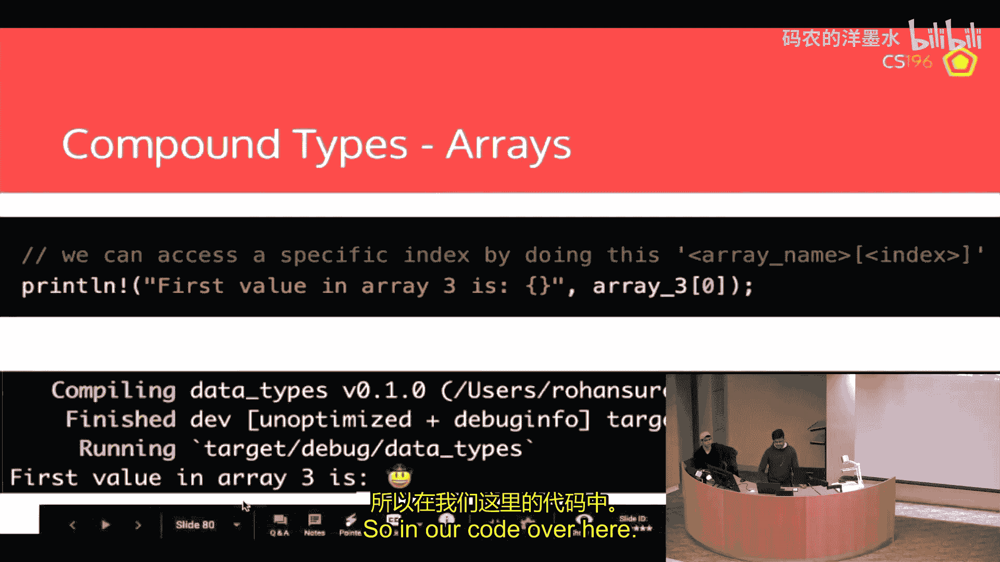

If we do this。We want the zero value in array 3。

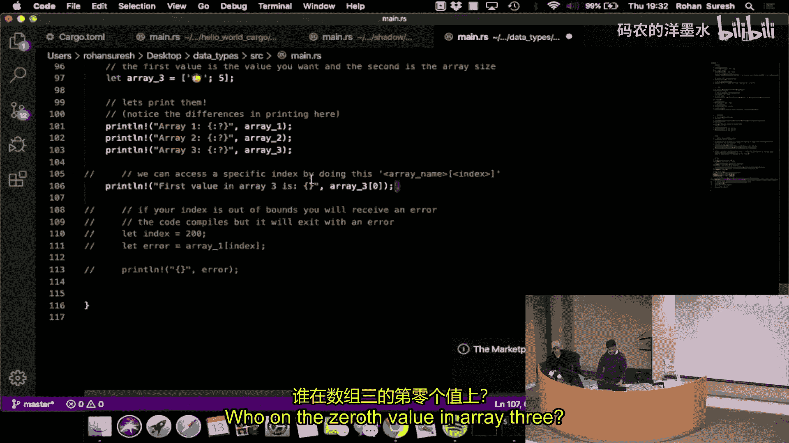

This is gonna be a cowboy emoji。As you can see in the output here。Okay。

An important thing notice that if you try and go beyond the bounds。 So let's say array 1。

 we know only has five elements in it。 If we try to get the 200th index， the code will compile。

 but we'll get a runtime error。 So when the code is running。

 it'll exit unsuccessfully because it was trying to access memory that isn't allowed to access。

So let's do that over here。

Because the previous stuff ran， but now it says。Thread main panicked because of the index outer bounds。

Because the compiler is very useful in telling you what the issues are。

 So make sure you notice compiler errors when you're writing your code。

Alright， so let's do a Kahoot。 Let's start the Kaahhoot。 If youre not the Kahoot， raiseise your hand。

 and I'll give you， okay。I'll give you guys a minute to join。Oh yeah。 also。

 because this because the first lecture of us is a lot of content。

 If you are in the top five in the cahoot， you get one whole percent of extra credit。

So I hope you are paying attention。So before we start any questions。About the content。Okay。

 is everyone in the Kahoot， raiseise your hand if you're not in the Kaahhoot。Okay。30 seconds。

We're gonna start in 5，4，3，2，1， start。

First question should be super easy。🎼は。🎼The。TheSa when get the travel is really， really upset。🎼对对对。

Yeah哈。😊，If first you got it wrong， please speak to me afterwards。🎼，🎼等等。Okay。

 so this was a little tricky。 So I'll go through this command。

 So cargo new creates a new cargo rust project。 cargo run will compile， create the exhibit cutable。

 and then also run the code。😊，Cargo check will only check if the code。Can work。

 So it'll try and compile it， but it will not create the executable。Cargo build， however。

 will compile the code and create the executable that you can run later on。

A any questions about that。That was a little hard。

Okay， one more question。 then we'll。Go back to the content。

🎼，🎼，🎼う。Okay， so most of you got that right， But I'll explain the answer。

 So an immutable variable means that you cannot change the value of the variable。

 So rust is by default， immutable for variables。 Therefore。

 you cannot change the variable once you assign at a value。 So false。

 you cannot change the value of an immutable variable。O。

NowLet's get into some more programming stuff。 So control flow Pa follow conditionals， first of all。

 So we use conditionals to choose what code we want to run based on current like values or whatevers happening in the code。

And they're just as statements。 Nothing super fancy here。So if statements are written in this form。

 so we do if some statement run this code。Otherwise， we do something else。

And when you write the condition， you don't need put like parentheses around the statement of the compiler will actually tell you。

 we'll run the code， but you don't need these parentheses。

And statements do not mean semicoons at the end。 So if youre doing an if statement。

 you can leave with data semicolon because the compiler knows this is an if statement。

And another thing is you can assign a statement to a variable。

 So if you say let var equals if statement， you put an if statement in there。

 whatever the result of the if statement is will be put into the variable。

So let's look in if statement because those can be confusing。

So this is another cargo file that I made called conditionals。嗯。

Okay。😊，Let's look at this first one over here。So。If we have this if statement。

 we have we're assign this variable to be。Whatever this number is。

 the way this condition works is if the first statement is true。

 and I'm not going to explain that in the moment。We print out the first statement， but。Let's else。

 if this is not true and this statement is true。We proud the second statement。

 And if they're all falses， we proud the third statement。Does that make sense。

 Are any questions about what。

The code does。Okay， great， because we have a caooot about it right now。

So all just code print。I'll like zoom in bit actually I'm not going to zoom in that makes it harder。

🎼。You guys had 90 seconds because this is harder and I want you guys to be able to think about it for a little bit。

🎼，🎼。Remember the percentage is of modum。🎼Or the remainder。🎼对。🎼Oh。

You got a lot of you guys got to write。 So great job for， for the majority of you。 I can explain why。

The， color won't don error。 I don't know why that was selected。

 but so let's go through what this code does， so。

To make it easier， let's actually print out what all these statements do。Oh we'll talk about it。

 So modulus is the remainder。 So if you divide x by 100 and the remainder is less than 50。

 we'll do something， et cetera， et cetera。 So if we divide x by 100。Or if you do mod X over 100。

That's an S。If you X mod00， the answer is 27。Okay， so the first statement is 27 less than 50。

 and also。Greater than 30。Nope， not true。So let's go to the next statement， is 27 less than 30。Yes。

 it is true。 So we， we know this is the answer straight away。

And we can ignore this final L completely because this else case was never reached。

So， let's run this。Cargo run。Or is it the second， Second statement was correct。So great job。

 That was a pretty tricky question。 So I'm glad you guys got it right， for the most part。😊。

Let's talk about。More stuff about this。

Oh， that's everything about， okay。So now we're going to go onto。Some more stuff about control flow。

 Now， we have loops。 So a loop is pretty straightforward。

 Itll repeatedly run a section of code over and over again。

 And the syntax for that is you write loop and put two curly brackets without any semicoons。

 And whatever is in there will keep running a forever。 And you're probably thinking， well。

 this is dumb。 This is gonna crash my computer because it's gonna get stuck。 And you're right。

 You can definitely do that。 But that's why we have something called the brake keyword。

 And this will allow you to exit the loop。😊，Another thing that's important is that you can assign a value of the loop to a variable。

 So if you say let variable equal a loop， whatever you break it。

 whatever value you break with will be whatever is put into your variable。

 So let me demonstrate that because that is a little confusing。

 A lot of languages don't let you do that。

So let me talk about this code for a second。 So we have this mutable counter here。

 and we have this variable loop bar。 So we loop repeatedly。And if the counter is less than 0。

 we break and we return the counter。And we decrement the counter every time。And then finally。

 we will proud the value of loop bar。 So does anyone want to guess what this does or what the value of loop bar will be。

To guys， any guesses。-1， yeah， exactly。

So cargo run。The value of looppar is -1。

So does that make sense how that works， Any questions about the looping。

Okay。

So we have our demo， and now we have another caooot， so I hope that made sense to everyone。

🎼。This is another tricky one， so take your time with it。🎼う。🎼，🎼The。🎼，🎼，🎼，🎼，Yeah。Okay， nice。

 lot of you guys got this one correct， too。 So this is another really tricky 1。

 I can walk through the code here for you guys， so。😊。

have that down here。So what does a loop do。 We have a mutable counter again。

 and we have this variable。 So we loop through。 And if the counter is greater than 25。

 we return counter times 2。😊，So if we， if we started 0， and we keep adding 5 to the counter。

 We're going up in 5 each time。 So we have 5， times，15，25， but 25。

 we aren't gonna break here because 25 is not greater than 25。 It's equal to it。 So the next loop。

 when we have 30， we enter this loop here， and we return 30 times 2， which is 60。

And if you guys don't believe me， we can do cargo run。 Oh， it's clear first us， actually。Cargo run。

And there we go。 Val is 60。 So a great job。 If you guys got that right。

 We'll look at the results at the end。 Hopefully we'll have time。😊。

So we have two more loops I want to go through。 And that's the while loop。

 So you've probably seen this before in Java or Python， if I'll explain it。

 So a while loop will just repeatedly run a section of code while the condition is true。

 So you say while condition around the code。Again， you can use a counter or you can have like a true false thing going on。

 What I have here。

As we say， let's sumn equal 5。 And while sumn does not equal 0。

 we're going to print on its value and then decrease the value by one。

 So what this will do is just go through a loop， print out what sumn is each time。

 And once the sumn is 0。

It's gonna break out of the while loop。 So we aren't stuck in infinite loop。

 And a very dangerous thing while loops is that if you don't have this brake statement or a way to get out of the loop。

Then you're gonna be stuck there forever。 and your computer will just， the program will just crash。

Because you'll lose up all the memory that you've allocated it。And I want to talk about for loops。

 So a for loop allows you to iterate over a collection of values。

 And it's a pretty generalized way of talking about it。

 But I think it's a good way to start thinking about for loops。 And as you start using them。

 youll realize that it's a little more complex than that。

So the loop will run the chunk of code for the length of collection。 So if we have a collection here。

 and do four counter in collection， as long as we're still， I guess we have a list of  one to 5。

 If I do four counter a collection， we'll go 1，2，3，4，5， and then we'll stop running this code。

 So let me go go through some actual code to explain what that does。😊。

So let's say we have this emoji list over here。Great emoji choices。 So for emoji in emoji list do it。

 iter just means we're gonna iterate through it。😊，We're gonna print the value of the emoji。

 So let's run this and I'll explain the output。

So the value is all the emojis in order。

So what this code has done is basically it is iterated through this emoji list。

And while the emoji is not the end of the list， it's going to keep running this code。

Any questions about control flow。

Okay。The last thing I to talk to you about is comments。 So comments are lines of text in your code。

 that think a compile will ignore。 So you use comments to explain what your code is doing。

 And that's good for yourself and for other programmers because it's very difficult to look at code on its own and try to understand what it does。

 So comments are for humans to see what's going on。

 It's also a good way of like ignoring chunks of code。 So you saw me doing that a lot。

 When I didn't want to run this code。 I would comment it out。😊。

A commentt is just a line that starts with two forward slashes。And you can see here this comment。

 The compiler can't see me。 And a cool trick is， if you highlight a bunch of code。

 if you press on a Mac command slash， it'll automatically comment that out。

 I think the Windows its control slash。 It's really great way of just instead of having to go through each line and do slash slash slashlash like this。

 saves you a lot of time also looks neat。 I only learned about this very recently。

 And I've wasted several hours writing the slash slashes in。😊。

So that's everything I had to cover today。 I know it a lot of content。 So If any questions。

 please post on piazza or ask us right now or check the documentation because that is a great source information。

 But yeah， let's look at the results for the Kahoot。😊。

🎼Oh。Good job， the co was really tricky today， so great job you guys even you didn't get on the podium。

Yeah， top five， let me everyone is going to get extra。So great job to all the guys come by。

🎼Alright， so I'm just gonna repeat a couple announcements when start a lecture because some of you guys came in late so if you guys weren't here on Tuesday for the project kickoff。

 make sure you come talk to me in Rohan， we'll get you caught up if you were here on Tuesday。

 stay in touch with your PM join the Discord all of that good stuff also we will not be having a homework tomorrow you guys are free for this week so get started on your projects。

 start researching get to know your team members etc and we will hopefully have a rust homework for you guys on Friday so you can get some application with the material that you learned today and what you'll learn next week so and if you have any question this cop here ask them。

Have a wonderful night。

