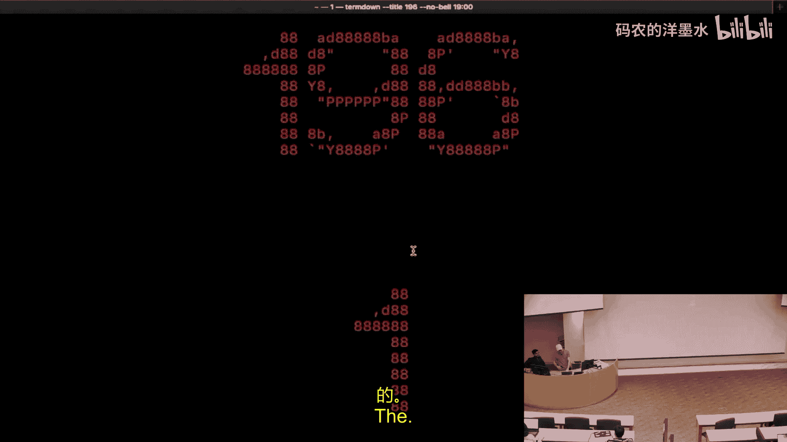
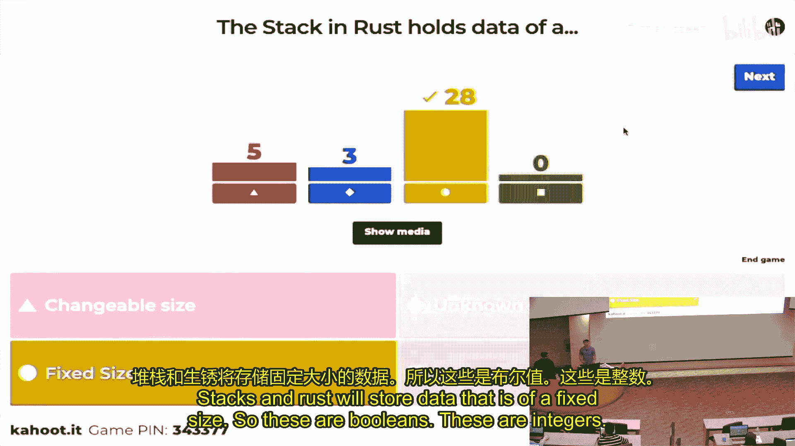
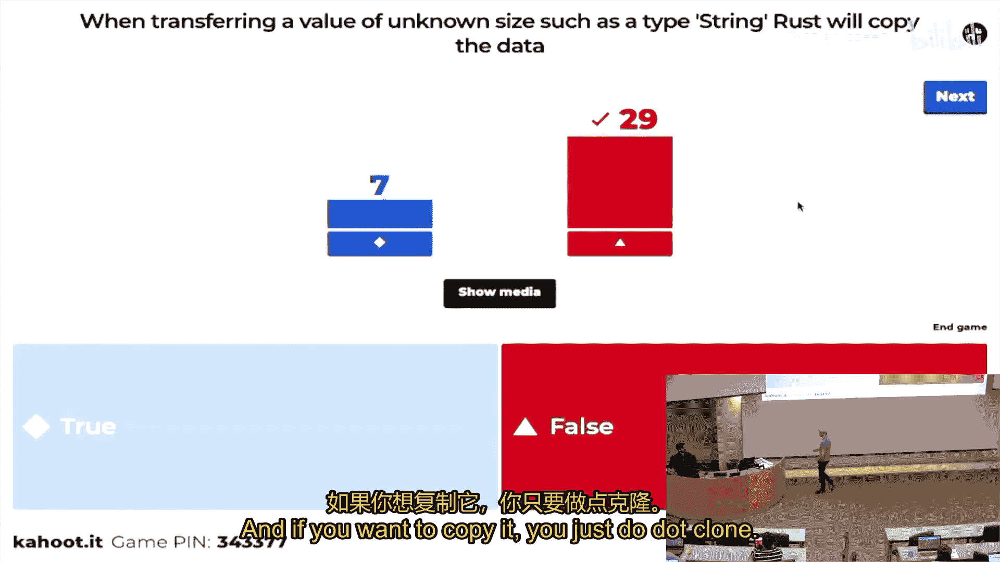
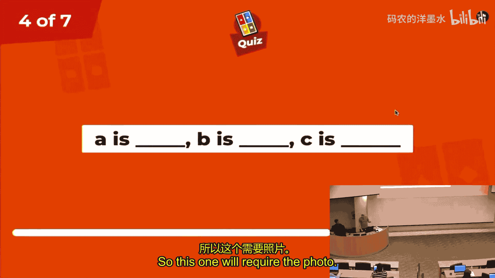
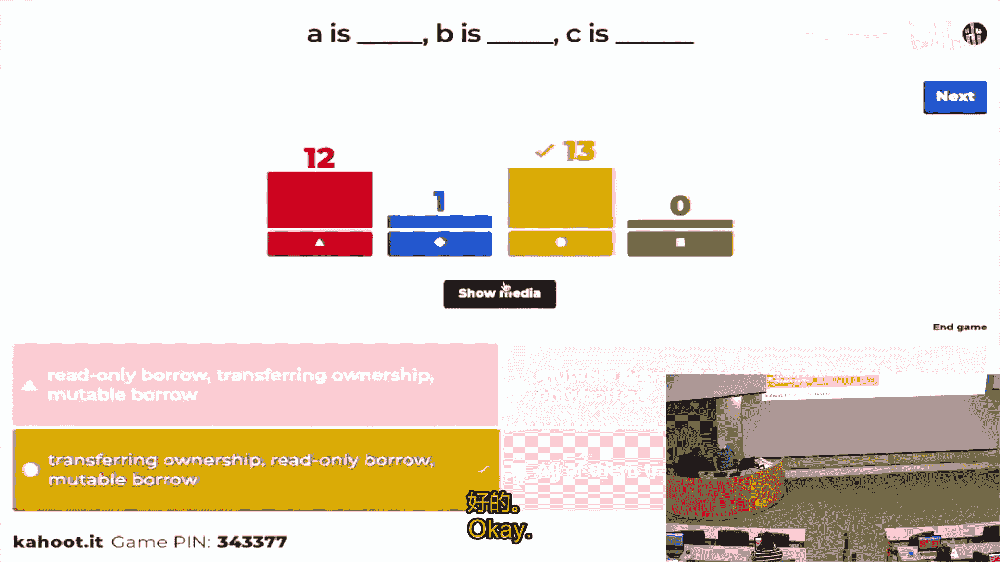
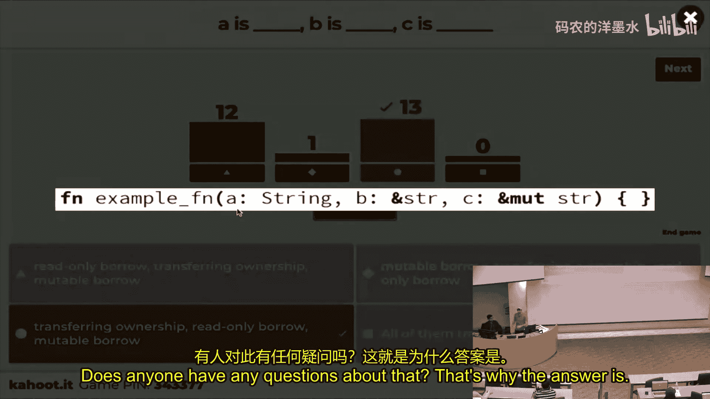
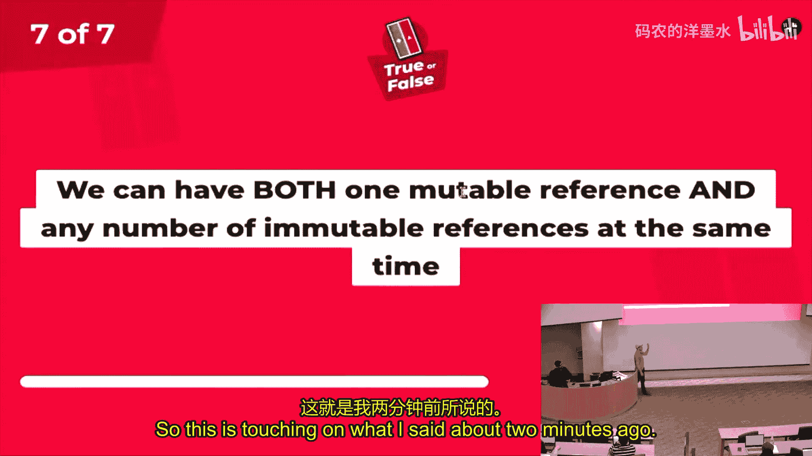
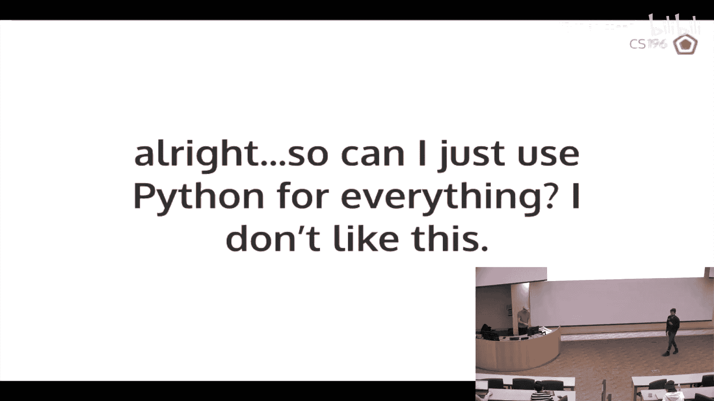

# 【全集 春季版】伊利诺伊大学 计算机编程：从Bash到Rust 中英字幕 p06 Lecture 6 - Rust：内存、所有权、借用 -BV188rDBFEUY_p6-

Allright， welcome back to CS S 196。So today we're going to do a continuation of the last rust lecture。

 We spent a lot of time on very basic syntax and Ru lecture 1。

 I'm going to close off some of the basic syntax in the first few slides。 and then after that。

 we're gonna jump into how rust handles memory management in the language。

 So let's go ahead and start off very quickly with index4 loops。

 So this is what you're likely used to already with index4 loops。 this is known as a C style 4 loops。

 So you start at0 you loop until it's less than 10 increment by one every single time and you do something I times。

 So this is a C style4 loop that you've seen in Java by now you will definitely see it in languages like C plus plus and many languages use this style rust does not。

 So for reference， the Java code is on the bottom left。This is what it looks like in rust。

 So it's syntactically the same。 It's doing the same exact thing。 But in this case。

 we're starting at 0。 and we're going to say4 I in0 dot dot 10。

 So we're going to start at 0 and keep on going until it is less than 10。

 and we're going to do something I times。 These do the same exact thing。

 I'm not going to spend too much time on it once you write it a couple times yourself。

 It'll become second nature。 But those are index4 loops and rust。And again， these are the same。

So let's talk about functions。 So again， this is probably what you're used to by now with functions。

 what are functions， they are basically something that does something really well。 So in this case。

 an add function， we have the return type， which is an integer， it takes in two parameters。

 the first number and the second number， which are both of the integer type and we return the first number plus the second number。

 So this function returns the sum of two numbers。 And in Java， this is what it looks like。 And again。

 this is a Cst function， if we don't want to return a value， we have the void property。

 So instead of saying the return type is int or boolean， we can say it is void。

 So this function does nothing。And so again， these are function styles that you will see in languages like Java like C plus plus in rust。

 it is definitely a bit different。 So for reference Java codes on the bottom。

 but the rest codes on top here。 So the difference is to declare a function。

 we say fN and then the function name and then for each parameter we must declare the type。

 So in Java， the types are just int。 but in rust， as we said in rust lecture 1。

 they're a bit different。 So here the types are a bit more explicit。

 So this is a signed integer of 32 bits for each value for first number and the second number。

 and then we say the return type by having this arrow on the function on the method signature。

 So the arrow says that we are returning another signed integer of 32 bits。And now。

 notice we don't have a return or a semicolon inside the function。 And this is a feature of rust。

 If you want to have a return statement。If you make if you make this statement say no semicolon。

 no return， Rus will know that you are trying to return this statement。

 so this will return the first number plus the second number。 Now， if this is a bit weird for you。

 you can still do it the exact same way you do it in Java where you say return first number and second number with a semicolon。

This does the same exact thing。 You will see the first one a bit more commonly used in Ru code。

 however， and another use use case of this traditional return line is if you ever want to have an early return。

 So if in a function you have an if statement and inside that if statement。

 you have a return statement then you would use this style of return rather than this style of return。

 but they do the same exact thing。 and I believe this is a bit more common。

 you'll see this more in Ru code in documentation and in larger code basiss。

 So does anyone have any questions about this style of writing functions in rust。

I don't want to spend too much time on it again， write it once or twice yourself。

 and it'll become second nature。And also， if you have no return type。 So in Java。

 this is a void function in rust。 you just simply don't have the arrow in the method signature。

 You say that there is nothing that we are returning。And just another caveat is that in rust。

 the variables and the function names are using snake case。

 rather than what is traditionally known as Caml case， which you guys are probably using in CS 125。

 Obviously， the code will still compile just convention。 We use S case and rust。Those are functions。

 Let's go ahead and dive into what the main content of today is the rust memory model。

 So I want to build up a lot of ideas。 There are a lot of ideas that feed into this rust memory model and we'll start off with memory。

 So it is very easy to forget that computers use memory and that's because in higher level languages such as Java or Python。

 we don't have to deal with memory management at all。 it is all done for us。

 but in systems programming languages such as rust c plus plus。

 you have to be able to manage the memory on your own。

 Ru is a bit different than c c plus plus in the way that it manages its memory。

 but you still have to think about it。 So what does memory actually even look like。

 So we can think about memory as just blocks that store information。

 and the way that we label each block is just by numbering them。 So we have012，3，4， etc，5，6，7，8，9。

 But what's a little bit special about the way that we label memory in computer science is that。

WeTraditionally use what is called hexadeadecimal。 So here we're not going to go ahead and say 10。

 Rather we're going to use A。 A represents 10。 B represents 11，1213。14，15， and so on。

 But we actually don't go on to 16。The way that we represent 16 in what is called hexidadecial is in this case。

 we can consider it as for each element，0 times 1 is 0。1 times 1 is1，2 times 1 is 2。 Now。

 if we want to represent the number 16， we can simply add another number to the left of them。

And so for example， after F， if we want to represent 16。

 well what we can do is we can say for the number to the left of0。 instead of multiplying by1。

 we are going to multiply by 16。 And that is because hexadecimal is base 16 in comparison to what you're probably known more familiar with。

 which is binary， which is base not 16， of course， So here we would do one times 16 plus 0 times1。

 So this is how we represent 16。 and so on and so forth。

 And if we want to be a little bit more clear。 what you will see is that in memory addresses and programming languages we use the prefix 0 x to say that this is hexadeadecimal。

 What you are reading are not traditional numbers they are hexadeadecimal。

 So does anyone have any questions about how memory is represented in our computer what hexadecimal looks like。

Anything of the likes。Okay。So another little caveat that we have to mention before we dive into the memory model is the stack data structure。

 So the stack data structure， you should think about it like a stack。

 So if you have a stack of papers， you stack things up on top。

 and it's just another way of structuring our data。

 By now you're definitely used to arrays Ars or very powerful data structures but you will soon find out that there are many different types of data structures that are useful for different use cases。

 they're faster at doing certain things， and in this case。

 the stack is incredibly useful for being able to push and pop things in a stack fashion。

 So here if we have an element and we want to add it to the stack。

 it will go to the top of the stack。 and we call this pushing to the top of the stack。

 if we w to remove something from the stack we do what is called popping from the top of the stack。

And another another thing that is important to know is that they are first in last out。

 meaning the first thing that goes into the stack will be the last thing that comes out of the stack because in order to access the first thing that went into the stack。

 we need to remove everything that came after it， Everything that's on top of it in the stack。

 So does anyone have any questions about the stack data structure。

 We're going to be using it later on in the lecture in about two slides so。

If you are comfortable with this， just think about it as a traditional stack， stack of papers。

 stack of dishes， whatever you want to think。So in rust we have what is called the stack and the heap and the stack and the heap are parts of memory that are available to your code to use at runtime。

 but they are structured in different ways， and so the way that they're structured differently is that well the stack functions exactly like what we just saw in the data structure where itll be able to pop and push from the top of the stack but in this case。

 the difference is that rust uses it to store data of a known fixed size。

 this is incredibly important and this is going to come up all throughout the lecture。Now。

 the heap in comparison， the heap is just a general term that describes boxes。 Now。

 when you go on to take CS225， or if you are just learning data structures on your own。

 you're going to eventually learn a data structure that is known as the heap。

 This is not that data structure。 Just for this case。

 think of the heap as just a term that describes boxes。And in this case。

 it is used to store data of an unknown size or a size that might change。

 So we said the stack is a known size。 The heap is for data of an unknown size。

 And so elements that would be of a known size are things such as integers of 32 B and the likes。

 something that would be of unknown size is， for example， a string。

 The string type is not of a known size at compile time because let's go ahead and say someone's taking user input into their computer。

 We don't know how much user input someone's going to put into a field。

 the string could be arbitrarily large or arbitrarily small。

 We don't know the exact size of it at compile time。So for unknown sizes or sizes that might change。

 we use what is called the heat。Is everyone comfortable with this idea so far？

We're going to be using it all throughout the lecture。Okay。So for the stack in Ru。

 imagine it as just a person sitting at a table reading your code and papers are coming in on top of their desk。

 And this is an example that I'm stealing from a YouTube video that I found。

 I thought he did an excellent way of explaining it。 So I'm going to do almost the same thing。

 So imagine a person sitting at a table。 They're reading your code。 And here is your code。

 So you have a main function。 and you have inside of that main function。

 a function call to another function。😊，So we're going to start， of course， at the main function。

 The main function is the entry point of any program。 and in rust。 This is where we start。

 So we read the main function。 And the person at the desk is going to take out a piece of paper。

 and they're going to write The first thing they're going to do is write your function name on top of it。

 So now we continue reading it line by line。 we let number equal to 3。

 So we'll write down nu is equal to 3。😊，Now， we have another function call。

 So we're going take this paper。 We're going put it down on our desk。 Imagine it laying flat。

 I can't really show that very well on Google slides。

 but now we take another piece of paper out because we are currently in the other function。

So we write other function on top of this piece of paper and similar to what we did in the main function。

 we're gonna write other nu is equal to 5。That's the extent of this function。

 It's not doing anything else。 It's not returning anything。

 So what we can do is we can just rip up this paper and throw it away。

 And all of the memory for other number is now in the garbage。

And now we're back in the main function。 We take that paper， which was at the bottom of the stack。

 The next element in the stack。 And we see that our main function is done。

 So we rip up the paper and we throw it away。 The program is now done。

 All of the memory associated with number and other number is deleted in all memory is clear。

 So this is how rust uses the stack to delete data of a fixed size from memory。😊。

Notice here that we have three and5。 These are both signed integers in this case。

32 Bs because Ru defaults to 32 bits。 if you don't declare the type。

 if we wanted to declare the type， if you remember from Ru lecture 1。

 you can just have a colon and the type name here， these are signed integers of 32 bits。

 we know exactly what size it is at compile time。 So for these variables we are using this stack so。

Let's continue。What about the elements of an unknown size。 So in this case， we're talking about。

 for example， strings we thought about user input。 We thought about strings that can change in size。

 So in this case， we are going to use what is called the heap。So now for the heap。

 we're still going to use the stack because not everything is of an unknown sized。

And here in our main function， we have a string that is equal to this slightly cryptic line of code。

Don't get scared over this， we will go into the differences more of string types。But in this case。

 just know that we are creating a string type that we can add and subtract from。

 It is a mutable string type。 So here， if you want a short explanation of what that code is doing。

 we are creating a string type from this string literal， which is hello。

Don't get too concerned about this。 It's not the main point of this lecture。

 but we will revisit that at a later point。 But here we have a string。

 which is of an unknown size or or it is of a known size right now。

 but it can change in size later on。 We can add to hello。 We can subtract to hello。

 And that's why we can't use the stack for it。So we open up the piece of paper。

 we write main and first string， what are we supposed to write because we don't know what the size of it is。

 we can't use the stack。 So in this case， we use the heap。 So for the heap for this example。

 I'm going to use a locker room analogy。 So similar to what we saw in memory。

 we will have lockers and each locker is going to store something and each locker is going to have an identity。

So here we're going to store hello inside of these lockers。 This is how we are storing it in memory。

 The lockers are representing the heap。 So we have 0，1，2，3，4 with each character being H， E， L， L， O。

😊，So， now。What are we going to store in the place of the question marks on the stack？ Well。

 obviously， we can't put this exactly。 So what we'll do instead。Is we will have this。

Information here， we're going to store a pointer to the starting location of the string on the heap。

 We're going to store the length and capacity of the string。

 Don't worry too much about the differences of length and capacity。 We will revisit that。

 But just know that we have a pointer to the location on the heap。

So now when this code is over after the main function is done。

 the way that rust will remove the memory or the string is it will follow the pointer to the heap。

 it will find the memory there， delete it， and then the memory is free。😡。

Does that make sense to everyone。 I'll go back a slide。 Does that make sense。

 Should we go over anything。 Do we have any questions。Okay。

So let's continue taking these concepts and put them all together。So in rust。

 we have this concept of ownership。So in previous slides。

 each value in rust has a variable that's called its owner。 So in previous slides we saw。

 for example， here， Str is equal to the string。 String is the owner of this value on the heat。

And so that is the first rule of ownership。 Each value and rust has a variable that is called its owner。

Now， the second rule is that there can only be one owner at a time。

 This is incredibly important because we will revisit this later。 but if you remember in the example。

 we followed the pointer in order to delete it from the heap。 If we had a value。

 let's say the same value， hello， but multiple owners of it at the same time。

 if we followed that pointer for each element that is attached to it。

 then we would end up deleting it twice。 And this is an issue that you will find in languages such as C plus plus where you delete something the same element twice。

 and that's called a double delete error。 in many languages。

 your program will crash horrible things will happen。

 Rus prevents this by saying that there can only be one owner at a time。

And the third rule is that when the owner goes out of scope， the value will be dropped。

 So in the previous example， when the string went out of scope， when the main function was over。

 we went ahead and we followed the pointer to the heap。

 and we dropped all memory that was associated with with it。

So these are the three rules of ownership， and。Keep that in mind because it will come up later on。

So let's look at this example。So here， x is the owner of 5。And in a traditional programming language。

 this strip of code would take the value of5 and assign it to y， because X is assigned to5。

 So in this case， in a traditional programming language， Y would be equal to 5。And in rust。

 this is also the same thing。Because these are elements of a fixed size。

 we know that 5 is of a sine integer of 32 B。So we will make a copy of five and assign it to Y。

 And that's again， because these are a fixed size。What will happen if we have elements of an unknown size。

 or rather a size that can change in this example。So here we have a string。

 We will do the same exact thing as we did in the example。 We'll set it equal to a string hello。

 and this string hello can change in size whenever it wants。

And if I want to assign it to the value S2， again in a traditional programming language。

 S2 and S1 would both be equal to hello。This is different in rust。So， here。

We have to notice that these values are on the heap compared to on the stack。

So this is how we will think about it。 So S1 is currently pointing to hello。

 which is stored on the heat， and it will start。 It will point to the beginning of the string。

 which is the zero locker and hello。So in the bottom left I have the code for reference。

 If I want to assign S1 to S2， what's going to happen is we are not going to copy rather we are going to move the pointer from S1 to S2 So now S2 is pointing to the same exact value that was stored on the heap and now S1 is invalid and the reason why S1 it is invalid is because if we ever want to access this data。

 we want to use S2 and similar to what we said earlier。

 if it was the case that S1 was also pointing to hello。

 which S2 is also pointing to due to the rules of ownership we would end up deleting this twice。

 which is a critical error in a lot of programming languages and also if we just went ahead and copyied the data from S1 to S2 well this would be a bit inefficient if you imagine in a programming in a program where these values are extremely large let's say we're storing user data for millions of people。

IfFor every time that we wanted to assign that value to a variable and we copied that data over and over again。

 this would become one very expensive for memory and two very inefficient because we have to spend a lot of time copying that data over。

 And so this is very nice in systems programming languages such as rust because it gives you that control over your computer。

 you're able to make those decisions on your own to make your program run faster。Now。

 if you did want to actually copy the data， you're still able to do that in rust。

 you can just do what is called a dot clone operation。

 And this is different from the move operation in the previous slide。 Here。

 we're going to basically take the data that was stored on the heap。 make a copy of it。

 And both of them are pointing to different locations on the heap。

 even though they have the same data。 So S1 is the owner of that hello string on top。

 And S2 is the owner of that hello string on the bottom。 And it is also important to mention。😊。

Then in the previous example， if we try to use S1 in the code。

 it will give us a compiler error error。 Rus will say S1 is invalid， it is not the owner of anything。

 you cannot use it， please don't use it。So why are we doing this？

We want to be able to keep ownership in mind so we said there can only be one owner at a time and when the owner goes out of scope。

 the value will be dropped so this is extremely important because again if both of these were pointing to the same thing on the heap since there can only be one owner at a time。

 Ru is going to yell at you but also and more importantly when the owner goes out of scope the value will be dropped so when S1 and S2 both go out of scope。

 we are going to try and delete the same element in memory two times which of course by now you know is a big problem so this is why rust does not allow you to do this。

Safeと。A big point and rust。 We want to be able to write safe programs that are also still just as fast as something you would write and C or C plus plus。

Does everyone understand the content that we did so far before I build on it with functions？

Any questions？Differences between the stack and the heap。Okay。So now with functions。

 functions will take the ownership of the variables that are passed to it。

 So if you pass an element to a variable inside of that function。

 it will take the ownership of that variable。 And I'll show you exactly what I mean by that。So， here。

We have a lot of code with a lot of comments。 So we'll start reading this at the main function。

 So we're saying let S equal to hello。 So the size is able to change， as I've stated earlier。

 because this version of the hellello string， we can increase it and decrease it in size。

 So this is stored on the heat。😊，So now， if I pass it to this print string function。

 now this function is extremely trivial。 not many people would write a function that would just print something because there's print line。

 of course， but I'm using it just to show it for demonstration。

 So we pass it to this print string function and now some string。

 which is the parameter for that function， is going to take ownership of the hello string。

 So if you think about the visualizations that I showed you in previous slides。

 some string is now going to be the one that is pointing to the value hello on the heap and now S is going to be invalid。

So when some string at line 15， when our scope is over。

 some string is going to go out of scope and behind the scenes。

 Ru is going to follow that pointer to the location on the heap。

 and it is going to delete the memory that is associated with it。

So when we go back to the main function， line 3， our function call is over， and what do we have now。

 Well， S is going to be invalid because inside of the print string function。

 some string took ownership and deleted that memory and ownership was not returned to S。

And that's because the value was storeded on the heap。So now， in comparison， a fixed size。

 behavior is very similar to what we've seen already。 So here x is equal to 5。 again。

 integer of 32 B。 So when we pass it to the printum function on line 8。

 we're going to go to line 18 and the printum function。

 some integer isn't going to take ownership of that value。

 because since it is of fixed size rather than moving it。

 we are going to copy it copying it rather than moving the data is okay in this case。

 because we know how much the data is going to take it's not like the example earlier where if we were allowing the movement of extremely large rather if we were allowing the copy of an extremely large data set。

 that would be inefficient， but transferring over 32 B， it's not really that fruitful。

 So rather we can just copy it。 So when we pass5 to the printum function。

 it will create a copy of that because again， it is of fixed size。 And when this variable。

 some integer goes。Of scope， we can imagine the stack frame from the paper example is just being ripped off and thrown away。

And nothing is different in the main function。 The X variable is still valid。 We can still use it。

 And at line 10， when x and S goes out of scope， the memory associated with x is cleared away。

 and the memory associated with S。 Nothing happens because there is no memory associated with S。

 S is invalid。Any questions about this line of code demonstrating how when we pass a variable to a function。

 it takes ownership if and only if it is a variable that is stored on the heap rather than the stack。

Any questions？Okay。So。Functions can also give ownership。 So in the previous example。

 we saw how functions are taking ownership of the variables。But。If we look at this example。

 they can also give ownership。So let's start again in the main function。

 We'll see that we're declaring a string， S1。Or rather， sorry。 in S1， we are calling this function。

Gives ownership， which will assign its value to S1。So and Gis ownership。

 we'll see that we are returning a string。And that string is some string， which is hello。So now。

 when we break out of this function， S1 is going to be the new owner of that hello string Within the function。

 some string is the owner。 But since we're returning。

 the ownership is transferred from some string to S1， and some string is popped off the stack。

 It is invalid。So now if we look at line 4， S2 is equal to this string。

 when we pass it to this function called takes and Gives Back。

 we'll end up having a string being the new owner of this variable。

 but it also gives it back to S3 on line 6。Does anyone have any questions about this。

 We can see how when we have a function and returns a value， it gives the ownership back。But。

For example， in line 9， if nothing is passed to it。

 it'll just give the ownership to whatever it's assigned to。So。If we don't have any questions。

 I'll keep on going。We can see how this can get very tedious。

 If every single time that we call the function， we needed to return the ownership back to its original owner。

 We could see how this would get messy。So， for example， let's look at this function。So here。

 S1 is equal to hello。 And if we had a function that calculated the length of the string， again。

 trivial example。 But it's just to demonstrate this concept。 So we pass it to calculate length。

 S is now the owner of the hello string。And when we calculate the length of it and we return the length。

 we can see how on line 4， our length is going to be equal to 5 and we'll print it out。

 But since we're using S1， which is now invalid， it is not the owner of anything anymore because。

In the calculate length function， S already took the ownership of it and didn't return it。

 didn't give the ownership back。So on line 6， if we try to use S1， since it's invalid。

 Ru will throw an error。😡，And this is a bit annoying because if we wanted to be able to just simply call this function and not have to worry about getting the ownership back。

 well， the way that we would have to do this would be a bit unclean because in the calculate length function。

 we would have to do something along the lines of this。

We would have to return a tuple that returns the string， as well as the length。

Simply to get the string's ownership back to its original owner。 And just a side note。

 tuples are useful for returning multiple types if you want to ever do that in your own code。

 But here， if we had to do this every single time， we wanted to return ownership to its original owner。

 it would be tremendously messy。 So just to a walk through this code On line 2， we have a string S1。

 S1 is the owner of hello。 And then on line 4， we're calling calculate length with that string。

 So now on line 9， S is now the owner of that value hello and S1 becomes invalid。😊，So now here。

 on line 10， we calculate the length and on line 12， we return both the string and the length。

So now on line 4， S2 becomes the new owner of that variable and length becomes equal to5。

 So line the print line on 6 will actually compile this time because S2 is a valid variable and our length of course。

 is valid because it was just a normal variable that was returned。

So if I had to do this every single time that I wanted to get ownership back from a function。

 I would never write Ru code。 That would be terrible and。Very， very gross。

So that's why we have this concept known as borrowing。So， here。If you notice on line 9。

 we have an ampersand So and also on line 4， an ampersand。

 an ampersand is how we symbolize borrowing and rust。 This is also known as creating a reference。

 So what example， what exactly is borrowing a value。 So let's walk through this code。So on line2。

 again， we have this string， which is the owner of hello。 And now。

 when we call the function calculate length on line 4 with that string。

The ownership actually is not transferred from S1 to variable S on line 9。

 as it was in previous examples。 So here。Because we are simply borrowing the value rather than transferring the ownership。

 we can。Send the length back to the variable on line 4 length。

 and we can print it out without a problem。 This code will actually compile。Now。

 it is important to mention。That this。String that we are passing is going to be immutable。

 And that is because since we are passing a reference since you are borrowing this value。

 you can't actually do anything with it。 And that makes sense。 in real life， if you gave someone。

 for example， a book to borrow and they gave it back to you and it was completely different。

 you wouldn't be very happy。 So here online too， we have the variable S， which is the owner of hello。

 we pass it to the change function。 But instead of transferring the ownership in this case。

 we are just saying you can borrow this value。 So ownership is not transferred。Some string， again。

 is not the owner。 Rather it is just representing a reference to the same exact location。

And if we tried to append comma world to the end of that string。

 Rus would throw an error because it would say you are not the owner of this variable。

 You cannot change what it represents。Does that make sense， being able to borrow values。

 not have to worry about returning ownership back to the main function and of course。

 not being able to mutate the state。Anyone have any questions about this。O。So。If you would like。

 you are actually able to pass a reference， be able to borrow something and still change the value of it。

 So we do this by declaring it as M U T。 You give the person permission to mutate the state of that variable。

😊，So here we have On line2， a mutable string。 So another caveat is that if we want to borrow as a mutable variable。

 we have to declare it as mutable to begin。So it's mutable， and we pass it to the change function。

 We are borrowing a mutable reference。And on line 8。

 this will actually be fine because since we had permission to make changes to this copy。

We can add world to the end of that string。So another caveat is that at any given time。

 you can have either one mutable reference or any number of immutable references at the same time。

 And so the reason why this is is because if you think about it， if you have a。

 let's say string that says hello and you give out a bunch of copies to people， that's fine。

 But if at the same time you give people copies， you give someone a copy that they can actually change。

 the people that have read only access to to that version are not expecting these changes to happen under their hood。

They aren't expecting this kind of behavior。 And as a result of the unexpected behavior。

 you aren't able to have both read only and mutable references out at the same time。

If you have just read only references， you can pass out as many as you'd like。

With mutable references， you can only have one。 And the reason why that is。

 is because if you gave multiple mutable references at the same time。

 that also causes the same kind of unexpected behavior where multiple people are accessing the same kind of data and making changes。

So that is a very important rule when it comes to references。So on line 4 here。

 we have a read only reference。 On line 5， we have a read only reference。

 We're borrowing the string that's stored in S。 But as soon as on number 6。

We try to create a mutable reference to S。 We are borrowing a read and write。A version of the string。

 Rus will throw an air because we can't have both of these at the same time。Now。

 if I transferred line6 above these two， it would also still throw an error because as soon as we try to create a read only string after a mututable string。

 it will say due to this rule on top， you cannot do that。Does anyone have any questions about this？

Okay。Why do we need to do all of this？It seems kind of miserable。In rust。

 there are gazillion things you have to keep in mind。

 If you wrote a rust program for something very small。

 the compiler is going to throw a bunch of wrenches at you。

 and you are going to be extremely frustrated because you have to keep in mind ownership。

 all of this memory management thing， it sounds miserable。

But the reason why we do it is because let's go ahead and look at what Java does in comparison。

 So Java is a fine language。 And the way that they actually deal with their memory management is by using what is called a garbage collector。

 So the garbage collector will do all of the work for you。 It's going to go throughout your code。

 It's going to see all of the memory that you're no longer using。 And it will free it by itself。

 You don't have to think about it at all。 And Python does similar things。Now。

Why does every language do this， Why are we not always using Java。

 Why are we not always using a garbage collector？😡，Well， if we look at this start。

 we can see the differences in the performance， the control and the safety of these languages。

So on the X axis， we have safety， on the Y axis， we have control and performance。

 and we can see rust all the way on the top right that is succeeding in both control。

 performance and safety。😊，Now， if we look at Java， it is pretty comfortable in the middle and Python is not on this。

 but we would say that Python is a little less fast as Java， but a little more safe。

 so I would put it you know wherever you could find that on the chart。😡，C++ is also extremely fast。

 just like rust， but it is not as safe。 Do you have a question？

So what I mean by the language as safe is if you remember in the previous slides。

 notice how rust is preventing you from being able to delete memory in the same place as something else that's accessing that memory。

 right， you're not able to delete a memory an element in memory two times。

 So that is something that increases safety in rust in a language like C plus plus it gives you that kind of control。

 but it is up to you to be careful about those things。

 And so when you actually go off to write C plus plus code in C225 or C 126 if you're taking that as a C major。

 you'll see that in C plus you're given these abilities， you have that control。

 but it's not as safe because they give you a very large amount of freedom。

 and oftentimes when codebas get large or inexperienced people are using the language you're going to end up making these mistakes that are going to lead to segmentation faults。

 double deletes， etc。You will see the benefits for sure as you get more experience with languages like C++。

Does that answer your question？Does anyone have any other questions about this？Okay。So， yeah。

This chart basically says it all。 In rust， we have a very different style of handling memory。

 but due to this style， it allows us to have this nice， happy medium between safety and performance。

😊，So why don't we just use Python for everything？嗯。Well。

 the reason why we don't use Python for everything as beautiful as the language as Python is is because certain things are better for certain things。

So if you wanted to write a extremely large back end service that is handling a gazillion requests at the same time。

 that extra speed and performance actually does matter。

 Your response times will go from 15 seconds to 3 seconds。And in the context of an app。

 you want your back in service to be able to reply back to your front end extremely fast。

 So that is why you would use a language such as C plus plus or in this case。

 Ru to be able to make things run faster。😊，Now， Python， it is a fine language。

 and many of you will use Python。 Python is very good for projects that you want to just spin up very fast and do something cool or data science。

 for example， there are many data science libraries in Python that are extremely useful。

 and you can do very nice data analytics using the language。😊。

There are different use cases for different languages。

 and you will find out what those use cases are， the more and more you get into software development。

ButThe differences between all these languages are extremely important to understand。

 because as you understand more language features， when you go on to learn languages on your own。

 you'll find that a lot of features do overlap and some features use or some languages use certain features and some languages don't。

Does anyone have any questions？😡，We're going jump into a caooot。

Since the content was a bit difficult today， the co will be 1% extra credit on your final grade。

 if you are top 5。Let's get that open。🎼So join in with your net idea。 This is for attendance。

 but also for a chance。🎼Some really nice extra credit。🎼，🎼，🎼。

🎼，🎼，🎼，🎼The。🎼The。🎼Does anyone not？🎼The。🎼。🎼，🎼，Anyone add。🎼，Okay。So the first question， very easy。

🎼Thats our first and first outcherable。🎼し。Okay， so definitely false again。

 think of stacks like a stack of paper if you put things inside of the stack。

In order to access the first thing that was entered into the stack。

 you have to remove everything that was on top of it。 So these are all the things that came after it。

 You will learn data structures that are first in first out。 Those are cus。

 You will learn about it a little bit more。 We will likely cover it later in this semester。

 but you'll definitely learn it in classes like CS 225。So this is our scoreboard so far。So in rust。

 how do we use the stack。 It holds the data of。Attainable size， fixed size， unknown size。

 or does it just store everything？Okay， very good。Again。

Stackax and rust will store data that is of a fixed size， so these are booleans， these are integers。

And the likes。

So when we transfer a value that is of unknown size， but for example， a string。

 we'll rust copy the data。🎼。🎼这。🎼た。The。Okay very good， so this is false like we said。

 since we don't know how big or small the data is， we store it on the heap rather than the stack。

 and since again we don't know how big small it is， we don't want to always copy this data。

 Rus will rather just move it over。And if you want to copy it， you just do dot clone。

So this one will require the photo。

嗯。I hope you guys can see this。So on this method signature。Three inputs， A， B， and C。

What are the type of the inputs that it is given？🎼，🎼。O。

So a lot of people picking red。So let's break it down。 So this is the method signature。 Again。

 we have a function。 We're naming it example function， and we have three parameters to this function。

 We have A， B and C， and the types are what are after the colon。

So the first parameter is of type string。The second parameter。

 you can see the Ampersand saying that this is a read only borrow。 So again。

 you're passing out a bunch of copies of something。

 You don't want the people that are taking what they're borrowing。

 You don't want them to take it and start changing things。 You give someone a book。

 You expect that book back。Now， if you give them permission to take your book and start writing a bunch of things in it。

 then what you do is what is on C。 So you declare a reference being able to borrow something with the Ampersand。

 but if you also want to give them the ability to mutate it， you write MUT。

So these are the three different types of types you'll see when you use ownership and borrowing。

Does anyone have any questions about that？ That's why the answer is。

Yellow， A is transferring ownership。 B is a read only borrow， and C is a mutable borrow。

 So we're able to actually change things with the value。Any questions about this？

So a couple more questions。This is our scoreboard so far。

So can we have as many immutable references as we want？🎼本先走。Yeah。Even split。So。

We can have as many immutable references as we want。It is important to know this。😡。

We can give out as many read only copies of something as we'd like。Now。

 we are only not able to when we mentioned that little caveat that I had at the end。

 where if at the same time we have an im immutable reference。

 we have a mutable reference active as well， because people who have the version of the mutable or rather the read only reference。

 they don't expect the value of their read only reference to change without them realizing。

 So if someone else had access to change things while someone else had to read only version of it。

They don't expect things to change。 And that is why。When there is no mutable reference out。

 we can have as many immutable references as we'd like。 But when there is one， we can't have any。

Does this make sense。

Okay， a couple more questions。

So there's the leaderboard so far。So we can have as many mutable references as we want。

 true or false。

🎼是。Very good。 So this is definitely false。 We can only have one mutable reference out at a time。

One more question。

So， this is。Touching on what I said about two minutes ago。

🎼，🎼，Okay。So yes， this is false。I'll go through it one more time。

So we can only have one mutable reference out at a time or。

Any number of immutable references out at the same time。And that is， again。

 because when we are giving something for someone to borrow。

We don't expect this unexpected behavior where if you have a read only version and someone else has a mutable version and they change something。

 the person with a read only copy doesn't expect anything to change。 They expect it to stay the same。

 so we can't have both of them out at the same time。Now， for giving a bunch of read only copies。

 we can do this as long as there is no copy of it that is mutable。

 because if we just give a bunch of people read only access to something。

 we don't have any unexpected behavior behavior there。

 We know that they're not able to change anything under the hood。So that's the whole Kaahhoot。

Here's the leaderboard。

So in first place。7even out of seven。Second place。I don't know your names， but those are your nu IDs。

And the runner up。So congratulations to these people。Very well done， you will get 1% of extra credit。

🎼Let me get out of it。

Okay。So that's the whole lecture for today， Rohan's going to do a couple of announcements。

For anything that you guys didn't understand of today， the slides are available on the website。

 we are going to release a homework this Friday， which will give you a little bit more application with these concepts。

 This will take a while for some people to grasp， it took even me a little bit of time to actually fully understand when I was learning it originally。

 don't be worried if it doesn't stick right away。 but once you are able to understand it。

 it is very beneficial when you go off to learn other languages It is very beneficial when you use Ru by itself to write very powerful and fast applications。

Just a few things from me。 Firstly， you shall all be in groups right now。 If no。

 if you're not in a group yet， speak to us after lecture or send us an email。

 we'll get you guys sorted out。 Secondly， regarding your groups and your projects。

 you should be working on your MVP or you should already have that done。 that's super important。

 and that should be done。 A S A because we gonna be to look at them and tell you whether your projects are feasible or what changes to make so you don't have to change it halfway through when you're already putting work into it。

Finally。Use Discord as last event to say。 So if you're not your the Discord yet。

 make sure you email your PM and get your Discord AAP。

 because that's part of your grade is how much you're communicating with your group。

 So make sure you get the discord as soon as you can。 And that's everything from us。

 If any questions， you can come up here and ask us in person。

