# 【全集 春季版】伊利诺伊大学 计算机编程：从Bash到Rust 中英字幕 p08 Lecture 8 - Debug -BV188rDBFEUY_p8-

Alright， so today's gonna to be a lecture on debugging。

 And I just wanted to first talk about what I look at debugging as。

 And so I think as debugging as being able to sit in a room that's on fire and being able to say this is okay。

 We will be able to take care of this。 Just calmly grab some buckets of water。😊。

Pour it all on the fire。 Everything will be fine。 And the reason why I wanted to talk about debugging today。

 especially， is because I like to think that debugging is one of the biggest deterrence of people away from C。

 S。 People will face their first large bug in computer science。 and immediately。

 they'll go as far as saying they're not cut out to do computer science because they can't solve a bug。

Being able to debug is an incredibly important skill。

 it'll allow you to be a self- sufficientuffient programmer。 And also everyone goes through it。

 no matter how experienced of a programmer you are， you will have to debug at some point。

 some more often than others， but don't get terrified over needing to debug。

 don't think you're not cut out for computer science or something because you're not as strong as debugging as some other people that might be more experience。

And so as a testament to that， I put in this quote that I saw on Reddit a couple days ago from a C。

 S professor here。 His name is Wade Fagan。 Some of you might have had him already。

 Some of you might never have him。 He's currently leading a data science initiative at the University of Illinois。

Wade Fagan is probably one of the best C， S professors in the world， And he got a 4。

0 in his undergrad。 He's extremely intelligent。 He had a very profound impact on every course that he's touched。

 The guy is just a legend。😊，And he says this about debugging。Debugging sucks。 I hate it。 Tools， IDs。

 debugggers， et cetera， make it easier， but it still sucks。😡。

Finding a bug can take hours just to fix one line of code。

 I try everything I can to avoid needing to debug。And so this is Wait Fagin。Again， see us God。

But everyone needs to debug。So don't get terrified over this concept。And so。

I want to actually touch on two things that he said。He said one major point。

 which is that tools I Ds make it easier， but it still sucks。 And also。

 he tries everything he can to avoid needing to do it in the first place。

 So the second point I want to just touch on very quickly。Before we even learn how to debug。

 how can we avoid needing to debug in the first place。 So this isn't a software design class。

 So I don't want to spend too much time on this。 But my biggest advice for you is to test often。

 Don't just write a gazillion lines of code and then hit run once and hope that it'll magically work。

 make sure that as you're writing your tests， make sure that as you're writing your code。

 you test every every so often， every small piece of functionality， So that way。

 when you build on top of each other， you're not just building a train wreck。

 Think of building a house。 when construction workers are building a house。

 they're not gonna build the first floor of their house and say， it looks about right to me。

 build 30 more floors and say all right， it's time to test。

's let's see how this house is gonna hold up。 That's not at all how it works。 They test very often。

 They make sure that every piece of functionality that they're implementing every floor is still very sturdy and structured well。

It's the same thing with programming。 Make sure that every small piece of functionality that you're writing is something that works that way you're not just building off your own assumptions。

But again， this isn't a software design class。 You'll learn about this more in C， S 1，26 or C， S 2。

42。 If you're a transfer student into C， S。They will touch on this more。But today is about debugging。

 How can we make debugging a little less painful than it is， But in reality。

 it will always be painful， in my opinion。So problems with computer science and things that you need to debug。

 It usually boils down to this idea that you have a lot of incorrect assumptions that you make inside of your head about what your code does。

 And so there is not really an algorithm that you can run in your head to debug your code and just follow certain steps along the way and you'll be able to fix any issue that you have。

 instead， what I can give you is a toolbox of a lot of different tools that you can have that you can pick and choose from depending on the situation when you're debugging your own code。

 And they're all tackling this issue being able to tackle the incorrect assumptions that you have about your code。

 being able to challenge your assumptions and make sure that when you're building your code。

 you have a strong house， for example。 So let's go and start off。😊，With again。

 this toolbox and the first tool that we have is printline debugging。

 This is one of the most basic ways of debugging your code。 And it's actually quite powerful。

 You just basically put print lines throughout your code to make sure what your outputs are to see if you're reaching certain areas。

 So these are various questions that you could ask yourself。Am I even entering this function， Well。

 if you put a print line in that function， you can see。Why is this value know here， well。

You put a print line there。 You can see exactly why How many elements are in my array here。 Again。

 put a print line and you'll find out。 So I'm going to do a quick demo of this。

Just being able to do basic print line debugging。To solve a bug。

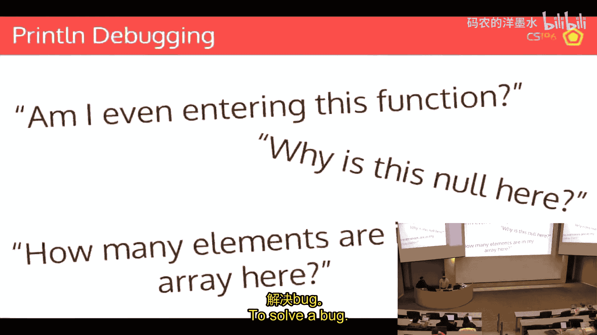

So I'm going to start off by first describing this。Problem that we're trying to solve。

So here's the problem right here。I pulled this off of Lecode Lee code do com。

 It's a nice website for very for very basic interview problems and also very complex ones。

 These are basically the easiest problems that I could find on the website。

 And fun fact about this problem， It's actually one of the most popular。

 I believe the most popular problem that interviewers give very early on in the interview process just to weed out very。

 you know， inexperienced programmers。😊，So we're writing a program that can output the string representation of numbers from one to n。

 And for each number， if it is a multiple of three， we're gonna output Phizz。

 If it is a multiple of five， we'll output buzz。 And if it is both a multiple of three and 5。

 we output Phizz buzz。So， for example。Our input is 15， so from 1 to 15。

Our output is going be one because one is both not a multiple of 3 and 5，2， same reasoning。

3 is a multiple of three。 So we output fizz。4。5 is a multiple of five。 So we output buzz。

 so on and so forth。9 is a multiple of three。 So we say Phizz， and then 15 hisz buzz。So。

Here is some code。That does almost the right thing to do when it comes to tackling this problem。

It just barely， it almost works， but it doesn't quite。

So let's go ahead and walk through it very quickly。

We said that if the number is both a multiple of 3 and 5， then we output Fizzbus。If the multiple。

 if the numbers a multiple of three， then we output Fz。 And if it's just a multiple of five。

 we output buzz。 And if it doesn't fall into any of those categories， we're just going to output。

The number。And very quickly， just a quick note。An informal introduction to vectors。

 This is a vector of strings。 What is a vector。 It's just basically a resizable array。For now。

 that's all it is。And in this problem， we're going to treat it just like an array。

 So we'll give a more formal introduction to vectors。 But for now， this is all it really is。

So we're gonna loop from one to N， checking if each value from one to n is。

A multiple of three and a multiple of five。So I have no idea why this doesn't work， so。

How am I going tackle this issue， I can， I can pick up my laptop and， you know。

 go to office hours and say， Mr。 Co staff， it doesn't work。Can you help me？You can。

Respond to the questions that they ask you or they say， well， what's wrong， You say it doesn't work。

In this case， I want you to try printline debugging。So first， let me actually try some inputs。

 So let's say in the main function。I just call the function with an input 1， just to see。

What is going to give me。So here is the output。😡，We see that for one， it's giving me an empty list。

But it shouldn't be giving me an empty list。 It should be giving me。1。😡。

Because one is both down a multiple of 3 and 5。So， if I look here。

I don't quite exactly know why that's happening。The functions not working。

And where it should be is right here。Because when I input one into this program。

 it should say it's not this。 It's not this。 It's not this。 So it's this。So let's see。

 are we even getting to this point in our program？😡，Let's put a print line。And we'll see。What's up？

So I'm going to run it again。We'll see that we're again getting this empty list。😡。

But I'm not getting any output from the council。 I'm not saying， is this working。

 So we know that we're not entering this if statement。So I say， okay， well。

 are we even entering the loop？At all。Let's see。So if I run it again。We'll see you again。

We're just getting this empty list。And I don't see the print line anywhere in the council。

 So we're not even entering this for loop。Well， is our function even working at all， let's find out。

I can put a print line here。Cargo run。Okay， so we do see。That we are entering the function。

Just as a sanity check， this is working。 So we're not entering the for loop。

 Why are we not entering the for loop。Well。If we， again， just for the sake of testing。

 keep this here。I guess now we can look at our bounds because we know that we're not entering the for loop due to our print line debugging。

 So what's wrong with our bounds， Maybe， we said we're looping from one to N。 Well， now we realize。

 well， actually。When we say n is one。With the way that four loops work。

 it's going to say one is not less than one。 So we're not even going to enter this for loop at all。

So what I can do to solve this issue。Is just say， look from one。The n plus1。And if I run it again。

We'll see that we're outputting the list of one。And we're actually entering the for loop。

And as I increase the number of inputs。Let's say instead of from one to one， we can say one to。

 for example，15， like the problem statement。If I run this。We can see。What does that mean？

I's try that again。Okay， I have no clue what just happened， but。

We could see that this is the correct list that we saw in the problem statement。

 And so we were able to do that by using just very basic print line statements。😊。

And so printline statements， there are a bit of。

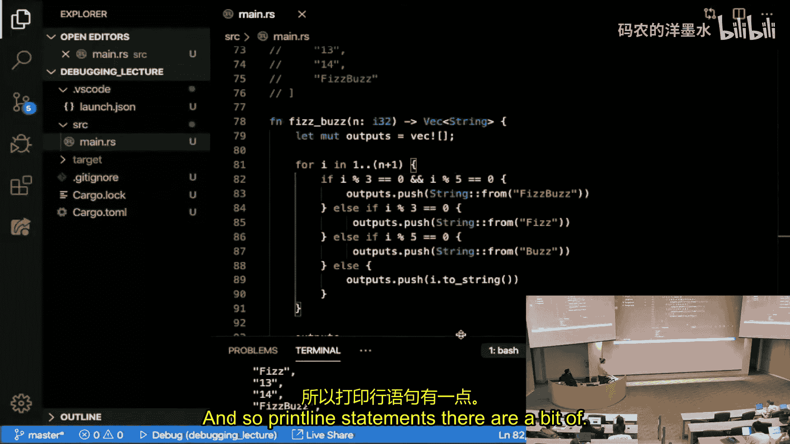

Issues with them。 They're not the end all be all of debugging。And we did the demo。

 So what's wrong with printline debugging。 They are very useful and they are very powerful。

 but they are bits slow。 If you realize that you need to move or add a print line statement。

 you need to recompil the code。 You saw that I ran cargo run at least six times there。

 and you need to completely relaunch your application。

 So you have to keep on running it over and over again。

And they are actually something that is a part of the code。 So what does this mean， Well。

 we're changing the line numbers around If we're using Virgin control。

 Git is gonna say you have modifications to the file when really you don't。

And it can even affect the performance and or behavior because print line statements actually do take time。

 And so when you have a bunch of print line statements throughout your code。

 it can not only get very messy， but also can slow things down quite a bit。And then lastly。

 they are a bit limited。 And we'll see how they're a bit limited later on when I introduce the idea of debuggers。

 But for now， these are the cons of print line debugging。Now， with that said。

 I do know quite of people， quite a bit of people that have gone years developing just with printline debugging alone。

 So it is quite powerful， but there are better ways of going about doing things。So。

 we already showed that。So now another tool for your toolbox， rubber duck debugging。Now。

 some of you are going to laugh at this concept， but rubber duck debugging is something that actually。

 many of you have probably already done。When I was younger and I was looking for。

 let's say something in the fridge。 I wanted a bottle of ketchup。

 I would look all over the place for this bottle of ketchup， but I wouldn't be able to find it。

So what， what would I do， I would go to the living room。 I would annoy and bug my mom。 I would say。

 mom。I need to find this ketchup bottle。 Can you come help me。And the poor lady。

 she's comfortable on the couch。 She's watching TV， and I'm interrupting her time。

 She comes to the kitchen。 And I'm like， all right， mom。So I looked in the fridge。

 I looked through the first row。 I looked behind the mill cart， and I couldn't find it。 Second row。

 somewhere in the back， oh。Sorry， mom， it's right there。Okay， so let me grab the ketchup bottle。

 and my mom is so mad at me。 But this is rubber duck de buggging。

So it's a name in reference to the story in the book。

 the program programmer in which a programmer would just carry around a rubber duck and debug their code by forcing themselves to explain it line by line to the rubber duck。

So you might think that this guy is a maniac， but it's actually quite genius because this style of debugging is something that is very powerful。

So here's some more rubber ducks。So here's from Wikipedia。

Many programmers have had the experience of explaining a problem to someone else。

 possibly even someone who knows nothing about programming。

And then hitting upon the solution in the process of explaining the problem。

 This is something many of you have already probably done。

In describing what the code is supposed to do and observing what it actually does。

 any incongruity between these two becomes apparent。More generally。

 teaching a subject forces its evaluation from different perspectives and can provide a deeper understanding。

By using an inanimate object， the programmer can try to accomplish this without having to interrupt anyone else。

 So， sorry， mom。

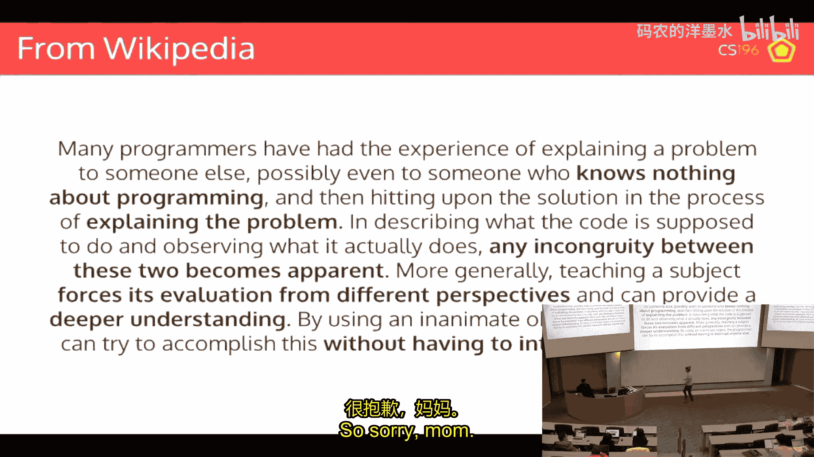

But let's do a quick demo。And actually， so I don't have a rubber duck， but。I have a penguin。

So we'll use a penguin。I'm going to quickly。Comments out this code。

And we'll move over to this function。So， this。Function here is another problem that I got of Le code。

And it is also a very simple question that some companies will ask very early on in their interview process just to weed people out。

So we're given an array of numbers。And what we need to return is。

Whether or not or actually how many numbers are of even length。 So here。

This list would output 2 because 12 is two digits long。345 is 3 digit long。That doesn't count。

It's 7007896。Is a number of even length？So we have two numbers of even length。

And so the purpose of this function。I's to solve this problem。So。Here is a function that is broken。

And so if I was doing rubber duck debugging， I would grab my rubber duck or whatever it is。

 As you might have noticed by now， it doesn't actually have to be a rubber duck。

 It can be whatever inaddamant object， or even another human。And we can say， okay。

 so for this problem， I want to take in this array of numbers。 And for each number。

 I want to check whether or not it is of even or odd length。And so here is my approach。

 I'm taking in a vector of numbers。And I'm gonna initializing the number of even numbers to 0。

And I'm gonna to loop through this。Number array。And for each element。

 I'm going to check if it is even。So， now， here。Some of you might have realized already。

 I've actually realized it due to rubber duct de buggging。 I'm realizing that here's my mistake。

I'm checking if the value of each number is even， but not the length of each number。 So here，346。

 for example， is an even number， but it contains three digits。

 and that's what the problem is actually looking for。And so since this has an odd number of digits。

 it shouldn't be counted， but instead， it is。So this function is actually just wrong。

The solution to this problem can be。Done by abusing this little fact here。

So the inputs to the function can be at most 10 to the fifth， which is， in other words。

 represented like this。 And we can say that the solution can just abuse that fact by saying between one and this number。

The only way to represent an even number is numbers that have two digits long，4 digits long。

And six digits long。Because we can't represent numbers bigger than the input that it's giving us。So。

This function doesn't work。 And we realized why it doesn't work due to， again， rubber duck debugging。

 I went through this function line by line， and I described in great detail what it's trying to do and what it's trying to accomplish。

 And after that， I realized what was wrong。I found the bottle of ketchup。So here is。A function。

That tries to accomplish the solution。That I talked about just a minute ago。

And what I would like is for one of you to rubber duck debug this code。 This code does not work。

 And there are a couple of issues in this code that I would like for at least one of you to point out through rubber duck debugging。

Is anyone willing to do it without extra credit？Anyone？Raise your hand。 Let me know。Okay。

 that's what I thought， so。1% extra credit on your final grade。 If you rubber duck debug this code。

 raise your hand。There you go。 Allright。So I'm just going to correct you really quick。

 It's saying greater than 9 less than 100。Okay， so that is indeed a mistake， so。This。

 this and and should be an ore。 We said there are a couple cases where。The number will be even。

 right， It'll be of length 2 of length 4 or of length 6。And so for the number。

 for the what we're allowing for the input of this function。10。

100000 is the greatest that the number can be。So here。

 this would be the only way that it could be a number of six digit length。 So that's even。But。

 there is。Another issue with this code。Would you like to keep going？100000。 So that part is correct。

So it is checking if it's less than 10000， right with within that quantity， we're saying。

 is it less than 10000。Or。Something else。So two issues there。 Someone else raised their hand。

 You raise your hand。So that's completely correct。So in that quantity。

 we're trying to see if the number is four digits long。

And so the way that we're doing this is by saying， is it greater than 999 and also less than 10000。

 because that is the only way we could have a digit of four length。So as he pointed out。

 this is incorrect。And this or is incorrect because we want it to be within the two bones。

 So the first condition has to be satisfied， and the second condition has to be satisfied。

So this should be changed to an end。And that solves our problem。 This code is now functioning。

So if we want to run through it one more time。We're taking in this numbers array。

And we're just gonna check for each element。 Is it two digits long。 A K A is greater than 9。

 less than 100。Is it four digits long， A K， A greater than 999， less than 10000。

Or is it 6 digits long， which is strictly equal to 100000。

And so for each element that satisfies those constraints。We will increment numb even by one。

Does anyone have any questions about this。So the reason why we were able to find those problems is because at first glance。

 it looked like it was kind of right。 But by rubber duck debugging it。

 by walking through it line by line with great detail。

 we were able to very quickly find out what the issue was。😊。

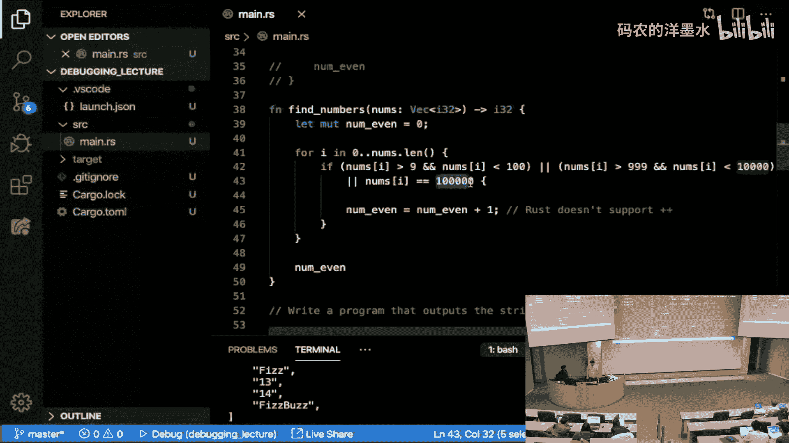

So， that is。Rubber duck。Debugging。So now I want to show another tool。

 And this is the use of a debugger。 And so debuggers are actually very， very powerful tools。

 They you can use them in G Ys， visually in your I D E or text editor。

 or you can use them within the command line。Today。

 I'm just going to show the very basic use of a debugger within an I DE， or rather a text editor。

 I'll be using V S code。 And what they allow you to do is set break points throughout your code and automatically trace through your code with them。

So you can see how earlier what we were doing is kind of simulating these break points by using print line statements。

But instead， what we can do。

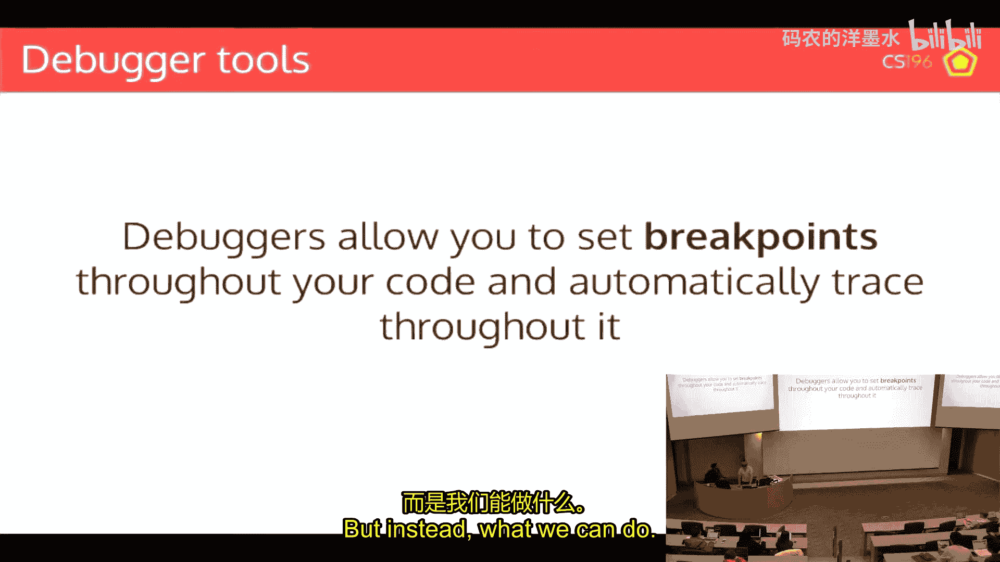

If I open up my。Tex editor。So I'm not going to go through how to set up debugging tool。

You can very easily Google that。 I'm just going show you。Really。

 the basic use case of how to use one by yourself。So here I just have a function。

Nothing's wrong with the function， but I just want to show you what happens when we use it abuger。

So the way that we use a debugger is by setting what are called break points。And so in V S code。

 it looks like this。 And in many text editors or Ides， this is what it looks like。

 You can also do this from the terminal or command line， but I'm not going to be showing that today。

So you want to set these break points。 So let's say I set one here。

 and what this breakpoint is basically saying is run this program like usual。

 but when you get to this breakpoint， stop because I want to be able to control the flow of the program beyond this point。

And another caveat is that you want to put these break points on lines that actually have code on them。

 So， for example， here， line 98， there's really no point of putting a break point because there's nothing there。

So。In V S code， I have this ability to run this start debugging button。And actually， really quickly。

 let me run cargo build。 So cargo build will give me an executable that the debugger can use to run。

So when I click this button。You'll see that it's going to run my program like usual。

 But once I get to that break point there， it's going to stop。

 and it's going to allow me to control the flow of this program beyond this point。

And so what is this useful for， Well， if you look at the side here。

 you can see that we can see the state of the variables at this point in the program。

 And if I want to keep walking through the program step by step。

 I can use this button called step over。And there's two other buttons here。

 We have step into and step out。 step into will allow you to step into a function。

 Step out will allow you to step out of a function。But really。

 the most useful one is this step over button。So here our test is equal to 0。

 We knew that n is equal to 10 because that was the input to our function。 So when we step over。

For basically。As you can see over here。On the left here。We can see the state of our variables。

 So I'm just going to keep on clicking through this。Sos going trace through my code。

It's going to increment the variables as I go。So。Test is now equal to one。And this extra stuff here。

 don't worry too much about it。 is just an iterator， which is。Basically。

 the way that rust handles this for loop， you don't have to worry about it too much right now。

 Just focus on these values here。 And then also， Val is how rust is handling the right side of this。

Assignment operator， it's calculating that value， and then it's assigning it into test。

So if I keep stepping over my code， we can see that I is incrementing。

 We can see that test is being updated with the new value， and I can just keep on going。

 keep on going。 And you guys get the point。 And so this is very useful for being able to track what the state of our program is。

 You can set breakpoints throughout your code and see what's going on a little bit more explicitly。

And you can see how this is actually a bit more clean than using printline debugging。

 because we're not actually writing anything into the code。

 and we don't have to keep on recompiling it over and over again。

We're able to just set these break points， and let the。The bugger do its work。

Another caveat is you can obviously set multiple break pointss so I can set one here， if I'd like。

I can set one in the main function。And it'll just basically run my program as usual。

 I don't think I actually clicked there。Yeah， so I can just run my program as usual。

 And every single time it hits a break point， then it'll just stop and tell me you can continue it from here on out。

So does anyone have any questions on debugggers。Or anything that we've covered so far。Okay。

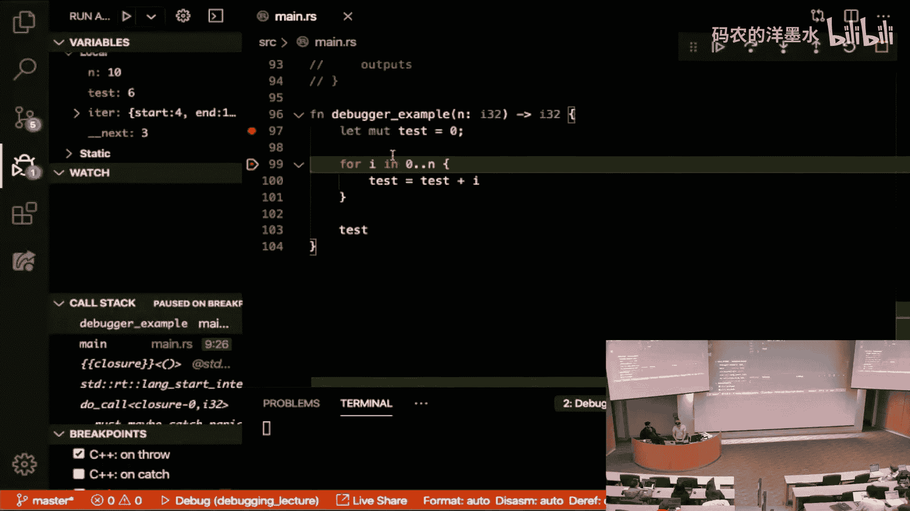

So。Let me just continue。That was the demo。So now we have Professor Google。 Oh。

 do you have a question。Yeah。Yeah。嗯。So that might be specific to the debugger that you're using。Yeah。

 I've never used the In bugggger。It might be specific to the debugger you're using。But。

I could try to get back to you on that。Any other questions。O。So， Professor Google。

Google is the greatest。It is how you will find stack overflow pages。

 It is how you will find Github issue pages。 You will find all of the answers to your problems。

 whether they are programming related or anything else on Google。 So use Google。Seriously。

 use Google。Take your error message and put it in Google。

Describe what you think your problem is and put it in Google。

 There are so many of the problems that you face day to day when you're programming that can so easily be solved by just googling what your problem is。

 And I'm saying this because I'm sure many of you have just gotten an error message。

 picked up your laptop， walked over to office hours and said， sir or ma'am， it doesn't work。

Why doesn't it work？😡，Well， it's just not working。 Can you figure it out。

You want to be able to be a self sufficient programmer。

And so I don't want to scare you guys over what it's like an industry or something。

 depending on the company you work at， some communities are a bit more collaborative than others。

 But even if you're working in a collaborative environment。

 you must be able to succeed in selfsufficiency。 You can't have someone babysit you at all times。

And so one of the ways that you can accomplish this is through Googling。Use Google。Please。

And so with that， we're gonna do a Google scavenger hunt on Kahoot。Where the winner will get。

 or rather top 5 will get 1% extra credit。It'll be six questions。Some of them。

 you might have an idea of what the problem is。 Some of them。

 you will definitely have to Google what the problem is。

And you will have longer time for the questions。Because， obviously。

They won't be at the top of your head to join in。There's the code。Howop five extra credit？🎼The。

Get in here。🎼，🎼。🎼。🎼The。🎼，🎼。🎼。🎼。🎼。🎼。🎼，🎼。🎼。🎼The。🎼，🎼，🎼，🎼，Anyone's still matter。🎼，🎼，🎼。

🎼Ths thumbhs up is very we good。 Okay， so we'll go ahead and get started。

So the first question。

You'll have， I believe， two minutes。So gets yelling at me。🎼It's saying error。

 unable to read tree object head。 What does this mean， What do I do？

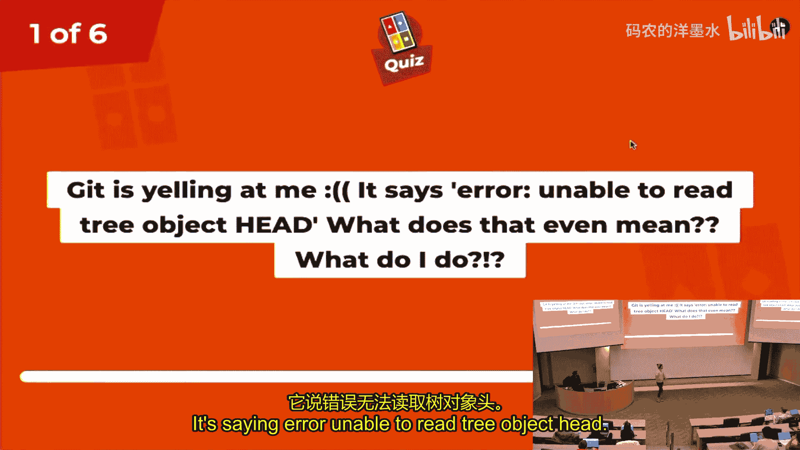

You have two minutes。Google is at your disposal， use it。Some of you are already answering。

Gssing you're just legends。Also very peaceful Kahoot music。 Never heard this。Very nice。

 reminds me of Mincraft。I'm very tempted to just click skip。🎼嗯。🎼아무리 비 끝났을 때。There we go。

 Well done guys。I'm pretty sure。 I mean， I looked at， I looked this up myself。

 and I'm pretty sure the one on the top right is like the only one you would find。嗯。Yeah。

 so that's the answer。 I honestly don't even remember what it does。

 but that's the beauty of stack overflow。 You can use things that you don't fully understand。

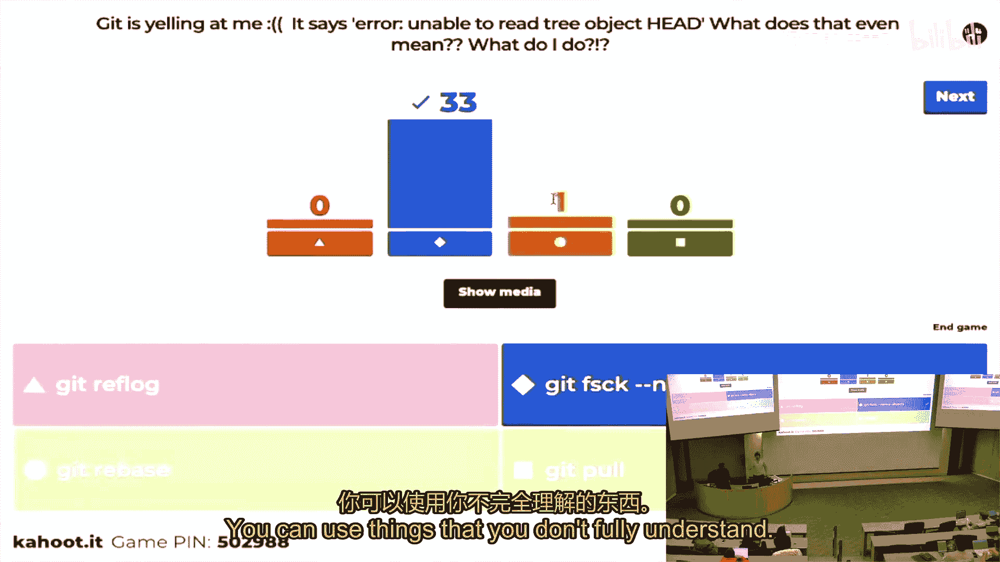

That's cool， my scoreboard。

All right， so I'm stuck in vim， I can't close it。😡，What do I do。

 this one only 60 seconds because some of you might already know the answer。

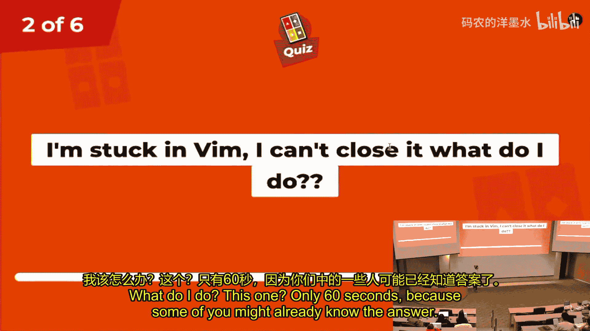

🎼。🎼，あ。🎼。🎼The。🎼ち。🎼Yeah。🎼た。🎼き。と。Yeah， so if you're here for the bash lectures， that is the answer。

And that is what Google will tell you。Clicking the escape key won't quite get you out of it entirely。

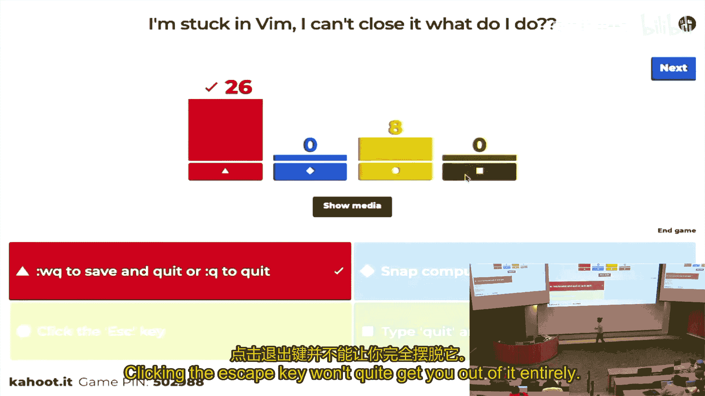

The next question， here is the scoreboard。

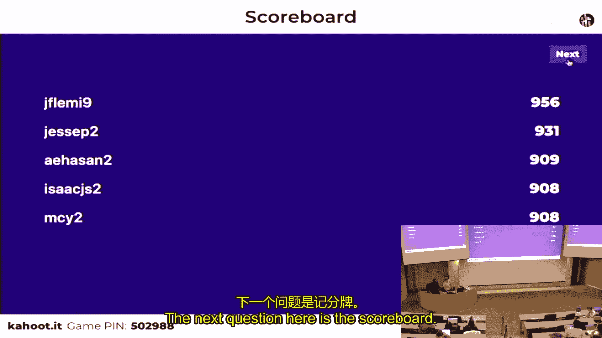

That is a very cool feature。 Nice， nice job Kahoot。🎼So when I type echo path。

 this is a bash question。 It will return my path， but I don't want to do that。 I just want to do。

The word。🎼Dollar sign hat instead it is doing the variable So what does the dollar how can we echo just the dollar sign This is really annoying。

 How do I do it？Professor Google， what do I do， How do I do it？🎼，🎼Yeah。The。🎼，Okay。🎼，🎼，🎼おち。🎼。🎼。Okay。

 well done， green is literally just the command from the question。

 copyied and paste it into an answer。嗯。And the other two are just wrong。

Stack Overflow will tell you this one。And that's how you basically do escape sequences。

 escape characters in besh。So well done to the 26 of you。

Scoreboard。So more batchsh questions。 I'm using C， D， D IR。

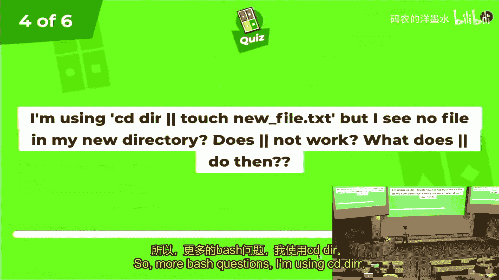

Touch new file， but I see no file in my new directory。Does it not work？What does that even do？

🎼Gogle help。You guys have。你们那。🎼Music very intense。🎼Yeah。🎼，🎼，🎼，🎼，🎼Yeah。🎼，All right， well done。

So the or， the logical or is just like what you would see in a programming language。

 where if the first one is true， the second half just won't execute at all。

 So here we have C DIR that will be successful。 We will change into that new directory。

 And so the second half just won't be executing at all。

 So that's why you're not seeing a new file in your new directory because we're not actually executing the touch command。

We're just doing C，d。Does anyone have any questions about this。So。

The orer operator only does the second command if the first one fails。

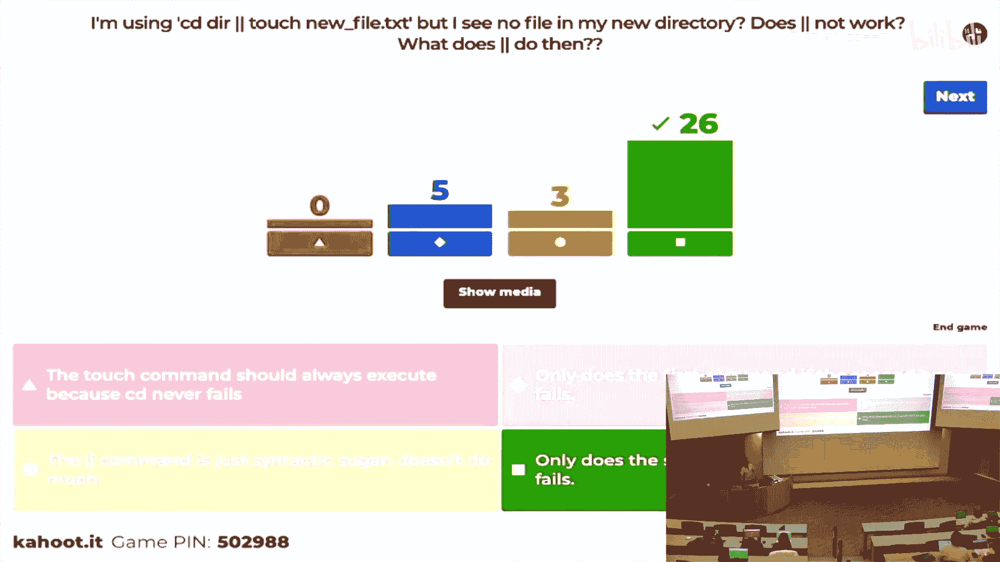

Scoreboard。So Python。🎼So this just goes to show that you don't have to have any clue what's going on to get your answer from Google。

 Some of you probably have never even seen Python code。

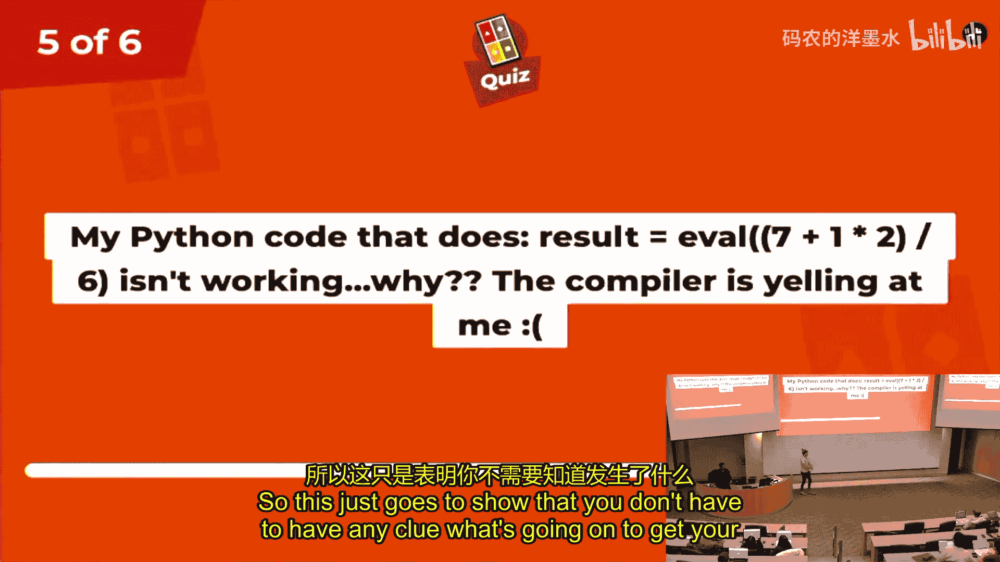

🎼So my code does result is equal to this function and it's not working。

 the compiler is just shouting its lungs out at me， what do I do， how will I do this？Google。

 can you please help me？🎼，🎼，🎼，🎼で。🎼せ。🎼。🎼し？🎼，Okay， very well done。 So again。

 you don't need to know a bunch about something to be able to Google about it。

Blue is the correct answer。 The email function will have to take in a string or two other types that you won't really see very often。

Definitely not。What this is up here。So well done， one more question。

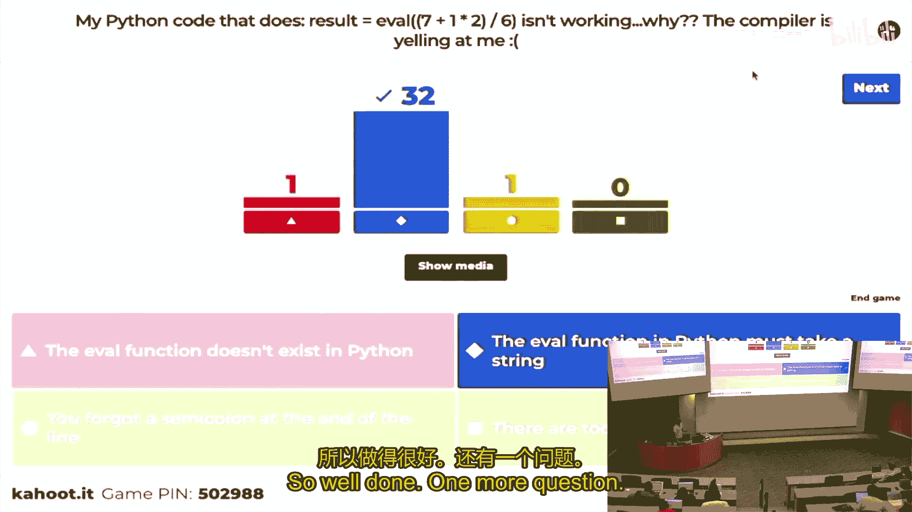

Here's the leaderboard。

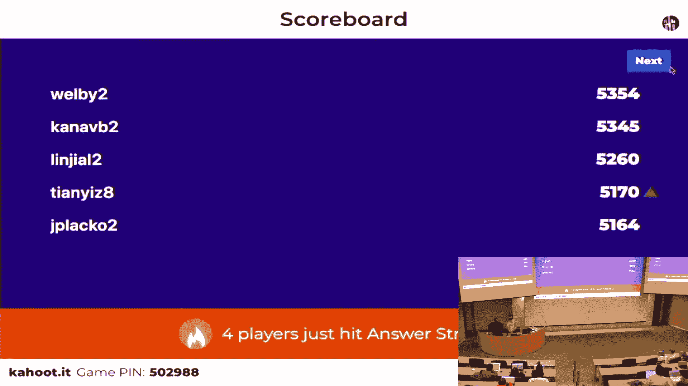

So I'm trying to S S H into my U IU C virtual machine， but it says that my Ne I D can't be found。

Help me。What will I do？🎼，🎼，The。🎼，🎼あ。🎼，🎼，🎼，🎼，🎼The。🎼。🎼。🎼The。🎼いす。All right。Very well done again。

I think the answer to that is on like one of our course websites。嗯。Yeah， that's。

 that's how you do it。 You do your net I D at。Whatever the host URL is。

 And if you were here for one of the batchsh lectures， S SH is what you used to， for example。

 go into a virtual machine from your computer。

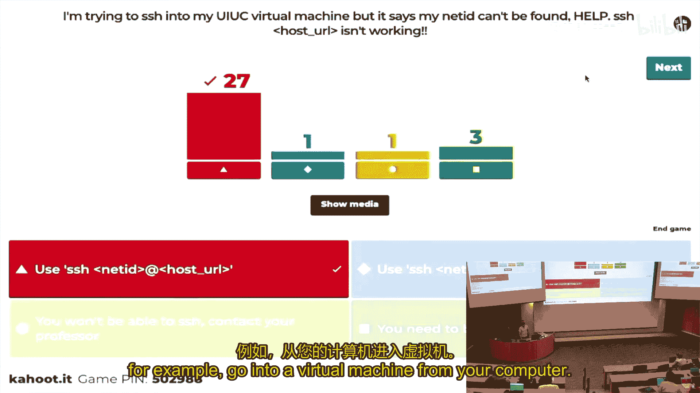

So that's the Google scab in front。Let's have our very dramatic podium。🎼Third place。🎼First， place。

Very nice。Those are doing runner up。One beautiful piece of extra credit for all of you。

Get out of here。

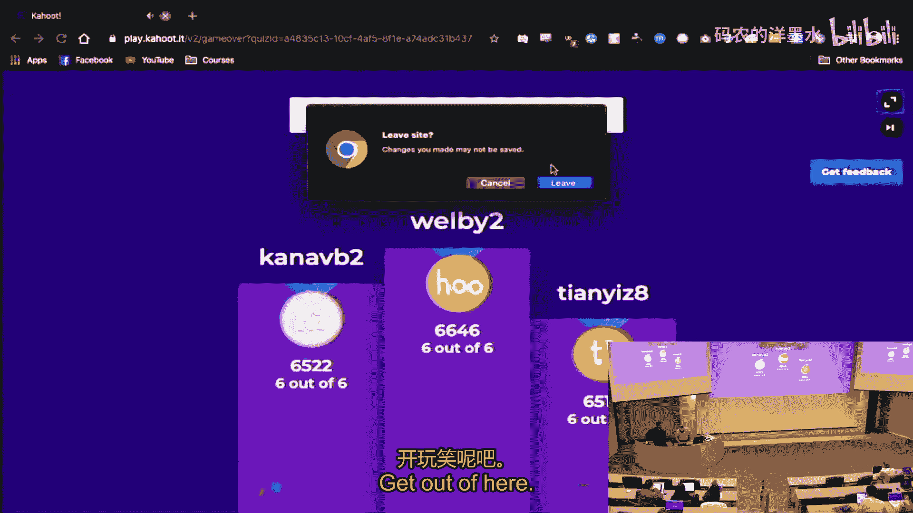

So those are all the slides for today。 So I hope this gave you guys some tools。

 some tips and tricks for being able to tackle these issues on your own。

 If you have an issue in your code you can use a combination of printline debugging。

 rubberproductductivebugging， using a debugger on your I DE or terminal。 You can use Google。

 You can do all of these different things to try and get a better idea of what's going on in your code。

😊，The more self sufficient you are as a programmer， the better programmer you are。

 And this goes beyond just software engineering。 If you become a theoretician， for example。

 you will have to debug things。 If you are just some sort of engineer， you will have to debug things。

 debugging is all throughout。Many different disciplines， many different careers。 It is a very。

 very useful tool to have， very useful skill to have。And I hope this was helpful。Any announcements？

No announcements for today。 So have a wonderful Tuesday。 Thank you。😊。

