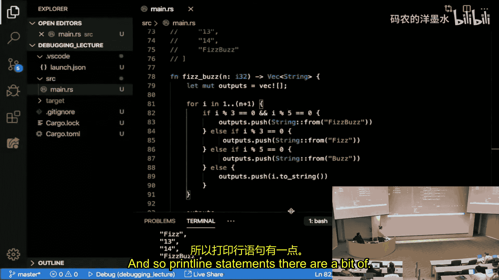
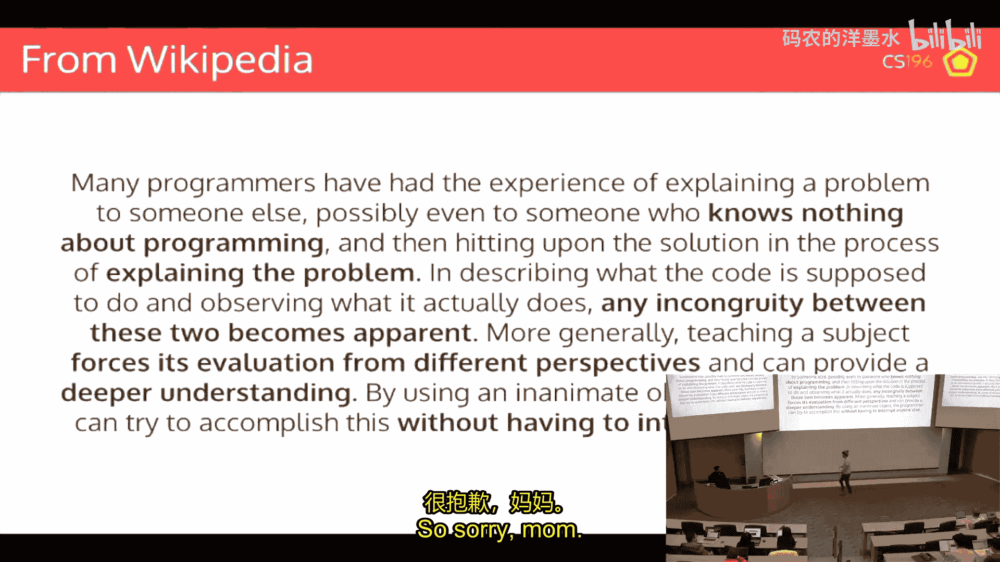
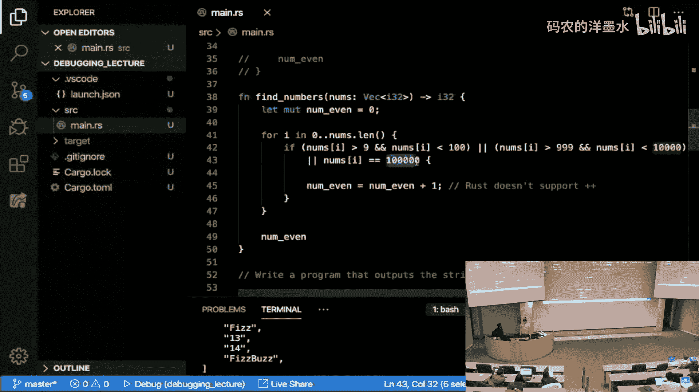
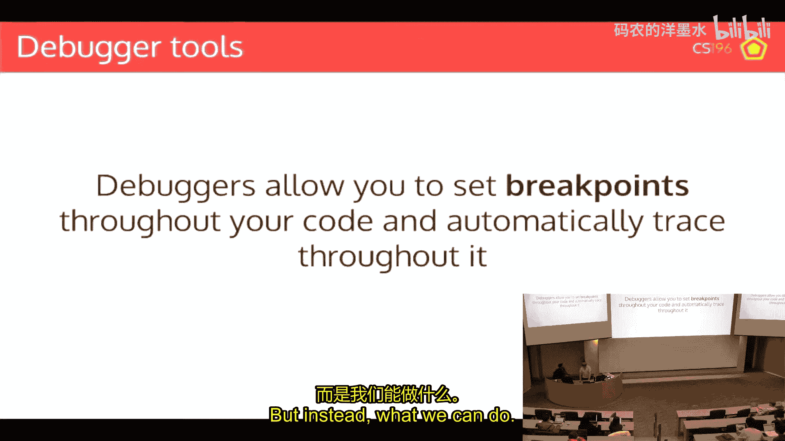
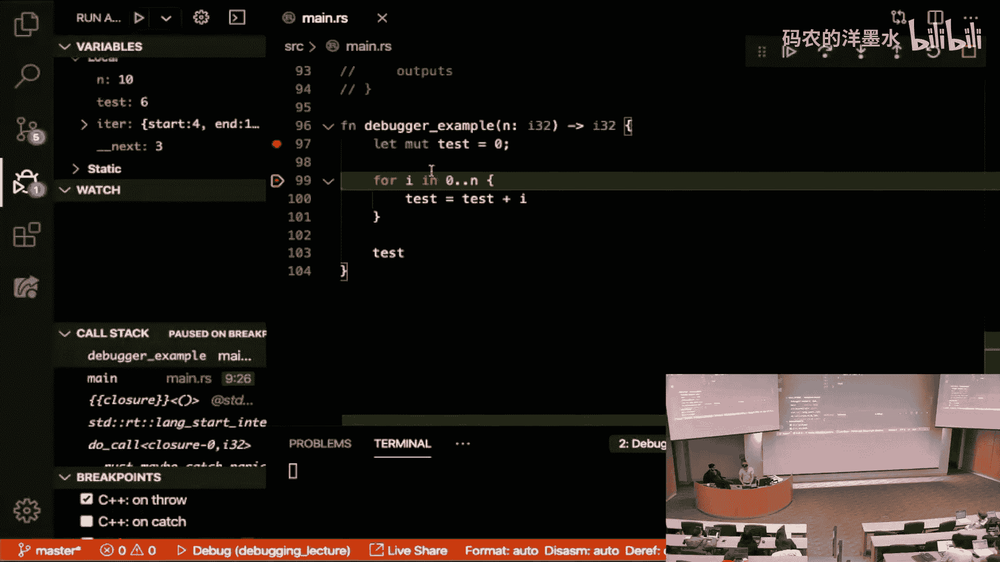
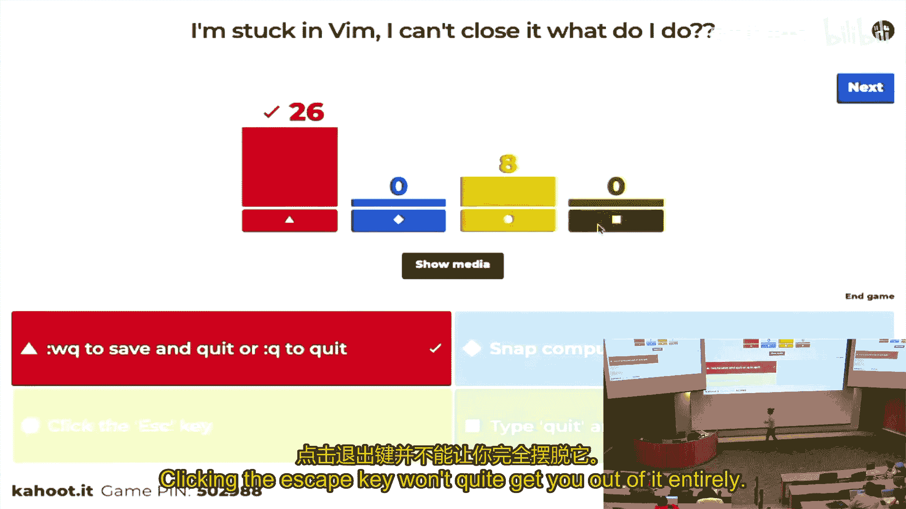
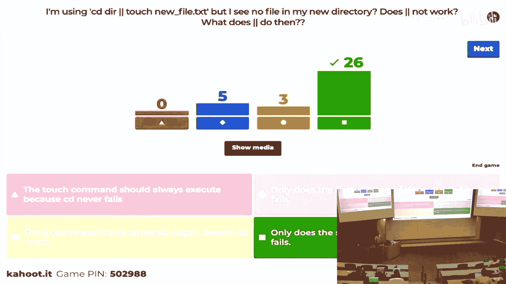
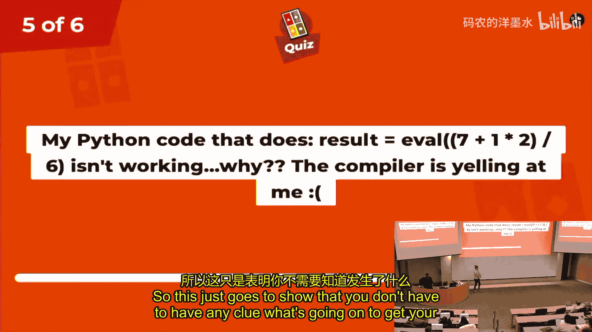
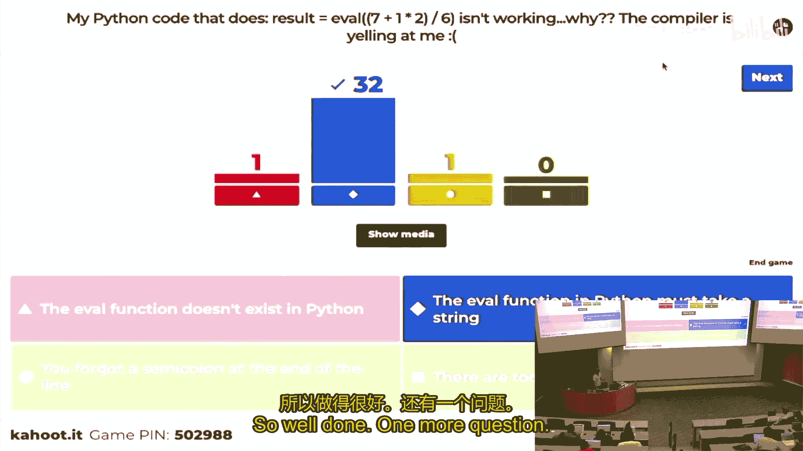

# 计算机编程：从Bash到Rust：第8讲：调试 🐛

在本节课中，我们将要学习调试（Debugging）——这是编程中一项至关重要的技能。调试是找出并修复代码中错误的过程。我们将探讨调试的心态、几种实用的调试方法，以及如何利用工具和资源来更高效地解决问题。无论你是编程新手还是有一定经验，掌握调试技巧都将使你成为一名更独立、更自信的程序员。

## 调试的心态

上一节我们介绍了课程概述，本节中我们来看看调试时应该保持怎样的心态。

调试可以被看作是在一个着火的房间里，依然能冷静地说：“没关系，我们能处理好。”然后从容地拿起水桶灭火。这种冷静和有条不紊的态度至关重要。

今天特别讨论调试，是因为我认为调试是许多人远离计算机科学（C.S.）的最大障碍之一。人们常常在遇到第一个棘手的程序错误（Bug）时，就认为自己不适合学习计算机科学，因为他们无法解决这个错误。

掌握调试是一项极其重要的技能，它能让你成为一名自给自足的程序员。每个人都会经历调试的过程，无论你经验多么丰富，总会在某个时候需要调试代码。有些人可能调试得更频繁，但不要因为需要调试而感到恐惧，也不要因为自己不像其他更有经验的人那样擅长调试，就认为自己不适合学习计算机科学。

为了证明这一点，我引用了几天前在Reddit上看到的一位伊利诺伊大学C.S.教授Wade Fagan的话。他是一位非常出色的教授，他说：“调试很糟糕。我讨厌它。工具、IDE、调试器等让调试变得容易一些，但它仍然很糟糕。找到一个错误可能要花上几个小时，只是为了修复一行代码。我尽我所能避免需要调试。”

即使是Wade Fagan这样的专家也需要调试。所以，不要对这个概念感到恐惧。

## 如何避免调试

在深入学习如何调试之前，我们先来看看如何从一开始就避免需要调试的情况。这不是一门软件设计课程，所以我不会花太多时间在这上面，但我最大的建议是：**经常测试**。


不要一次性写一大堆代码，然后只运行一次，希望它能神奇地工作。确保在编写代码的过程中，经常测试每一个小的功能模块。这样，当你在此基础上构建更多功能时，才不会造成灾难性的后果。

想象一下建造房子。建筑工人不会建好第一层就说“看起来差不多”，然后直接再建30层，最后才说“好了，是时候测试一下这栋房子是否稳固了”。他们会在建造过程中经常测试，确保每一层楼都非常坚固、结构良好。编程也是如此。

当然，这不是软件设计课程，你会在CS 126或CS 242等课程中更深入地学习这些内容。但今天我们的重点是调试。

## 调试工具箱

计算机科学中的问题和你需要调试的错误，通常可以归结为你对代码行为的许多错误假设。没有一个可以让你在脑海中运行的“调试算法”，让你按部就班地解决所有问题。

相反，我能给你的是一个包含多种不同工具的“工具箱”。你可以根据调试代码时的具体情况，从中挑选合适的工具。这些工具都是为了解决同一个核心问题：挑战你对代码的错误假设，确保你构建的代码像一栋坚固的房子。

### 工具一：打印语句调试（Printline Debugging）

让我们从工具箱中的第一个工具开始：打印语句调试。这是调试代码最基本的方法之一，但实际上非常强大。

你基本上就是在代码中各处放置打印语句，以确保输出符合预期，并检查是否进入了某些代码区域。

以下是你可以问自己的一些问题：
*   我是否进入了这个函数？在函数里放一个打印语句就能看到。
*   为什么这个值在这里是未知的？在那里放一个打印语句就能看到。
*   我的数组里有多少个元素？同样，放一个打印语句就能知道。



#### 演示：打印语句调试

我将通过一个快速演示来展示如何使用基本的打印语句调试来解决一个错误。

**问题描述：**
这是一个来自LeetCode的简单面试题。我们需要编写一个程序，输出从1到n的数字的字符串表示。对于每个数字：
*   如果是3的倍数，输出“Fizz”。
*   如果是5的倍数，输出“Buzz”。
*   如果同时是3和5的倍数，输出“FizzBuzz”。

例如，输入为15时，输出应为：`1, 2, Fizz, 4, Buzz, Fizz, 7, 8, Fizz, Buzz, 11, Fizz, 13, 14, FizzBuzz`。

**有问题的代码：**
```rust
fn fizz_buzz(n: i32) -> Vec<String> {
    let mut answer = Vec::new();
    for i in 1..n {
        if i % 3 == 0 && i % 5 == 0 {
            answer.push("FizzBuzz".to_string());
        } else if i % 3 == 0 {
            answer.push("Fizz".to_string());
        } else if i % 5 == 0 {
            answer.push("Buzz".to_string());
        } else {
            answer.push(i.to_string());
        }
    }
    answer
}
```
这段代码看起来几乎正确，但实际运行结果不对。

**调试过程：**
1.  首先，我用输入`1`测试。输出是一个空列表`[]`，但预期应该是`["1"]`。
2.  我在`else`分支（输出数字的分支）里添加打印语句`println!("Is this working?");`，但运行后控制台没有输出。这说明程序没有进入这个`if`语句。
3.  接着，我在`for`循环开始处添加打印语句`println!("Entering loop");`，运行后依然没有输出。这说明程序没有进入`for`循环。
4.  最后，我在函数开头添加打印语句`println!("Entering function");`，运行后看到了输出。这说明函数被调用了，但`for`循环没进去。
5.  检查循环边界：`for i in 1..n`。当`n=1`时，范围是`1..1`，这是一个空范围，所以循环体一次都不会执行。
6.  修复方法：将循环范围改为`1..=n`或`1..n+1`，使其包含`n`本身。

修复后，代码运行正常。



#### 打印语句调试的优缺点

打印语句调试非常有用且强大，但它并非完美无缺。

以下是它的缺点：
*   **速度慢**：如果你意识到需要移动或添加打印语句，你必须重新编译代码并重新运行整个程序。
*   **污染代码**：打印语句成为代码的一部分。使用版本控制（如Git）时，它会显示文件被修改，即使这些修改只是调试性的。此外，过多的打印语句会使代码变得混乱。
*   **可能影响性能和行为**：打印语句本身需要执行时间，大量使用可能会拖慢程序速度，在极少数情况下甚至可能改变程序的行为（例如在多线程环境中）。
*   **功能有限**：我们将在后面介绍调试器时看到，打印语句的功能相对有限。

尽管如此，我知道很多人仅凭打印语句调试就开发了多年。它确实很强大，但有更好的方法。

### 工具二：小黄鸭调试法（Rubber Duck Debugging）

现在介绍工具箱里的另一个工具：小黄鸭调试法。你们有些人可能会觉得这个概念很好笑，但小黄鸭调试法实际上是很多人可能已经在无意中使用过的方法。

这个概念的名字来源于《程序员修炼之道》一书中的故事：一个程序员会随身携带一只橡皮鸭，通过向鸭子逐行解释代码来调试程序。

你可能会觉得这个人是个怪人，但这其实非常聪明，因为这种调试方式非常强大。

维基百科上是这样描述的：“许多程序员都有过这样的经历：向别人（甚至可能是一个完全不懂编程的人）解释一个问题时，在解释的过程中突然想到了解决方案。在描述代码应该做什么和观察它实际做什么的过程中，两者之间的任何不一致都会变得显而易见。更普遍地说，教授一个主题会迫使你从不同的角度评估它，从而获得更深入的理解。通过使用一个无生命的物体，程序员可以在不打扰任何人的情况下完成这个过程。”

#### 演示：小黄鸭调试法

我没有橡皮鸭，但我有一只企鹅玩偶，我们就用它来代替。



**问题描述：**
这是另一个来自LeetCode的简单问题。给定一个数字数组，我们需要返回其中**数字位数**为偶数的数字有多少个。
例如，数组`[12, 345, 2, 6, 7896]`，输出应为`2`，因为`12`（2位）和`7896`（4位）是偶数位。

**有问题的代码：**
```rust
fn find_numbers(nums: Vec<i32>) -> i32 {
    let mut num_even = 0;
    for num in nums {
        if num % 2 == 0 { // 错误：检查数字本身是否为偶数，而不是其位数
            num_even += 1;
        }
    }
    num_even
}
```
现在，我拿起我的“小黄鸭”（企鹅），开始向它解释代码：
“好的，对于这个问题，我接收一个数字数组。我初始化一个计数器`num_even`为0。然后我遍历这个数组。对于每个元素`num`，我检查它是否是偶数……哦！我发现了问题！我在检查数字本身`num`是否为偶数，但题目要求的是检查数字的**位数**是否为偶数。所以`346`是偶数，但它有3位（奇数位），不应该被计数，而我的代码却会计数它。”



通过逐行解释，我很快发现了逻辑上的错误。

**正确的思路：**
题目限制了输入数字最大为`10^5`。我们可以利用这个条件：在这个范围内，只有位数为2、4或6的数字才符合条件。因此，我们可以直接检查数字是否落在这些区间内。

**另一段有问题的代码：**
```rust
fn find_numbers(nums: Vec<i32>) -> i32 {
    let mut num_even = 0;
    for num in nums {
        if (num > 9 && num < 100) || (num > 999 || num < 10000) || num == 100000 {
            num_even += 1;
        }
    }
    num_even
}
```
这段代码意图实现上述思路，但仍有错误。通过课堂上的“小黄鸭调试”（即请同学逐行解释），我们发现了两个错误：
1.  检查四位数时，条件`(num > 999 || num < 10000)`中的`||`（或）用错了。应该是`&&`（与），因为我们需要数字同时大于999**且**小于10000。
2.  同样，整个条件组合中，各个区间应该是“或”的关系，但第二个区间的内部逻辑错了。

修复后的正确代码应该是：
```rust
if (num > 9 && num < 100) || (num > 999 && num < 10000) || num == 100000 {
    num_even += 1;
}
```
通过小黄鸭调试法，我们能够仔细审视每一行代码，从而快速发现问题所在。

### 工具三：调试器（Debugger）

现在我想展示另一个强大的工具：调试器。你可以在IDE或文本编辑器中可视化地使用调试器，也可以在命令行中使用。

今天，我将展示在文本编辑器（VS Code）中使用调试器的基本方法。调试器允许你在代码中设置断点，并自动跟踪代码的执行。

之前我们用打印语句模拟了断点，而调试器可以更干净地实现这一点。



#### 演示：使用调试器

1.  **设置断点**：在VS Code中，点击代码行号左侧的空白区域，会出现一个红点，这就是断点。断点应该设置在包含实际代码的行上。
2.  **启动调试**：首先确保项目已编译（例如运行`cargo build`）。然后点击VS Code的“启动调试”按钮。
3.  **控制程序流**：程序会正常运行，直到遇到第一个断点后暂停。此时，你可以看到侧边栏中所有变量的当前状态。
4.  **单步执行**：你可以使用“单步跳过”（Step Over）按钮逐行执行代码。每点击一次，程序就执行一行，变量的状态也会随之更新。你还可以使用“单步进入”（Step Into）进入被调用的函数内部，或使用“单步跳出”（Step Out）跳出当前函数。
5.  **多个断点**：你可以设置多个断点。程序会在每个断点处暂停，让你检查状态。

使用调试器的好处是，你无需修改代码（添加打印语句），也无需反复重新编译和运行。你可以直接设置断点，让调试器来完成工作，并且能更清晰、更交互式地观察程序状态。

### 工具四：谷歌教授（Professor Google）


谷歌是最强大的工具。你可以通过它找到Stack Overflow页面、GitHub issues页面，以及几乎所有编程问题（乃至其他问题）的答案。


请务必使用谷歌。将你的错误信息复制到谷歌搜索框。描述你认为的问题所在并进行搜索。你日常编程中遇到的许多问题，都可以通过简单地谷歌搜索得到解决。


我说这些是因为，我相信你们许多人在遇到错误信息时，会直接拿起电脑去办公室时间，说：“老师，它不工作了。” 但你得学会成为一个自给自足的程序员。





无论你将来是在工业界还是学术界，自我解决问题的能力都至关重要。你不能指望一直有人手把手帮你。而实现这一目标的方法之一，就是善用谷歌。


#### 活动：谷歌寻宝游戏


我们通过一个Kahoot小游戏来实践一下。游戏包含6个问题，有些你可能知道答案，有些则肯定需要谷歌。前5名将获得额外的学分奖励。

**问题示例：**
1.  Git报错：`error: unable to read tree object HEAD`。这是什么意思？我该怎么办？
2.  我被困在Vim编辑器里了，关不掉！怎么办？（提示：在Bash讲座中学过）
3.  在Bash中，我想用`echo`输出美元符号`$`，但输入`echo $`它却试图解释变量。我该怎么只输出`$`这个字符？
4.  在Bash中，我输入`cd new_dir || touch new_file`，进入了新目录，但没看到新文件。`touch`命令没执行吗？这是怎么回事？
5.  在Python中，我的代码`result = int(“123”)`报错了，编译器在抱怨。我该怎么办？
6.  我尝试SSH连接到我的UIUC虚拟机，但系统说我的NetID找不到。怎么办？





通过这个游戏，我们可以看到，即使你对某个问题或语言一无所知，只要善于使用谷歌搜索，也能找到解决方案。

## 总结




本节课中我们一起学习了调试的艺术与科学。我们探讨了调试时应有的冷静心态，并介绍了四种强大的调试工具：


1.  **打印语句调试**：通过插入打印输出来观察程序状态和流程，简单直接但稍显笨拙。
2.  **小黄鸭调试法**：通过向他人或物体逐行解释代码，来梳理逻辑、发现隐含的错误假设。
3.  **调试器**：利用IDE或命令行工具设置断点、单步执行、实时查看变量状态，提供了强大且非侵入式的调试手段。
4.  **谷歌搜索**：将错误信息或问题描述作为搜索词，利用互联网上的海量资源（如Stack Overflow）寻找解决方案，是程序员最重要的自学技能之一。

作为一名程序员，你越能自给自足，就越优秀。这项技能不仅限于软件工程。无论你将来成为理论研究者，还是其他领域的工程师，调试能力都贯穿于许多不同的学科和职业中，是一项非常有用且重要的技能。


希望本节课对你有所帮助。祝你调试顺利！