# 【全集 春季版】伊利诺伊大学 计算机编程：从Bash到Rust 中英字幕 p10 Lecture 10 - 使用库和框架 -BV188rDBFEUY_p10-

Wecome back to CS196。Let's go ahead and go over the objectives for today very quickly。

 So today I want to teach you guys the differences between libraries and frameworks。

 more importantly， how to use them in your projects and your applications in real life and why we use them in general。

So very quickly， what is the big idea from last lecture。

 We talked about how programmers are in a way very lazy。 you don't want to reinvent the wheel。

 So here is an example of someone literally reinventing the wheel。

 We don't want to do this in our day to day applications in software development。

 We want to be able to use what's already existing in our applications so that we don't need to spend a long time doing very basic things。

So to begin， let's talk about the differences between libraries and frameworks。

 So last time we talked about APIs， application programming interfaces。

 and those are very good ways of interacting across the network with different services such as Google Maps to be able to get data and use different services in your own application。

 So that is one great way of not reinventing the wheel。

 libraries and frameworks are also very good ways of doing this。So very quickly。

 just a side by side comparison， libraries provide a set of helper functions， objects。

 modules which your application code can call for specific functionality。

 so consider the example of a library that provides statistics functionality and one of the functions that it provides is calculating the mean of a list for example。

 this is a very simple example but you could imagine this library providing things like the normal distribution and and other things related to statistics。

So in comparison frameworks， define open or unimplemented functions or objects which the user writes to create a custom application。

 So think of this as a skeleton that the framework gives you。 And so an example of this is angular。

Angular is a web framework and JavaScript， if you wanted to write a web application。

 Angular is a very good way of doing this and it just essentially gives you the skeleton and you can implement things inside of the skeleton to get your web application to work。

 so in comparison to a library where it just simply gives you functions that you can use in your own application。

So those are the differences between frameworks and libraries。So this sounds very good to me。

I want to be lazy myself。 How can I start using this in my own projects。

So I want to go ahead and go very quickly。Through the steps that I personally take when I'm researching libraries and frameworks that I want to use in my own personal projects。

 So the first step that I take is to research。 If I want a library that does something very specific。

 then I'll go on Google。 So by research， I mean Google and I will look at what I need to do what I want to accomplish。

 So Google what you need， match your intentions to the least amount of work possible and get a few candidates that are showing some sort of potential straight away。

 So if I need a library that， for example， does gives me the functionality of being able to write web applications。

 I'll go on Google and I'll search that functionality with the programming language that I need。

 and I'll just basically open into a couple tabs of libraries that give me that functionality or frameworks that give me that functionality。

😊，So the next step is I want to just simply evaluate it what library is the best and we'll go through steps and metrics that you can use to see what is a good library in your application。

 so we'll revisit this later。😡，But after that， simply try it up。 So take the library。

 put it in your own project， branch off if you're using Viin control。

 and try to get a simple hello world working。 do very basic things and see how you feel about it。

 If you like it， keep on going with it。 tie it into your application and essentially put this ingredient into your melting pot。

 your project。So。I talked about how we want to be able to evaluate the usefulness of a library。

 So if we're looking for something that gives us a certain piece of functionality and I see 10 different results。

 how can I choose what I think is the best one。So these are some metrics that I think are very useful for evaluating whether or not a library is powerful。

 whether or not you'll like it in your own project。 So the first metric that I use is GitHub stars。

 So quite simply the more of these， the better。 if you have a repository that contains a library that has。

 you know 40000 stars and one has five。 Then we can assume which one's probably better just looking at that alone。

 right。And by stars， I mean， you know， you can compare this to likes or follows or whatever you want to call it。

 This is just a very simple， you know， upvote style metric that determines whether or not people like a library。

So number two is the readme file。 So this is usually a very good way of judging a book by its cover。

 If the readme file looks really nice， then chances are the project or the library will be very nice。

😊，Documentation， skim through the documentation of the library。 See how you feel about it。

 Does it have example code。 Does it look well documented， Is it easier to understand。

 Do you like the way the syntax looks， You can just basically follow through these steps in your head。

 And based on these two， you can limit and narrow down your choices between the candidates that you found from your Google search。

Look at the support that is being provided to the people that are using these libraries。

 Look at the issues tab on the Github repository。Do we see a good ratio of open issues and closed issues。

 So if someone has an issue with a library， they'll open up an issue on GiHub， right。

 if we see 100 open issues and two of them are resolved。

 we want to probably stay away from this library because we know that people are not maintaining it。

 people are not supporting those who are using their code So are people getting the help they need。

 is there a good ratio， are people closing issues as they come。And have you used it previously？

So you should be， you have to be open to learning new things。

 You have to be open to learning new libraries， tools that you haven't seen before。

 But if you've used something like it before， you should probably consider using it again。

 And sometimes this just comes down to personal preference。

 I'll show you guys some examples later of libraries and frameworks that will essentially qualify all of the metrics that I have from one through four。

 And from there， it'll usually just be personal preference。 which one you prefer。

So let's take a look。So let's say I want to。Find a librarian。😡，That will give me。

Functionality for stats， for example。So on Ru， a very useful website to search for these libraries is createates I O。

So already beforehand， I looked up statistics in the search。

And I see all of these libraries here that Rust provides or that people have written in rustt that I can see on this website。

And so on this website， I can open up the repository， I can open up the documentation。

And I can basically。Just from these， evaluate what I think about it。

 So I already opened these up before。 These are basically the top three that I was able to find giving those searches。

 So this has 156 Github stars。😊，And this is stats Rs。This is another library。 It's called Rus Stats。

 It has 54 Github stars。Here is a library called Statistic。 It has 19 Github stars。

 So just from Github stars alone， I kind of have an idea of which 1 I like the most。

But let's keep on looking more right I don't want to just weed out， you know。

 just base off the stars， let's give all of them an equal chance right if we look at the readme here。

 it's very nice， it's very well documented straight away there's example code。

 we can see that you know it's also open source so if people want to help contribute to the library。

 they can just make pull requests and do that here with a list of all of the you know functionality that he wants help implementing。

Overall， it's just a very nice read me。Now， if we look at the other ones。

Doesn't look like there's much here。And same thing with this last one。

 So if I were to be if I wanted to， for example， use an API to call the MTD bus API。

 gather some data， some live data from their API。 and let's say I wanted to do some statistical analysis somewhere in my project。

 I wouldn't go and write the statistics functions myself because there's a lot of things that are in statistics that you would need to write yourself。

 instead， I would go on Google or in this case， creates that Io and I would say I need a statistics library。

 and I weed down my search between these three and I would personally end up with stats R。

So with stats R S， I would go into my project， and I'll just do a very simple hello world。

 And I'll do this later on in the lecture。But I would take a look at their documentation。

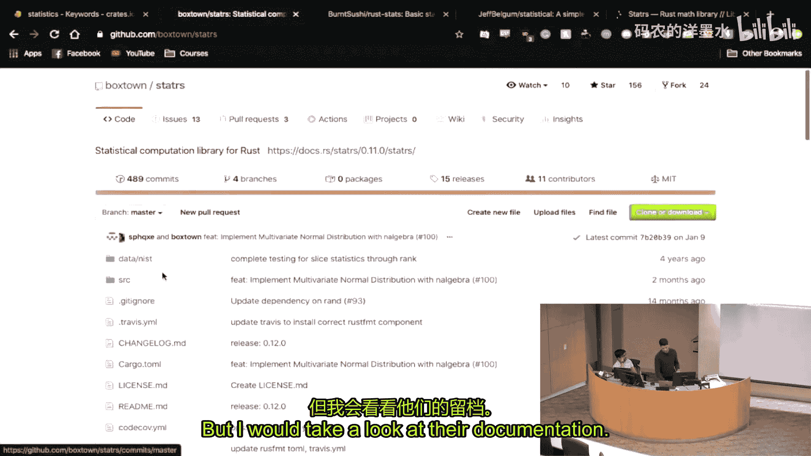

So that's here。We can see that there's a lot of example code， everything is very nicely documented。

We could see all of the different pieces of functionality that it provides。So if I go here。

We can see the different distributions that it gives me。

All of the functions that it can give me to calculate things like very basic mean median mode。

I wouldn't want to write all of these functions myself， right。

 So I'm gonna to use the library and I'll make a simple hello world in my own application。

 If I'm using Virgin control。 I'm not gonna to forget to branch off because let's say this library breaks something。

 I don't want to develop this on my main branch because then if I push the code and something's wrong。

 then my master branch is going to be compromised， right。

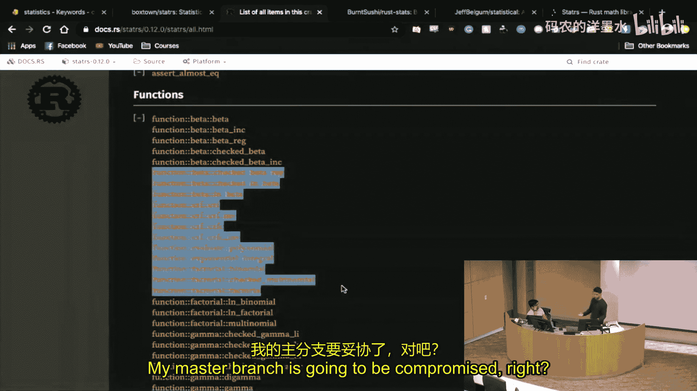

So that's the basic idea。That I want you guys to have when it comes to how to implement a library or framework into your own code。

So what does this look like specifically in rust？So if you remember cargo。

 cargo will handle all of this for you。😡，There's a file called the cargo dot TOML and under dependencies。

 you just simply put the name of the library， and there's going to be a little bit more details。

 but you'll find that in the getting started of the readme of the library that you're looking at。

 so I'll show that a little bit more later on。So here's the cargo do Tael。

 And you can see in dependencies On line 10， we just have the library that I just found。 That's R S。

 And the version of the library that I want to。Put in。 so 0 dot 12 dot 0。 This is the latest one。

 And I was able to find this on the getting started on the readme in the repository。😊。

And when you write cargo build into your terminal， this will install all of the dependencies that you don't have。

 And when I say dependencies， I basically mean that your project is now depending on these libraries that you're putting into your application。

 So if someone else pulls in your project and wants to run it on their own computer。

 they don't have the libraries and dependencies that you originally put in your project。

 So in order for them to get all of these little pieces of functionality that you put in your project。

 they would need to run cargo build and cargo build will basically go through。

And install not only the dependencies that you have in your application。

 but also the dependencies of the dependencies of you know， those dependencies。

So this is a nice little graph that shows what this would look like。

Cargo build will just basically start off at your dependency and just go all the way down the graph and get all of the dependencies that are being used in those dependencies。

And these dependency graphs can get very， very large。Very， very large。

 We can see sometimes when you have， let's say 10 dependencies。

 those dependencies have dependencies of themselves because these libraries are just basically code that someone else wrote for your use。

And this is shown there。So。Oh， actually， very quickly。 So this isn't specific to rust。

Rust uses cargo。 That's the package manager that we've been talking about since Ru lecture 1。

 Javascript uses a package manager called NPM。 It will do all the things that cargo does。

 and possibly even more。 Python uses Pip。Jobi uses maven， etctera。

 Most programming languages have one of these package managers。

 It just so happens that Rus uses cargo。But they're all very， very similar。

So quick demo of everything so far。

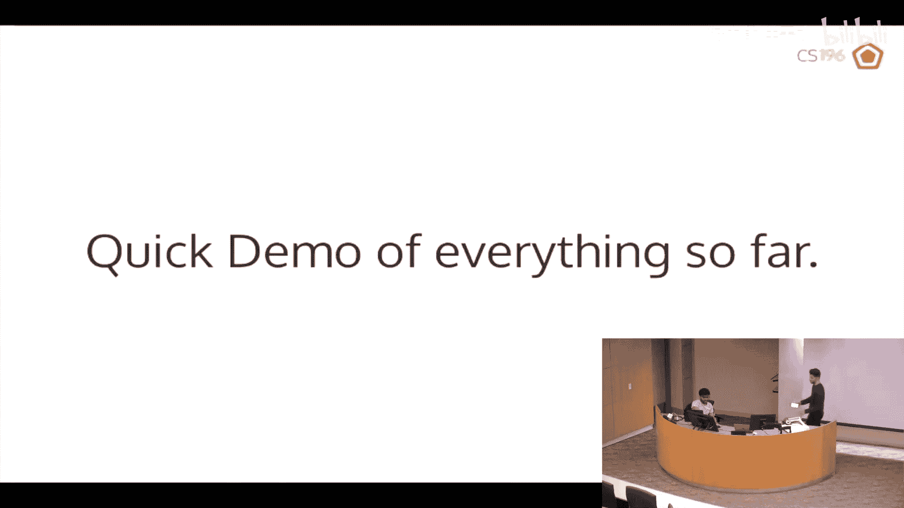

So， here。We talked about how I'm going to go ahead and settle on this library for my project。

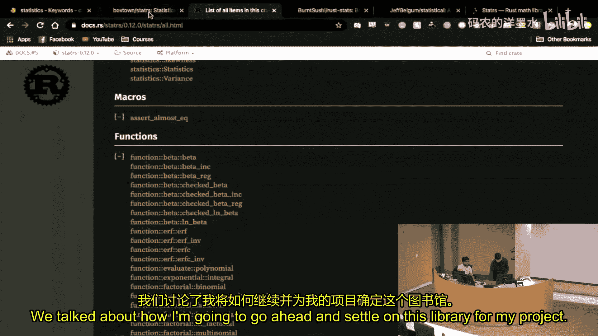

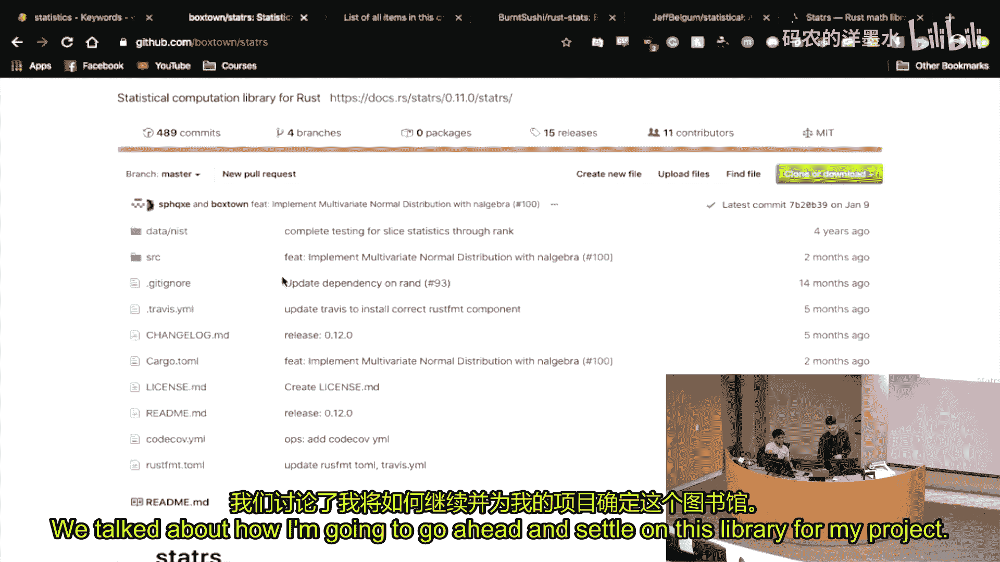

And so。I didn't want to spend too much time doing this from scratch in my own application。

This is some commands that I wrote right before the lecture。So in my cargo dot Tammo。

You can see that。It has some information about who is creating this project。

And here we have dependencies。So stats Rs， this is exactly what I had in the slides。

 So once I put this here。

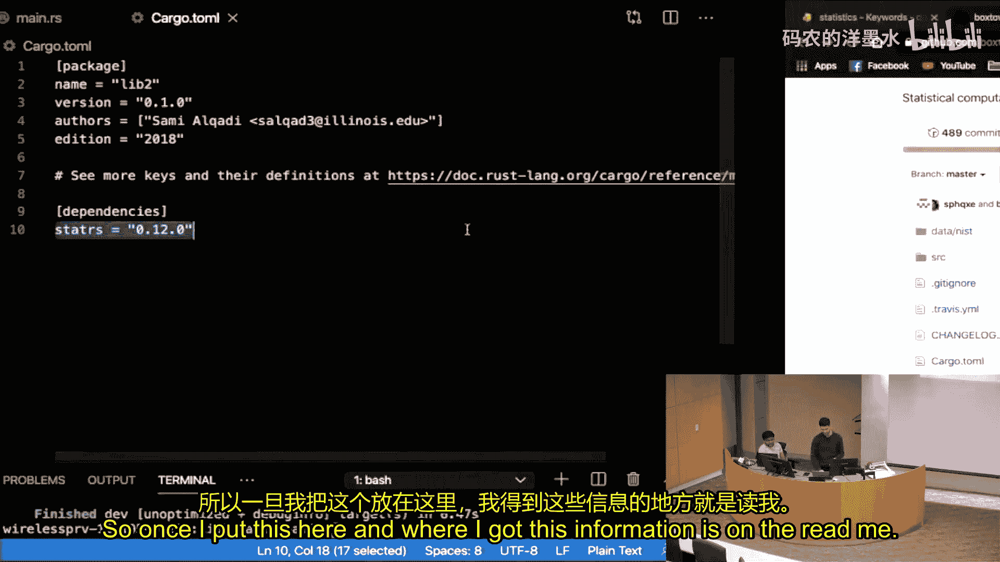

And where I got this information is on the readme。It'll basically say， how do you use it， Well。

 if you put this in your cargo， then cargo will now know about it and it'll know where to find it。

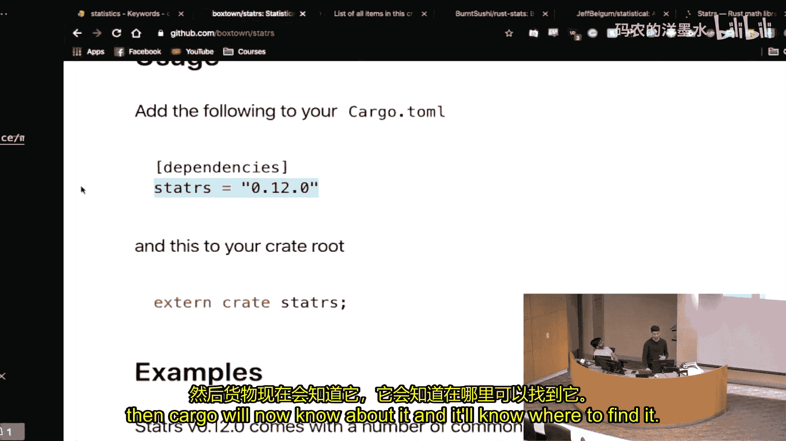

So after I put it in my file。I can run this command cargo build。

 And you can kind of see the dependency graph come to life here。 So on the bottom here。

 you can see how it's installing stats R S， but not only is it installing stats R S。

 It turns out that stats R S uses all of these libraries that come before it。 So P PV light 86。

 R Chacha， all of these different libraries。😊，Because someone wrote stats R S。

 And while he was writing stats R S， it just so happened that he also used some of the dependencies that come before it。

So does anyone have any questions so far？About cargo， about dependencies， libraries。

 versus frameworks， anything。Yeah。Grael， is that what you asked about。

I think Raal is for like building Android apps， right？So I don't think that it is。Yeah。

 I don't think Gadle is a package manager。 I believe it still uses maven because it's Java， right。

Yeah， you can look into that a little more。 just Google like Gle。

 I don't think it's a package manager， though。Any other questions？Okay。So very quickly。

As you can see in the main。

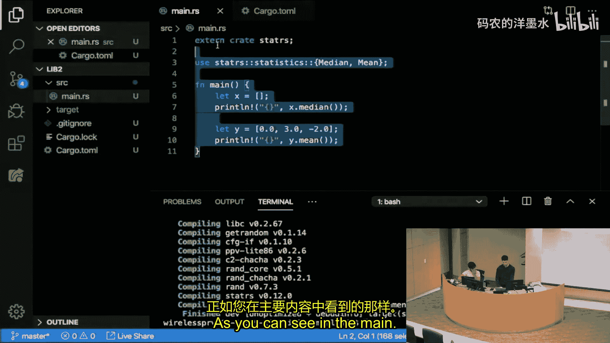

I went ahead and I looked through their documentation。

 I'll just go ahead and close all these other ones that I was considering。

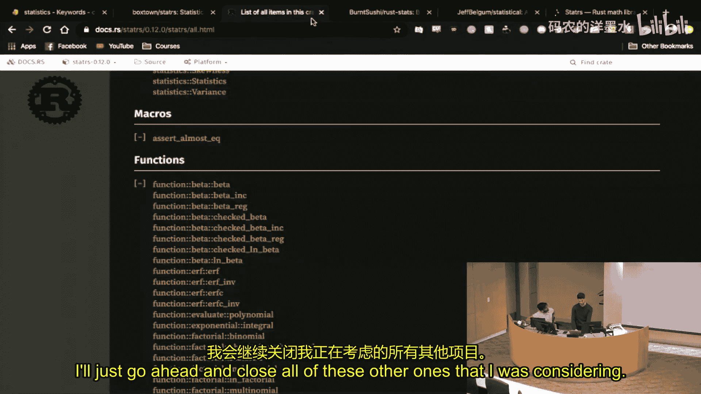

So here's their documentation。

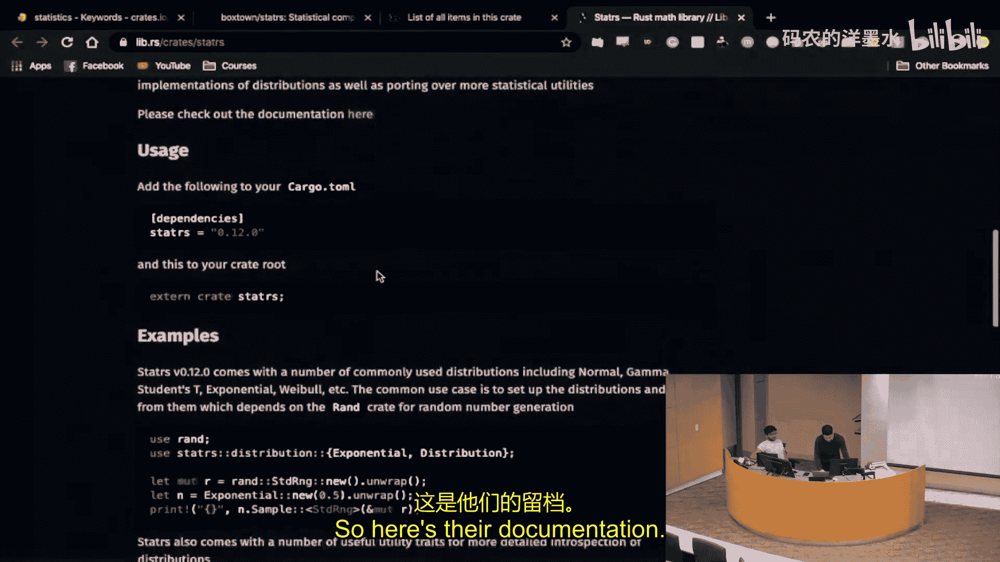

And if I just put。Some of this code into my project， I can just test to see if it works。

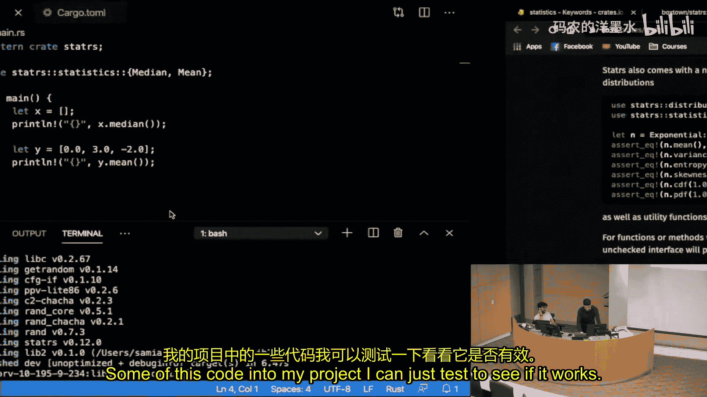

So if I do cargo run。We'll see that the median of this empty list is NN because there's nothing in there。

And the mean of this list is 0。333。 And I'm just basically using the functionality that this library provides。

 I didn't have to do anything to calculate the mean and median other than this up top。

So as you can see on line one， we have externalern Cate stats Rs。

 This is just basically how you write import and rust。

 So after you add the dependency to your project and the cargo dot TMl and you build and you add and install it into your project in order to actually use the library in your code。

 you need to import it in。 This is how rust knows about the functionality that it provides。

Then right under that， the way that we import the functions in specifically from this library。

Is right here。 We use the use keyword and then stats R S。 and then those colons。

 you can think of them as name space name spaces。 So from stats R S。

 we're using the statistics functionality。 And from that， we're using two specific things。

 median and mode。Or。En and mean， sorry。And this curly bracket syntax。All it's basically saying is。

Instead of doing something like this， where we。Import。Median and mean separately。So。

This is what that looks like。 And I can do cargo run， and it'll do the same exact thing。

Instead of doing something like this where we are importing functions from the same exact section。

 I can just put it in curly braces。Like what we saw a second ago。 So I'll just undo。

And this does the same exact thing。 It's just a little bit of syntactic sugar to simplify our code。

 Do you have a question。Yeah。Okay， so the question was。

The first line is we're importing this into our code。 The second line is why do we need to you know。

 use very specific functionality？ Well， the answer is stas R S itself probably isn't a huge library。

 But there are libraries that have a gazillion functions and a gazillion pieces of functionality。

 So rust and basically every language gives you the ability to specify what exactly you want to pull from this library because if you were to basically have everything immediately available to your code that would pollute the state of your program。

 you would have so many functions that you don't plan on using。

 So this is just our way of specifying to rust that from this library。

 I only want these two functions for now。Does that make sense。You would need to。It would， yes。

 It would。 It would throw an air。 You need to specify exactly what you want， essentially。Yeah。

 very good question， but。It's just not very good practice to like。

 just import the entire library into your code。 and then。

Another issue other than it polluting your state is that like。

 let's say you're reading someone else's code。 And you saw something like line 10。 Why that mean。

 You have no idea where that mean function came from， right？ But in this case。

 if you're reading the code and you see online line  too， Well， okay。

 the mean function came from this library。 So this gives a better understanding a little bit more intuition of what's actually going on in the code。

But yes， also， it pollutes the state of your program。Does that make sense， Okay。

 anyone have any other questions。Okay。So yeah， just very quickly， this is。Basically。

 our way of saying import crate is the way that rust calls libraries。

 So if you remember from the website Cates。 IO， crates is just rust's name for libraries。

 so don't get confused about that。 and then we talked already about this。

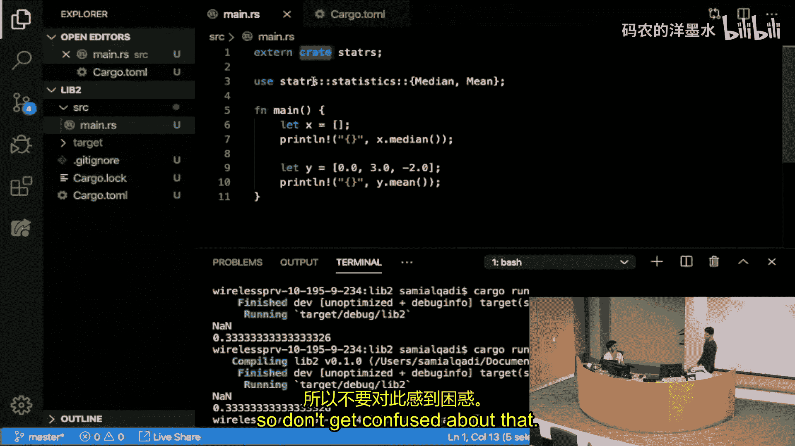

So if I was using this library， I would just basically go through the documentation。

 see all the pieces of functionality that it provides。

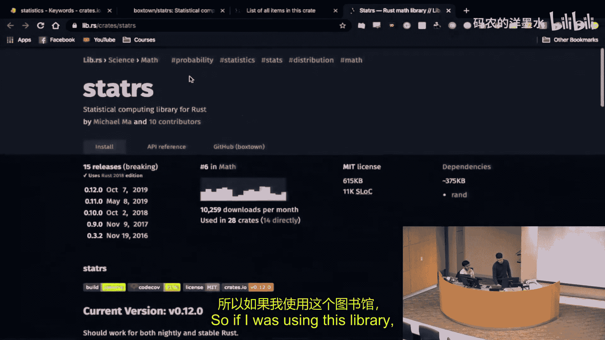

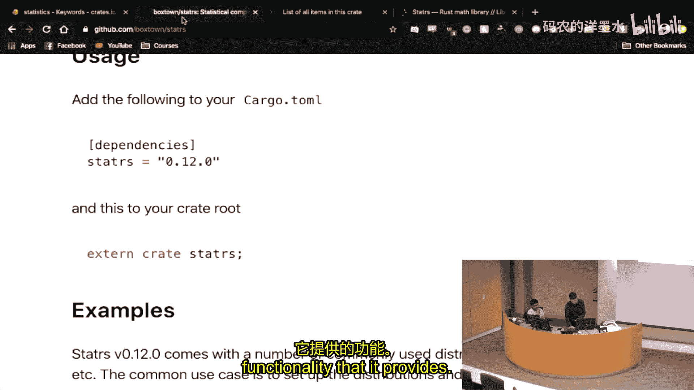

So here we pulled this in already。Let me just open it up。

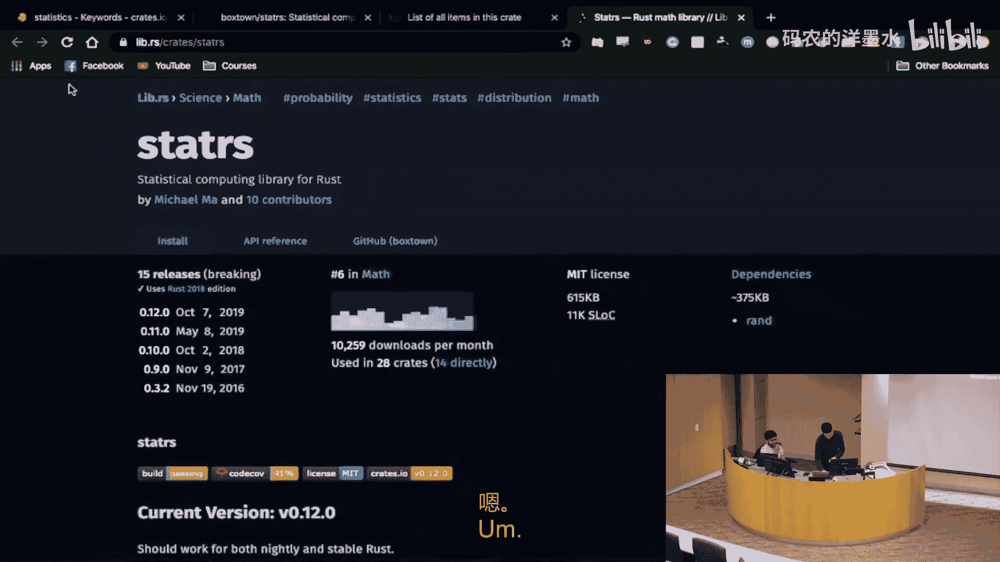

One more time。 actually， I have that here。And so let's say I want to look at。Some more。

Things that it provides。 Let's say， chi squared。We can see the documentation is very good。

And I can test this in my own code by just simply copying and pasting it in。

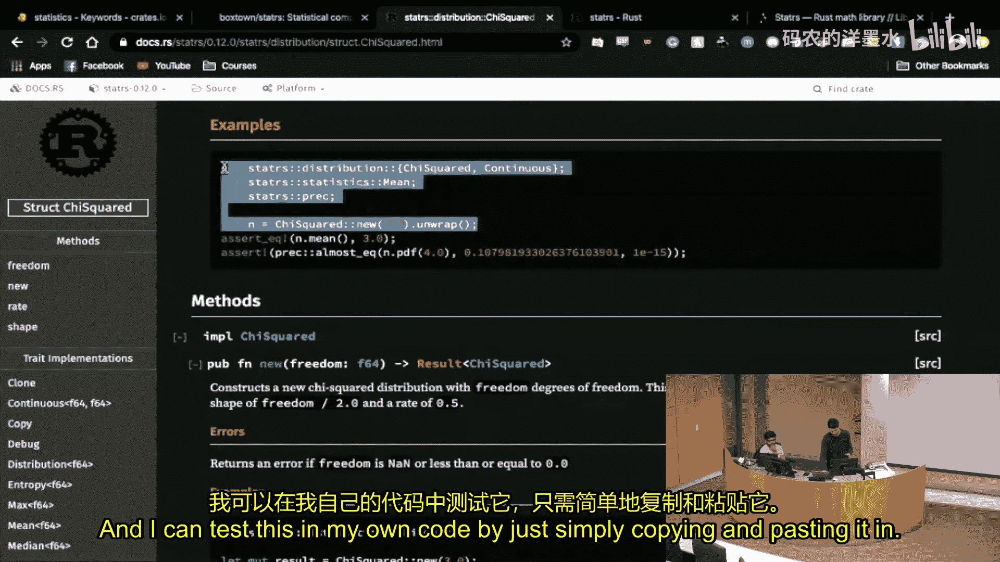

And also， later on， if I ever have any errors that I'm confused about in the issues tab。

 we can see how there's only 13 issues open and 55 issues closed。 So people。

 whenever they have a problem with the library that they can't find on their own using Google or Github because really there just might not be an answer for them。

 especially for smaller libraries like this。 you can see how once they open up the library。

 there are people talking about it， and also there are people closing them as they come。

 So this this is showing how when you put a library into your code。

 you want to make sure that it actually has some support。 because the last thing you want to do。

 is put use a library， and then you know one month of developing later。

 you run into a major issue and you can't find the solution to it anywhere。

 you'll have to either figure it out yourself， which can sometimes be very。

 very difficult without Google or Github issues。Or you can just backtrack and erase everything that you did。

 which would be terrible。 That's why support is extremely important。

 You want to make sure that as issues come， you're able to have somewhere to go to resolve them。

And I can actually just compare that to the other libraries that I found as well。

 So let's say this one。Right here。I actually haven't even looked at it yet。

 but let's see how it compares。So。I， I just assumed based on the Github stars that this wasn't a very good library。

 but。Now that I look deeper into the issues， we can see there are8 issues open and only three of them have been closed。

 or actually， there were 11 issues total，8 of them are open， and three of them have been closed。

 So this is proof that if I were to go ahead and use this library in my own code。

 then I'll probably have some issues down the line。Does anyone have any questions？Okay。

So we'll do a cahoot。Join in with your Ne IDs。🎼あ。🎼，🎼。Okay， music is a little flaggy。🎼That's。

So todays just going to be for attendance， it's a shorter caahhoot， so no extra credit。

 but still try your best because it's good practice。🎼，🎼The。🎼，🎼。🎼Yeah。🎼喂。🎼。🎼The。🎼，🎼。🎼By。🎼，🎼。

🎼Has anyone not in？🎼，Okay， looks like we're good to go。

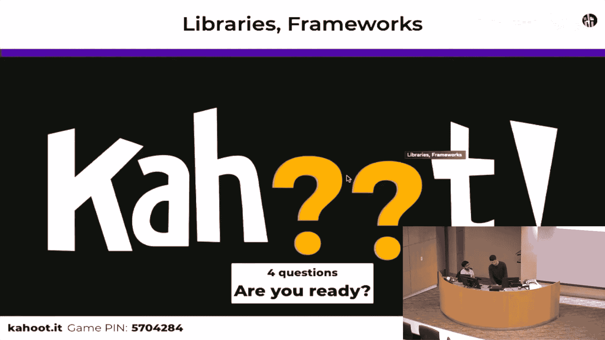

So the first question should be fairly easy if I have a new dependency or library。

 if that word is better for you， where do I play？

🎼，🎼ち。🎼But个。🎼The。🎼，🎼，Okay。Very good。 So red is the correct answer。

 As you saw in the example I go into cargo tMl under dependencies。

 just basically put in the name and the version that you want to import in。

 blue is incorrect just because packages is not in the cargo do Tamel and yellow and green are actually what you can see in ja and python respectively So jascript or sorry jascript So jascript uses NPpm and their cargo do Tamel is actually a package json and it's very similar。

 you can put your dependencies there and view what dependencies are in your program and green is a bit different。

 it's Python so Python uses Pip and instead of a package json or a cargo do Tael they use a requirements text file and you just basically put in all of the libraries that you plan on using there and it's very similar cargo build cargo or Pip install NPpm install they do very。

 very similar things they go through that dependency graph and they pull them in。To your program。

 does anyone have any questions。

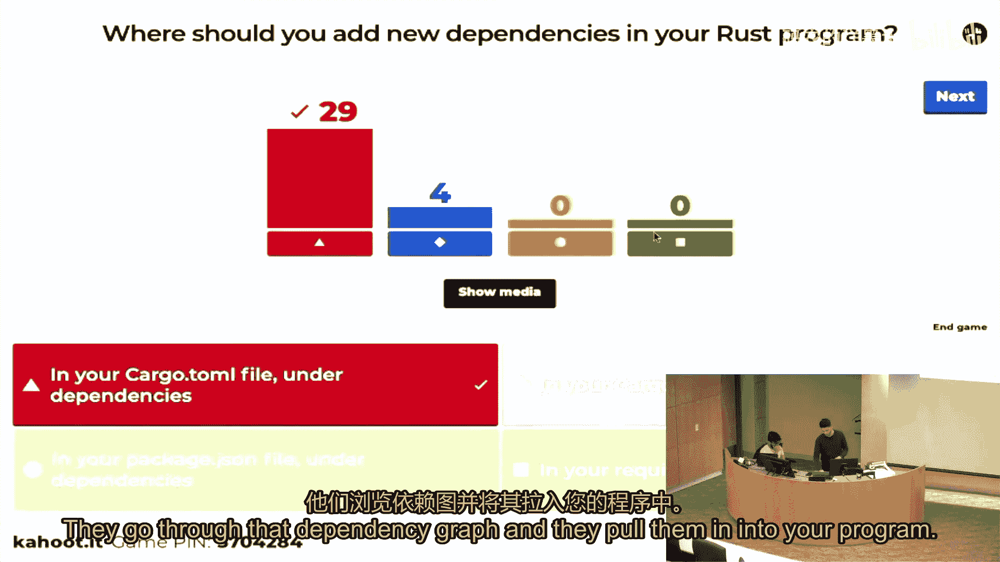

O。

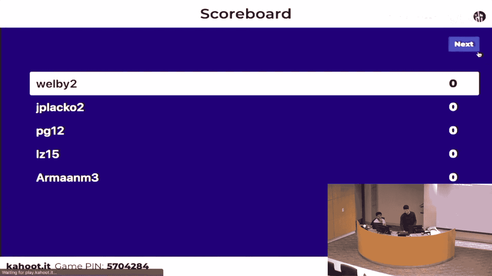

Eterboard。So once you've added dependencies， how do you actually get them？

I totally get am to this sweat。🎼Yeah。🎼Yeah。🎼Yeah。🎼，Okay。

 so there are actually two correct answers technically here， I marked it。Cargo install doesn't exist。

So for those of you who picked that， incorrect。Yellow and blue is correct， though。

 because cargo build， it'll install all of those packages into your program。Cargo run will do that。

 and it'll also run the program。 So technically， cargo run is correct。

 but you don't always want to run the program every time you just want to bring in new dependencies。

 That's what cargo built is for。NPM install。 That's JavaScriptscript and。Cargo install is nothing。

Any questions？Alright， so the next question is going to be a little bit of a Google scavenger hunt。

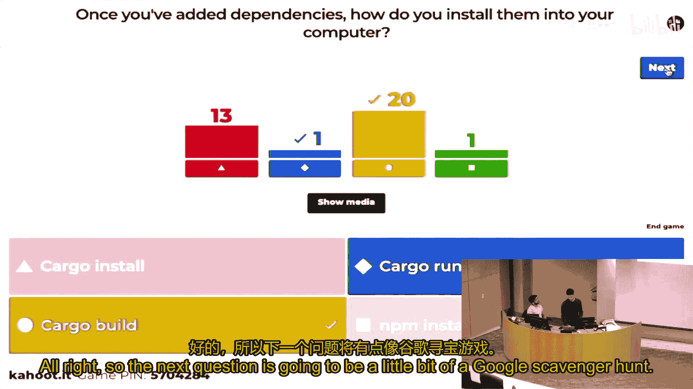

A little bit of extra time。I want a good library that makes making API calls and rust easy。

 What should I use？😡。

You guys have two minutes。Go crazy。Google is at your fingertips。Okay， I love that music。

 It went from like Minecraft to like horror movie。😊，So there are two correct answers here。

Good job to those of you who got them。Orange and blue。

 I'm not quite sure how you got them because orange is an H T TP client for Java。

 And Axios is a client for jascript。 So in your Google search。

 make sure you add like rust at the end。 So that way you don't get。Those。Hyper and request。

 So request is a good library for kind of like higher level syntax。 Hy is like low level syntax。

 So if you want kind of like Python style HTP requests request is what's that for what that is for。

Hyper is a little bit lower level， and I might as well just make the Google search here， right。

So let's say HTTP clients are actually API calls in Russ Library I did earlier， actually。

So you can see here request。And it shows up。Throughout the Google search。

I believe it's also in this textbook。

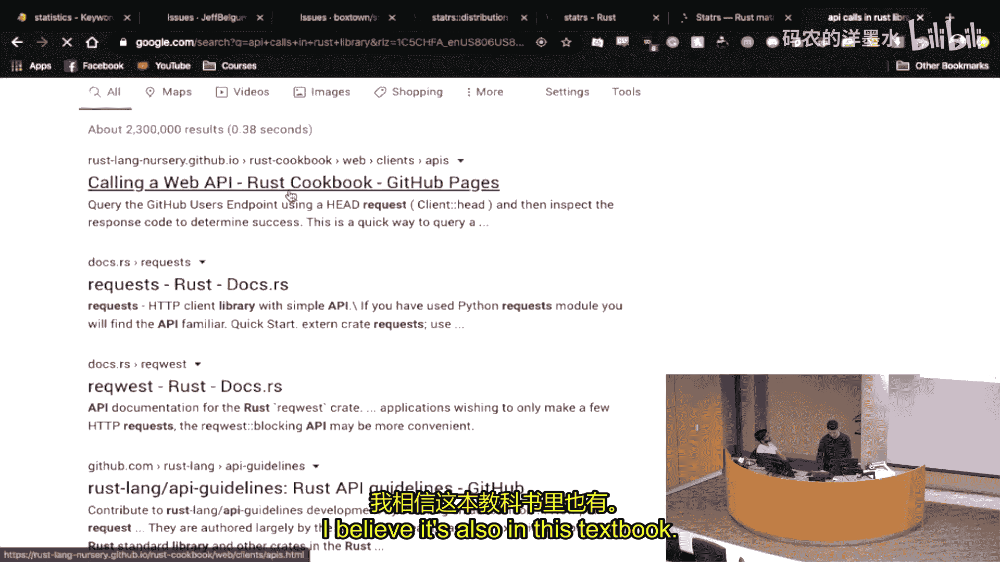

Request。And hyper would show up。

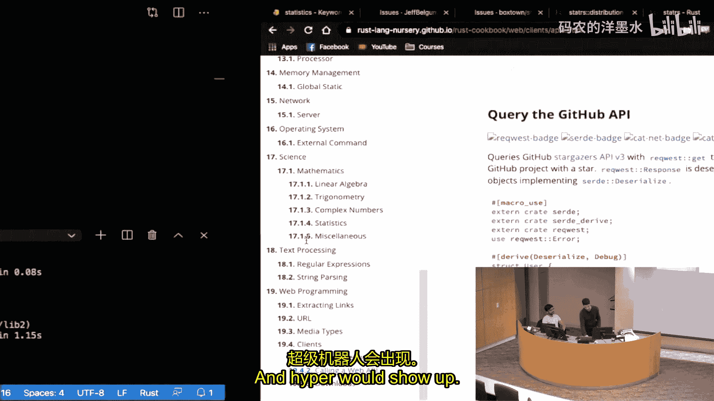

With a couple other searches。Does anyone have any questions？

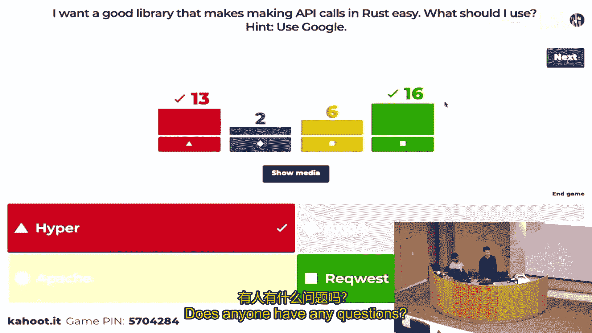

Okay。

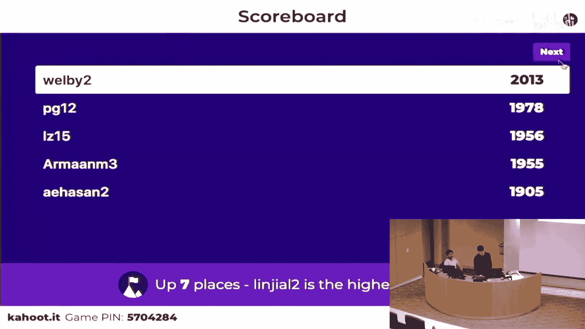

Score bird。So how can I add request to my project now that I've chosen this？

I want to use it， What do I do？Hence， it's also kind of Google Savenron as well。

Remember how I added Sta RRSN， where did I look to find what to add？

So where do I look to find requests？🎼。🎼，🎼。🎼，🎼。🎼The。🎼，🎼，🎼，🎼。All right， well done。

Red is on the right track。 But if you read。The read me a little bit。

 You would see that the version is actually wrong。 I don't think 2。89 is， I'm pretty sure 0。

1 is like the latest version of the library。So definitely not a 2。89 version。

Yellow is wrong because you want to specify what version that you want in your code。

And then green is definitely wrong because that's just the whole point。So it's at the three of you。

Wake up。

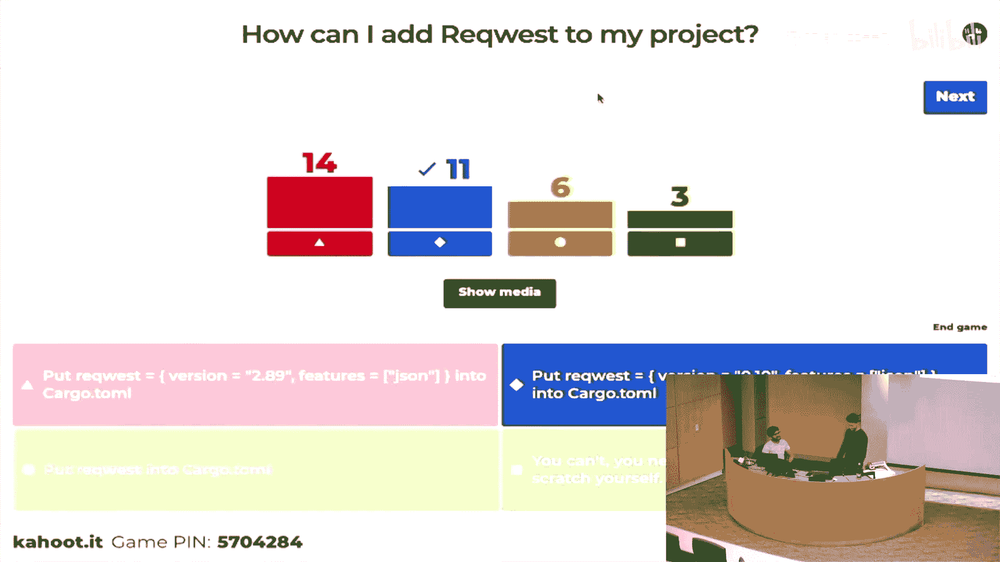

I'll show the leaderer board for fun。

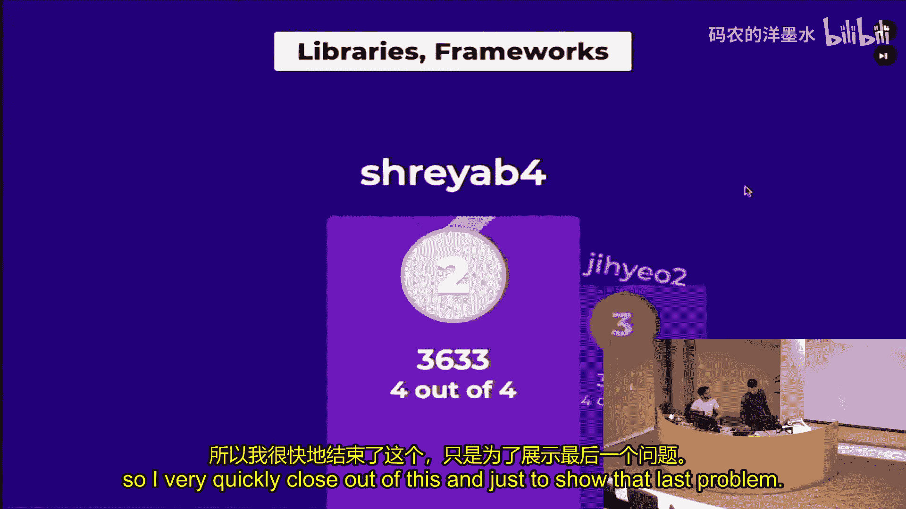

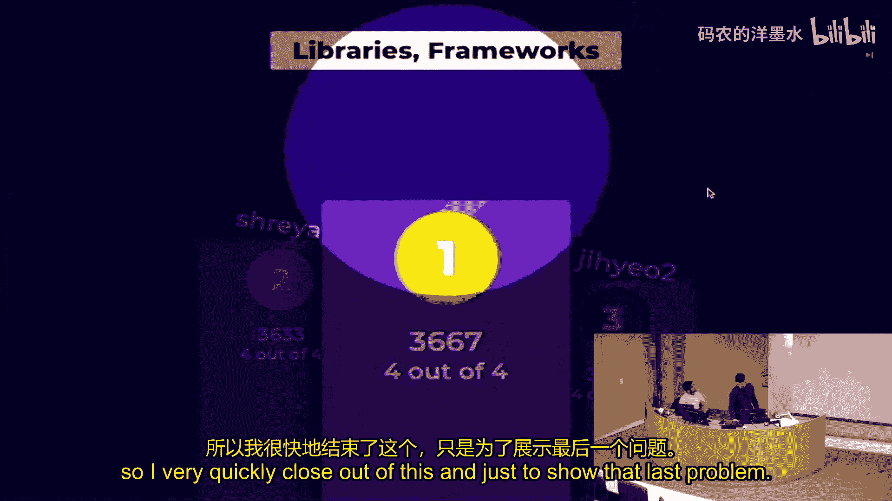

🎼第。

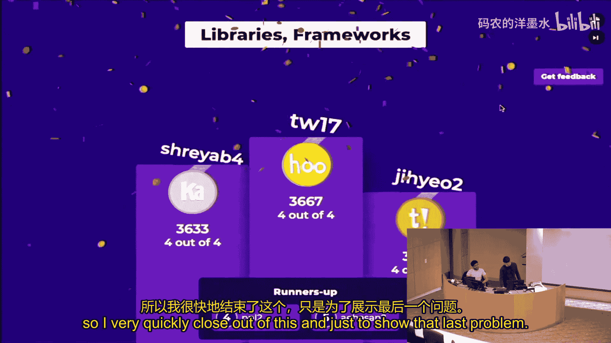

So very quickly blows out of this。And just to show that last problem。So， request。

I'll just look at their GitHub repository。So here's the repository for request。

And if I'm curious of how I want to put this in my own program， I'd scroll down。

And I'd see right here， it's telling me in your dependencies。Put request is equal to this right here。

 and so it's a little bit different than what I showed you guys in the examples earlier where I just put a string with a version earlier。

 this is a JSON file or not file rather JSON structure with the features as well so there's just some specific features that this library provides and it can tell you what to put in that array to get those features。

Don't need to worry about it too much。Really， you can just copy and paste it into your code。

Does anyone have any questions？All right。So we're gonna be wrapping up。Pretty soon。

And I just want to put in a few things at the end here。

 So you guys are all striving to be world class chefs。 What do I mean by this。

If you guys haven't realized by now， we showed you guys APIs， frameworks， libraries。

 all these different tools that you can use within your projects and your code to basically make things faster and to do things more efficiently。

 So think about this as being a chef。 Chefs don't， you know。

 let's say Gordon Ramsay wants to create a dish。 Gordon Ramsey is not gonna go out to the field。

 raise some cows， grow some wheats or whatever。 and then go to the kitchen。

 realize he has no tools and then start you know banging some steel for some pants。

 He will eventually be able to make the meal。 and the meal will taste very good。

 right But that will take forever。 So this is why we use things like APIs frameworks， libraries。

And the cats out of the bag。 This is why we get paid。

 This is basically what a majority of software engineering is。

You just basically grab pieces from every everywhere and you tie them together。

 That's really all it is。 Obviously， there， there's a little bit more to it， depending on your role。

 But a majority of it is just this。 You're grabbing things from everywhere。

 And you want to be able to start thinking in this way of， if I'm starting to build a project。

 how am I going to do this。 Well， you think， okay， well， I need some data from this API。

I need a framework to do this for me。 I need a library to do that for me。

 and you just plug them all together， and youll， you'll be able to accomplish things that do very cool things with very little work on your end。

😊，Um。Yeah， does anyone have any questions about that？Yeah。

 so this is what software engineering really is。 Today is more of a software engineering kind of lecture。

 I know not all of you want to be software engineers， but。You know， in the classes that we have here。

 you're kind of implementing the functionality for everything yourself。 And that's fine， right。

 This is one of the best computer science schools in the world for a reason。

 There is a lot of merit in doing that。 But in the real world。

 you're not coding things from scratch all the time。 In fact。

 you're really not coding things from scratch very often。😊。

I just wanted to throw that in there at the very end because in your own projects in this class。

 you're going find that there are a lot of very useful libraries that you can use， and in fact。

 many of you have found them already。 So if you haven't already for your own projects。

 start researching and see some things that you can tie in so you can do very cool things。

That's basically for today's lecture， just a very short announcement。 Thursday next week。

 we're gonna have our midterm presentations。 Your PMs will talk to you more about those。

 So not too much about that for me。 just make sure you're here。 because if you look at the syllabus。

 they're about。5% of your project grade， something like that。 correctect me if I'm wrong， but。

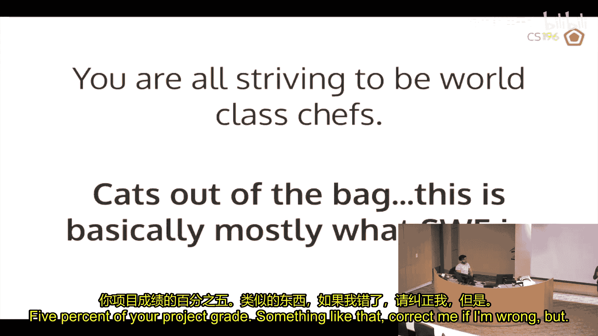

Other than that， you guys would good to go。