# 【全集 春季版】伊利诺伊大学 计算机编程：从Bash到Rust 中英字幕 p11 Lecture 11 - 正则表达式 -BV188rDBFEUY_p11-

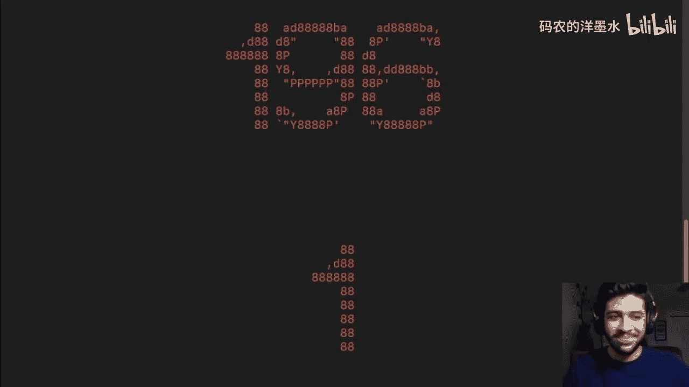

All right。Welcome back to CS196 COVID 19 editionition。啊。

I hope that you found some comfort in these not so comfortable times。

We'll be doing online lectures for the rest of the semester。

 we'll do a bunch of announcements at the end of this lecture but。

Let go ahead and get straight into today's lecture。

Let's go ahead and start with the objectives of today's lecture。

 we're going to start by talking about how data can be very， very messy in the real world。

 you're not going to be really working with a lot of clean data and so you want to be able to combat that with a couple of techniques that you can learn throughout this week on today's lecture and we'll go through some more techniques on Thursday。

So the technique that we're going to learn today is regular expressions。

 and we're also going to go over how you can actually use them and use regular expressions in your own code and your own projects。

So the main point of today is that data can be very messy and it's not always the way that you want it to be in fact most of the time it isn't the way that you want it to be and that's because you know in freeform data when you give humans the power to essentially write whatever they want into a field。

 then you're going to end up with very wild responses from the human。

 and it is up to you as a computer scientist to be able to handle these responses and parse them in the correct way and I would say probably one of the most common tasks of a computer scientist is to be able to take data of one format。

 you know do some things to it and end up with data in another format。

 the format that you want it to be in you'll be doing this very。

 very often whether you're a computer scientist， a data scientist， a software engineer。

 you know all the different disciplines， this is something that is a very common task。

So let's look at some types of data that you'll come across that kind of prove how messy data。

 even the most simple of data， how messy it can be right so we have this way of writing a phone number and that type of phone number can be written in this format completely different it can also be written with periods in between the digits right so these are all ways all very perfectly valid formats of writing phone numbers and if you were handling this on the backend of you know a project。

 you would have to do certain things to combat this。

 you wouldn't be able to just do it in one simple concrete way way。

Another very good example of this is simple dates， so the same exact date can be written like this。

 can be written like this。And even in pure English， you could just say May 9th， 2017。

 or the 5th of May 2017。So let's say you're looking at some news articles， you'll see that， you know。

 one date could be written in a gazillion different ways。

So what is one type of solution for this problem？Well。

 the solution that we're going to go over today is known as regular expressions。

 and they are for the rest of the lecture today， we're going to be calling them res。

 This is the short way of saying regular expressions。So what is rex and what does it look like？

Here's a definition from Wikipedia， so a regular expression or regx is a sequence of characters that define a search pattern。

 usually such patterns are used by string searching algorithms for find or find and replace operations on strings or for input validation。

 it is a technique that is developed in theoretical computer science and formal language theory。

So that was a mouthful and that part at the end there about theoretical computer science and formal language theory。

 we're not going to cover today， we're not going to cover in this class at all。

 that's stuff that you'll learn in CS374 intro to algorithms and models of computation。

 language theory can get pretty complex it can get you know a lot more dense than you'd like it to be and if you take CS374。

 you'll have plenty of fun working with know the language theory side of regular expressions。

 but today we're just going to be looking at how to build patterns using regular expressions。

So in very simple words， ReX allows you to define a pattern that you can match text to。And so。

The thing is about regular expression patterns is that they look extremely weird and very terrifying。

 and usually this is one of the common deterrence away from people learning regular expressions because。

 for example， if they see them in a code base or something like that and they see that they're called the you regular expressions。

 they want to stay away from it because they look something like this。

 this is an example of a simple rex pattern。It looks completely cryptic， you know。

 if you looked at this without actually understanding what a regular expression is。

 you will be confused out of your mind and you'll think that someone is you know communicating in some alien language。

So yeah， I wasn't lying when I said it looks terrifying。

 and so this is a very common issue with regular expressions。

 but today we're going to learn them from the bottom up。

 we're going to build up our knowledge of regular expressions and by the end of this lecture。

 this very simple regular expression pattern should be very simple to read。

So how do we go about building these patterns ourselves？

Let's go ahead and consider this body of text Hello CS196 at Illinois This class is the Hos a on to CS125 Introuction to computer science。

 We hope you enjoy our class and we wish you best of luck in future classes such as CS173， CS225。

 CS333， and so on and so forth and beyond， right？So now what if from this body of text。

 I wanted to parse CS196。What is my pattern going to be？Well， I don't want to overthink this。

 This is actually quite simple if you were looking at this on a web page and you wanted to find CS196。

 you'd hit command or control F and you'd just type CS196 and this is actually a valid regular expression and if you were looking for CS196 in this body of text。

 this is what you would type in and essentially what you're doing here is you're saying that you want to find you know an occurrence of C followed by s。

 followed by1， followed by9， followed by6 and so it sounds really you know overcomplicating it by saying followed by followed by followed by。

 but behind the scenes that's actually how regular expressions work。

 they're looking for you know in this case， C followed by s and so on and so forth。So as we add more。

To our arsenal， we will find that， you know thinking about it in this manner will be kind of helpful to make sure you don't get confused。

So let's go ahead and look at a demo of some sort。So here's a website RegxPll。

com there are a lot of websites like this where you can you know basically input your test data set and practice or check or test the regular expressions that you're writing to make sure that it's actually matching what you want it to match So in this case we have our regular expression CS 196。

And we can see how given our test when we write CS196， our regular expression。

 we can see exactly what it matches in our data set and so we know that this regular expression that we wrote does what we want it to do。

So let's continue。So as we go throughout this lecture。

 we're going to be inputting and building up this bank or cheat sheet of some sorts of various rules that we're learning for regular expressions。

 and so the first two are very， very simple， if you want to match a letter。

 then you can write that letter that you want to match and if you want to match a number you can write that number that you want to match。

 not very complicated， don't overthink it。So let's go ahead and start building up from the bottom up right so same body of text。

 but now in this case， let's say I don't want to just get CS196。

 let's say I want to get all CS courses from this text， so CS196， CS125， 173 and so on and so forth。

So in this case， I can't just write CS196 again， of course。

 because that would be looking for C followed by S followed by 1。

 followed by 9 followed by 6 instead what I need is something that abstracts away those numbers right I want CS and then just any three numbers。

 right？So my pattern and the way that I can do this is exactly what you see here on the slide。

So the way that regular expression symbolizes digits is by using this slash D and the reason why there's a slash in front of the D is because D is reserved for the normal letter right if you want to symbolize a digit。

 you have to put a slash in front of it so that regular expression knows that you're not talking about D you're talking about any digit。

 so what we're looking for here is C followed by S followed by any digit followed by any digit followed by any digit。

 so this perfectly matches all of the courses in our body of text here。So again。

 we'll just do a quick demo with that， so here is our regular expression。We write CS， dash D， dash D。

 dash D， and now we're matching all of these courses and here I have an extra one to show you that you know even if I change the digits around。

It will still match。So let's go ahead and build up our bank of regular expressions。

 so s D we set is any digit。And a caveat is with regular expressions with these metacharacters that are called the uppercase version of it is known as the inverse of its lowercase counterparts so here slash D slash lowercase D is any digit so if we inverse it if we take slash uppercase D instead of any digit will have any non-dit and that goes for any of the metacharacters that involve a letter and that's just very useful thing to keep in mind。

So with that， let's go ahead and jump into a very quick hoot question or two， actually。

Keep in mind that there is like a 10 second delay maybe with these questions。

There is the game pen join in you guys have a little bit of time。Of course， join in with your Ne IDs。

And apologies they can't hear the Kahoot music， I can't get my desktop audio working for some reason。

I don't know why。Okay。Maybe like 30 more seconds for you guys to join in， I can't really。

 unless you guys type in the chat that you're not ready， I can't really know if you're not ready but。

Yeah。Give a little bit more time， but I think everyone that's here is here。

So I'll go ahead and get it started。So keep in mind a little bit of a delay。So the first question。

Is asking， what is the rex to match phone numbers in the format of this？嗯。嗯。嗯。嗯。All right， well done。

Red and yellow are incorrect because again we want to be able to sort of generalize with our patterns right we said in the format of 7349303030 we want to be able to abstract away the numbers so red and yellow are not correct so blue we said you know lowercase D is going to match any digit while capital D is any nondigit so。

Here in this case。Green is the correct answer because we're looking for a digit， followed by a digit。

 followed by a digit， followed by a dash and so on and so forth。

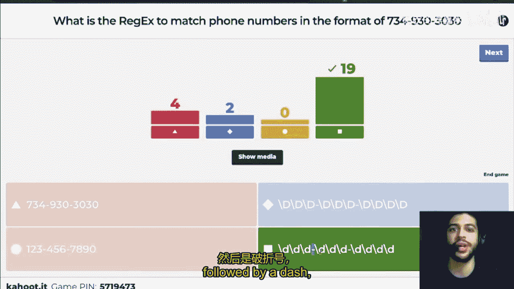

So here is the leaderboard。Someone says they can hear the music。

 so I guess I'll keep it on if you can hear it。

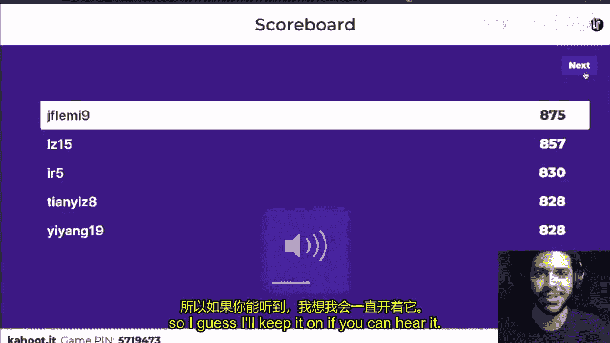

So one more question， what is the rex to match any 100 level course formatted XY 100？With X。

Y being any non digit。嗯。Keyword here is 100 level course。嗯。嗯。Okay， so。A lot of you picking red。

There is a very important thing in the directions here that says any 100 level course。

Yellow is the correct answer because we're looking for a non digit followed by a non digit。

 followed by a one， because in the hundreds place you want to have a  one for 100。

 followed by any digit， followed by any digit。And so I could just actually show that very quickly if you'd like。

On regx Poll。So if I have CS1。Or sorry， capital D， capital D， one， lowercase D， lowercase D。

When I write CS 200， it's not going to match， but if I write CS 100。

 it'll match and you can write any digit there。So well done to the five of you and the other ones are incorrect because again we said xY is any nondit。

 which is symbolized by backslash uppercaseD。

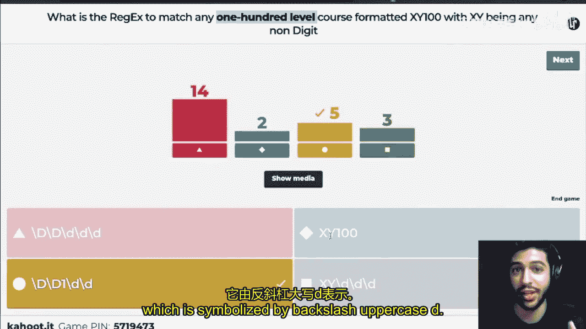

So those are the questions for now we'll come back to some more questions later。

 but let's keep on moving forward。

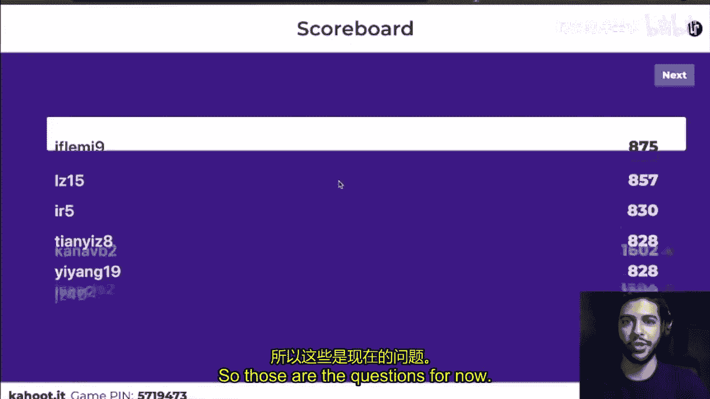

So consider this body of text。And let's say we want to be able to parse all things that come before a comma in this text。

 So all the things that come before a comma we can see is hello。

And all of these classes on the bottom here。So how can we do this using regular expressions？

What we need to do is we need to have something that matches more than just a digit or a letter。

 it needs to match anything right because here we have letters with hello。

 we have numbers and letters down here， we want something that matches anything so the way that we can do this is with the dot meta characteract。

And so the pattern is going to be five periods or five dots followed by a comma。

 and so the dot is just able to match anything， so in this case dot matches H dot matches E and L and L and O and then a comma comes right after that。

 so this will properly parse everything that comes before a comma from this text。

So let me go ahead and show you guys that on the RedX tester。

If I wanted everything that comes before a comma， I can just do this wild card like this， one， two。

  three，4， 5， and then a comma， and we'll see that it grabs all of the things that come before a comma in this data。

So a really important thing to note is that。Since dot is now taken up the way that we actually use。

 if we want to actually match a dot in our data sets。

 the way that we do that is by using a backslash just like we did with D right so in any case where the letter is taken up by a rex rule。

 you want to be able to put that escape backslash to that way you can actually search for what you're wanting to match so in this case dot is known as the wild card right we set it matches anything but the backslash period is going to actually be a period so this is what you would use if you wanted to match that。

So with that said， we'll do another very quick Kahoot question。

So what is the rejectx to match any five characters followed by a period？嗯。嗯。All right。

 well done to the 18 of， so red is incorrect because that's just six dots in a row。

 so you want to be able to actually escape on the final one you don't want to say。

Match anything on the final one you want to match specifically a period。

 and we said that the way that we do that is by doing back slash period。

Blue is incorrect because we're not looking for。Five periods in a row。

We're looking for five of anything in a row。And this is just nonsense last one。So let's continue。

So now what if we want to get more specific in what we want to capture using these regular expressions so far I've showed you you know being able to capture any digit。

 being able to capture anything。 So these things are very powerful。

 but sometimes they're a bit too powerful sometimes we want to be able to know narrow things back and that's kind of our goal with these regular expressions。

 we want to be able to create very tight regular expressions so that we match only what we intend and nothing else right So how can we get a little bit more specific So consider this example we have three phone numbers and so in this case we only want to match phone numbers of the first two formats but definitely not the last one。

 So look at the issue that the third one poses us we can see how we have a digit followed by a digit followed by a digit followed by a dash and then in the second example followed by a period but in the third one in both of those slots here with L andt we can see that。

We don't want these characters， right， So how can we sort of get more specific and tell reex that for this slot。

 I don't want to accept anything but the period and the dash。

 So our pattern in this case is going to be using these square brackets。

 and what these square brackets do is they essentially define a set of acceptable characters。

 So in this case， within that slot， we only want either a dash or a period to match these patterns。

So our set is going to be within those square brackets， it's either going to be a dash or a period。

So what is my pattern？Well， it's going to be a digit。Flllowed by a digit， followed by a digit。

 followed by this either the set of either a dash or a period followed by a digit and so on and so forth。

 So this is just basically our way of saying that within this slot， I only want a dash or a period。

 so the third one won't be captured L is not one of those things。

So what if instead of defining what I want， sometimes I want to define what I don't want？

Consider this example so on the left here。I have all of the occurrences of。Words that end in O G。

3 letter words that end in O G that are valid English words。

 And the ones on the right are some of the English words that end in O G。

3 letter words that are not valid English words。 There are more。

 I just didn't feel like writing them all out。 So in this case， we know what we don't want。

 So how can we do this。 What is our pattern。Well， here we can see that we don't want within this slot。

 the first letter， we don't want AO or AEIOQ RU。So the way that we do this is within the square brackets。

 we put in this hat or carrot， some people call it。

So by putting this hat inside of the square brackets， we're basically saying that for this slot。

 we don't want these letters， so anything except for these characters match will match the regular expression。

And so we can also match ranges of characters to avoid redundancy so instead of writing in our regular expression。

 ABC， D EFGHI and so on and so forth， you can have a range so in this case we're just basically listing all of the letters from A to P so instead of actually writing all of them out。

 we can just do within the square brackets the starting and the ending letters that we want and we can do the same exact thing with numbers so if I want 0 through 9 instead of writing 012。

3， I would just write 0-9。So here's an example of that。

 let's say I have a course catalog and I want to take from this course catalog only the 200。

 300 and 400 level classes from this text。😊，How can I do that， what will my pattern be？Well。

This is our pattern。 We would say we want C followed by S followed by a space。

 and then for the hundreds place， we either want a two， a three or a four。

 And so that's what we're doing here。 We're saying we want。Arange starting from two， ending at4。

 followed by digit， followed by another digit， so that will capture exactly what we want from this text。

So let's continue adding to our cheat sheet that we're building here。

So we said that the square brackets， anything inside of them define the characters that we want。

 so in this case on the slide we want ABC for that slot。And below that we can do ranges。

 so if we put the starting and ending， we have a through z or 0 through 9 in these cases。

 and then when we put that carrot or the hat， this defines the characters that we do not want。

 so in this case we can match anything except for ABC。So let's do another Kaahooot question。嗯。

Here is your leaderboard。So what is the rejectx to match anything except 100 level courses from an ECE catalog？

嗯。嗯。嗯。Okay， well done， so there are actually two correct answers here。嗯。

Yellow was the one that I was hoping you would choose， but green is technically correct as well。

 red is incorrect because that would actually match only 100 level courses。

Blue is incorrect because we said that this hat is not within the square brackets that we were talking about。

Yellow is correct because for that slot， we don't want one， right。

 we don't want 100 level courses and green is correct because everything else is also correct too。

Match two through nine， then that will be。Everything except 100 level courses。

 but I would hope that you would use this instead of this one。So。Let's continue。

So what if we want to specify how many times we want a character to repeat so this is in other words。

 saying， you know， instead of typing a 100 times I want to match just a instead of matching a by A match by typing AAA over and over again。

 how can I kind of simplify that down， how can I make that nice and concise so the way that we do this。

 so for example here。What we wrote previously to match the phone number format。Is we had。

Three digits， a digit followed by a digit， followed by a digit。

So instead of writing digit over and over again， we know how many occurrences of digit that we want in a row。

 So the way that we can improve on this is by using curly brace syntax where。Here we have。

Three digits in a row。 so within the curly brace syntax or within the curly braces。

 we just write three so that way we can have three digits in a row。

And the same thing with the final one， we want digit to repeat four times。

 so we write that inside of the curly braces。So。Let's say we want to do more than just repetitions。

 Sometimes we want to kind of say that there is a range。 So in this case。

 let's say I only want to match this hay in the middle。 Let's say I don't want。

I want more than one E， but not more than five E's， just because I'm weird， right， So in this case。

 we have to use a little bit of a variation of the curly brace syntax。 So here。

We're looking for H followed by E。But right here。The curly brace is saying2 comma 5。

 So what that means is we want either two occurrences of E， three occurrences of E。

 four occurrences of E or five occurrences of E。 so it's kind of like a range starting at2。

 ending at5 inclusive， followed by a y， so this will only match this one in the middle here。

And so there are two shortcuts for common repetitions。So the star right here。

 this is known as the clean star with a K K L， E， E， N E。

 and that's because it was named after a mathematician。Named clean， very smart guy。

 And so for zero or more of the preceding character。You would use a star。

 and if you want one or more of the preceding character， you would use a plus。

 and so I'll show you that on the next slide。So， here。

Let's say I only want to match these final three hays， we don't want to match the first one here。

How can we do this？ Well， the way that we do this is by using a combination of the clean star and the clean plus。

This is our pattern， so what we're looking for here。

 let's break this down is H followed by since we're using a plus one or more E's followed by a y。

Which is followed by plus we're saying one or more wise。 and then there's a star here。

 so we know that we're also looking for zero or more exclamation marks。

 So this pattern will only match these final three because here in the first one。

H can't be there is no E after H。 So this can't match because if there was a star here， we would say。

 all right， zero or more E's。But here， there are zero E's。 And with the plus。

 we're looking for at least one。 So this won't match， but it'll match everything else because。Here。

 the second one， for example， will match because we have zero or more exclamation marks。

This will be able to capture what we want， and I'll actually be able to show you guys that a little bit better in the demo。

So。Let's say here。I have a very similar data set。I can write exactly what I wanted。In this case。

 and it'll match and what this it'll let me do is no matter what amount of E。

 amount of whatever amount of y's， it'll match what I was looking for。 I actually wrote this wrong。

 Okay， there we go。 so it'll match any amount of E's any amount of y's， and if I want。

 I can even have it one or more H's as well。 So here if I add more H's， it'll still match。

But the whole point is I don't want to match something like this。

 and so we prevent that by using the Clean plus and the clean star。

So we can add that to our cheat sheet， we said that the curly brace。

 if any number that you put inside of it will be， for example here M。

 that'll be M repetitions of the preceding character。

 this is M toN repetitions of the preceding character。The clean plus is one or more。

 and the clean star is0 or more。So with that said， let's do。Some more cahot。

So what is the rex to match between two and six of any character？嗯。Okay。So well done。

 Blue is the correct answer because we said any character is period， right。

 That's the wild card and then。Between two and six of any character would be two， comma 6。

 so the other ones are just wrong。U。Okay。And I believe there's。One more question after this。

Let me check。We'll get back to the I'm not sure if the next question is covered yet。

 but we'll get back to it。 So what if I want to have an option of whether or not something occurs So sometimes we have situations where something occurs zero times or one times right it either happens or it doesn't So one example of this is back to the phone number example right if I use the same exact pattern that we've used in the previous slide with phone numbers。

 we wouldn't capture these last two phone numbers here why because we have parentheses there。

So how can I actually say that？If there's app parentheses that's fine。

 we'll capture it otherwise that's also fine， we'll still capture it so the way that we do that。

Is by adding in these question marks。Let's break this down here。

 so I have a slash here behind the parentheses because like every other metacharact in regular expressions。

 since regular expression when something's already taken up you have to put that escape character so right after this I'll show you what parentheses are actually used for in regular expressions but for now just to know that we have to escape them but what's important is this question mark here。

So the way that we symbolize optionality。Being able to say， you know。

 zero or one occurrences of something is fine， we put the question mark next to it so here。

We'll just go through the pattern， we have maybe parentheses followed by three digits。

 followed by maybe parentheses， followed by either a period or a dash。

 followed by three digits and so on and so forth， so the question mark is how we use how we have optionality。

So let's continue So what if we want to apply these metacharacters so for example the what we just learned the question mark。

 the plus the clean plus the clean star or this repetition set。

 what if we want to apply it to more than just single characters so far we've only seen it applied to for example。

 a digit or a parentheses， for example， what if we want to do more than that well。

Let's look at this example right， so here we have a very clear example of a group of things being repeated over and over again。

 So we have ABC， ABC and ABC， right。If it was just a single digit， we would say， you know。

 that digit with a clean plus， we would say we want one or more occurrence。

Because here we want to match only the bottom three， we don't want to match the first one。

So the way that we can group these groups of ABC together is with parentheses， so here's our pattern。

We put ABC inside of these parentheses， so we have ABC。And since we want one or more of them。

 we just put the clean plus right next to it， and it works the same way as if there was just a single digit or a single character。

So we would have AB， ABC， ABC， followed by a1， followed by a 2， followed by3。

 and that would match all of the things in our dummy data set here。

And so we can also have matching groups inside of matching groups。

 sometimes our data is in sort of like a nested format。

 so this is very useful for that so here's an example right let's say from this data set I want to match all these all of these different。

File names with file endings， right。So we notice how the file name is optional。

Another thing that's optional is kind of like an intermediate file ending。

We want to be able to create a pattern that kind of has the group of。

The entire file name as a whole being optional， but also within that file name have some more things that are optional。

 So what do I mean by that， Well， let's look at the pattern， right？ So here， what I have in bold。

Is this nested group inside of the file pattern matching group as a whole？

So here we have dotnu dot PNG。So the dot new is optional。

 but also the dot new dot PNG as a whole is optional。

 so we can kind of see how patterns or matching groups inside of matching groups can be very useful in this scenario。

 and also note I also put in this optional。A patternttern here， where for the image。

 if I sometimes don't have a number that follows it， I can put the question mark to say that。

 you know， maybe we have a number that follows the image， maybe we don't。Okay。

 so what if we want multiple options， So here's here's what I mean by that So here。

In our data set I only want to match the top two I want to match either I love cats or I love dogs I don't want to say I love logs and I don't want to say I love cogs So what is our pattern here Well we use what is called the logical or and you're very familiar with the logical or by now you've probably learned it in like two other areas at least。

And so this is what it looks like。 We can say that within this matching group。

 which in this within this。We can say that we either want a cat or a dog。

 and the orar is with just the vertical line。And so this won't match logs or cogs because it's not one of the options that we have listed。

So let's add all of the new things that we just learned inside of our cheat sheet。

 so we said that the question mark is how we symbolize optionality。

The parentheses is how we create a capturing group and we can also have nested capturing groups as well。

 and then we have the logical ore。So let's do our final set of Kaahhoot questions。

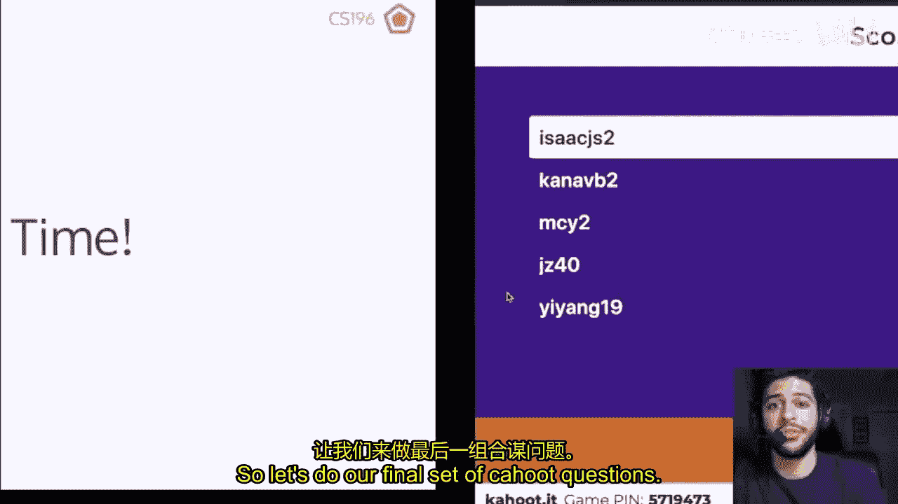

So what is the reexx to match the first three and skip the last。

 so you'll need the photo for this and also youll have more time for this because you might need to think about it a little bit。

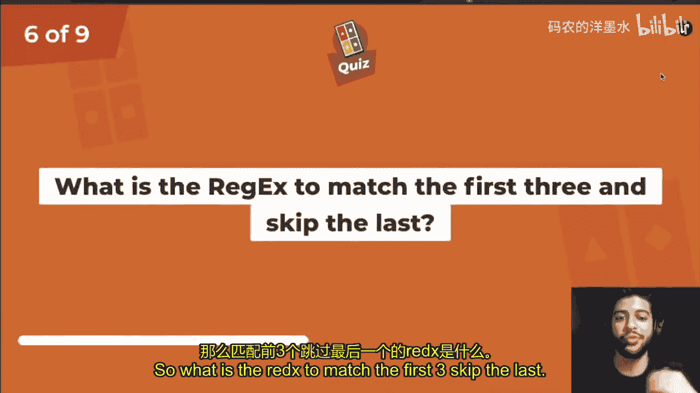

嗯。嗯。是。是。Okay， well done。Let me actually show what we were trying to match before。

So we said we only want to match the top three here， but not the final one。

 And so what's important is that we want。1 or more A's， so。We already have that with the clean plus。

But we also want。Zero or more bees， because in the third one， we don't have any bees， right？

And then finally， we want at least one C， so one or more C's。

And so the only one that does that is blue。 So we say at least1 a with a clean plus。

Zero or more Bs with the clean star and at least1 c with the clean plus。 so well done。

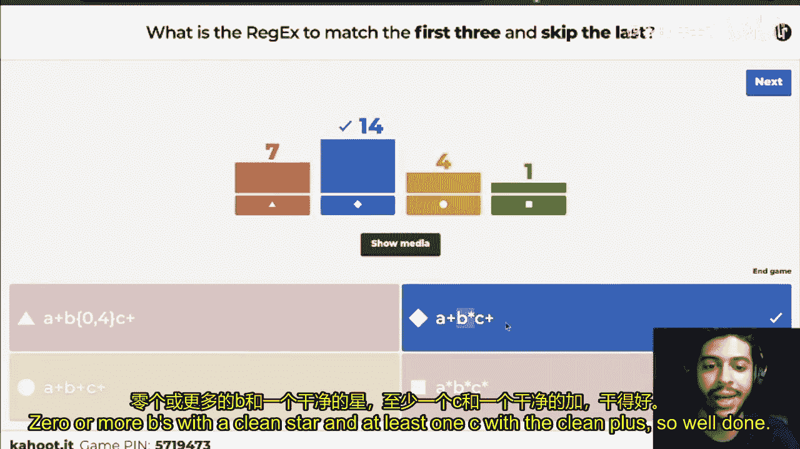

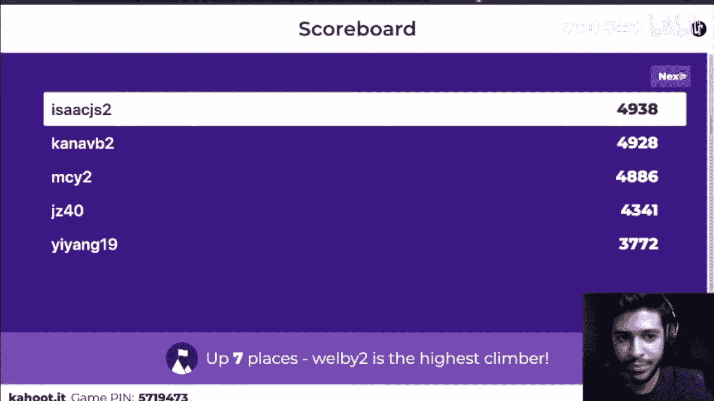

Here's your leaderboard， let's continue。So what is the rex to match the first three。

 but not the last？And。Also remember that if we want to actually match question mark。

 we need to use that escape。嗯。Back slash。Also more time for this one， of course。嗯。是。Alright。

 well done。 Let's look at what we just。Tried to do。So here。There's a few things we need to notice。

 One is that we want to have any number of digits because we can have， you know， as many。

Fileles found as we found right， then followed by a space and then notice that not all of these have an s at the end。

 so that's an option right， we can either have an s or we don't。

 so we put a question mark after our S then followed by a space followed by found followed by a question mark。

And so the question mark at the end here， we need to make sure that we escape because otherwise we're going to say。

 you know， option D， right？So the only one that does that is red here。

Yellow also got a decent amount of responses， it just forgot to make the S optional。

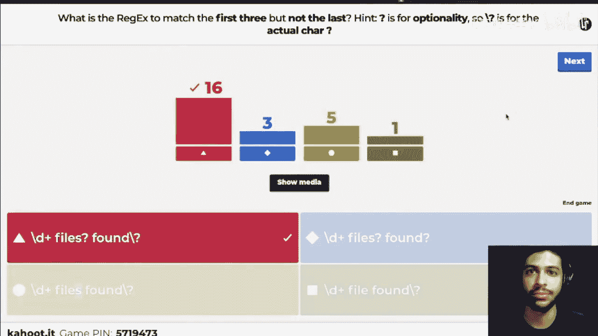

So here's our leaderboard。

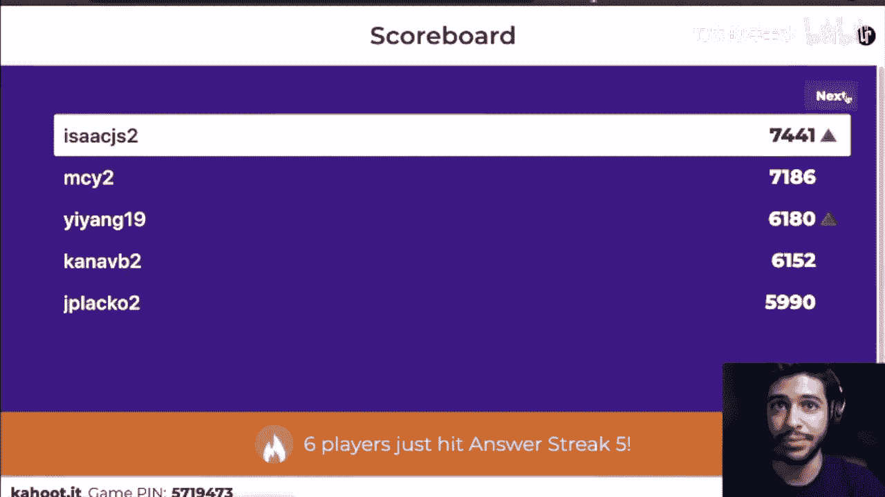

Let's continue。 So what is the regular expression to make the area code on the phone number optional。

 you will have even more time on this one。Because you'll need to。

Decipher some very ugly regular expressions。So here are some examples of the formats。

That you'd like to be able to match。嗯。嗯。嗯。All right， well done。

Blue and green were kind of obviously wrong because if you were to use these。

 you would only capture the second one here。So really， it's between the first one or the second one。

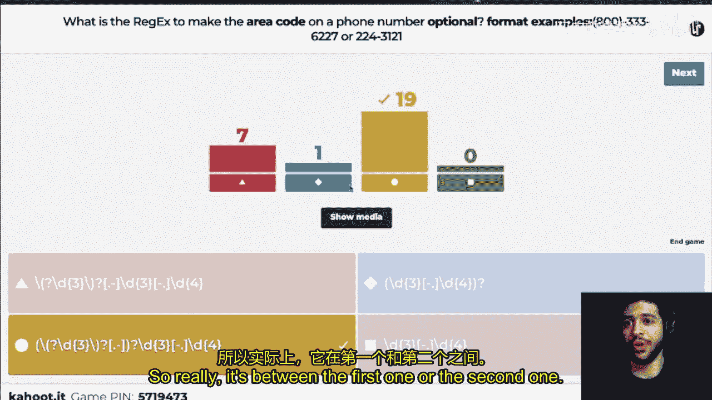

So。🤧嗯。

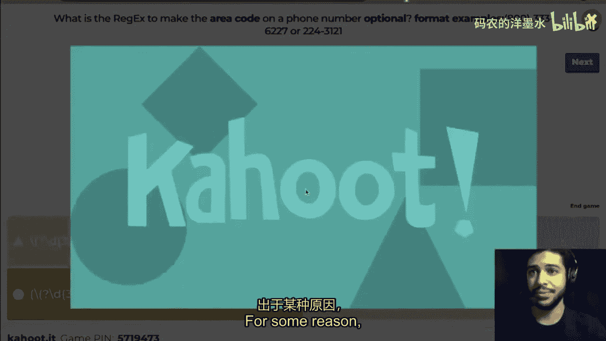

For some reason， the media isn't showing or' because there is no media for this one， actually。

 these are the examples， right？So let's go and break down the regular expressions here， right。

 So we have。嗯。This option group right here that symbolizes the area code。And so。We can say that。

The parentheses is optional， we sometimes inside of the area could have appheses， sometimes we don't。

Then we have our three digits。Then we have another optional parentheses inside of the area code。Then。

 we have。Either a period or a dash， again， inside of that group， followed by the optional。

The optional。Tsing on the entire matching group。 So we're basically saying the area code in the dot slash as a whole is optional。

 you don't need it。To match， for example， the second format。

So the reason why the first one is wrong in comparison is because it's only saying that this number here is optional where we want to be able to actually say this whole thing is optional because in this case。

 for example here we don't have a dash or a period at the beginning。

 and that's not very common in phone numbers， so that is why yellow is the correct one。

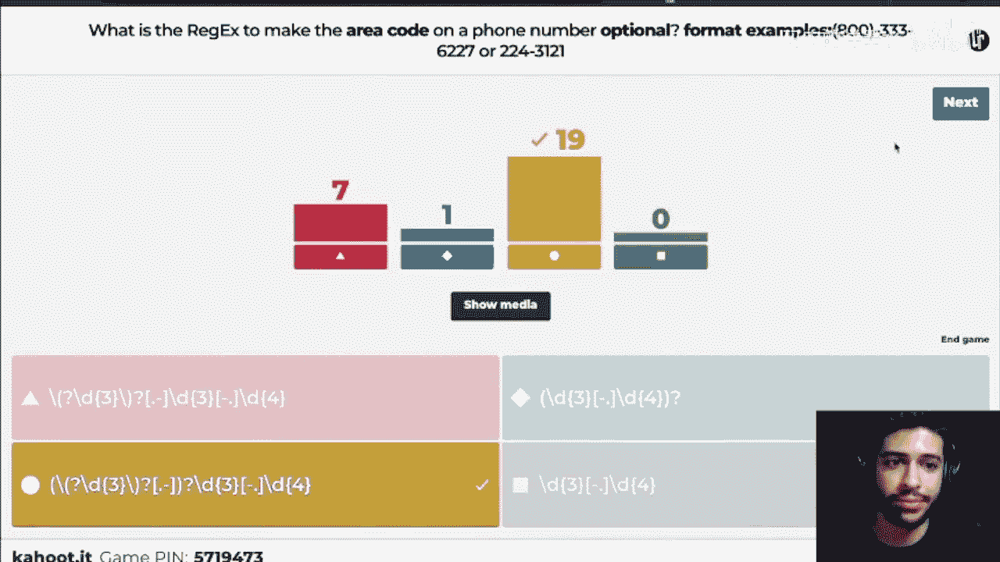

So final question， what is the reexx to match all three of these？

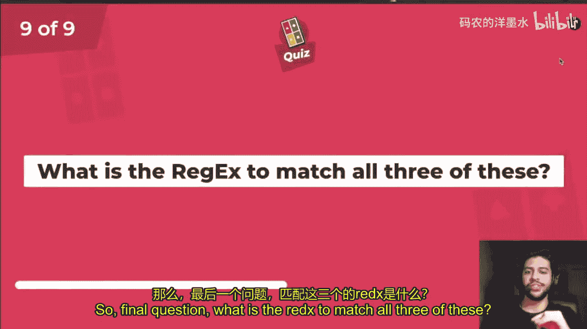

嗯。All right， very well done。So blue is incorrect here because that's just incorrect syntax we want to put these logical ors inside of matching groups not within those square bracket sets。

And also， yellow is wrong because it's only one vertical line， not two。嗯。So very quickly actually。

 I saw some stuff in the comments about matching an ECE catalog I just realized I have an EC catalog open。

 so let's go over and do that really quickly。 let's say we only wanted to match。

everything except for 100 level courses from this catalog。Well kind of replicate a web scrape here。

 let's say I just scraped this entire web page and I drop it into my reexx palll to kind of test to see if what I'm doing is correct。

 So very messy data I would just write ECE。

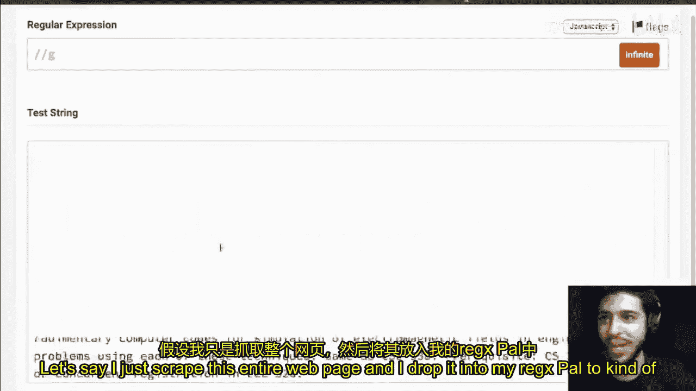

And then for that slot， we'll say I want everything except for a one followed by any digit。

 followed by any digit。 And the concern is correct。 technicalnically。

 this would also capture things such as。This。So it would be good if you handled that in your regular expression。

 I was just kind of showing for the demonstration like for the demonstration for out of simplicity and also assuming that。

Since you're going for an EC catalog， it'd probably be， you know。

 you probably wouldn't have anything like this， but。

Definitely you should make your regular expressions tight and so you only match what you intend on matching so a good observation there。

Here's your leader board。Congratulations。嗯。We'll give extra credit for this Kaoo too， why not？

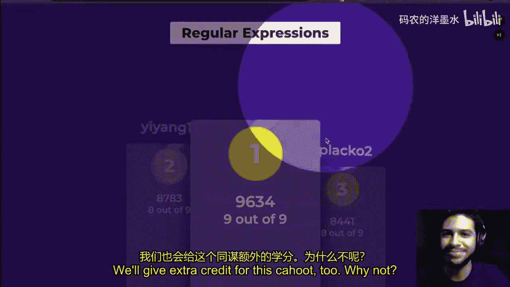

We're giving out extra credit like crazy。So congratulations。

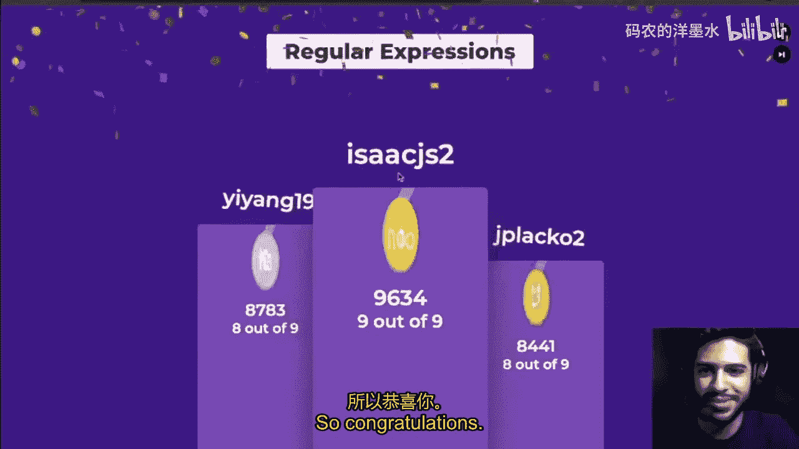

To all of you。We're wrapping up here。So I just wanted to mention that there's more irregular expressions you know in this lecture we covered a lot of very。

 very good amount， and I think that as you learn more of these classes and quantifiers。

 it should come pretty easy。Even someone that knows regular expressions really well probably doesn't like remember all of these at all times。

 so it's really nice to have like a reference sheet so you could just look up Regex's cheat sheet and you'll be able to reference it。

A lot。😊，So this is what one of those would look like， you know， take a look at one， try out。

Going on a website like Reg's Powell and create some regular expressions for yourself to get practice with it。

And here is something that I thought was interesting to kind of show that we like practice what we preach a little bit。

 this is one of the test cases in the back end of our prairieLn for the rust syntax homework so we just decided that like instead of just having you guys create an array and return it so that way we could grade it this test case specifically was making sure that you create an array with 99 elements of C right and so to prevent you guys from just writing C over and over again explicitly into an array and actually testing that you did the syntax like you should we actually used regular expressions to process the input that you guys put for this homework。

Rightlo expressions are language agnostic， basically every programming language has it。

 and it's an extremely useful tool to filter out free form data。

 whether it's in your projects or future data sets that you're working with， whatever it may be。

And now announcements so again。Covid 19， things are crazy Plato。Part two was released。

 I believe about like four hours ago or three hours ago。

 so get started on that office hours as usual， please stay updated with Piazza。

 we are making a lot of announcements on there， things are going remote now so communication is more important than ever stay in the loop and that's it for today。

I'll stick around if you guys have any questions。

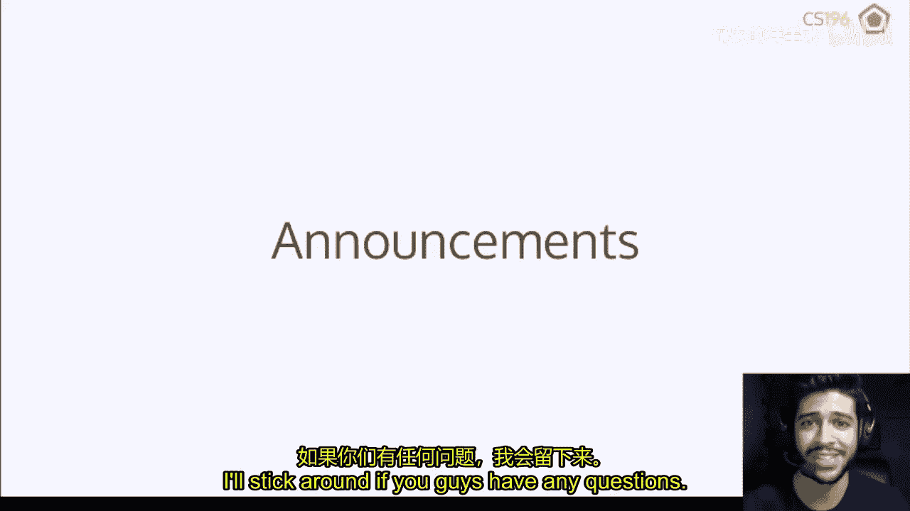

But yeah。