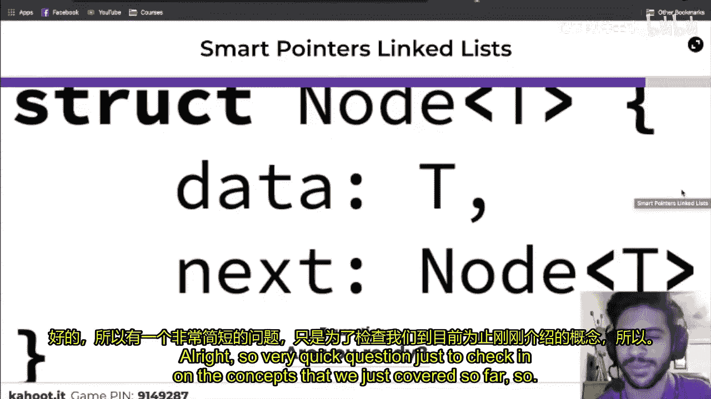
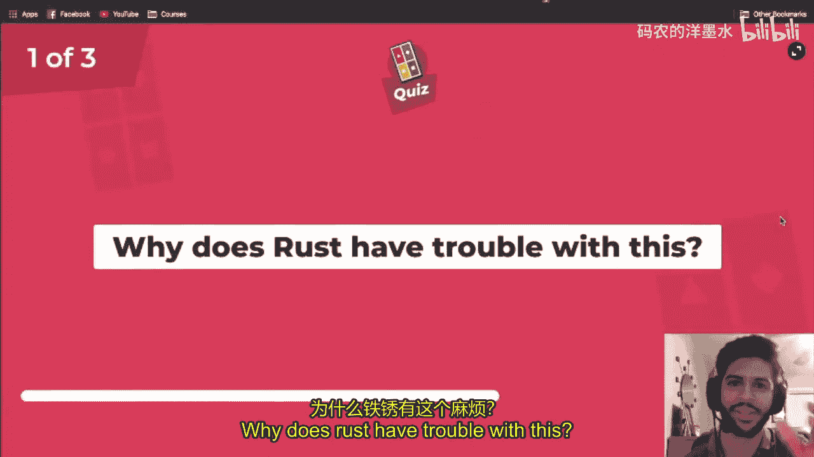
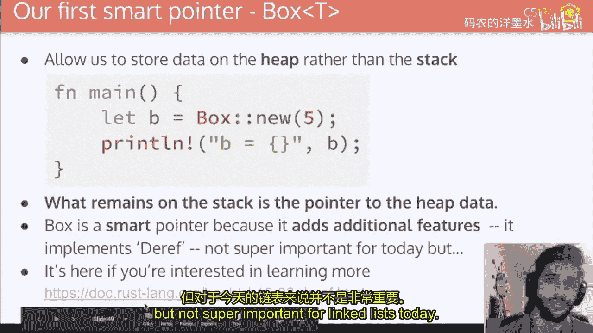
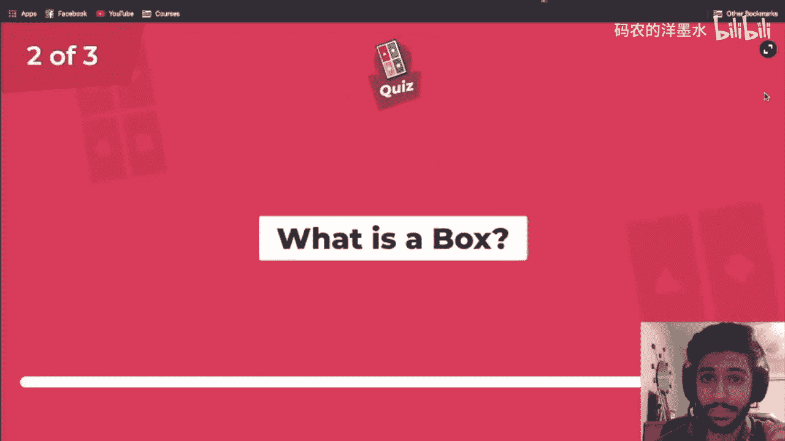
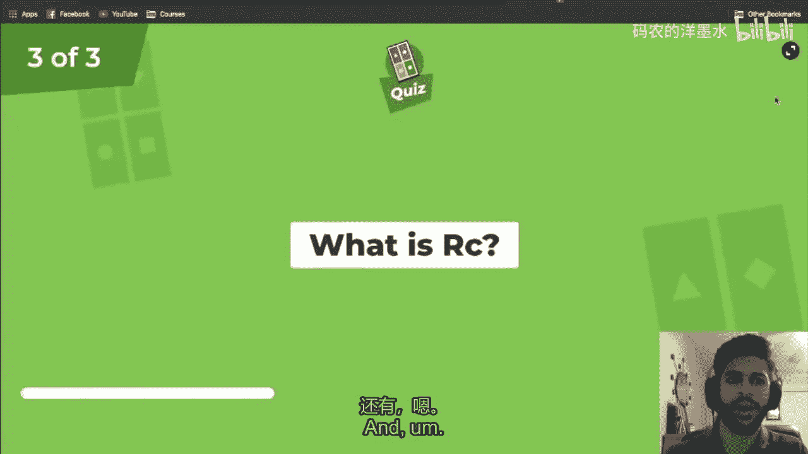
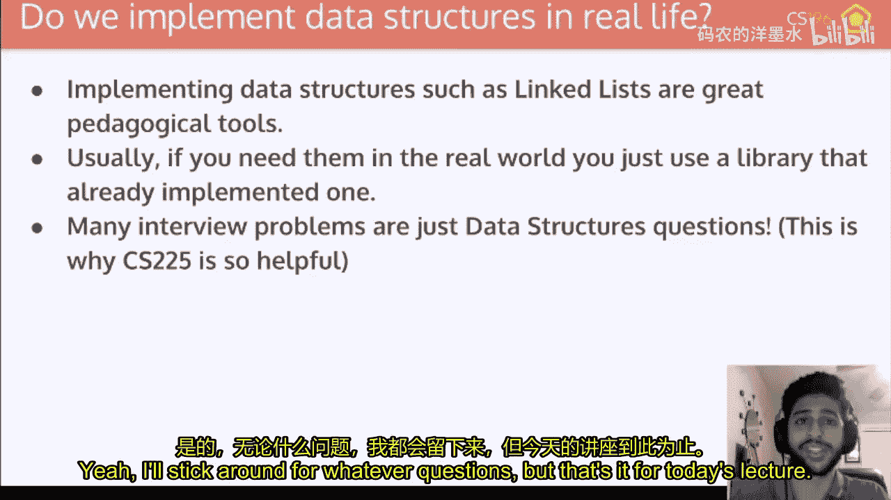

# 【全集 春季版】伊利诺伊大学 计算机编程：从Bash到Rust 中英字幕 p12 Lecture 12 - Rust：智能指针、链表 -BV188rDBFEUY_p12-

Alright。😊，Welcome back to CS196。So。Today。We are going to be covering smart pointers。

 so let's very quickly go over the objectives that we're going to cover today。

 so we'll go over smart pointers and what exactly what they are in the first place。

And the applications of them in rust， and so the applications that I'm going to show you guys today are going to be in the applications of linked lists。

I'm pretty sure that yesterday CS125 covered linked lists。

 but I'm going to you know do a very quick review of it as if you haven't seen them before。

 but I hope that you kind of have some idea of it going into today's lecture because apparently 125 covered it already。

So we're also going to go over doubly linked lists as well。

 and I'll show you exactly what I mean by that later on in the lecture。And of course。

 wash your hands， coronavirus， you know the drill I know。

So let's do a brief recap of what we talked about very early on in the semester when we learned about ownership and references and rust。

 one of the main ideas of that lecture is that computers use memory and memory is you know basically represented as blocks that are addressed by these hexadecimal numbers and。

I wanted to actually very quickly show this very quickly。

 this is how you would represent an array in memory。

 Arrays are essentially just contiguous blocks of memory and what I mean by contiguous is that the blocks of memory are just touching each other。

 so this is all an array in memory is。AndSo what this allows us to do is have this array indexing。

Here with this block of memory， we can address every single memory cell with an index because we know where exactly the next element will be。

 It'll just be right next to it or right before it so we can index it due to this characteristic of a。

So yesterday I would hope that you guys learned a little bit about linked lists， but if you haven't。

 this is essentially what linked lists are。Keep this array idea in mind because it'll contrast very well with linked lists here。

We can kind of imagine linked lists as just elements and memory scattered all over the place。

 so here is you know an element in memory addressed at address 0。

 and then we have another one all the way over here， we have another one all the way over here。

 another one all the way over here， so a very important feature of linked lists is that you can't access them by index because they're scattered around memory and so the way that you link these blocks of memory together。

I with pointers and so this is what it would look like。

 So if I want to link these blocks of memory in such a way that they're all connected in a linear form。

 you could just say that this memory points to this block of memory and this block of memory points to this block of memory and you're basically building a chain so。

Again， we won't be able to use indexing because it's not a contiguous block and memory。

 it's scattered all over the place， and so this is why we have these pointers for linked lists。

So what does this look like in Java？For every single one of these nodes they're called。

 you can imagine them as just a simple Java object where not only do they contain the data that they're assigned。

 So here， you know this linked list is containing integers， this one is containing a1， a9， a6 and a0。

 not only do they contain the data that they're holding。

 but they also contain a pointer to the next node in the list。

 So this holds one and you know the pointer to the next node。And same thing with this one。

Pointing to this block of memory here and this block of memory store 6 and points to this block of memory here。

 that's basically how it is in job。 It's very nice， very simple。

 You can just use objects in a very intuitive format。So how can you do this。

 how can you accomplish the same exact thing in rust Well。

 when I was trying to figure out how to do this myself， I did a quick Google search。

 how to implement a linked list in rust， and I was greeted by some very comforting very promising posts about how linked lists in rust are very simple。

嗯。Obviously， if you don't have a sarcasm detector， I was kidding， it was the complete opposite。

Liinnk lists in rust are apparently extremely hard to implement。

 but we're going to cover that today and。So yeah， these posts on Google made me very sad。

So why exactly is it so hard and rust？This is again， what we saw in Java。

 the object that contains the data that it's holding and the next pointer。

So what if we tried to do the same exact thing in rust。

 what if we tried to make a struct that has not only the data。

 but also a pointer to the next node and also C。Right here， this T in these。You know， these braces。

 I don't want you to get too confused about this。 This is just basically in many programming languages。

 it's this idea of generics， where if you want a node to hold you know data of multiple different types。

 this will just basically hold whatever type you give it。

 So if you have a node containing you know an integer T will just take place integer will just take place of T。

 So that's all this is。 but more importantly， this whole struct as a whole won't work in rust because of a very important reason and we'll go over that right now。

SoAt compile time， Rus needs to be able to know how much space a type takes up。

The reason why this fails is， I think， demonstrated very well in this example from the Ru textbook。

 So this is not a linkedless node。 This is a node。 This is a cons list。

 I don't want you to get too caught up in the type of data structure here。

 I want you to focus your attention here。 So here we have a list and inside of the list type。

 We are containing another list， right So。This recursion of list types。

 so a list type inside of a list type makes it very hard to actually know what the size of this type is at compile time。

 and so Java they don't really care about it because the way that they handle this in Java is quite different from rust and you're allowed to do this without a problem。

 but in rust， they want you to be able to know the size of the type at compile time。So here。

 when we're trying to decide the size of this type， we run into a lot of issues because we say， okay。

 well， the list type。Inside of the list type， we have another list type。

 And so this takes some amount of memory。 And so inside of the list type。

 we have another list type that takes some amount of memory。 and inside of the list type。

 we have another list type that takes some amount of memory。 And you just keep on going infinitely。

 Rust has no way of actually knowing how much memory this type will take up。 And I think this is。😊。

this is a very good visual to kind of demonstrate what I'm talking about。

 basically you keep on going infinitely into a dark hole。So with that。

 let's do a very quick Kahoot question to check in and make sure that know we're following the concepts。

🎼So join in， there's again， roughly like a 10 second delay。🎼The。🎼，🎼，🎼。🎼。🎼，🎼，🎼，🎼The。🎼，🎼哎。🎼。🎼，🎼，🎼。

I'm to give it like 20 more seconds， but I think。Everyone that's here should be here。🎼。🎼，20 more。

 20 more seconds people are still slowly joining and I don't want to cut you guys off。🎼The。All right。

All right， it's a very quick question just to check in on the concepts that we just covered so far。

嗯。Why does Rust have trouble with this and it'll have a visual to go along with it？

So what is the problem here？🎼，🎼，🎼The。And someone commented about moving the face camp。

 the I made sure that nothing is actually cut off by the ca。

It's really hard to make sure nothing's cut off。 So I don't want to move it because it'll cut off stuff later in the lecture。

 but yeah， nothing is like completely cut off here。 This is compile time。 and this is like。

The end of that， but very good job can't figure out the size at compile time。

 so this is a different node than what we saw in the slides。

 this is actually a linkedless node and Ru will throw a fit over this because we're basically just going infinitely we can't decide what the size of this is at compile time。

So let's continue going forward， so this is the same exact thing we just saw in the Kahoot。

So if we wanted to implement a linked bist and rust， what do we do， how do we go about doing this。

 right？So this is a great time to introduce the concept of smart pointers and so smart pointers is a concept that you'll see in many programming languages such as C++ and Ru。

 they're slightly different， but they all share the same exact definition。 So first。

 before we talk about smart pointers， let's just go ahead and give a very abstract definition of what a pointer is I would say that pointer is one of the most like liberally used words in computer science Comp scientists really love this word pointer。

So what is a pointer？In an abstract definition， theyre just simply an arrow to a value that's stored somewhere else in some languages like C++。

 this is a little bit less abstract and C plus plus pointers are defined as something that stores the memory address of a value。

 but it's kind of the same exact idea， right， it's a pointer to a value stored somewhere else。

 and so in rust， this is kind of abstracted away from us。

 This is kind of all we really need to know about what a pointer is。So with that said。

 what is a smart pointer？Abstractly， they are pointers with additional features and metadata。

 So they just are basically not only a you know pointer that something that points to a value stored somewhere else。

 it's also something that is a little bit smarter， some might say and we'll show some examples of that right now。

 So our first smart pointer， the first smart pointer and rust is known as the box smart pointer。

 And what the box smart pointer allows us to do is store data on the heap rather than the stack。

And so， if you need。A quick refresher on what the differences between the stack and the heap are in rust。

There's parts of memory that are available to your code to use at runtime。

 but they're structured in different ways。So here， let's take a look at this example of the box smart pointer。

 So5， if you remember， is a signedine integer of 32 B。 So without anything。

5 would be stored on the stack because it is an element of fixed size。

 but when we wrap it in this box pointer。 being instead of five being stored on the stack。

 it is now being stored on the heap and so。What remains on the stack is a pointer to the heap data。

 So5 right here wrapped in this box pointer is being stored on the heap now rather than the stack。

 But B， this pointer 25 in memory is currently what is left on the stack B remains on the stack B is a pointer2 this element in memory on the heap。

So the reason why Box is a smart pointer is because of the additional features that it provides。

 it implements D， but this part of the box pointer isn't super important for today if you're interested in learning more about how it implements D that's covered very nicely in the textbook。

 but not super important for linked lists today。

So let's do another quick Kahoot just to check in。

嗯。🎼，I'm cutting off the answer a little bit here。🎼お。🎼，🎼。🎼，🎼で。

Yeah okay well done today the of you blue is a completely fake answer a box is indeed a container with a flat basin sides typically square or rectangle but。

Not in the context of rust， in the context of rust。

 it is a smart pointer for putting stack data on the heap。

 so this is very important because I'm going to show you right now how this helps us write linked lists in rust。

So let's go ahead and go back to the issue that we ran into with the cons list。Right here。

In this example， we said that the size keeps on recursing infinitely。

 we can never actually establish what the size of this list is at compile time。

So very quickly I just want to review what the heap is in rust。

 the heap is a general term that describes boxes， but in this case is' used to store data of an unknown size or a size that might change。

So this is very convenient because again， here， this type is a size that is unknown， right？

So if we could store it on the heap， that would be very convenient。

So what do we do to store an element from the stack onto the heap if only we had a smart pointer that could allow us to do that？

Well， we do。 we just learned it， the box smart pointer right so from the Ru textbook。

 we can improve on the cons list that we talked about by wrapping the list type in a box。

 and so the reason why this works is because now we know what the size is at compile time we know that the box is just a pointer right it's not actually something that is stored on the heap。

Pointers are a fixed size because no matter what it's pointing to。

The size of the pointer stays the same。 You don't need a bigger or smaller pointer to point at something。

 right， you know， if you were pointing at the White House or a shed in your backyard。

 you don't need a bigger pointer， you just need to point at it right So since it is of a fixed size。

 this will actually compile and it won't give us any issues。

So what remains on the stack is a pointer to the he data when using the box smart pointer。

 so to this， Russ says no problem。So in the context of the linked list that we were just looking at。

 we can do the same exact thing。 So if we just wrap the node in a box。

 then Ru will say no problem except for one minor thing。

 So this solves the problem of us not being able to decide the size of the element at compile time。

 but there's one more thing that we want to include here。

 So in Java we know that objects can either have a value or they can be null， but in rust。

 if we want to tell rust that our data inside of our node struct can either be something or none。

 we need to wrap it in this option type。 And what I mean by that is just basically wrapping it in this option right here。

So that way we can say， hey， Ru this element in memory。

 it can either be nothing or it can be something similar to how in Java it can be something or null right。

 so this is just basically saying optionality， you have the option of having something or not。

And so to this， Rut will say no problem for sure， and this is how you implement a singly linked list in rust。

So here's a little bit of an example of how you can actually use the linked list that you implemented in rust。

 so up top is the struct that we just implemented with the linkedless node。

And so here we can see how if we want to， let's actually start in the main function。

 So if we want to create。A head pointer or a head mode。 Sorry， the head of the linked list。

 we can just set the next value initialized to none， and we can say that the value。

 the data that it's storing is just one。And so。We can create a pointer a next node so that way we can set the next pointer of head to this new node。

And the way that we do that is just by saying head dot set next to this next node object。

 so you can imagine you built one node and you're making it point to this other node here。

 and this is how you would use this linkedless implementation that we just covered。

So that wasn't too bad。 but what about wub linked lists， So w linked lists are the same， Actually。

 someone just asked a question。 so the list is going to be the head next。U。So。Yeah。

 the list is going to be this and it's going this node。

Object is going to point at this other node object， yes， so head is going to point to next here。

I I hope that makes sense。So it's just basically imagine an arrow going from here to here。

 I should have had that visual on the slide but。So let's continue。That wasn't too bad。

 What about doubly linked lists？Doubly linked lists are basically the same thing as singly linked lists。

 except they don't have a next or actually they do have a next pointer。

 but on top of having the next pointer， they have a previous pointer as well。

 And what I mean by that is if you look at each one of these nodes， not only do they store the next。

Pointer。To the next node that it's going to point at。

 But it also has a pointer to the previous node as well。

 And so the way that you would represent this in Java。

As by saying not only does it have a next pointer， it also has a previous pointer as well。

 And so in Java， this would work perfectly fine。 This is how you would do a doubly linked list。

 You just basically sayPrevious pointer， next pointer， and that's all you need to do。

So can you imagine it being this simple and rust， well， we wouldn't be having this lecture if it was。

 so no。To this， if we try to do the same exact thing that we did with the Sly linked list。

 so let's say we just added a previous pointer wrapped in a box wrapped in an option。

 Rust will say there is a huge problem when we try to do this， it will throw a fit。

And so the reason why this is。What's wrong， Sa face， sad face。

 The reason why this is is if you remember the rules of ownership that we talked about many lectures ago。

 so we said that each value in rust has a variable that's called its owner and there can only be one owner at a time When the owner goes out of scope。

 the value will be dropped。So this is important in the context of linked lists because if you think about it。

 what's going on here？This node object， orstruct， rather。Not only has。

Something owning it here because this value is pointing to this node。But also。

 this node over here is also pointing to this node here and the same thing goes with this node and this node。

 basically all of these nodes have two things that are owning it at the same exact time。

 So if you keep the rules of ownership in mind here。

 Rus will throw a fit because you cannot have more than one owner at a time。

So if only we could have multiple owners and rust。Can we do this？Well， the answer is yes。

Here is our second smart pointer， and this is known as the RC pointer。

So sometimes we actually need to be allowed for a value to have multiple owners。

 And so doubly linked lists are a great example of this。 So R C is short for reference counting。

 And what this smart pointer does is it keeps track of how many references we have to a value and it'll clean up after itself when it's done when there are no references remaining to the object that it's pointing to。

 It'll just go to the heap， Delete the memory that we allocated and。😊，you know。

 call it a day and so the reason why this is a smart pointer is because it adds an additional feature and the additional feature in this case is the reference counting。

So here's a very good intuition behind the RC pointer from the Ru textbook。

 so imagine the RC pointer as a TV in a family room when one person enters to watch the TV they turn it on others can come into the room and watch the TV but when the last person leaves the room they turn off the TV because it's no longer being used if someone turns off the TV while others are still watching it。

 there would be uproar from the remaining TV watchers and so the reason why this is a great intuition to have behind the RC smart pointer。

Is because if you think about it， you could have， for example。

 four things pointing at the same element in memory。

 and it isn't until the final one islocated from memory， the final pointer is delocated。

 that is when we will follow the pointer to the heap and actually remove the memory that we allocated for that object。

So this is a great intuition to have， basically saying when you're done using something。

 you turn it off， no matter how many people are using it at the same time。So how does this look。

 well， from the rust textbook back to the cons list example that we talked about earlier。

 I don't want you to really look into the details too much here。

 just notice that every single time we create a clone。

 so here RC clone every single time we have the RC pointer。

 you know every single time we have a new pointer pointing to the same element and memory。

 then what will happen is if we print out the reference count。

We'll see that it goes up every single time， so here。We have the count after a， which is1。

 the count after creating the B variable， which is2。

 and then inside of this scope here after creating the C variable， it'll go up to 3。

 but if you notice the bracket here， C will now go out of scope。 and so after that。

 the reference counts of the variable will now be to because C is no longer pointing to it。

 And so it isn't until this number goes down to 0， that's when we will actually clear the memory of what these Rrc pointers are pointing at。

So in the context of a doubly linked list， we can see how here。

If we just removed the box pointer and replaced it with an RC pointer。

 we would assume that this would solve all of our problems。But to this。

 Rust says no problem except for one minor thing。So someone asked in the chat does did memory get automatically cleared once all of the pointers go out of scope or do we need to manually delete it That's exactly the point。

 so it'll get automatically cleared you don't have to manually delete anything in rust So this is nice in comparison to other programming languages like C++ where you have to actually explicitly clear all heap data but in rust you basically in as far as I know always have a way of automatically clearing your memory and so in this case when it goes down to zero yes。

 it will automatically cleared from memory when all of the pointers go out of scope's a good question。

So here。We have， again， the box pointer replaced with the RC pointer， and so if we try to do this。

 rest will say no problem except for one minor， one not so minor thing。So if you remember from again。

 that lecture not too long ago， quite some time ago。We said at any given time。

 you can either have one mutable reference or any number of immutable references。

 but not at the same time。 So the example that we used with this is we said， what if we have a book。

 if we let people borrow the book。 we don't want people you know。

 writing things inside of it because， well。You know， that wouldn't be cool。

 we don't give them permission to。So when we put this apers sand， we just basically tell people。

 you have permission to borrow my book， but nothing else， you're only allowed to read it。

When we put the M UT right next to the Ampersand， we say not only can you borrow my book。

 but you can also write things in it， but as a result of that。

 you're only allowed to give one of these mutable borrows at the same time。

 you can't give more than one of these in particular。 And the reason why， is if you were to give。

 for example， three different people you know， like permission to write in the same exact book。

 then what'll happen is。Person 1 will be writing into the book while person 3 is looking at the same book and things are randomly going to change around。

 He is going to be reading a page and words are randomly going to be start， you know。

 are randomly going to be removed from the page added to the page whatever it is。

 So if this creates a lot of unexpected behavior。When it comes to passing out multiple references that are mutable。

 so to this， the reason why we have these rules is to remove this unexpected behavior。

 you can either have one mutable reference at or any number of immutable references。

 but not at the same time。So this introduces our third smart pointer very nicely。

 so we said that in the previous example， if we fail to follow any one of these rules。

 what will happen is Rus will not allow you to compile your code at all and this is very important because in comparison to other languages。

 if you don't you know other languages don't really have these rules。

 but if you end up having unexpected behavior behavior or run into an error。

 it's not going to not compile your code， what will happen is when you run into the issue at runtime。

 it will actually you panic and it'll exit out your program and give you an error。

 so Rus tries to prevent this by having these errors caught at compile time so you don't actually run your code and then you know many hours later while you're running it randomly at errors and you have no reason why。

But with this smart pointer， so。The Ref cell smart pointer。

 what it allows us to do is it allows us to kind of break the rules a little bit that we just covered in this slide。

 but not completely。 So just like our compile time borrowing rules， this smart pointer lets us have。

 you know， as many immutable borrows or one mutable borrow at any point in time。

 but the difference between this and our normal rules。

 is that Reffel keeps track of how many we are giving out at the same time。And so basically。

 what it'll do is if we are caught trying to break the rules instead of not allowing us to compile。

 it'll just basically panic at runtime and exit your program。

 And so this is nice with the doubly link list， because。Actually。

 I'll go back to the visual that we had a while ago。

This is nice with the doubly linked list because we want to be able to mutate the state of these pointer of these notes。

 and we want to give multiple pointers permission to mutate the state。

 we want to be able to give the previous pointer permission and the next pointer permission。

 And so if we were to do this without the ref cell smart pointer。

 then rust simply will not let us compile。 So instead， when we have the ref cell pointer。

We can see how when we just add this one more layer of nesting here。

 where we have inside of the RC pointer， a ref cell。

 basically saying that you're allowed to break the rules。Then rust to this will say no problem。So。

An important thing to mention here though is that we can do a lot better and the reason why we can do a lot better is kind of out of the scope of this class a little bit。

 I don't really want to go too far into it there is a very nice explanation of this in this unofficial textbook here。

But technically， this implementation of the DOubly linked list in rust actually works。

 it's just very hard to implement very straightforwardly。The more important part is。

 is the smart pointers that we learned throughout the process。

 So in regards to the singlely linked list， that implementation is completely fine。

 and this implementation is technically completely fine as well。

 But what's important is the smart pointers that we had learned using these linked lists as example。

 the box smart pointer， the R C smart pointer and the ref cell smart pointer。

So let's go ahead and do a very quick， I believe， final Kaooot question。

And。

🎼Should be fairly simple。🎼，🎼好。This reference。🎼配色。🎼，🎼，Sorry about that， I try。

 I guess the Kahoot didn't get updated， this answer should have been here and this answer should have been there so that way nothing got cut off。

 but you guys， most of you guys got the point， RC is a smart pointer that has reference counting。

So I think that is a good place to kind of address this point that a lot of people talk about。

 which is do we actually implement data structures in real life and so implementing data structures such as linked lists are mainly just very good pedagogical tools。

If you were to actually use one in the real world， you would almost always just use a library that's already implemented one for you most of the time that will suffice and if you want to make changes to the linked list or whatever data structure you're working on or working with rather。

 then most libraries allow you to easily change the functionality of the data structure that you're using very easily。

Another thing that's worth mentioning is that many interview problems are just data structure problems and so this is one of the reasons to why CST25 is so helpful you know in you know like interview internship interviewing hunting and full time position hunting。

 whatever it is a lot of interview problems are just data structure questions。

 so not only are they fantastic pedagogical tools， you know we don't want people to just use data structures that they don't understand。

One of the best ways to understand a data structure is to actually implement it yourself so you can see the inner workings of it inside。

 you know， behind the hood。And you can actually see the issues that you might run into while implementing them。

 so that is why you know， often in CS125 or you know we have a whole class dedicated to it CS225。

 this is why it's so， you know， there's a lot of merit and actually taking the time to implement them yourself。

But aside from all of that， if you just care about the money。

 I'm mean interview problems pull a lot from these data structure questions。

Someone wrote in the chat，R lecture1， okay， here's all of these rules。

 which makes it a super secure language， R lesson 10， LOO， how to break all these rules。

 I couldn't have set it better myself so。Rust creates a lot of very strict rules on the programmer。

 but。You know， there is also unsafe for rust， which allows you to really。

 really break the rules and kind of write。Code that is technically unsafe。

 but what they mean by unsafe is that the compiler isn't there to just like be very careful for you。

So that is it for today's lecture， it was a little bit shorter。

Keep in mind that Plato part2 is still out， and I believe it's due like at the end of this week， so。

Keep going at that if you haven't done it already， we're gonna have office hours tomorrow and Friday as usual post your questions on Piazza the university announced that like you have the option of going passville if you're thinking about it for this class honestly I'm pretty sure like everyone in this class is on pace for an A so if I were you I would just continue going at it there's in my opinion。

 no reason to you know pass this like do passville for this class but。Completely up to you。

 I have no way of knowing if you do select pass fill for this class。

 I'm just saying I'm pretty sure every single one of you is on track forna， so。嗯。Yeah。

 I'll stick around for whatever questions， but that's it for today's lecture。

