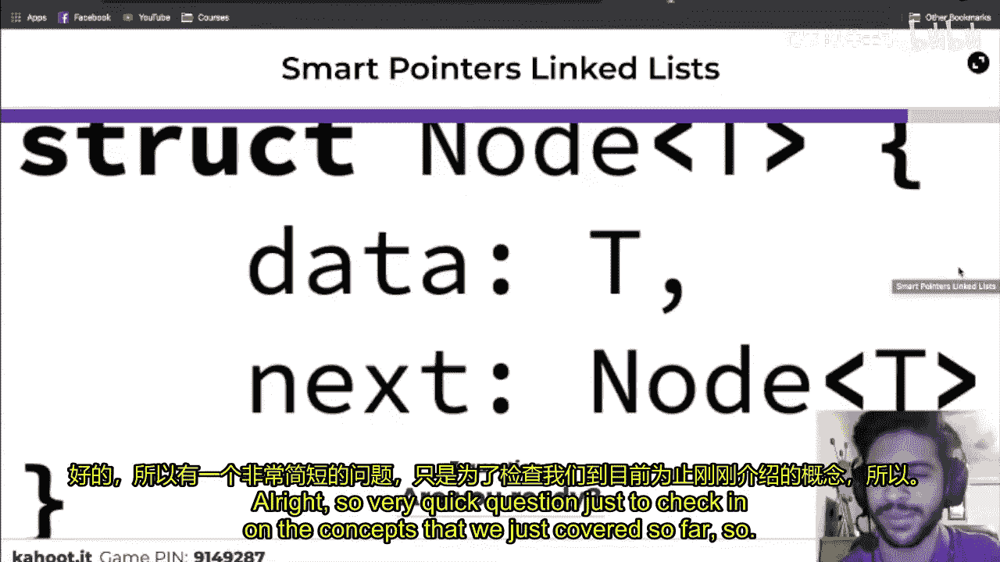
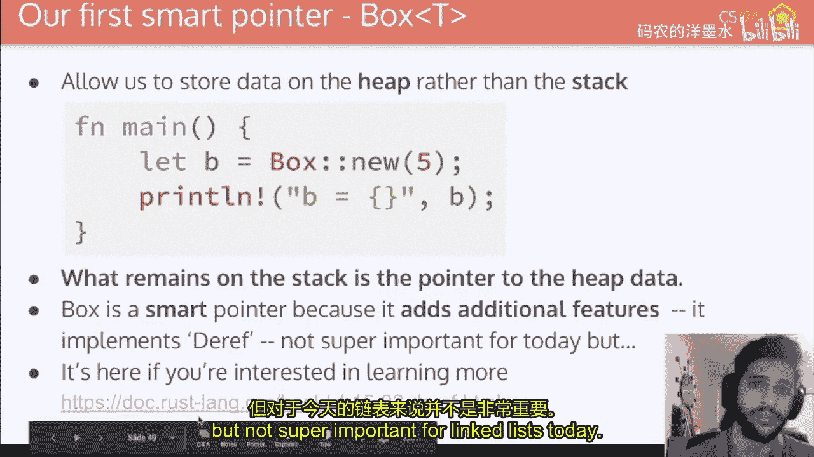
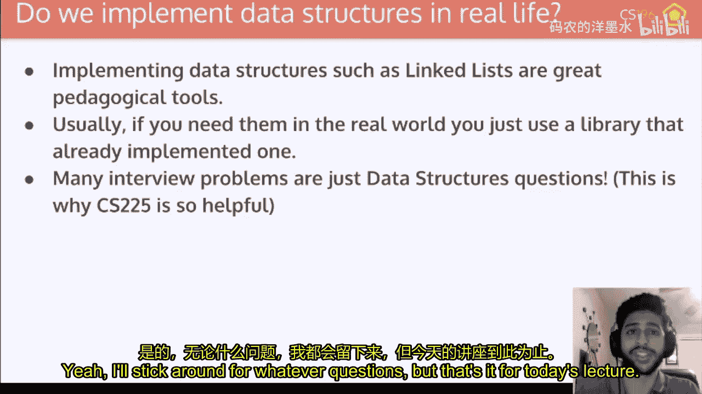

# 计算机编程：从Bash到Rust：12：Rust智能指针与链表 🧠


在本节课中，我们将要学习Rust中的智能指针，并探索如何利用它们来实现链表数据结构。我们将从理解指针的基本概念开始，逐步深入到`Box`、`Rc`和`RefCell`这三种核心智能指针，并了解它们如何解决在Rust中实现链表时遇到的所有权与可变性等独特挑战。

## 内存与数据结构回顾

上一节我们介绍了课程目标，本节中我们来看看计算机内存的基本概念，为理解链表和指针打下基础。

计算机使用内存，内存可以看作是由十六进制数字寻址的块。数组在内存中的表示就是一系列连续的块。所谓连续，意味着这些内存块彼此相邻。这种特性使得我们可以通过索引来访问数组中的每个元素，因为我们确切地知道下一个元素就在它旁边。


## 链表简介

与数组的连续存储不同，链表元素可以分散在内存各处。以下是链表在内存中的抽象表示：



链表的一个重要特性是你不能通过索引来访问元素，因为它们分散在内存中。连接这些内存块的方式是通过指针。通过让一个内存块指向下一个内存块，我们可以构建一条链。因此，链表依赖于指针来建立元素间的线性关系。

在Java等语言中，链表的节点可以简单地用一个对象表示，该对象不仅包含数据，还包含一个指向下一个节点的指针。

## Rust中实现链表的挑战

那么，如何在Rust中实现同样的功能呢？当我们尝试在Rust中创建一个包含数据和下一个节点指针的结构体时，会遇到一个根本性问题。

在编译时，Rust需要知道一个类型占用多少空间。问题在于，如果一个类型（如链表节点）递归地包含自身，Rust就无法在编译时确定其大小。这就像陷入了一个无限循环：要计算`List`的大小，需要知道其内部`List`的大小，而内部的`List`又包含另一个`List`，如此往复。


Rust无法在编译时确定这种递归类型的大小，因此代码无法编译。

## 智能指针概述

为了解决上述问题，我们需要引入智能指针的概念。首先，让我们定义什么是指针。

在抽象定义中，指针是指向存储在其他地方值的箭头。在像C++这样的语言中，指针被定义为存储值的内存地址的东西。在Rust中，这个概念对我们有所抽象，但核心思想相同。

智能指针是指针，但带有额外的功能和元数据。它们更“智能”。在Rust中，我们将学习三种主要的智能指针。

## Box 智能指针




我们遇到的第一个智能指针是`Box`智能指针。`Box`允许我们将数据存储在堆上，而不是栈上。

在Rust中，栈用于存储大小固定且在编译时已知的数据，而堆用于存储大小未知或可能变化的数据。`Box<T>`是一个智能指针，它通过在堆上分配类型为`T`的值，并在栈上保留一个指向堆数据的指针来实现这一点。

```rust
let b = Box::new(5); // 5存储在堆上，b（一个指针）存储在栈上
```

`Box`是一个智能指针，因为它实现了`Deref`和`Drop` trait，允许它像引用一样被使用，并在离开作用域时自动清理堆数据。

使用`Box`可以解决链表节点大小未知的问题。通过将递归类型包装在`Box`中，我们告诉Rust：这个字段只是一个指针（`Box`），而指针的大小是固定的。因此，整个结构体的大小在编译时就可知了。

以下是改进后的链表节点定义：
```rust
struct Node {
    value: i32,
    next: Option<Box<Node>>, // 使用Box包装下一个节点
}
```

`Option`枚举用于表示“有值”或“无值”（类似其他语言中的`null`），结合`Box`，这便是一个可编译的单向链表节点。

## 实现单向链表

基于`Box`和`Option`，我们可以实现一个简单的单向链表。

以下是链表节点的结构定义和使用示例：
```rust
struct Node {
    value: i32,
    next: Option<Box<Node>>,
}

impl Node {
    fn set_next(&mut self, next_node: Box<Node>) {
        self.next = Some(next_node);
    }
}

fn main() {
    // 创建头节点
    let mut head = Node { value: 1, next: None };
    // 创建下一个节点
    let next_node = Box::new(Node { value: 2, next: None });
    // 将头节点指向下一个节点
    head.set_next(next_node);
}
```
在这个例子中，`head`节点指向`next_node`，形成了一个简单的两节点链表。

## 双向链表的挑战

单向链表相对简单，但双向链表带来了新的挑战。双向链表的每个节点不仅有一个指向下一个节点的指针（`next`），还有一个指向前一个节点的指针（`prev`）。

在Java中，这很简单：节点类包含`prev`和`next`两个字段。在Rust中，如果我们尝试用`Box`来实现：

```rust
struct Node {
    value: i32,
    prev: Option<Box<Node>>, // 指向前一个节点
    next: Option<Box<Node>>, // 指向下一个节点
}
```

这段代码会引发所有权问题。根据Rust的所有权规则，每个值只能有一个所有者。在双向链表中，一个节点可能同时被其前一个节点的`next`字段和后一个节点的`prev`字段“拥有”。这违反了单一所有权原则。

## Rc 智能指针

为了解决多所有权问题，我们引入第二个智能指针：`Rc`，即引用计数智能指针。

`Rc<T>`允许一个值拥有多个所有者。它通过引用计数来跟踪指向同一数据的引用数量。当计数变为零时，数据会被自动清理。

`Rc`的直观比喻是一个客厅里的电视：第一个人进来打开电视，其他人可以进来观看。当最后一个人离开房间时，电视被关掉。如果在还有人看的时候关掉电视，就会引起混乱。`Rc`确保只有当所有“观看者”（引用）都离开时，才清理数据。

在双向链表中，我们可以用`Rc`来包装节点，允许多个指针（`prev`和`next`）共享对同一个节点的所有权。

```rust
use std::rc::Rc;

struct Node {
    value: i32,
    prev: Option<Rc<Node>>,
    next: Option<Rc<Node>>,
}
```

## 内部可变性与 RefCell 智能指针

然而，仅仅使用`Rc`还不够。回忆一下Rust的借用规则：在任何给定时间，你可以拥有一个可变引用，或者任意数量的不可变引用，但不能同时拥有两者。

在双向链表中，我们不仅需要共享所有权（`Rc`），有时还需要能够修改节点，即使它被多个地方引用。例如，设置一个节点的`prev`或`next`字段就是修改操作。

这引出了我们的第三个智能指针：`RefCell`。`RefCell<T>`允许你在运行时执行借用检查，而不是在编译时。它遵循与编译时相同的规则（多个不可变借用或一个可变借用），但如果违反规则，程序会在运行时`panic`，而不是无法编译。

对于双向链表，我们需要结合`Rc`和`RefCell`：`Rc`允许多个所有者共享数据，`RefCell`允许在需要时对共享数据进行可变访问。

最终，一个可行的双向链表节点定义可能如下：
```rust
use std::rc::Rc;
use std::cell::RefCell;


struct Node {
    value: i32,
    prev: Option<Rc<RefCell<Node>>>,
    next: Option<Rc<RefCell<Node>>>,
}
```
这种嵌套（`Rc<RefCell<Node>>`）表示：“这是一个可以被多个所有者共享的节点，并且这些所有者可以在运行时获得可变引用来修改它。” 对于这个结构，Rust会说没问题。



## 总结

本节课中我们一起学习了Rust中实现链表所需的核心智能指针。

*   **`Box<T>`**：用于在堆上分配数据，解决递归类型大小未知的问题。它是实现单向链表的基础。
*   **`Rc<T>`**：启用多重所有权，通过引用计数管理内存。它是实现需要共享节点的数据结构（如双向链表）的关键。
*   **`RefCell<T>`**：提供内部可变性，允许在运行时检查借用规则。它使得在多重所有权的上下文中修改数据成为可能。

通过结合使用这些智能指针，我们能够克服Rust严格的所有权和借用规则带来的挑战，成功实现链表这类复杂的数据结构。理解这些工具不仅能帮助你构建链表，更是掌握Rust安全且高效地管理内存和并发能力的基石。


---
**内容来源**：根据伊利诺伊大学计算机编程课程《从Bash到Rust》第12讲“Rust：智能指针、链表”（BV188rDBFEUY_p12）内容翻译整理。