# 【全集 春季版】伊利诺伊大学 计算机编程：从Bash到Rust 中英字幕 p13 Lecture 13 - Rust：函数式编程、闭包 -BV188rDBFEUY_p13-

Welcome back to CS196， yet had another lecture， I hope you guys are doing all well。

Hope you're enjoying your time at home。probably aren't， but。Let's get into today's lecture。

So the objectives for today， only one objective to cover functional programming so functional programming is this idea。

 this programming paradigm that is actually quite uncommon for new programmers to learn most people don't really get familiarity with functional programming at the school until they take CS421。

 which is a class that people take like usually senior year and even outside of school people don't really learn functional programming until like you know way on to their programming careers for reasons that I'm not really quite sure because it's actually quite powerful and very useful So this is the。

😊，Topic for today。And so we started off our rust lectures by talking about how rust is a multipar language。

 we said that you're not restricted to one paradigm and so this is a good thing to bring back up today because we can show how rust is not only useful for you know procedural or imperative programming but in this case we are going to be covering functional programming so it's a multipar language and we're going to show how today。

The functional programming paradigm can be completed in rust。So what is functional programming？

Quite important for today's lecture so here is the definition that I found quite useful so functional programming is the process of building software by composing pure functions。

 avoiding shared state， mutable data and side effects and we can contrast this with the other programming paradigm that I'm sure all of you are familiar with。

 object oriented programming。😊，Where you can notice the application state is usually shared。

And co located with methods and objects。So I think this is a good way to kind of compare and contrast before we get into functional programming。

 kind of where we're coming from and what the motivation for this style of programming is and how it compares to object oriented programming。

Now， I would say that these words right here， most of them you should already kind of know。

 but will go into the ones that you likely don't know already。

So we said that it's composing of pure functions， avoiding shared state mutable data and side effects。

 so this should mostly make sense right you should kind of have an idea of what shared state and mutable data means。

 but these two words you might not be completely familiar with， so let's go into it。

So pure functions is just this idea basically that every input has exactly one output。

 and when we learned about functions， you know， like 10 years ago in grade school or middle school or wherever you learned it。

This is the definition of a function that you would have learned that every input is mapped to only one output。

So。I think a good example of this is just a normal mathematical function。

 very basic F of x is equal to 2 x， right？We can guarantee that when this is the function that we defined if we input 2 to this function。

 we will always get4 back， this will never change， the input to2 is always4 and if this is the definition of our function anywhere where we see f of2。

 we can substitute4 in and it will not change the behavior1 bit right so if this is considered to be a pure function。

But now if we consider the random function， let's say we want， you know。

 you know a random number from0 to 4 and we input those parameters to a function。

 we're not going to get the same exact output every single time for very obvious reasons we could get 2。

7， we could get 3。4， whatever it is， right？So the random function is definitely not a pure function。

 so let's continue defining these terms so what we mean by side effects so side effects is the idea that any application state change that is observable outside the called function other than its return value。

So some good examples of this is modifying global variables because when you call function。

 what the only thing you're expecting when that function is called is to get a return value。

 you're not expecting any of these side effects so modifying global variables is a great example of this because。

This is exactly the definition， right， there is some behavior that has nothing to do with just getting us that return value that's happening。

And so， you know。This is a side effect， and it's the same thing with council logging Council logging。

 you know， will not。Assist you in getting that return value to the person that's calling the function。

 so this is considered to be a side effect。 and there is many many， many examples of this。

know especiallyspecly the example of global variables。

 this is something that you should try to stay away from in your own code where you really the function should not have any sort of unexpected behavior if you're modifying a bunch of global state that people wouldn't really know about when they call this function that's considered to be a side effect and so functional programming tries to stay away from this。

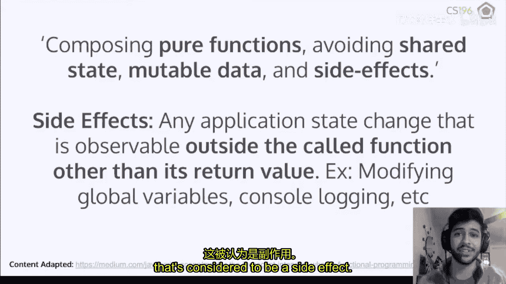

So let's talk about the benefits of functional code， it tends to be more concise， more predictable。

 easier to test than imperative or objectoriented code。

 but if you're unfamiliar with it and the common patterns associated with it。

 functional code can seem a lot more dense and the related literature can be impenetrable to newcomers。

So I think this is a very important idea to bring up the benefits of functional code and the barriers to entry。

Many people are a little bit scared to take on this idea of functional programming because the words seem very complex。

 you know already we've talked about pure functions and these side effects and all of these different fancy words and there will be more fancy words coming up but the ideas that they're actually demonstrating are quite simple and they very powerful so we're going to take today's lecture to take the opportunity to you know start from the bottom up we're going to explain it and that way you can reap the benefits of functional code。

😊，So let's talk about the first feature of functional programming that we're going to talk about today。

 and that's the idea of first class functions。

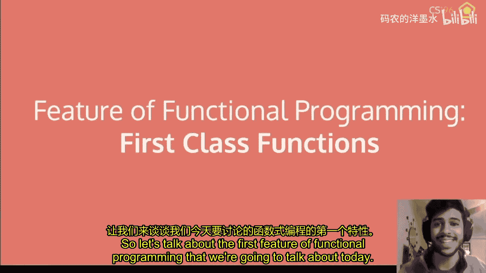

So what is a first class function？So this is the idea that functions are treated like any other variable。

And so this is a little bit weird to think about， so here's some examples。

So in a language with first class functions， a function can be passed as an argument to other functions。

 it can be returned by another function， and it can be even a sign as a value to a variable。

So this can be kind of hard to wrap your mind around because it's almost like nothing you've ever seen before。

 the idea of being able to treat a function like it's an integer or a string。

You can pass it to functions， you can return it as a normal value， you can assign it to a variable。

 whatever it is， so this is a little bit hard to wrap your mind around at first。

 but we'll go through some examples and demonstrate why first class functions can be so powerful。😊。

So let's go over first an example of a first class function， and so here's another word coming up。

 a closure， so a closure is an example of a first class function。

 meaning it is something that we can pass around like any other variable。😊，And so closures。

 essentially what they are， are anonymous functions。

 and that means that you can save them in a variable or pass them as arguments to other functions。

 but they're anonymous because they don't have a name。

So we refer to these anonymous functions by using the name of the variable that is referring to it。

 but that does not make it a named function， so this is a little bit weird when you just talk about it in pure English but we'll show this in actual code pretty soon and it'll make sense。

But the difference between closures and functions is that they can capture values from the scope in which they are defined。

So let's show this right now。And so a lot of the concepts that we're going to learn today are not specific to rustt。

 there are you know these concepts are implemented in Java， JavaScript， Python。

 a whole bunch of programming languages， there are even programming languages such as Haskell。

 Ocal that are purely functional languages and are purely built on this programming paradigm alone。

 but today of course we're going to show it in rustT。So here is a normal function。

 and you should have a pretty good idea of what this function does we take in。A variable。

 and we add two to it and then we return it， that's basically all that's going on here。

 so we'll start very simple。So how can we turn this function into a closure？

What we're going to do is we're going to put it side by side。

 these are currently the same and let's take this function and transform it into a closure。

So the first thing that we said about closures is that they're anonymous functions and so what that means is that they have no name。

 so in order to turn this function into a closure， all we have to do is take away the name。

So now all we have left are the parameters and the body of the function。And so。Specific to rust。

 this is the syntax of how you write a closure and rust specifically。

 instead of having these parentheses， how we continue transforming it into a closure is we replace those parentheses with these vertical bars。

And it serves essentially the same purpose。As the app parentheses did。

 but this is how we define a closure specifically in rust。And so this is technically a valid closure。

 however， we actually do not need types either， so we can go even further and remove the types entirely。

 they're both the types of the input and the types of the output。

 notice how we define both the type of x and what we were returning。

 we don't need that at all with a closure， rust will actually infer it for you。

So now notice how much more simple it's gotten already， so we just take in， you know。

 same thing as what's on the left here， the same exact behavior。

 we're taking an x to our closure and we are returning x plus to。

So this is also still a valid closure， but we can even go further since this is only one expression x+2。

 we can put it all on the same exact line and we can actually remove the braces because again。

 it's only one expression so we can put this all in one line。

 and we have simplified this whole function down to this simple closure where it does the same exact thing。

 the behavior is the same， however。It's written quite differently。

 and we can show how these closures are useful all throughout the lecture。

If you guys have any questions about closures， drop them in the chat。

 but I hope it's made sense so far。So these are some things that I want you guys to notice from the example。

 so to define a closure in rust， we need to start with a pair of these vertical pipes and inside we specify the parameters to the closure。

 just like a function。And if we had more than one parameter， they're just comma separated。

 just like a function。And after the parameters， we place curly brackets that hold the body of the closure。

 just like a function。But these are optional if the closure body is a single expression。

 and you saw how we did that with this x being transformed into xs2。

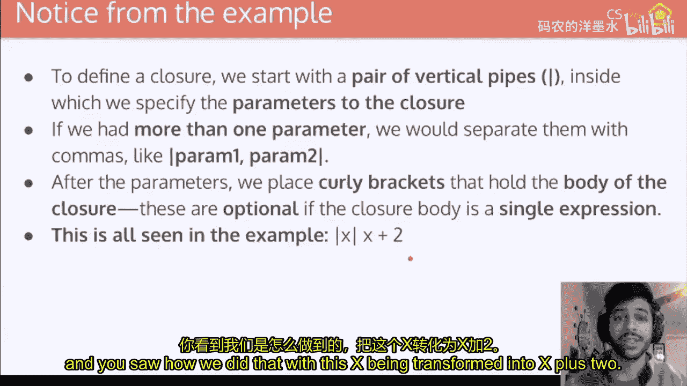

So let's do a couple questions before we continue with the rest of the lecture。

As usual。

Whoa that's loud I'm so sorry question how do you call a closure if it doesn't have a name。

 we will go into that right after the cuoo questions Good question。And you guys have like。

I don't know， a minute trying not to take too long。

A couple more seconds and then we're just going to get started。

All right。

So two questions for now。First question。

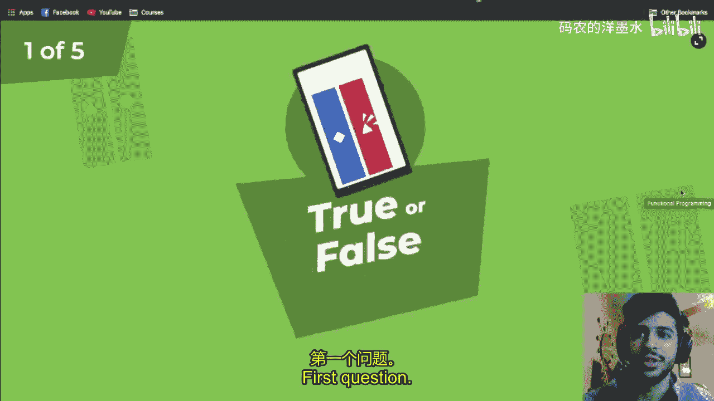

First class functions allow you to treat functions like any other variable through re。

Why is that so long？Yeah。🎼おったこおたこ。一け？Okay， I'm going to go over that in a second after I fixed the sound that was so loud。

I'm sorry if that was loud for you guys， it was so loud for me。Let's continue。

 that should be fine though。Well done。To all of you。Perfect score。Okay。

First class functions allow you to treat functions like any other variable true， one more question。

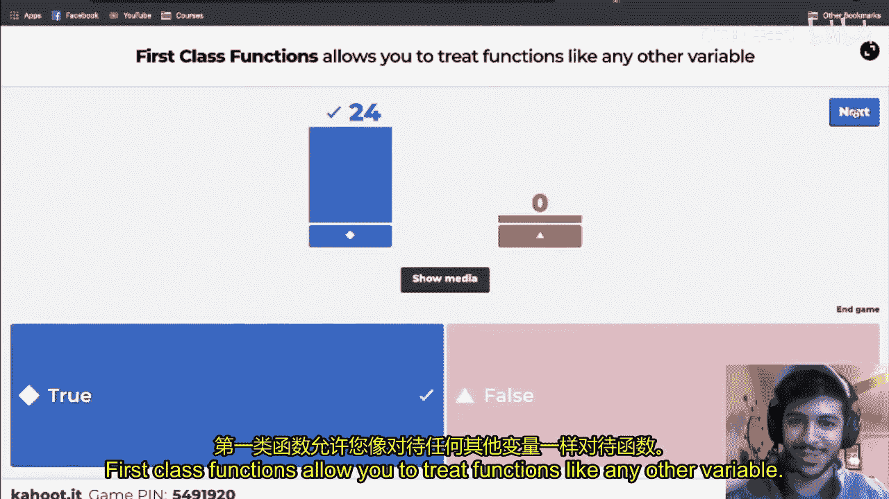

For now。

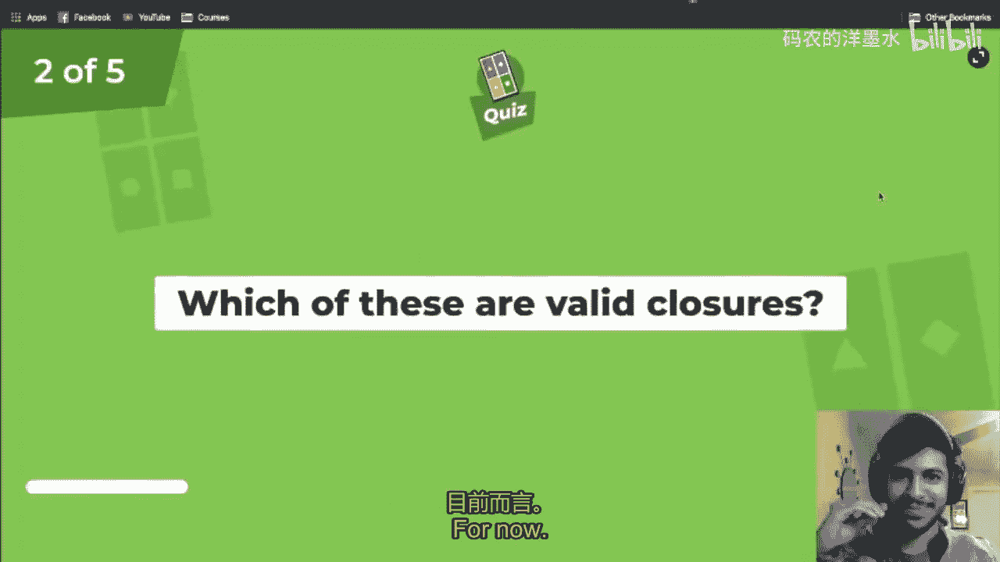

Which of these are valid closures Do you guys have a little bit more time？All right。

So somewhat of a trick question， all of them were right， except for yellow。

And so what I wanted to demonstrate with this question is that， you know， technically。

 it's a valid closure， if you include the types， you just don't have to。

Technically it's a valid closure if you keep the braces in on one line。

 but you don't have to the cleanest way to write this expression definitely I would say is green。

 this is how Ru wants you to write your closures and I would suggest that you do it this way。

 but these are both technically valid as well you can keep the types。

 you can keep the braces you just don't have to。

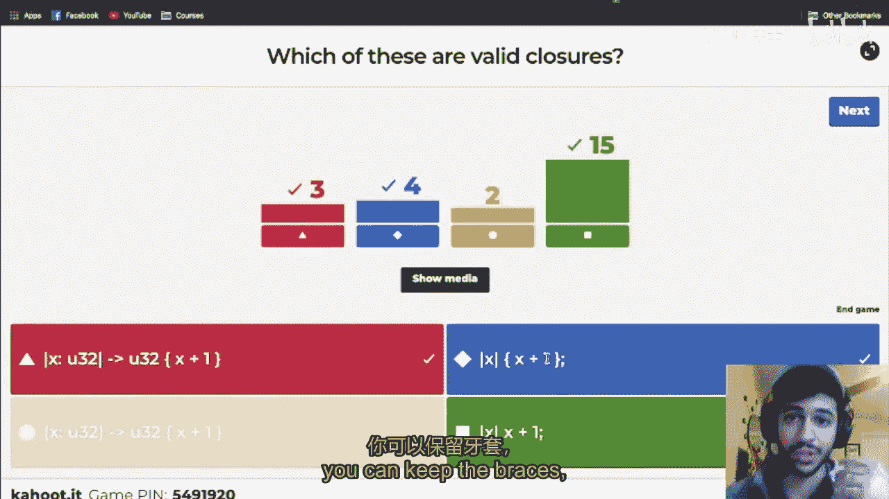

And then yellow， this is wrong because this is not a closure。

 this is a function because there's parentheses here。

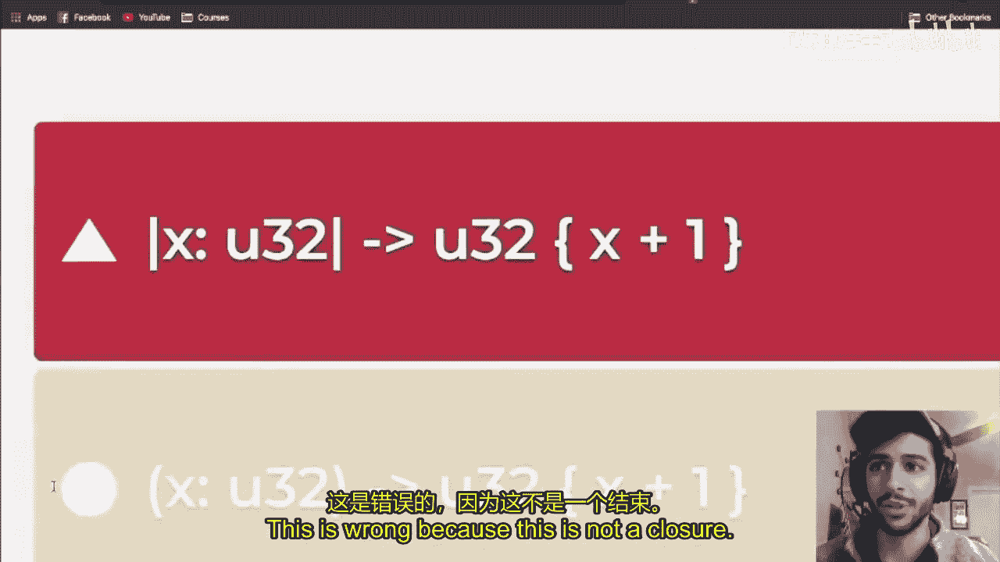

And so we'll go over a little bit more of the differences between functions and closures。

 but syntactically， these are different。So those are the coup questions for now， let's continue。

And of course， any questions， drop them in the chat。

So this was the question that we got right before the Kahoots。

" do you call a closure if it doesn't have a name right here？

This is the same closure that we had in the slides previously， the add to closure。

And we're assigning it to a variable here。So one thing that's important to notice here is that we're calling the function like normal using the name of the variable that the closure is assigned to。

This is an important thing to mention， we refer to this anonymous function using the name of the variable that is referring to it。

 but that does not mean that this is a named function， This is still an anonymous function。

 this is a closure， right？So a little bit weird to think about。

 but just understand that just because we're assigning it to a variable name。

 that doesn't mean that this is not an anonymous function。

And we call it just like any normal function would， right， you put in parentheses and your input。

 and that's that。And so this is another just quick caveat that I wanted to bring up again。

 we said that closures are different from functions in that it can access variables within the scope that it's defined in。

So that can be seen here， we have a closure that takes literally nothing as input and just returns x as its output。

Where does x come from， we'll notice it's in the same exact scope here so we can access it。

Like so and that's the note here so unlike functions。

 closures can capture values from the scope in which they're defined and we'll show how this is useful later on in a couple of slides。

 but it's just important to know that this is a very nice benefit of closures and this is one of the main ways they differ from regular functions that are defined with those parentheses。

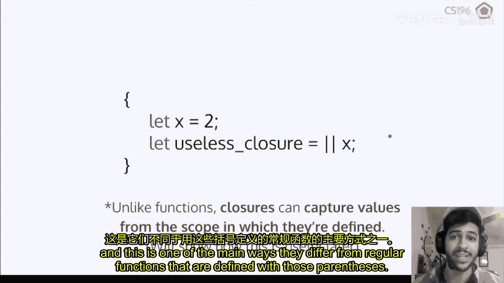

So let's continue with some more features of functional programming。

 so now that we understand this idea of a first class function。

 let's talk about this idea of higher order functions。

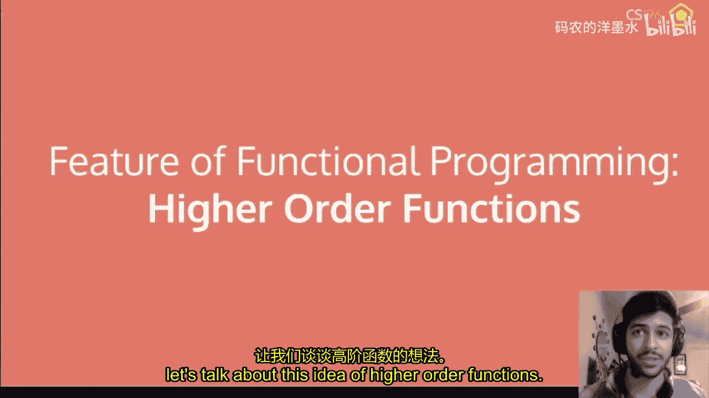

SoHer order functions are simply any function which takes a function as an argument。

 returns a function or does both， you know taking one as an argument and returning a function。

 so this is one of the use cases of those first class functions since they're treated like normal variables since you can pass them around。

 return them， you can use them with these what they're called higher order functions。

And I'll show you some examples of that now。So here's the first example of a higher order function。

 the map function。So the map function takes a function or a closure and a list and applies that function to every element in the list and as a result。

 produces a new list。So let's see an example of that here。So here's a vector or a list。

 whatever you want to call it that we've defined that contains three elements， one， two， and three。

 just normal integers， and let's say I want to add one to every single one of these elements in the list。

 so I want to have two， three， and four。Well， the way that we do this is I want you to first focus your attention here。

We have a closure that takes an x as an input as a parameter to the function to of the closure。

And we'll return x plus 1。And with the map function。

 since we're passing in this function to the map function。

 what map will do is it will essentially apply this function to every element of this list。

 so we'll do one input to this function returns2。And we'll put that here so we set a map takes a closure and a list and applies that function to every element in the list producing a new list so here's our new list。

 so we see how first we see one it goes into the function。

 returns2 that goes here two goes into the closure returns3 which is two plus1 goes here and so on and so forth so that is what the mapping function does right we're kind of mapping this function to every element in the list。

Now there's a few other things that rusts has here。

 you've probably by now noticed this iterator function right here。

So very briefly I just want to cover what an iterator is， it's not related to the map function。

 but it's important to understand why we have iterators。

 so iterators are actually quite good names for what they are because they are quite literally iterators。

We're not exactly looping through this with the map function what we're doing is we are following the iterator and the reason why we have iterators is because it's not always obvious how you traverse a data structure with a list it's pretty obvious you go you know from the beginning to the end or the end backwards whatever you want to say but let's say you have like a binary tree right the way that you traverse that。

 you could traverse that in many different ways， you could start at the root。

 then go to the left child and then the right， you could start at the left child。

 go to the root than the right the way that you traverse a binary tree isn't always clear。

So you can make these iterators that kind of abstract you know layer over the implementation of how you traverse a data structure。

 so that way all you really worry about is the traversing the data structure part。

 you can think of it as just like a pointer， it's pointing at all the values and you're following the pointer around so here in the case of this list it would go one。

 two three， with a binary tree， you can think of it however， right？

So we apply the map to an iterator。And then this collect at the end。

 the reason why rustt has it is because map itself returns an iterator， so collect。

 we' take that iterator， collect it and just basically build this list right here out of that iterator。

I hope that makes sense， but。We'll have some more examples of this in a bit。So yes。

 let's go ahead and redefine that little note that we had at the bottom here where we said that instead of it applying that function to every element in the list。

 I want to redefine that a little bit。It takes a function and an iterable and applies that function to every iterable。

 producing a new iterable。So that is shown here， right？

It takes an in itertable and a function creates a new itertable， and then in this case。

 collect takes that itertable and translates it into a list。So if you're more of a visual learner。

 this is exactly what's going on， this is actually a JavaScript syntax。

 but the idea is the exact same。You know， we have our input array list， itertable。

 whatever you want to call it。We use the mapping function。

And then we have the input to that function and then the transformation that's happening。

And then of course， you have your results， so I think it's a nice thing to kind of break it down virtuallyvalier。

So let's do a quick ahoot question。

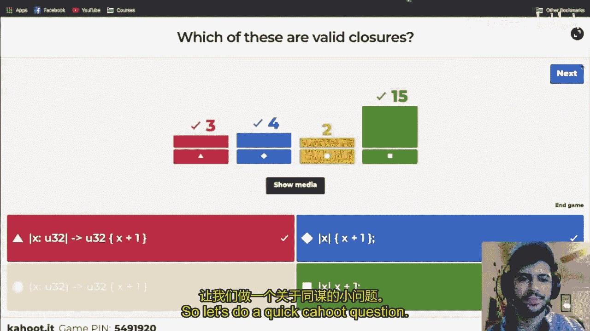

What does the map higher order function do。

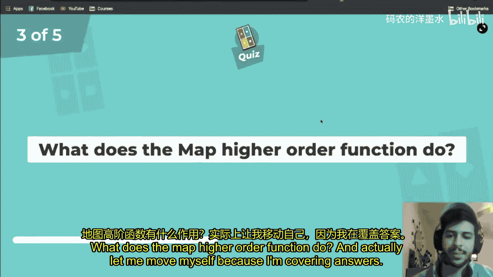

And actually， let me move。Myself。Because I'm covering answers。是。Sorry。

 there's no kho music right now。 I blew my ears out earlier trying to keep that on。

 I don't know why it was so loud。But we're good now。Okay， well done to the 15 of you。

So this is exactly what the mapre order function does。

 it takes in a closure and it'll apply it to every element in a list。

 so we saw how in that example we went through the list， were using the iterator。

We traversed it and we added one to every single element by using that transformation function x returns x plus 1。

The other two are wrong and you'll see why they're wrong a little bit more later because。

We go over stuff that does exactly these things。Let's continue。

So we went over the mapping higher order function， let's talk about the filter function。

 so the filter higher order function is a bit different from map what this does instead is it it will make an iterator from elements of an iterable for which a function returns true。

So。In other words， with the filter function， we can literally filter out。Things in。You know。

 a list or a data structure， we can kind of set up a criteria for what we want out of that data structure using these closures。

 and I'll show you what I mean by that。So here's an example of let me move my camera back。

Here's an example of where these where this filter function would be useful so let's say we have a struct that's defined here。

 a shoestruct and it contains the size of the shoe and what kind of shoe it is and so we have this function that uses that returns。

The shoe that is your size。 So let's say， you know。

 we have like a website and people are trying to filter shoes based off of their shoe size。

 we can build， I want you guys to focus in on this part right here。

Because this is the actual functional part。The function is just a normal function that wraps it。

And so we'll take a vector of shoes， a list of shoes。

And then we'll use this filter function similar to how we did mapping。 But we said that the filter。

Construct an iterator from which elements of an itertable in which a function returns true here。

Every shoe in that list will be passed to this function。And as long as the shoe size。

That we're looking for is equal to the size that's associated with that shoe。

 then we know that this statement will return true and it essentially passes the criteria and we're filtering out all the shoes that are not our size because they wouldn't be returned by this。

And so of course， similar to how we saw in the previous example。

 Rust wants us to convert this iterator back into a list。

 and that's what this collect function is for。And so another thing that I wanted to note is that as we said earlier。

 this is one of the use cases of closures that they can capture values from the scope in which they're defined so notice here。

Shoe size is within the scope of this closure， right？

And so we can use shoe size here because since it's in the same scope。

 even though this is in the body of the closure， we can still access that variable because that's just how closures work in rust。

And so this is demonstrating why that's useful。So let's put this function to use right。

 the function that we had is right down here。And let's say， you know， we're on a website and we have。

You know， we're selling shoes and we want to give users the ability to filter things。

So this is how you would do it， this is obviously much smaller than the selection you'd see on a website。

 but let's say you have three shoes， one of them is a sneaker， one of them is a sandal。

 and another of them is a boot。And these are the sizes that are associated with those shoes。

So then we make a call to this function， trying to find shoes that are only size 1。

 so we only want sneaker and bo。So what it'll happen。As that's passed here。And we essentially say。

 is this first shoe size 10， yes， it is， so put it in the returning itritable。Is 13 size 10。

 no it's not， is 10 size 10， Yes it is， so we will filter out sandal and we will have sneaker and boot because those are the ones in which this returns true。

So here's another visual that might make it easier to kind of wrap your head around。This is again。

 JavaScript， but same idea。 So you have an array。And you have some criteria that you want to return true and filter out anything that doesn't return true。

 So here in this case， the only numbers that go into this filter that are less than 10 are 2，6。

 and8 and 4。So hopefully that helps。

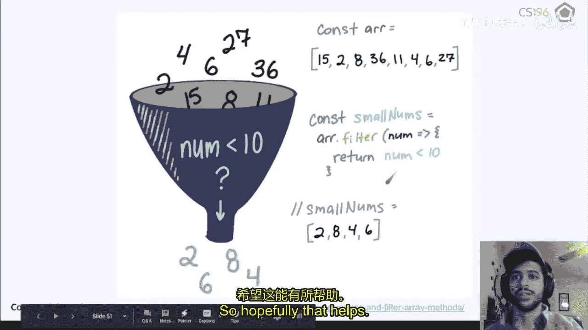

Let's do another question。

So what does the filter higher order function do？

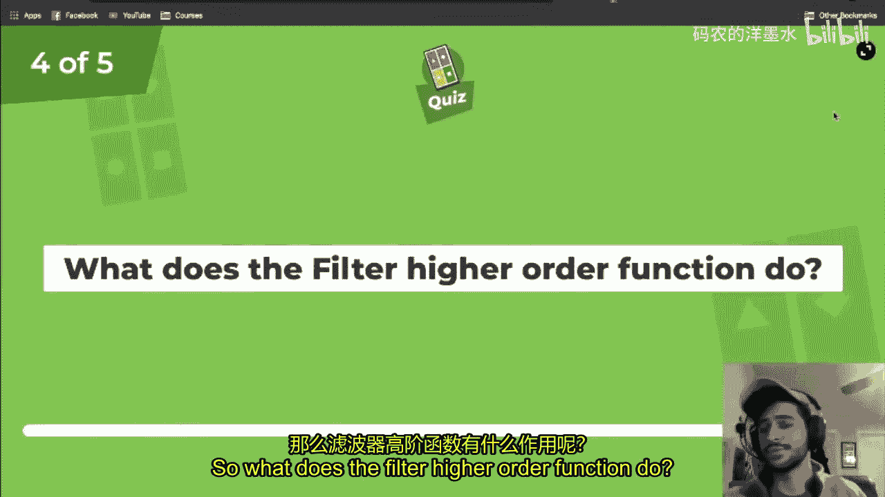

嗯。是。All right， well done。That's exactly it。 filter will make a list from elements of any of a list or itritable。

 you know， in the case of。This example for which a function returns true。

Yellow is the map function and these two。Let's continue。

So let's go over the last higher order function that we're going to cover in today's lecture。

 but of course there are other higher order functions out there。

 so the example here is the fold function。😊，So what is the fold function let me actually put my camera back。

 so I don't forget okay。So the fold method is a bit different from the other two that we just learned。

 it applies a function to an itertable， and in this case produces a single final value。

 and we'll see how that makes sense pretty soon。So it takes arguments， one is an initial value。

 and another is a closure with two arguments， an accumulator， and an element。

The closure returns a value that the accumulator should have for the next iteration。

 so this is a little bit confusing just looking at the English。

 but again we'll look at the code and I think it'll click。So in other languages。

 this fault function is usually named the reduce function。 and this is important because we'll show。

A pattern that uses all of these a little bit later called map filter Reduce， but yeah， so fold。

 just know that usually it's under a different alias in a lot of other languages。But okay。

 let's look at how fold can be used in rust。So let's say we have。This array of numbers， 1，2， and3。

And we want to use the fold function。So as we said， we said it takes in two arguments。

 an initial value， so we're initializing our fold function to zero。

And it takes in a closure with two arguments， an accumulator， and an element， so that's here。

 we have an accumulator and an element， and the closure returns the value that the accumulator should have for the next iteration。

So what we're essentially doing here is we're initializing this value to zero。

 and then for each elements of this list。X is going to be that element。

 and then accumulator is going to be a variable that holds。In this case， the sum。

 or rather more generally， it holds the value that it should have for the next iteration。

 but in this case， it is the sum， right？So。Let's show that here。 So in this case。

 we would take in one because that's the first element in our itritable。 We pass it in here to x。

The accumulator is currently zero because we haven't added anything yet。So0 plus 1 will return1。

And so1 will go into the accumulator， and then x will be2， the next element of the itertable。

So one and two go into the closure and so we return one plus2， which is three that return。

We'll go into accumulator so we can use it in the next iteration。So now accumulator is 3。

 and the next element in the list is 3， so that goes into x， so now accumulator 3， x is 3。

 we add 3 plus 3， and so that's 6。 We have no more elements left in the list and so we know that the sum of this list is 6。

And so this is a demonstration of how we can apply a function to an itertable and it produces a single final value。

 so in this case the value that it provides is six we took this list and we reduced it or we folded it down into one value。

And so we'll go over again how the fold function can be useful a little bit more。So again。

 if you're a visual learner here， I think is a nice visual of what's going on with the reduce。

 or in this case the fold function， very similar， so this is JavaScript， but same idea。

So let's say in this example， we have a list of ingredients and we want to reduce it to one output。

 so we put all of these ingredients into this function and what we're getting output is one item right。

We're reducing these down to a single output。嗯。I'll show you some more examples using F and all of it in a bit。

 but I hope this is good enough for now。

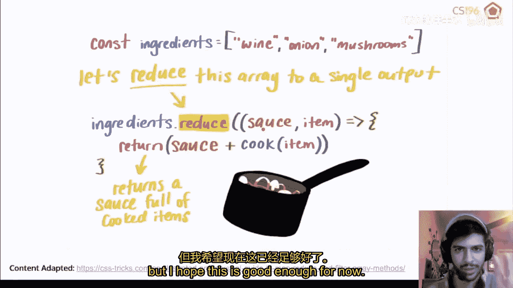

So let's do another question。

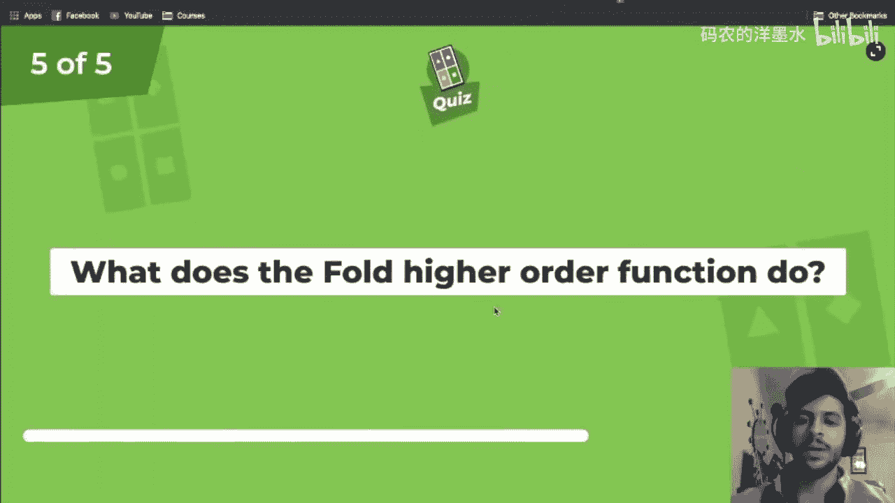

All right， fairly self explanatory。 So now you know what these all do。

 this last one was nothing that we covered today， but we said that this is the map function。

 This is the。Filter function， and this is the fold function also known as the reduced function。

So well done。That's， I believe the last co questions， but we still have more。Lecture to go。

Let me put this back。Should really make hot keys for。I have a steel series update， nice， okay。

So let's put it all together。So we can chain these higher order functions together for very powerful use cases。

 so we can take the map， filter and reduce functions。

 and we can do very powerful data processing with those functions alone In fact， so powerful。😊。

That Google was able to build an entire distributed data processing system on top of it。

 So what's linked here is a Wikipedia entry about the map， reduce data processing framework。

 if you're interested in reading it， go for it。You probably won't be very interested in reading it though。

Some of you might。But let's see an example of how powerful this map filter reduce data processing pattern can be。

And as we said before。Instead of reduced， we're using fold。So there's a link to a rust snippet here。

 I'm going to open it。Over here。And kind of similar example to what we saw before with the shoe example。

 But in this case， I kind of want to replicate。Let's say we pulled in from an NBA database and we have。

Some JSON for basketball players and what were given is their name。

 how many points that they scored and how many points they contributed through assists。

 so they assisted a player that player scored， this is how many points that represents。

And whether or not they're an all star。U。And so what we have down here。All the way at the bottom。

Is a function that takes in a list of players。And it'll sum for only all stars。

 how many points they contributed to their team that season。So we take in the player list。

 we make an itertable out of it。And we're using the filter， the map。

 and the fold method here to process the data。So the filter， we said。Will only return。

If the function returns true。So。We go through the itritable， which is in this case， the player list。

 and for each player， if they are an all star， they will be put in that returning list。

 otherwise they're omitted right so beyond this point。This will give us only the allstar。

And then there's the mapping function， which we said。The mapping function。

 which we said will apply this function to every element in the itertable。So from here。

After we filter out anyone that's not an allstar， what we will have is only a list full of all stars。

 all star basketball players， right， and from those players we can sum together for each person。

The points that they scored and the points that they helped other people score。

 their assisted points。So this will sum those up together for us。

 and then finally the fold or the reduce function will essentially take in this initial value。

 which is0。And then sum together the list of points that is remaining。Someone said。

The comment says that there are better ways to do this。

 Does that mean that this is not the most effective way。

 What I mean is you can reduce this down to using maybe like one or two of these functions。

 But I wanted to show kind of the power of this pattern。

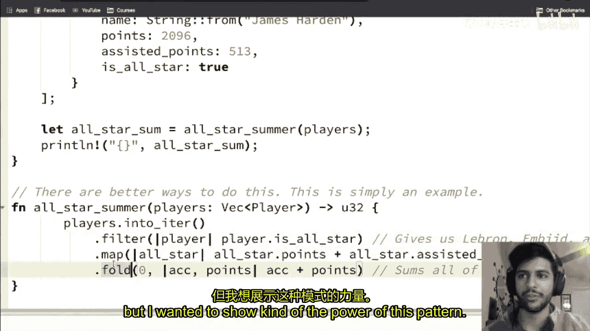