# 【全集 春季版】伊利诺伊大学 计算机编程：从Bash到Rust 中英字幕 p14 Lecture 14 - 递归树、调用栈 -BV188rDBFEUY_p14-

Welcome back to CS196 so another。Lecture of COVId 19 edition 196， hope everythings going well。

Hope online learning is treating you well， let's go over the objectives for today。So today。

 the name of today's lecture is going to be fearless recursion because as long as you've been keeping up with CS125。

 you would have been。Most recently you would have learned recursion and recursion is probably one of the mostiest one of the most scary topics that you can learn in CS125 or any introductory course。

 so today I wanted to take an opportunity to kind of show some visualizations for recursion so that way when you tackle this topic you can actually have a better understanding of recursion so what we're going to be doing today is we are going to be demystifying recursion with some visuals and as a result we'll have a greater intuition of what's going on under the hood。

So let's go ahead and start off with some first things some first things first。

 so you already all know recursion if as long as you've taken any sort of math class before coming here to the University of Illinois。

 you likely already know recursion and so here's an example of what I hope you're already all familiar with and that's the factorial exclamation mark here。

You can see how six factorial， if you're not familiar with what a factorial is。

 is equal to6 times 5 times 4 times 3 all the way down to1。

 and so you might notice that in this example of factorial， you can see how six factorial。

Is also equal to six times5 factorial， so instead of going all the way down to one， you can just say。

 well，5 factorial is equal to five times4 factorial because four times3 times 2 times 1 is in fact four factorial and you can see how this kind of works in a recursive fashion。

And so the recursive definition is stated here。 We can say that the base case of this factorial function。

 this recursive function is that。The base case is one where once we hit the factorial of one。

 that is the smallest version of this problem that we know。

 And every single time we make the problem smaller in size， we just want to basically。

You knowSe up our function and multiply in the same way that we add here。

So recursion may feel magical when you first learn it。

 but the fact of the matter is is that it isn't， the more you're working with recursion。

 the more you actually see the visualizations and what's actually going on under the hood。

 I hope that it'll make more sense。Here is the recursive definition for factorial encode that we just saw。

 so if we hit the base case， which is n equals 1， we'll just say that the factorial of 1 is 1 and every single time we'll multiply you know n times the smaller factorial so if we want the factorial of6 we'll do six times the factorial of 5。

So how does this work a very common issue with recursion is you know you look at this function and it just seems like it works like magic。

 you just kind of put some things into your compiler and it'll end up just magically giving you the answer。

 but let's go ahead and start breaking this down。So how can we visualize recursion？Well。

 the first way that we're going to visualize recursion in today's lecture is through recursion treats。

So here is the same exact recursive definition that we saw。All throughout the lectures so far。

 the factorial function， and let's work on creating a recursion tree for this function。

 So let's say I want to find the factorial of six so。I will just input6 into the function。

 what is six factorial？So we'll find right up here we have F of6。In order to calculate f of6。

 since we're multiplying n times factorial of n minus1， we know that in order to calculate f of 6。

 we need to calculate f of 5。We're basically just going to go all the way down this recursion tree that we're building and we'll end up hitting a base case。

 So what we're looking at here isn't involving any sort of data。

 This is all just control flow so F of5 in order for f of5 to resolve we need to know the answer to f of4 so then we go down even further we go to F of4 factorial4 and it's the same thing here F of3 because F of4 needs F of3 and we just keep on going all the way down until we hit a base case so we know that F of1 is the base case for the factorial function。

So what we've done so far here was just purely the control of our program。

 but now that we've hit a base case， we can say that f of1 is equal to one。

 so it'll return one and we'll start working all the way back up our recursive tree。

So since factorial of1 is1。We can propagate upwards in our tree。

And we can actually resolve f of2 now。 So we know that for factorial of 2。

 we can return two times what we now know。I the factorial of one， which is just one。

 so factorial of two will return two， and now that we have this answer。

 we can propagate further up the tree。So now for factorial of3。

 we can just simply say the factorial of 3 is equal to 3 times 2 because now we can actually say that factorial of 2 is 2 so F of 3 returns 6 and then we keep on doing this over and over again。

 we propagate upwards and then we get the answer of that function， propagate upwards。

 the answer of f of 5 is 120 and so on and so forth。

 F of6 is 720 and we finally completed the result that we've been trying to find the factorial of 6 we know is 720 and we were able to do this because we。

Simply it calculated all of the factorials that came under it。

So here's a well knownn example of recursion， the Fibonacci numbers。

 and I just want to quickly cover what exactly the Fibonacci numbers what they are in the first place before we actually use them in some examples。

 So these are some example of the Fibonacci numbers and to put it simply the Fibonacci numbers are just。

For any element so we can index them at zero like every other you know like imagine it as an array so for to calculate the nth Fibonacci number we just need to know what the two numbers before it were so for example this is the zeroth Fibonacci number and the first Fibonacci number these two are our base cases so as long as we know these we can calculate any Fibonacci number so if I want the fifth Fibonacci number for example I can just look here and say。

2 plus one。 The last two numbers。Add them together and I will get three。

 and it's the same thing here，5 is equal to3 plus 2，8 is equal to5 plus3。

 You just basically add the two numbers that came before it。

So what is our recursive definition for this， well， it looks exactly like this。So for our base cases。

 we know that for n equals 1。Our Fibonacci number is just 0。 and for n equals 2。

 our fibonacci number is just  one。 And then as long as we have those base cases， we can。

Sum up the last two Fibonacci numbers to get our current Fibonacci number。

This is exactly what's going on here。 These are our base cases， and we say。

The current Fibonacci is equal to。The one before it。 and the。2， that came before。So in this case。

 we have Fibonacci of 5， which is0 plus 1， which is our base cases， give us1，1 plus 1 gives us two。

 2 plus 1 gives us three， and so on and so forth， and then eventually we get to 5 because 3 plus 2 is equal to 5。

So what does the recursion tree look like for the Fibonacci？

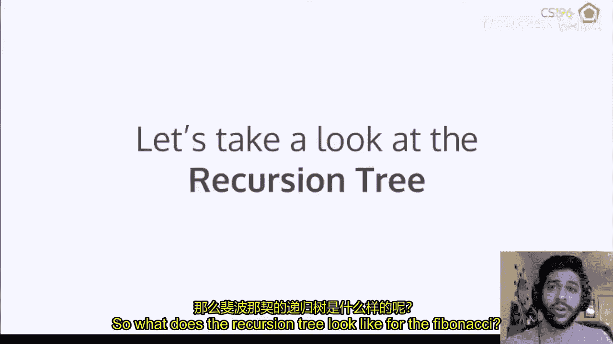

Numbers， so here's a little bit of a demo。

There is a very nice website for visualizations， it's called visualgo。net。

And if I want to visualize the recursion tree， you could just go over here。

And I find this website very useful。In creating these recursive trees for either very common recursive functions or functions that you write yourself。

 so if you go down here。You'll see that there's a little dropdown menu of all of the very common recursive problems and so the one that we'll be doing today is Fibonacci numbers and then of course you can write your own code in here if you want to see what the recursion tree looks like for your recursive function。

For example， we can start off with factorial numbers just to show you what the website looks like。So。

 here。If I want to find factorial of four， we know that the recursion tree is just essentially a straight line。

 So we start by。嗯。We start at four， four needs the factorial of three to compute。

 three needs the factorial of two to compute and two needs the factorial of one to compute。

 This is the same recursive tree that we saw in the slides。

 but I just want to show you how the website works so the return value is here12 factorial of 3 is 6 and factorial of4 is 24 so this is how the website works so now if we want to see what the factorial or rather what the Fibonacci function looks like in a recursive tree。

We can see that Fibonacciia 5 will obviously start at five。

And Fibonacci of5 needs to call Fibonacci of four， because if you remember when we looked at the code。

In the order of how this code executes， we need to first find what Fibonacci of n minus1 is before we move on to Fibonacci of n minus2 in the execution order。

 so here Fibonacci of 5 will go on to first compute Fibonacci of 4。

Fibbonacci of four will then go on to do the same exact thing， it will need a Fibonacci of three。

Which will need two， which will need one。 So we basically go all the way down the recursive tree。

 and we only start propagating back up when we hit our base case。 So our base case for the Fibonacci。

Numbers， one of them is n equals 1 here。Since n is equal to1。

 we return one and then we start propagating back up。

And then since we said that the other thing that we needed to compute Fibonacci numbers is n minus 2。

 then we propagate up back to f of 2 and then go straight back down to get Fibonacci of n minus 2。

 which is zero0 will return0 and then we propagate back up， so now F of2 is now done。

 so then we propagate up even further back up to 3。3。

We'll go back down so it can get Fibonacciia and minus2， which is f of 1 that will return 1。

 and I'll just go ahead and let the rest of the visualization continue so you can see how this plays out。

Basically， what's going on is that。You're able to build this recursive tree to visualize what's going on more in your code。

嗯。We will go over the recursive tree a little bit more later on in the lecture。But for now。

 I just thought that this website would be really useful in looking at。

You know how a recursive function actually executes。And so I'll just speed it up a little bit。

Might as well。So it works all the way back up the tree and we can see that Fibonacci of5 is in fact equal to five。

 just like how we saw it in the slides。

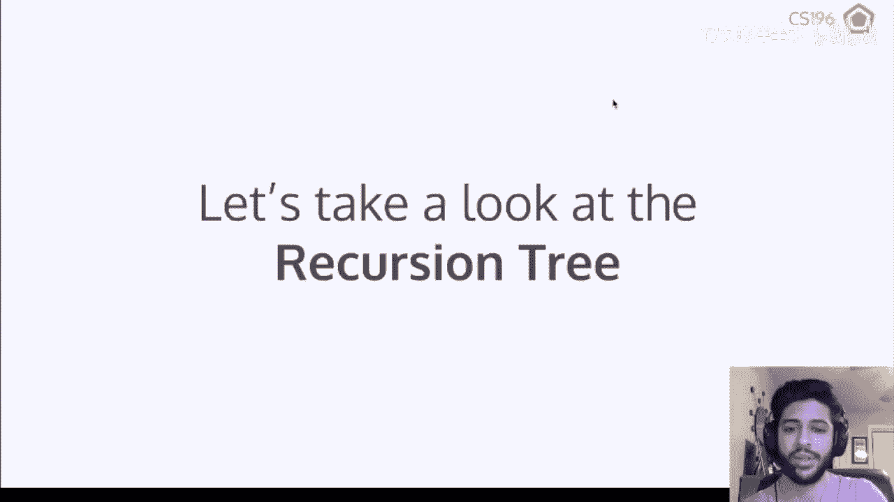

So let's do a very quick set of Kaooot questions the Kaahhoot questions won't be very difficult today。

 it's just going to be mainly for attendance。

But here's the code。

Join in， and you guys have like two minutes。🎼，🎼，🎼。🎼。🎼。🎼。🎼哎。

🎼，🎼。🎼，🎼哎。🎼。🎼。🎼，🎼，no extra credit for today's Kaahooot because it's really simple。嗯。

I hope everyone's in we'll do like 20 more seconds。🎼。

All right， I'll get started Yeah， no extra credit for today's Kaooot because the questions are pretty pretty simple。

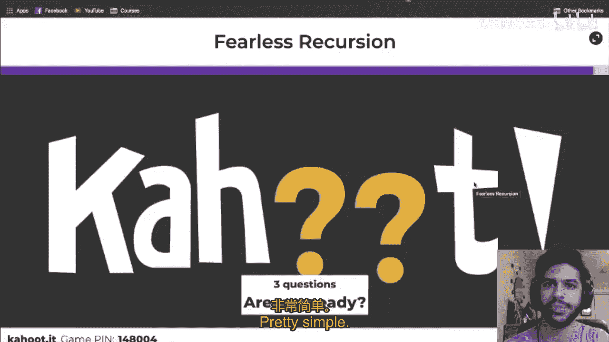

Mainly for attendance， so the recursion tree for factorial function is just a straight line。

 true or false。

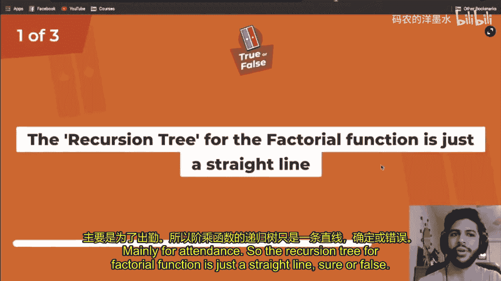

🎼The。🎼，🎼，🎼The。The。Okay so this is in fact true and I can show you why very quickly if we just look back at the slide so this was the recursive tree for the factorial function。

 we said that you know factorial of n every single time we compute factorial of n we need to also compute factorial of n minus1 let's get the pointer here factorial of n minus1 and so since we need that every single time we call the function will just keep on going downwards until we hit a base case which is f of1 as we see here so the factorial function。

 the recursive tree is just basically a straight line all the way down because we' not we're only doing you know one reduction at a time factorial n minus1 we're not branching out into multiple function calls so this is the recursion tree for the factorial function it's just a straight line so well done to the 16 of you。

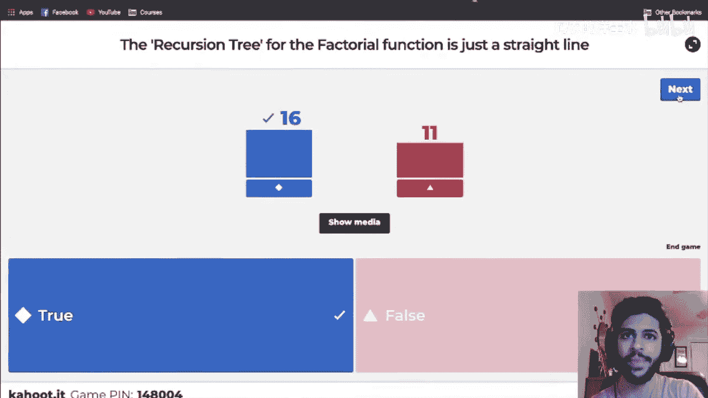

And we'll just do one more。The recursion tree for the Fibonacci implementation is just a straight line true or false。

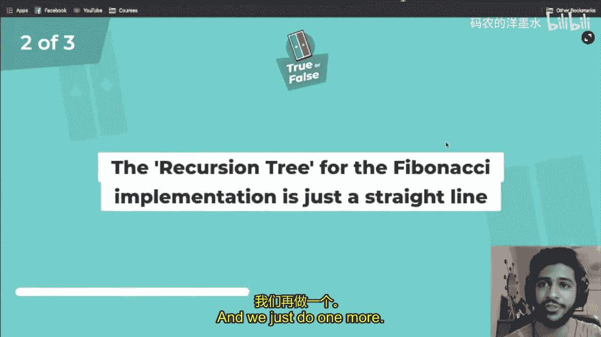

🎼，🎼，🎼，🎼。🎼The。🎼The。Okay so。Much better on this one， we have。

For the Fibonacci function we saw right over here， it is most certainly not a straight line because as we said before。

 every call of Fibonacci needs both Fibonacci of n minus1 and Fibonacci of n minus2 so every single time we make that recursive call it'll branch off into two function calls as long as it's not a base case so here we have five it branches off into4 and 3 which branches into so on and so forth。

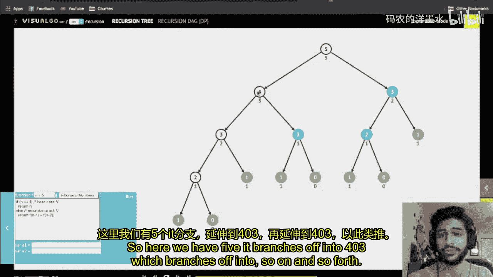

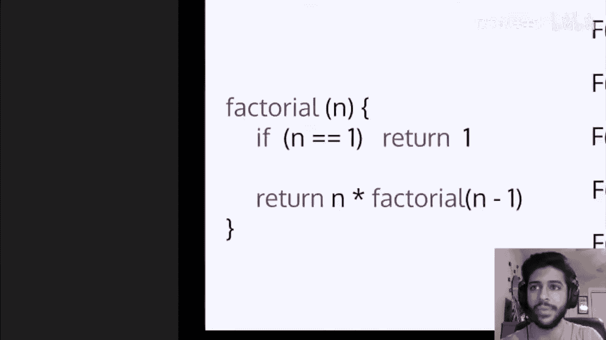

So let's go ahead and get back into the question or the slides here。Okay， here we are。

So that was basically all we were going to talk about with procursion trees。

 but we will go a little bit deeper towards the end of the lecture。

Heres another sort of visualization that you can have with recursion that I think will kind of help understand a little bit better what's going on under the hood and that is the call stack so if you remember from the rust lectures all the way back in before spring break we talked about how every single time we call a function we create what is called a stack frame and so you can think about this as a person just sitting down at a table that is reading your code line by line and writing down things on pieces of paper for every single function call so we said you know for example。

 this code right here we have a main function that just basically calls another function。

So if you have a person that's sitting down at a table reading your code line by line。

 they'll start at Maine because that's where we start our programs， you know。

 they'll write the name of the function on the stack frame， the piece of paper。

 and then they'll write all the variables that you declared on it。

 and then we'll notice here we're calling another function， so when we call another function。

We'll just put that piece of paper down， pull up a new piece of paper for our new function。

Write down the name of it in this case is other function。

Write down the variables that are associated with it here we have other number is equal to5。

 and then that's all that function does。 It doesn't do anything more。

 it doesn't call any other functions， so we rip up that piece of paper and throw it away。

 and then we pick up。Back at the function that we were originally at， which is main。

This after this function call we're not doing anything else so we just rip up the paper。

 throw it away， and that's the end of our program， so that's a little bit of an intuition behind these stack frames that we talked about a while back as a review。

So let's see how this looks when it comes to recursive functions。

 so let's go back to the factorial example that we talked about earlier。

 so here is a very similar code except the main function is calling the factorial function with n equals5 and inside of the factorial function we have the same thing the base case and then you know we're reducing the size of the problem every single time。

So。The first thing that we do when we read a program was we start at Maine， of course。

 so we have a stack frame for main。And this is， of course， our stack。

 I simplified it a bit because the paper example would get too crazy。

So these are our stack frames and this is our stack。

So we call the first thing that we do is we call main。

 and then after that we read in our factorial5 function call so we put that stack frame on the stack。

So we notice that F of5 needs f of4 similar to what we saw in the recursive tree。

 so then we will call that function again and put that on top of the call stack so now we are in factorial of4 and so the reason why we're using this call stack is because。

The state of F of5 can't just be thrown away right we need to wait until F of4 resolves before we can compute F of5。

 so we put it on the call stack to basically say once this is done。

 I'll just basically put the result into F of5 and then I'll have my answer。

 but then we notice that F of4 is reduced itself， we need to actually compute F of4。

 which again needs F of3， so we put that on top of the call stack。

And we keep on doing this all the way until we hit a base case。

 similar to what we saw in the recursive tree。And the reason why we do this is， like we said。

 F of5 needs f of4， which needs f of3， which needs two， one and so on and so forth。

 but once we actually have，A base case， then we can start propagating downwards。So here。

 F of1 we know is a base case， we can just return one。And so that function call。

 we will just simply return one and then pop off the stack because we don't need it anymore。

 and you can imagine this being like the person sitting on the table just ripping up the stack frame and throwing it away all the memory associated with it is cleared。

And so now we're at F of2。So F of 2 we know is going to be2 times F of1， well since F of 1 returned1。

 we know that it's just 2 times 1， so F of 2 will be popped off of the top of the call stack and returned 2。

And we keep on doing this， we'll have three times F of2， which is just six。

 so F of3 will return6 and pop it off of the top of the call stack。

 and we keep on doing this all the way until we go back to F of5。

 which will then return 120 because we are able to use the value of you know the last function call essentially。

And so once F of5 returns 120， then our main function is done because there's nothing that comes after that and it's just popped off of the top of the call stack and our program is over。

So does anyone have any questions about the call stack before we continue because I'm going to show how it works with the Fibonacci members so any questions before we continue？

嗯。You guys are going crazy in the chat today， let me just say that。You guys are some wild people。Um。

I'm assuming no questions， so we'll just keep on going。

So we can see how the recursive call stack works。With the factorial function。

 But now we can kind of build off of these concepts with the factorial function。

 So the factorial function， similar to how the recursion tree wasn't very simple。

 the call stack is a little bit different as well。嗯。

So here is the same code that we saw earlier with a Fibonacci function in our main weing Fibonacci for n equals5。

 and I just basically copied and pasted the same Fibonacci function that we saw earlier。So。

I'm going to actually wall showing you guys the call stack also build the recursion tree right over here as we go through the problem so we start off with f of5 or actually we start off the main function so the program our computer will call the main function and then after that we call Fibonacci of 5 so here's the start of our recursive tree and we can see how this function will branch off into other function calls so F of5 goes to the top of the call stack and our recursive tree of course f of5 becomes the head or the root rather。

So now F of5 needs both F of4 and F of3 because that's n minus1 and n minus2。But again。

 as we said earlier， since Fibonacci of n minus1 in the code comes first。

 we have to execute Fibonacci of n minus1 first。So F of5 we'll call F of4。

F of4 goes on to the top of the call stack and we know that F of4 is now running the same exact function all over again。

 and it's the same exact thing Fibonacci of 4 needs to execute Fibonacci of n minus1 before it does Fibonacci of n minus2 so F of4 will compute f of3 now F of3 goes to the top of the call stack and we keep on doing this until we hit a base case so we know that F of2 is in fact a base case because when n equals2 we simply return1。

So now that we've hit this space case， we've propagated all the way down left in our tree。

Now that we've hit the base case in our recursive tree， we can start working back up。

 so F of2 will return one， like our function says。And then that stack frame， if you notice。

 is popped off of the top of the call stack because we don't need that function call anymore。

So F of3 is now able to use the result of F of2。And since we have that。

 we can now compute Fibonacci of n minus2 because this function call on the left has resolved。

 So what is Fibonacci of n minus2， well that will be 3 minus2， which is 1。

Fibbonacci of1 is one of our base cases， so we return zero。

And notice that that function call was added to the top of the call stack， so F of1 will return0。

 we return 0， pop it off the top of the call stack。

 and now F of3 is able to say1 plus 0 because that's n minus1 plus n minus2。

So F of3 will then resolve itself， which is it will just return one， of course。

 so that function is popped off of the top of the call stack and now we go upwards now we're at F of4。

So it's the same thing with all the other function calls F of4 has finished computing n minus1。

 we know that n minus1 is 1 like we saw here， and now we can actually start continuing and calculating Fibonacci of n minus2。

So Fibonacci of n minus2 is 4 minus2， so we do f of 2。What is F of2， well， it's a base case。

 so now we can just return one and pop it off of the top of our call stack。So what is Fibonacci of 4。

 well it's Fibonacci of n minus1 plus n minus2， which is just in this case2。So F4 returns2。

 and we propagate further up and pop it off of the top of our call stack。

So now we're all the way back up to Fibonacci of five。

 This is what we were trying to compute in the first place and。

The reason why we went down to the left of the tree is because again， we had to compute this first。

 so now we can start working down to the right of the tree。Wwhich is fibonacri of n minus2。

 so 5 minus2 is 3 so we want to calculate f of 3。 we put that function on the top of a call stack just like any other function。

 and now we do what we've been doing the entire time we keep going down all the way until we hit a base case so f of 3。

We'll break down into f of2 F of2 is a base case， it'll return one and pop it off the top of a call stack。

 it will call f of1 which is on the top of the call stack。

 it'll return zero and by now I hope it's coming into the big picture F of three returns one and now finally we can give you the value of Fibonacci of5 so Fibonacci of5 is equal to two plus1 and we know that the fifth Fibonacci number is three because we can just sum those two together pop it off the top of the call stack it returns main is done after this function call because there's nothing that comes after it so it's off the call stack and we celebrate。

We've figured out what Fibonacciio 5 is， and that's of course。

 how it is with any other function call to this function。

So I think it just helps to kind of visualize what's going on when you call a recursive function。

 how that recursive function will break off into its own recursive calls into its own function calls。

 and how the state of those functions is saved on the call stack。

But since the state of those functions is saved， you have to notice that this call stack actually takes up memory because we're saving state in our computer。

So since this actually takes up memory， we have to kind of realize something here。

This is why missing a base case in our code is so fatal。So we can see this example here。

Let's say we try to write an implementation of factorial of n and we just forgot to include our base case。

 This is actually a lot more common than you think factorial function， of course， is fairly trivial。

 but when it comes to more complex recursive functions where the base cases aren't always super clear or you have you know three。

4 base cases it's you know somewhat common to actually forget what one of the base cases are when you actually go to write it and you end up running your code and things go wrong Well why do they go wrong Well like we said the call stack takes up memory in our computer So what happens when we try to run factorial of5 with this factorial function that forgot to write a base case well。

Factorial 5 needs factorial4， which is n1， which needs three， which needs two， which needs1。

 which needs0， which needs negative 1， negative2， negative 3， negative 4。

 and it'll keep on going infinitely until your whole computer explodes and you start crying。

So this is why it is super important。To get your base cases correct。

And so if you noticed what happened here， our stack literally overflowed until we ran out of memory in our computer。

And so。I hope the visual made this clear。This is a stack overflow a lot of people actually don't know why the website is named stack overflow or they don't know what a stack Overflow error is this is exactly it it's what happens when our recursion either goes infinitely or goes too deep because there are some cases where the size of our problem is really large and recursion might actually just simply run out of memory because if you remember when we are building that recursive tree。

We had to go fairly deep before we were actually able to propagate upwards。

 the recursive trees for factorial or for binnaci were actually quite small。

 we didn't actually have to go more than like five levels of a recursion tree。And of course。

 the size of this call stack is drawn to Google slides。

 but the recursive call stack is obviously much larger than this in our actual computer。

I just wanted to fit it all in the same slide。But this is what happens when we either forget to write a base case or the size of our problem。

Requires more memory。To actually execute when we use recursion。And so again the。

The call stack takes a memory， so this is actually one of the reasons to why recursion can also be inefficient。

If you run certain functions iteratively， you'll notice that you're not really taking up any extra space unless you declare an array or you declare a hashmap or whatever it is。

 right， you declare variable stuff like that that takes up space。

 but you don't actually need these stack frames unless you call other functions inside of let's say your for loop。

But recursion， on the other hand， since it needs to save the state of these function calls。

 it can take up a lot of memory， and so there are some implementations that actually might be done better iteratively rather than recursively。

 because there are some times where recursion can actually take up more space than you need and as a result it can be fairly inefficient。

However， another thing that we need to consider is that there are some cases where recursion actually is a bit more readable。

 it is a bit cleaner to write， sometimes the iterative version of a recursive function is quite messy。

Anything that you write recursively can be written iteratively as well。

 It's not like there's some sort of。You know， block between what you can write in one versus the other。

 but there are trade offs between the two types of writing。You know。

 your algorithms and these are tradeoffs that you want to keep in mind。

 so don't always write recursion just because it seems really cool。

 this is something that Jeff mentions a lot in CS125。

 but there are actual tradeoffs that you need to keep in mind。So with that。

 we'll do a quick Kaahooot question。I believe our final one questions aren't very difficult today。

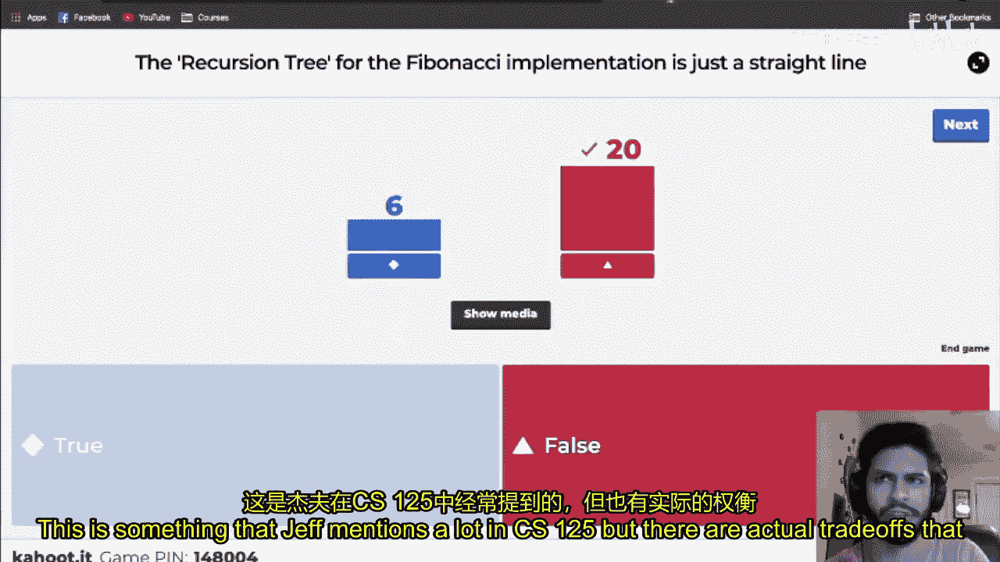

So the question is recursion is always the best way to implement something true or false。

 I hope it's clear by now。

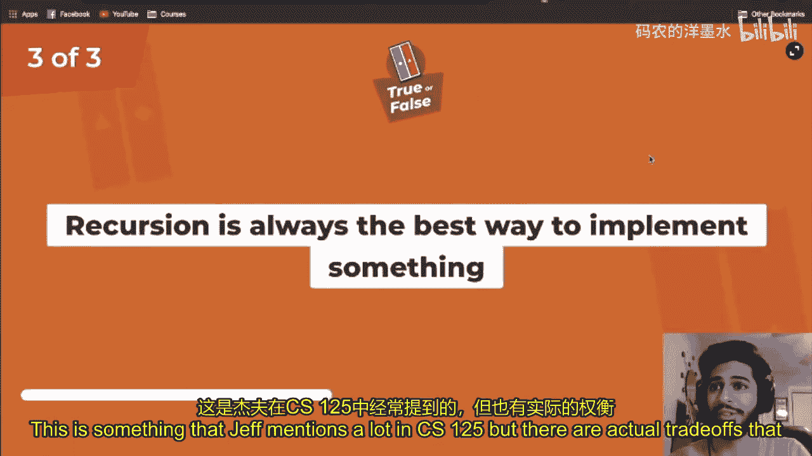

🎼，🎼The。🎼あ。🎼The。🎼。🎼う？🎼，🎼，Yeah。Okay。Well done to the 22 of you。Yeah。

 recursion is not always the best way to implement something。

 that's basically what it talks about right now。You will get better at writing recursive functions as you practice them more。

 but I hope that the visualizations that we showed today were a bit more helpful in understanding what's actually going on under the hood and kind of demystifying you the recursion magic behind like these algorithms and when you actually write them in your code yourself。

We will continue our recursive strategies on Thursday Rohan will do that lecture and we'll go a little bit more in detail about how there are some cases where recursion is actually quite good and there are some cases where recursion is quite inefficient today we talked about how the memory side of things can be inefficient but on Thursday we'll talk about time complexity rather than space complexity but for today。

A little bit of a shorter lecture you guys are。

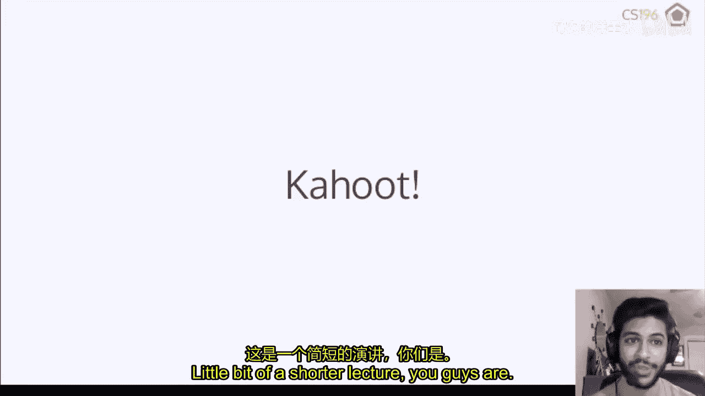

Good to call it here。