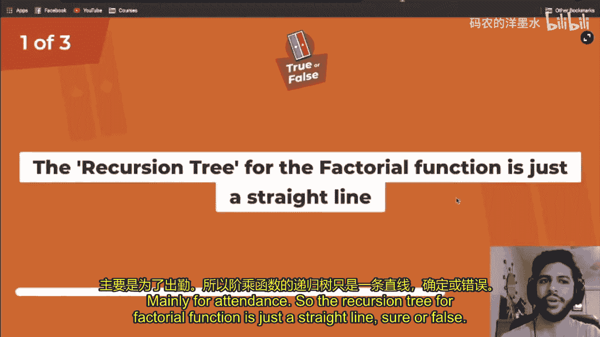
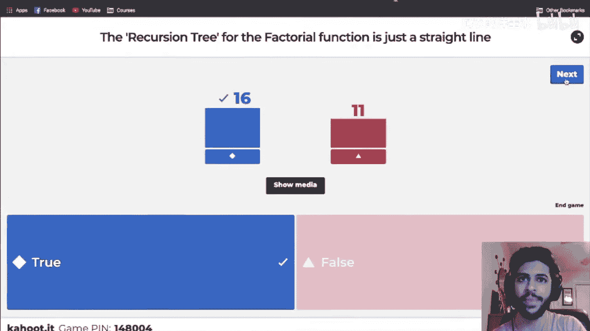
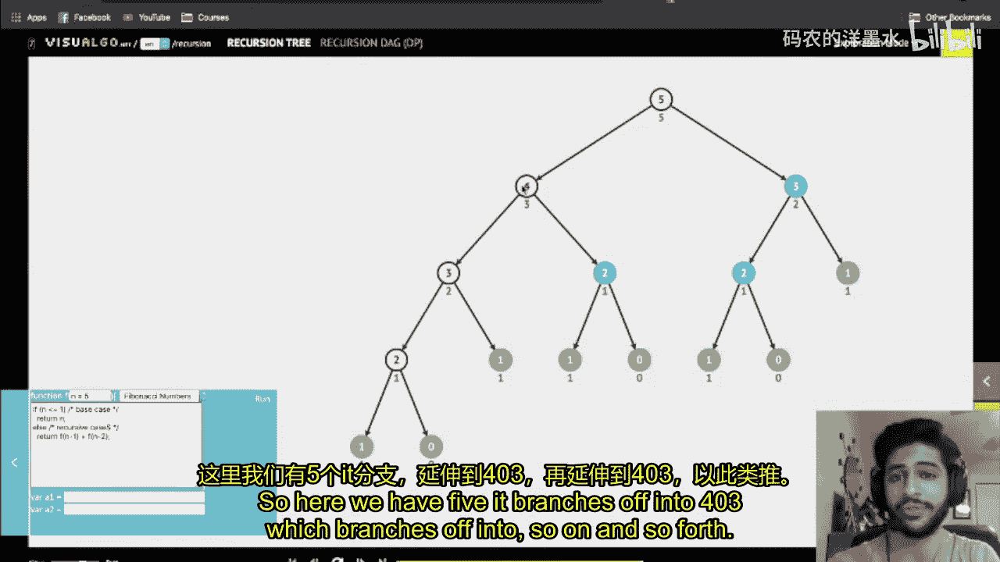
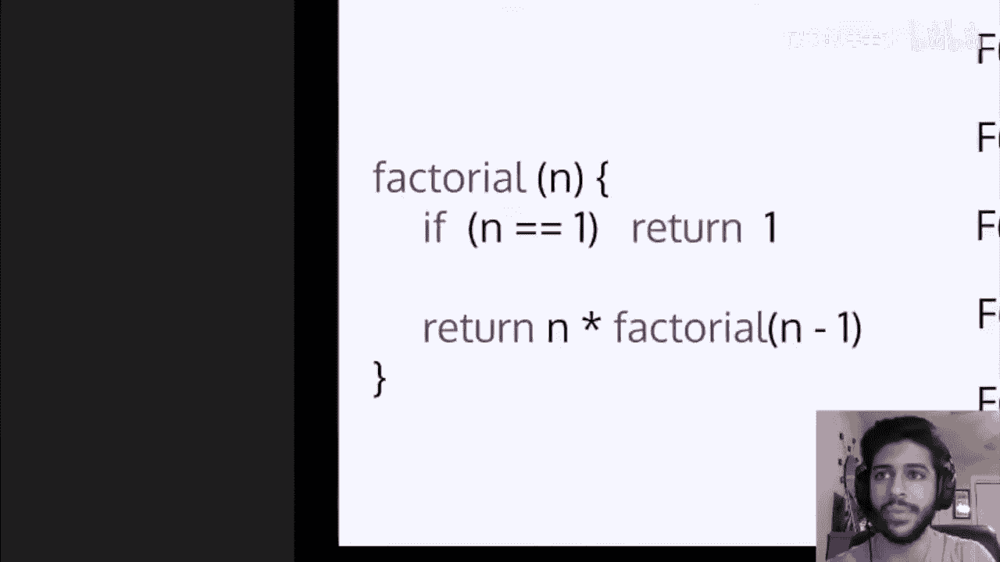
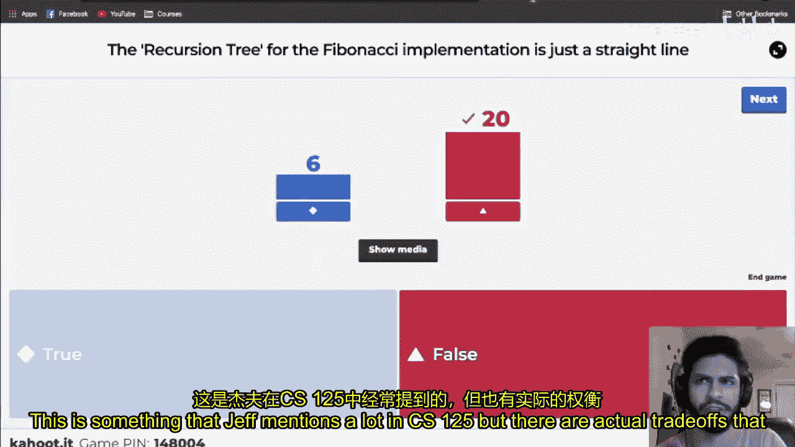

# 计算机编程：从Bash到Rust：14：无惧递归 🧠


在本节课中，我们将学习递归。递归是计算机科学中一个看似神奇但实则非常基础的概念。我们将通过可视化的方式，特别是**递归树**和**调用栈**，来揭开递归的神秘面纱，帮助你直观地理解递归在代码底层是如何工作的。

---

## 递归简介

上一节我们介绍了函数的基本概念，本节中我们来看看递归。递归在数学中其实很常见，一个经典的例子是阶乘函数。

阶乘的数学定义如下：
```
n! = n × (n-1) × (n-2) × ... × 1
```
例如，`6! = 6 × 5 × 4 × 3 × 2 × 1 = 720`。

我们可以注意到，`6!` 也可以写成 `6 × 5!`。这种将问题分解为更小的、相同形式的子问题的过程，就是递归的核心思想。

---

## 递归的代码表示

递归函数通常包含两个部分：**基准情形**和**递归情形**。基准情形是问题的最小版本，可以直接给出答案，从而终止递归。


以下是阶乘函数的递归定义代码：
```python
def factorial(n):
    if n == 1:          # 基准情形
        return 1
    else:               # 递归情形
        return n * factorial(n-1)
```
当 `n` 为 1 时，函数直接返回 1。否则，函数会调用自身来计算 `n-1` 的阶乘，并将结果与 `n` 相乘。

---

## 可视化递归：递归树 🌳

为了理解递归的执行过程，我们可以使用**递归树**。递归树以图形化的方式展示了函数调用自身的过程。

让我们以计算 `factorial(6)` 为例来构建递归树。


1.  为了计算 `f(6)`，我们需要知道 `f(5)` 的结果。
2.  为了计算 `f(5)`，我们需要知道 `f(4)` 的结果。
3.  这个过程一直持续下去，直到我们到达基准情形 `f(1)`，它直接返回 1。




此时，递归树向下延伸的部分（控制流）就完成了。然后，我们开始向上回溯（返回结果）：




1.  `f(1)` 返回 1。
2.  `f(2)` 计算 `2 * f(1) = 2`，并返回 2。
3.  `f(3)` 计算 `3 * f(2) = 6`，并返回 6。
4.  依次类推，最终 `f(6)` 计算 `6 * f(5) = 6 * 120 = 720`，得到最终结果。





对于阶乘函数，其递归树是一条直线，因为每次递归调用只产生一个子问题。

---

## 另一个例子：斐波那契数列

斐波那契数列是另一个经典的递归例子。数列的定义是：第0项是0，第1项是1，从第2项开始，每一项都等于前两项之和。

其递归定义如下：
```
F(0) = 0
F(1) = 1
F(n) = F(n-1) + F(n-2)   (当 n > 1 时)
```

对应的代码实现是：
```python
def fibonacci(n):
    if n == 0:          # 基准情形 1
        return 0
    elif n == 1:        # 基准情形 2
        return 1
    else:               # 递归情形
        return fibonacci(n-1) + fibonacci(n-2)
```

斐波那契数列的递归树与阶乘不同。因为每次递归调用需要计算 `F(n-1)` 和 `F(n-2)` 两个子问题，所以递归树会**分叉**，形成一个树状结构，而不是一条直线。你可以使用像 `visualgo.net` 这样的网站来可视化这个分支过程。

---

## 可视化递归：调用栈 📚

除了递归树，**调用栈**是理解递归底层机制的另一个关键工具。调用栈是计算机内存中的一块区域，用于跟踪函数调用。

当一个函数被调用时，系统会为其创建一个**栈帧**，并将其压入调用栈。栈帧中包含了函数的参数、局部变量和返回地址等信息。当函数执行完毕返回时，其对应的栈帧会被弹出。

让我们用阶乘函数 `factorial(5)` 来看调用栈的工作流程：

1.  `main` 函数调用 `factorial(5)`，将 `factorial(5)` 的栈帧压入栈。
2.  `factorial(5)` 需要调用 `factorial(4)`，将 `factorial(4)` 的栈帧压入栈顶。
3.  此过程持续到 `factorial(1)` 被调用并压栈。
4.  `factorial(1)` 是基准情形，它返回值 `1`，然后其栈帧被弹出。
5.  控制权回到 `factorial(2)`，它现在可以计算 `2 * 1 = 2`，返回值后弹出栈帧。
6.  此过程逐级向上回溯，直到 `factorial(5)` 计算出结果 `120` 并返回给 `main` 函数，所有栈帧被清空。

对于斐波那契数列 `fibonacci(5)`，调用栈的变化会更复杂，因为涉及多个分支的函数调用和返回，但其基本原理相同：每次函数调用产生一个栈帧，返回时弹出。

---

## 递归的陷阱与权衡

通过调用栈模型，我们可以理解递归的两个重要陷阱：

1.  **栈溢出**：如果递归函数缺少正确的基准情形，或者递归深度过大，会导致函数无限调用自身。这将不断创建新的栈帧，直到耗尽系统内存，引发“栈溢出”错误。
2.  **空间效率**：递归调用需要为每一层调用保存栈帧，这可能会消耗大量内存。对于深度很大的递归，其空间复杂度可能比等效的迭代解法更高。

因此，递归并非总是最佳选择。递归代码通常更简洁、更直观，尤其对于树状结构或分治算法。但迭代解法在空间效率上往往更有优势。在选择时，需要在代码的清晰度和运行效率之间进行权衡。

---

## 总结




本节课中我们一起学习了递归的核心概念。我们通过**递归树**可视化了递归的分解与合并过程，并通过**调用栈**模型理解了递归在计算机内存中的执行机制。我们还探讨了递归的潜在问题，如栈溢出和空间消耗，并提醒大家递归和迭代各有优劣，应根据实际情况选择。


记住，理解递归的关键在于识别**基准情形**和信任递归步骤能正确解决更小的子问题。多加练习，你就能无惧递归。