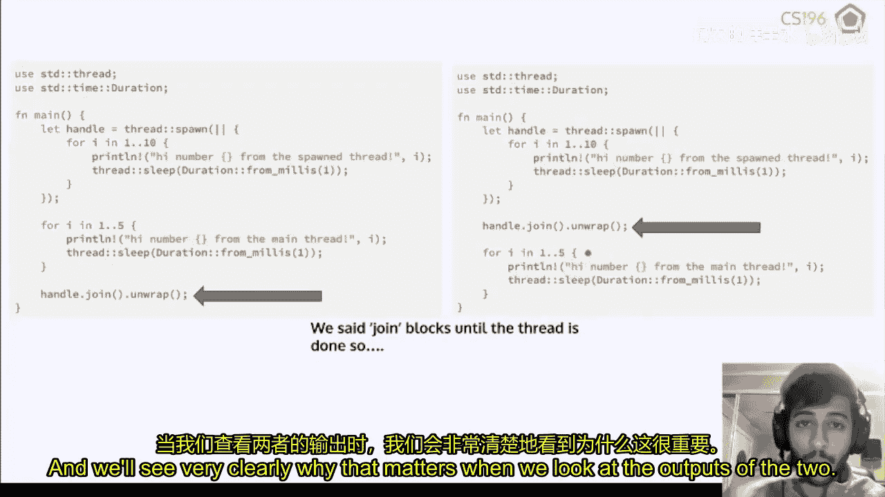
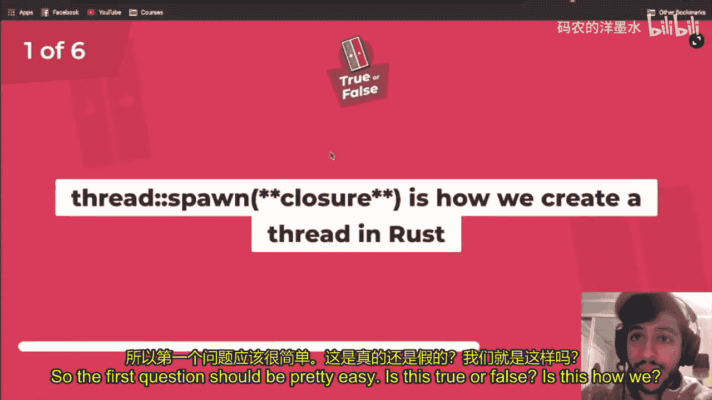
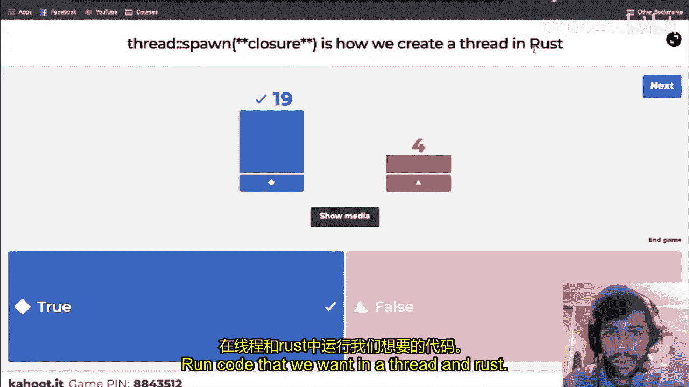
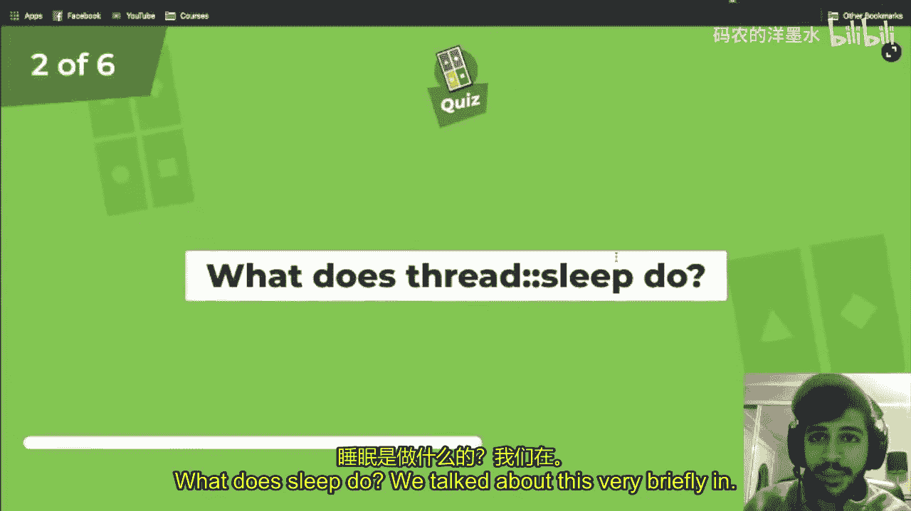
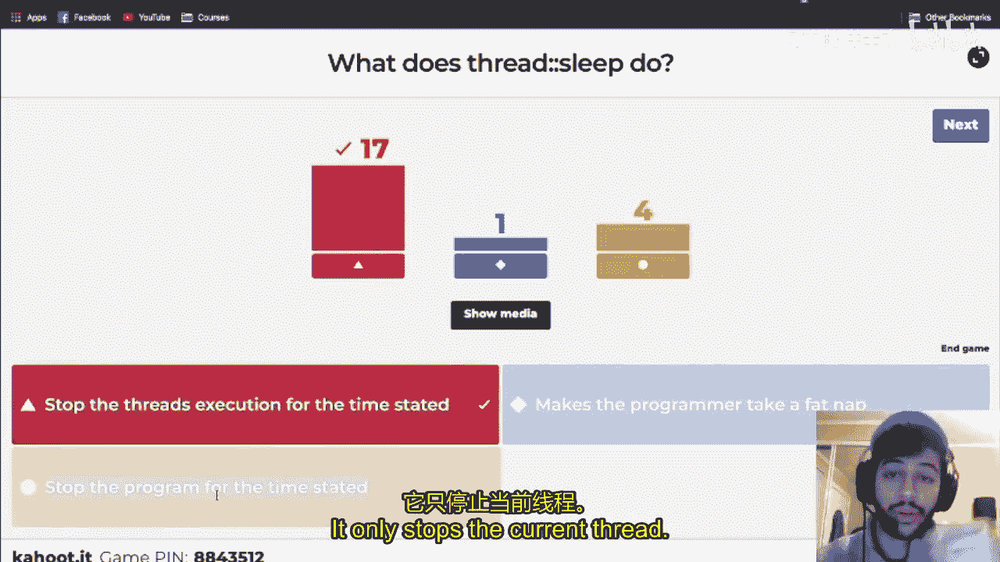
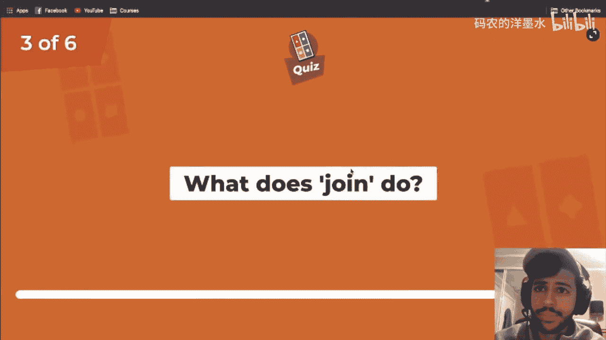
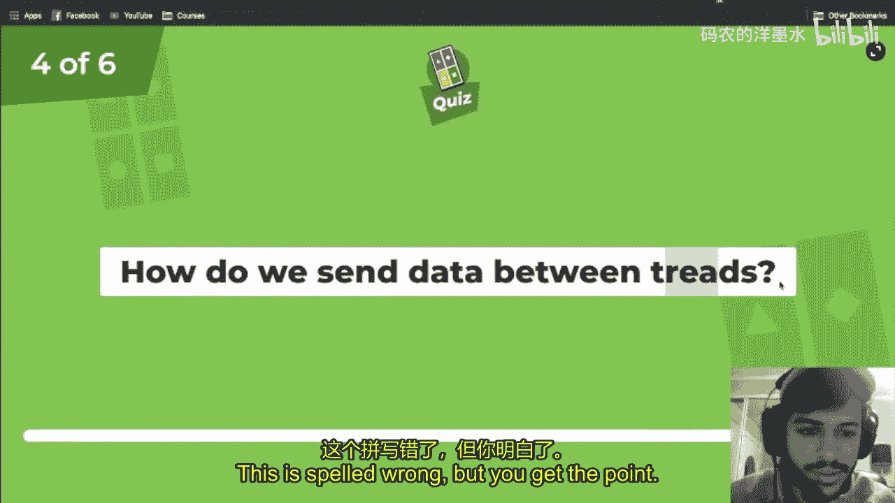
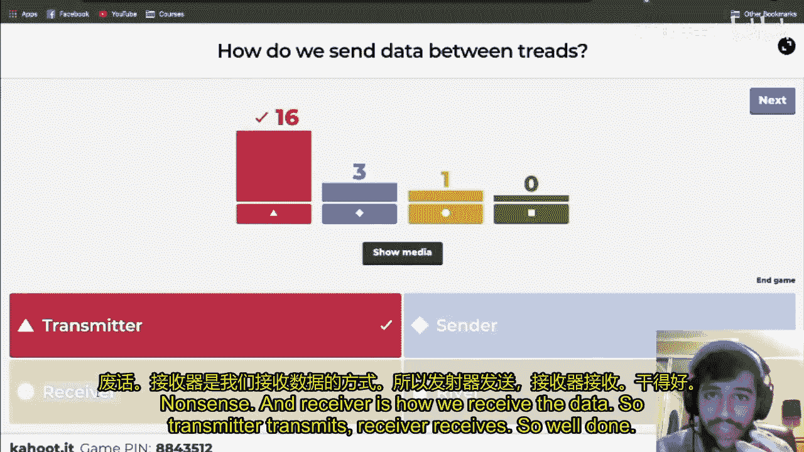
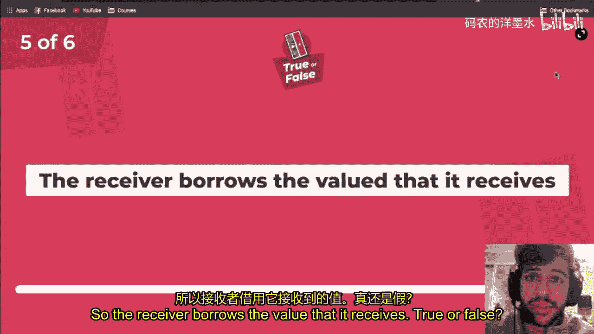
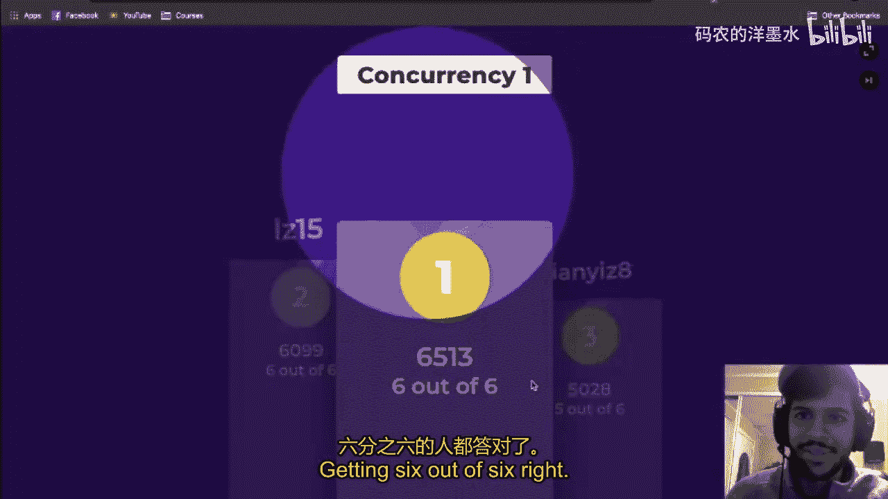

# 【全集 春季版】伊利诺伊大学 计算机编程：从Bash到Rust 中英字幕 p15 Lecture 15 - Rust：并发、线程、通道 -BV188rDBFEUY_p15-

So very quickly objectives for today， so I want to go over the final topic of today's of the semester we're going to spend today speaking about this topic and Rohan will talk more on it on Thursday and that topic is concurrency so this is one of the benefits of rust。

The ability to do concurrency very nicely compared to what is done traditionally with systems programming languages and we'll talk。

On why we use concurrency， what is concurrency， why is it so hard to use concurrency？

We'll talk about what threads are and how we can communicate between the threads using these things called channels。

But first， of course， let's talk about what concurrency is。So。

 concurrency is defined as the ability for a program to be decomposed into parts that can run independently of each other。

So if this definition doesn't make sense to you right away， it's completely fine。

 we're going to go through a lot of examples today that demonstrate concurrency both in real world examples and。

You， code as well。Just very quickly， when we speak about concurrency。

 we typically also speak about this idea of parallelism。

 so let's look at the definitions side by side very quickly so we understand what they are。

 but it's not extremely important for the sake of today's lecture， but we'll do it anyway。

Concurrency is the idea of different parts of a program executing independently of each other。

Well with parallelism， it's the idea of different parts of a program executing at the same exact time。

So I think that this is a very good visual to kind of demonstrate the differences between the two。

And if this visual doesn't make sense， consider a few real world examples。

So you know as humans we have a lot of tasks in our tasks in our day to day lives。

 so when we do these tasks we usually don't wait until we're completely done with something before we move on to something else so for example you could be working on homework let's demonstrate that you know here on this visual you could be working on homework then you know very quickly you check your email and then once you're done checking your email you go back to working on your homework。

 then you get a text message and then you start checking your text messages and then you check another email and then you go back to working on your homework and so you kind of work in this concurrent fashion。

 you don't you know do all of your homework then check all of your text messages then check all of your emails。

 I mean you can but traditionally most people work concurrently in this fashion。

Another example is this idea of baking right if you were baking。

 let's say a tray of like four trays of cookies， you wouldn't， you know。Prepare a tray of cookies。

 put it in the oven， wait until that tray of cookies is done。

 then start preparing another tray of cookies after that and put that one in the oven and so on and so forth。

 instead what you would do to work concurrently in this fashion is put the tray of cookies in the oven。

 and then while that's in there， start working on preparing another tray and then putting another one in the oven and so on and so forth。

Now， working in parallel in comparison。Humans can't quite do perfect parallelism you know we are basically we're essentially limited to working only concurrently。

 but you know with a cookie example， if you think about that example you can say working parallel。

 working in parallel would be taking those trays of cookies and just putting all four of them in the oven at the same exact time and preparing all four of them at the same exact time that's the important part when we talk about the differences between concurrency and parallelism。

 parallelism is when they are all at this very same exact interval of time like we see in this visual here。

But then again， as we said earlier， for the sake of this lecture。

 just both of them are going to be labeled as concurrency， we're not going to be too precise in what。

You know， exactly the type of concurrency or parallelism that we're talking about。

 we're just going to classify them both as this。So why do we use concurrency？

So I want you to focus your attention to this graph， so this graph looks a little bit scary。

 but essentially what it's representing is the past 40 years of microprocessor data and what's important to notice is this trend right here。

 so these green dots are creating a trend that essentially tell us that the speed of our processors is beginning to flatline。

And so。While our processors aren't exactly getting faster， essentially they're flatlining a bit here。

 you can see all the way at the bottom， the amount of cores that we have is starting to increase tremendously。

 so what that tells us is we're not quite able to make things faster。

 but we are able to use more of what we have。RightWe're even in our modern computers。

 we don't really see single computers in the market anymore。

 they're all at the very least quad core computers compared to what was in the market very commonly like five years ago there was dual core。

 so we're increasing the number of course that we have even in the modern market and of course。

 in what is used at the production level。And so concurrency。

 it's important to mention this graph as we talk about concurrency because concurrency allows us to take advantage of the multiple processors in our computer。

So this sounds very fancy。 and it sounds really great， right， We're able to， in a lot of cases。

 increase performance。 But what is the catch here， There's got to be a catch and there there is concurrency is very。

 very difficult to accomplish。 And the reason why it's difficult We'll talk about the challenges today。

 but。😊，Here is an example without even knowing what concurrency is perfectly on how difficult it is。

 so Missoilla is the company that developed rust and they are actually using it。

In their engine that is used to render web pages in Firefox。

 Missizzle is the company that created Firefox if you're not familiar with them。

And so here is an issue that they had open in their codeb that says parallellyize selector matching。

 so in other words， they wanted to use concurrency in the way that they render web web pages in Firefox。

And so what's important to see here is that this issue was open for seven whole years。

And the reason why it was open for so long is because this code base was written in C++。

 and so in a multi， this is the engine that they use to render web pages。

The amount of lines of code that was in this program is like millions and millions of lines。

 and it's a concurrent program in order to add things to this concurrent program。

 it is extremely difficult， the amount of complexity that is involved in making sure that nothing is broken once this change is implemented is very。

 very difficult。So when their codeb was written in C++， this issue。

 no one really ever got around to it because it was just too difficult to accomplish。

 nearly impossible。But。When we say that concurrency is very difficult。

 the reason why we don't just get turned away from it and never look back is that it's really nice you know on the contrary。

 So this issue that we were talking about when they migrated over to rust。

 we can see the benefits of it here so they usingcur concurrency in that bug that they fixed。

 they were able to reduce the amount of time that it takes to render these web pages fairly significantly。

 you can see that here， Amazon YouTube。嗯。So the benefits of concurrency should be very clear。

So why is it so difficult？Let's go over just very quickly a motivating challenge to why to some challenges that is very common when working in a concurrent program。

 so here is we'll call him Jeff， so Jeff is working on withdrawing $2，000 from his ATM。

And so here is his ATM。 and here is the server that the bank is using to hold all of the user data related to customers。

 and， of course， the balance the user data includes the balances as well。

 So Jeff's balance is $5000 in this server associated with the bank。

 So the first step in the algorithm that the ATM should use is that first it needs to read the balance from the server。

 So we read the balance from the server， and we know that Jeff's balance is $5000。

 And so the next step is we're withdrawing $2000。 So we say。5000-2000 is 3000。

 So locally here on the ATM， his balance is currently $3000。 So now let's say it's payday。

 and Jeff is getting a direct deposit from his company straight into his bank account。With $4000。

So the first step for the bank to handle the direct deposit is to first read the balance。

 so we read the balance in from the server， we know that his balance is $5。

000 and we want to add the direct deposit that his company is paying him， so that's $4，000。So 5。

000 plus 4，000 his balance gets updated to 9，000 and so now I think you're starting to notice the challenges of working in this concurrent sort of fashion。

 multiple things are accessing the same data what's going to happen here well we update that the ATM will update the balance of the server thatll be updated to $3。

000 and then that direct deposit will update the balance that on the server and the server will be updated to $9。

000。So if you've been paying attention， this is completely wrong。

 right the balance on the server should be $7，000 because he got a direct deposit deposit $4000。

 he originally had $5，000 and he withdrew $2000 from his bank So as a result of all of those interactions。

 he should have $7，000 in the bank， but because we're working in this concurrent fashion and we're not handling any of these data races they're called。

We end up with Jeff gaining $2，000 more than he originally had。Or that he was supposed to have。

So the good news is is that Ru does a lot to mitigate this and the one that you just saw in the bank example。

 we can say that you know a lot of the challenges in concurrency are actually solved in rust by this idea of ownership。

 the idea that we talked about in the second lecture of rustt。Because。

Common issues in concurrency are these memory safety issues and data races。

 memory safety being things deleted after they're already deleted once or before they're done being used they're deleted for memory。

 so that's memory safety issues that's solved by ownership and data races like the example we saw here。

This doesn't really happen with ownership， and these are some of the benefits that we have when we use rust。

So what does concurrency look like when we use rust？So the first thing we need to look at is threads。

 so what is a thread？So from the Ru textbook we can define it as this。

 so in most current operating systems， an executed program code is run in a process and the operating system manages multiple processes at once within your program you could have。

Independent parts that run simultaneously the features that run these independent parts are called threads。

 so threads are very much at the backbone of concurrency threads are how we have those independent independent parts actually run you know in those chunks。

 right？So more things from the Ru textbook， we can say that splitting the computation in your program into multiple threads can improve performance because the program does multiple tasks at the same time。

But it also adds complexity， as we talked about in the Firefox example。

So because threads can run simultaneously， there's no inherent guarantee about the order and which parts of your code on different threads will run。

So we'll talk about that a little bit more， but also throughout the lecture。

 keep the example of the bank in mind。And one last thing from the textbook。

 so we say that Rust attempts to mitigate the negative effects of using threads。

 but programming in a multithreaded context still takes careful thought and requires a code structure that is different from that in programs running in a single thread so in other words。

Rust does want you to be fearless when you write concurrent programs。

 they want you to be a lot more comfortable than C or C++ because they are taking care of a lot of the issues where the other languages fall apart。

But with that said， concurrency is still hard and you still have to use your brain while you're programming。

 you can't just completely turn it off。So we talked about threads。

 how do we actually create threads in rust？So this is how we do it so from thread we use the Spwn function and inside of the Spwn function we pass a closure that contains the code that we want in another thread。

AndSo if you remember from the functional programming lecture。

 closures are those double barred functions that you can pass to functions and return from functions because they're first class functions。

And so here's an example。So here。This is what we need to import in in order to use threads in our。

In our program， we we have to import thread from the standard library in rust。

So if we focus our attention here， we can see。what we saw in the previous slide。

 we're using the spawn function。 and inside of the spawn function， you can see here。

 we're passing in a closure that takes in no arguments。

 And this is the code that we want to run inside of the thread。 So here in this program。

 we have two threads。 We have the main thread。 And then we also have this spawned thread right here。

 So we have two threads。 And inside of the spawn thread。

 we're printing out numbers all the way up to 9。 And then we're doing this。

Function right here that's called thread sleep， which basically will pause the thread。

So as we said in the previous slide， the way that we create a thread is we call the Spwn function and we pass a closure containing the code that we want running in that new thread。

So outside of this thread in the main thread， we have another function that's just going to loop from one to five and print out all of the。

Um。Numbers in each iteration。 So what is this output， Well， if we look。

 it'll say high from the main thread， the spawn thread， main thread， and it'll keep going Again。

 we can't exactly guarantee the order in which it'll execute because depending on your operating system the way that it schedules these threads to run。

 it's not always the same。 In fact， on the same exact， you know within three different runs。

 you could have three different。Outputs， and you haven't had any changes in your environment。

But what's important to see here is that inside of our spawned thread。

We said that we were looping all the way up to 9。 but if we look at the output from the spawned thread。

 notice that it doesn't actually go all the way up to 9。 we're only going up to 5。

 and that's because this spawned thread isn't guaranteed to finish。

By the time the main thread finishes right so by the time the main thread closes down。

 you can see here the main thread you know， prints all the way up to four as it's meant to。

 and then that spawn thread doesn't even get to nine because。Once the main thread is down。

 then this will be down as well。So how do we solve this problem Our Spwn thread isn't finishing all the way。

 How can we solve that What we can do is we can save the return value in a variable。

So if you notice here， we have the same exact code except instead of putting that thread by itself。

 just calling it， we're actually storing the return value here in the handle。

 and so you might be wondering what does thread return？

Or sorry what the spawn return spawn returns what's called a join handle and so what's important to realize here is that when we call join on it so we said it returns a type join handle so that's what handle is down here we can see that we're using the dot join function and what dot join does is it will wait for the thread to finish before we continue So what's important is that join will actually block the main thread right we won't actually be able to continue until the spawn thread is done it'll block the main thread until this thread is done so when we look at the output here。

 we'll see what this does So very similar output to the last example of the last code snippet but instead here the main thread。

Goes all the way up to4 and the spawn thread， even though the main thread is already done。

 iterating up the4， as we see here， we go all the way to9 with the spawn thread， even though。

The main thread is over because join will block the main thread。

 wait for this spawn thread to finish， and then it will close down the main thread。

So if we have any questions， feel free to drop them in the chat。But for now， we'll keep on going。

So we said the join function will block the thread。

And what's important to realize is that where you put this join function actually matters。

So here is the code snippet that we saw in the last slide on the left here， right。

 we just had join all the way at the end。But here is the same exact code snippet。

 but instead of putting join at the end， we put it right before this for loop here。

So we said that join will block the main thread in this case until the spawned thread is finished。

 right？So。If we look here。This will simply wait until spawn。Is done。

Until closing down the main thread。But here it'll do the same thing， but since we put it up here。

 it's going to wait until this thread is done before we even move on to the next for loop。

And we'll see very clearly why that matters when we look at the outputs of the two。

So on the left here we have。Focus your attention here。

 the join all the way at the bottom of the function。So we see that it'll in fact， finish both of the。

Four loops right， this is the same exact output as we saw two slides ago。

 but when we put the join function here right before the for loop。

It'll say hi from the Spwn thread all the way up to9。But since it's blocking the thread。

 after this process is completed， then we'll start。

Iterating in this function or in this for loop here。

 so then we'll start from one all the way to four printing every single time。

So this is a very important point to hit home on just how join will block the thread until we can actually continue and how the location of it as a result of that fact does matter。

So let's go ahead and do some quick Kaooot questions。

Just to check in。As usual。A couple minutes for this as usual。Give it like 30 more seconds。

And then we'll get started。是。All right。If you're not in， the code will be down here。

So let's get started。

So the first question should be pretty easy， is this true or false， is this how we？

Create a thread and rust。Okay。So well done。 This is exactly how we do it。

 We'll pass a closure to the thread spawn function in order to。

Run code that we want in a thread in rust。

So two more questions。

What does sleep do， we talked about this very briefly in。

Like10 slides in。Okay， well done， whoever picked blue， you're funny， but the answer is red。

 we stop the threads execution for the time stated。

 so the time that we pass to the sleep function is in milliseconds so we just say。

Stop this thread's execution for however many milliseconds， it doesn't stop the entire program。

 it only stops the current thread that you applied sleep to。

One more question for now。

So what does Join do？

Should be。Fairly easy again。Okay， so it definitely does not join two threads together。

 I'm actually surprised that that got the majority。

 it waits for the threads to finish by using blocking。

 so let's go and cover that again really quickly。So we saw here。That。Join。

We'll wait for the thread to finish。We assigned the join handle。

 the thing that spawn returns to this。Function to this variable here， sorry。And so down here。

 the function join will actually wait for this thread to finish before the whole main function completes because we said before on this slide here。

嗯。Since threads run simultaneously， there's no inherent guarantee about the order in which the different threads run。

 so join helps us kind of you know， make sure that while the order isn't guaranteed。

 we can actually make sure that the thread is actually run to the end。Which we saw。That issue here。

 right？The spawned thread didn't even get to finish its iteration because the main thread。

Close down before it even got a chance， so that's what join allows us to do。

 it just essentially will wait for the thread to finish by using blocking， it'll block the thread。

So if you guys have any questions about that， post it in the comments or the chat。

 but I hope that makes sense。Okay。Here we go。So let's talk about some more measures that Rus takes to ensure thread safety。

And one of the ways that it does this is by using the move keyword。So here。

If you remember from the lecture about functional programming。

 closures are able to capture values from the scope that it's in。So in this case。

 in a traditional closure。This closure here should be able to access V because it's in the same exact scope。

Trying to do this in rust will actually give you a very large problem with。Threads。

 it's a little bit different。So here。Let's take a look at this example。

 so let's say this thread is using V right， so if you keep the bank example in your mind。

 you would notice that you don't want this value to be messed with after this thread is using it。

Because。After we send the value off to this closure。

 what's going to happen is we're going to do things to that value inside of this thread if we also do things to that value outside of this thread after this。

 there is going to maybe be a point where this is suddenly invalid or this value is changing with unexpected behavior like we saw in the bank example。

So I think a very good way of really hitting this point home is let's say after we pass this value to the thread。

And then we call the drop function on it。 The drop function is what rust uses to clear memory。

 It does it automatically。 Like if a variable goes out of scope， it'll call the drop function on it。

 But let's say we do this manually。 And after we send it off to the thread， we after。You know。

 after it encode， we will call the drop function on it。 This is a large problem。

 So rust actually doesn't even allow us to do this。 Itll it'll error because。

Trying to do things here will create unexpected behavior。 This， if Ru allowed us to do it。

 this would be an even larger problem， because we would have。You know。

 the thread trying to use that element and memory here。

 and then you have that function just or that variable just randomly vanishing away and the thread has no reason why。

So the way that rust mitigates this is first we need to acknowledge that we don't know how long this spawn thread is going to take we have no clue right we just need to make sure that V is not used after we use it in the thread so keep that bank example in mind so what rust does specifically to mitigate this is by forcing the closure to take the ownership of values it uses by using this move keyword。

So what we do is we put this move keyword before the closure， here is the closure here。

We put move before it， and what moveve will do is it'll say after we move V to the new thread。

This will now be the owner of V the thread will have ownership of V。

 So if we ever try to do anything with V after we send it off to the thread。

 Rust will say you are not the owner of V anymore V is invalid if you remember the rules of ownership from Ru lecture2 after you transfer ownership the original reference becomes invalid So after we send it off to the thread。

 we can't use V anymore and that's to ensure thread safety keep the bank example in mind right？

So I hope that makes sense now we can talk about how we pass data between threads and rust and we do this by using what are called channels。

So from the RusT textbook， we say that one major tool Rust has for accomplishing message sending concurrency is the channel。

A programming concept that that Ru standard library provides an implementation of you can imagine a channel and programming as being like a channel of water such as a stream or a river so if you put something in a boat in a stream it's going to travel downstream to the end of the waterway so when we talk about channels in the context of rust and programming we can think about it in a very similar fashion so the rust textbook says that the channel has two halves we have the transmitter and we have the receiver so the transmitter in the example would be like where you put boats into the river while the receiver is actually downstream where those boats eventually end up so the transmitter will give you data that you want to send and the part that is checking for the arriving messages is what we know as the receiver。

So how do we create one of these channels and rust？It's very simple。

 We can take a look at this coat snippet here。So let's break the down a little bit because it looks a little bit。

Confusing。So first， let's look at the right side， we see this MPC channel。

 so this is a type of channel that Rust has that is called multi producer single customer。

And so I think that it would be easy to just use this in the context of the example that we were talking about so imagine multiple streams flowing together into one big river everything sent down any of the streams will end up in one river at the end so since it is a multiprocer single customer we can have multiple transmitters sending data to the same receiver so multiple streams going into the same downstream where the boats end up right？

So now this returns to values， we have the receiver and the transmitter obviously you can name these variables whatever you want。

 it's just pretty traditional to name the receiver Rx and the transmitter Tx。

So we said the transmitter is what's actually sending the data。

 it is where the boats are being sent off， and the receiver is what's receiving those boats right in the real world example。

So we can look at this in code here， so here is the same exact code snippet that we saw in the previous slide we are declaring a transmitter and a receiver with a multi purpose。

A multi producer， single consumer channel。So now here is our new thread and this is the code that we want to run inside of that thread。

 and we're using the move keyword so that way when we capture values within the same scope of the closure。

We actually take ownership of it， so here the thread is actually owning Tx because we moved it into the closure。

So here。I want you to notice that we are sending the value。That we declared here， hi。

 we are sending it to the transmitter。And so now down here with the receiver。

 if we want to receive the values， then we just do dot receive on the receiver。

 and we will actually get the values that we sent from the transmitters。

So what will this output it will just simply output high because we declared high here。

 we sent it using the transmitter， right， we sent the boats downstream and then downstream we collected the boat with the receiver and we printed it out that's all that's happening here。

And so this is how we transfer data between these threads。

 this is how we can communicate between them。So let's talk about some more measures that Russ takes to increase threat safety。

So the receiver will take ownership of the data that is being sent。

 so one more time keep the bank example in mind while we look at this strip of code here。

So very similar code snippet， except for after we sent the value over to the transmitter。

 what happens if we try to use it right here in the code snippet？

What will happen is Rust will give us a big error。Because we are trying to use a value after we've already given ownership of it。

The transmitter will give ownership to the receiver here。So if we try to use ValL。

 ValL will be invalid right because once we transfer ownership of a variable。

 the original variable becomes invalid， this is stuff that we covered in lecture2。

 and so this is one of the ways that we can ensure that when multiple things are accessing the same exact data。

 we don't end up creating you know data races and errors with memory， stuff like that。

 ownership actually handles this very nicely。So。If you have any questions about this post it in the chat。

So we said that the MPC。Was a multi producer single channel right so we said that many transmitters can feed into one receiver So how can we actually do this Well we do this and rust by cloning the transmitter So we can create multiple transmitters that feed into the same receiver So what does that look like Well let's take a look at this example here a lot longer because of these vectors but almost the same exact thing So up here we have what we saw on the slide right we're declaring a transmitter and a receiver just like normal So if we want to create a new transmitter we can clone it by passing it by reference by borrowing it。

We clone it and now Tx1 is another transmitter。And inside of this new thread here we'll spawn a new thread here we'll actually have two threads。

 but let's take a look up here， we have a vector of strings high from the thread and we're just looping over this vector and we're sending off the values to the receiver one by one using the transmitter。

 the transmitter that we just created。Now here in the other thread。

 we are using the original transmitter that we declared。

 and one by one we're looping over this vector and we're sending off the values to the receiver。

Using the for loop by looping over these values， right？So all the way at the bottom here。

 we actually don't need to do the dot receive on the receiver。

 we can actually just treat it as an iterator。And every single value will just print it out one by one。

 so what we should expect is just high from the thread and more messages for you in scattered order just because like we said。

 we can't guarantee the order that these threads are being executed in。But what's important is that。

We have multipleter transmitters feeding into the same receiver here。

 So if we look at the STD output。We'll see that we're getting high more from messages for the thread U so a little bit out of order。

 but you can see that all of the messages are present here。

 we're getting high from the thread more messages for U， but in some wacky order。

So this proves that we're able to have multiple threads with multiple transmitters feeding in to the same receiver。

So let's have some more good questions。

This is spelled wrong， but you get the point。

So how do we send data between threads？Okay well done so keyword here is sending the data within the channel。

 we can send the data through the channel by using a transmitter sender is nonsense and receiver is how we receive the data so transmitter transmits receiver receives so well done。

So the receiver borrows the value that it receives， true or false。

A little bit of a tricky question here， be careful。Okay， almost an even split。

 so this was a very tricky question。But a majority of you got it。

 So the receiver does not borrow the values that it receives。 We can take a look back here。嗯。

So in order to increase thread safety， it doesn't borrow the values instead it takes full ownership over it。

 so if you remember from Ru Le2， this is very important。Because when we borrow a value。

 you know the original reference to it will still remain valid。 So here。

 you know after we send it off， if this was only borrowing。

 then value would still be valid past this point， but since we are giving complete ownership over。

The data that we are sending， then the original reference to it becomes invalid。

 and that increases thread safety because of the reasons that we talked about in Ru lecture 2， right。

 we're not able to delete。嗯。We're not able to delete。Elements in the same exact location and memory。

We won't have any of these data races that we talked about in the bank example， so yeah。

 we are not borrowing， we are taking full ownership。So well done to the 11 of you。So true or false。

 we can only use one transmitter and one receiver with the MPSC。

Okay。So this is definitely false， well done to the nine of you。

So the key word here is that this channel， NPSC is a type of channel， right。

 we said channels are you can think of them as these rivers。

And so the channels have transmitters and receivers， so multipurpose single consumer。

Is what MPSC stands for， and so the key word for this question is that it's multi producer， sorry。

 not purpose， multi producer。So since we have multiple producers。

 that means we can have multiple transmitters。So we can have more than one transmitter。

 we can have more than one thing sending data across this channel。

And it all ends up with one receiver， so we can look at that in the slides here。So。Yeah， right here。

So this is what we mentioned here， imagine multiple streams flowing together into one big river。

 everything sent down any of the streams will end up in one river at the end， so we say that。

You know， the multiple streams are multiple transmitters。

 so that's why we can have more than one transmitter。

More than one thing sending data。We'll do this leaderboard for fun， why not？

So well done to top two。Getting six out of six， right？

And。I believe。

That is the end of the Kaahhoot。And the end of the lecture。

 but a few more things that I want to talk about。So yeah， that was the end of the Kaahhoot。

And just a couple announcements for the end here。So Rohan is going to do the second concurrency lecture on Thursday。

 I wanted to spend some time today just talking about the very basics of concurrency and how we do it in rust Rohan will build on what we talked about today。

Concurrency is the final topic of the semester， so that means that next week we are not going to have lecture we're going to give you guys some more time to work on your projects just in the final stretch。

So what that means is that this is my final lecture because I don't teach Thursdays and we're not doing lecture beyond this week。

 so it was a pleasure teaching you guys this semester and yeah I mean good luck wrapping up your projects。

 we'll have applications for course staff opening up very soon。

I hope to see you guys applying so that way you can join us on course staff for next semester。

 a lot of exciting things for the fall， hopefully we won't have any you know online learning still for next semester。

But。Yeah， anything else。I think that's essentially it。

 I'll stick around for another eight minutes or so since。750 is the know end of the period， but。

Yeah， thanks a lot， guys。