# 【全集 春季版】伊利诺伊大学 计算机编程：从Bash到Rust 中英字幕 p16 Lecture 16 - Rust：共享状态并发、互斥锁 -BV188rDBFEUY_p16-

All right so welcome everyone welcome back to CS196。

 this is our last lecture this semester so congratulations all you guys made it through I hope you learned a lot。

 I hope it was informative Dave。Sammy and I had a lot of fun teaching the class semester and yeah。

 let's get right into it so first of all，'ll start with our objectives。

So we're going to talk about share stakeking currency， the issues with sharetaking currency。

 mut taxes， mutual exclusion， mut taxes and rust， and then finally we're to end with some uses of procurcur。

Really the main topic for today is trying to understand what shared stake currency is and how MuTex help us solve that and MuTexes aren't just exclusive to us。

 this is the topic that you'll see in many other languages that allow for multitted programming。

All so from last lecture， also if you're just in， I'm going to keep pasting the code for the Kahoot into the chat。

Sammy isn't there， he can probably paste it for you too， Sammy isn't there so。

We'll be doing aQ today， obviously， so from last lecture。

 so we learned about channels and their communication through channels in the last lecture。

So we focused on this because reading from the same memory list issues in concurrent programs and we saw that with Sammy's example of the person trying to reach an ATM and ending up more money than they should because of how the threats communicated。

And the user channels any programming languages is similar to the idea of single ownership。

 so we know how ownership works in rust where each variable typically only has a single owner。

So once the value is transferred down to channel， the thread should not access the date anymore because it's passed off ownership to the new thread。

By doing this， we prevent the errors that occur in concurrent programs where two threads acted the same data and modified at the same time。

Communication by channel prevents different threads from meaning to share memory。

But what would this look like so rust is pretty unique in the sense that it has idea of single ownership and the way it handles ownership。

 but a lot of other languages allow you to share memory。

So rust isn't applying to this idea and it's aware that a lot of other programs are familiar with how to share memory and how to do this effectively。

 but let's see what this looks like in rust and how we can utilize this。

In a different way to how we did last lecture。So let's talk about what Sha to Cur is and it's this big block text here。

So shared memory concurrency is like multiple ownership。

 multiple threats can access the same memory location at the same time。Allright。

 so this sounds like bad news， but let's just go into why exactly this is bad news or an example for this。

So let's talk some issues with threads and accessing data。

 and this is a pretty good example for that。So this is some pseudocode。

 it's kind of like rust is code。So we have a static global variable。

 so this global variable can be read by all threads， and we have simple four loop from I0 to 10。

 let's increase this by one。Alright， so three important steps take place when implementing a variable。

 So the thread。Firstly reads the current value of the variable， the third increments value。

 and the third writes value to the variable。So whenever we're trying to do an incrementation like this。

 it isn't a one liner thing， several things happen in same place， so if you  do 33。

 you understand that when you increment a variable， you first have to read this in into your memory。

 increment the value and then write it back so three things happen。

And that's why multitra programming kind of fails when you have。sharedhar memory。

So let's say we're reading here， let's say we're going from I from  zero to8 so that this fits here。

So we're going be reading here。It's pretty simple in a single third program， we just go one， two。

 three，4，5，6，7，8， and this is done。 We're going to pretend this as eight here， not 10。

And what I'm sayingwhile we're reading here is the value in thread1 on this side is going to be the value after we increment so whatever like the value of global variable is once we're past this line of code and as you can see in a single data program it's pretty basic like we didn't really expect anything else to happen。

 this is going to be Im going to pointer up this is going to give us value of8 because we're ining through of eight。

But now let's look up how this works with two threads， so now with two threads。

 let's say we're going from zero to4 and not zero to 5 so we're half that value and we're going to increment four times through these two threads。

And again， we're reading here after we increment it。

 so whatever value you see here is the value after the str has incr it。So our goal， I guess。

 would be to still get the value of a at the end， except we're going to have double the speed because we have two threads in preventing the same time。

 Unfortunately， it's not how it's always works。 So let's see how this could work。 So let's start in。

So notice so we have this value here， notice that we're in thread one now so threadh one doesn't really know what threadh2 is doing。

 it's not really aware of this at all， it's doing its own thing independently and we're not communicating between with thread2。

So right now， third one reads the value of global variable， global variable to zero。

It increments it and then saves it as one。Pretty standard。

Let's say threat2 starts a few like nanoseconds， microseconds after global variable。

 so when it reads the value here， the values already been incrementalcremented to one， like so。

 so it increments the value and saves as two。And this is what it looks like。

 this is kind of what we wanted to happen。Unfortunately。

 we don't know how the CPU allocates time to these processes that is totally dependent on the scheduler and there's no guarantee it's going to do it the way we want it to。

Now' let's look at threat too。Third one again， so third one in our second iteration reads the global variable here。

The values too， because it probably waited a couple nanoites something happened。 we incremented。

 and now it's three here。 however， while it was incrementing。This value here。

Fred too was also reading the sin。So read the value in。It got two， Icremented it， and got three。

And now， oh， no， our things already broken because thread one and thread2。

Acs the same data at the same time before Thin had a chance to write down this new value of three threat who had already started reading it。

And then so you can see where this is going。Let's say threat two starts earlier this time。

 it'll read the value of gold variables 3 inement as one， we get four here。

Third five might start a couple of nanosecons afterwards， this is just one simulation of this。

Gets four， increments it gets five。Okay， so now we're offset again。

 we're not at the point where we want to be， we want to see six here。

And now when we use the final iteration we have actually like three or four different versions from like this state of where we could be。

 for instance， if both threads access goldro at the same time， we can have them be 6， it could be 6。

7，7，6， it could even be that threadh2 started before threadh1t even had a chance to increment itself so it might be a five here。

And this is obviously very， very bad。 We have no idea what this code outputs if we ran this 10 20 times。

 we'll probably see different values for global variable every single time。And this is one we want。

And this is where the idea of a mut text comes in。 So let's talk what a mutex is。

So mutt is short for mutual exclusion。So mut text to solve our previous issue by only allowing one thread to access the data at any given time。

So to access the data that is in a mutex the therapist must first ask for the Mutexs lock。

And the lock is the data structure that keeps track who currently has exclusive access to the data。

So essentially what happens is we lock our data with the Muches。

Whoever has locked the mutex can access the data and read it freely。

 however the other threads when they want to try and read the data， when they try and get the mutex。

 they'll stop running， they'll block because only one person can have the mutex at any given time。

And let's see this example with a conference analogy。And just so we don't lose。

 and so let's say we have a set of speakers like this， an audience here， and unfortunately。

 only one microphone。And so we don't lose track of like our initial gold problem。

 let's just label everything， so these are our threads here， the speakers。

 the mut text is our microphone and the audience is our data。So the way this works is。

 a single speaker can go to the microphone。And then they lock the microphone。

 only they are allowed to use the microphone from now on。And they can speak to the audience。

 receive data from the audience， essentially only one person can interact the data at this time。

When the speaker is done， they unlock the mutex。Go back and then new speaker can come and access the data。

The new speaker arrives， locks the mics only they can use the mic and they can speak。

And they unlock it and so on and so forth， by doing this。

 only one person is allowed to access data at any given time。And this is great。

 this is exactly what we wanted。Unfortunately， new Texas are a little more complex than that。

 let's say。For example。Scrreer1 goes over here， Ser least talkings the audience having a great time。

But then he leaves and he takes the microphone with him， he forgot to unlock them he text，Well。

 now what happens。Well， let let's to the other threads here， they also want to speak。

 so they're just going to wait here for a bit。And there's going to keep waiting and waiting。

Its going to keep sitting there for a bit， a little longer。Wait。

 they're not gonna get the mic ever because the mutux never unlock， they're never gonna to be freed。

 And the code gets stuck into something we call。Deadlock。Okay， Dlock is a kind of scary。

 sounding name and for very good reason， because when you're code deadlock， it is stuck。

 it is never going to finish。And you're in the state where your coat is frozen。

 it's very hard to bug。A lot of bad things happen， So let me like define deadlocking for you。

 so deadlocking occurs。When a third forgets to unlock a mutex。

 therefore when other threads go to access the mutex， they block on it and therefore can no longer。

 the code can no longer progress。The reason this happens is because when someone locks a muttex。

Any other threads have reached that line of code will block automatically。

 They're going to block and wait for that person to let go them you take if someone else can take it。

As that never happens， your code is never going to finish， so we get deadlock。

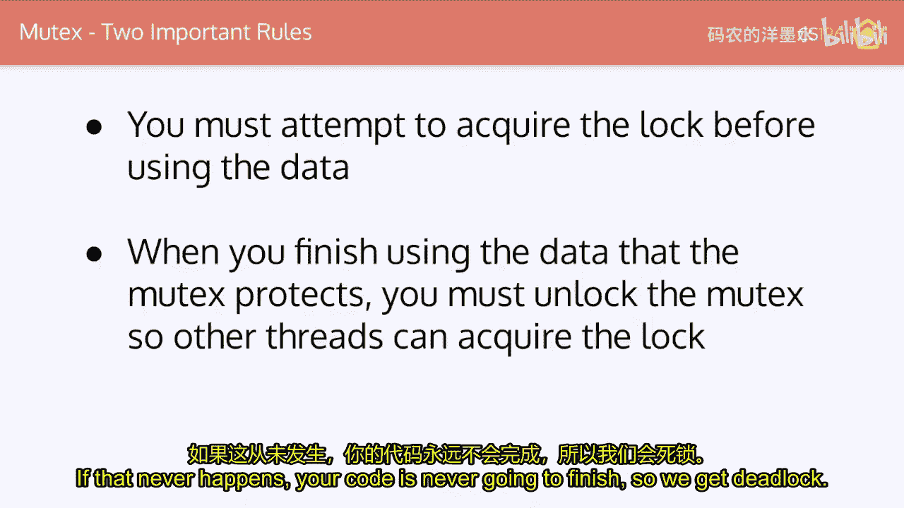

So Mut have two important rules and you're probably wondering why like this is pretty obvious。

 unlock it after you're done using it， but surprisingly。

You'll see a lot of like complex multistarted programming that isn't as obvious as it may seem。

 there might be several cases where you have to lock slash unlock a muttex。

 you might have several mut textes in a given instance， you know。

 the way different sets interact these things。Is difficult to predict。

 so if deadlocking isn't something that's a rare occurrence。

 you will see deadlocking very frequently when you're writing multitheted code。😊。

That's okay。Well we're going talk about howre helps us avoid this。 So with Muex is and generally。

 you must attempt to there are two important rules。 Firstly。

 you must attempt to acquire the lock before using the data。 And secondly。

 when you finish using the data that that the Mutex predicts。

 you must unlock the Muex so other threads can acquire the lock。

So this is exactly what we're talking about the mutex protects the data and you need to have it to use the data so as long as you have the mutex and nobody else can use it。

And when you're done using it， you have to let go of the muttex to unlock the mutex so other threads can acquire luck and continue using the data and the program can continue。

There there's a lot of information there。 Any questions about the Muex or。

Any concept we covered previously？You can just drop it in the chat。Allright， let's move on then。

To our kho。SoHere's the Kaoo code， I'll paste into the chat as well。

I'll keep it open for like one more minute and then we can get right into the Kaahooot。

Alright， I think everybody's in if you're not in yet。

 I'll you can just make a question in the Twitch chat and I can paste the code down。

 So let's start with the Kahoot。

Concurrency， too。

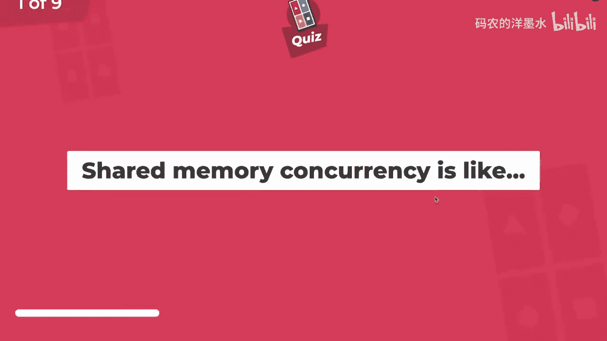

SoShar me Cur is like。Alright， so this one had a lot of mixed responses。

 Let's go back to my slide from before。嗯。Jump all the way back， I guess。All right。

 so shared memory concurrency is like multiple ownership because multiple threads can access the same memory location at the same time。

Yeah， so that's a definition the way sharing accuracy works is because the memory shared between all the threads。

 all the threads can read and write the same thing at the same time。

 which is why we have muteex so that we can protect data from being edited at inappropriate times。

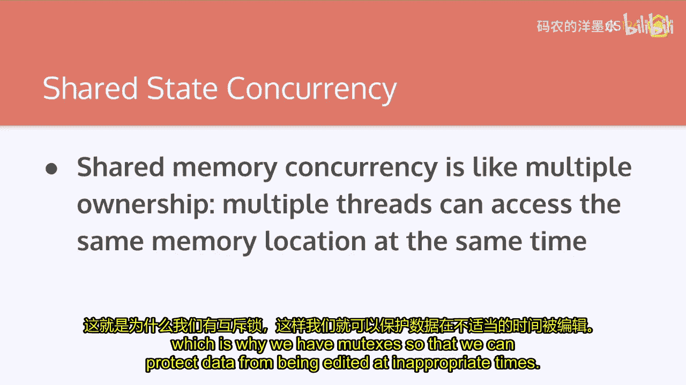

All right， next question。

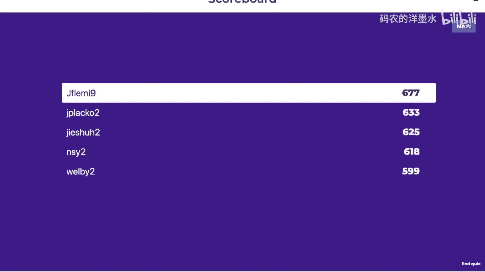

So what is Mutex stored for？Okay， so again， we。Yeah， the first one is a little tricky。

 Muable exclusive sounds pretty similar。 but it， it sounds for a mutual exclusion。

 So most you got it correct or big chunk， you got it correct。 It's the name Mutex。

Kind of like comes to an idea that only one person can access or one third can access data at the same time。

 So they're mutually exclusive。 No two that should access the same data at the same time。

And therefore we get the work mutual exclusion， remember that's super important this will come up a lot in later classes where you do parallel programming or multi more multi programming。

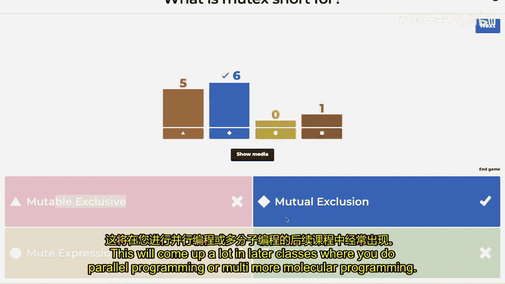

So yeah， next question。

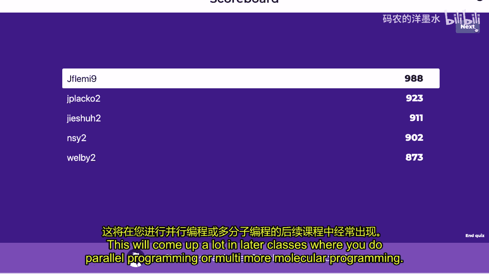

What is deadadlock？

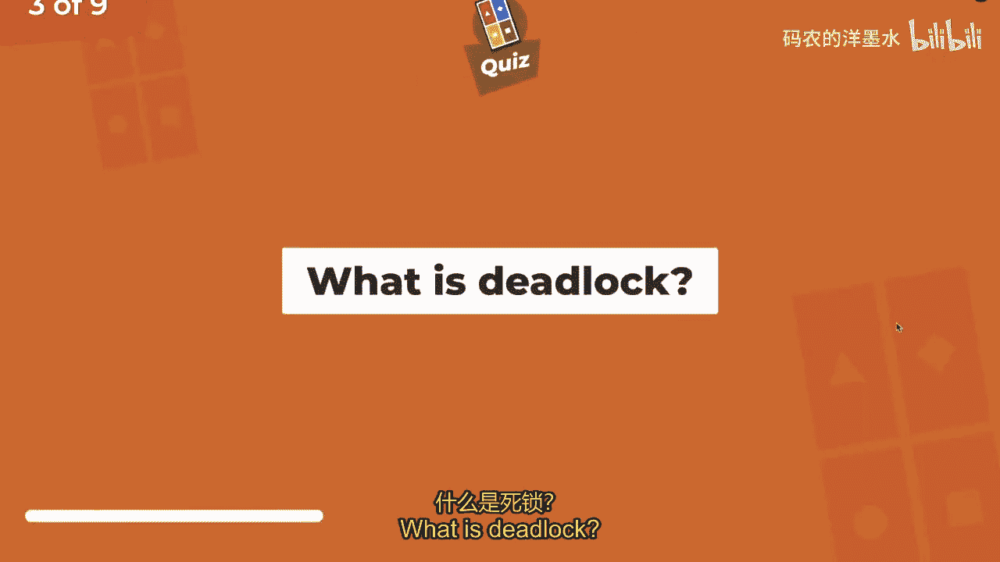

Alright， great。 So most guys got this correct。 So deadlocking occurs when Mutex is locked。

 never unlocked or it never unlocked because of a certain like condition not being met。 Therefore。

 all the other threads will hit the mutex block and then never complete because they can't move past that line of code until they require the muttex。

 So great。 most of you guys got that correct。

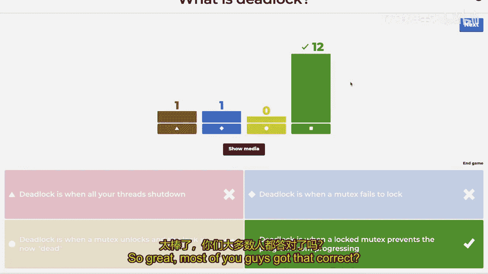

A big shift in the leaderboard there。

F， which of the options below can cause deadlock？

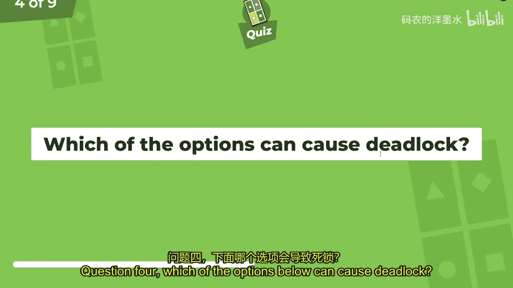

All right， yes， so most you guys again， there's two correct answers here。

So if you get to unlock a muttex， obviously when the other threads come to that mutex。

 they'll just block on the mutex and they'll never finish， Similarlyly。

 if you lock a mutex that has that will never be unlocked。

 it's pretty similar to the first case where all the other threads will hit it and never finish that your code will never finish。

Unlockys too early will not doesn't really matter you might have issues with like。

Your data being edited when it shouldn't be edited like in our first example。

But the code will run that'll be now deadlocking， finally you forget unlock a muttex in a program with one thread doesn't matter because you don't even need a muttex in a single start of program if you lock a muttex。

 that code will just keep moving past， it doesn't stop on the line where the Muex is the muttex kind like a barrier preventing other threads surpasing that point。

And we'll talk with them when we look at the actual code be a single third of program。

 it doesn't matter whether you have a mutex or not if you try to unlock and already unlock Mutex will have undefined behavior。

 but it's not going to cause your code to deadlock。All right。I think we have one more for this round。

So true false， you must attempt to acquire the lock before using the data。All right。

 you guys all got this correct。 So yep， this is exactly what we're talking about。

 You have to attempt a quiet lock for using the data and why the word attempt is using set up you must get the lock is because all the threads will run the same line of code so they're all going go for the lock whoever gets their first will be able to use the data first and the other ones will have to wait because they don't have the locks that is' waiting there because the code blocks it they get blocked by the mutex and eventually when the mutex is unlocked again。

 another thread can go and grab it So yep great job guys。😊。

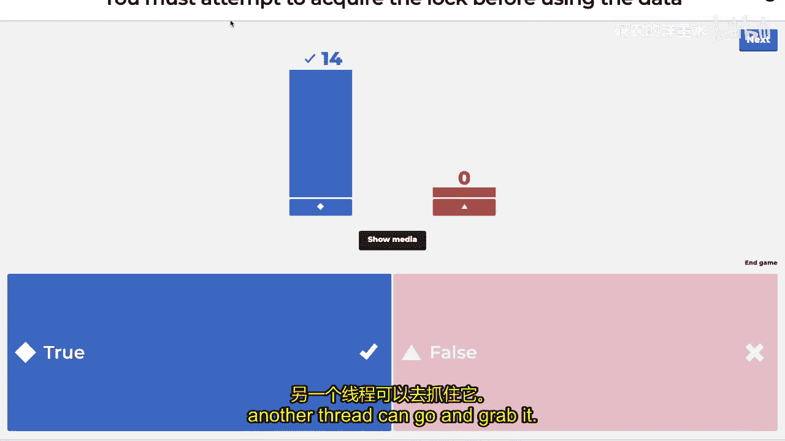

Take a look at the leaderboard and get back to the lecture。

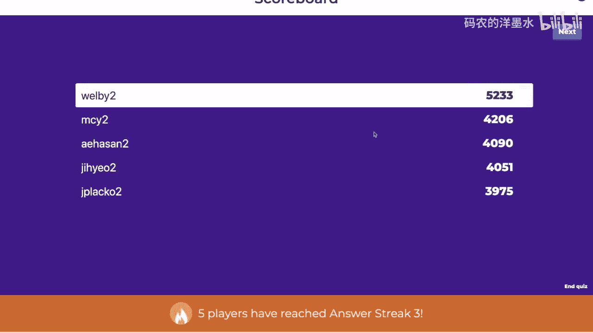

All right。😊，So let's jump back to where we were。See so recap with the two important Mutex rules that you must attempt to acquire the lock before using the data。

 and secondly， when you finish using the data that the Mutex protects。

 you have to unlock the mutex or other that's going to acquire the lock。

U because of like the complexity that comes with multi programming。

 it's often difficult to follow these rules， but rust helps us。

To get past on the complexity and make us help to prevent deadlocking and we're to talk about that now。

So let's look at this code here。For a simple muttex。

 so this is a single starter program we're not spawning any new threads。

 but we are going to use a mutex here。It is a little different to what you might imagine because Ru does a little differently than the languages。

 but I'm going to talk through red。So firstly， we create a new Mutex type using the new function。

 so our mut textex also holds this value5。At the moment， when we initialize it。

So very important using the new keyword to declare this new Muex and it's going to be called M。

And then to access data inside the Mutex， we use the lock method to acquire the lock。

 so we say let mutable numb。Equal end dot lock， and we unwrap it。

 and I'll talk more about this later。And this will block other threads also trying to access the data because let's say two threads are going for the lock at the same time。

 whichever thread gets here first will be able to unlock the Muex， do whatever wants the data。

 and the other thread is just going to have to wait at this line here until it can get the mutex。嗯。

So we can treat the return value name nu in this case as a mutable reference the data inside。

 so nuum isn't like it's on separate variable， it's just pointing to the value inside the mutex。

And we're dereferencing it to it， allocate values to it or edit it。

So if you haven't like put together already， Mut T is like a smart pointer。

Or more because BTC last year multiple owners the same thing。

 which is why it works with multiple their programs。To be more accurate。

 the call to lock would heard the smart pointer called Mutex Guard wrapped in the lock result that we handle with our call to unwraprap。

So when we call lock， we get mutex Guard， which is wrapped in lock result。

 and then we unwrap it to get the value。Which is here and numb。

So the mutus guide can be dereenced to point to our data and we see that here。

 so when we dereference it， we get the value here。Or we can assign values to it after you're referencing it。

And the mut also has a drop implementation that releases the lock once muttex guard drops out of the scope。

 So if you haven't heard the drop implementation before， I believe Sam covered it last lecture。

Essential this works is how like a rust handles like garbage collection when a variable or pointer goes out of scope。

 drop is called on it so that it releases its resource that's being used。

 So Muex guard automatically is drop called on it and that will also unlock the mutex。😊。

So if this seems like a lot of like words， lot of like complex starving in there， we have TDR here。

 we don't risk for Dan to unlock the mutex because this is done automatically for you。

 So rust automatically handles。Unlock in the mutex by using drop。And therefore。

 deadlock in rust is very unlikely， don't I actually don't think it's possible to deadlock in rust。

Which is great， we don't want to deadlock and rust， although a little more complex。

 like syntactically helps us logically to write cleaner code that is less likely to fail。

But unfortunately， the use of this kind of format doesn't work in actual multistarted code in Ru。

 I'm going to talk a little more about that。So what we're going to talk about now is more R specific and doesn't really work in other languages。

However， to use mut text between multiple threads， you need to do more of this the code you saw in the previous example。

So we have to use the AT smart pointer type and I'm not going to go too much into like the gr stuff about it。

 all you know is that it's an autoomically reference counted type。

What that means like only one it has like single value and it counts， it's like a counter variable。

And we use RT for additional thread safety， so this makes our programs threadSafe。

 however they aren't as fast， we lose some performance when we use the RT type。

 but we have to use the RT type because otherwise our multita code won't compile when we are creating multiple threads in rust。

And no we only have use RT multith programs because if we're having a single thread program we use RT。

 we're just losing performance for thread safety， which is not needed because we have just one thread。

All right， so let's look at this code here and let's walk through it。

So I'm going to talk about it quickly before we go into search pointers and stuff。

 but essentially we're going to create a mut text here。On a create vector called handles。

 which will have all our threads， we're going to loop here。嗯。Clown the counter to our new thread。

 create the thread。Unlock the threat， unlock the mutex， increment the number。

Add this new thread to our handles vector， and I'm going to join at the very end。Okay。

 so let's go through this step by step。So we give a value of multiple threadSafe owners by using the smartPoer Arc T to create an autoomically referenced countered value。

This is very similar to before， except we cast it to the archetype。We still use a new keyword。

Within the kneet。Within here， we then spawn 10 threads and each thread increments our value once。

 so notice once we dereence this value because it's mutle， we can edit it and once it's dereence。

 we can just treat it like a regular variable in rust。

So we spawn a thread and increment within an each cloud。And we join our threads at the end。

So using join synchronizes all our threads because you know that we don't know。

When the exc will finish， Because although we sp 10 threads。

 if your computer doesn't have 10 processors， it's not all gonna to run 10 things at the same time。

 It'll be like maybe four things running。It once， and it'll you know， do like each thread。

Once or twice。嗯。😊，And we print our result at the very end。

 So the reason we have our join up here is because we don't want to like print our result when we're still when stununk does or still trying to in the value and also if we print before joining we'd see print line results being printed like 10 times。

And we got our final result， which is 10。So the key thing to note here。Is that。

When we use the atype function， this makes it thread safe。

 So now when we create these threads and we want to use the Muex。

 we're not going to have issues with multiple owners trying to own the Muex because arc。

The Arcyke Sp planer allows us to have multiple owners with the Muex。Does that make sense。

 there's a lot of content there so if you have any questions you can drop them in the chat right now。

All right， if not， we have。So yeah， so this is pretty simple code excerpt。

But because all we did here was really increment a variable to 10。 and honestly， if we timed this。

 it probably would take the same amount of time as a single for loop without creating all these threads。

But this simple code excerpt can be set up as a template。

 make more complex multi programs or functions。Because most of these will have the same feature where we have to create all these threads。

 do something to data within the thread， and then like return that value here or print that value。

So we can use this example here as a template for more complex multither programs。

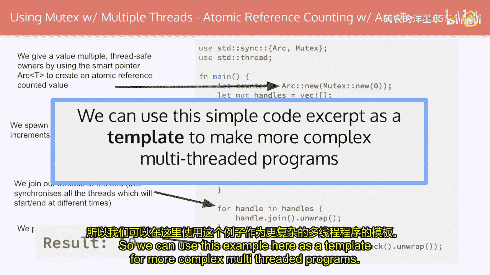

All right， and with that， we can go into our。Nextxiec。

So true or false， when you finish using the data that the Mutex protects。

 you must unlock the Mutex so other threads can acquire the lock。

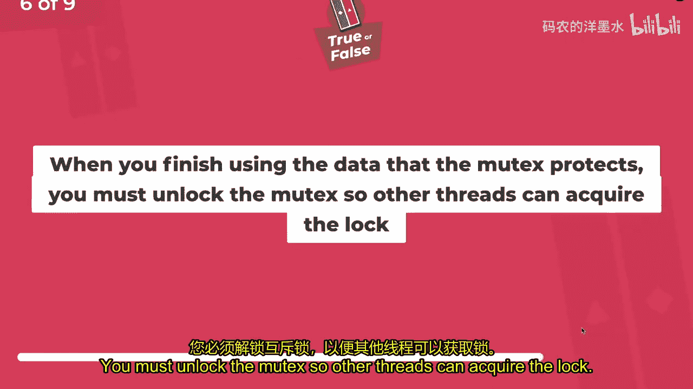

Okay， great。 so codes correct。 So when you finish using the data that the Mu textex protects。

 you have to unlock the muttex because don't unlock the muttex when all the other threads hit that line。

 they'll lock and they won't be able to unlock and finish the code。

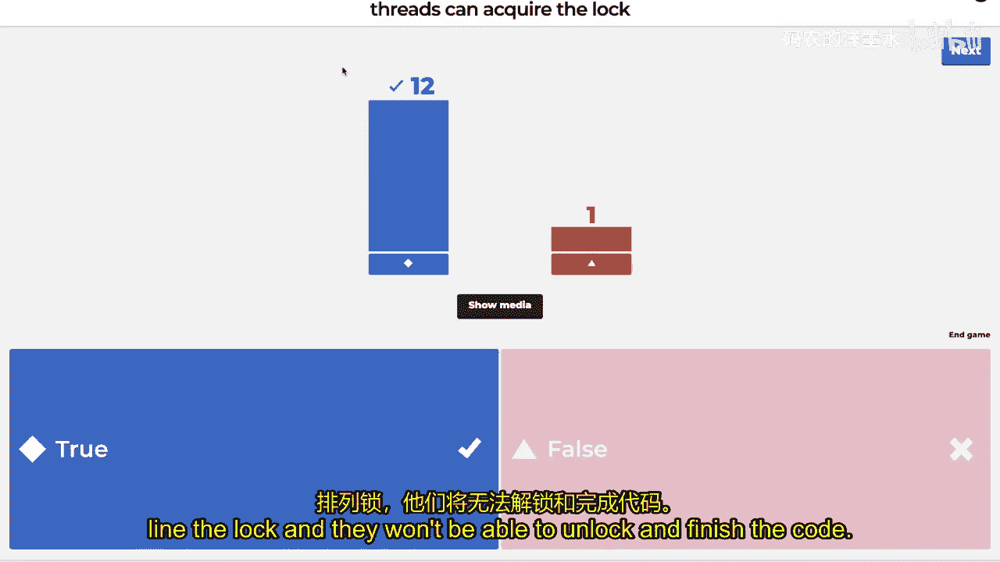

So great。

Next ones are more like syntax to see if you're paying attention。

So what keyword do we use to lock the mutex。I really hope your all gets all correct。

 there's a big hint in the title。Alright， so most of you is correct again。

 If we want to lock the mutex use the word lock。 So the words garden and protect。

 which are the other options picked are they might seem like good ideas because it is what you're doing。

 You are like protecting and guarding the data from other other threads when you lock it。

 But unfortunately， the keyword used lock。 And this is actually pretty。

 you'll see this in other like languages like C， for example， where we lock the mutex。 So it's just。

😊，A general， like syntactical thing that we use。

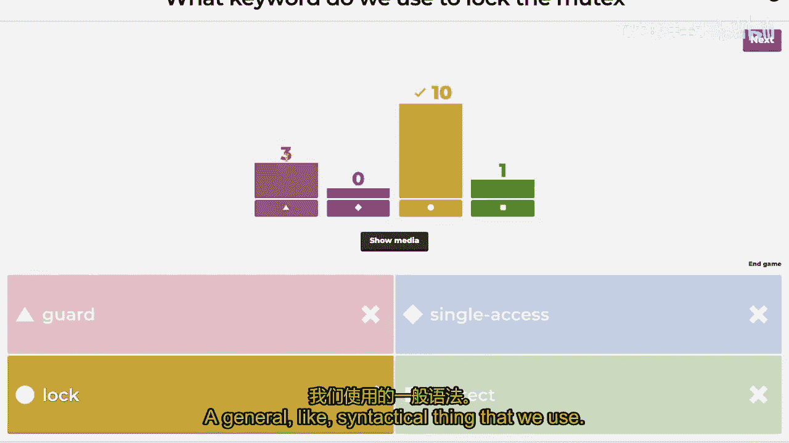

So what keyword would do we use to create a newm text type？

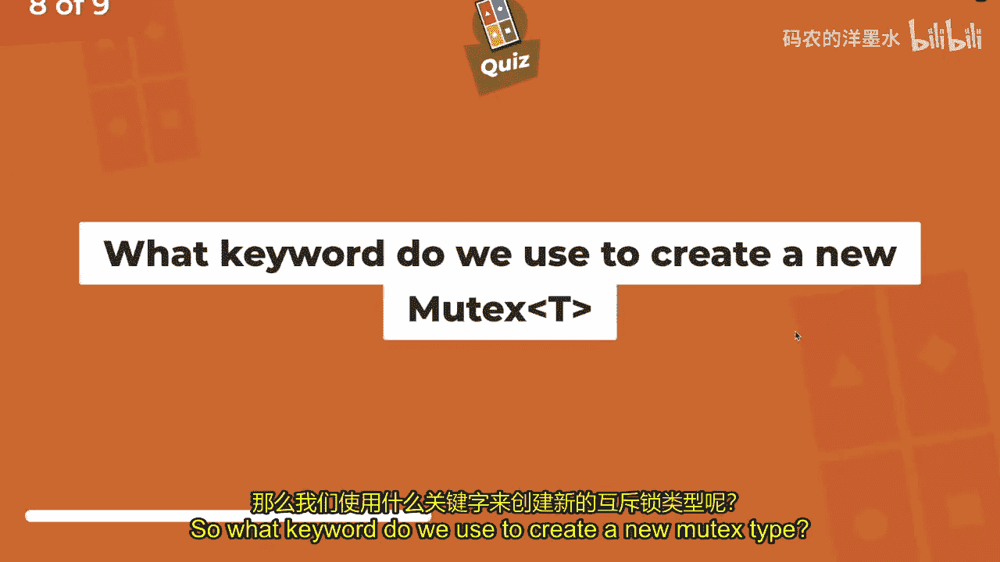

Alright， great。 So new is the correct answer。 as we saw in the code previously。

 when we want to spawn this new mutex， we use the keyword。 new this spawn is correct。

 we're going to declare a new mutex， we use the new keyword。 It's a great job。😊。

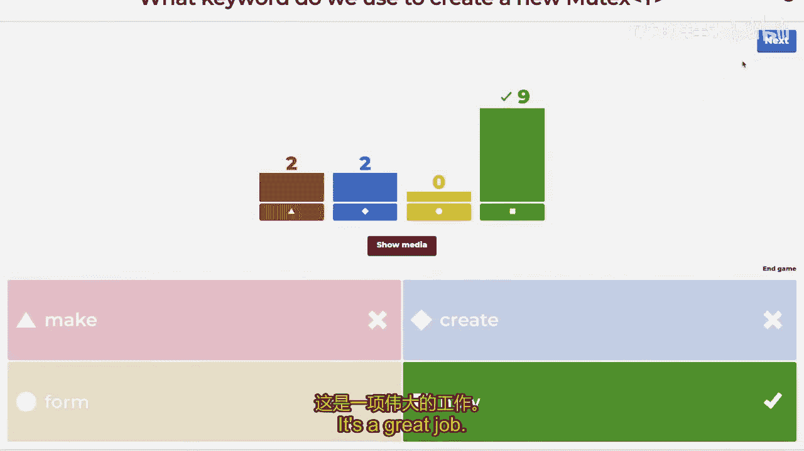

Final question， Arc T is not thread safe。 true or false。

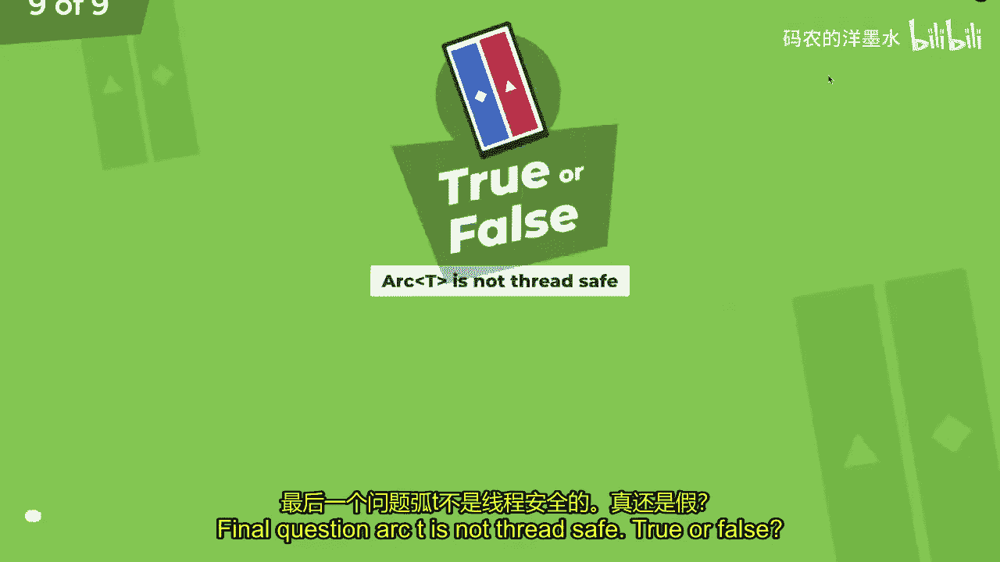

The archivetypes sorry。All right， so great job I correct again， so RT is not is threadsa。

 so the statement is false as we know we use our RT type because it allows our mutex to have multiple owners and makes it thread safe to so when we have multiple threads access to mutex at the same time。

 we aren't violating any issues with rust。

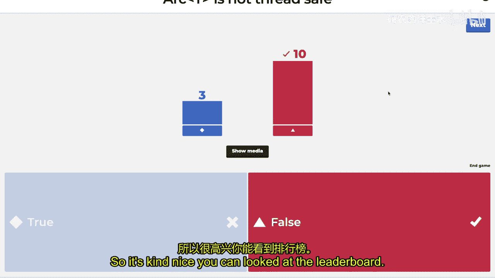

So's pretty nice we can look at the leaderboard。

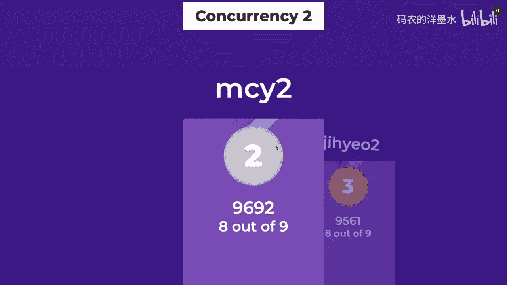

So great job number one for getting all them correct。

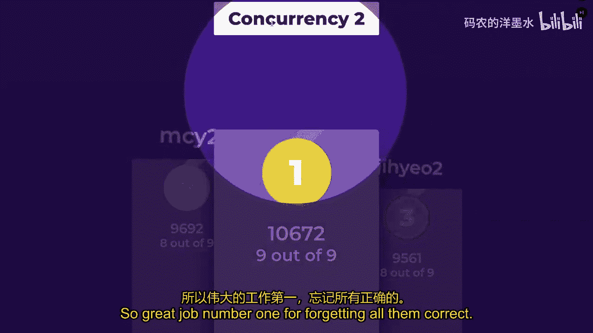

Awesome， so great job everyone。And I'm just going to close this。

Alright， yes， I'm going to look at if you look Co one last time。

 the biggest thing I want to like drive home today is that our mutex perdexar data。

 So although we're using a shared memory， which we said previously in the last lecture was not good。

 A shared memory is actually very doable when we had Mu textexbook that allows us to prevent other users from accessing the data。

😊，Mutex2 adds more complexity， we have to lock and unlock them。

 thankfully in you don't have to deal with the unlocking stuff， just the locking。

But this is very typical other languages， like E plus plus， where you can have parallel programming。

 but you have to have shared memory。 Therefore， using Newt helps us keep our。

Allows our programs to work the way we wanted to and not leave it up to chance for how the scheduler allocates time to the threads。

So finally， I want to talk about use of forcurrency。

 so to start off concurrency really isn't limited to specific group tasks。

 it optimizes certain tasks and honestly anything you can do concurrently you can do linearly too。

 but currency does help us in many ways because it speeds up tasks that would otherwise take a long time。

Is there easy for the Kaahhoot？Sure， why not？Last lecture is their tricky concept。 So yeah。

 what's EB。So what Kirssy actually does is increases a program's throughput so what I mean my throughput is it allows the number of tasks completed in a given time to increase proportionally to the number of processors so when you're writing code normally like in a single thread it's often only going run by one processor and that really isn't maximizing the use of your hardware。

 but if you have multiplecurrent programs， then more of your processors will be used at the same time。

So the more processes you have， the more throughput you can have because more tasks can be done because all the different processor can do different things。

And this can improve overall program structure because some tasks are just designed to be like a current。

So yeah， if you have a problem that is just very， very concurrent， like it's like for an example。

 like a real life example would be like baking cookies。

If you're going to do each task like making getting your ingredients， mixing them up。

 putting them in the pen in the oven， one by one each time in a row。

 if you have to make four cakes you're going to take a very long time。

But if we do them concurrently and we have like one person doing each thing。

 then we're going to increase the throughput overall for this task。And guess finally。

 this usually utilize hardware better than nonconcurt programs because when you only have one process running at the same time。

 you're just wasting the other four that you spent like most computers are quad corere。

 blah blah eight cores， and if you're not using all these cores。

 then you're not maximizing the use of the hardware in you' built in your computer。And with that。

 that's everything we wanted to cover today for your currency and thank you all for a fantastic semester。

 I hope you guys enjoyed the course， thought it was useful， learned something。😊。

And if you're interested in running for any positions on course staff。

 specifically like project manager， we'll be sending applications soon so keep an eye on Piazza for that now that it's everything I wanted to cover you're free to leave hope you have a wonderful weekend。

And thank you for coming to the last lecture。

