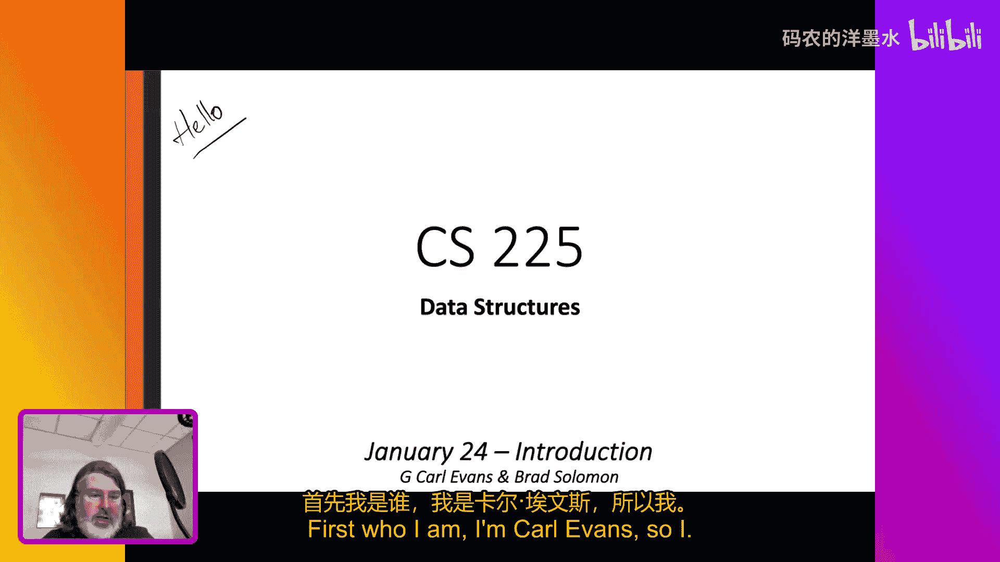
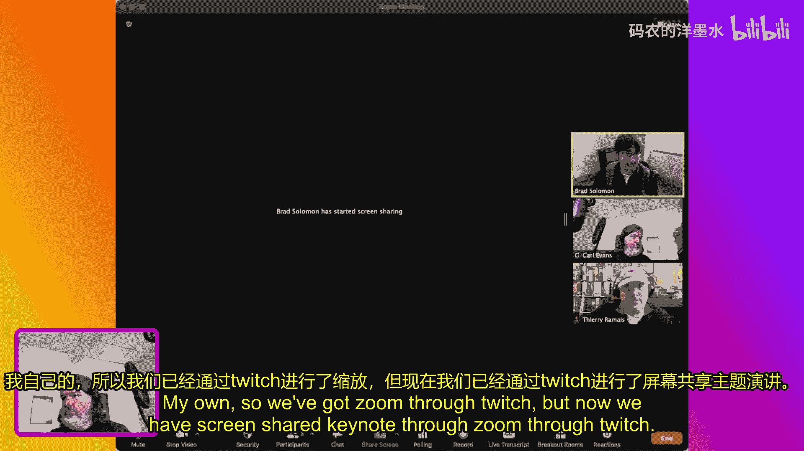
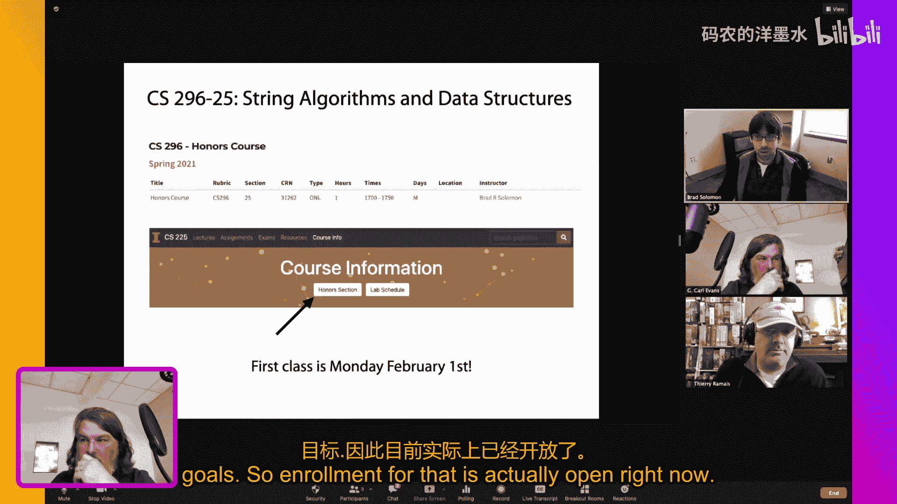
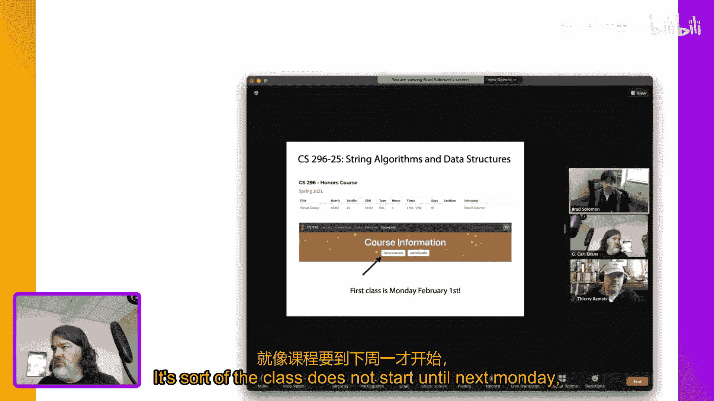
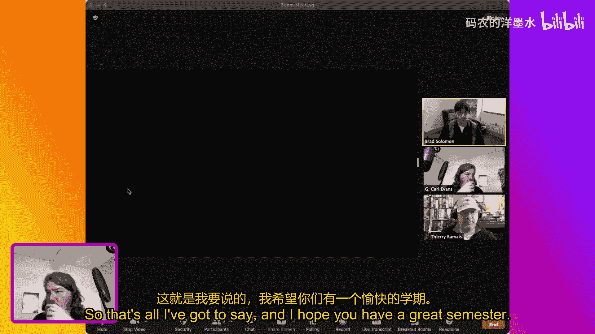
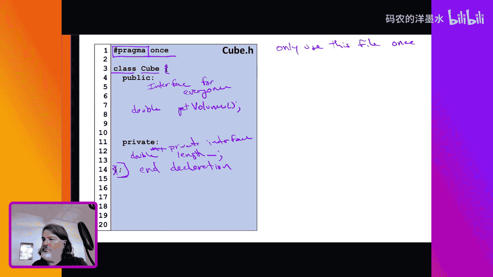

# 数据结构与算法：1：导论

在本节课中，我们将学习课程的基本介绍，包括课程目标、教学团队、课程结构以及C++编程语言的基础概念。

## 课程与教学团队介绍

大家好，欢迎来到CS 225课程。今天我们将进行课程导论，介绍课程内容与运行方式。课程讲座将通过Twitch平台直播进行，实验课将通过Zoom平台进行，更具协作性。

首先，我们来介绍教学团队。

我是卡尔·埃文斯。我在伊利诺伊大学任教多年，并且是在本地长大的。我的研究方向是计算科学，特别是通过模拟来替代昂贵的实验。例如，我曾研究等离子体耦合燃烧的模拟。此外，我也研究过并行计算中的系统求解器，以及程序流程控制的图形化表示，这与本课程的部分内容相关。

接下来是布拉德·所罗门。我是一名新任的计算机科学教学助理教授。我的背景是计算基因组学，主要研究如何高效地存储、搜索和分析大型基因组数据集。我开发过如序列B树等新颖的数据结构。本学期，我还将负责荣誉课程部分，重点讲授字符串算法和数据结构，并将其与图算法等核心概念结合。

最后是特里。我负责本课程的后勤与行政管理工作，协调课程各部分之间的沟通，处理日程安排、考试缺席申请等事务性问题。如果大家对课程运行方式有任何疑问，可以联系我。

## 课程沟通与资源

有多种方式可以联系我们并获取帮助。

*   最佳的联系方式是发送邮件至课程管理邮箱：`cs225admin@illinois.edu`。
*   我们有一个Discord服务器，非常适合快速提问和交流。虽然我们不会在那里进行私人的代码调试，但会有很多同学乐于互相帮助。
*   我们使用Piazza平台进行课程讨论。请注意，我们使用的是免费版本，**没有付费要求**。

## 学生背景与课程起点

了解大家的编程背景对课程安排很重要。本课程的先修要求主要涉及理论和编程两方面。

在理论方面，大部分同学可能来自CS 173或MATH 213课程，学习了算法分析、图、树和证明等概念。

在编程方面，大家的背景更加多样：
*   许多同学来自CS 125（Java）或CS 126（Java转向C++）。
*   部分同学来自ECE 220（C语言，后期涉及C++）。
*   我们还看到有Python、Haskell、Pascal等多种语言背景的同学。

本学期我们首次开设了CS 128课程，它将教授C++，未来可能会影响本课程的先修要求。但目前，**本课程的前几周将重点讲解C++**，以确保所有同学都能跟上。

## 课程核心：数据结构是什么

本课程的核心是数据结构。但数据结构究竟是什么？我们可以通过图书馆的比喻来理解。

想象三个不同的图书馆：
1.  **本科图书馆**：一个通用图书馆，采用杜威十进制系统按主题分类书籍。这种结构便于按概念进行探索和发现。
2.  **绘本图书馆**：书籍全部封面朝外摆放。这种结构针对儿童设计，便于通过视觉发现书籍，解决了“如何让孩子找到想看的书”这个特定问题。
3.  **博德利图书馆**：书籍按照入馆时间顺序排列。这种结构便于观察馆藏随时间的演变，解决了“如何展示历史脉络”的问题。

这些图书馆都存储信息并使其可用，但因其服务的目标不同，而采用了截然不同的组织结构。

**数据结构也是如此**。它是组织信息的一种架构。我们选择如何存储数据，决定了哪些操作会变得简单，哪些会变得困难。数据本身很重要，但我们组织数据的最终目的是为了**使用它**来完成特定任务。

在本课程中，我们将学习：
*   **如何设计数据架构**：为了完成特定任务，应如何组织数据。
*   **实践层面**：如何用代码实现这些结构。
*   **理论层面**：如何分析这些结构的性能和行为。

这门课巧妙地将计算机科学中抽象的理论与具体的实现细节结合在了一起。

## C++编程基础：核心差异

对于来自Java等语言的同学，C++在语法上看起来相似，但有一个根本性差异：**C++以具体的方式管理内存**。

在C++中，每个变量都包含几个要素：
*   **名称（Name）**：变量的标识符。
*   **类型（Type）**：如 `int`, `char`, `double`，或用户定义的类（如 `Cat`）。
*   **内存位置（Memory Location）**：变量在计算机内存中存储的地址。
*   **值（Value）**：存储在该内存位置的数据。

对于未初始化的基本类型变量（如 `int my_favorite_int;`），其值是**未定义的（undefined）**，即该内存位置原先存在的、未知的数据。这是C++编程中常见的问题来源。

对于类对象（如 `Cat guinevere;`），如果没有指定，它们会通过**默认构造函数（default constructor）**进行初始化。

关于 `NULL` 与 `nullptr`：在C++11及以后的标准中，推荐使用 `nullptr` 表示空指针。`NULL` 通常是一个定义为0的宏，在旧代码中常见。

## 封装与文件组织

封装是将接口与实现分离的思想，这非常重要。

*   **接口（Interface）**：描述如何使用一个类。例如，数组的接口是通过方括号和索引来访问元素。
*   **实现（Implementation）**：描述功能如何被完成。例如，一个图形类中画圆功能的具体代码。

不同的实现方式（如使用数组、指针等）不会改变接口，但会严重影响操作的效率。

C++通过多文件结构来实现封装：
*   **头文件（.h 文件）**：包含类的接口声明。
*   **源文件（.cpp 文件）**：包含类的具体实现代码。

头文件通常以 `#pragma once` 指令开头，这是一个**头文件保护（header guard）**，确保该文件在编译时只被包含一次，防止重复定义。

在头文件中，我们定义类。类内部通常分为 `public`（公开接口）和 `private`（私有实现）部分。私有成员变量常以下划线结尾（如 `length_`）作为命名约定。

有时，非常简单的函数实现也会直接写在头文件中。C++功能强大但需要谨慎使用，就像链锯一样，初学者可能容易出错，但熟练掌握后能完成非常高效的工作。

## 总结

本节课我们一起学习了CS 225课程的概览。我们认识了教学团队，了解了课程沟通渠道。我们探讨了数据结构的本质——它是为特定任务而设计的信息组织架构，并通过图书馆的比喻加深了理解。最后，我们介绍了C++与Java的核心区别，即其对内存的具体管理，并学习了C++中通过头文件和源文件实现封装的基本概念。下节课我们将继续深入C++的细节。