# 002：内存管理基础 🧠

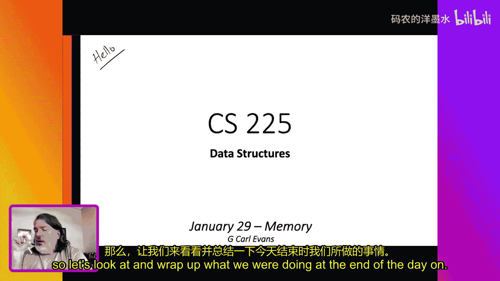

在本节课中，我们将学习C++中关于内存管理的基础知识，包括构造函数、引用和指针。这些概念是理解C++如何管理内存以及它与Java等语言区别的关键。

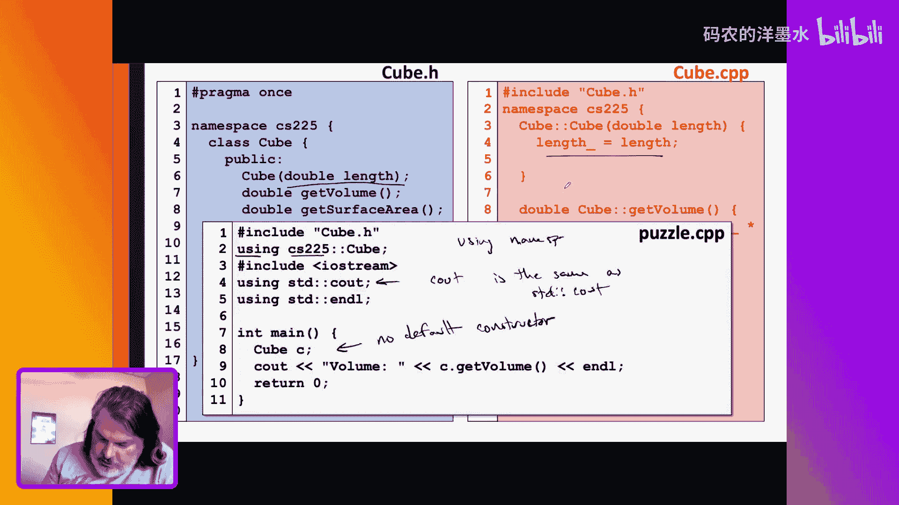

---

## 构造函数回顾与深入 🔧

上一节我们介绍了构造函数。我们编写了一个自定义构造函数，并发现了一个重要问题。

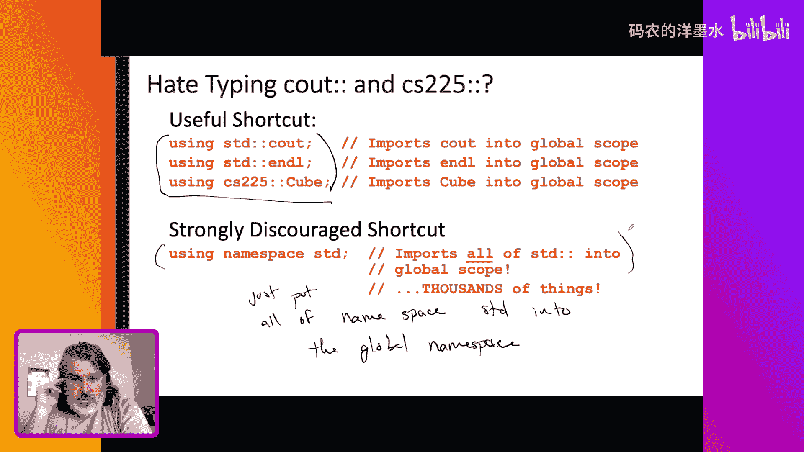

```cpp
class Cube {
public:
    Cube(double length) {
        length_ = length;
    }
    double getVolume() {
        return length_ * length_ * length_;
    }
private:
    double length_;
};
```

当我们尝试创建一个没有参数的`Cube`对象时，代码无法编译。

```cpp
Cube c; // 编译错误！
```

这是因为一旦我们编写了任何自定义构造函数，编译器就不再自动提供默认构造函数。要解决这个问题，有两种方法。

以下是两种解决方案：

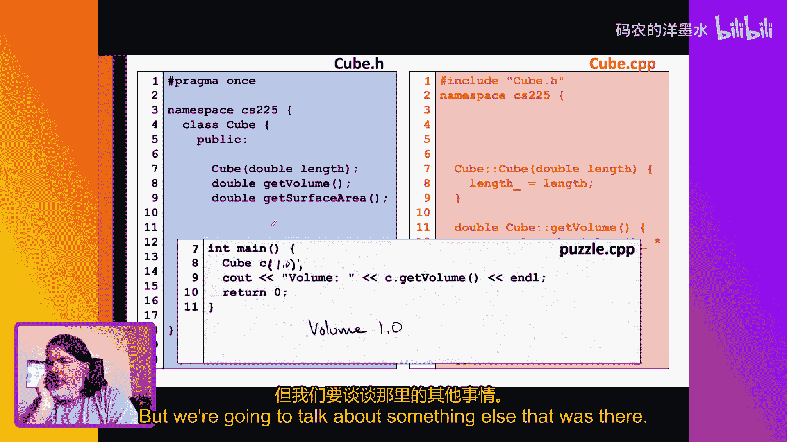

1.  **添加一个默认构造函数**：我们显式地编写一个不接受任何参数的构造函数。
    ```cpp
    class Cube {
    public:
        Cube() { // 默认构造函数
            length_ = 1.0;
        }
        Cube(double length) { // 自定义构造函数
            length_ = length;
        }
        // ... 其他成员
    };
    ```

2.  **在创建对象时提供参数**：直接使用我们已有的自定义构造函数。
    ```cpp
    Cube c(2.0); // 使用自定义构造函数
    ```

这两种方式都是函数重载的例子。函数重载允许我们为同一个函数名（这里是`Cube`）提供多个版本，只要它们的参数列表不同即可。

---

## 命名空间的使用 📛

在代码中，我们使用了`using`声明来简化代码。

```cpp
using CS225::Cube;
using std::cout;
```

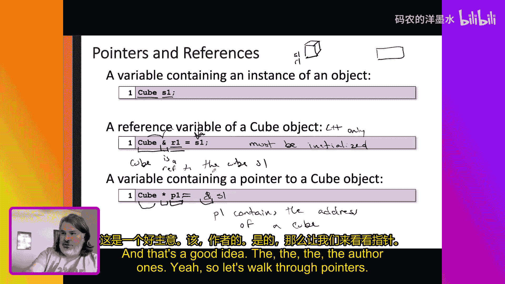


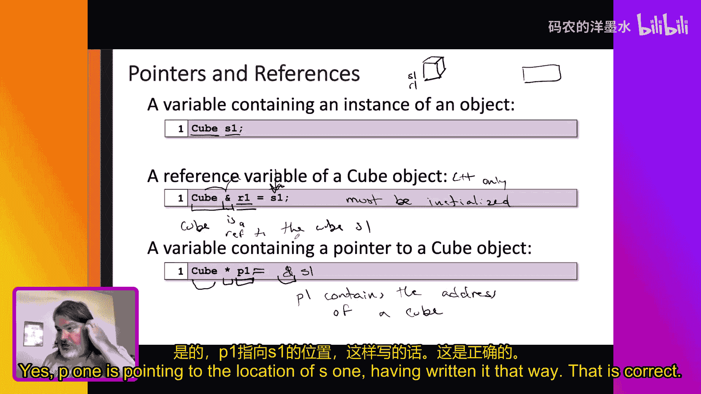

这比使用`using namespace std;`更安全。后者会将整个`std`命名空间中的所有名称引入全局作用域，可能导致名称冲突和难以理解的错误。明确引入所需的名称是更好的实践。

全局命名空间是所有不属于任何特定命名空间的标识符的容器。命名空间的作用是组织和区分这些标识符。

---

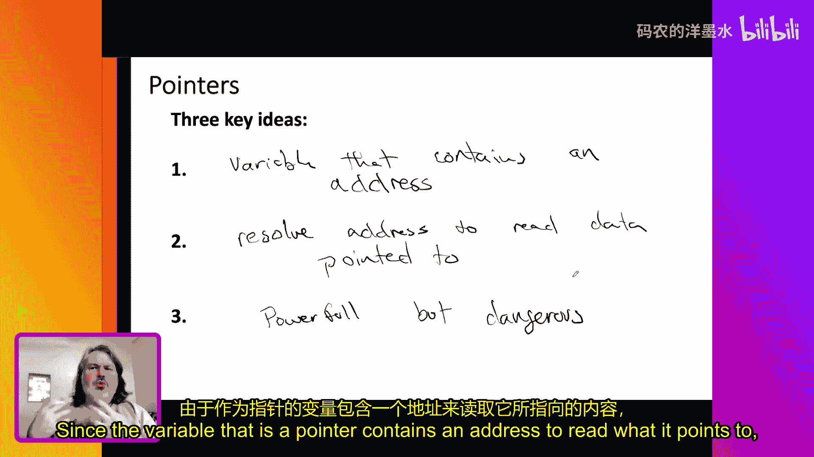

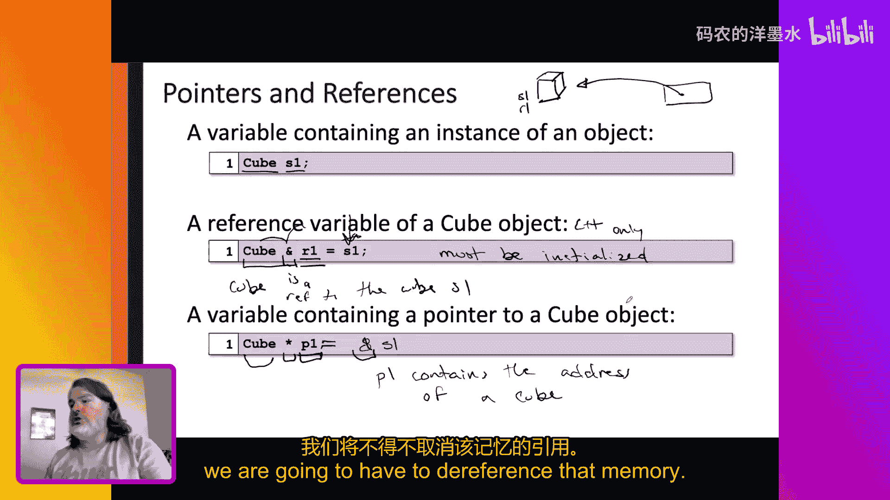

## 变量、引用与指针 🎯

本节中我们来看看C++中几种不同的变量类型，这是理解内存操作的基础。

### 变量
变量是存储数据的基本单元。
```cpp
Cube s1; // 在内存中创建一个Cube对象，命名为s1
```

### 引用
引用是另一个变量的别名。它必须在创建时初始化，并且一旦初始化，就不能再指向其他变量。引用本身不占用额外的存储空间（实现细节可能不同，但逻辑上如此）。
```cpp
Cube &r1 = s1; // r1是s1的引用（别名）
```
**公式**： 如果 `r` 是 `T` 类型的引用，则 `r` 等价于它所绑定的那个 `T` 类型对象。

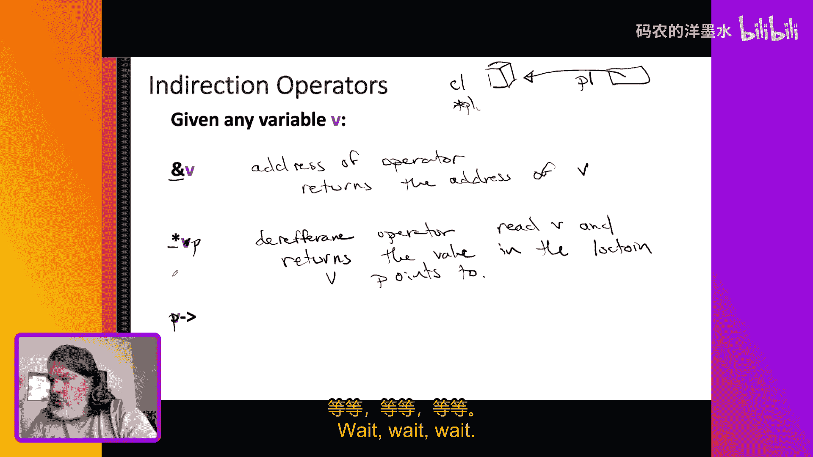

### 指针
指针是一个变量，它存储的是另一个变量的内存地址。
```cpp
Cube *p1; // p1是一个指向Cube的指针
p1 = &s1; // 将s1的地址赋值给p1
```
**公式**： 指针变量 `p` 存储的是地址值 `&x`，其中 `x` 是某个对象。

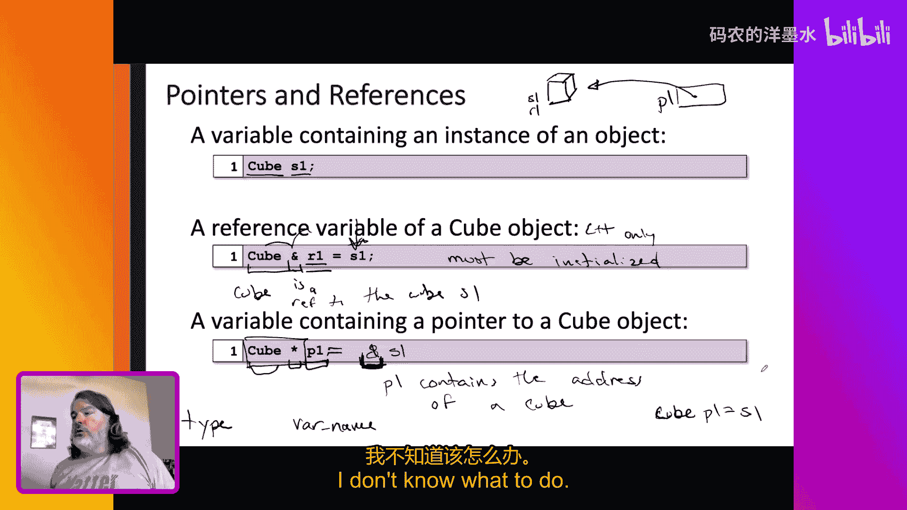

---

## 间接操作符详解 ⚙️

为了操作指针和地址，C++提供了几个关键的运算符。

### 取地址运算符 (`&`)
在表达式中使用`&`可以获取一个变量的内存地址。
```cpp
Cube *p = &s1; // p保存了s1所在的内存地址
```

### 解引用运算符 (`*`)
使用`*`可以访问指针所指向地址中存储的值。
```cpp
double vol = (*p).getVolume(); // 访问p指向的Cube对象，并调用其方法
```

### 箭头运算符 (`->`)
这是访问指针所指向对象的成员的快捷方式，它等价于先解引用再使用点运算符。
```cpp
double vol = p->getVolume(); // 与 (*p).getVolume() 完全相同
```
**代码对比**：
```cpp
// 以下三行代码效果相同
double v1 = s1.getVolume();
double v2 = (*p1).getVolume();
double v3 = p1->getVolume();
```

指针非常强大，但也容易导致错误（如空指针解引用、内存泄漏），因此需要谨慎使用。

---

## 内存布局示例 🗺️

让我们通过一个简单的例子看看变量和指针在内存中是如何安排的。

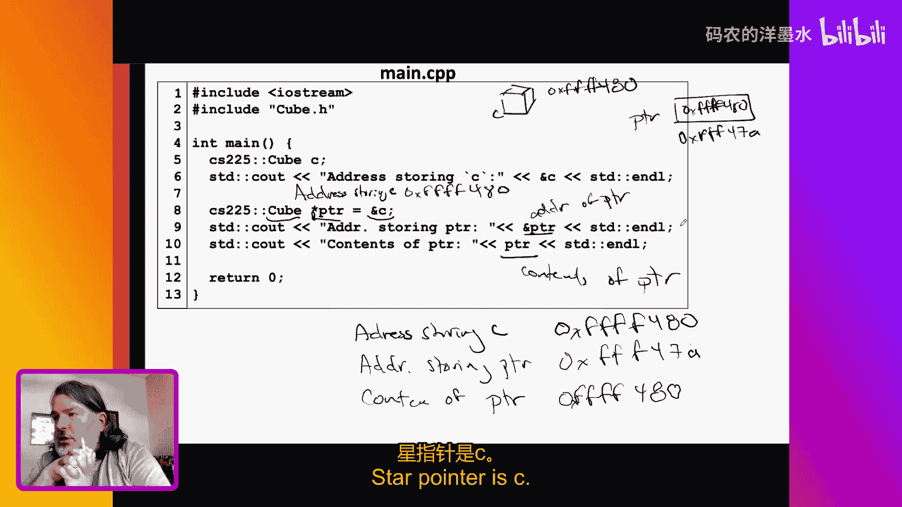

```cpp
int a;          // 未初始化的int，通常占用4字节
int b = -3;     // 初始化为-3的int
int c = 12345;  // 初始化为12345的int
int *p = &b;    // 指向b的指针，在64位系统上通常占用8字节
```

假设栈内存从高地址向低地址增长，而单个变量从低地址向高地址存储，其布局可能如下所示（地址为示意）：
```
高地址
...
[ a (4字节) ]    地址：0xFFFF...F4
[ b (4字节) ]    地址：0xFFFF...F0 (p指向这里)
[ c (4字节) ]    地址：0xFFFF...EC
[ p (8字节) ]    地址：0xFFFF...E4 (存储着值 0xFFFF...F0，即b的地址)
...
低地址
```

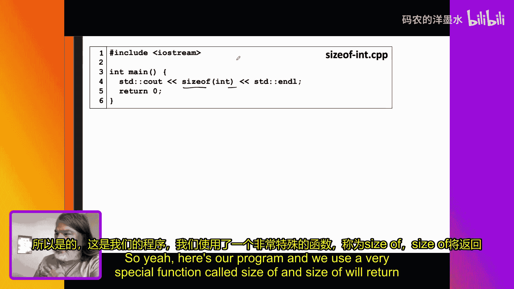

我们可以使用`sizeof`运算符来查看类型或变量占用的字节数。
```cpp
std::cout << sizeof(int) << std::endl;  // 输出int的大小，如 4
std::cout << sizeof(p) << std::endl;    // 输出指针的大小，如 8
```

---

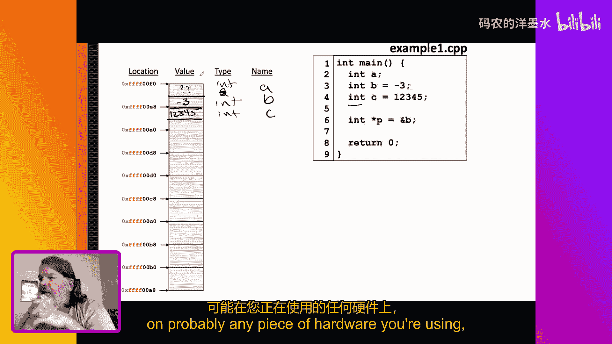

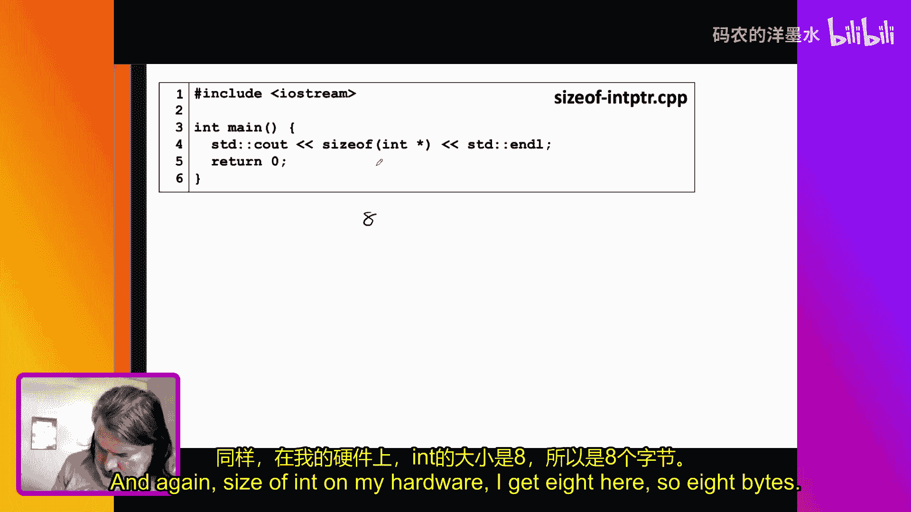

## 总结 📚

本节课中我们一起学习了C++内存管理的几个核心概念：
1.  **构造函数**：自定义构造函数会抑制默认构造函数的生成，需要根据需求选择添加默认构造函数或调用带参构造函数。
2.  **引用**：作为变量的别名，必须初始化且不可重新绑定，用于提供对现有对象的另一个访问名称。
3.  **指针**：存储内存地址的变量。通过取地址运算符(`&`)获取地址，通过解引用运算符(`*`)或箭头运算符(`->`)访问指向的数据。
4.  **内存布局**：了解了栈的基本概念以及变量、指针在内存中的大致排列方式。

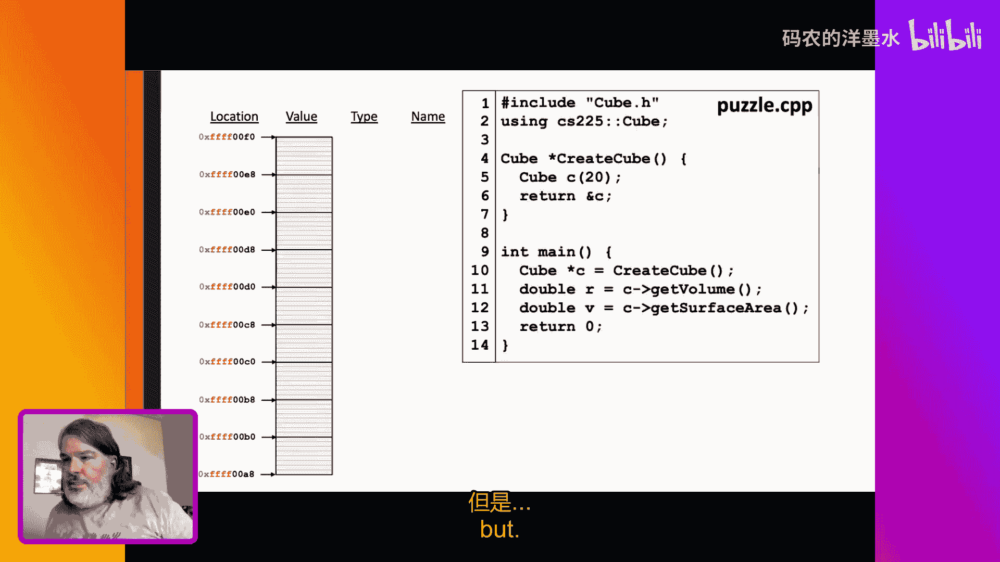

理解变量、引用和指针的区别与联系，是掌握C++手动内存管理能力的第一步。在接下来的课程中，我们将继续深入探讨如何使用这些工具来动态分配和释放内存。