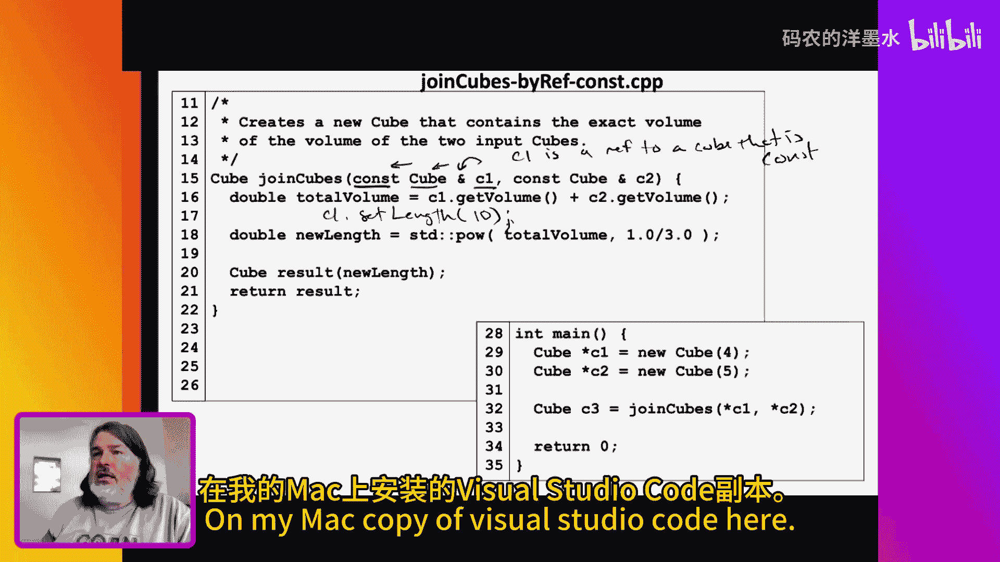
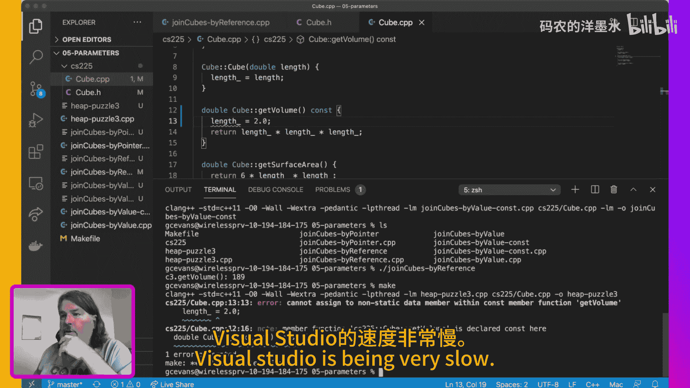
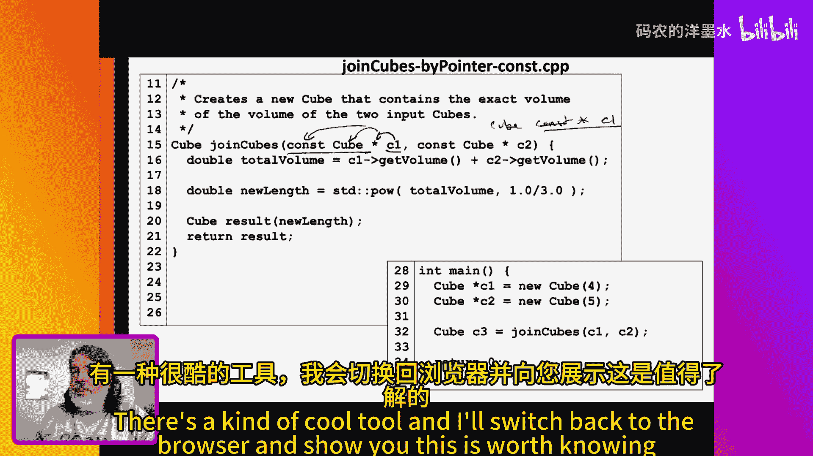
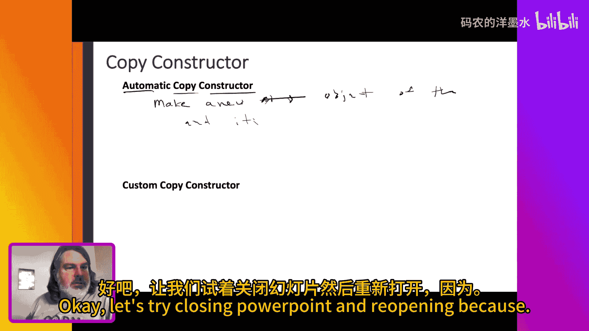
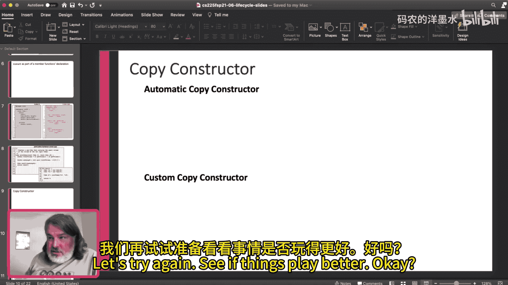
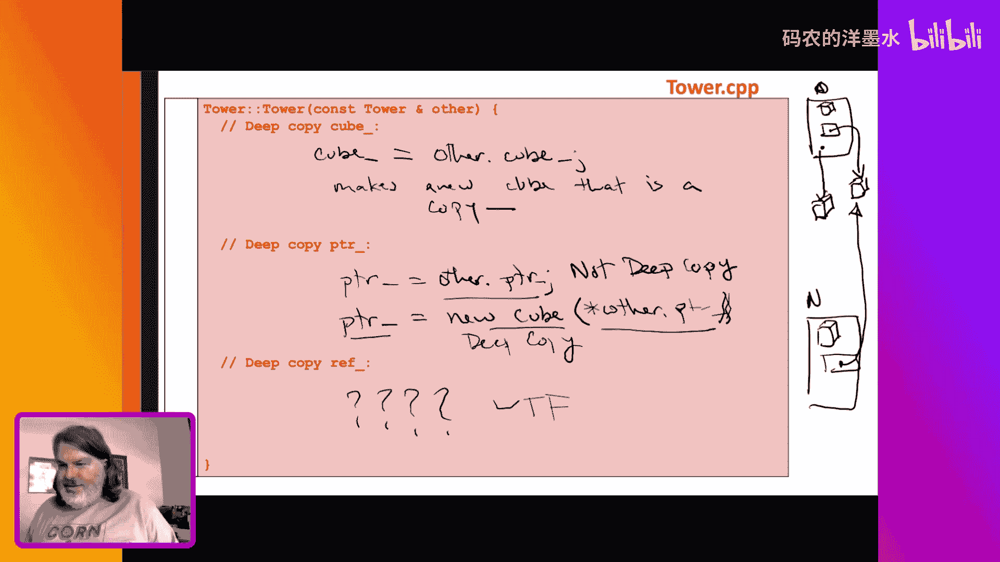

# 005：生命周期 🧬

在本节课中，我们将要学习C++中两个核心概念：`const`关键字和拷贝构造函数。我们将了解如何使用`const`来保证代码的安全性，以及如何通过拷贝构造函数来控制对象的复制行为。

---

## `const`关键字：不可变的承诺



上一节我们介绍了引用和指针，本节中我们来看看如何让它们更安全。`const`关键字用于声明一个不可变的常量或对象。它告诉编译器，这个值在初始化后不能被修改。

### `const`的基本用法

以下是`const`的基本用法：

*   `const int pi = 3;`：声明一个整型常量`pi`，其值不能改变。
*   `pi = 5;`：这行代码会导致编译错误。

### `const`与引用

当`const`与引用结合时，可以确保函数不会修改传入的参数。这对于代码的可读性和安全性至关重要。

```cpp
void printCube(const Cube& c) {
    // 函数承诺不会修改c
    double vol = c.getVolume();
    std::cout << vol << std::endl;
}
```



如果一个对象被声明为`const`，那么只能调用该对象中被标记为`const`的成员函数。因为编译器需要确保这些函数不会修改对象的状态。

### 标记成员函数为`const`



在成员函数声明的末尾添加`const`，表示该函数不会修改其所属对象的任何成员变量。

```cpp
class Cube {
public:
    double getVolume() const; // 这是一个const成员函数
private:
    double length_;
};
```

**注意**：`const`在函数**之前**和**之后**的含义不同：
*   `const double getVolume();`：表示返回值是一个`const double`。
*   `double getVolume() const;`：表示`getVolume`函数不会修改`Cube`对象。


### `const`与指针

`const`与指针结合时，需要仔细区分是**指针本身**不可变，还是**指针指向的内容**不可变。

以下是`const`与指针的几种组合：

*   `const Cube* ptr;`：`ptr`是一个指针，它指向一个`const Cube`。你不能通过`ptr`来修改它指向的`Cube`对象，但可以让`ptr`指向另一个`Cube`。
*   `Cube* const ptr;`：`ptr`是一个`const`指针，它指向一个`Cube`。你不能改变`ptr`本身（即不能让它指向别的地址），但可以通过`ptr`来修改它当前指向的`Cube`对象。
*   `const Cube* const ptr;`：`ptr`是一个`const`指针，它指向一个`const Cube`。两者都不可改变。

---

## 拷贝构造函数：对象的复制

上一节我们了解了如何保护对象不被修改，本节中我们来看看如何复制一个对象。拷贝构造函数是一种特殊的构造函数，用于创建一个新对象作为现有对象的副本。

### 何时会调用拷贝构造函数？

在以下情况中，拷贝构造函数会被调用：





1.  用一个对象初始化另一个对象时：
    ```cpp
    Cube c1(5);
    Cube c2 = c1; // 调用拷贝构造函数
    Cube c3(c1);  // 另一种语法，同样调用拷贝构造函数
    ```
2.  以**传值**方式将对象传递给函数时。
3.  函数以**传值**方式返回对象时。

### 默认拷贝构造函数

如果你没有为类定义拷贝构造函数，编译器会自动生成一个**默认拷贝构造函数**。它的行为是：对对象的每一个非静态成员变量，调用其自身的拷贝构造函数进行复制（对于基本类型，则是直接复制值）。

对于简单的类（如我们之前的`Cube`），默认拷贝构造函数完全够用。

### 自定义拷贝构造函数

有时，默认的“逐成员复制”行为并不正确，特别是当类中包含**指针**成员时。这时我们需要编写自己的拷贝构造函数。

拷贝构造函数的签名是固定的：

```cpp
ClassName(const ClassName& other);
```

它必须是引用传递。如果使用值传递，为了复制参数`other`，又需要调用拷贝构造函数，这将导致无限递归。

以下是一个自定义拷贝构造函数的例子：

```cpp
class Cube {
public:
    // 自定义拷贝构造函数
    Cube(const Cube& other) {
        length_ = other.length_; // 直接复制值
    }
private:
    double length_;
};
```

### 初始化列表

在构造函数中，有些成员（如`const`成员、引用成员）必须在对象创建时初始化，而不能在构造函数体内赋值。这时需要使用**成员初始化列表**。

以下是使用初始化列表的拷贝构造函数：

```cpp
class Tower {
public:
    Tower(const Tower& other)
        : cube_(other.cube_),        // 调用Cube的拷贝构造函数
          ptr_(new Cube(*other.ptr_)), // 深拷贝：新建一个Cube对象
          ref_(other.ref_)           // 引用只能初始化，不能重新绑定
    {
        // 构造函数体
    }
private:
    Cube cube_;
    Cube* ptr_;
    Cube& ref_;
};
```

### 浅拷贝与深拷贝

这是理解自定义拷贝构造函数为何重要的关键：

*   **浅拷贝**：仅复制指针的值（即内存地址）。结果是两个指针指向同一块内存。修改其中一个对象会影响另一个。
*   **深拷贝**：为新对象分配新的内存，并复制原指针所指向的实际内容。结果是两个完全独立的对象。

默认拷贝构造函数进行的是浅拷贝。当类管理动态分配的内存（拥有指针成员）时，通常需要实现深拷贝，以避免多个对象意外共享同一资源，导致重复释放内存等问题。

---



本节课中我们一起学习了`const`关键字和拷贝构造函数。`const`是提高代码安全性和表达力的重要工具，它能明确表达“不变”的意图。拷贝构造函数则控制了对象复制的行为，对于管理资源的类（尤其是包含指针的类）来说，实现正确的拷贝语义（通常是深拷贝）至关重要，这是避免内存错误的关键一步。