# 数据结构与算法：第6讲：析构函数与运算符重载

在本节课中，我们将要学习C++中两个重要的概念：析构函数和运算符重载。析构函数负责在对象生命周期结束时清理资源，而运算符重载则允许我们为自定义类型定义运算符的行为。

## 析构函数

上一节我们介绍了拷贝构造函数，本节中我们来看看析构函数。析构函数的目的是释放由对象分配的任何资源。这通常是内存，但也可能是网络连接、文件句柄或数据库锁等。

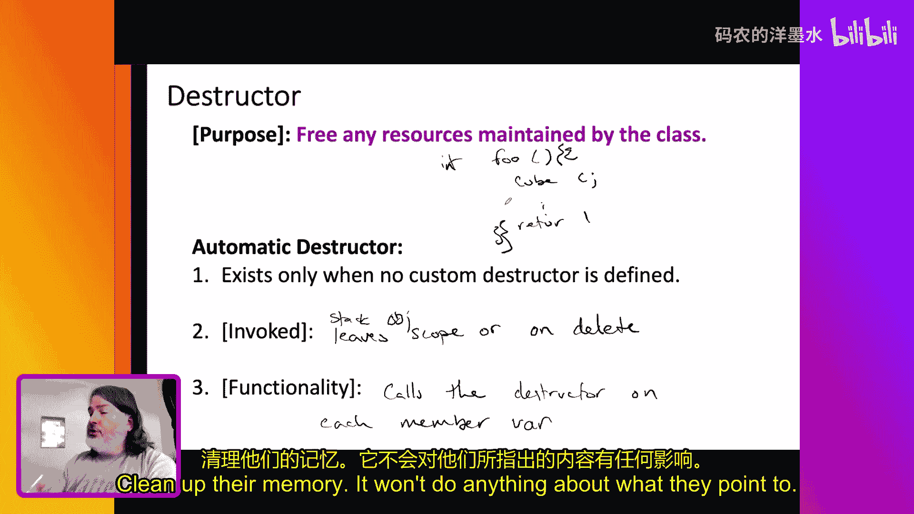

析构函数是一个特殊的成员函数，其名称由波浪号（`~`）后接类名构成。它没有参数，也没有返回值。

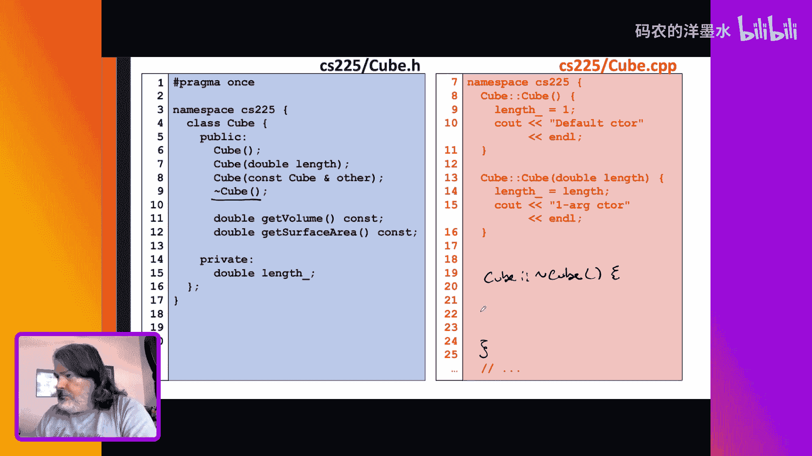

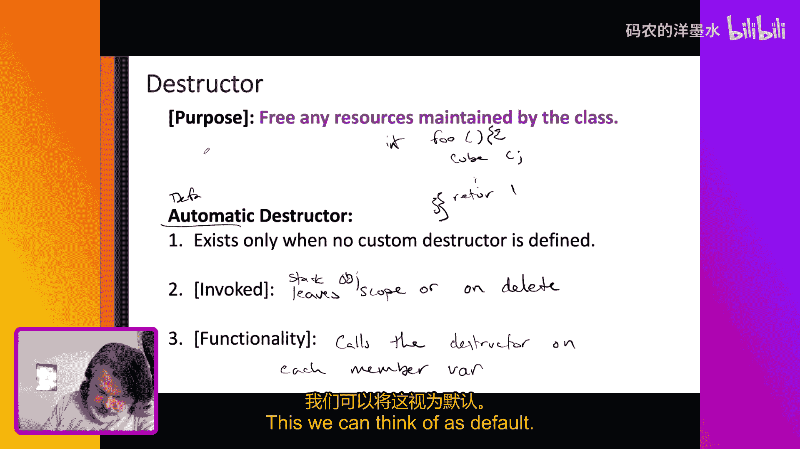

```cpp
class Cube {
public:
    ~Cube(); // 析构函数声明
};
```

析构函数在以下两种情况下被自动调用：
1.  当使用 `delete` 操作符删除堆上分配的对象时。
2.  当栈上分配的对象离开其作用域时。

默认的析构函数（即编译器自动生成的）会为每个成员变量调用其自身的析构函数。对于基本类型（如 `int`、`char*`），其“析构”操作不执行任何动作。

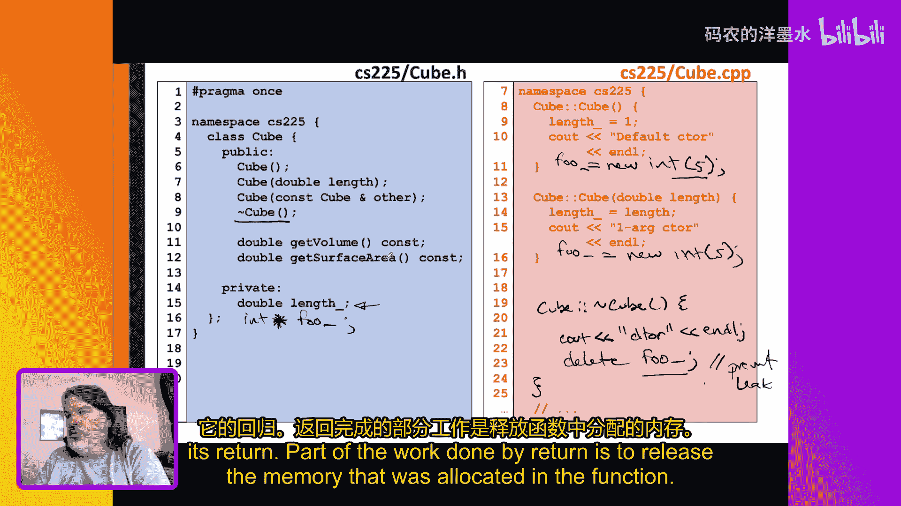

如果一个类在构造函数中分配了资源（例如使用 `new`），那么它通常需要自定义析构函数来释放这些资源，否则会导致内存泄漏。

```cpp
class MyClass {
private:
    int* data;
public:
    MyClass() {
        data = new int[100]; // 在构造函数中分配资源
    }
    ~MyClass() {
        delete[] data; // 在析构函数中释放资源，防止泄漏
    }
};
```

**注意**：我们从不直接调用析构函数。它总是由系统在对象销毁时自动调用。

## 运算符重载

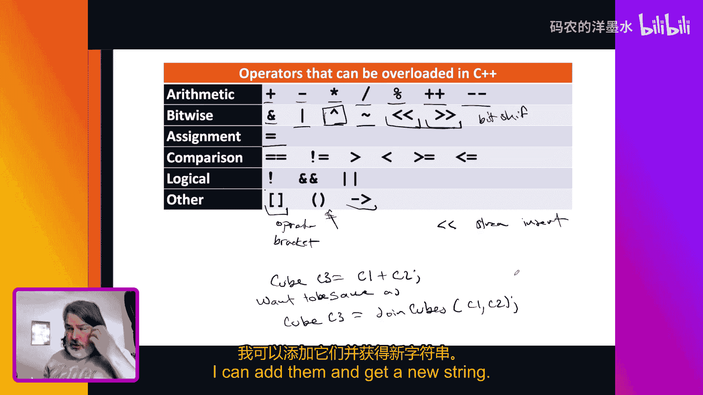

C++允许我们重新定义大多数运算符对于自定义类型的含义，这称为运算符重载。这使得代码更直观、更易读。例如，我们可以为 `Cube` 类定义 `+` 运算符，使其表示两个立方体的“连接”。

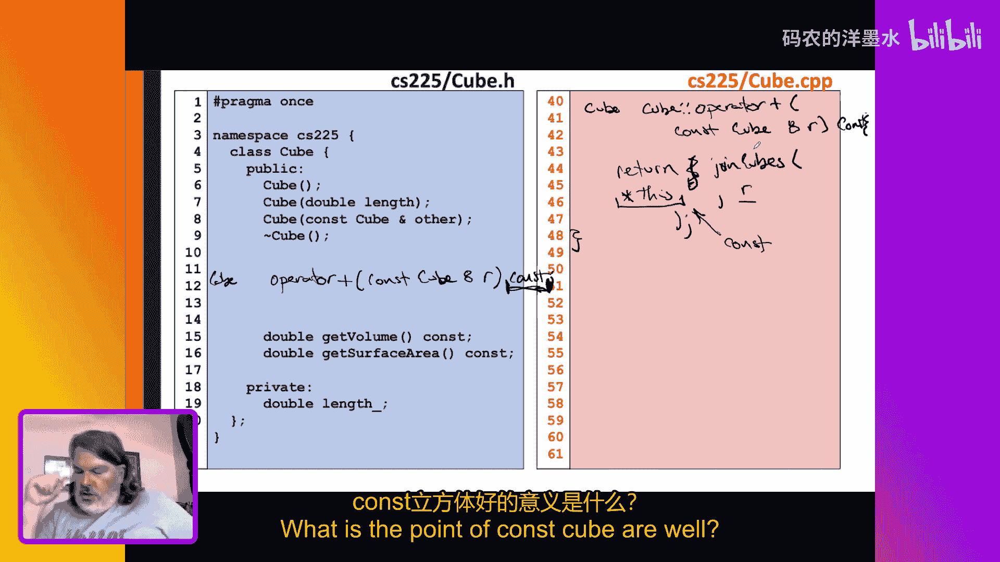

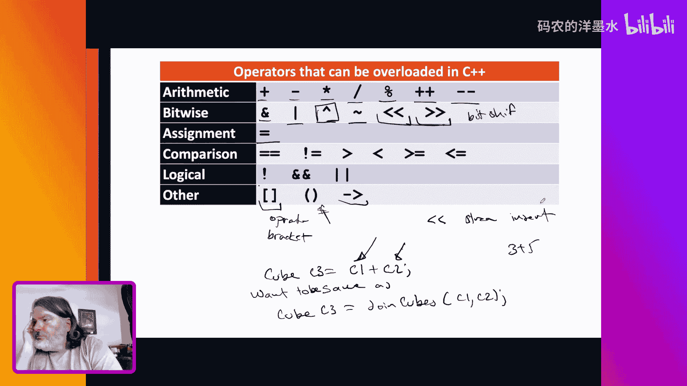

运算符重载本质上是一个特殊的成员函数或全局函数，函数名由关键字 `operator` 后接要重载的运算符符号组成。

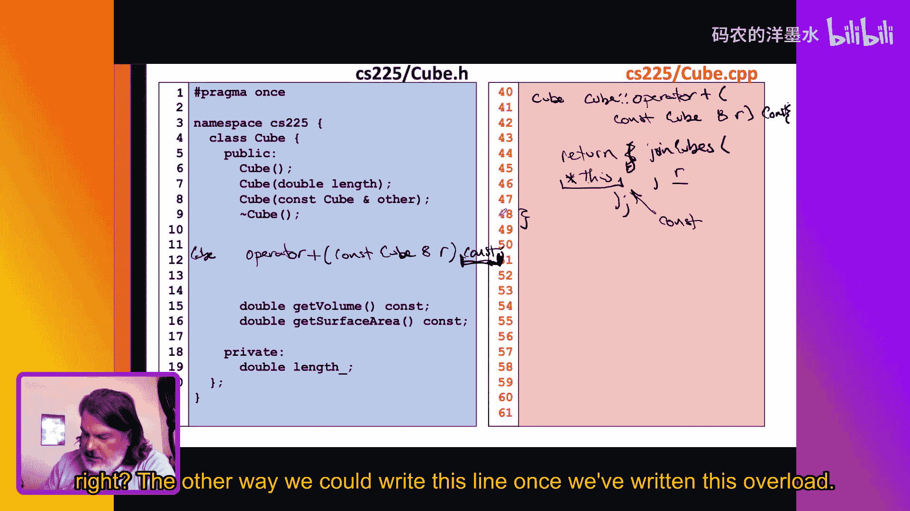

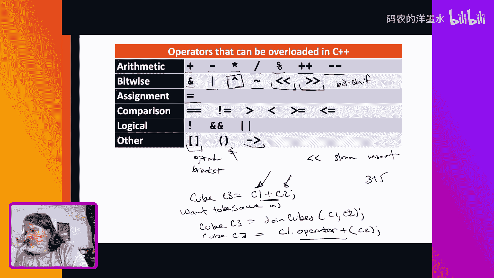

以下是重载 `+` 运算符的示例：

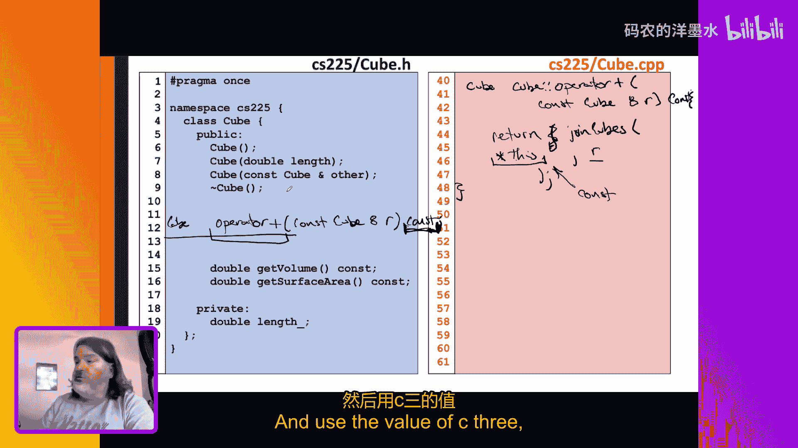

```cpp
class Cube {
public:
    // ... 其他成员 ...
    Cube operator+(const Cube& other) const {
        // 返回一个新的Cube对象，其“长度”是两个立方体长度之和
        return Cube(this->length + other.length);
    }
};
```

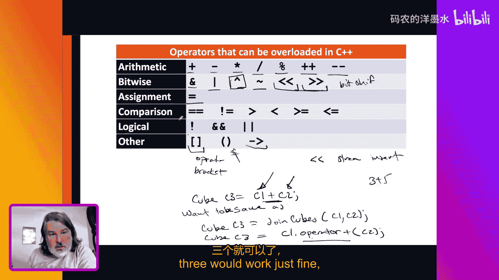

使用方式如下：
```cpp
Cube c1(5), c2(10);
Cube c3 = c1 + c2; // 等价于 c1.operator+(c2)
```

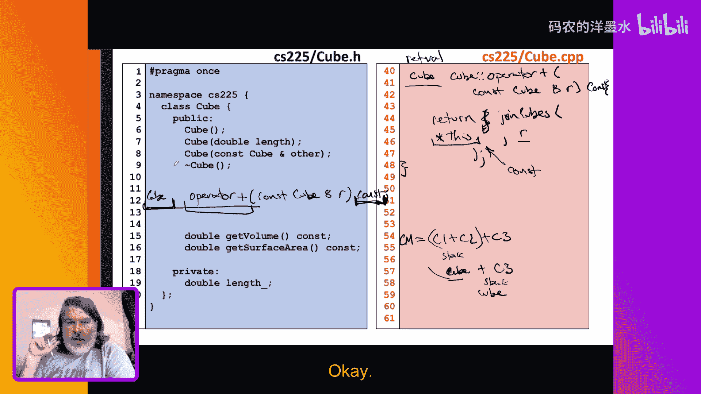

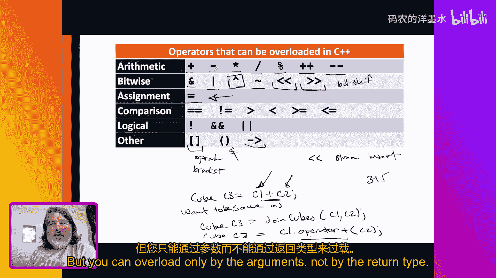

**关键点**：
*   函数后的 `const` 关键字表示该函数不会修改调用它的对象（即 `c1`）。
*   参数 `const Cube& other` 表示我们通过常量引用接收另一个对象，避免拷贝，且承诺不修改它。
*   我们通常返回一个新对象，而不是修改原有对象，这符合直觉（就像 `3+5` 不会改变 `3` 或 `5` 一样）。

## 赋值运算符重载与三法则

赋值运算符（`=`）也可以被重载。编译器会提供一个默认的赋值运算符，它执行成员的浅拷贝。如果类管理着动态内存等资源，浅拷贝会导致问题（如多个对象指向同一块内存），因此我们需要自定义。

自定义赋值运算符通常需要完成两件事：
1.  释放左侧对象原有的资源（避免内存泄漏）。
2.  将右侧对象的值拷贝到左侧对象。

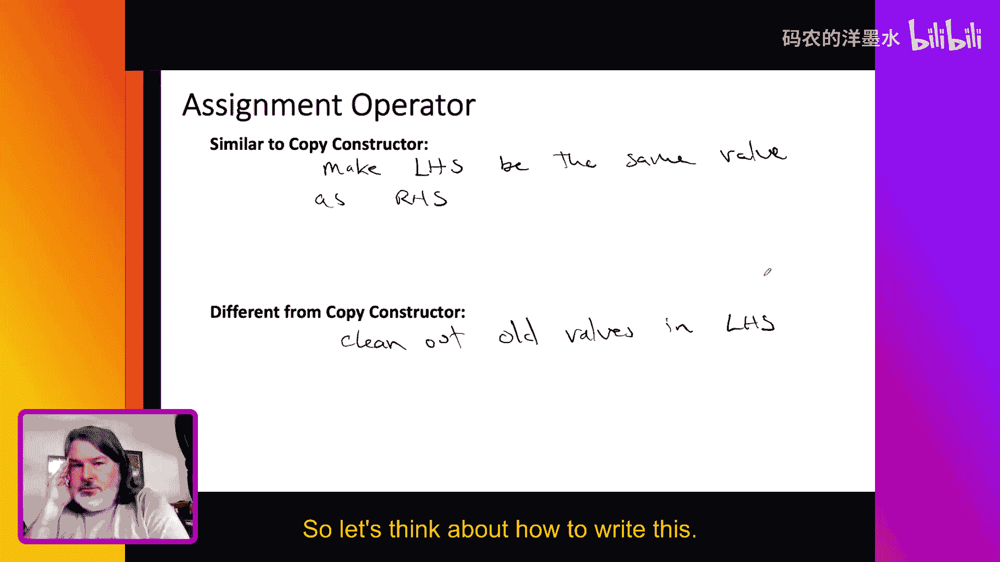

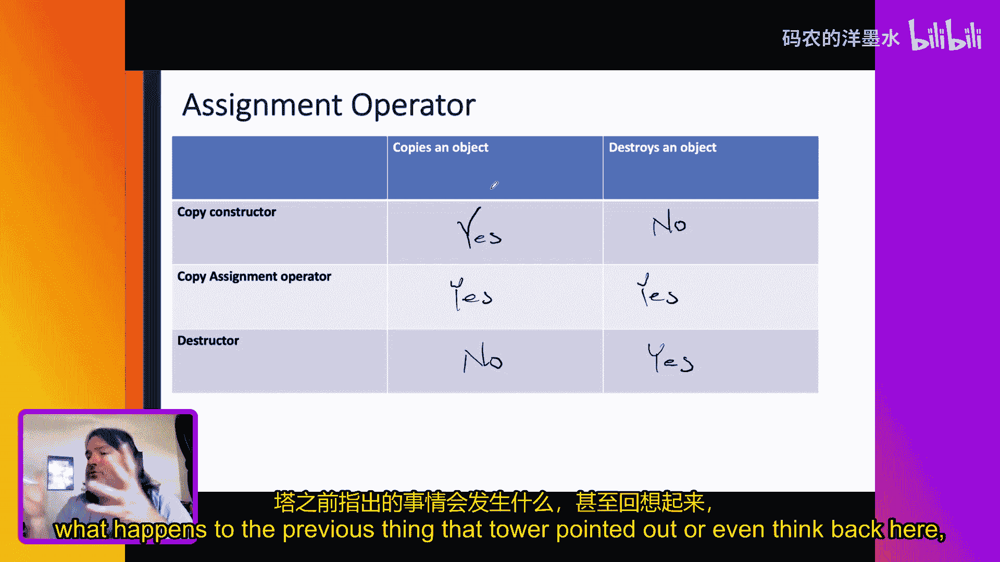

其声明形式如下：
```cpp
class MyClass {
public:
    MyClass& operator=(const MyClass& other);
};
```
返回引用（`MyClass&`）是为了支持链式赋值，如 `a = b = c`。

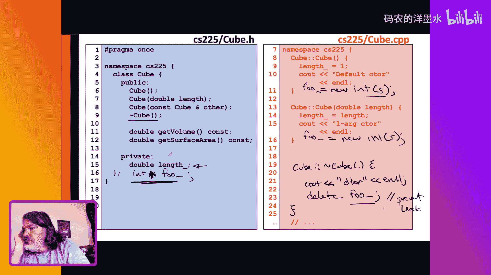

**三法则**指出：如果一个类需要显式定义**析构函数**、**拷贝构造函数**或**拷贝赋值运算符**中的任何一个，那么它很可能需要全部定义这三个。这是因为它们通常都涉及同一种资源的管理（如动态内存）。如果只定义其中一个而依赖编译器生成其他两个，很可能导致资源管理错误（如重复释放或内存泄漏）。

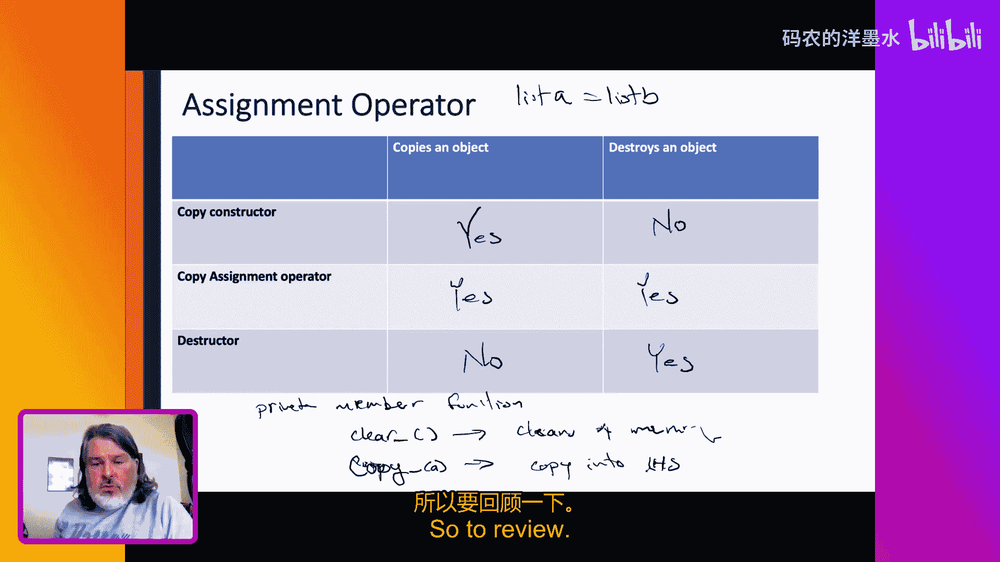

**零法则**是一个更好的实践：设计类时，尽量使用已有的、能妥善管理资源的类（如标准库中的 `std::vector`, `std::string`）作为成员。这样，编译器生成的默认析构函数、拷贝构造和拷贝赋值就能正确工作，我们无需自己定义它们。在本课程中，我们将主要学习如何实现那些管理资源的类，因此会频繁应用“三法则”。

---

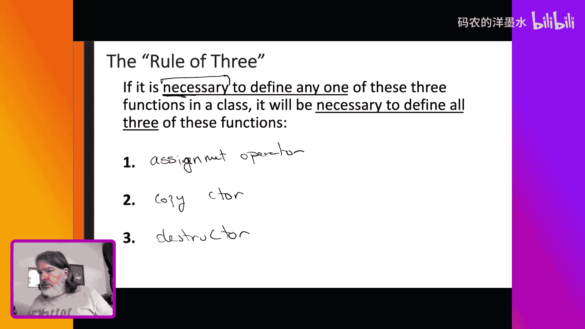

本节课中我们一起学习了析构函数的作用与用法，了解了如何通过运算符重载让自定义类型支持直观的运算，并掌握了管理类资源的“三法则”与“零法则”核心思想。理解这些概念对于编写正确、高效的C++程序至关重要。