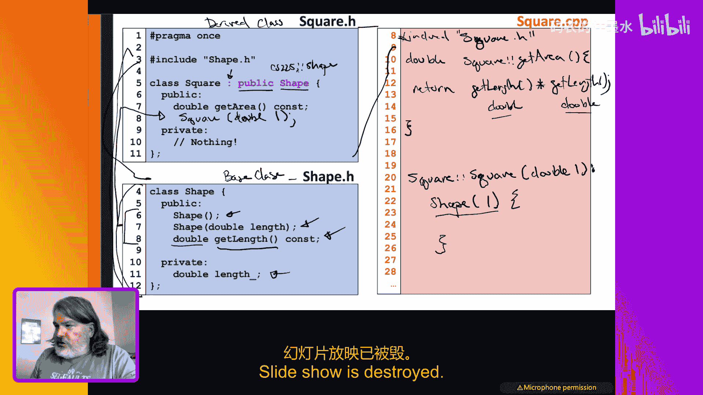
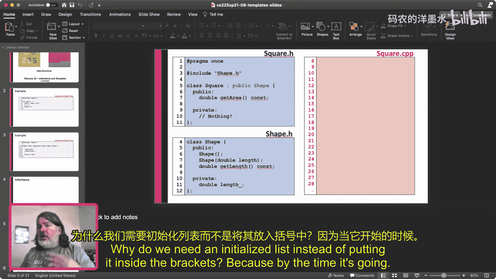
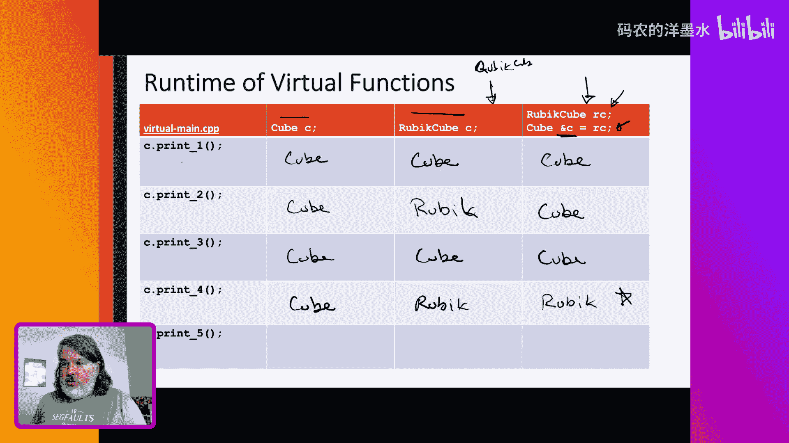

# 007：接口与模板

在本节课中，我们将学习C++中的两个核心概念：赋值运算符的重载与类的继承。我们将探讨如何安全地实现赋值操作，以及如何通过继承来构建更复杂的类。

---

## 赋值运算符的重载与自赋值问题

上一节我们介绍了类的构造函数，本节中我们来看看如何重载赋值运算符，并处理一个常见但危险的问题：自赋值。

考虑以下代码片段：
```cpp
Cube x;
x = x; // 自赋值
```
这段代码是合法的，但按照我们之前讨论的赋值运算符实现方式（先销毁自身，再复制源对象），会导致对象在复制前就被销毁，从而引发未定义行为。

问题的核心在于，当赋值运算符的左右两边是同一个对象时，我们不能先销毁自身。因此，我们需要在赋值操作前检查是否为自赋值。

以下是解决自赋值问题的关键方法：
*   比较对象的地址：这是最高效的方式，因为地址比较是常数时间操作。
*   在赋值运算符实现的开头添加检查：如果 `this`（当前对象的地址）与 `&other`（传入对象的地址）相同，则直接返回 `*this`，不做任何操作。

赋值运算符的典型实现结构如下：
```cpp
Cube& Cube::operator=(const Cube &other) {
    // 1. 检查自赋值
    if (this == &other) {
        return *this;
    }
    // 2. 释放当前对象持有的资源
    // 3. 从 other 对象复制资源
    // 4. 返回 *this 以支持链式赋值 (如 a = b = c)
    return *this;
}
```
**注意**：`this` 是C++中的一个关键字，它是一个指针，指向调用当前成员函数的对象。`operator=` 是重载赋值运算符的函数名。

---

## C++中的继承基础

接下来，我们转向C++的另一个核心特性：继承。继承允许我们基于已有的类（基类）创建新的类（派生类），从而实现代码的复用和层次化设计。

想象一个图形系统，我们有一个基类 `Shape`（形状），然后派生出 `Cube`（立方体）和 `Circle`（圆形）等具体形状。`Shape` 类可能包含所有形状共有的属性（如位置），而派生类则添加自己特有的属性（如边长、半径）。

在CS225课程中，我们只讨论最简单的公有继承（`public inheritance`）。

### 公有继承的语法与含义

以下是一个简单的例子，`Square`（正方形）类公有继承自 `Shape` 类：
```cpp
// Shape 基类
class Shape {
public:
    Shape();
    Shape(double length);
    double getLength() const;
private:
    double length_;
};

// Square 派生类
class Square : public Shape {
public:
    Square();
    double getArea() const;
};
```
**语法**：`class Square : public Shape`
**含义**：`Square` 类公有继承 `Shape` 类。这意味着：
1.  在每一个 `Square` 对象内部，都包含一个完整的 `Shape` 子对象。
2.  `Shape` 类中的所有 **公有** 成员函数（如 `getLength`）在 `Square` 类中也是可访问的，就像它们是 `Square` 自己的成员一样。
3.  `Square` 类 **不能直接访问** `Shape` 类的私有成员（如 `length_`），必须通过 `Shape` 的公有接口（如 `getLength` 函数）进行访问。

因此，`Square` 类中 `getArea` 函数的实现应该是：
```cpp
double Square::getArea() const {
    // 通过公有成员函数 getLength() 访问基类的边长
    return getLength() * getLength();
}
```
在成员函数内部，`getLength()` 等价于 `this->getLength()`，它调用的是从 `Shape` 继承而来的函数。

### 派生类的构造函数与初始化列表

如何为 `Square` 类设置边长？我们需要在 `Square` 的构造函数中初始化其内部的 `Shape` 子对象。

由于 `Shape` 的私有成员 `length_` 只能在 `Shape` 的构造函数中初始化，我们需要使用 **成员初始化列表** 来调用 `Shape` 的带参构造函数：
```cpp
Square::Square(double width) : Shape(width) {
    // 构造函数体，可以留空或执行其他初始化
}
```
**关键点**：
*   派生类对象构造时，**先构造基类子对象，再构造派生类部分**。
*   成员初始化列表在构造函数体执行之前运行，用于初始化成员变量和基类子对象。
*   如果基类没有默认构造函数，或者你想使用基类的特定构造函数，**必须**在派生类构造函数的初始化列表中显式调用。

---



## 多态性与虚函数



继承最强大的功能之一是 **多态**：允许使用基类的指针或引用来操作派生类对象，并根据对象的实际类型调用正确的函数。

然而，默认情况下，通过基类指针/引用调用函数，调用的是基类中定义的版本，而非派生类中可能存在的重写版本。为了实现“根据实际对象类型调用函数”的行为，我们需要使用 **虚函数**。

### 函数调用规则

首先，了解默认的成员函数调用规则：
1.  查看调用该函数的变量或表达式的**静态类型**（声明时的类型）。
2.  在该类型的类定义中查找要调用的函数。
3.  如果找到，则调用它。
4.  如果未找到，则递归地在其基类中查找。

### 虚函数的作用

在函数声明前加上 `virtual` 关键字，使其成为虚函数。虚函数引入了新的行为：
*   当通过基类的指针或引用调用一个虚函数时，程序会检查指针/引用所指向的**实际对象**的类型（动态类型）。
*   如果该实际对象的类型（派生类）重写（override）了这个虚函数，则调用派生类中的版本；否则，调用基类中的版本。

**示例对比**：
```cpp
class Cube {
public:
    void print1() { cout << "Cube"; }
    virtual void print2() { cout << "Cube"; }
};
class RubiksCube : public Cube {
public:
    void print2() override { cout << "RubiksCube"; } // 重写虚函数
};

int main() {
    RubiksCube rc;
    Cube& cubeRef = rc; // 基类引用指向派生类对象

    rc.print1(); // 输出 "Cube" (规则查找，RubiksCube没有print1，找到基类的)
    rc.print2(); // 输出 "RubiksCube" (调用RubiksCube自己的print2)

    cubeRef.print1(); // 输出 "Cube" (静态类型是Cube，Cube::print1不是虚函数)
    cubeRef.print2(); // 输出 "RubiksCube" (print2是虚函数，根据实际对象类型调用)
}
```
**总结虚函数的关键**：`virtual` 关键字使得函数调用依赖于对象的**实际类型**，而非指针或引用的**静态类型**，这是实现运行时多态的基础。

### 纯虚函数与抽象类

当一个虚函数在基类中被声明为 `= 0` 时，它成为 **纯虚函数**。包含纯虚函数的类称为 **抽象类**。
```cpp
class Shape {
public:
    virtual double getArea() const = 0; // 纯虚函数
};
```
*   抽象类**不能**被实例化（不能创建 `Shape` 对象）。
*   任何从抽象类派生的**非抽象类**，都必须提供所有纯虚函数的具体实现。
*   纯虚函数定义了接口规范，强制派生类实现特定功能，这是实现接口设计的重要手段。

---



本节课中我们一起学习了C++中赋值运算符重载时处理自赋值的安全方法，以及面向对象编程中继承与多态的核心概念。我们了解了公有继承的语法和含义，掌握了通过初始化列表构造派生类对象，并深入探讨了虚函数如何实现运行时多态，以及纯虚函数如何定义接口。这些概念是构建复杂、灵活且易于维护的软件系统的基础。