# 数据结构与算法：第9讲：列表实现 📚

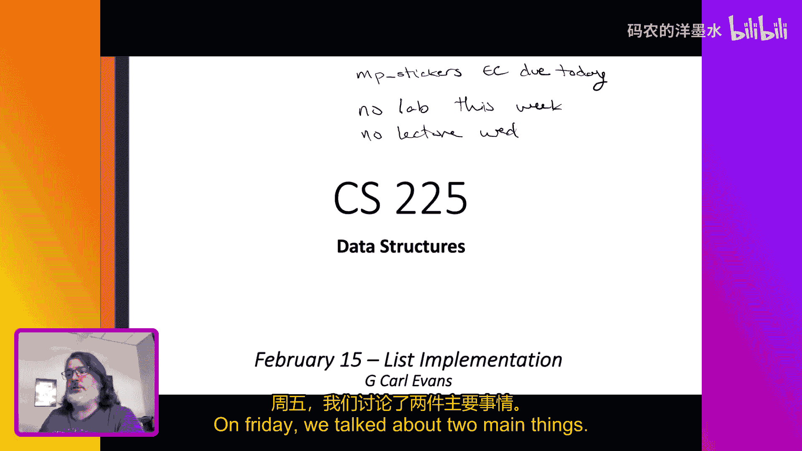

在本节课中，我们将学习如何实现列表（List）这一抽象数据类型（ADT）。我们将重点讨论基于链式内存（链表）的实现方式，并编写具体的模板化代码。课程内容包括回顾抽象数据类型、链表的节点结构、以及实现插入等核心操作。

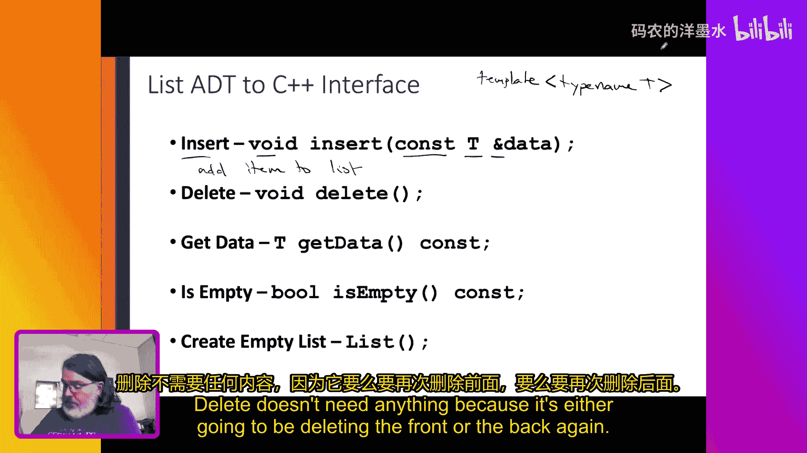

---

## 抽象数据类型回顾 📋


上一节我们介绍了模板化代码和列表抽象数据类型的概念。列表抽象数据类型定义了一组核心操作，这些操作描述了列表应有的行为，而不涉及具体实现。

以下是列表ADT到具体函数的一个映射示例：

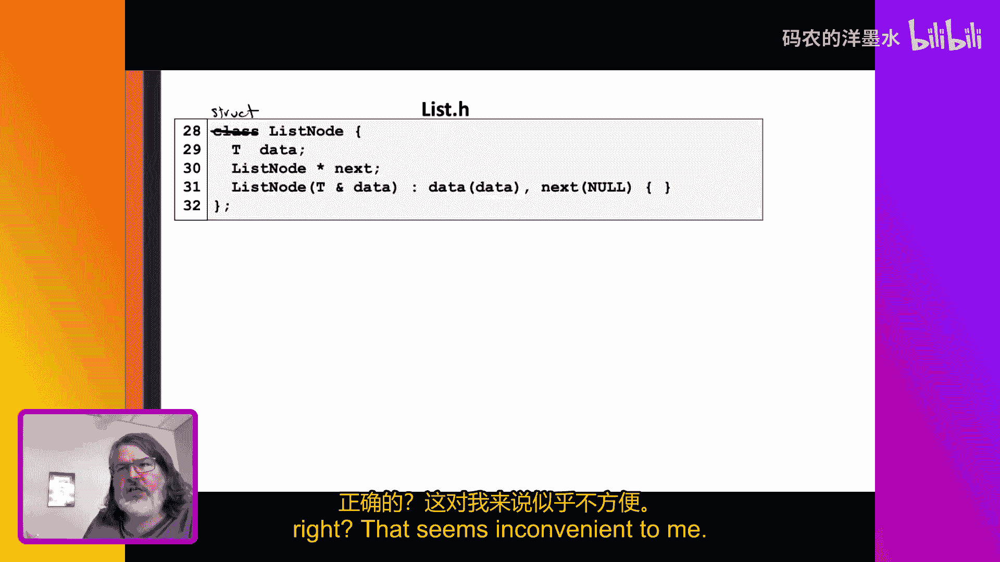

*   **插入（Insert）**：向列表前端或后端添加元素。函数原型可能类似于 `void insert(const T& data)`。
*   **删除（Delete）**：从列表前端或后端移除元素。函数原型可能类似于 `void removeFront()` 或 `void removeBack()`。
*   **获取数据（Get Data）**：获取列表前端的元素。函数原型为 `T getFront() const`，返回数据的副本且不应修改列表。
*   **判空（Is Empty）**：检查列表是否为空。函数原型为 `bool isEmpty() const`。
*   **创建空列表（Create Empty List）**：初始化一个空列表。

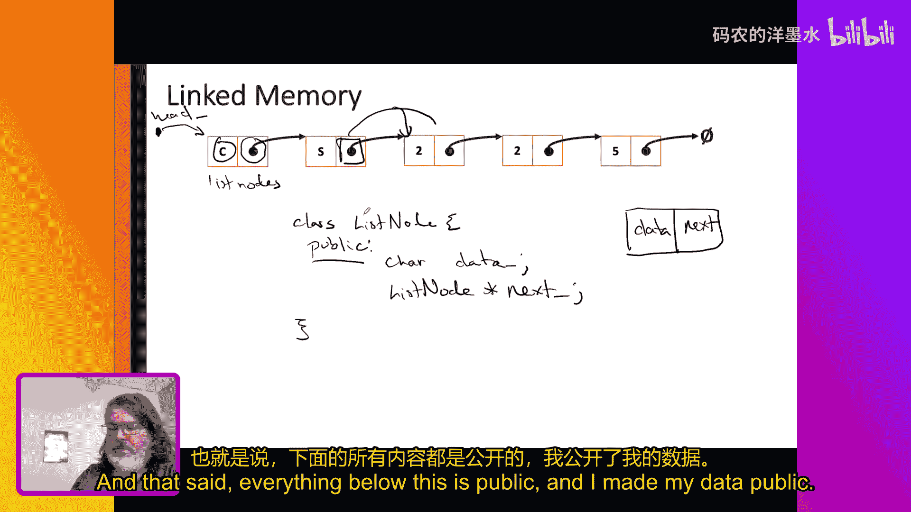


在本节中，我们将看看如何用链式内存来实现这些操作。

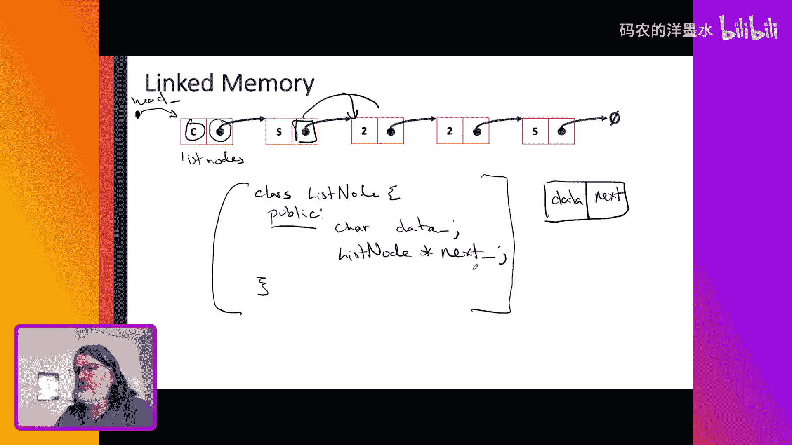

---

## 链式内存实现 🔗

目前，我们掌握的工具允许我们用两种基本方式实现列表：链式内存和数组。本节课我们专注于链式内存的实现，即链表。


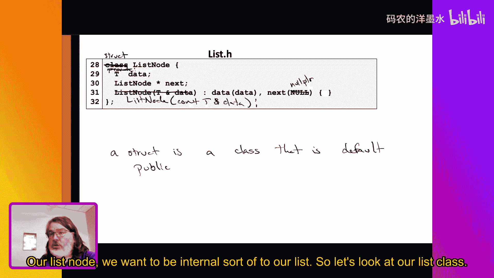

链表的基本单元是节点。每个节点包含两部分：存储的数据和一个指向下一个节点的指针。

### 链表节点结构

我们可以使用一个结构体（`struct`）来定义链表节点。在C++中，`struct` 和 `class` 几乎相同，唯一的区别是：在 `class` 中，成员默认访问权限是 `private`；而在 `struct` 中，成员默认访问权限是 `public`。当我们只需要一个简单的数据容器，并且希望直接访问其成员时，通常使用 `struct`。

以下是模板化的链表节点定义：
```cpp
template <typename T>
struct ListNode {
    T data;
    ListNode* next;
    // 构造函数，初始化数据和next指针
    ListNode(const T& data) : data(data), next(nullptr) {}
};
```
代码解释：
*   `T data;`：存储模板类型 `T` 的数据。
*   `ListNode* next;`：指向下一个 `ListNode` 的指针。
*   `ListNode(const T& data) : data(data), next(nullptr) {}`：构造函数，用传入的数据初始化 `data` 成员，并将 `next` 指针初始化为 `nullptr`（空指针）。

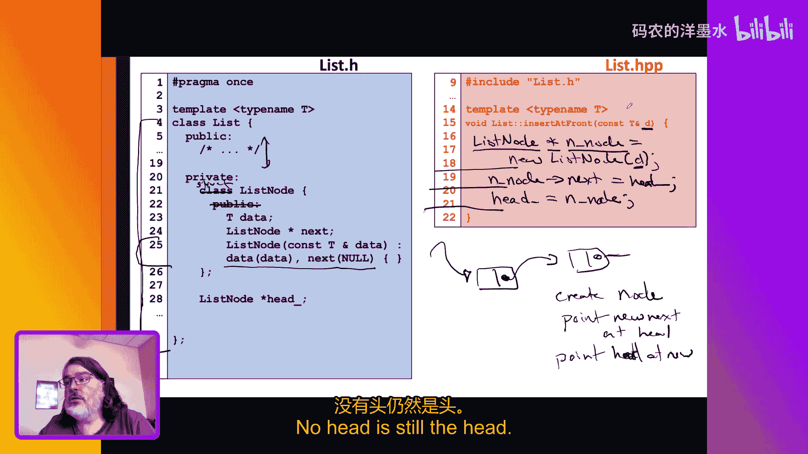

### 链表类框架

接下来，我们定义链表类本身。它将节点结构作为内部类型，并管理链表的头指针。

以下是链表类的基本框架：
```cpp
template <typename T>
class List {
private:
    // 内部节点类型定义
    struct ListNode {
        T data;
        ListNode* next;
        ListNode(const T& data) : data(data), next(nullptr) {}
    };
    ListNode* head_; // 指向链表第一个节点的指针

public:
    List() : head_(nullptr) {} // 构造函数，初始化空链表
    // 接下来将在这里声明成员函数，如 insertFront
};
```

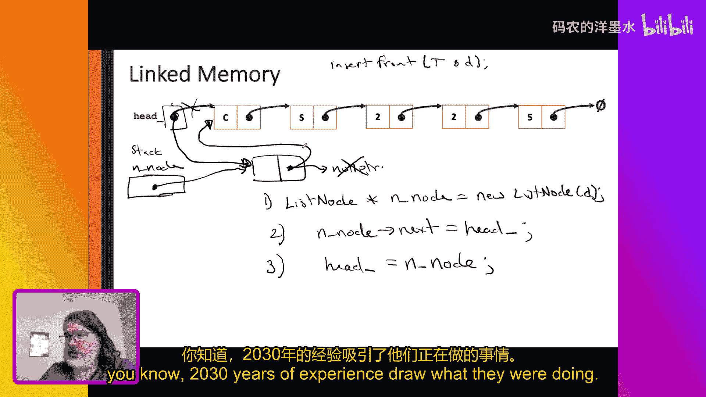

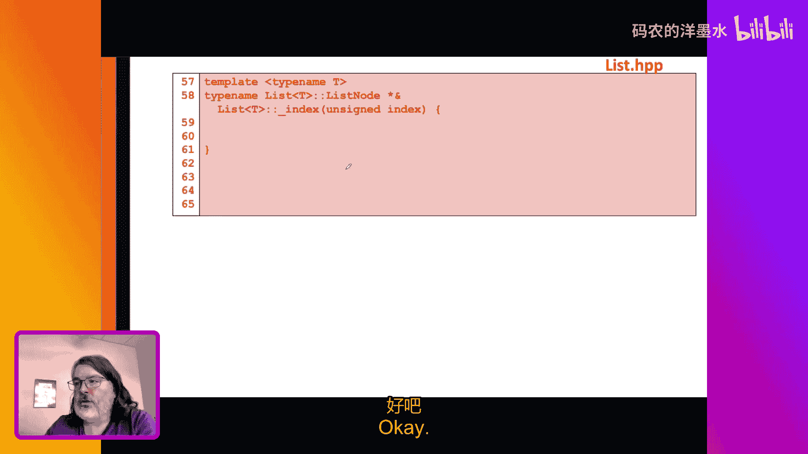

---


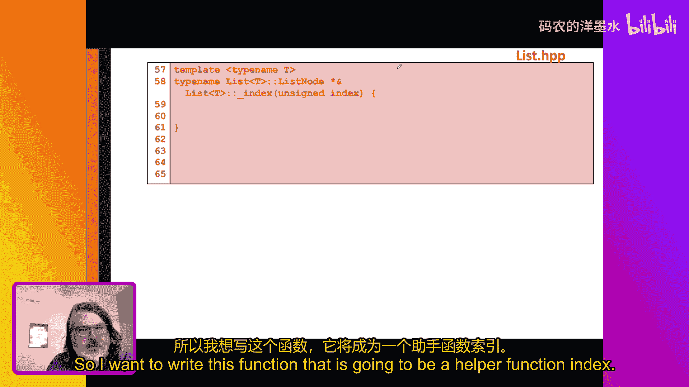

## 实现前端插入操作 ➕

现在，让我们实现一个具体的操作：在链表前端插入一个新节点。

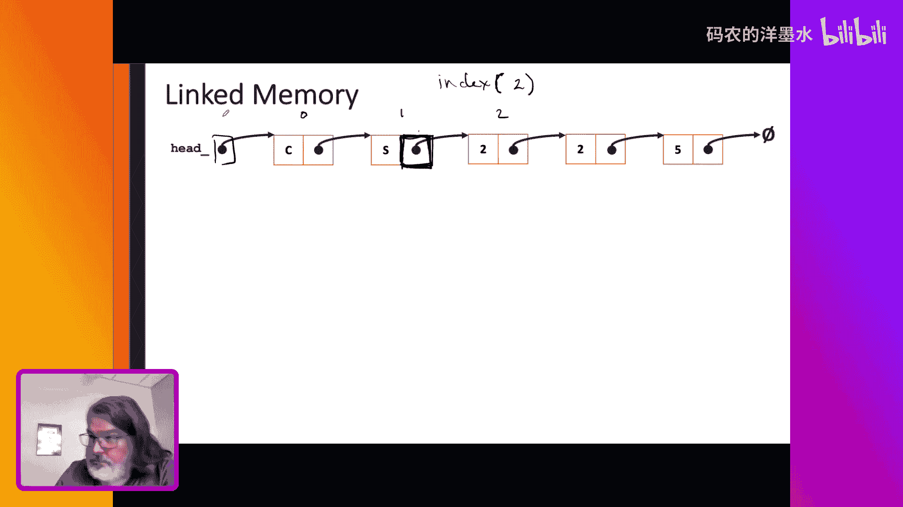


在链表前端插入节点的逻辑分为三步：
1.  创建一个新节点。
2.  让新节点的 `next` 指针指向当前的头节点。
3.  更新链表的 `head_` 指针，使其指向新节点。


以下是 `insertFront` 函数的实现代码：
```cpp
void insertFront(const T& data) {
    // 1. 在堆上创建新节点，并用 data 初始化
    ListNode* newNode = new ListNode(data);
    // 2. 新节点的 next 指向原头节点
    newNode->next = head_;
    // 3. 更新头指针指向新节点
    head_ = newNode;
}
```
代码逐步分析：
1.  `ListNode* newNode = new ListNode(data);`：在堆内存中动态分配一个新节点，并用传入的 `data` 初始化它。`newNode` 是一个局部指针变量，指向这个新节点。
2.  `newNode->next = head_;`：使用箭头操作符 `->` 访问新节点的 `next` 成员，并将其设置为当前 `head_` 的值（即原第一个节点的地址）。
3.  `head_ = newNode;`：将链表的成员变量 `head_` 更新为 `newNode` 的值（即新节点的地址）。

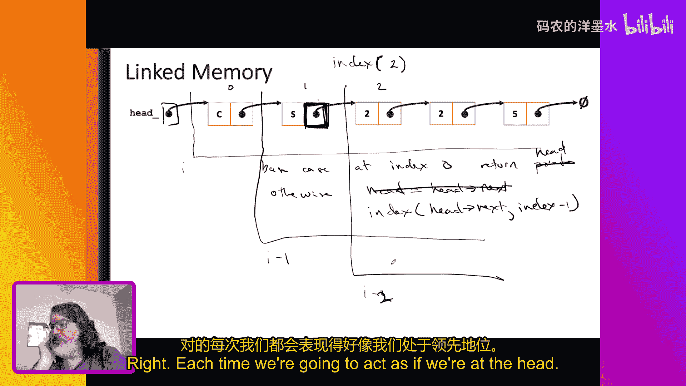

函数结束后，局部指针 `newNode` 会被销毁，但新节点本身存在于堆上，并且通过 `head_` 指针被链表正确引用。


---


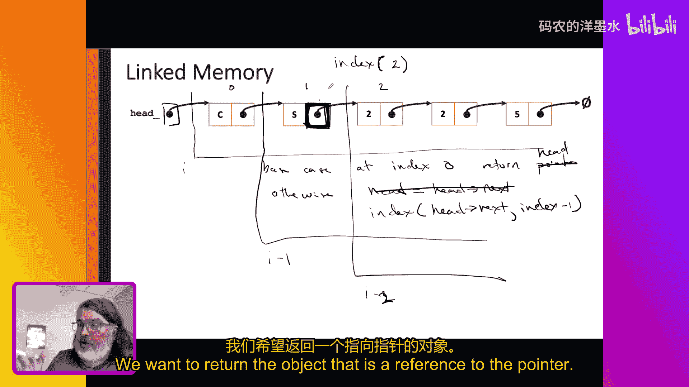

## 进阶：实现按索引插入操作 🎯


仅仅在头部插入是不够的。我们希望能够向链表的任意位置（索引）插入节点。为此，我们需要一个辅助工具：一个能返回指向链表中第 `i` 个节点的**指针的引用**的函数。

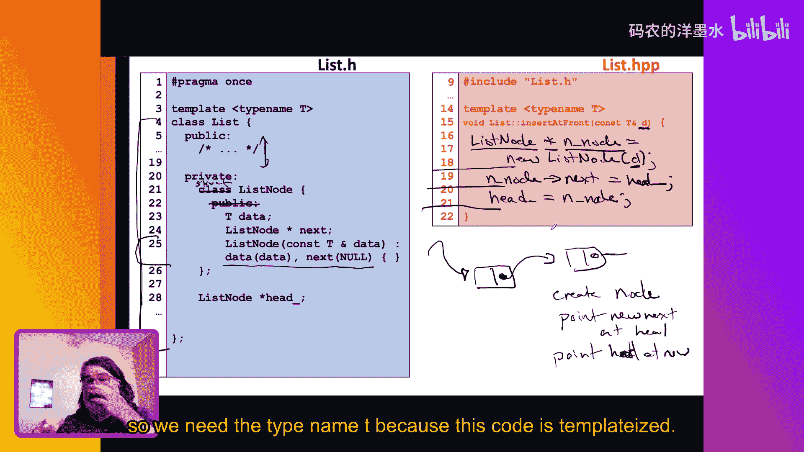

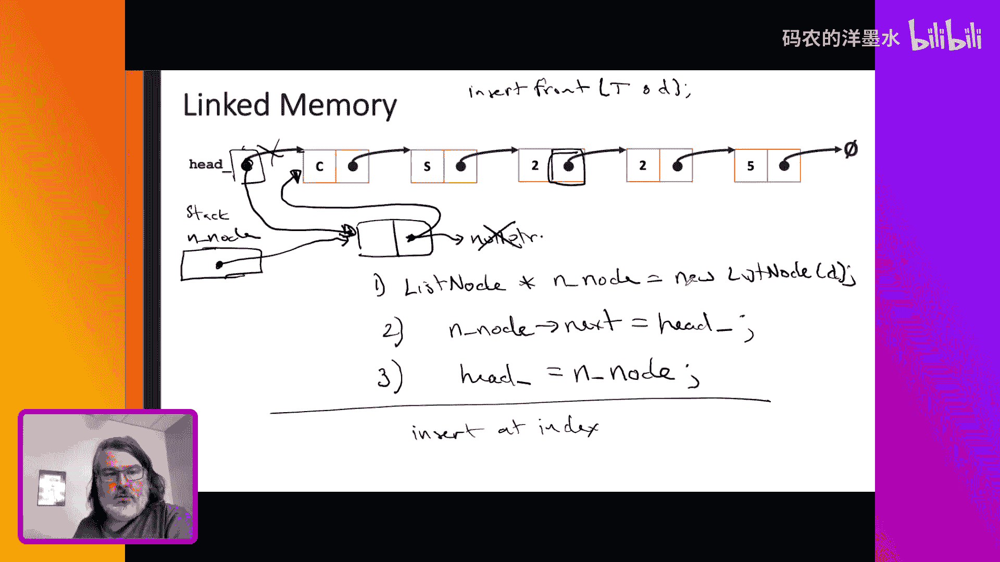


### 索引辅助函数

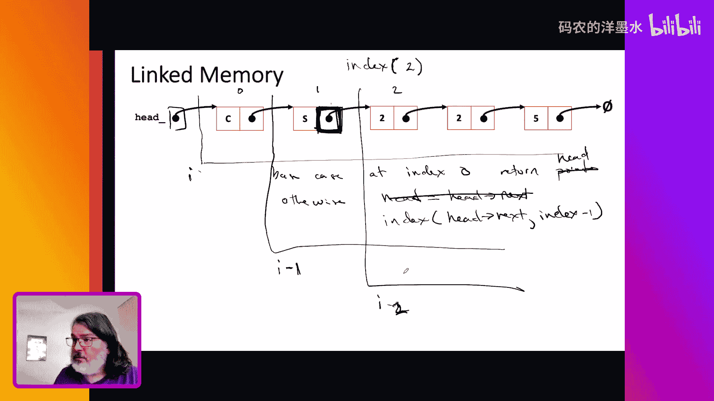

为什么返回“指针的引用”如此强大？因为它允许我们直接修改链表中的某个指针（例如，某个节点的 `next` 指针），而不仅仅是获取一个副本。

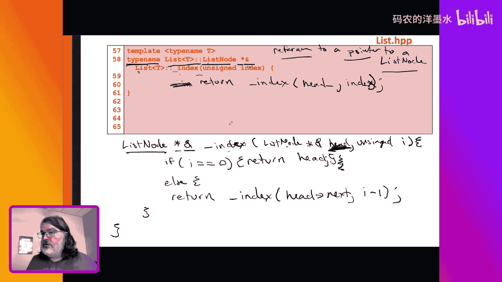

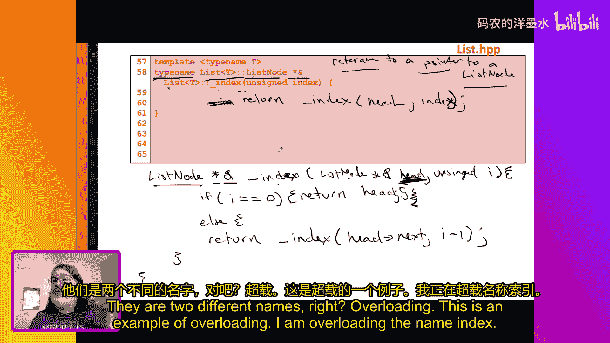

我们可以用递归或迭代的方式实现这个函数。递归实现有助于我们更深入地理解链表的结构。


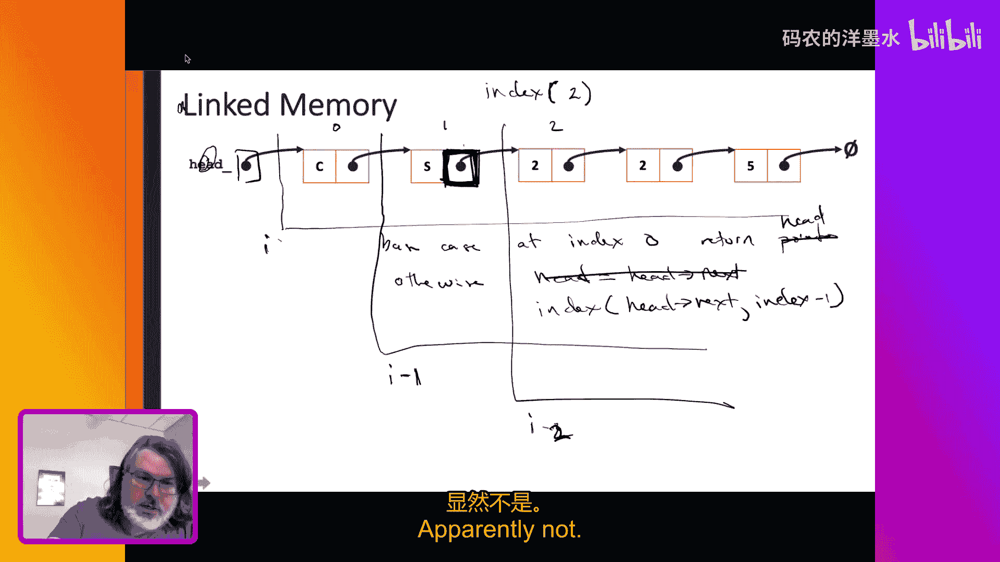

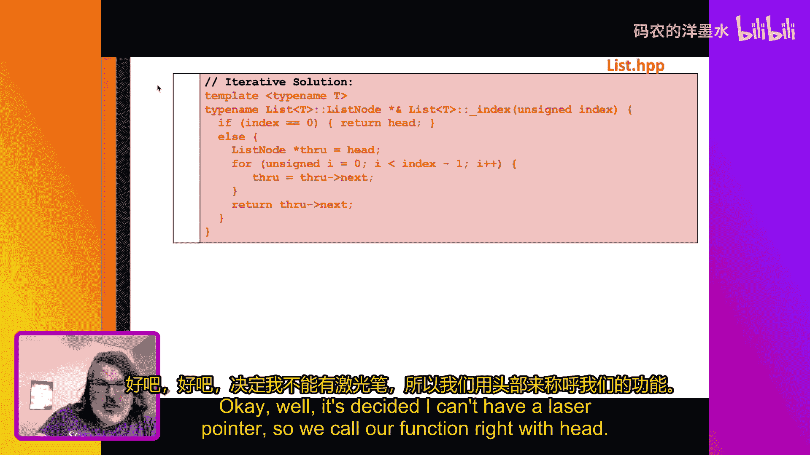

以下是递归版本的 `index` 辅助函数声明和实现：
```cpp
// 公共接口：传入索引 i，返回指向第 i 个节点的指针的引用
ListNode*& index(unsigned i) {
    // 调用私有递归辅助函数，传入头指针和索引
    return index(head_, i);
}

private:
// 私有递归辅助函数
ListNode*& index(ListNode*& head, unsigned i) {
    if (i == 0) {
        // 基准情况：索引为0，返回当前头指针的引用
        return head;
    }
    // 递归情况：将当前节点的 next 指针视为新链表的头，索引减1
    return index(head->next, i - 1);
}
```
代码解释：
*   函数重载：`index(unsigned i)` 和 `index(ListNode*& head, unsigned i)` 是两个不同的函数，编译器根据参数类型区分它们。
*   `ListNode*&`：这是返回类型，表示返回一个对 `ListNode` 指针的引用。
*   递归过程：假设我们要找索引 2 的节点。初始调用 `index(head_, 2)`。
    1.  `i=2`，不等于0，递归调用 `index(head_->next, 1)`。
    2.  `i=1`，不等于0，递归调用 `index(head_->next->next, 0)`。
    3.  `i=0`，到达基准情况，返回 `head_->next->next` 这个指针本身的引用。

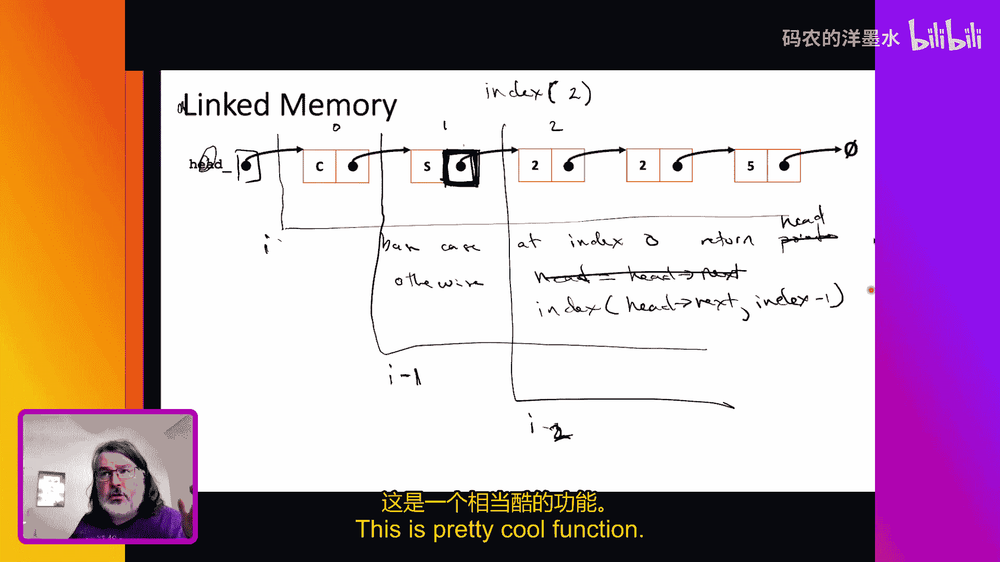

### 利用索引函数实现插入

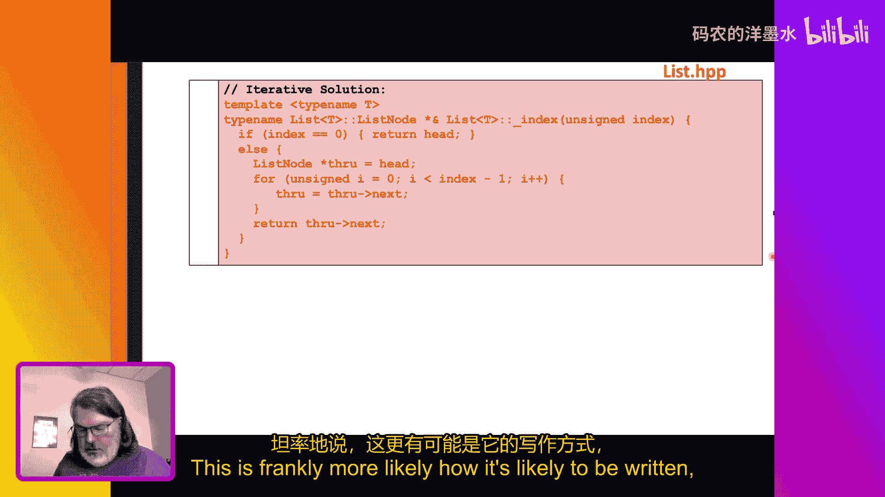


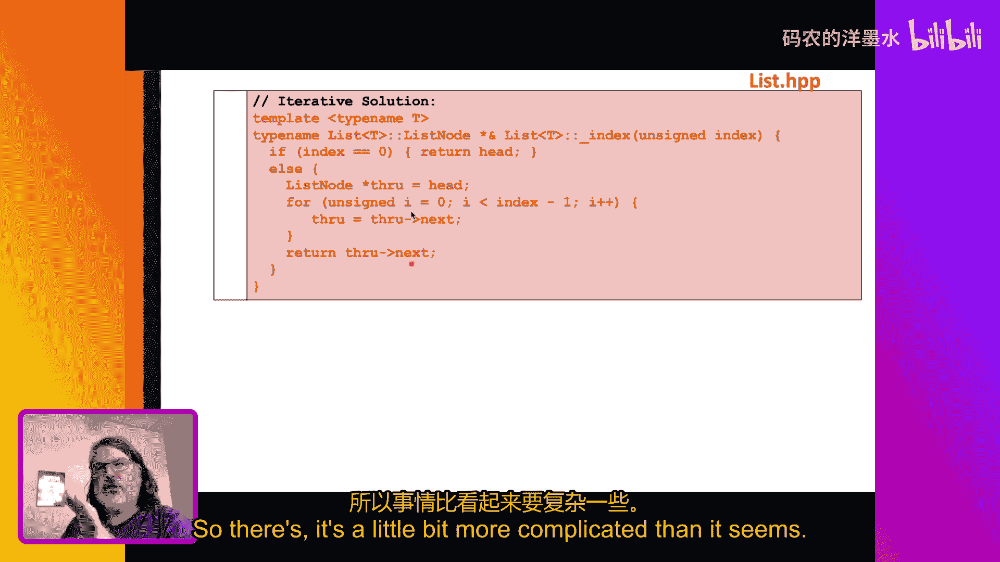

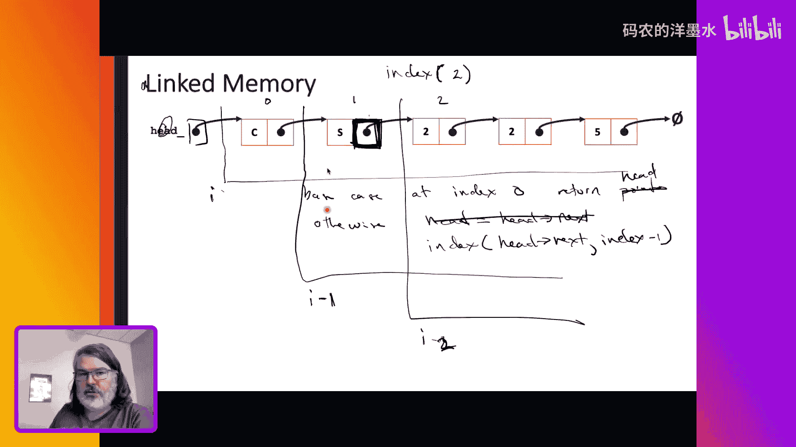

有了 `index` 函数，在任意位置插入节点就变得和前端插入一样简单。我们可以把目标位置想象成那个位置的“局部链表”的头部。


以下是 `insertAt` 函数的实现：
```cpp
void insertAt(unsigned i, const T& data) {
    // 1. 创建新节点
    ListNode* newNode = new ListNode(data);
    // 2. 获取指向第 i 个节点指针的引用
    ListNode*& targetRef = index(i);
    // 3. 新节点指向 targetRef 当前指向的节点
    newNode->next = targetRef;
    // 4. 让 targetRef 指向新节点
    targetRef = newNode;
}
```
工作原理：假设要在索引 2 处插入 ‘X’。`index(2)` 返回一个指向原索引 2 节点（比如 ‘C’）的指针的引用。通过上述四步操作，我们成功将 ‘X’ 插入到 ‘B’ 之后、’C’ 之前的位置。`index` 函数返回的引用是关键，它允许我们直接修改链表中的连接关系。

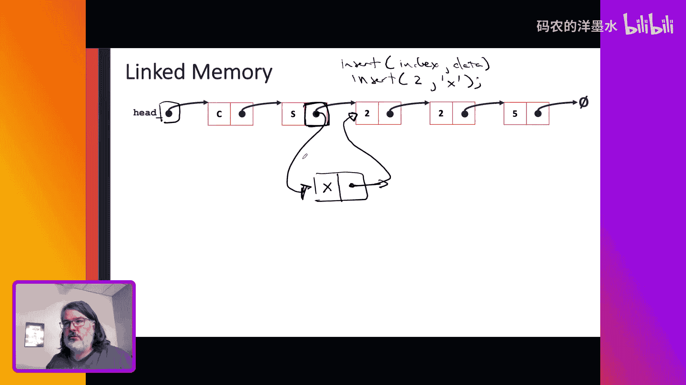

---

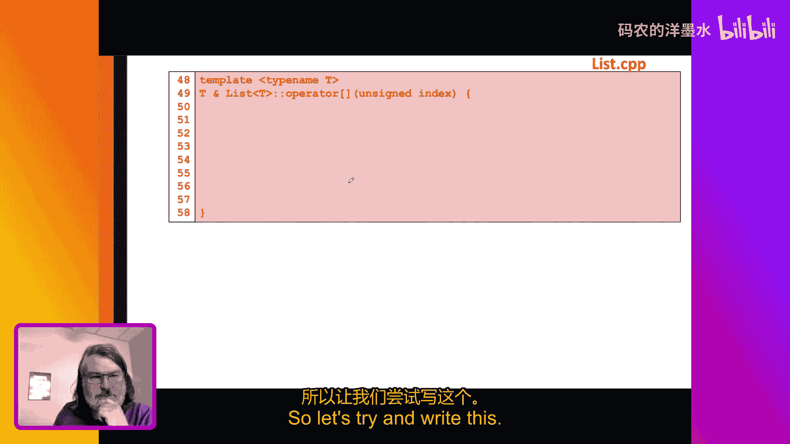


## 总结 📝

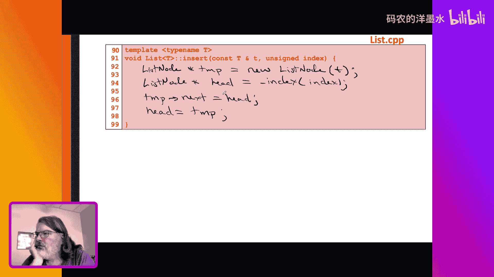

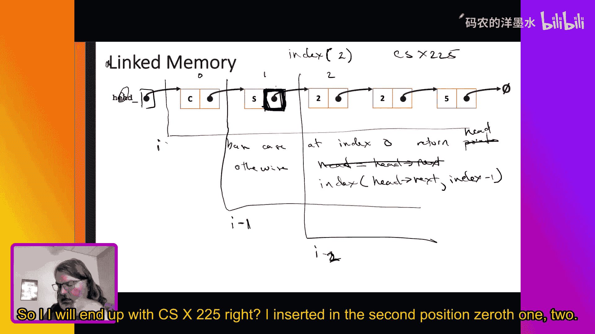

本节课中我们一起学习了列表的链式内存实现。
*   我们首先回顾了列表抽象数据类型（ADT）的核心操作。
*   接着，我们定义了模板化的链表节点 `ListNode`，并使用 `struct` 使其成员可公开访问。
*   然后，我们实现了最简单的操作——在链表前端插入节点，并详细分析了其三步逻辑。
*   最后，为了支持在任意位置插入，我们引入了一个强大的工具：返回“指针的引用”的递归辅助函数 `index`。利用这个函数，我们能够以简洁的代码实现通用的 `insertAt` 功能。


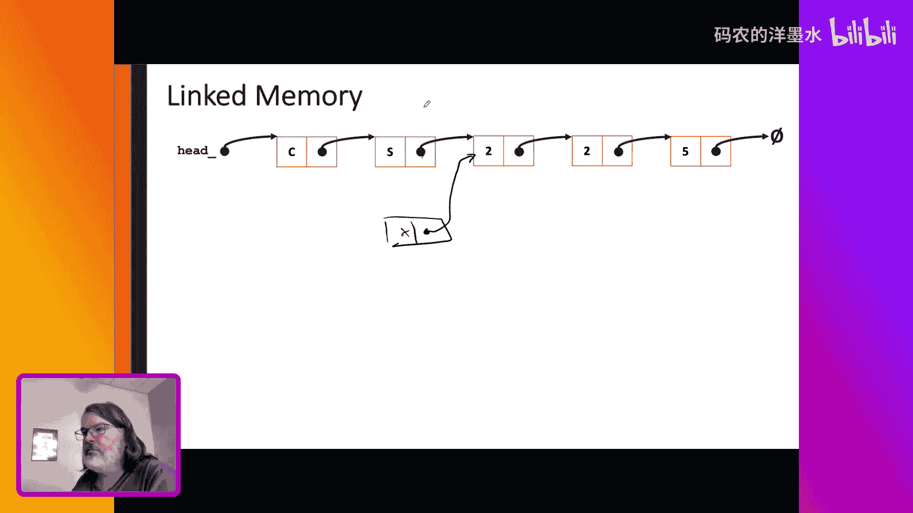


理解指针操作和引用在链表实现中至关重要。绘制示意图是理解和调试链表代码的极佳方法。在接下来的课程中，我们将继续探索链表的其他操作和更复杂的数据结构。