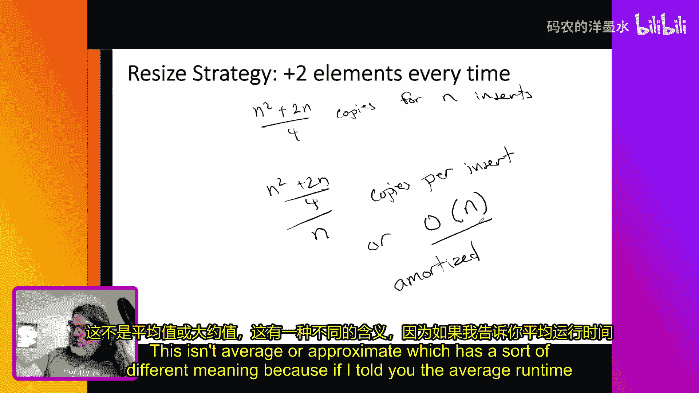
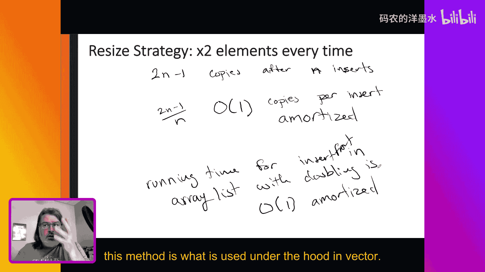
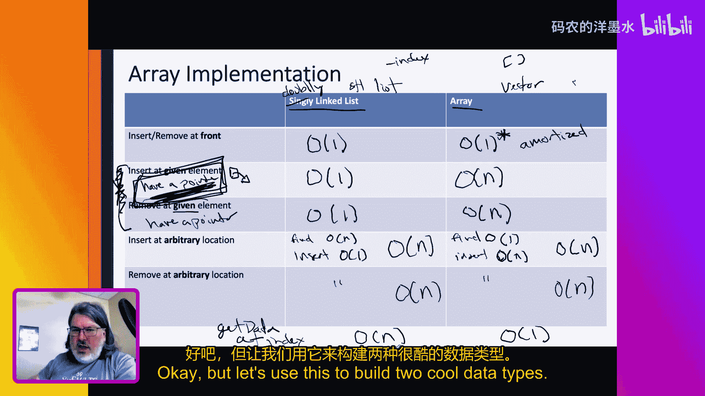
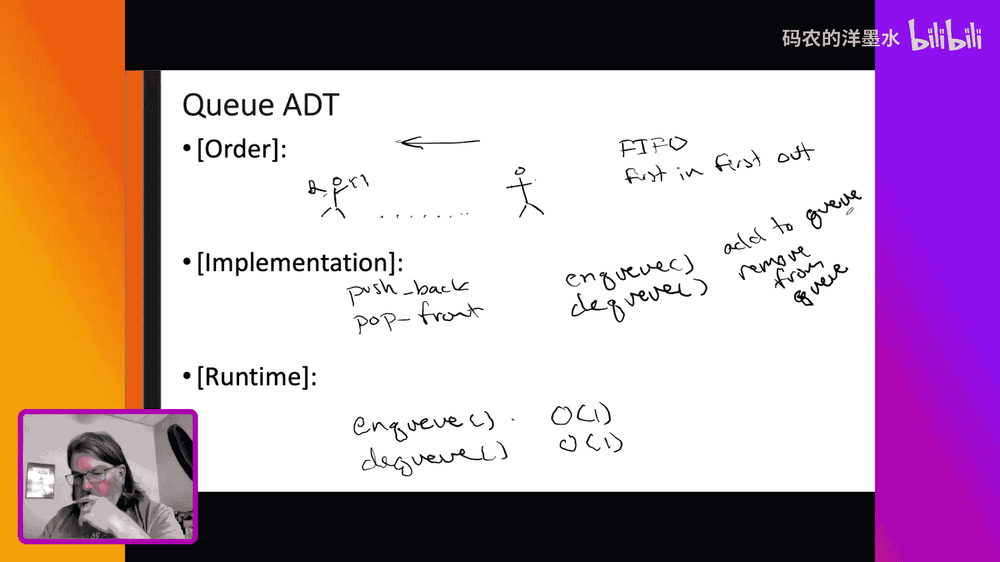
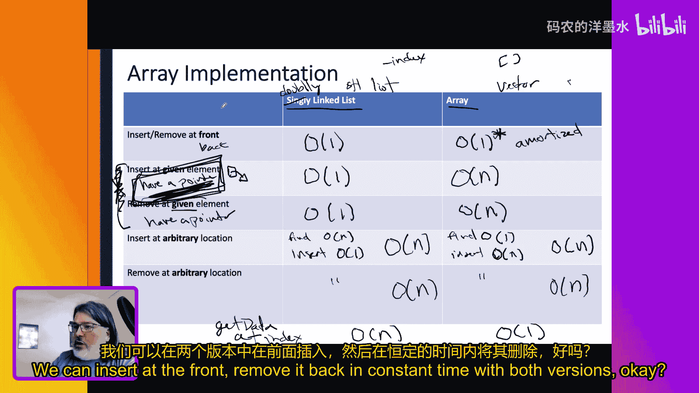
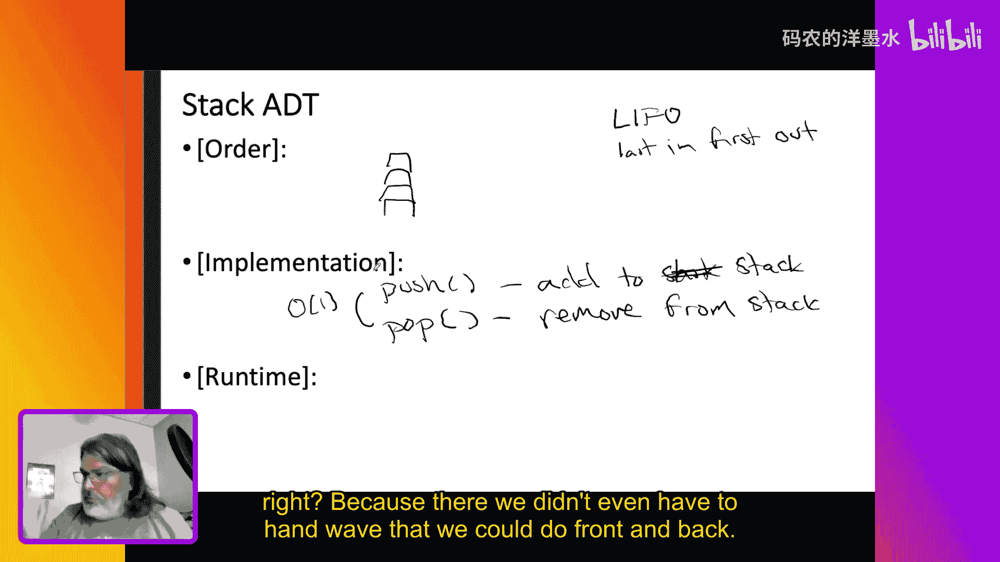
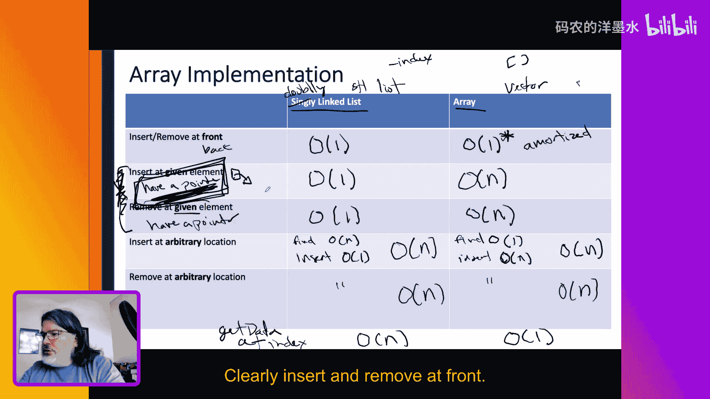
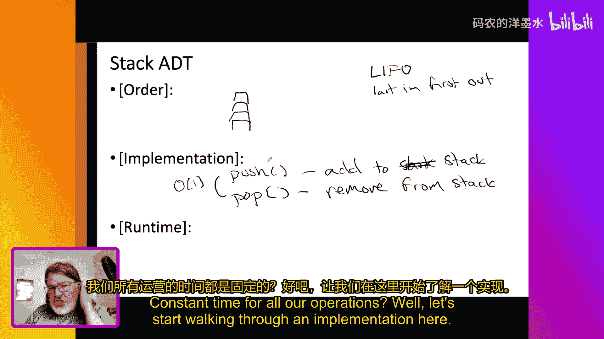
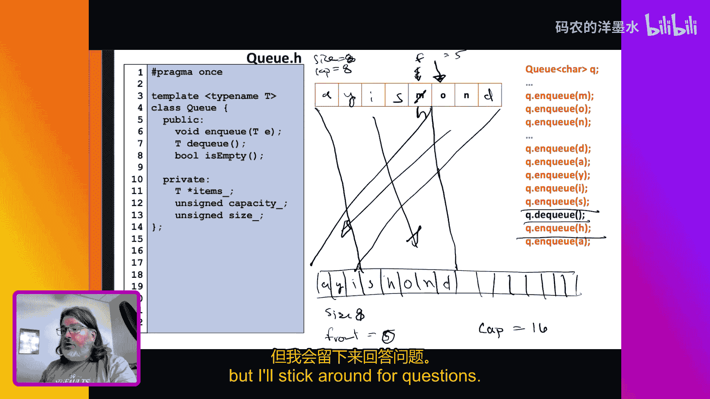

# 数据结构与算法：11：扩容策略与队列/栈实现 🧠

在本节课中，我们将学习数组实现列表时的扩容策略，并深入理解“摊还分析”的概念。随后，我们将探讨两种重要的数据结构——队列和栈，并分析它们如何利用数组或链表高效实现。



---

## 摊还分析简介

上一节我们分析了数组列表在满时每次扩容1个单位的策略，其插入操作的代价较高。本节中，我们来看看另一种更高效的策略——**加倍扩容**，并引入“摊还分析”这一关键概念。

摊还分析的含义是：我们不保证**每一步**操作都花费确定的时间，而是说在连续的 **n** 步操作中，总运行时间不会超过 **摊还代价 × n**。这是一个精确的下界，而非平均值或近似值。它不说明单步操作的具体耗时。

例如，对于每次扩容1个单位的策略，经过分析，**n** 次插入的总拷贝次数为 **(n² + 2n) / 4**。那么，每次插入的摊还拷贝次数为：
```
总拷贝次数 / n = (n² + 2n) / 4n = O(n)
```
这意味着，在这种策略下，`insert` 操作的摊还运行时间是 **O(n)**。

---

## 加倍扩容策略分析

现在，让我们分析**加倍扩容**策略。当数组空间不足时，我们将其容量扩大一倍。



以下是扩容过程的轮次分析（从第0轮开始）：
*   第0轮：进行 **1** 次拷贝（容量从1变为2）。
*   第1轮：进行 **2** 次拷贝（容量从2变为4）。
*   第2轮：进行 **4** 次拷贝（容量从4变为8）。
*   第3轮：进行 **8** 次拷贝（容量从8变为16）。

可以观察到，第 **r** 轮需要进行 **2ʳ** 次拷贝。假设我们一共进行了 **n** 次插入，那么总共经历的轮数 **r** 满足 **2ʳ ≈ n**，即 **r = log₂ n**。

所有轮次的总拷贝次数是等比数列求和：
```
总拷贝次数 = Σ (k=0 到 r) 2ᵏ = 2ʳ⁺¹ - 1 ≈ 2n - 1
```
因此，**n** 次插入的总拷贝次数约为 **2n - 1**。

那么，每次插入的摊还拷贝次数为：
```
(2n - 1) / n ≈ 2 = O(1)
```
这是一个巨大的改进！采用加倍策略后，`insert` 操作的**摊还运行时间变为 O(1)**。虽然单次插入的代价可能很高（例如在扩容时），但平均分摊到每次插入上，代价是常数。

---

## 链表与数组列表对比

我们有两种方式实现列表抽象数据类型：单链表和数组列表（如C++中的`vector`）。以下是它们在不同操作下的时间复杂度对比：

以下是核心操作的时间复杂度对比：

| 操作 | 单链表 (Singly Linked List) | 数组列表 (Array List / Vector) |
| :--- | :--- | :--- |
| **在头部插入/删除** | **O(1)** | **O(1)** (摊还) |
| **在给定元素处插入/删除** (已有指针) | **O(1)** | **O(n)** (需要移动后续元素) |
| **在任意位置插入/删除** (按索引查找) | **O(n)** (需要遍历查找) | **O(n)** (查找O(1)，但插入/删除需移动元素) |
| **按索引访问数据** | **O(n)** | **O(1)** |

**如何选择？**
*   **数组列表** 在内存连续性和随机访问（`get`）方面有巨大优势，适合以查询为主、数据相对静态的场景。`vector` 是典型的数组列表实现。
*   **单链表** 在动态插入/删除（尤其在已知节点指针时）方面更灵活，且不要求连续内存。这在操作系统等对单次操作时间有严格限制或内存碎片化的底层环境中很关键。

---



## 队列的实现 🚶‍♂️🚶‍♀️



队列是一种 **先进先出 (FIFO)** 的抽象数据类型，就像排队一样。主要操作是：
*   **入队 (enqueue)**：在队尾添加元素。
*   **出队 (dequeue)**：从队头移除元素。



使用数组实现队列时，为了达到 **O(1)** 的入队和出队操作，并高效利用空间，我们采用一种称为**循环缓冲区**的技巧。







核心思路是维护几个变量：
*   `T* items`：指向存储元素的数组。
*   `size_t capacity`：数组的总容量。
*   `size_t size`：队列中当前的元素数量。
*   `size_t front`：指向队头元素的索引。

**入队位置**的计算公式为：
```
入队索引 = (front + size) % capacity
```
**出队**后，只需返回 `items[front]`，并将 `front` 更新为 `(front + 1) % capacity`，同时 `size` 减1。

当 `size == capacity`，队列已满，需要进行**扩容**。扩容时，我们分配一个两倍大的新数组，并将旧数组中的元素按顺序（从 `front` 开始循环拷贝）复制到新数组的开头，然后将 `front` 重置为0。这个过程保证了所有操作的**摊还时间复杂度为 O(1)**。

---

## 栈的实现 📚

栈是一种 **后进先出 (LIFO)** 的抽象数据类型，就像一摞书。主要操作是：
*   **压栈 (push)**：在栈顶添加元素。
*   **弹栈 (pop)**：从栈顶移除元素。

栈的实现更为直接。无论是用链表（在头部操作）还是数组列表（在尾部操作），`push` 和 `pop` 操作都可以在 **O(1)** 时间内完成，无需复杂的循环索引逻辑。

---

## 总结

本节课中我们一起学习了：
1.  **摊还分析**：一种评估操作序列总成本的平均化方法，重点关注**加倍扩容**策略如何将数组列表的插入操作优化至摊还 **O(1)** 时间。
2.  **数据结构对比**：深入比较了单链表和数组列表在各项操作上的时间复杂度，理解了它们各自的适用场景。
3.  **队列与栈**：实现了两种重要的线性数据结构——队列 (FIFO) 和栈 (LIFO)。我们重点剖析了如何使用**数组配合循环缓冲区**来实现高效且空间利用率高的队列，其所有核心操作的摊还时间均为常数。



通过掌握这些扩容策略和基础数据结构，你为构建更复杂、高效的算法打下了坚实的基础。