# 数据结构与算法：13：树 🌳

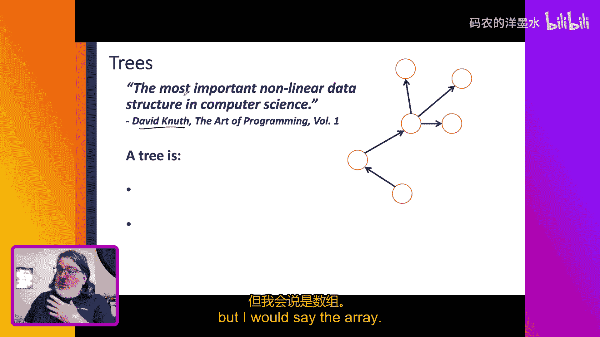

在本节课中，我们将要学习计算机科学中最重要的非线性数据结构之一：树。我们将从树的基本概念开始，逐步深入到其形式化定义、不同类型的树（如二叉树、满树、完美树、完全树）以及它们的性质。最后，我们会简要介绍树的抽象数据类型（ADT）和实现思路。

---

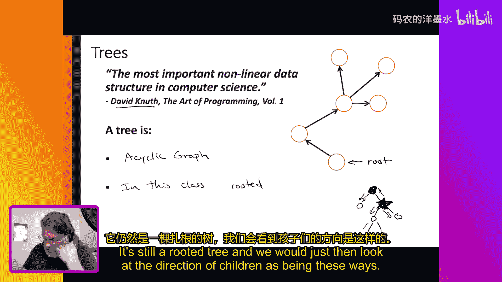

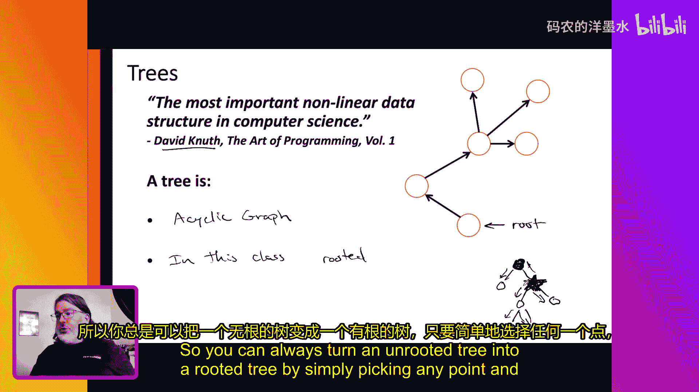

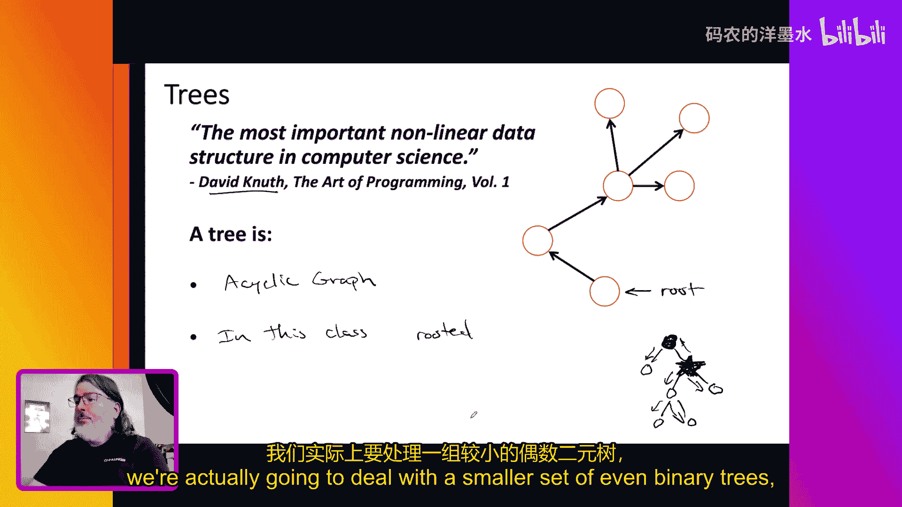

## 树的基本概念

树是一种无环图。这是理论层面的定义。然而，在本课程中，我们几乎总是在讨论**有根树**。一个有根树是指有一个特定节点被指定为根的树。任何无根树都可以通过选择任意一个节点作为根，从而转化为有根树。


上图展示了一个有根树的例子，其中标出的节点就是根。箭头方向表示从父节点到子节点的关系，但通常我们也可以省略箭头。

---

## 二叉树的形式化定义

上一节我们介绍了有根树的概念，本节中我们来看看一种特殊的树：**二叉树**。二叉树是每个节点最多有两个子节点的有根树。

我们可以用递归的方式来形式化定义二叉树 `T`：
*   `T` 要么是一个空树（用 `∅` 表示）。
*   `T` 要么是一个根节点 `R`，加上一个左子树 `T_L` 和一个右子树 `T_R`，其中 `T_L` 和 `T_R` 本身也是二叉树。

用公式可以表示为：
```
T = ∅ 或 T = (R, T_L, T_R)
```
其中 `T_L` 和 `T_R` 是二叉树。

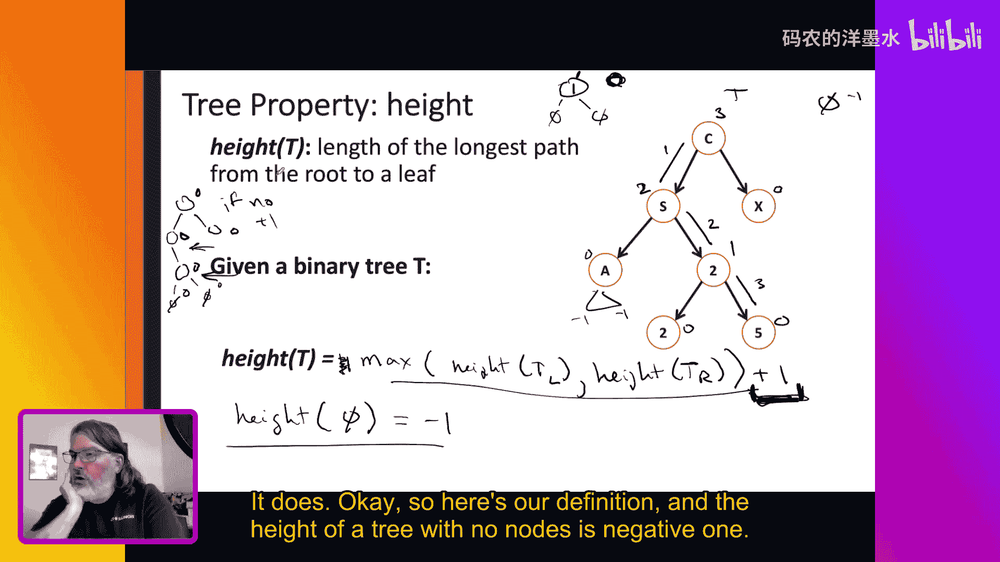

将空树包含在定义中对于实现和递归处理非常重要，它为我们提供了清晰的递归基。

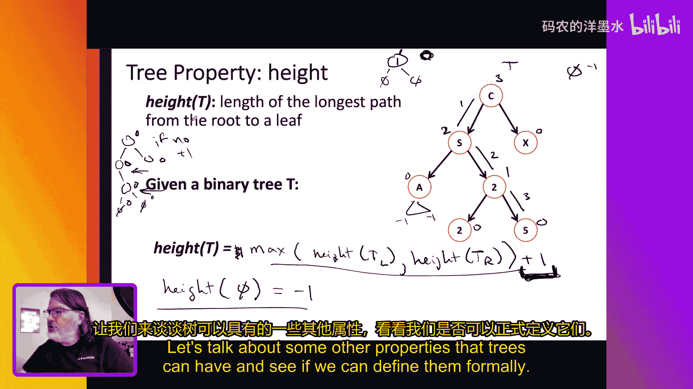

---

## 树的性质：高度

现在我们来定义树的一个重要性质：**高度**。树的高度定义为从根节点到最远叶子节点的最长路径上的边数。

高度的计算是递归的。对于一棵树 `T`，其高度 `height(T)` 可以定义为：
```
height(T) = -1,                    如果 T 是空树 (∅)
height(T) = 1 + max(height(T_L), height(T_R)), 如果 T = (R, T_L, T_R)
```
根据这个定义，空树的高度为 -1，只有一个根节点（无子节点）的树高度为 0。

这个递归定义虽然初看有些奇怪（空树高度为-1），但在后续的证明和算法分析中会非常简洁和一致。

---

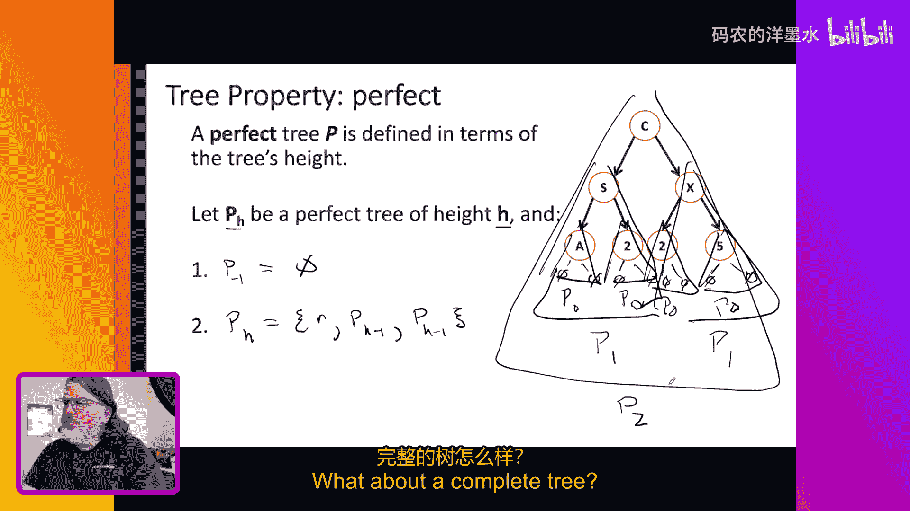

## 特殊类型的二叉树

了解了基本定义和高度后，我们来看看几种具有特殊性质的二叉树。以下是它们的定义和特点：

### 满二叉树
一棵满二叉树中，每个节点要么有 0 个子节点（叶子节点），要么有 2 个子节点。
递归定义如下：
```
F = ∅ 或 F = (R, F_L, F_R)，其中 F_L 和 F_R 要么都是空树，要么都不是空树。
```

### 完美二叉树
完美二叉树是所有叶子节点都在同一层，并且所有非叶子节点都有两个子节点的树。它拥有给定高度下最多的节点数，第 `k` 层有 `2^k` 个节点。
递归定义如下（设 `P(h)` 为高度 `h` 的完美二叉树）：
```
P(-1) = ∅
P(h) = (R, P(h-1), P(h-1)), 对于 h >= 0
```

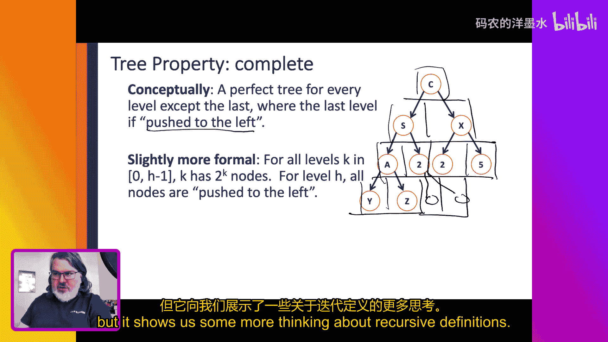

### 完全二叉树
完全二叉树是除了最后一层外，所有层都是“满”的（即具有最大节点数），并且最后一层的所有节点都尽可能地向左排列。
这个“向左排列”的性质对于将树高效地存储在数组中非常关键，因为它能保证数组元素的连续性。

---

## 不同类型树之间的关系

我们已经定义了满树、完美树和完全树。理解它们之间的关系非常重要：

*   **所有完美树都是满树，也是完全树。**
*   **完全树不一定是满树**（例如，一个节点只有一个左子节点的树是完全的，但不是满的）。
*   **满树不一定是完全树**（例如，一个节点的左子节点有一个子节点，而右子节点为空，这棵树是满的，但不是完全的）。
*   存在既不是满树、也不是完全树、也不是完美树的树。

这些定义主要是为了我们在描述和实现特定数据结构（如堆）时的方便。

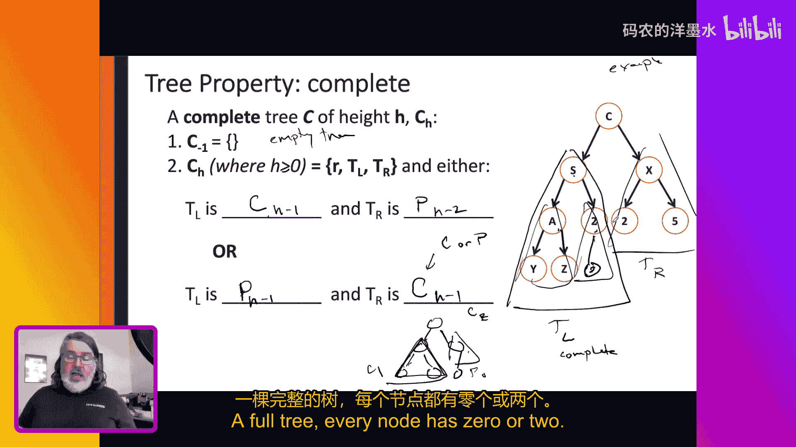

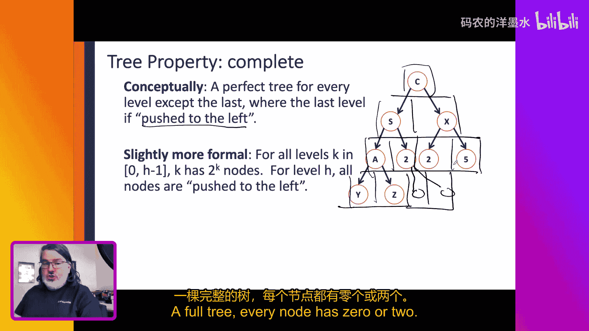

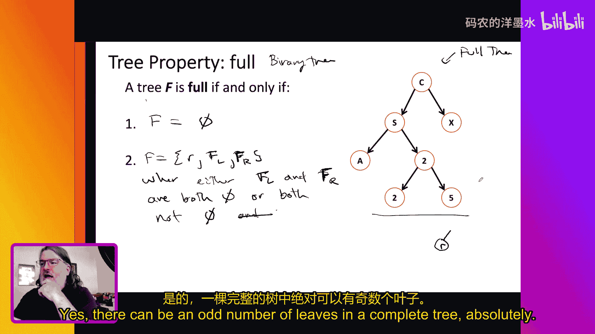

---

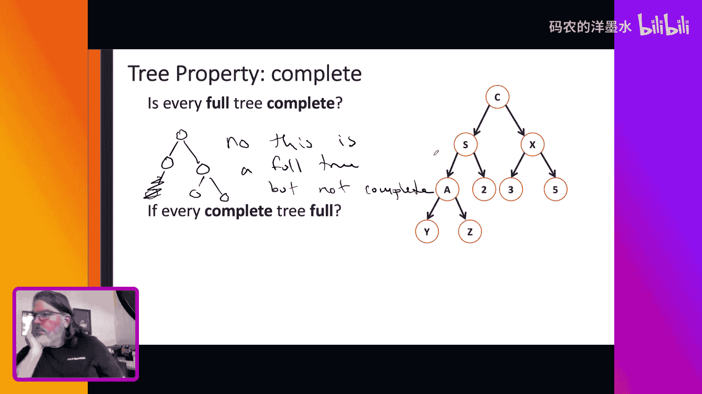

## 树的抽象数据类型（ADT）与实现思路

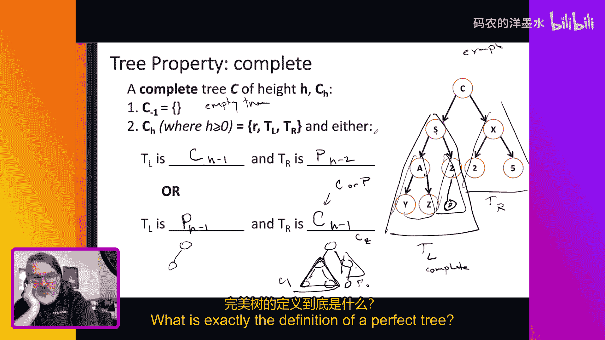

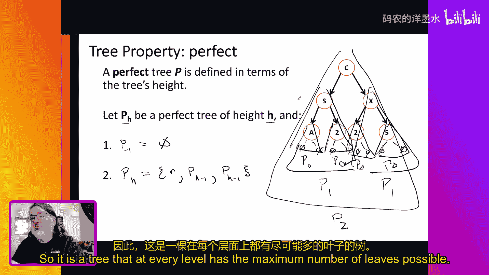

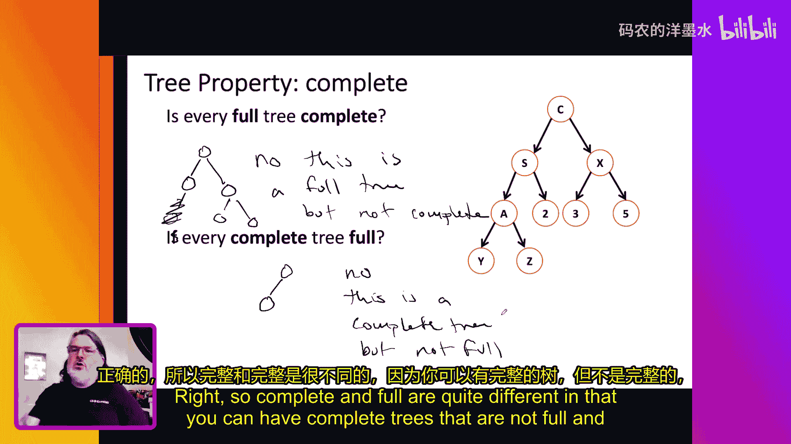

最后，让我们思考一下树的抽象数据类型（ADT）应包含哪些基本操作。一棵树（作为数据结构）必须支持以下核心操作：
*   **插入**：向树中添加一个节点。
*   **删除**：从树中移除一个节点。
*   **遍历**：访问或检查树中的所有节点。

在实现层面，二叉树通常使用类似链表的结构。每个树节点包含：
*   存储的数据。
*   指向左子节点的指针。
*   指向右子节点的指针。
整棵树则由一个指向根节点的指针来管理。

用代码可以表示为：
```cpp
struct TreeNode {
    DataType data;
    TreeNode* left;
    TreeNode* right;
};

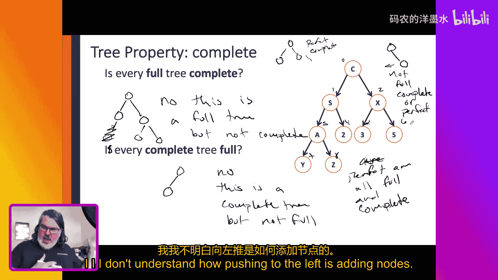

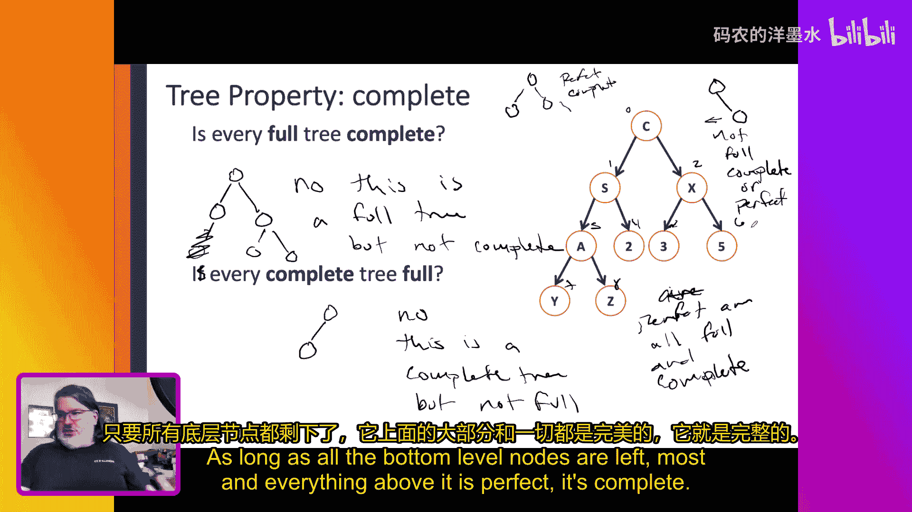

class BinaryTree {
private:
    TreeNode* root;
    // ... 成员函数（插入、删除、遍历等）...
public:
    // ... 公共接口 ...
};
```

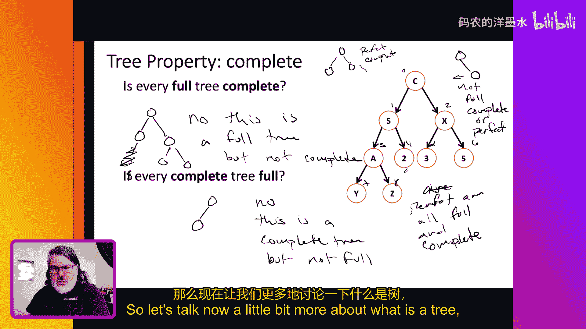

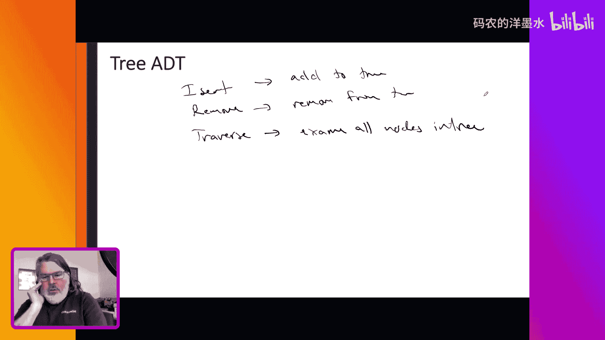

在实际绘图中，我们通常使用简洁的图形化表示，而不是画出每个指针，以方便讨论。

---

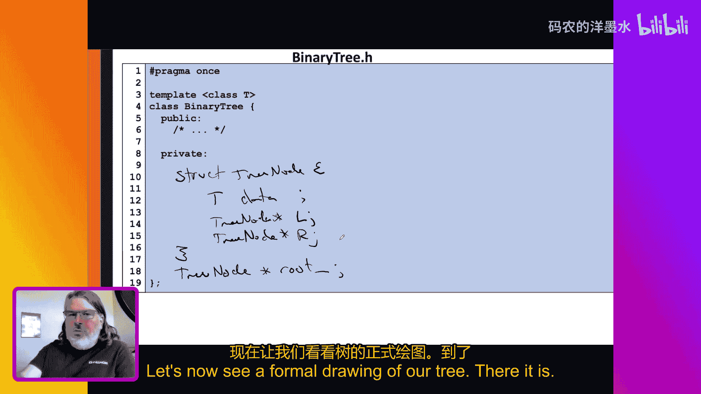

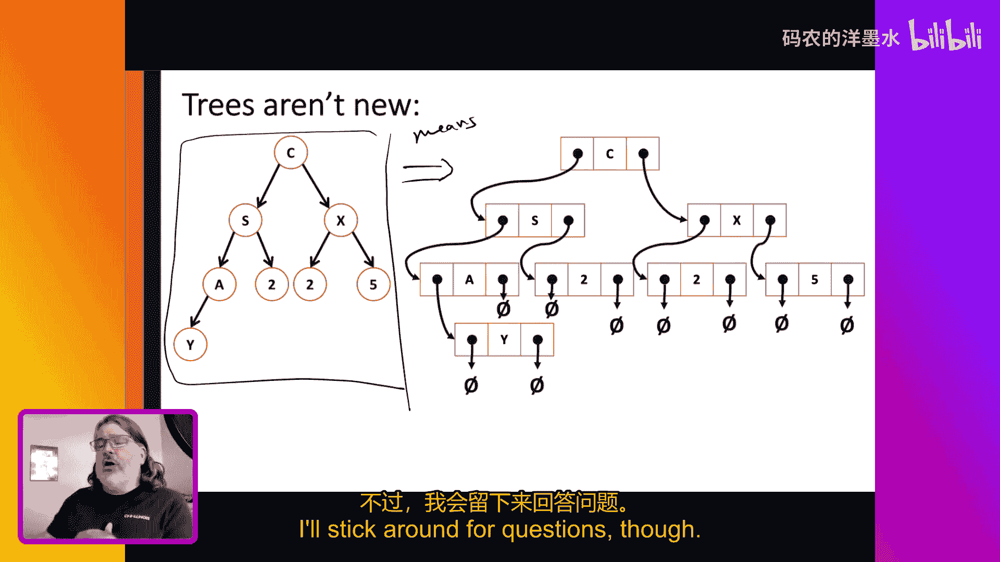

本节课中我们一起学习了树的基本概念，包括有根树和二叉树的定义。我们深入探讨了树的高度这一重要性质，并介绍了满二叉树、完美二叉树和完全二叉树这三种特殊类型及其相互关系。最后，我们概述了树作为抽象数据类型应具备的操作以及其基于节点指针的典型实现思路。树是构建许多高级数据结构（如二叉搜索树、堆、AVL树等）的基础，理解这些核心概念至关重要。