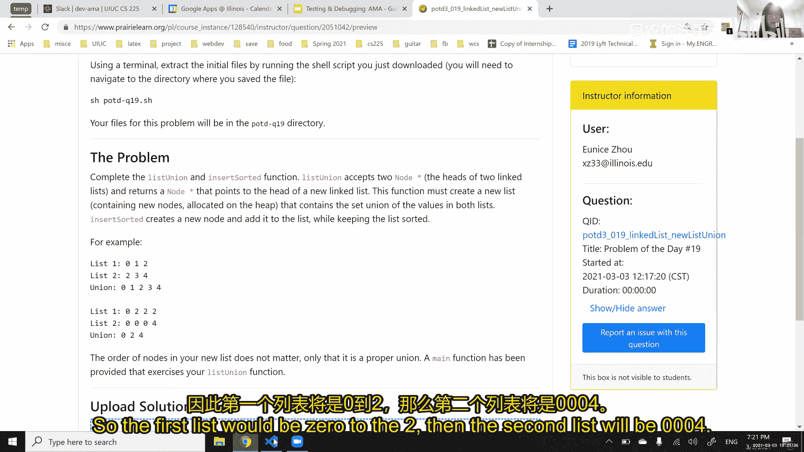
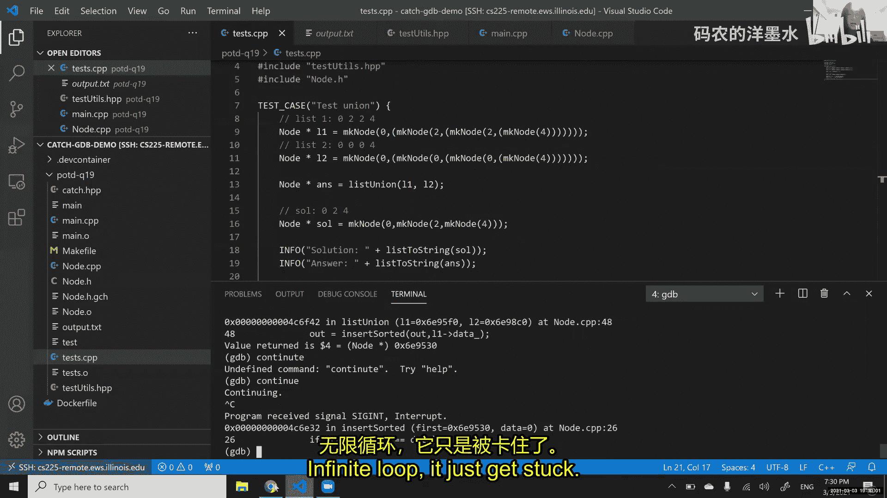
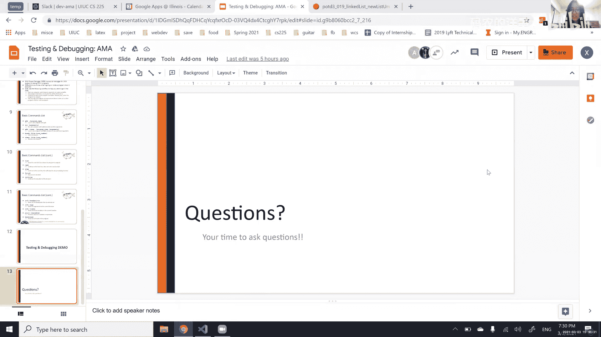

# 数据结构与算法：16：测试与调试 🐛


在本节课中，我们将要学习如何使用Catch测试框架和GDB调试器来辅助C++程序的开发。掌握这些工具能帮助你更早地发现错误，并更高效地定位和修复程序中的问题。

## Catch测试框架简介

上一节我们介绍了课程主题，本节中我们来看看Catch测试框架。Catch是一个用于C++的单元测试框架。如果你使用过Java的JUnit，会发现它们非常相似。它允许你测试程序的各个单元或独立函数，而不是整个程序。这使得调试更加容易，因为它能让你尽早发现错误。Catch提供了一系列宏来简化测试，我们将在幻灯片中介绍一些常用的宏。

Catch还可以将测试用例划分为不同的部分，并可以独立运行这些部分。总的来说，开始使用Catch非常简单直接。我们将展示一个Catch测试用例的例子，并演示如何编写一个简单的测试。

以下是Catch中一些重要的宏：

*   **`REQUIRE`**：它接受一个表达式并将其求值为布尔值。如果表达式结果为假，则测试失败。例如，如果你知道一个函数的预期输出，可以使用`REQUIRE`来检查你的函数输出是否与预期输出相同。
*   **`TEST_CASE`**：顾名思义，它定义一个测试用例。第一个参数指定测试名称，你还可以根据需要提供额外的标签。
*   **`SECTION`**：它是测试用例的一个子集，嵌套在`TEST_CASE`内部。通常用于组织测试用例，你可以将一个测试用例划分为多个部分，每个部分测试特定的功能。
*   **`INFO`**：它的作用是在测试失败时记录一条消息。这相当于添加打印语句，以便在测试过程中获取更多信息。

## 一个Catch测试示例

现在，我们来看一个具体的Catch测试示例。这个测试用例用于测试向量的`size`和`resize`方法。

```cpp
TEST_CASE("Testing size and resize for vectors") {
    std::vector<int> vec(5);
    REQUIRE(vec.size() == 5);
    REQUIRE(vec.capacity() >= 5);

    SECTION("Testing resize method") {
        vec.resize(10);
        REQUIRE(vec.size() == 10);
        REQUIRE(vec.capacity() >= 10);
    }
}
```

在这个测试用例中，我们首先创建了一个包含5个整数的向量。然后，我们有两个断言，要求向量的大小等于5，容量大于等于5。之后，我们有一个专门测试向量`resize`方法的`SECTION`。在这个部分中，我们将向量大小调整为10，并对调整后的大小和容量有额外的要求。

## 运行Catch测试的方法

接下来，我们介绍一些运行Catch测试的有用方法。

*   **默认运行**：如果不传递任何参数或标志，Catch将运行整个测试套件。
*   **运行单个测试**：你可以通过指定测试名称来运行单个测试用例。
*   **列出所有测试**：如果你想查看所有可用的测试列表，可以使用`-l`标志，它会列出测试文件中的所有测试用例。
*   **显示成功测试的输出**：默认情况下，成功的测试输出不会显示。如果你想查看成功运行的测试的输出，可以使用`-s`标志。
*   **重定向输出到文件**：你可以将所有测试用例的输出重定向到一个文件，而不是打印在终端上。使用`-o`标志并指定文件名即可。

## GDB调试器简介

上一节我们介绍了Catch测试，本节中我们来看看GDB调试器。GDB是GNU项目调试器，是一个在Unix系统上调试C/C++程序的流行调试器。它允许你在程序执行时查看内部情况。起初，它复杂的输出可能看起来有点吓人，但实际上它对调试非常有帮助，因为它比Valgrind给你更多的程序执行控制权。

使用Valgrind时，你必须运行整个程序直到它完成或遇到错误崩溃。而使用GDB，你可以通过断点在任意点停止程序的执行。一旦程序停止，你可以检查程序的状态，例如打印出任何变量或内存中的内容，以确保你的函数按预期工作。你还可以逐行步进执行程序。你可以将GDB与打印语句结合使用，以获取程序的更多信息。



## 常用GDB命令

以下是人们通常使用的一些基本GDB命令：

*   **启动GDB**：`gdb <program_name>`
*   **运行程序**：`run` 或 `r`
*   **设置断点**：`break <file>:<line>` 或 `break <function_name>`。例如，`break main`会在`main`函数的开头设置一个断点。
*   **删除断点**：`clear`
*   **显示代码**：`list` 用于显示程序停止位置前后的代码。
*   **步进执行**：
    *   `next` 或 `n`：执行下一行，但不进入函数内部。
    *   `step` 或 `s`：执行下一行，如果下一行是函数调用，则进入该函数。
    *   `finish`：执行完当前函数并返回到调用它的函数。
    *   `continue` 或 `c`：继续执行程序直到下一个断点或程序结束。
*   **获取信息**：
    *   `info breakpoints`：显示所有已设置的断点。
    *   `info args`：显示当前函数的参数。
    *   `info locals`：显示当前函数的局部变量。
*   **打印变量**：`print <variable>` 或 `p <variable>`，打印变量或表达式的值。
*   **查看调用栈**：`backtrace` 或 `bt`，显示程序的调用栈。

## 演示：使用Catch和GDB

现在，我们将通过一个演示来实际应用这些工具。演示代码取自一个练习题，实现一个名为`listUnion`的函数，该函数接收两个链表，尝试对它们取并集并保持排序。

首先，我们编写一个Catch测试用例来验证`listUnion`函数。

```cpp
TEST_CASE("Test Union") {
    // 创建链表 L1 和 L2
    Node* L1 = /* ... 创建链表 ... */;
    Node* L2 = /* ... 创建链表 ... */;

    // 调用待测试函数
    Node* answer = listUnion(L1, L2);

    // 创建预期结果链表
    Node* solution = /* ... 创建预期链表 ... */;

    // 使用INFO打印信息
    INFO("Solution: " + to_string(solution));
    INFO("Answer: " + to_string(answer));

    // 断言结果相等
    REQUIRE(areEqual(answer, solution));
}
```

运行这个测试，如果一切正常，测试将通过。我们还可以使用`-s`标志来查看`INFO`宏打印的信息。

接下来，我们故意在`listUnion`函数中引入一个错误（例如，注释掉更新链表指针的代码，导致无限循环），然后使用GDB来调试。

1.  使用`gdb ./test`启动GDB并加载测试程序。
2.  使用`break listUnion`在`listUnion`函数开头设置断点。
3.  使用`run`运行程序，程序会在断点处停止。
4.  使用`next`或`step`逐行执行。
5.  使用`print`命令检查变量（如`print L1`），观察其值是否如预期变化。
6.  如果发现程序陷入循环，可以检查循环条件相关的变量，从而定位问题。
7.  使用`continue`继续执行，或使用`quit`退出GDB。

通过结合`next`（不进入函数）和`step`（进入函数），你可以细致地跟踪程序流。使用`finish`可以跳出当前函数。`info args`和`info locals`可以帮助你查看当前上下文中的变量。

## 总结





本节课中我们一起学习了两个强大的开发工具：Catch测试框架和GDB调试器。Catch帮助你通过编写单元测试来验证代码的各个部分，确保它们按预期工作，并能及早发现错误。GDB则允许你在程序运行时深入其内部，设置断点、检查变量状态、逐行执行代码，是定位和修复复杂错误的利器。掌握这些工具将极大地提升你开发C++程序的效率和质量。