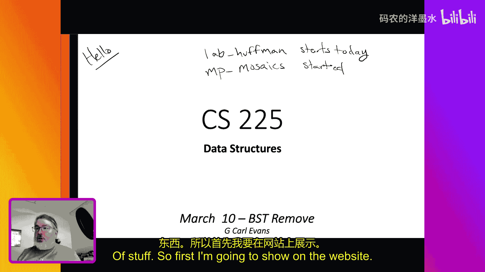

# 018：二叉搜索树的删除操作 🌳




在本节课中，我们将要学习二叉搜索树（BST）的删除操作。我们将从最简单的删除情况开始，逐步深入到更复杂的场景，并理解如何高效地维护BST的性质。最后，我们会探讨BST操作的性能，并引出对更优树结构的思考。

---

## 课程公告与项目信息 📢

首先，请注意课程网站已发布期末项目的详细信息。目前无需立即开始工作，但需要尽快决定是接受随机分配的团队，还是自行组建一个3-4人的团队。

关于平时作业（MP）的延期政策，本学期没有自动的24小时宽限期。但你有最多两次机会，可以通过向指定邮箱发送申请，获得一次24小时的自动延期。评分会在稍后进行，并保证在“重做”截止日期前完成。

此外，在复习日，你可以选择一次MP进行重做评分。系统将重新评估你在课程最后一天提交的版本，并将你的MP成绩更新为原成绩或新成绩的90%（取较高者）。这项政策不影响额外学分。

对于新发布的MP作业“Mosaics”，今晚将有一场答疑活动（AMA），强烈建议参加。如果无法参加，录像会稍后发布在课程平台上。

---

## 回顾插入与引入删除 🔄

上一节我们介绍了二叉搜索树的插入操作，它主要依赖于 `find` 函数来定位插入点。本节中我们来看看删除操作 `remove`。

我们能否类似地先使用 `find` 找到目标节点，然后删除它呢？让我们分情况讨论。

---

## 情况一：删除叶子节点（零个子节点） 🍃

如果要删除的节点是叶子节点（例如节点40），操作非常简单：
1.  使用 `find` 找到指向该节点的指针。
2.  删除该节点并释放内存。
3.  将父节点中对应的指针设置为 `nullptr`。

这个过程直观且不会破坏BST的性质。

---

## 情况二：删除仅有一个子节点的节点 ➡️

如果要删除的节点只有一个子节点（例如节点25或89），操作也不复杂：
1.  使用 `find` 找到指向该节点的指针 `r`。
2.  保存其唯一子节点的指针 `t`（可能是左子节点或右子节点）。
3.  删除节点 `r`。
4.  让 `r` 的父节点直接指向保存的子节点 `t`。

以下是该过程的伪代码示意：
```cpp
// 假设 r 是要删除的节点指针，且已知它只有一个子节点
if (r->left == nullptr) {
    t = r->right;
} else {
    t = r->left;
}
// 执行删除 r 和指针重连的操作
```

由于BST的性质，将唯一子节点提升到被删除节点的位置，总能保证新树仍然是一棵有效的二叉搜索树。

---

## 情况三：删除有两个子节点的节点 🔀

当要删除的节点有两个子节点时（例如节点13），直接删除会留下两个需要处理的子树，情况变得复杂。我们不能简单地将其中一个子节点提升上来。

一个低效的方法是：删除该节点后，将其左右子树的所有节点重新插入一棵新树。但这种方法的时间复杂度在最坏情况下可能达到 **O(n²)**，不可接受。

我们需要一个更聪明的方法。核心思路是：**避免直接删除有两个子节点的节点**。

---

### 高效的删除策略：节点交换

我们可以利用BST中序遍历有序的特性。对于一个有两个子节点的节点，它在中序遍历序列中必然存在**前驱节点**和**后继节点**。
*   **中序前驱**：左子树中的最大节点。
*   **中序后继**：右子树中的最小节点。

关键点在于：**这个前驱或后继节点，最多只有一个子节点**（零个或一个）。

因此，删除有两个子节点的节点的策略如下：
1.  找到该节点的中序前驱（或后继）。
2.  **交换**这两个节点的**位置**（或交换它们的键值/数据，如果数据量小的话；但通常交换节点指针更高效）。
3.  此时，原节点被换到了叶子节点或单子节点位置。
4.  问题转化为删除一个零个或一个子节点的节点，使用我们已知的方法即可。

例如，要删除节点13，我们找到它的中序前驱12。交换13和12的位置，然后删除位于新位置的（原来的）13节点，此时它已是一个叶子节点。

---

## 删除操作的性能分析 ⚡

让我们总结一下BST核心操作的时间复杂度，它们都依赖于树的高度 `h`：
*   `find`: **O(h)**
*   `insert`: **O(h)** （先 `find`，再常数时间操作）
*   `remove`: **O(h)** （先 `find`，可能再找一次前驱/后继，仍是 **O(h)**）
*   各种遍历：**O(n)** （必须访问每个节点）

目前，树的高度 `h` 在最坏情况下（树退化成一条链）是 **O(n)**，最好情况下（完全平衡树）是 **O(log n)**。因此，我们操作的性能在 **O(log n)** 到 **O(n)** 之间波动。

---

## 平衡的重要性与期望 ⚖️

上述分析揭示了一个关键点：**如果树能保持矮胖（高度低），操作就会非常快**。我们渴望所有操作都能达到 **O(log n)** 的时间复杂度。

研究表明，如果数据以**随机顺序**插入，BST的平均高度确实是 **O(log n)**。对于有 `n` 个节点的树，有 `n!` 种可能的插入顺序，其中只有极少数（如完全升序或降序）会导致退化的链状树（高度为 `n`），而绝大多数顺序会产生近似平衡的树（高度为 **log n**）。

如果我们在构建树时就拥有全部数据，我们可以通过精心选择根节点（例如使用快速选择算法找中位数）来构造一棵完美平衡的树。然而，在动态插入和删除的现实场景中，我们无法预知所有操作。

---

## 预告与总结 🎯

本节课中我们一起学习了二叉搜索树删除操作的完整逻辑，涵盖了三种情况，并理解了通过交换节点将复杂情况转化为简单情况的巧妙策略。我们也认识到，BST操作的效率高度依赖于树的平衡度。

目前，我们依赖“随机插入”来获得良好的平均性能。但这并不总是可靠的。从下节课开始，我们将探讨如何**主动维护树的平衡**，确保在最坏情况下也能获得 **O(log n)** 的性能。这将引出自平衡二叉搜索树，例如AVL树和红黑树。


**总结**：二叉搜索树的删除操作需要根据节点子节点的数量（0个、1个或2个）采取不同策略。对于有两个子节点的节点，通过与其中序前驱或后继节点进行交换，可以将其转化为更容易删除的情况。所有操作的时间复杂度都与树高 `h` 相关，而保持树的高度接近 **log n** 是获得高效操作的关键。