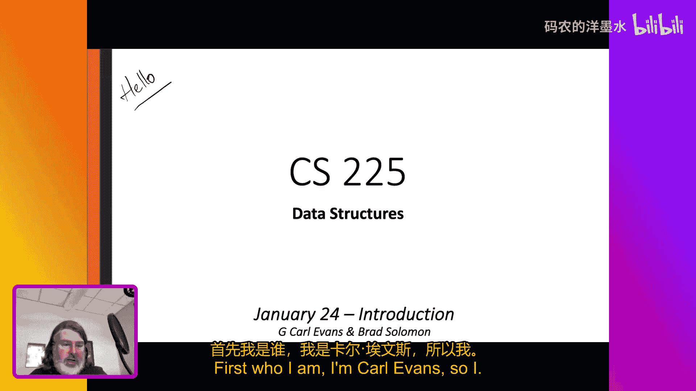
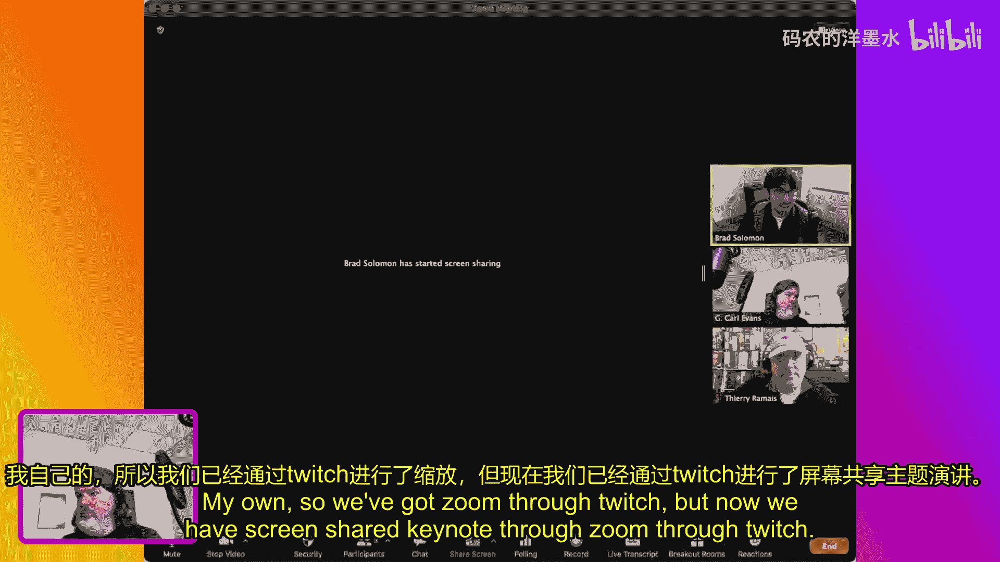
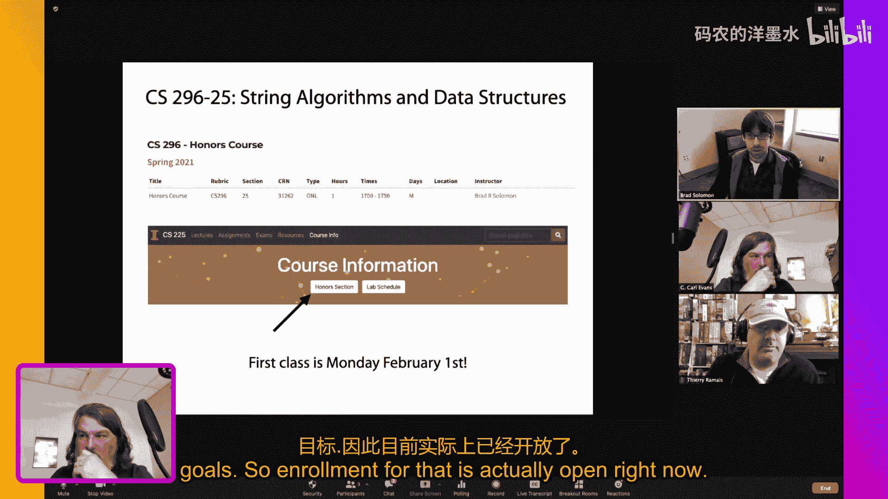
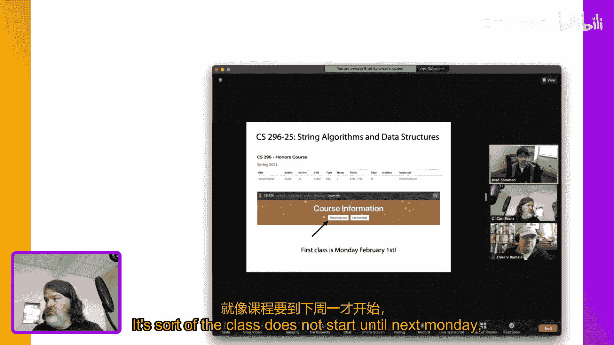
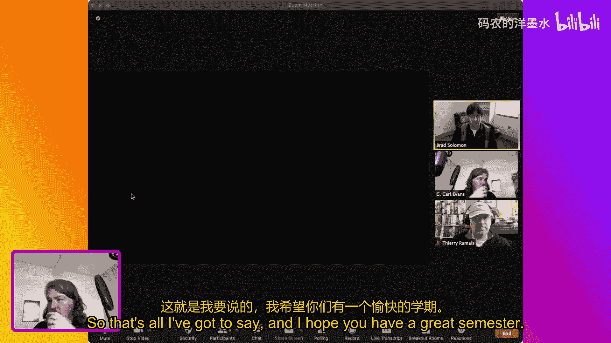
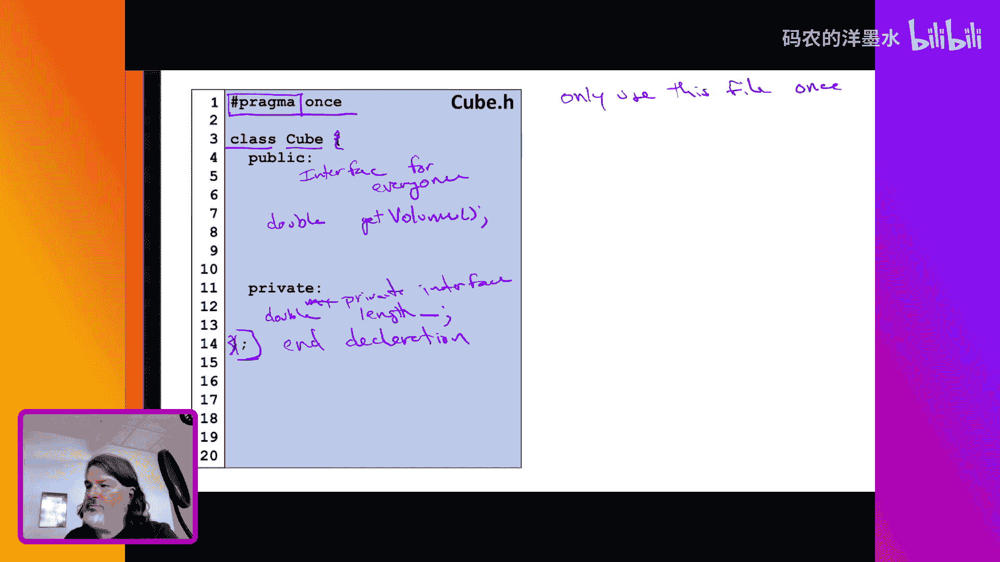

# 【全集】伊利诺伊大学 数据结构与算法 中英字幕 1080P p01 Lecture 1 - 导论 -BV1t9FHzdEYL_p1-

That means I need to start recording， okay。Hello everyone and welcome to CS 225。

 So today we're just going to do an introduction talking about。What's going on and how it is。

 you know， how this course is going to get run。 We are on Twitch。

 That's how we're going to do the lectures and I'm going to do them live。

Labbs are going to be in Zoom and are going to be more collaborative。so。

Let's start with introductions of who。We are。First， who I am。

I'm Carl Evanvins， so I。Have been at the university for a long time， and I actually grew up in town。

 so I have been here sort of forever one way or another。That。

I've done a lot of things over the years， as becoming a。嗯。Professor。

 and I'm going to talk a little bit about my research and how I got here。 So first。

 I get to have pretty pictures here。 So here we see。The pretty picture。

 which is why it's great fun to have involvement with actual science。

 So a lot of my research work has been on computational。😊，Science。

 which is simulations that doing experiments can be really expensive。 And if we can。

 we would like to be able to instead simulate many things。 In this case， we are simulating。

Something called plasma coupled combustion。 So here we've got。

 I'm going to change my pen color so it can be seen a little bit better。Let's do blue。

 Here we have a tube here。And it's spewing gas into this。Tunnel， which has wind going like this。

And this is showing the combustion of the gas。 So it's showing the。

The heat and what we're measuring is what's called plasma combustion。

 There's a little electrode there that is charging the particles， so it's plasma。

So that was what I did a bunch of work on。But before that， I did this。

 And those of you who have done linear algebra， This is a system solver。

 So here we have a system of equations that can be written as bands。And。

We can solve them by solving these little chunks。Independently。

And then we get what we call spikes like this， and now we have a bunch of independent solutions。And。

This allows us to solve equations in parallel。 And finally。

 the one bit that well kind of touch on this class is this teeny picture here。

 And it's a little bit hard to see。 But what we've got here is the flow control。Of。A program。

 So it is doing a sub I plus B sub I。And assigning to。C sub。And you can see it doing loads。

You can see it incrementing。And。Storing。 I'm sorry， it's doing A， and it's B and C， but。Okay。

 so that is the one piece that actually kind of looks like。嗯。Stuff we're going to do in 225。

 and that's because that is a graph。 and it's a way of representing a program visually， so。Okay。

 with that， I'm going to bring in the rest of the staff， the perfect leading staff。 So to do that。

 we are going to use the high tech method of streaming zoom onto。Twitch， so。Okay。

 so Brad probably should go first。 You should be sent to take over and。Go ahead and do it。All right。

Hello， everyone。 I'm Brad Solomon。Let me just quickly throw out。My own。

 so we've got Zoom through Twitch， but now we have screen shared keynote through Zoom through Twitch。

So who am I？Not just like how Carl introduced himself， I'm Brad Soloman。

 I'm a new teaching assistant professor here in the computer science department。

And my background was actually in computational genomics。

 and what that means is that my past work and my research interests largely focus。

How to effectively store， search and analyze large genomic data sets。

 such as those listed here Now you really don't have to know anything about genomics。

 suffice to say that the main idea here is that these data sets are essentially just large collections of text with a four letter alphabet instead of the English language or some other alphabet。

And the goal of my research was to essentially develop novel data structures such as the sequence B treee。

In order to enable large scale search of tens or hundreds of terabytes of text for some arbitrary sequence or string of interest。

And that was sort of my foundational works was developing these different data structures。

More recently， I've been involved in a number of big data science projects。

 where it's a combination of data structure development algorithm development。

 and also just workflow developments in order to basically do large scale computation in an effective way that is reproducible。

So of course like Carl， I'm largely transitioning to a primarily teaching role。

 and I will be teaching some amount of the regular CS225 class。

But you'll see me mostly working in the background alongside our exceptional course staff。

 some of whom are moderating， some of whom will。Introduce themselves in a moment。

But before I transition to that， I'm also the primary instructor for the honor section this year。

 which is going to be on string algorithms， data structure。

 sort of essentially the research that I enjoy teaching。I'm doing。

So what is the focus of string algorithm and data structures？Well。

 the hope here is that we will be covering these different methods， again。

 algorithms data structures to solve the number of fundamental problems in computer science， such as。

Text search， you know， I have a large file。 I have a large data set。 I want to look up a specific。

We'll also be focusing on data storage and data compression。

 how can I take a large collection of things and in some ways store it in a reasonable amount of space or store it in a way which is itself searchable and how can we do that effectively？

And of course， how can we scale these sorts of foundational concepts to modern problems。

 big data sets， big websites， things along those lines？But of course。

 because this is sort of the honor section of the regular data structures class。

 we're also going to be focusing on graphs， much like how most of the latter part of this class is going to be on graph algorithms。

In keeping at this sort of graph centric view， we'll see how string algorithms can used to produce complex graph。

 such as the evolutionary tree of COVID。But also how graph data structures are relevant themselves in string algorithms。

Such as the de Brown graph shown here， which is useful for assembling a very large string from a number of smaller strings which overlap。

So overall， I hope it'll be a fun and productive experience。

 and I think it'll prove useful to any student who is interested in taking it regardless of their future career goals。

So enrollment for that is actually open right now， it's sort of the class does not start until next Monday。

 February 1st， so you still have some time to basically decide if you want to take it or even if you'd rather just sort of audit and sit in。

 you can find the information。

Through a separate piazza， which you can link to through the ECS。So that's all I've got to say。

 and I hope you have a great semester。

Thanks Brad， I'm now going to ask Terry to say a few words， I don't know if Terry has slides。

 but Terry is our admin and almost all questions about how the course runs。

 I missed a task I want to know if something's due dress or other procedural exemptions go through him。

 so handing it over to Terry。Hi everyone， so yeah I'm gonna keep it short and sweet I've been and I don't have any slides but I've been involved with CS25 for a little more than five years now and I am one of those people one not I'm not a computer scientist or an engineer I'm actually be a I just graduated with a Ph in English a year ago it was good timing and what I do for this class is as colleagues plan trying to kind of keep some of the pieces together and try to keep the communication flowing between the different parts of this class so I take care of schedules。

 I take care of trying to address any problem or relay any problem that you might have with the logistics of the class。

 two faculty two CAAs to TAs and I also take care of address students of absences of N exams if you have any so I can be one of your point of reference if you have any questions again。

the way the class is being run， so that's my story。Thanks， Terry。

 so I think that's enough zoom through Twitch and we'll go back to me running the show。So。Okay。

 so you got to meet us， there's a bunch other people of that there's a bunch more people。

 there's a bunch more ways to reach out to us so first of all。

 the best way to ask administrative procedural questions is through the admin email CS 225 admin it lists thats CS that Illinois Eu。

It's right there， we have a Discord server， we found it very useful I tend to be on it most of the time。

 so it's a good way to ask quick questions， we won't do private debugging for you there。

 but there are lots of people in the class who are happy to help you and work with you。

and both other students， which we encourage because one of the things that's hardest about being online like this is how。

Um， sorry， had to deal with stuff。Um， how。Easy it is to get separated。 I mean。

 the link for the Discord server is right there。 It's also on the course website if you want to be able to click it。

Or。We have piazza， which we're using。 And I want to speak out one thing on piazza that there is no。

Expectation that you pay for it， we're using the user supported， but there's no requirement to do so。

 so。Okay。So let's talk about you because we've talked about us。

 there's a bunch of Ts and there's a bunch of CAAs that are helping。

 and I don't want to minimize their contribution， but it's harder to get them on a Zoom call so。Okay。

 so。What I want to ask is。Where do you all come from。

 Because right now there's a bunch of different prerequisites you have to have。嗯。And。

This is the major set of prerequisites。 And we can look at it， that this shows。Om。

What's going on in the course， so。Where do you come from， So who all came from 173？Lots of 173 here。

 I'm seeing a lot of people saying 173。 So 173 is a big O。And。

Also and basic analysis but also graphs。Trees。And proofs。So。That's great。

So that's one side of the theory， the other way you could get the theory。Its from Math 2 13。

Which has almost all the same things。But。Less big O。And algorithms。Okay。

 so that's our theory background and that's staying。Our programming side is a huge mass。

 I guess I think 347 also can work。Yep。It's not the requirement， but 347 counts is 213。

 I believe is how that works。Am。So， okay。On the programming side， let's see。A bunch of you。

 I'm sure came from 125， and then you did Java， right。

 So the language you have a familiarity with is Java。Some people came from。126。1，26 was Java。

Moving to C plus plus。Okay。And finally， of the major direct ones， we have ECE220。

 which is C with C++ at the end。And then we have a bunch of other possible things that we've allowed so far。

h yes， we have LC3 showing up for those of you that like assembly。That's fine， there's no C++ in 125。

Just wait till you build an LC3 processor。EC C E 411 represent。

 But so what other languages do we have as a background， see Java， C plus plus。What else？

We're an actual online class， but you're welcome to join Python， of course， yeah， we got Python。Oh。

 camel。Hasll。Pas goal。F sharp。What are the things， Ru R， P P。Htm， H， I won't give it， is it Oh。

 Kolin。Rt。So a lot of different backgrounds， right？And I don't know if you've heard。

 but we've got one more class that is running for the first time this semester。Which is？C， S 1，28。

Which will become C plus plus， and。Then we will have 125 into 128。

At which point the course will start changing because we'll have an expectation。 You know。

 C plus plus， but today。We don't。So the first couple of。

U weekseks of this course are going to be C+ plus。Okay。So that's how this course starts。

Everything about this course， well， our website， which was put up there previously。

 has all of this stuff。Do take a look at it。 We'll keep it up。 There were some questions in Piazza。

 that the。Lectures show from last semester。And I do that because you every lecture I create new slides or modify the slides and update them。

😡，But。嗯。I leave up the last semester until the new ones go up because it gives you not the exact same material you'll get this semester。

 but an idea of what's coming so。Okay。But what is this course about？Well， it's about data structures。

 but what does that mean？So I like to think of data structures as containing information。

 and what I've got here is a picture of three places。Anyone know what any of these are？

Anyone recognize any of these locations of the undergrad undergrad？

So even even if you might not be actually in town， there's the undergrad library。 Yeah。

 they're all libraries。West World Library。Hogwarts， it's not Hogwarts， it's the Booloon。

And it's too dark。The Boolin Library in Oxford， it is beautiful。

 and then we have the picture book library。UmIn Iwaee， Japan。So。

These libraries all share an idea that they are all about storing information and making them available。

 but they're very different， aren't they。They're very different in that。They look different。

 but they're organized differently。 So let's talk about it。

 The undergrad library is a general purpose library。 What do I mean by that， It has a bunch of books。

 some of which are for research， some of which are for fun。

 and it's organized using the Dewey decimal system。

 and it's physically structured so that you can see in it。 there's these tables so people can study。

 I don't know if you can see in the windows really well， where I'm trying to mark， right。

 People are studying。And the organization allows you to sort of do discovery by looking in a space where。

The same ideas are organized right They organize the books by concept。

 So if I'm looking for books about the history of the Ottoman Empire。

 I go into one place and it's going to be all in that same spot。 and I can look around it yeah。

 COVID has made it less convenient， but that's pretty cool。

 And then you go out and you can study and you can put them back and look。

 so thats that's a very general data structure。But what about the picture book library。

 if you look at this picture。You'll notice it's organized very differently。

 And this isn't just sort of a display。 That's the shelves of the library。

 That's really how it's set。 And， in fact， every book is placed so that it faces out because in a picture book。

 the way you know what a picture book is about。Is by its art， by what it's showing， right？

 So the books are all shown face out so that you can walk by。 You can see the books。

 You can look at them and you can wander around。I think that's really cool， it's organized very。

 very differently， and it allows children to discover picture books more effective。

What about the Bodo in library It means， it's beautiful and it's relaxing。

 but there's something really fascinating。The Botel and Library's collection。

 the books that it keeps are organized。In time。That is to say。

 they are ordered by the order they were added to the library。

 So the books that the library got most recently are in one end and the books that are oldest are in the other end。

 right， It's organized by the way they were added， and it's a very different structure。

 but it allows you to see how the librarys changed over time。 It's， again。

 it's producing a different structure to solve a different problem。And I think it's really cool。

 And what are we going to do， Why is this have to， Why am I talking about libraries？ Well。

 with data structures， we have the same question。We're building architecture to store information。

And to store information to be used for particular algorithms。😡。

When we choose how we store information， we choose what things will be easy to do and what things will be hard to do。

And by doing that， we end up with a different structure。

 and in this class I'm going to be teaching you how to think about data architecture。

 how to think about organizing data to do tasks。😡，Because while data is cool。

 the real reason we organize it is to do something with it。

And you need to know what you're going to do to know how to place it。

And that's what we're going to cover。 and we're going to see the advantages of each one。

Of each structure。And I think that's really cool and we're going to talk about these things。

From a practical point of view， how do you write the code。

 How do you actually make this structure work， And we're going to talk about them from a theoretical point of view of how do we analyze these things。

 How do we know。What they're doing， how do we， how are we sure they're going to behave the way we want。

So。I think it's really cool， I really like this class， I think it's a wonderful way to balance。嗯。

ItsWe see the two threads of computer science， the theoretical。

 the abstract and the very concrete detail come together。So。There you go。With that。

I want to talk a little bit of an introduction about what's going on in C++。Would be， it would be。

 it would be sad。 It is unlikely that people will ever or at least frequently teach classes on materials they don't like。

 but I think this class is special。 It's special to me in that when I first took this class。

 it was what inspired me to become a professor to teach。So。Okay， so。Let's talk about。C plus plus。

And let's talk about。What is the fundamental difference between C plus plus。And what we were doing。

Before。So if you're coming out of。Java。C++ visually looks very similar。But fundamentally。

 it's very different。And it's very different， because。In C++。

 we are talking about memory in a concrete way。Okay， what do I mean。I mean。

When we look at a variable in C++， there are a few things it has and every variable has a name。Okay。

Every variable has。A name， which we can see here， here， here。Every variable has a type。😡。

What do we have， we have an integer， a char， a double。Okay。

 those are the builtian types or the primitive types。Here are catt cube in。Person， which are。

 in this case going to be types， but theyre user defined types。 So they're classes。So we have a name。

A type。When else？We have a memory location。Every single variable in C plus plus。Has a location。

And that location， it's the address。Is the place in the computer's memory that it is stored。

So my favorite int is going to allocate space somewhere in memory to store。That variable。

What else does it have， So every variable has a name， a type。In a memory location。Okay。

One last thing it has is。Of value。For a lot of these， we can tell what's going on here。

 grades value is the letter A， capital A， right？Gmma has a value of 0。653。

 which is a floating position point number。啊。What's the value of my favorite integer or my favorite int。

 Any suggestion。Well。There's one value that hasn't。That it can't be that people have suggested。

 people have suggested that it is null。KNull is a value that a pointer has。

 it will compare to null possibly。But it is not no Other than that， it is。Unknown。It is undefined。

But it's still there。 And why do I say it's still there， It's because somebody said it right there。

 whatever exists in that location already。So。There was some memory there。And I don't know what。

 But whatever memory was there。Is what its value is。so。In memory。So wherever that location is。

 whatever happens to be there， that's the value。And this problem of undefined is。

One of the things that causes real problems。For C++ programmers。

 because you never want something to be undefined。Okay。So undefined， this was a。 This was 6。653。

 Any suggestions of what's going on with the cat。Katya and Guwenare。Two cats I've had。

 they're classes， but what are their values？Are they undefined？got declared memories me。

 someone's got it。 And this is， this is ahead。 They are default constructed。Constructed。

So since I didn't tell them what to do。They had to be created。And in our class。

 one of the things we're going to have is a constructor that tells the computer。Dear computer。

 when you create one of these， here's what you do。😡，And if we don't write that code。

 someone will write it for us。 So they have some amount of memory， which is the space to fit a cat。

And they have values that are created by whatever the cat class。Um， says。

Is there null isn't a value at all。 Null actually is a value。

 Let me show you something that could be null。Um， or more properly in C+ plus null pointer。

 which is instead we could have cat。Pointer。Cant pointer。Equals。No， pointer。So there is a variable。

 its name is CA pointer。Its type is a pointer to a cat object。And it is pointing at null pointer。Um。

 I will get more to the default constructor， think of that as a preview for material that I believe comes next Monday。

😡，So。What's the difference between null and null pointer？ So the type。Of no。Is int。The type。

Of no pointer。I。Vd。Star。So no pointer is a pointer to an unknown type。

So this is a type pointer and this is a type integer。iss no pointer a keyword and C+ plus yes。So。Um。

 I'm afraid we will not see Kaya because she is no longer with us。

 but in all probability you will see Guwenaever。So。Okay。So。Let's talk a bit more about classes。😡。

Classes we' have seen in Java and you will have seen before。Om。

I'll answer the when would you use null versus null pointer。

 you would use null if you were writing old code at this point， you should always use null pointer。

 null pointer was introduced， I believe， in C++ 11。 and prior to that， it did not exist。

That's not true。 null is a capital null is usually a macro for0。

 and that has to do with old C semantics。So we are using C++ 17 in this course。嗯。

What does a macro mean， okay， we'll talk about it that。

A macro is a thing where the compiler will replace that string with some other string。It's a。

It literally is a string replacement system。It is a old system。

 we don't use that much anymore and we're not going to focus on it。I mean， here is。I。

It looks like that。 And then after the compiler sees this line， any time it sees null by itself。

 it will replace null with the0。That's it。Okay。So， let's talk about。

Macros are always fully capitalized， that's the tradition， there's no requirement about that。

But in general， if you see something always capitalized， it means that it was probably a macro。

It is not a global declaration。It's。It literally appears in the code file。

 it exists until something removes it。Okay。So let's talk about encapsization。

We do not enforce a style guide。Incapsization is the idea of separating the interface。

From the implementation。And this is a really important point。This is really useful。

 We want to separate。The interface of our classes from their implementation， why？

The interface is how。It is used。It describes。How to use my class。

Let's think about an interface we're all familiar with。We're all familiar with an array， right。

 An array has an interface where it uses square brackets and a index。To access itself。

 And we can use it on the left or the right hand side。Right。So。

We might also want something complicated， for example， if we had a graphics class。

 we might have a circle that allows you to display the circle to set the color of the circle。

To hide the circle， to fill in the circle， all of those things would be an interface to that class。

 But what's the implementation， well。Hao。Yude。Yoxs。2。😔，Fengchun。So how do you actually do it？

And we're going to talk about this a lot because we're going to talk about data structures as having an interface。

 and then we're going to talk about how do we implement that interface， right， Do we use an array。

 Do we use something else。 Do we use pointers， Do we use pieces。

 and those choices will not change how the thing can be used。

 but it will change what is most effective to use on it。😡，So how effectively it works。嗯。

Is going to be defined by the implementation。Okay。So。Go a little bit farther。

 I'm going to talk about an example of how C plus plus does encapsization。

So one of its most fundamental things is it breaks the program down into multiple files。

 So we have the header file。File that has the interface。The code in the header file。😡，Describes。

How you access and use a class。V。Code file。Or C plus plus file。People use both names。

Is the implementation。Filllings asks， should we use dot H or do HPP？😡。

We are not yet using HP P P a little later in the semester。 We'll talk about what H PP means and why。

 So H PP is kind of a header， and it's kind of a code file。

 And when we get to talking about templates， we will introduce H PP files and explain with what's going on with that。

 But we don't need to worry about it now， What is the difference between C C and C PP。

 Different computers like different extensions。 They're the same thing。😡。

So this is the implementation。So the okay， that's a good question。 What is the dot O file。

 A dot o file is what a compiler produces a compiler takes as one step of building a program。

 it does the compilation step， which is where it takes the source code and produces an object。

 That's going to be the actual machine code that the computer will run。

 but without the parts to make it a program， just the code for all of the functions and the code for all of the。

Variables that appear。But you need a little bit more。

 and there's a step called linking that will wrap it up。

Well be getting into how compilers and linkers work a little this semester a bit more。

 but not deeply， we'll talk about it some。😡，So， okay。

 C++ separates these implementation and interface。U we will not be going over CMake in general in this class we use make。

哦。Okay。So。Let's look at what goes in the dot H file。In the dot H file。

 we have a couple things at the top， every dot H file is going to have a pragma once。

What is pragma once， it is called a header guard。And it is。Saying only。Use。This file。Once。

Why do we say that？We say this because even if we are including files that include other files。😡。

It allows us to make sure that we don't end up with a cycle。

 and it allows us not to do anything else。 Where does pragma come from。

 That's actually a really good question。 I don't know where the term comes from。 Why the word。

It is a。Instruction to the compiler。 So this says this is instructions to the compiler about how to do something。

So pragma 1 says use this file once， okay。And every file has it。Okay。Then we have。

The definition in this case of a class。You have a class。Cube。Okay， so that's the name。

The class keyword says the next thing we're going to do is。Define a thing。

 and we need to give it the name and an open print， an open squiggly brace。Starts it and ends it。

 And here is the thing most of you are going to forget several times because I even sometimes do when you define a class。

 you need to have。A semi colon at the end to end。Deeclaration。Okay。Inside。

 we're going to have two sections。 This is the interface section。For public。Everyone。And then this。

 after private， will be my interface。Private， or it will say private。Interface。

It will have one other thing。It will also have。Om。Ei。Any space it needs。And ask。

 why is space part of the interface。There's a good reason here。

That the interface tells everybody how to use it， right？And if I want to use a cube。

 I need to make a place to do it， right？😡，I need to make space for it。

And I'm going to make space for it by declaring it。 So my cube here is going to have， say， a double。

Which is going to describe its length。And we're going to use an underscore after anything that is private。

Okay。So we're going to store。The information about our cube by storing a variable that stores the length of its side。

Okay。So some people were asking that they had heard that in the dot H file。

 you will sometimes have implementations， and that's true。😡，That if you have a very simple function。

You might just write it in the dot age file and that'll happen sometimes。

One way to think about C++ is that C+ plus is like a chainsaw。Why is C++ like a chainsaw。

 Because the first time you pick up a chainsaw， if you turn it on and swing it around。

 you will probably lose a limb。On the other hand， if you study and practice for a long time。

I've seen a guy who can sculpt chairs free hand with a chainsaw。Turns it on。

Walks up and just starts carving away。 And there's a chair， almost finished。

I have only seen videos of him。 I have not seen him in person。

 but C plus plus is like that When you first start using it。

It can go very wrong and but as you learn it， it is very powerful and can do lots of things。

On the other hand， much like a chainsaw。It's not the best solution for everything。

But I do think it is a very good solution for what we are doing in this class。So， okay。

What else do we have we'll have sort of。Let's have what do we want。 We want to return a double。

And we have a function get。Volume。And there is part of my interface。

So those are the things that end up in a header。And。I think that's it。 When I come back on Wednesday。

 we will continue with this and start working at what's going on。So that's what I've got for today。

I will try to find and post a link for the chainsaw video in Piazza or something， but yeah。

Anyways。