# 【全集】伊利诺伊大学 数据结构与算法 中英字幕 1080P p02 Lecture 2 - 内存 -BV1t9FHzdEYL_p2-

So our last lecture of the week。Our last day of the week， that is a class day。

So we were talking about constructors and we had written one。

 So let's look at and wrap up what we were doing at the end of the day on。

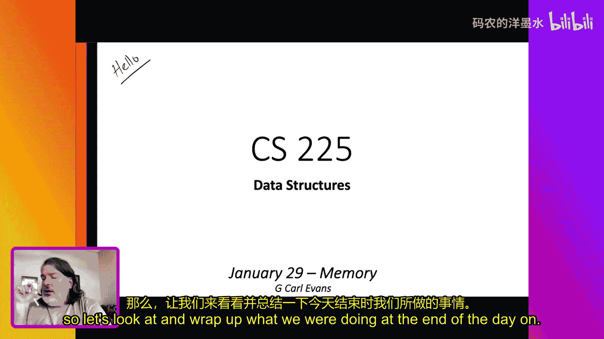

Wednesday。We have this code here， right， and we had written a custom constructor cube。

And it set length to length。And。I've done one thing I've written。

 And so I didn't have to use CS 225 all over the place。I used a statement using using CS225 cube。

Okay。And I also did using sea outs， this says sea out。Is the same。Has。Stood。Xiao。

So it makes my code a little bit easier to read。Um， so my question for you is。

 what is this code going to do when I run it？And we only have the one constructor here。

 we've written a custom constructor。Any thoughts， I'm going to compile this code and try and run it what happens。

Yeah， it turns out， and this is a little bit of a trick， there's going to be an error。

You're almost right。So it's going to throw a compile error。😡，And here is why。

There there are a lot of good thoughts here。 It's going to throw a compile error because since I wrote a custom constructor。

 the compiler will no longer provide a automatic default constructor。

 so it's going to get here and say no default。😡，Constructor。So if I wrote no constructors。

Then I would automatically get a default。But here I would need to give it an argument because there is no longer a default provided。

So I'm actually going to address。The question that true real King was asking。

 why don't I just use using CS S 225， right？ I have this using CS S 225， Col and cold。

 instead I could have done using。Namespace。

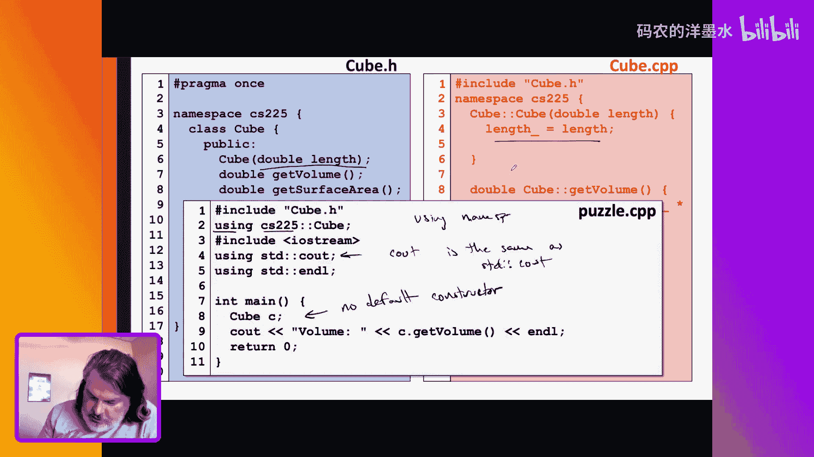

C S 225。 and I'll actually go here instead of you having to read me writing。

 So why do we want to not do that， Because that brings a lot of things。

 I think that if I did using namespace standard， I'm going to bring all of the things that exist in the standard namespace。

 And there's like hundreds of thousands of things that I might be adding to my program。

 The advantage of namespaces is to differentiate。 I don't want to say because what this really does is say just。

Put。All of。Namespace。Stood。Into the global namespace。It's kind of like saying just never use it。

 pretend it doesn't exist。That is to say， if we were in a world without namespaces。

 it would work like this。So this is an issue， but not really memory。

 it doesn't add that many more things to memory， but it does。It makes it easier to have things。

Accidentally mean something else。These are much safer and much better shortcuts。

 and let me say that if you do the using namespace。

 you will sometimes get errors that make no sense to you。😡，Because you will。

Get stuff that you did not realize added to your program。Um， you。

 if you were a C programmer and didn't want to be a C++ programmer。

 you absolutely could pound include standard IO， but we aren't going to do that in this class。So。

 okay， these shortcuts are good because they're explicitly bringing in the things you want。

This is a shortcut， has possible problems， and I have seen actual students have problems using it。

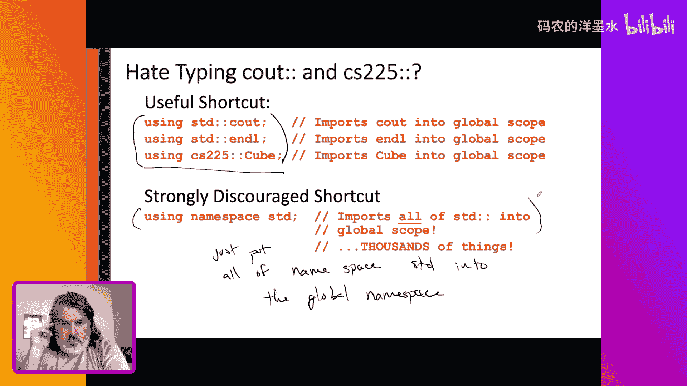

Okay。The global namespace is where anything that does not belong to a namespace exists。

It's everything。In fact， the namespaces exist in the global namespace right if you think of the world。

 the world starts with everything and then we start subdividing it。 Well。

 the global space is the space of everything。Then I put a box， I put stuff in the box。But where is。

 where do we start， the global name space is where we start。So here's our program。

 So we said that as we had it。It didn't compile。After today's lecture。

 you have knowledge to complete lab one， complete the MP。

 and in some ways the knowledge for next week's lab， though。

More experience will help for next week's lab。Okay。So。Here is the code we have that doesn't work。

 How can we fix this？How can we make this code work， Any suggestions？

It's not so much that we're doing a lot today， it's the complete。Immediately， we got two suggestions。

 I'm going to do the first one。 let's do an empty constructor。

 so we're going to create add a default constructor。 How do we do that。 We write cube。

So that is declared a default constructor， and then we're going to define it cube。Colon， colon cube。

And it's going to say。Equals 1。0。Okay， so I have created a default constructor and now when I compile this program。

😡，It'll work。So it wouldn't work before because the compiler will only provide a default constructor if you have written no constructors。

If you have written any constructors， it assumes you have taken responsibility for that job and it doesn't do anything for you。

Okay， so now when I compile it， what's going to print？So we're going to print right volume。

And get volume was doing， yeah， we're going to print one or 1。0 and we'd have to to see but yeah。

 looks good。Because one times1 times1 is still one。Okay。I can， in fact。

What is our second suggestion of how to do this？Let's do。And we are going to print。

So in there's the question here， Un oblivious Otter what a great name。

 are we essentially overloading the constructor by creating ones with different arguments， Yes。

 we have not talked about overloading， but in C plus plus the。

actual name of a function is its name plus its arguments， and so we have two constructor functions。

 one that is cubed that takes no argument and one that is cubed that takes a double precision floating point number。

😡，What would be the difference between cubeB1 and cubeB C equals new cubeB1 Well cubeB C equals new cubebe1 would not compile and on Monday we will get to what is going on there。

So。This is， this is one kind of overloading。 We're providing more than one function for the same name。

So。Okay。So we have two ways of making this program work， which one's better？😡，Again。

 we I don't know what you guys are talking about these， this new new word， I don't know what that is。

I don't think there is a better one。I think that these are two things that depends。

On exactly what you want。 now， I will say。I do believe that if you're defining a class。

 you probably want to have a default constructor as well。But。Okay， so that's it。

 We now know about classes and about constructors， and we know of two kinds of constructors。

 We know of the default constructor， which is what happens when you create a class object with no arguments。

😡，And we know about a custom constructor where you can give it any set of arguments。Okay。Um new。

 I've never heard of the word， I think I will hear of that word on Monday。So。

But we're going to talk about something else that was there。😡。

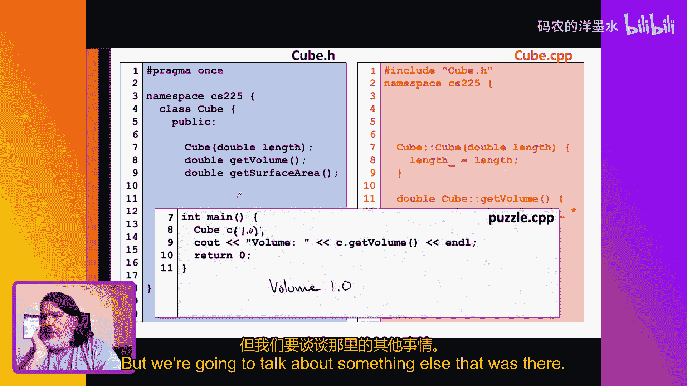

We're going to start talking about memory。😡，Because what makes C plus plus fundamentally different than。

What you've seen in Java is we are much more explicit about memory。And to do that。

 we need ways to talk about memory。Okay。Where you're not dealing with that stuff of declaring default and all that sort of thing。

Okay。A variable。Here is the variables we've seen， right， so this declares a cube called S1。

And it makes a cube somewhere in memory right and calls it S1。Okay。Now， if you came from C。

 you may know some of what we have here， but this is entirely in C plus plus only。

We have something called a reference。A reference says。哼ん。😊，I am going to make R 1。

 which is a variable， and it is going to refer to。um。Some other variable。 and in fact。

 whenever you create a reference， you must initialize， must be initialized。😡。

Because all a reference is， is it's， in a sense， almost not a variable。

 It is another name for an object。 So when I said this， I don't create any more space。 I say， oh。

 we're also going to call this。R 1。Yeah， we can think of it as alias， we call it a reference here。

It's just another name， right， if we think。Um。IfSo what if we did cube R1 equals S1。

 that would create a cube R1 that was a copy of S1。What are the benefits of having a reference Well。

 the real advantage will be when we pass it to a function。

It allows us to have another name for something， so I can pass into your function a reference。

 and you can change something that I am holding。😡，In this case， in a declaration。

 So when we have a type followed by this， followed by a name， it means that R 1。Is a reference。2。

The cube。And that's the way to read it， you start with the name and read outward。😡。

So it says R1 is a reference to a cube。If I did cube R1 equals S1。

 I would be declaring R1 to be a new。Cubbe。That is a copy of S1。

Is R1 a reference to a cube initialized to S1？It says that R1 is a reference to。The cube。N's one。

How is R one implemented magic？Fairry magic is how R one is implemented。And I say this， because。

If we want to talk about compilers and you want to come back and take 426。

 we'll talk about how it's implemented。😡，Right now。

All I'm promising and what I am promising with this language is that R1 is a reference to a cube。

That is S1。So R1 is a reference to the A cube S1。No， it's just another name is S1 an address。

 I don't know S1 is a name for the location is a name for the cube。Okay。You're thinking this is Java。

 so why don't we just pass S1 as an argument if you want to adjust S1？When we get to arguments。

 you will find out that in C++ we pass by copy。Not by reference in Java。

 objects were always references， but that is not the case。

 Nothing is a reference unless you make it so。😡，Again， doesn't S1 point to the top of the object。

 S1 is a name for the object。That we can talk about how that works。

When we talk about how a compiler works。Don't worry about it yet， it is not an address。

 there is an address for it。Okay， so then we have one more type。

Is S1 a name but not a reference once okay？Once I have created a thing。

I can't tell the difference between a reference and an object once it exists。Okay。Once。

I have made a reference， a reference is indistinguishable from being the actual thing。

But when I make it， I set what it refers to okay？So it creates another name for an object or a variable。

😡，Okay。So we have one last thing， and this one is an actual thing。Which is a pointer。

 so this says P1。Is a pointer to a cube。😡，Okay。What is a pointer？P1 contains。The address。Of a cube。

So this is a type of something that it holds something， it holds a cube。

 and we will talk about it being the address of a cube。😡，In this case， in a declaration。In fact。

 absolutely， and Perand and star are just the way we write the type of a pointer and a cube。

R1 and S1， and I'm avoiding using refer here， and I realize this is kind of funny。

 it'll start making sense over time， but they are both names for the same object。Can I make it point。

 Can I make P1 point to a specific cube absolutely， And I will we will do this this way。

 We will say P1 equals。And per sand， and this is looking ahead S1。

So this is using and perand in a different way。😡，Which is where we take the address of operator。

And percentand in a declaration makes something a reference。And Perand， in all the rest of the cases。

 says， give me the address of something。That is correct。

 A reference can never change what it refers to， but。A pointer cam。And that's a good idea。

 the author ones， Yeah， so let's walk through pointers。

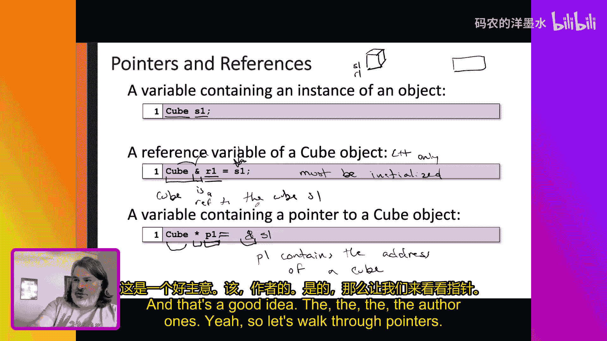

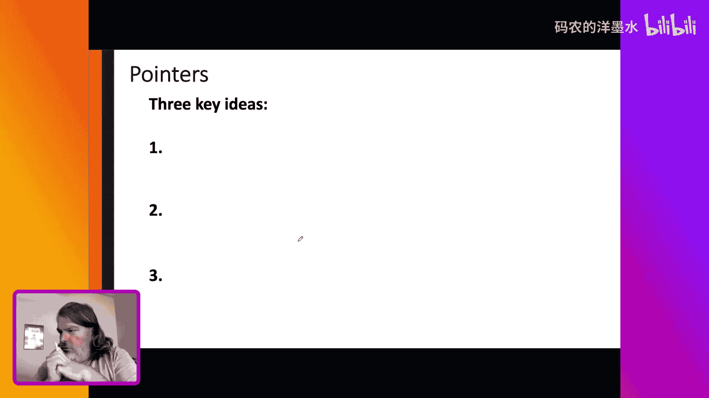

So。Yes， P1 is pointing to the location of S1， having written it that way， that is correct。

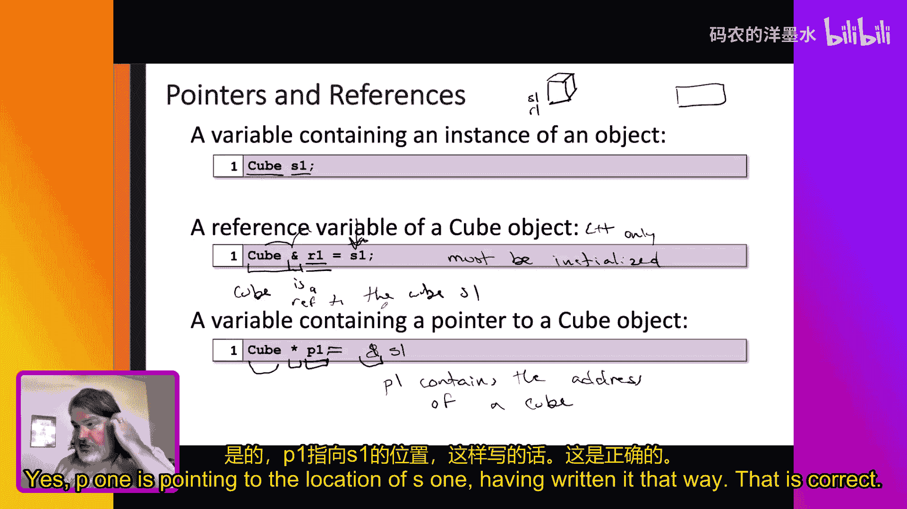

So what is a pointer， it is a variable。😡，That。Contains。An address。That's it。

It's just a place in memory and what we're sticking in there is。

The address is andpersand different depending on the context， absolutely。

 andpersand in the declaration makes something a reference。

 andpersand in an expression makes a call to the dereference to the address of operator。

We haven't even begun to start talking about inheritance， but we do get that next week。Okay。

 so what else can we do？We need to resolve。Address。To read。Data。Pointed to。

So if I want to read what a。嗯。Variable points2。I need to dereence it。

So someone wanted to see this for a second。The address of operator returns the address。

 the location in memory that a variable is， and we'll get to that in just a second。Is that enough。

right we have a location of memory when I did the equals， we can think of it as pointing at that。

Okay。So again， I said this before。Powerful。But dangerous。

We can use pointers to do all sorts of really， really cool things， and that's great。

But we can also use pointers to consistently ruin our lives and make our code far harder to understand。

So again， this really is the biggest place where that chainsaw analogy I made early on comes into play。

That。Since the variable that is a pointer contains an address to read what it points to。

 to do anything with the cube， we are going to have to dereence that memory。😡。

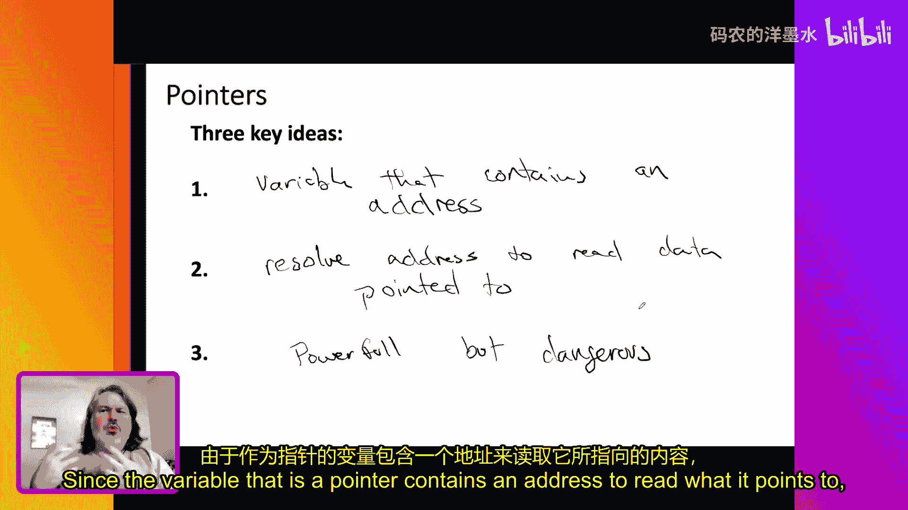

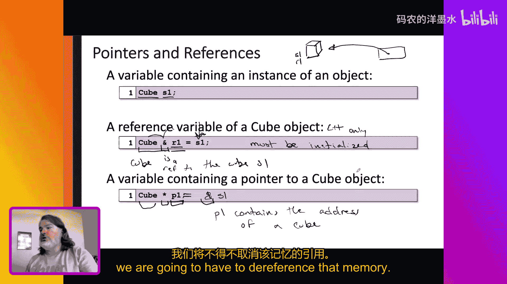

We are not going to be using smart pointers in this class。😡，So in this class。

 we're going to be using regular pointers。Yeah， we are still in raw pointer world here。

 we may adopt to using it some， but in this class the work we're doing is the case where raw pointers are often what you actually need。

So。I think smart pointers are great， but。Can we create a reference to a pointer， yes。Okay。

So people wanted to know more about two， and let' let's now talk about the pieces we do to work on。😡。

well， I'm going to talk about how we use it and that's going to help， I think。

the variable of a pointer contains an address， it's an address of a thing。

 and in general what you want to do with a pointer is work on that thing。😡，So。

We have what are called the indirect operators。 These are operators that are used to work with memory addresses one way or another。

Okay。So the first one we have is this is the address。Of operator。And it returns。The address。Of。V。

So V is a variable。😡，And it is stored somewhere in memory。Because that's where variables are。

When we take the address of operator。😡，What we get back is that location in memory。

Which is useful because what a pointers store， they store locations in memory， they store addresses。

 so to initialize a pointer， we need to tell the pointer to point to the location and memory that something is and that location we get using the address of operator。

😡，So now part two。To access what a pointer points to， we have to dereence it。

 and this operator is the D reference。😡，Operator。What does it do？It says。Reads。V。And returns。

The value。In the。Location。Z points2。So if V is a pointer to a cube， star V is that cube。

What if V is not an address， then the compiler is going to say tightness match error。

Cannot de reference V。So if the type of V is not a pointer。It's just going to。

 it's not going to compile and if the type of V is a pointer。It's going to work just fine。

Can you say the example with a cube again， So here we'll have if we have a cube C1。 our cube。

 and we have P1 is a pointer。Points to the cube。Star P1 can also be thought of as the cube。

We should be， this is V， this will have to be some kind of pointer and this will also have to be some kind of pointer。

If V is a reference， is it a reference to a？Pointter， that's fine。

It's not about before the equals sign， so this is actually a really good question， wait wait wait。

 so let's go back here。

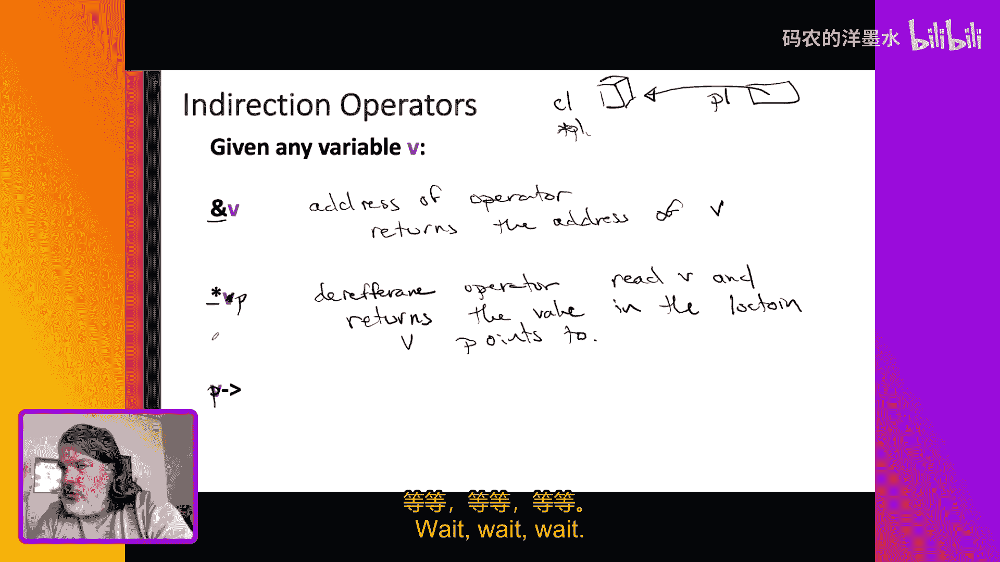

The m% in the star。Is a declaration？嗯。So。This is a declaration and a declaration is type。

And variable。Ning。And then it could be followed within an equals or not， so the type。

 the full type of this is that chunk of text， it is P1 is a star cube， so it is a pointer to a cube。

😡，It says N percentand S1， yes。Because here I'm using the address of operator。

To get the address of S1 and initializing P1 to store that address。Um。

 whitehite space doesn't matter。I don't understand what you're saying with redefining it at all。Yeah。

 the surge is pointing out a good trick。Well， it's going to if， if I wrote this line。

 if in this code， I wrote。AC。P1 equals S1。 the compiler would say type mismatch error。S1 is a cube。

 P1 is a pointer to a cube， no conversion for type。They're two different things。

The compiler checks the types and says，Here you've got a cube， here you have a pointer to a cube。

 I don't know what to do。😡。

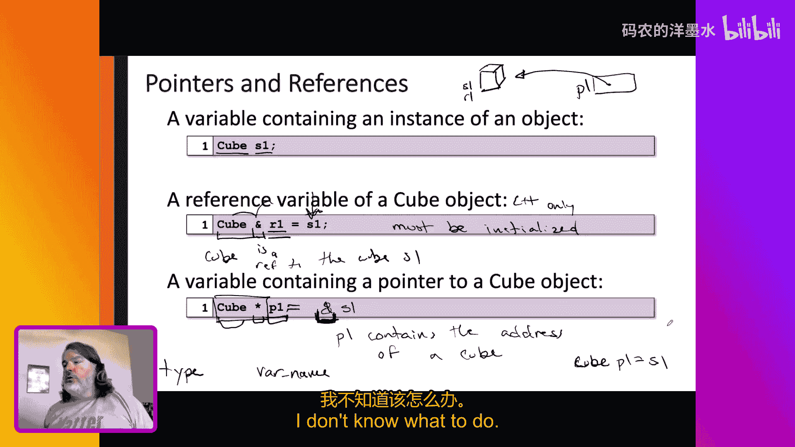

That's it。Okay。So we have one thing。A reference is inistinguishable after being created。Okay。

Their functions， they will change the type。So this will turn。

 you can think of M percent as pulling off a star and star is pulling up putting one on。Or sorry。

 you can So if I have。As I apply the ampressand operator， I'm taking an address。

 I turn the type from a thing to an address of a thing。If I put the star on。

 I am going to that address and getting what's there。😡，We haven't started talking about destruction。

 we haven't started talking about stuff。Arm。We're not going to worry about that yet because that's a different part of。

 Does a reference point to a memory address。A reference is another name for a variable。That's it。

It's another name。How it's implemented， yes， it is probably implemented as an address。

 but it is just another name。The n percent operator takes a variable。And returns its address。

This is think of this as a function call。We are calling the address of function on the variable V。

 and the result of that function will be the location in memory where variable v is stored。

This is a function call that will de referenceence。A pointer。

 which is to say it will look in the variable V。Look at the address stored in that and go to that address and return whatever is there。

😡，Finally， we have thearrows operator。😡，And what this says is， say we had a P1。

 which we've created up here and we have P1 arrows。Get volume。

So we are going to follow the pointer and call the function。😡。

This is exactly the same as what we could have done before， which would have been this。Right？

When Ampersand is in a declaration。This is not a declaration。That is a declaration。So left hand side。

Right hand side。What matters is that this is a declaration because I am creating a new cube。

 a new variable in the first line I did not create a new variable。😡，Okay， that is the difference。

P1 arrows does。This。It literally is exactly the same as wrapping P1 in square braces and dereferencing and then using the dot operator。

So any place on the type， so on a cube that I could use the dot operator， I can use an arrow。😡。

It's called oh， it's called arrow， or you mean the fancy one in text？

What is the meaning of P1 arrows get volume if we can do bracket P arrows a whole lot easier to read？

They are exactly the same。Same。Because of the binding of order of operations， the dereence operator。

Otherwise， if we wrote。Starp1。t get volume。That would call P get volume on P1 and then dereference it。

So that's why we need it。A declaration is declaring a variable。😡。

You'll need to provide a type right If I say cube C1 equals C2， I have declared C1 as a new cube。

 If I say C1 equals C2， I have assigned。😡，Cubes the value of C2 to C1。I mean。

Ars says dereference and then apply the dot operator。😡。

When we call a method on something on an object， we call it by applying dot right if we had our cube。

😡，So if we have C1 dot get volume。Right？We can instead if we have the pointer to C1。

Do you get volume？Okay。Star P1 get volume will not compile because it will try to call the function get volume on a pointer to a cube。

 which in fact does not have a method。U the arrows operator very tightly binds if you want to look about the whole order of operations and all of that。

 go read， there's pages of it。Star look。Order of operations。You can go read。

 but star binds very loosely。More loosely than dot。

Why can't I call a method on a pointer because a pointer is not a class？

A pointer to a class is not the class。Does star and percent V give V， yes， absolutely？

Arrows is the way to access a pointer。If P1 point arrows is the way to call methods。

That are on classes pointed to by things， yeah。You can write it the hard way， but thats。No。

 I'm not going to try and do the order of operations because。There's just a huge mess，Go look it up。

It'll become intuitive in general， but when things get weird， I have to read it。

Arrows only make sense on pointers because arrows de references。

 the first thing an arrows operator does is dereences the variable。If P1 points to C1。

 star P1 is exactly the same as C1。That is correct。Okay。Let's walk through some bits of this。So。

Here we have something to examine what's going on。So I first am going to create a cube C1。Okay right。

 so this is creating a cube， then I'm going to print something I'm going to print storing C and peran C。

 and what I'm going to print， I'm probably going to print something like0 X， FF FF， let's say 480。

Okay。So this is going to do something like address。Storing。C， and then it's going to do that。

 Why is it going to do zero because？C plus plus print addresses and hexadecimal。

 and this is a very large number。 And then we're going to say pointer。Is a pointer？To a cube。

And it's going to be initialized， so we have C here， right？And we have written that it address is0。

 X， F， F，F，4，8，0。And now we are making another variable pointer。And we have initialized it with。

The address， so0 x， FFF。I can say more F， F。4，80。Um。And then we go the address storing the pointer。

 what is it going to print here？What are we going to say so we did address？Storing。C。

 and we printed zero F， F， F， F，F， 480。The address where the pointer is stored， Yes。

 so we're now going to say address。Storing。Pointer。And it's going to be sub number。

 and it's probably going to be something like0 x， F F。4， seven。A， maybe。Okay。

And then we're going to do contents of pointer。Of pointer。

Could somebody tell me what this one's going to print？Yeah， it'll be the address of C， right。

 so it'll be the0 x， F F F。4，8，0。You got it。Can you have a pointer to a pointer you can。

 you can in fact have a pointer to a pointer to a pointer to a pointer to a pointer to as many times as you want What happens if we just have cube pointer equals address of C。

 you have a compile error？啊。Able to initialize pointer， which is a CS225 cube with address of a C。

 which is an address of a CS225 cube。So that's what's going to happen with CS225 cube pointer equals and per sand C。

Okay。I need to star pointer。To。Print the。What it points to， this is the address of the pointer。

 this is the contents of the pointer。Content。And pointer contains an address。

The contents of pointer are not C， the contents of pointer are the address O C。Star pointer is C。

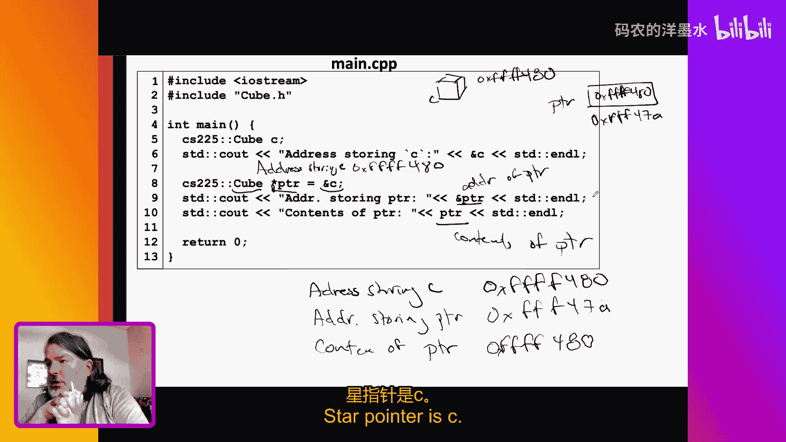

Yes， 225 is at UIU， so let's try and get a teeny bit more done。So first of all。

 you all have heard of a stack， right？Anything printed to the screen looks like a string， right？

So the stack is when you call functions， right， things go on the stack。Well。

 it turns out you may have seen。The stack growing up， but in reality。The stack grows。down。

On all modern hardware。The stack is implemented in memory。

 starting at a very high address and working down。And the natural way to write memory is to start at zero and go to the top when you're going up。

I need to dereference pointer to get what it points to， not to get its contents。😡。

So here's the stack and as we put variables on right。

 we had cubebe C and it went somewhere on the stack and then we had a pointer。

And it went on the stack， et ceter， and when you leave a function， it cleans up。So， okay。

So let's look at a very simple program and try and figure out what happened。So first。

 we declare a to be anient。啊。Or sorry， to be an endt。And its name is A。Any idea how big an int is？

Mtuch of guesses， do you know how to find out？Well， here's a program to find out， and yeah。

 the right answer is depends。A int is not smaller than a short and not larger than a lawn。

To be helpful。 So yeah， here's our program and we use a very special function called size of and size of return the number of bytes on pretty much every piece of hardware you're going to use。

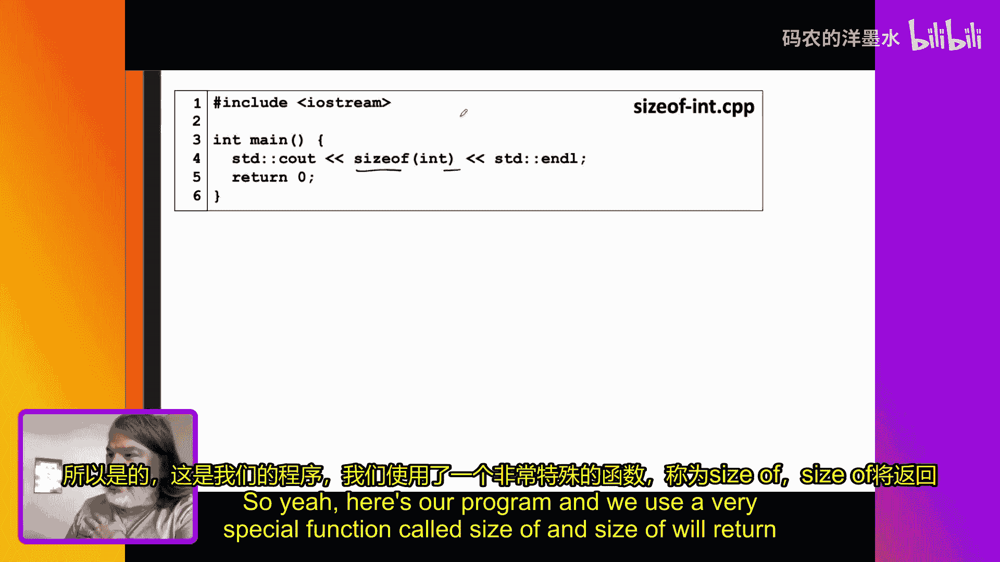

An ant is going to be four bytes， it is not 31 bits， it may have a maximum value based on that。U。

But it is four bytes， we're asking how much memory does it use？Okay， so。Four bytes。

 so each of these is eight， so here is our space。And we have int a and what value is it？

What is it initialized to？Size of works on any type that can be computed at compile time。😡。

Wouldn't it be nice if it was zero？But is it？Ant is not， in fact。A class。

 so it is not constructed if it's inside a class， it would be value set to zero， but it's。

 I don't know。It is undefined。Okay， now we create another int， so we have an int。

Its name is B and we create it one down， it has a value of minus3。Okay。Now we have another in C。

Its value is one， two， three， four， five。And now we have a pointer。How big is a pointer？Yeah。

 on probably any piece of hardware， hardware， probably any piece of hardware you're using。

 it's going to be eight bytes。

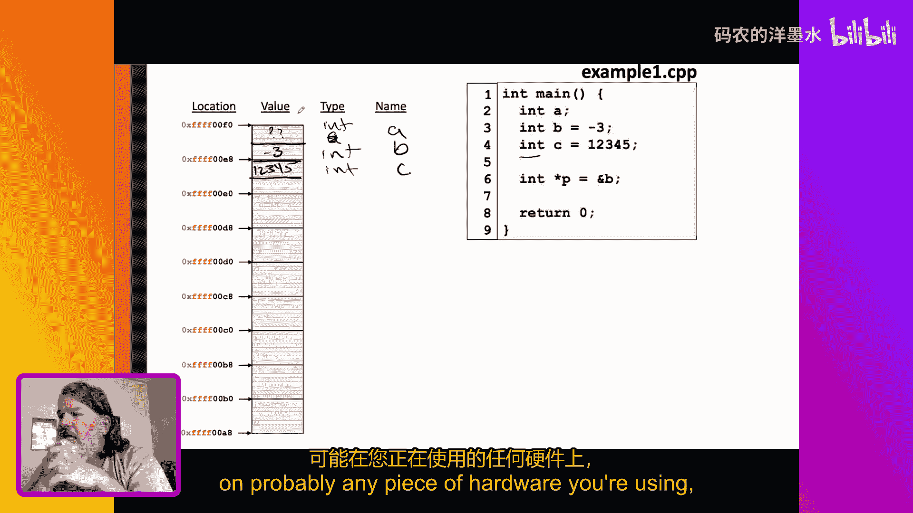

And again， size of int on my hardware， I get8 here， so8 bytes。

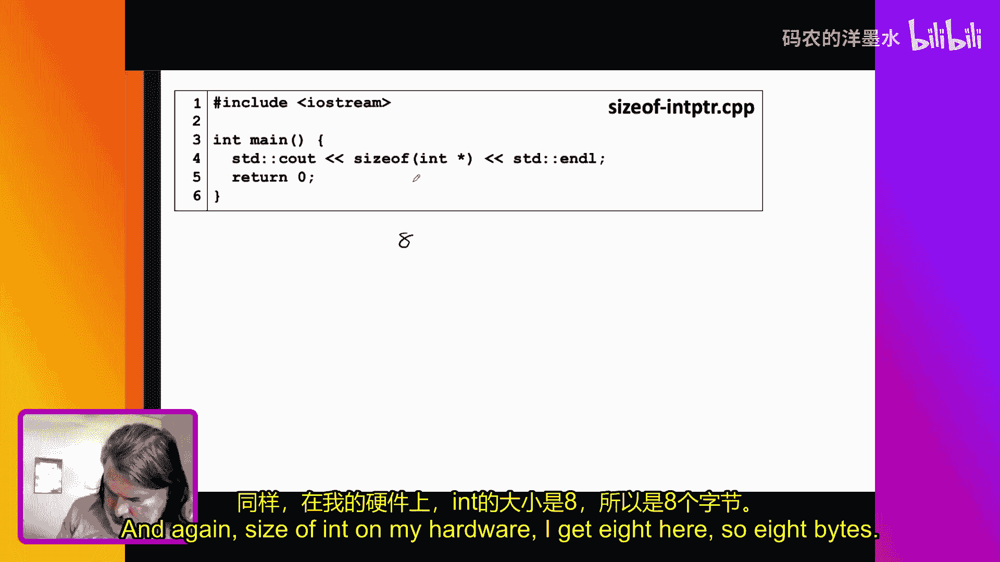

Okay， and that's what we're going to assume so a 64 bit computer is going to use 8 bytes。

 a 32 bit computer is going to use 4 bytes， a 16 bit computer。

 which I used when I was starting is going to use two bytes the size of a pointer。

The only way to tell is size of a pointer。So we need eight bytes， so we're using like this。

This chunk is all going to be here and this is going to be a int。Pointer。P。

 and it's going to have in it。What it's going to have the address of B。 What's the address of B。

Does this point。Here。Or here。We're not going to talk about doing in division on。Objects。

 so I'm not going to talk about。So。It turns out it's going to， man。

 you're all saying it's pointing to the top。Yeah， the stack grows downwards， but we read。Smaller。

So we read larger。So it points here。We aren't going to care about this a lot。But as we read。

 we read to bigger numbers。So I， in fact， will point to the bottom that the layout in memory of a variable。

 the start of it is small。And the end of it is large。So the stack grows down。

 but every variable goes the up。I mean， if zero， x， FffF， F，0，0。

 F0 is the highest location and memory it would never be pointed to directly。Okay。

And I'm going to have to call it there， but I will show you one last thing。

And here's some example you can look at that。There's。

 I want you to by Monday have looked at some of these examples and try and figure out what's going to happen like this puzzle。

 So thank you， everyone。 I'll stick around and answer questions， but。

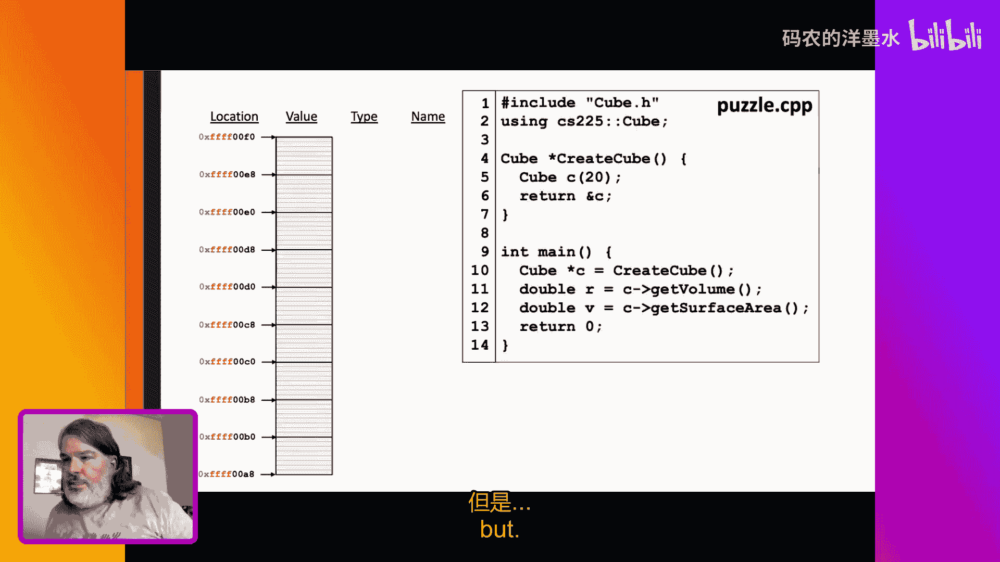

That's it for today's lecture。