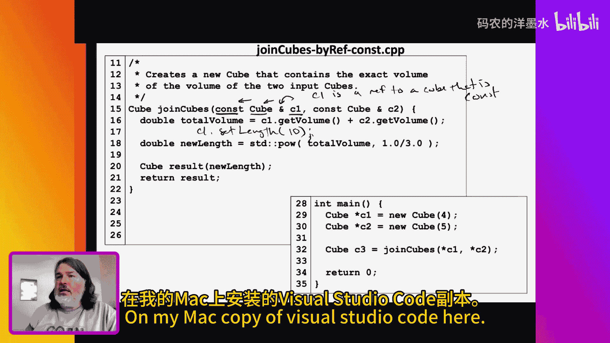
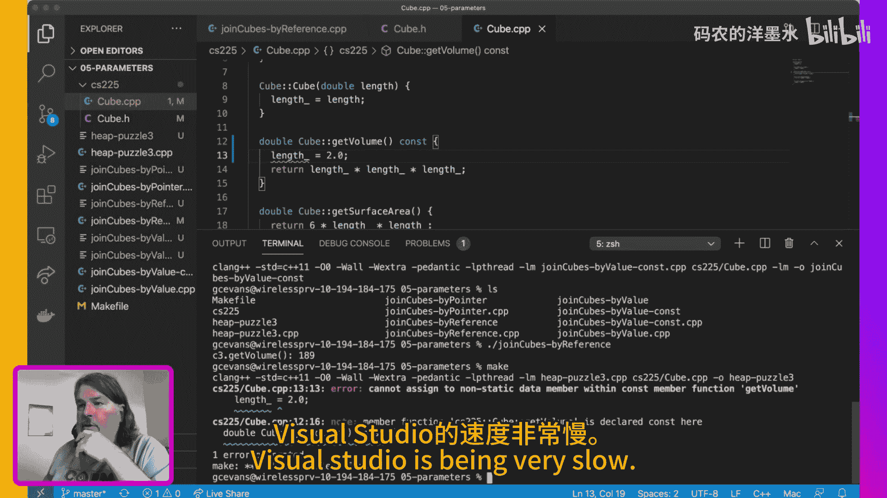
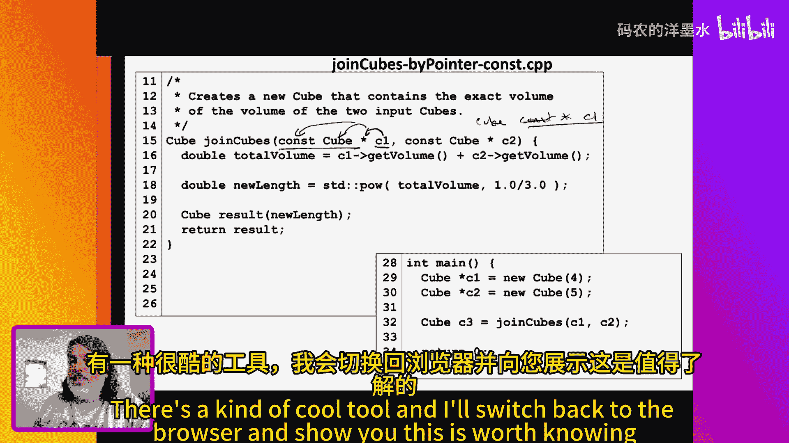
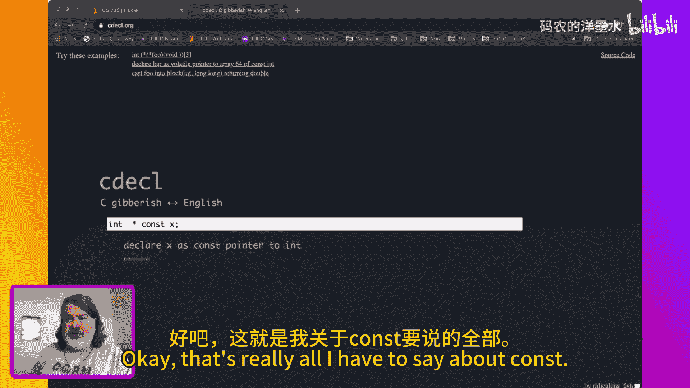
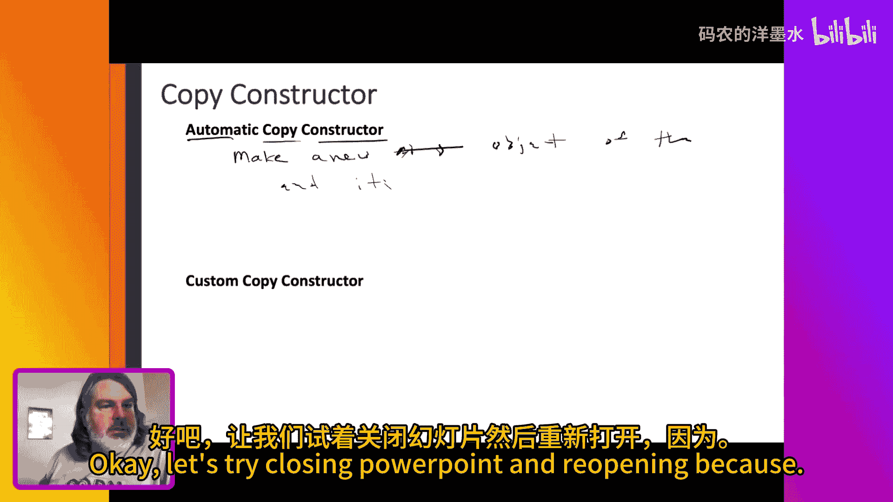
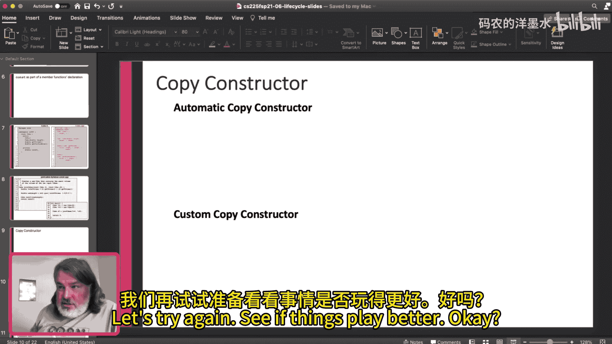
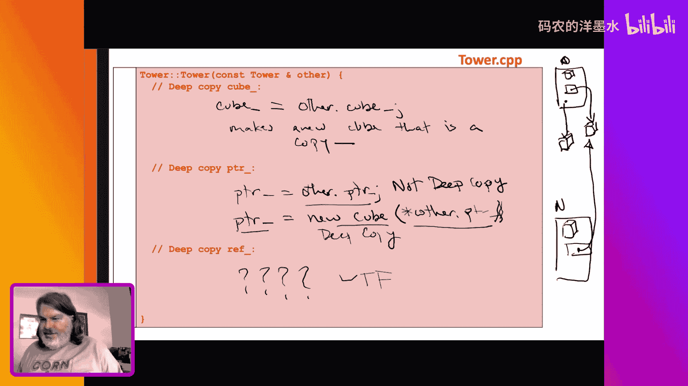

# 【全集】伊利诺伊大学 数据结构与算法 中英字幕 1080P p05 Lecture 5 - 生命周期 -BV1t9FHzdEYL_p5-

Okay。So today we're going to wrap up what we were doing on anybody， on anything before。

I read the chat and can't speak today we're going to start by wrapping up what was going to be done on Wednesday and then covering some stuff today。

Okay。So what we want to talk today about is cont。And constant in general。

 is fairly easy to understand constant。Modifies。It's a type。In general。And says。That。

It can't be changed。So if I have a constant， it's an int and it can't change。If it's a constant。

Floating point， it's a floating point that you can't change。

 but it turns out there's one other way we use const。So。Let's think through this， for a moment。Oh。

You could always break the rules。No， it says so。Const。And。Say pie。

Equals three because we have a very bad eye definition。pi equals5 won compile。Okay。Yes。

 e equals pi equals 3。Am。So。You know， it's just precision。嗯。Okay。So what's cont helpful for。

So we can have constant in this case。But let's look at conantt in the most useful case。

So when we were talking about。Yeah， a variables type can never change is correct。Well。

 sort of the type of the variable never changes， you can say， change it in its place。嗯。But。

We talked about references on Wednesday， and we said they were fast in like pointers and they were somewhat better because if you had a reference。

 you always knew that at the calling site， there was actually an object。嗯。But。

You could still change them， right， that if I changed my cube in here。

 if I did something like C1 dot set length。21， I would be changing the length of the cube that I referred to。

And we don't really want to do that because it means when reading the code down at the calling site。

 it's much harder to tell what's happening。It's much harder for me to know what's going to go on in a function if you can change things outside the function inside the function。

So。One thing we can do is we can say kst。 And here we said we have a cons cube。 So C1 is a reference。

To a cube。 That is cons。C 1 is a ra。To a cube。That is。Counst。Okay， so at this point。

 we can't change C1。That seems great。So let's look at this。 and I'm going to pull up。On my Mac。

 copy of Viual Studio code here。

And so， here we've got。Oh。Some code。 and make it just a little bit bigger。

And then I'm going to close the thing， right， So I've got this code， right。

 It's exactly what was on my slide。Individual visualual Studio code。We've got a little terminal open。

And I'm going to compile this， right， It looks good Right now， I'm passing in the cubebe C1 and C2。

 I'm doing everything and I have also made sure。Or wait， this is by， I have the wrong one open。

 I wanted reference。Well， we'll do it here， this's the work。But right now it's not consed。

 what if I make it consed？Okay， I'm going to make this code nice and safe， right？

So here we are and now my code is safe。Type make and。Chuggging along， it's thinking， it's thinking。

 and thinking and。Ha， it didn't build anymore。What， what。Okay。I'm going stick this back。

 So we are a little bit crunched off， but。So， we can。Play games with how much space out there。 Okay。

 I've got some errors now， right， What is it complaining about。What is it complaining about？

Let's see。 let's read this error erroror。 This argument to member function git volume has type cont CS225 cube。

 but function is not marked const。But if I look at get volume， I'm going to look at cube。In CS225。

 I have this cube class。Now look at what does Gi volume do？What。😮，Yeah。

 people are saying it doesn't know if get volume。Is going to change the object or not。

 So the way cons works is when the compiler compiles。

 it looks at every line in the function it's working on and says，hu， is this O。So。How do I fix this？

 Well， I fix this by going in here and adding。To the get volume signature。

So I'm saying that now get volume is a function。That return takes no arguments， returns a double。

 and is cons。So this con after the function name says。

 I promise that I will not change the class that this belongs to。So this only makes sense。

If get volume， if the function you' marking is cons。Is。A method。So。

A con cube is a cube that cannot have its。Variables changed。

What is the difference between putting con after get volume and what。So if I said， okay。

 this is a good question， Con after the function says get volume promises not to change its thing。

Kant before the function says git volume is a function that returns a constant double precision floating point number。

RightSo the cons before the function is modifying the type before the function。

 the cons after the function says this function does not modify the class that it is working on。😡。

Okay。Okay， so then we go in here and we needed， say。Cant。And。It's yelling at me because。

Those are different， so。Okay， so now I have changed it and what's going to happen Now。

 when the compiler compiles the get volume function， it's going to look and say。

 do you modify any of the member variables of the class， No， I just read them。

Every time I try to call a member function that is not marked cons。😡，On a constant object。

 the compiler will say there is an error。 There is an error。 There is an error because there is。

 you're telling it。Mo。Possibly modify this。 And you've told me that I can't。

 And so the compiler says， I don't know what to do。So let's see， have we fixed the problem now make。

And everything compiles。 And we could run it， but it's not very interesting， right， So we do。

Johnin cubes。Now， it is being very laggy， so。B。And there we ran it， okay。

What happens if a function is marked con still changes the if okay， so lets let's see。What if I said。

Okay， so my get volume is now going to modify。Om。The private variable length。If I do make。

What does it say， Bo Bo cannot assign a non static data member with it in con's member function。

 So it says。Can't do it。Right it's the same thing。 It is when you compile the code with cons。

 what happens is the compiler checks and says， you told me this can't change。

 but you tried to change it， so I won't work。😡，It did。Okay， so that's cons。

And that's con on a function。And you can understand that cost only makes sense。

Could I do cons with pointers？ Yes， but you have to be careful about what you mean。

 Let's look at this。Let's， let's go back to the slides， because the。Visual studio is being very slow。

So。And I can't draw on it。So here we have。Const with a pointer。 And this says C1 is a pointer。

To a cube that is const。But the trick is with a pointer。

Becauseuse think about what happens with an integer。 I can make a copy of that pointer。

And then I can change things。So this says I can change C1， but I cannot change what it points to。

 What I could instead say was cube。Can't。Pointer C1， which says I cannot change C1。 C1 is a or sorry。

 it goes here， right。No， I think it's I always have to look it up。

 so here I would be saying I can't change the pointer， but I can change what it points to。Yeah。

Because it just says this variable can't be used to change that。😡，Right。

This version says that the cube is constant， and I believe it's this one that says the pointer is constant。

Since the pointer is constant is basically never useful， I can never remember how to do it。

Because I've never actually written it except for as a toy example。

But that it points to something constant is。Somewhat。Mostly。

 but there's some funny rules to it again。In the in the normal cases， it's really easy。

 but you can write real gibberish。 There's a kind of cool tool。

 I'll switch back to the browser and show you。This is worth knowing about。

Um， ba， ba， baum。So C decal and this， you can write gibberish that is C。

 and it supports a lot of the C plus plus rules and tell you what it means， so we would have say。

 we would have constant int。Pointer x。Declare X as a pointer to a constant end versus。Can't。

Declare x as a pointer to a constant so it's then going to be this way。Yeah， so this is。

 that's the way it is。 So then X is a constant pointer to a constant。Kantst says this thing doesn't。

If I have another reference， so I could have for a variable a constant reference and a non con reference。

 I could change the variable with a non con reference。

 but I couldn't change the variable with the cons reference。 Now。

 what I can't do is if I have a constant。Variable， and I take the addressed in front of it。 So right。

This is a pointer that can't be changed X， which actually makes sense because it's reading from the X out。

 X is a constant pointer to an integer。But if I have a variable that is cons。Like a con int。

 And I take a pointer to it。 If I try to change it， it's going to fail in other ways。Okay。

Conants is checked by the compiler。And believed by the compiler。

 it is not enforced automatically by the runtime。Okay， that's really all I have to say about const。

都不准。And this is showing how to do it， but we did it in a more useful way。

 And I'm now going to talk about。The copy construct。So we've kind of talked about that right。

 we talked about making a copy and we talked about that when we did this by value， right。

 that there was a copy of C1 made。And the question becomes， how do we do that well？

We do that with something called the copy constructor。 we know about the default constructor。

 which is when we construct an object when there are no arguments and the custom constructors we' talked about。

 where we give it some number of arguments。The copy constructor says。M。A copy。Of。Cl object。

Of the class。In fact， we could perhaps say makes。A new copy。

 but I want to be careful because we don't want to use new， but it copies it。

Because it doesn't have to be doing it into heap。You could also do it in stack。How do you do it。

 Well， the copy constructor will be like this。 So if I go cube。Xiwen。5。

 so I've made a cube C1 that I initialized to a size of five。 And then I go cube。Xu。Equals C1。

That's going to invoke a copy constructor。Well， why is it useful。

 We already know whenever we call anything by value， the system needs to make a copy。

 This is how the system knows how to make a copy。We haven't gotten there yet， right？

The system has to have a way of doing this， right that。In C plus plus。

The system uses to make a copy of something。A。So if I wrote， instead。If I do cube。C3。

Then I do C3 equals C1。 That is an assignment。So this is。Copy constructor。Default。Tor。Custom。

And then this is assignment。Which we haven't talked about。This is creating a new C2。

The other way we could write this to make it look more like it's a constructor would be to write C to。

And this is copy constructor。Oh， there's even more constructors。But， yeah。So this。And this。

Are different syntax that mean exactly the same thing。

But the copy construct is really important because it gets used all the time。

Every time you call a function by value。嗯。It will invoke the copy constructor does C2 C1 equal to C25 C2 C1 will make a copy of C1 C2 a new variable that is a copy of C1 since C1 was initialized by5。

 it will be the same， but it is explicitly doing it by making a copy。So。It does exist by default。

 If you do not write a copy constructor， no matter what， we will get the automatic copy constructor。

 So if you don't write one and don't tell the compiler， you can't have one， it gets one。😡，Copy， it's。

There isn't， in a sense， wouldn't be a difference between copying an assignment。

There is a difference between a copy constructor and assignment。

 assignmentignment changes the value in。Right， because at this point。When I created C3。

 C 3 was created with a initial value of one。 and then when I assigned it。

 it got a value of 5 because C 3 already existed。 So， yeah。

 it's the difference between creating a new one and changing one that exists。Right， it。

 it copies the contents。 I mean， it's just like imagine instead of thinking of it with。

classes feel complicated， but all the same stuff is going on with integers right。

 if I create a new integer is different than if I take an existing integer and change its value。So。

Arays are a more complicated thing。 I'm not going to talk about the copy constructor and the contents in the context of an array that there is not the C plus plus raw array does not have a copy constructor。

 You cannot create a copy。 What you get is a new point you copy the pointer。

 If you're doing the raw arrays。All the cases have the same values at the end。

 all of them will be size 3， but cubebe C3 would have been different in the middle， right？

That when I created C3， it originally would have been created with size1。

But so let's talk about what these are so the automatic copy constructor well。

 what is the automatic copy constructor？Om。No， because that's Java。 So C1 dot equals C3。

It would say you've never given me a function equals， so。Yeah， I think that。

That if you wrote a function equals， you could do that， but it doesn't exist。嗯。Formerally。

 they don't have constructors。That is to say the built in types don't have constructors。

 but they have things that do all of the same work。Okay。And this is why we talk about all this stuff。

Well， yeah， we have to define equals because what does equals mean？Okay， let's work through this。

 We're copy constructor now。Automatic copy constructor， the automatic copy constructor will。Make。

Bingliu。Variable。Or object， let's say。I don't know， I have an idealet。Just a second。

My computers being very laggy， so I'm going to close some things I don't need anymore。

In hopes that it will play nicer。So。And actually claims it's not running at high CPU load。

 on the other hand， it is totally laggy， so you know。Something's behaving badly。Okay。So。

Make a new object。On。Of the type。Initialize it。Okay， let's try closing PowerPoint and reopening。

Because。

That is too laggy to be usable。What do you say is spending time。

Windows server is spending a million a lot of time doing stuff。Things are still being laggy， Okay。

 let's close Chrome。Which seems really inconvenient， but whatever。

Because that will take me a lot of time to start it up later， but。Close discord。Close word。

Close safari。Close preview。Okay。No clothes。Okay。Let's try again， see if things play better， okay。

Oh， except I need to， but it is behaving better， but I do need to turn on the pen again。Okay。Make。

A new。Object。Of。Toy。That。Is initialized。Okay。And is initialized by。Hping。😔，Om。Caing。😔，The copy。

Constructor。On every。Member。Variable。So what it's going to do？Right， is it going to copy。

Variable by variable by calling a copy constructor on it。

So it's going to construct a new object and it's going to initialize that object by constructing all of the member variables of the object by calling the cop the constructor。

ok。Okay。That's pretty straightforward。 And for what we've been doing， that works just fine， right？

We'll find out that。 sometimes it doesn't。Well， it needs to know how to make a copy of a class。

 And this is the way it chooses to do it， because for most classes。

 the automatic copy constructor is， in fact， exactly what you want to make a copy of our cube。

 What do we need to do。 We need a copy length。 That's it。 That's the whole we're done。

 We don't really need to do anything else。So it provides us what is most often what you want to do to make a copy of a class。

I think that's really helpful。So， but we could write a custom copy constructor。

So let's try and write the signature of our custom copy constructor。

 and first it's a constructor so we know its name right it's going to be cube。

 We're going to write our custom copy constructor。😡，And it's going to take some number of arguments。

 and since it's a constructor。Um， it's going to。not return anything。

Is reading stack memory for the object and copying over to a new point or dangerous。

 we're going to get to why we might want to do this as a custom it。

The default is not always what we want， but it is not dangerous in the sense of if the object exists。

 the constructor will work。But so what should we take as an argument here， any。

 any suggestions for what the argument？Of the type is for our copy constructor。Cube， I like that。

 We clearly want a cube。Oh，We like const cube。And a reference to， and here's my horrible reference。

 my inpers sand。We'll call it other。Okay。So that the example of making a copy of an FTP connection needed to make a new connection is absolutely。

A perfectly reasonable example of where you would need to make a copy。

 So is everybody happy with this is this signature。

So we want cont because when I make a copy of something。

 we don't want to modify the thing we're copying。😡，Right， this is。

Constout here wouldn't make sense because we are modifying the thing we're creating。

Why does it have to be a reference？Well， let's think about this for a moment。

So this is saying that it is a。Other。Is a reference to a constant。Cbe。That makes sense to me。

 But what if we。Get rid of this。 I mean， why do we need to be a reference。 It might be good。Arm。

For performance， but why can't I just write this？What would happen？Well， as I said。

 it might be good for performance， I think it's a good idea。

But what would happen if I didn't have the ampersand there？It would make a copy。

 How would it make a copy？You wanted to use the automatic copy constructor。 Turn out it won't。

 because in fact， there is one in only one copy constructor and the copy constructor is the only thing。

 So if we wrote this， what it would do is it would invoke the copy constructor in in order to invoke the copy constructor。

 it would invoke the copy constructor。 And in order to invoke the copy constructor。

 it would invoke the copy constructor。But it didn't know how to do that。

 So it would invoke the copy constructor， so it would invoke the copy。

 I could keep saying this for a long time。There is for your class， one copy constructor。

And it tells the system how to do it。 so it has to be a reference because otherwise it would have to keep copying and it would say。

 well， I don't know how to do this， so I'll invoke the copy constructor。Right。There is one。

 if you don't write one， you get the default。Okay。The other is not a key word， it's just， I mean。

 this is just the variable name。Right， we could just leave it off as purely this syntax。

 So this is just。A name， right？Yeah， it's the parameter name， okay。So here is my cube class。

And I started doing things with it。So I've modified my default constructor to print and my custom constructor to print。

😡，And now， I wanna add。Cubbe。Oh。And percent。Or sorry， comes the cube。In percent。And we'll just do O。

 because it's shorter。Okay。How does the compiler recognize this is the copy constructor？

 It's a good question。 It recognizes it because the signature of the copy constructor is。

A constructor， which will have the same name as the type that takes a constant cube reference。

That's how it knows。So we're going to write this thing， cube， colon， colon cube。I can't。Cubbe。

Reference。We're just going to use O， because it's shorter。And so how do we write this？Let's see。

 Here's my suggestion。If the copy constructor invoked the copy constructor inside itself。

 you would have a loop， yes。Does anyone see a problem with this code because there's something that maybe should bother you？

Yeah。Length is private， right？So。How are we getting to do this？Okay， it's not a friend Qua。

We aren't going to ever talk about friends in C++， they do exist， but we're not going to use them。

Yeah， it turns out we can access it because we are in a cubeB class。Private。

Private means that it is private to the class。Not to the object。Right。

If we did not have constant in the cube and then you tried to make a copy of a constant one。

 it would fail。So。嗯。Is there a private to the object， No， there is not that private is really。

To class。So any code that belongs to the class。Can access the private member variables of any object of that class。

Okay。Does that make sense？Okay。So。I honestly don't know。hI don't do Java enough。

So let's look at a case because with cube， this wasn't very interesting。Om。But here's another class。

Here's my class， right？ It is a tower。 It has some cubes in it。 So what's in this。

 So if I have my tower here。I have a cube。Inside my tower。I have a pointer。

Pointing somewhere to I think， a cube。And I have a reference。 And right。

 we draw a reference without a box。Pointing somewhere to some cube。Okay。It's not a really useful。

Class， but it will show something。So first of all， here looks like our code for our copy constructor。

 right？😡，Does that look good？Well， when I try to compile this code。Oops。So what's going on here？

This is a little subtle。We'll talk about what happens with the automatic。

 but let's look at our problem with our class。So we get an error here。And our error says。Blah， blah。

 blah bh， blah， Tower Conor for Tower must explicitly initialize the reference member Ref。Well。

 but what we didn't define equals for， so what's happening？Raph is。Is a reference。Variable。

And it says we can't change a reference variable。 We can only initialize it， right。

 When we create it， we have to initialize it。 And what's happened is inside here， Rph。Already。Exists。

Oops。So we will now。Om。There is no。 You are not allowed to do that because it already exists is the problem。

 So here's some code。To normal people。These two chunks of code do exactly the same thing。

To compiler people， these two chunks of code are completely different and have very different meanings。

So what do they say？All， this is using something called a constructor initializer list。

The construction initializer list says initialize these things as you construct them。So。Here。

 we initialize。Cube to be a copy of other cube。Using the copy constructor here we initialize a pointer to be a copy of other pointer。

Using the unitializer。 And here we finally can initialize。Reph， rather than assign it。

 So all of this happens。And then the class exists。Class。Exists。Too late。2。Create。

A reference variable。Okay。So initializer lists are just variable name， parenthesis。

 initializer value。Right？Sou。Once we have entered the code for our copy constructor or for any copy constructor。

 our class exists and we're setting values。😡，This says， create these values， then。Class exists。

Because a wrath must be initialized on creation。That's the problem。Okay， last thing。So。

When we make a copy， normally， we want these things to。B2 what do I mean the class exists。

 I mean it exists。I I don't really know what to say beyond that。

 that all of its pieces are there and。In tell that there isn't anything to do。Yeah。

It starts existing as soon as you。It must exist once you enter the bracket。

Because what you're doing there is then assigning values。😡。

So they technically went through construction。Right。

 so you can initialize constants and you can also initialize references。

It is a list that comes before after a colon， before the parenthesis。

 before the squiggly brace for a constructor。 That's it。It will。Be constructing those objects。

 using whatever is appropriate。 It doesn't have to be the default。 For example。

 instead of other cube， I could have said other。Cubbe。嗯。Dot length。

And called it with the initializer。People vary。I don't don't think that there is a strong argument that one is better。

Do whichever you're comfortable with。 I don't have a strong argument that they this will not compile because of reference。

Due to。Rph。Ling。A reference type。Right。Because。At that point， reference already exists。

And reference has， whenever a reference exists， it must be initialized。Reference cannot be assigned。

 They must be initialized。You can change what they refer to， but you can't change them。 You must。

 when you create a reference， initialize it。Yeah。Okay， other than that。

 it would compile they otherwise identical。Okay。But let's talk to the core thing。

 I've got one minute。Here is our thing。 What happens with arts， because。

This is doing exactly the same thing that the default does。 So what happens？Let's see A deep copy。

 A deep copy is the concept of a copy that makes an independent object。

So how do we deep copy a cube cube？Equals other。Dot cube。What does that do， Well。

 here is our original。A， which had a cube。A pointer to a cube。And a reference to a cube。

AndWell call this other。 Ill call it O。 and here we'll call it new。Or in。

We are making our new one when we make cube， we're going to make this other cube that is a copy。

 right， That's good。M。A new。Cube。That。Is a copy。Gui。What about the pointer？If what we had was。

Pointer。Equals other。Dot pointer。What does that do， Well， here is our new thing。 It has a pointer。

 and it points there。That's probably not what we wanted， right。Not a deep copy。

Here is how we would do it。Okay。Because you can't so。Right。

So here is a new cube that is constructed by dereferencing the cube。Got it。

And how do we make a deep copy of an independent of a reference？

What is the deep copy of our reference。I don't even know what that means， in a sense。Right。So。

A deep copy is the idea of an independent copy， and we're talking about it being deep because you're going into the object and copying all of the things that it talks about。

So instead of copying the pointer right， this copies the address。

 this assigns the pointer point to a newly created cube that is a copy of the other cube。Okay。

That's what I've got for today。But。

