# 【全集】伊利诺伊大学 数据结构与算法 中英字幕 1080P p06 Lecture 6 - 析构函数 -BV1t9FHzdEYL_p6-

Okay。So welcome back， CS 225。 and we have one bit to finish up that yesterday we had finished talking about the copy constructor。

 So we've talked about the default constructor， the copy constructor and the。Custom constructor。

We also want to talk about destructors。 and we've referred to them， right。

 We've said a number of times that things get destroyed。 So what's the purpose of a destructor。

The value of a deor is to release。Any。Resources。Allocated。Bye。The object。So。Right， well， it's memory。

 but it's also going to release， for example， if I had a object that represented。

 we've used an FTP client before， that the de is going to release the network connection it's going to close it up and release it if we had a thing representing a database。

 I might have a lock on a table and when I go away， I will want to release that lock。 So。😡。

In this class we're mostly going to deal with memory as the actual thing we're handling。

 but potentially you have an object that represents your program's window and when it goes away。

 it needs to release the window。So that could either be closing the window。

 but it could also be allowing other pieces to take control of it。So。

What is the difference between a clear function and a instructoror， Well。

 I don't know what a clear function is。It sounds like a function。

 a deor is a very specialized function。So again， its job is。To。

Release anything allocated by the object。Well， so like in the list， you could clear out the list。

 but the list still has some pieces， right， it potentially has some other things。Caned out。Well。

What is the difference between using delete in a deor， De， if you remember， calls a deor。

When we say delete， it calls the destructor and then delos memory， so in fact。

 delete is the way we invoke a deor。😡，A de is going to be invoked either on delete or when a stack allocated object leaves scope。

So。Run。On either。Deelete。Buer。When。A stack。Alllocated。Object。Leucope。Okay。

Well so this is why we have a deor。 It's to release the any resources that are allocated。

 and here is how you run a destructor In one sense， a destructor is just a function。

 but in another sense。It only is called indirectly。

 we never invoke a deor by calling it directly on an object。So okay。

 free resources maintained by the class。Exists only when。呃。

So the automatic deor exists when no custom dustor is defined。Invoked， as I said， leaves。Scope。Or。So。

Stack。Object。Or on delete。What is the functionality。It。Clls。Od。Destructor。On each。Member。Variable。

So the automatic deor。Which you get for automatically will go through every variable and call the deor on it。

Let me note that the destructor， which technically doesn't exist， but we talk about it this way。

On a primitive type， such as an integer or a pointer to a cube or。A character。U just does nothing。

If we implemented our own custom deor and forgot to delocate some things from the object。

 would that result in a leak in memory， well， if those objects were allocated with new and we did not write a custom deor that releases them。

 something else would have to have released them。So。When we talked about the constructor。

 we saw that how。In the constructor， we could possibly be making a deep copy and we might have a pointer and hence we'd need to make a copy of what that pointer points to。

Well， the idea is the destructor is what will release。That allocated resource。

Right so when we create it。We are creating it inside the class， and we want to release it。

 What does it mean for an object to leave scope， Well， I use that in a broader sense。

 But the case where we have seen leaving scope is when we return from a function。

 So if I had my function， right， foo。one's going to return an in， right？And inside it had a cube C。

And then it did some stuff。And when I do return。When I do that return， I have left scope， right？

The scope is actually this squiggly brace to that squiggly brace。

 So in C plus plus every time you have an open brace。Matched with a close race。

 you have created a scope。Normally we do that for a function right。

 but if we declared inside a loop a type， that type would leave scope when we left the loop。

Is it possible to call the deor using De on an object in the stack before it goes out of scope？

That will generate an error because delete of is only valid on he allocated things。 So you cannot。

 and it doesn't make sense to destroy an object before it leaves scope。That let。

Inherently introduces a bug， right？ It means that variable still exists， but it doesn't exist。

 We never call a deor automatically。 It gets called directly。From either leaving scope or。If you。

 it does nothing， deleting an object does nothing to things that refer to it。

 it's your responsibility as the programmer to handle things that refer to it。

And since pointers of any type are primitive， the automatic deor will just。Clean up their memory。

 It won't do anything about what they point to。

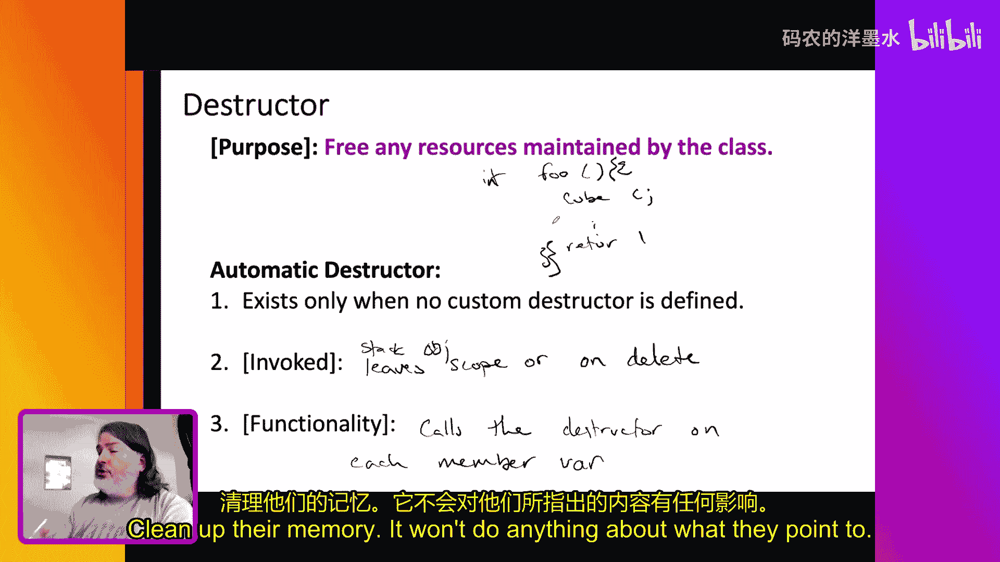

So， okay。So how do we write it？😡，Here is the destructor， and every class has one。

 we write it exactly as Tilda class name， and it takes no arguments。😡，How would we write the code。

 much like the constructor， right， we are going to have cube。Tilda cube。Takes no arguments。

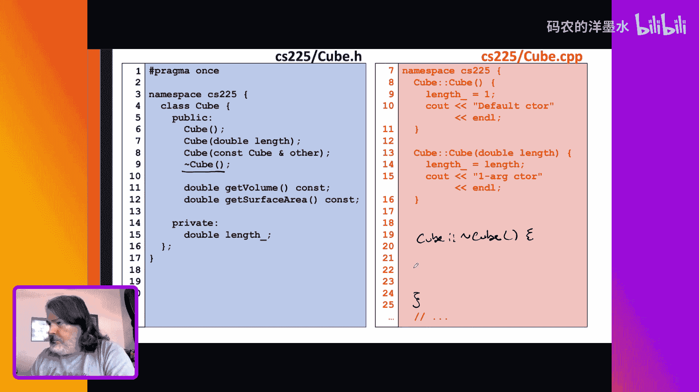

Or this we can think of as default。

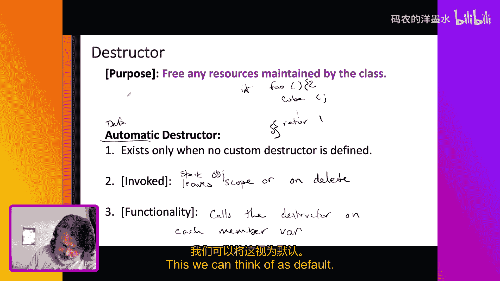

The one you get by automatically。And then we do whatever you want。 Well， in the case of cube。

 there really isn't much to do， but one thing we could try is。

And now I've made a deor that will print that it。When it's called， so。In the lecture slot code。

 we've got the code and you can experiment to see when objects are created， how they're created。

 and how they're destroyed by our annotated code that prints as it goes。

Right now we aren't doing much， but if we had sort of been allocating memory。

 we would have wanted to free that up。Okay。As we go farther in， you're going to see this more。Okay。

Any other questions about destructors？Well。If I have an object such as we saw with the tower。That。

When it starts， it creates a pointer to some memory， right， It has some eat memory。 It needs to。

 when it goes away， release that memory by calling delete。 So， for example， if I had a。Oh。

 let's say a int pointer。我。Foo because this is just gibberish and then in my constructor， I did。

 you know， foo。Equals new。And。5。嗯。We're just always going to make it exist， right。

 This is just a toy。You int。5， so we're creating a integer all the time。

Then we will have want you to delete。Fu。To release the memory， otherwise， we would leak， this is。

Prevent leak。Okay。Til the cube I mean。It's Tilda cube is just Tilda class name is simply the way that they decided to have destructor。

It's just how you write a instructor。It's a tilda。The underscore at the end comes from the Google style guide。

 which we're trying to use in general。When there's a memory leak。

 there's some memory that's allocated to your program that no one can get at it anymore。Actually。

 it doesnt the underscore doesn't mean private， it just means it is local to the thing。

New allocates the object and returns a pointer to that object。 so in this case。

 it is allocating an integer that is set to five and returning a pointer to it。

The de can call other des， yes， and in fact， that's very common。Right， so in this case。

 I don't like canceling， but in this case， it's releasing the memory that was allocated in the constructor。

 So right we've said that in C plus plus every time we see a new。

 there must be a matching matching delete。This is supposed to be a pointer。 It is a star， not an axe。

It had right。In this class， we're going to mostly see releasing memory。

 But you could have other allocated objects that you might want to release。

 You could have locks in a。Parallel program， you could have other things like that。

The deor does nothing about deleting from the stack。Delete。Right。Delete does two things。

 It calls the destructor and then releases memory。Returning from a function。Does two things。

Calls the destructor on everything that was allocated locally to the function and then releases the memory。

How do I pull the lecture code files， they're just a GitHub， you can click on it and go grab them。

What happens to the double length， Well， no work。Is done， right， but when the cube goes away。

 its memory is freed up。So there's no work to do to clean up length。Okay。

So that's it for deors as we start using them， you'll see the value。

 but even in this very toy example， the fact that every time we create it is going to be matched with a destructor call。

 right？😡，Then， we're handling。This。I mean， it gets moved up by the program。The deor just cleans up。

 The stack gets delocated by the return call。 So if you want to， if you want to ascribe a who to it。

 it's return。 Part of the work done by return is to release the memory that was allocated in the function。

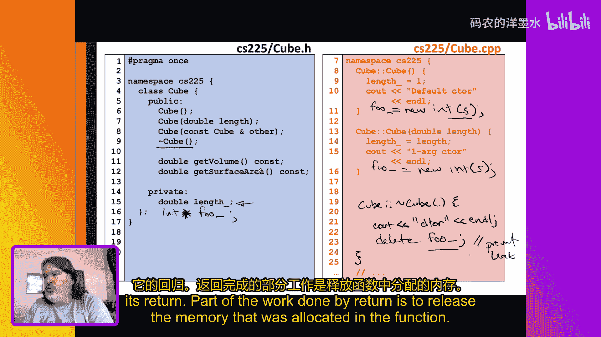

Okay， so MP1 is due today， but you have all of today until 1159。And on Wednesday， I'll share more。

 but I wanted to share a couple of things people had done that I thought were cool。

I always like sharing。Un Illinoisino。So someone did the classic one of the classic Illinois。

This thing I thought was really cool that this is a fractal。

 but I thought the square shapes on it were so interesting。

A biohazard feeling feels appropriate these days， doesn't it。And here is the solar system。

And I like this。 I'm not really quite sure what's going on， but it has a very pleasing tone to it。

 sort of itss pixelated。Random。And。Our friend。Crab。So on Wednesday， if I have time， I'll share more。

 but here's some that I've seen that I thought were pretty cool。My Pluto's still there。

How do people people spend a lot of time on it， which is fun and it's a way to do a bunch of programming where you get to choose what to do。

 but I thought they were all very cool and there's a bunch more and I I will share some more。

I did not realize the crab was mascot of rust。Okay。So。

Let's talk now about a feature of C++ that visually makes it very different from what you've seen in Java。

And that's what we call operator overloading was operator overloading。Well。

 I don't know if you've realized it。 but we've used it already。

So there are a bunch of operators right in the language that we're familiar with。

And we can redefine them。 So plus is going to do addition and minus multiplication division。

 modo division， pre and post increment and pre and post decrement。How about this， bit wise and。

Or X or。Not。Anyone know what these two are？EC CE have。Yeah， left shift。 they're the bit shifts。

 but that's not what we've used them are， so。Bit shifts。

Does anyone remember what we've been using them as？Yeah， stream insertion and extraction。But。

If their basic behavior is bit shift。Lins。Dream， insert。The way we've used it is that。

 How is that done， well。It's done by。Operator overloading， so IO stream， which we've used C out， CN。

 see out， it's all we've used。Is entirely written in standard C plus plus。

It is entirely written by using operator overloading。So this one's special， the assignment operator。

Which one's X or？Then we have logical comparisons。How of this？Square brackets。

Square brackets is an operator。Pretty cool。Prenhesis， we don't usually think much of as an operator。

 but it is from a formal standpoint。And arrows。Yes， we can also， I believe。

 overload the logical operators。Okay。So why do we have this？😡，Well。

 first I'm going to show you the toy example。What can't we overload， you have to go look it up。

 there's a couple others that you can overload。So overloading is replacing the functionality， right。

 all of these things have default functionality and we want to be able to replace it so it has different functionality。

Size of is an operator you can't overload and new is an operator you can't overload but。

So how about we had been working on join cubes， right？

That join cubes was this cute little function we wrote。Dot is an operator。

I don't remember if you can overload dot。 I've never done it。So。Join cubes allowed us to join cubes。

 And I think that。Conceptly， that's kind of adding， right， If I wanted to say cube。C equals。Xiyi。

Let's say C3 equals C1 plus C2。 I think it makes sense。That。That would be the same。

 Would I'd like this to be the same as。Want。Tubbi。Same as。Cube C 3 equals， join cubes。C1， C 2。

Right that kind of makes sense and this is a toy one。

 but we can think of examples that make more sense like。

Often people want adding that if I have a string and a string。

 I can add them and get a new string that would make sense。

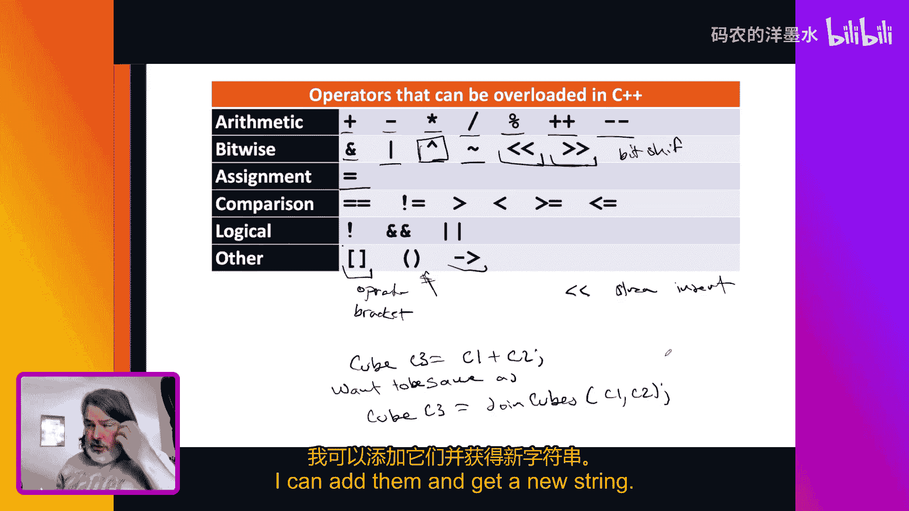

But let's do the join cubes one， so how do we do this？Well， we're going to want to add。

 So we're going to have。Operator。Plus。Right。It's going to take a con。Cubbe。Reference。E。

It's going to be cons。And what is it going to return？It's going to return a cube。Right。Okay。

 so let's try and write it。 Then we write here。 we're going to have cube。Cubbe。😔，Colon。

 colon operator。Pluss。Com。Cubbe。Reference。Or。Can't。And then we're going to do。Return。So。Join。Hubes。

So what are the cubes I'm joining， Well， the easy one is this one。Right。

The con after the method says that the left hand saw that the thing that is called on is cons。

 and that gives you a hint as to what I'm missing here。Is it this？What's the type of this？Yeah。

 I like that better。This is a pointer star， This is the cube。So there we are。

And that brings us to what this compst is doing。 This compst is saying。Cost。So。We're done。I mean。

What is the point of Kant's cube R well。

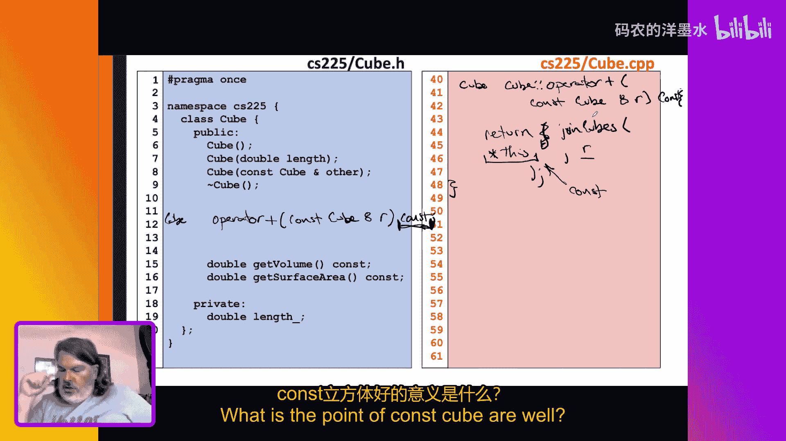

If I look back to my statement， right， do I expect either of these to change？C 1 plus C2。

 We don't expect C1 or C2 to change， right， If I do 3 plus 5， do I expect to suddenly redefine3 or 5。

 no。

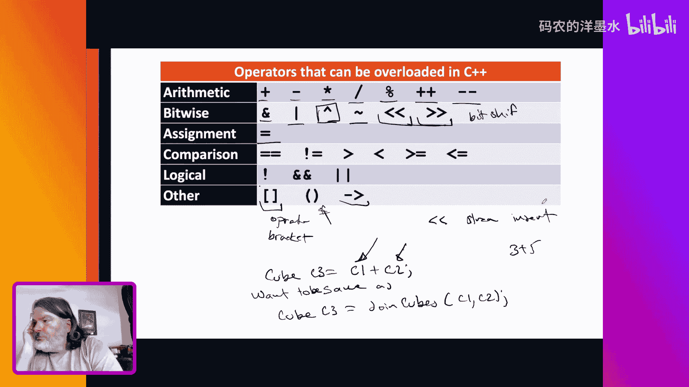

It will use the same association rules as the add function。 You can't change the function。

What is star this， This is a pointer to。My， myself。And star this is then myself。Okay， con。

 you want to promise you won't change it。Otherwise， the function can do anything。

 If this wasn't cons， I could just change it。And if it wasn't consed， the compiler。

 when you invoked this function， would say， hey， they might be changing it。 I don't trust you。No。

 the association and Order of precedes of operators in C++ are directly。AFrom the language。

This is a portion of C plus plus star is the dear reference operator applied to。This， right。

 So this would be C1。Okay。The second， the cons after the function says that the method will not change the class it's working on because right the other way we could write this line once we've written this overload。

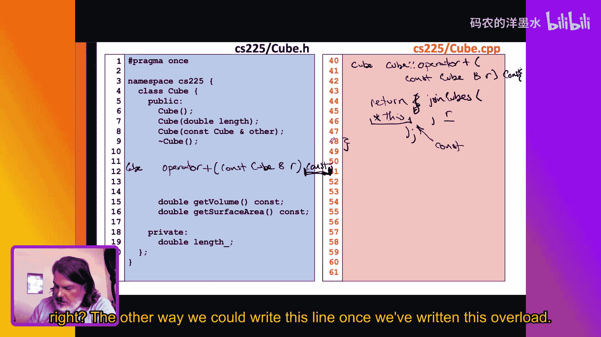

You could write。Also， cube C3 equals in case you're a strange person。

 you could instead write C1 dot operator。Plus。Xizu。So these would all three be the same thing。

That is to say。This and this。Are exactly the same thing。

Does that help why we need the con on the method。Has to do with how strings choose to implement plus。

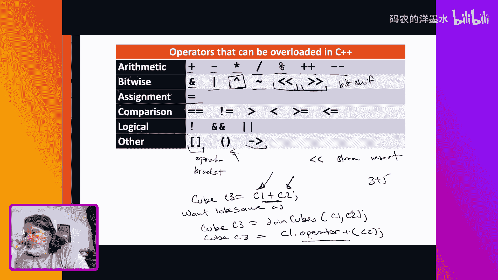

Operator plus is a class method that is correct。 And that's what we declared here， right。

 We said that there is a function called operator plus。 It is a class method。Absolutely。Okay。

So this is the basic kind。The con only does that second part。

 it promises that it will not change the object it is called on。😡。

It does not say that the object exists， if the object doesn't exist， it's not going to work。

Can we make plus return a type different than the add ends？ Yes。

 you can make plus return whatever you want， You probably want to make it return what you expected。

Then write a different function。Is operator a reserved word， yes。Yeah。

 but so is' operator overloading kind of shorthand for having a class method， well。

 it doesn't have to overload a class， you can have operator overloading of other things。

Would C1 plus C2 plus C3 work， well let's think about what happens。

Let's see C1 plus C2 would add C1 and C2 creating a new cube on the stack because it's return value。

 and then plus would be invoked on that cube that has no name。And use the value of C3， so yes。

 C1 plus C2 plus C3 would work just fine， right？

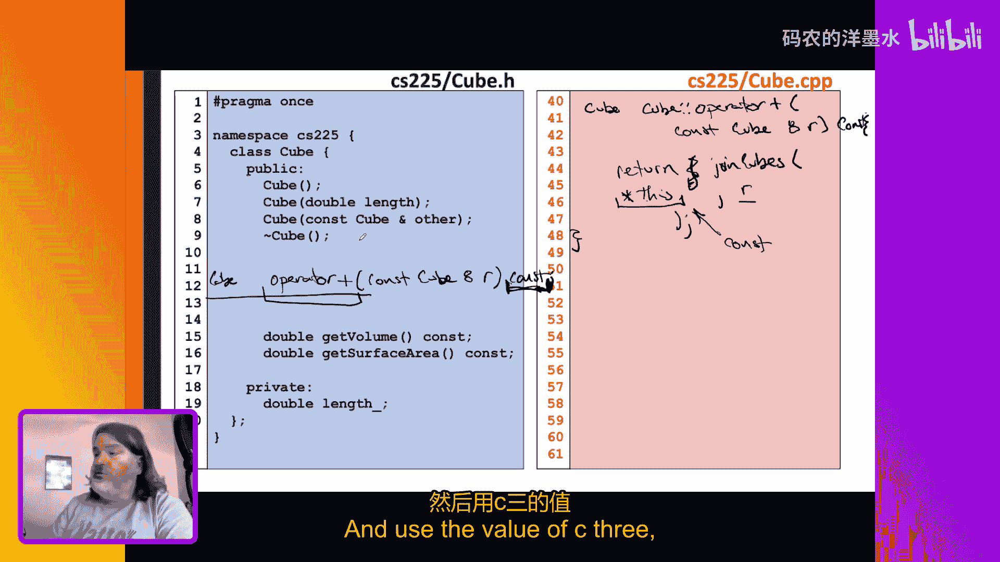

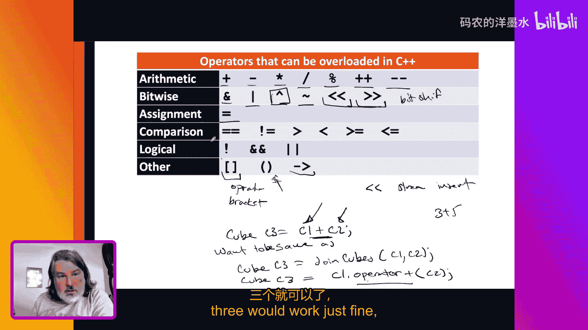

If I think about， I'm going to write it here because there isn't enough space。

 So I do C1 plus C2 plus C3， where C1， C2 and C3 are all cubes。And it'll have like， C max equals。

What's going to happen is C1 plus C2 associates this way。Those that edition happens。

 and we get a nuke， a cube。With no name。Plus。C 3， right。

 because the return value of this method was a cube。 So a cube， we can invoke operator plus on。

 and then we get a cube。So， yes， C1 plus C 2 plus E3 would work just fine in this case。Okay。

So you can do this a lot， it can help make code easier to read。😡。

Plus one it plus equals will derive from it correctly， yes。This is the return value。And then a space。

The cube， this is on stack。And this is on the stack。And they'll get cleaned up automatically。

As it turns out， these will be cleaned up as soon as this expression is done， these unnamed ones。

This version over only overrides plus in the case of cubes。 that's a very good question。

 so how does this work？When I see an when I'm a compiler and I see an expression in C++ involving an operator。

We look at the type on the left of that and say， hm so。Does that type have an overload for this。

 If so， then do I have a matching。哦。Argument。2 and C1 get added and create a new cube。On the stack。

And then C3 gets added to that and creates a new cube on the stack。The output's not const。

This is the output。It's just a cube。We could have made it be an integer or something。

Then C1 plus C2 plus C3 wouldn't work， but we could have done that。Okay。

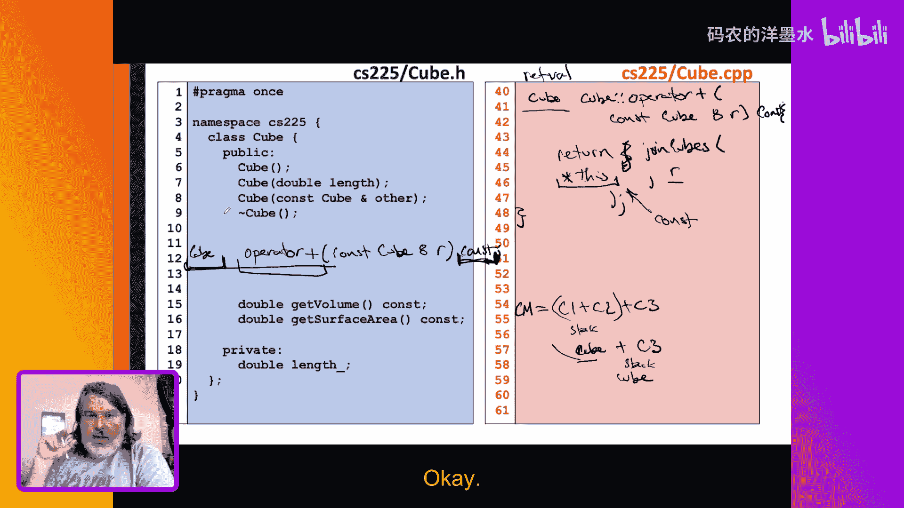

Now， let's talk about you will note we had one of these。All by itself。

You can overload as many times as you want。But you can overload only by the arguments。

 not by the return type。

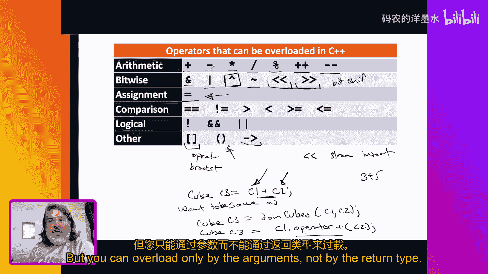

Okay。So there's one very special operator。And it's one that the compiler will actually do for you。

Its operator equals。So the assignment operator。Much like the copy operator may need to handle memory so。

Here is this syntax。 Let's break down what happens。 So we're overloading operator equals。

 which is the assignment。We choose that the right hand side is a con。Cubbe。

Or a constant object of tu reference。And we want to sign it to the left hand side。

 And here's the weird thing。It has a return value。Anyone have a theory as to why operator equals has a return value。

Can anyone write some code that would show why we want to return value。Oh， someone's got it。

Robotics has it。X equals Y equals z。Yeah， the， the idea of it returning a bull or a true or false is really interesting。

 but consider。Yant。X。Yant。Why and't。Z。X equals y。Equals z equals 5。Right that line。

 this line you want to make B。When it's resolved， right， if I ask you， what's the value of x？It's 5。

 If I ask you， what's the value of y， it's 5。 So how does this work well。

The assignment operator associates the other way around， and this actually looks like。This。This lamp。

So。What happens？ Z equals 5， right， So we have X， Y and z。Why are we using a cube reference， Well。

 in a sense， efficiency。 And let's think about what happens。Right。The X z equals 5。

let's draw these as boxes， right。And then we could have a five sitting around。

 But what we choose to do is this is now Z。Is the expression。Because this is a reference to Z。

And then we have。Well， now we do Y equals Z。 We get 5， and now we have x equals y。

 and the compiler is now going to。Do x equals y and get 5。

 Can you write into x equals int y equals n Z that you can't， because this is a declaration。

This is a expression。If I change， Y would that change Z， no。

What I'm producing here is a unnamed reference to Z。mLet's， let's think about what happened in。

X equals Y， Y equals Z。 Z equals 5。 Well， presumably y and x y and Z already existed。 So we have Y。

 which has some value。 Z has some value and。We'll call this question mark and this question mark question mark。

 and now we create X。Well， what does X get， X will initialize to question mark。

Y will become question mark， question mark， and then Z will become five。In that case， yes。

 because this is， in fact， the if if we were not overloading， we can think of this as int。Yt。

So that is the function signature of the integer addition。Okay。So。

It turns out if you don't do anything， there is an assignment operator generated。

So much like the copy constructor， the assignment operator has to do something， right？Meg。

Left hand side。Bi。The same。Value。As right hand side。Right， so we want the variable。

 our class object to become the。Same value as what we're assigning。Okay。

That's what we did in the copy constructor， right， we created a new object。

And we initialized it to what we were assigning。In。How is it different from the copy constructor？

Is there something I have to do in the assignment operator I didn't have to do in the copy constructor？

Yes。Clean out。Old values。In left hand side。The return type is different， that's certainly true。

 but functionally what's different。That in the copy constructor。

 there was no left hand side before the constructor happened。But in the assignment operator。

 there was something there， and I have to clean out whatever was there before I can make a copy。

 Otherwise， potentially， I could leak memory， right。Okay。So let's think about how to write this。😡。

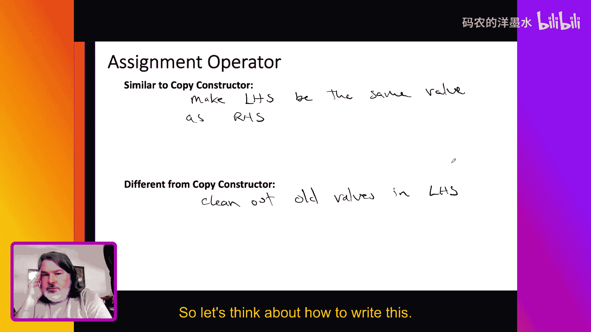

So what happens？No， and I didn't remove a salon， okay。The copy constructor copies an object。Check。

Does it destroy an object？No。The copy assignment operator， does it copy an object。Yes。

Does it destroy an object？Yeah。The deor does it copy an object。Does it destroy an object？So。

We kind of have already written all of this code， right？

So perhaps rather than writing this from scratch， what we want to do。Okay。

 why does the copy assignment operator destroy an object？It has to clean out whatever was there。

Think about our tower from Friday。In the tower， we had this new。 If I just made a deep copy。

 what happens to the previous thing that tower pointed out or even think back here， right？

 We talked in the deor。

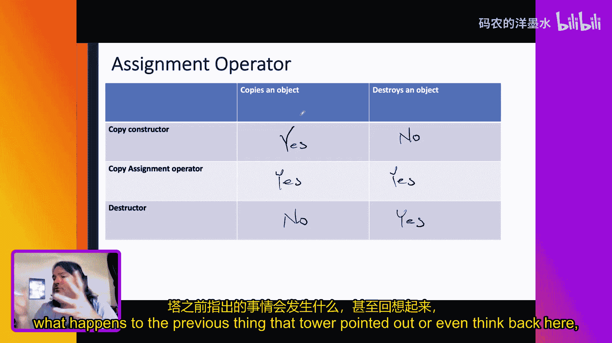

this piece has to be freed up。

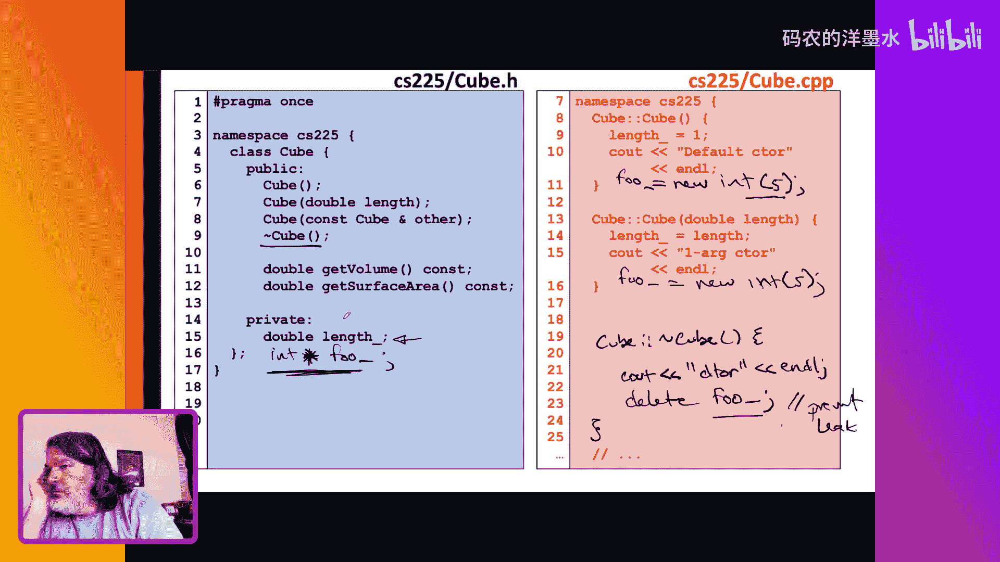

Right。So how can we write this， There are a bunch of different approaches。

 You can't use the deor itself， because。The deor。Cannot be invoked directly。 It doesn't make sense。

But what you can do is。Perhaps I write two helper functions。Private。Member function。Fengchun。

I'm going to write one that is going to be called clear。That。Cleans up。Ope， memory。嗯。

And I'm going to write one that is going to be called copy。

Let's see if I click around a little bit before if it'll play nice again。Yeah， we go。

And it's going to take an argument that is going to be a constant reference。And it's going to copy。

Into left hand side。Instead of destroying intfo， can't you just copy the same value into the right hand side as has it possibly？

But what。Not necessarily。Um， what if those are different sizes， for example。

 right now we kind of just have toy examples。What if what I had was a tree？Right or a list。

 I'm trying to make the the assignment operator where on my left hand side is list。A equals list。Bi。

I have no idea how big L B is， right？So we need to deal with it。 The exact way you deal with it。

 there are a lot of possible choices of details。 And when you're implementing clear and copy。

 you're going to want to think about how should I implement this to be most efficient， but。

They might not just be a one for one exchange。So the assignment operator is really important。😡。

And something we're going to work on。So to review。

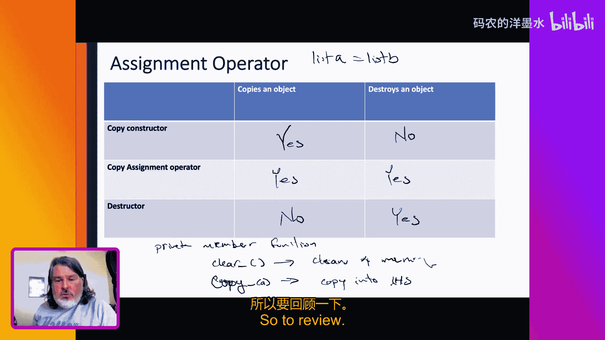

Or to review the ideas， let's talk about something we call the rule of three。

The rule of three says that if it is necessary。Not if you choose to do it， but if you need to do it。

If you need to decide define any one of these， then you have to define all of them or your class is not going to act correctly。

😡，And what are these， these are the assignment。The copy。Constructor。And the destructor。

If I have to write one of these。I have to write all of them。Okay。

 so if I've allocated memory so I know I need a deor， well， then I also need a copy constructor。

 otherwise it's not going to do what I want。 I also need an assignment operator to handle that memory when doing assignment。

😡，A correct class should either implement all three of these or none of these。And do you know what？

As a programmer， I'd like to spend less time doing stuff like this。

 So we have one other rule besides the rule of three。It is the rule。Of 0。

What does the rule of zero say？We aren't going to talk about the rule of five yet in this class。

 probably not going to talk about this。It says classes that declare custom deors copy。

 constructors or copy assignment。Should deal exclusively with ownership。

Other classes should not declare custom des。嗯。Copy constructors or copy assignment operator。

Either you need to implement the assignment operator， the copy constructor and the deor。

 or none of them。😡，But here's the thing what what this rule that I have that was quoting Scott Myers。

 who's a very well known C++ expert。mSay， look。Just don't do it。

Use classes such as from the STL to handle memory。And then that class automatically works， right。

 if I've written a class list。And inside my class， the way I keep track of memory is I use that list class。

As long as that list class has correctly handled memory， I don't care anymore more。

 The list class handles the memory for me。 Let someone else do it。So the rule of zero。Is great。

 and it's worth remembering。The flip side is。In this class。

 most of our time is going to be implementing。Classes that deal with ownership。

That we are going to be building these classes that do it。

Why do we need an assignment operator when we have a copy constructor， Well。

 if you needed to have a copy constructor。😡，Then。Something needs to handle assignment because otherwise。

When I do assignment， I'm going to get a different behavior than when I make a copy。Right。

 if I can just use other people's code， I don't have bugs。And that's it for today。

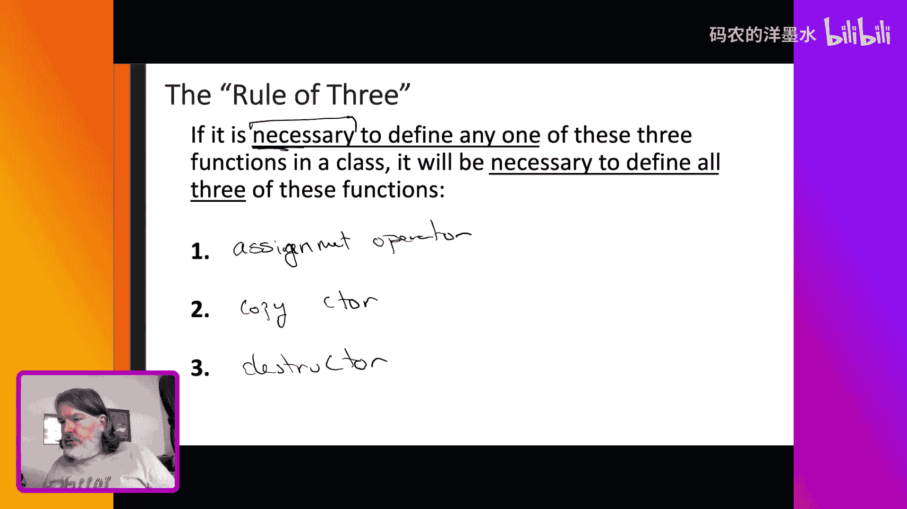

What。