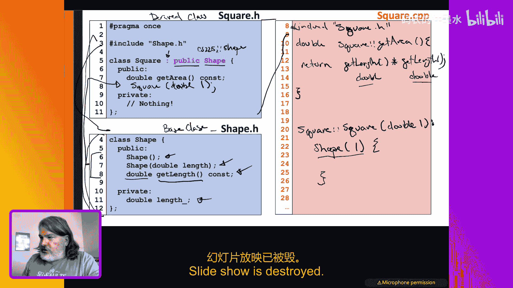
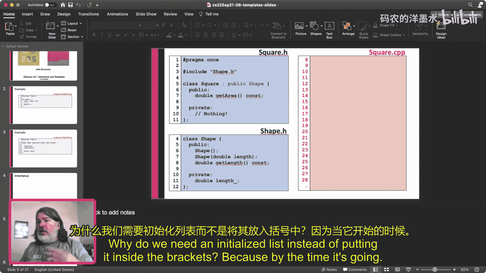
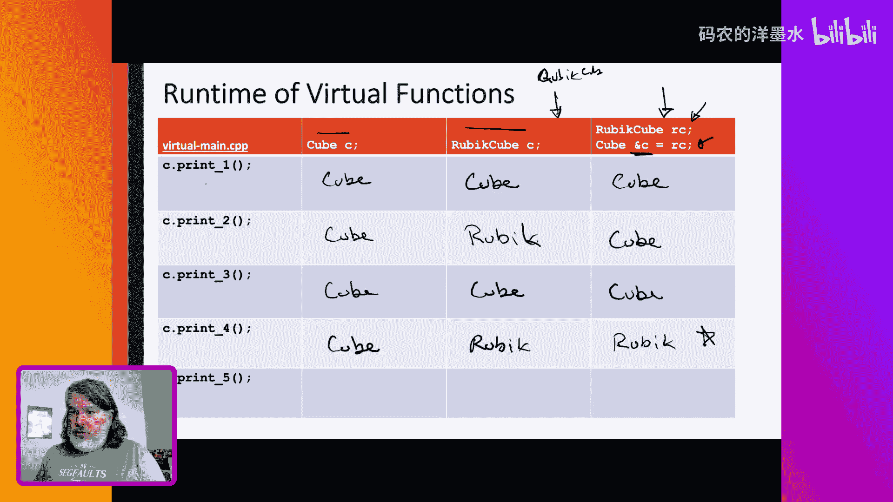

# 【全集】伊利诺伊大学 数据结构与算法 中英字幕 1080P p07 Lecture 7 - 接口与模板 -BV1t9FHzdEYL_p7-

Okay。So。First of all， there is one last bit to do to talk about。Copy。

 construct are the assignment operator。And let's consider。This chunk of code here。

So in this chunk of code。Do you see a problem with what we're doing？

Is there anything that's going to go wrong in this code？Well。But that's okay， right？Yeah。

 the way we talked about how to do。The assignment operator， this is going to be a problem， right。

 but this is legal code。That is to say， it is perfectly fine， if。Well， first of all。

 let' let's think about this for a moment。 So right now， it's， it's hard。

 But what if I have us a function。Called or let's just call it add。That takes an int。By reference。

A and a int。By reference。Be。Does。A。Equals a。Plus B。Or how about。And copy。And again。

 you can end up with。Something like this happening in real code， or it's not clear。Inside the code。

 you can't necessarily tell what happened。Okay， here it's really obvious that it's kind of silly copying。

 but it is perfectly lievable to say x equals x。Right。It's a fine thing to do。

But what's going to happen？Well， we said the way to do this was to do destroy。Followed by copy。Other。

Right？And what that's going to do is destroy C。And then copy the destroyed object in。So right。

 here's my code。Any suggestion of how I could fix this？You have to destroy it first。

 right what you're doing。Destroy it's cleaning up what's in sea。Yeah。

 we want a conditional statement that returns if they're the same。

So any suggestion of how can I check？If I'm the same。And I could do a comparison。

 but imagine comparing two PGs。That's a lot of work， right？Yeah， so how many use this？

So I want to see this。So this is if。sort of this。Something。Return。So this is a pointer。Yeah。

 check the address。 I like this suggestion。 So I' going to do， this is a pointer to myself。And。

I can do。Address of other。So。If my address and the address of the other thing are the same。

Remember the difference between a declaration and an expression here we are declaring a parameter right and the parameter we're declaring is other is a reference。

To a constant。Cubbe。Here we are taking dress of operator。Okay。So。This is how we can guard。Um。

 from accidentally destroying ourself。So。sorry。Yeah。And it takes a while to get used to some of this。

 this syntax is pretty dense and pretty esoteric， but yeah。Okay。So whenever you choose。To。Well。

 I'll answer this again， I said it before， why compare the addresses instead of comparing the values？

Well。I I want to compare the addresses because that's fast。

 How much time can it take to compare an address。 Well， they're at most the size of a pointer。

 That's pretty fast。 What if my objects were PGs。 Well。

 I would have to compare at every pixel and I could take a lot of time。So how about this。

 Why return star this， Well， what we return from here is a reference to。A cube， well。

The cube we want to return is ourse， and we want to do it for C1 equals C2 equals C 3。

 We want this expression to correctly make both C 1 and C2。B。Equal to the value of C3。

So the way this works is it's going to do this first and say that C2 gets the value in C3。

And then it C2 equals C1。Okay， so that's the last thing I have to say about the assignment operator。

😡，This isn't an equality。 I did not write operator。Equals equals out This is operator assignment。

Operator equals equals you probably don't want to compare addresses， right。

 you probably want to compare lengths。I do not post the annotated slides。

 lectures have lecture notes though。This is。A special variable that exists in any method of a class that is a pointer to the object that the method is being called on。

The equals after the operator is the name of the operator， right， overloading is。Operator。

And then here， operator。Bing。Overloaded。So in this case， we were overloading the assignment operator。

We don't pass in an address。We pass it in a reference。Yeah。

 and the videos go to Media Spacehen class transcribe。This in C++ is a pointer to the object。

 That is correct。And so， this is。Turning it into an object。Okay。

Operator overloading is writing a custom。Function to be taken when you see a particular operation。

So I am writing the function that when I see the operation E assignment。

I could write the function with the left hand side being a cube and the right hand side being a cube。

Okay。So now we're going to have a brief talk about。Inheritance in C plus plus。

RightInheritance we should have seen before。Inheritance is the idea of building more complicated things out of simpler things。

 and we're going to look at one of our classic ones， which is if imagine that we had a base class。

Shape。Right？And from the shape we would create other classes such as。Cubbe。Circle。

And you could imagine wanting to do this in a graphic system where shape includes a lot of the functionality for locating it on the screen and stuff and then the derived classes。

Have the functionality of the particular shape that you're drawing。😡，Okay。So from shape。

 we could derive cube and circle and from cube， we could drive， say。嗯。Rubik's cube。In circle。

 we could derive say sphere。et cetera。So。I I'm not going to go deeply into this because I'm going to assume you have seen some object oriented languages before。

 and also this is not a major focus of the course。😡。

In C++ the totality of everything you can do with inheritance is very large and well outside the scope of this class。

 so we're going to stick to the simplest use of inheritance in C++。Okay。

So I wanted to define a base class shape。It's going to be either a base class。

And I'm going to have a derived class。Clas。From it， square。So my base class is just a class。

 there's nothing special about it， it looks like classes we've seen before。

 it has a default constructor， it has a custom constructor， and it has a function to get the length。

And it stores much like our original cube。The length is a double。Okay。In my derived class。

I'm going to say it starts out the same and here's the funny syntax for inheritance。

After the class name， we put a colon。Followed by the type of inheritance we're doing。

 the only type we're ever going to handle in this class in CSD25 is public inheritance。

And then the class that we are inheriting from。So what does this mean， Well。

 the way to think about public inheritance is。That when your class has public inheritance from another class。

Hidden inside it。There is a instance of the base class and。All of its public functions。

Get copied up here。So it's like imagining that we have all of those pieces there。Specifically。

 we would imagine that we could call get length。So if I had a square。I could call get length on it。

Okay。So now let's try to write the function get area。And I'm going to start， right。

 we want to write get area， it's going to be returning a double。It's going to be a square。Colon。

 colon， because it's a function of square。I am only going to talk about basin derived。

That's a good question， so you can't modify length from a square。Well。

 we can do some things so we go square and then get area。And so。How would you write this function？

I want to write get area。So the suggestion is。We have two suggestions we have。And。Remember。

We have a lot of people that are wanting the power to be power and I'm familiar with that。

 but so we have length times length as a suggestion or get length times get length。So in this case。

 the correct answer has to be get length。So。Rturnn。Get length。Times get length。Because well。

 there is， in fact， hidden inside shape sorry， inside square， a shape instance。

The only way you can access it is through its public interface。 and since length is private to shape。

Square cannot access it。If it was protected， we would be in a different class。In 225。

 we only do public。That there are other weight。I could spend a whole semester talking about all the things that can go on。

In C plus plus inherentance， can we multiply functions？ Well， that's actually a very good question。

 Let's think about this for a moment。What does a function do， a function。 How do I evaluate this。

 right？So。To evaluate this。i。O。I going to。First， call the function。 So when I call that function。

It's going to act as if it's called that function on myself。And it's going to become what， well。

 get length is a double。 So after evaluating this function， we have a double。

And after evaluating this function， we have a double。So。This evaluation。And then what we're doing is。

Multiplying doubles。So how do we？Set the。Length。With the shape constructor。At the moment。

 there isn't anyway。What are we calling get length on ourse。

 we've already seen that when and that's a good question when in the scope of a member function。嗯。We。

Make a function call。That function call acts on our。If it is a member function。

So the other question is， do we have to include shaped dot H or only squared dot H， Well。

 let's think about it for a moment here， what do I include， I'm going to say I do include。😡。

Squared H。Why is that going to be enough？Because square ins here it's from shape there。

 I like that because square already includes shape， right， What is this say。

 This says copy all of this here， and this says copy。All of that there。

So this is exactly why you need those include guards because otherwise it's tricky。😡。

So there was another question I wanted to talk to， what would happen if we wrote return this dot get length Well。

 you're almost there。😡，That would be okay， but what would be wrong with it？What is wrong with。This。

Dot get length。Right， this is a pointer。 So if I wanted to write it。I could writearrows get length。

And。Inside a square function。This line here， and。Are exactly the same thing。Yep。

 you could also do it in other ways。Get length implicitly will use the this pointer as its。

objectbject to work on。Okay。So the question is， how do we set the length of this of the square We don't have a way to do it。

 There is a question of what does。What happens， So what's going to happen is the default constructor of shape is going to used。

We。So with inheritance， we don't need to include other files in CPP。😡，That's kind of a。

That's sort of like。If I go to the market， I don't necessarily need to go to the store。

 I can't answer， I don't have an answer there。So what is inherited is inside square。

 there is constructed first a shape。And all of the public。

Section of shape appears in the public section of square。Right。Okay。The private section of shape is。

Wherever。The privates right hidden inside shape。Inside square， there exists a shape。

That is correct Square has no access to length because length is a private member variable of shape。

To access length， we would have to have a function which conveniently we do get length。

So if square calls get length on itself， it can access length。

But that is because get length gives it access。Okay。Right， because。

Square can because it has public inheritance of shape， get length appears as if it is in square。

The way so will a square constructor call a shape constructor that's actually a very good question。

 so the way it works is first shape when you construct a square before you construct a square。

 it will construct a shape and then it will construct a square around it。😡。

We aren't going to talk about super。 We are only talking about baths and derived。

 there is a bunch of syntax that exists for inheritance that we are not going to deal with C++ also has multiple inheritance。

 which we're not going to deal with。They function for get length already exists in shape。

If it was not in the same namespace when you did inheritance。

 you would have to give it the namespace。 For example。

 if shape was not in the same aimspace as square， we could have public， say， C， S 2，25， colon。

 colon shape。That would scope it to a specific namespace。Get length is calling the function on shape。

Square has a default constructor， you could pass something in。

You should use Pragma once in every header file。This inside the functions of the methods of square is a pointer that points to a square。

 this inside the methods of shape is a pointer that points to shape。

C++ does not have interfaces the way Java does。Yes， it's presumably above line4。The are。

Pound pragal once。Okay。So we did that。The way to think about it。 So length exists for square， right。

 not really the way to think about it。 I'm going to draw this here。So just ignore all this。Fine。

 but it's not what I want to talk about。When I create a square on that。We have a square。

And hidden inside square， we can think of it sort of like this。Is a shape。

And the way it works when you create one is what's going to happen is you're going to create a shape and then you're going to create this square on top of it。

So square owns this chunk。Shape owns this chunk。And the world sees。This。Okay。Okay。

 so if there's a custom constructor like shapepe int in shape。

 does that transition to square H that a constructors square int length also exists？No。

You'd think it might work that way。 if what you wanted to do was initialize your shape in square。

 let's， let's write this。 So let's say I wanted to have square。And or probably double。Wen。Right。

 so I've now written that。Try and erase some space。So we're going to make some space。

 and I'm going to try and write this function。So here is my custom constructor I want for square。

Okay。So how is this going to work， Let's see we're going to have no return type and we're going to have square。

Colon，Double。Weeng。Hm。But I can't set length， can I？

Any suggestion of some weird syntax we've seen that would help us？We'， get links。

Allows an initializer list， right because an initializer list happens before。

 so I will do Co and Kong。Co，And then start my initializer list and it will say shape。

Which will'll take。A了。And then， we'll go。And close。Okay。Does that make sense？

So the way it's working here is that we are going to， on our shape that is hidden inside ourse。

 initialize it using its constructor。And that shape has no name， right， it's just there。

 and so we just write its type。No， it's using an initializer list。Yeah。

 it's colon and then the list of variables after。Its。Function name， colon。Nothing is in the bright。

 right， We don't need to do anything。 Anything else we wanted to do with our constructor would be inside the bracket after shape。

 but。And yeah， if。If shape had no custom constructor， we couldn't do it。

I'm going stop this for a moment， because。My slideshow is desired。

Why do we need initialized listed instead of putting it inside the brackets because by the time it's going？

Yeah， it's fixed it。I've lost my text， but that's okay。By the time it's going。Um。

 it already exists because the way we can initialize it is by using this constructor。😡。

And initialize， and remember， the shape is constructed first。An initializer list initializes。

The values before the function starts， before the constructor。So again， if we had。St Square。Doouu。然。

We did。Square。Square。Put it down here， double。It'll close。Period。And then our initializer list says。

 what do we initialize？Well， this is an L。 This is a womanington an L。Okay。

The initializer list initializes， it constructs the values before entering the constructor。

We had to do this with a reference because a reference can't be changed once it's created here we have to do it because really the same thing。

 right， that our shape。Base class does not have a way to change length。Well。

 this is exactly the same as constructing。As constructing that shape。Right？

It will the shape will be default constructed unless you tell it。

If I want to have anything other than the default constructor。

 I would need to use an initializer list。😡，Can I do square equals shape of some length。

 We'll get to that。 That's a more complicated question and the answer is that would not interact。

 what that would try to do is call a constructor on a square that took a shape。

So shape some length actually is going to create a shape right there on stack and then try to use that。

 So polymorphism， which is what we were about to get to polymorphism。

Is the idea that multiple things can be used is what things？Constructors don't have return values。

 Constructors become things。So polymorphism is the idea that a single interface may take multiple types。

So a square can also act as a shape that is correct。How do we do this？Well。To do this。

 we need to either use a point N C plus plus。Most。Use。Either。A pointer。Or a reference。Okay。

So to have my square act as a shape， I have to be using a pointer or a reference。And skip this。

So let's now try to figure out the rules of how this works。So are rules for how this works。

Let's figure this out。So。When we're trying to figure out what to do。

The first rule we do is look at type。Okay。Then， we will。Look。4。Method。Yin。That type。Okay。And then。

 we will。So let's see here is a very silly set of interfaces。So， we've got。A cube。It prints cube。

We have print two， which print cube。We have。A virtual， which we don't know what it was。

 is yet cube that prints 3。We have a virtual that prints for。And we have this nonsense at the bottom。

So this is in cube， and we have Rubik's cube that inherited from cube。 So cube is base。And inherit。

Or derived。Quas。We haven't talked about it。 so let's try and work through using our rules。

 So here we have a cube and we're going to call this method here we have a rubik's cube we're going to call methods。

😡，And here we have a rubikk's cube that we use a reference to。So what gets called， let's see。Cube。

 we call C。And our first rule says look at the type。The type is a cube。And then we look at that。

 and we look for a method， and we see print one。So we print cube。Okay。

We called the print run from Cube because we are a cube and we looked at cube and it was there。

So in Rubik's cubebe， we do C dot print1。And we look at Rubik's cube and we say，huh。

 there is no print one in Rubiik's cube。 We look at our rules， and I say， what do I do， We say。

 there's a third rule。Bace。Okay。Recurse to base type and go to2。 So we look in。

Because this could happen multiple times， we could have a derived out of a derived out of a derived out of a derived。

 so I'm going to use recur。We're not talking about multiple inheritance。I'm sorry。 I brought it up。

 So we look here， we look at Ruik's cube。 There's nothing。

 We recurse to the base type of rubikk's cube， which is cube。

 and there is print one and we write cube。And here， what happens， we have a Rubiik's cube。

 but its type is a cube and we print one and we write cube。Because。Nobody bothered to implement it。

 We're just going to use our base function。 I don't really want to type it， right。

We're showing all the different ways these rules can work。Okay， so now let's try looking print 2。

 We have a cube。On that cube， we call print 2， well print 2 has a function cube， it prints cube。

On a Ruic's Cu， we call print2， we follow our rules。Yeah， there's void。

I'm trying to fit it on a slide。So。We're now calling print 2 on Rubik's cube。

 and we look at our type， it's a rubbik's cube and we go Rubik。Right。I just did， right？

 That's what these rules tell us how to do。Okay， and now I'm looking at a reference。

 our type looks to be a cube。Because that's the reference we have。

 we look at cube and here we print cube。Okay。So now let's look at print 3， we got this word virtual。

 I bet that means something。Well， let's see what does virtual mean？Oh， virtualtual means something。

Virtual has。If virtual。Checkck。Base。Or check， there。Derived。So well， our type is a cube。

We look at the function 3。 It says it's virtual。 We check， are we a derived type。 No。

 we're really just a cube。 so we print cube。Okay， in three。Wei。Look at print 3。

 we say we're a rubikk's cube。 we look at root。We say， Hu， print 3。Says cubed。But we don't have it。

 We look to the base。 It says virtual， but we've already checked that。So we print cube。

And here we're going to print cube。What about four？So here we have virtual in print for。 Well。

 we're a cube， we print cube。Werubic's cube。We look at Rubik's cube。And we print Rubik。

Here we are a cube reference to a rubbi's cube。 So we see virtual and we go， oh。

 we're really a more derived type。So we look at that and yes。

 print 4 has a function and we print rubik。Okay。And now I tell you the big lie。It turns out。

If I include。This。None of this code compiled。Or at least a lot of code doesn't compile。

So if I include this， what's this nonsensehuh？Why is it rubic on which one so in this column？

Is what you're asking？The third column。 Yeah， okay， right， The column I've starred。

 So why is it rubic here it's clearly rubic。 But so let's follow our rules。

 So our rules is our type is a cube。 So look at the type。 We're a cube。

And we look at the method in the type。And so here。We see our method， right。

 and our method is virtual。So print4 is virtual。And the rule has this， if virtual。

Check the derived type。we say， hm。It's virtual。What's our derived type， Well。

 our derived type here is， well we're really a rubik's cube。

 so we will use the behavior from the Ruik's cube function。Because the function was marked virtual。

Virtual says。一。You inherit it。Okay。Now here we have something really weird。

We have virtual print 5 equals zero。Okay， let's back up and we'll。

 I think we'll cover the last thing on。Friday， because there's a lot going on in this last one。

What is the difference between columns 2 and column 3？Here I am a cube。😡，' sorry， Arabics cube。

That's really what I am。Here。C is a reference。2。A cube。But it turns out that in this instance。

 that reference is actually to a rubik's cube。So in the case where we have a function marked virtual。

😡，It will work down。Does Pri 2 doesn't have virtual next to it， That is correct。

Because that's what inheritance is about。 What we've promised by inheriting is that anything that is a derived class of cube。

Will also always be usable as a cube。Okay， so I'm going to stop recording， but I'll answer questions。

