# 【全集】伊利诺伊大学 数据结构与算法 中英字幕 1080P p09 Lecture 9 - 列表实现 -BV1t9FHzdEYL_p9-

Okay。So I'm going to go ahead and remind you the extra credit is due today for MP stickers。

 there is no lab this week and there is no lecture on Wednesday。

 I will hold my debu your brain office hours there so you're welcome to come。

And I want to start by helping us recall what we were doing on Friday。

On Friday we talked about two main things， we talked about templated code。

 and we talked about the list abstract data type。😡。

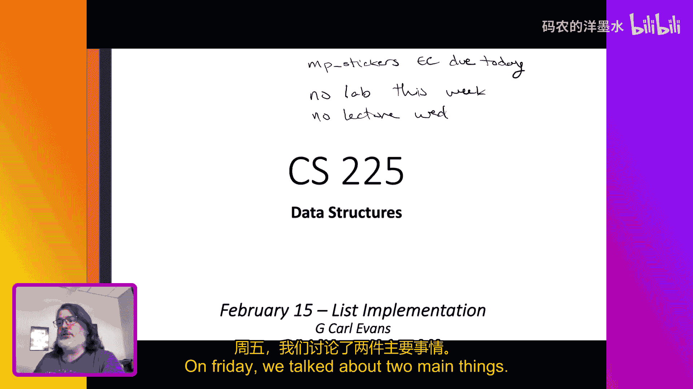

And what I have here is a mapping。From the primitive。

 the basic list abstract data type to a potential set of functions。Insert is add。Item to list。

To list。Front or back， it would be you'd want to probably name the function that way。

But it's just adding， so it doesn't return anything and it takes a constant T reference data。

What's the T coming from again？Yes， abstract ADT is the idea is the abstract data type。Yeah。

 so it's a template， so we're going to templateize this。Type name。Qi。Okay。

Delete doesn't need anything because it's either going to be deleting the front or the back again。

 you would probably in a more sophisticated  one1 and name it to be clear， but remove。

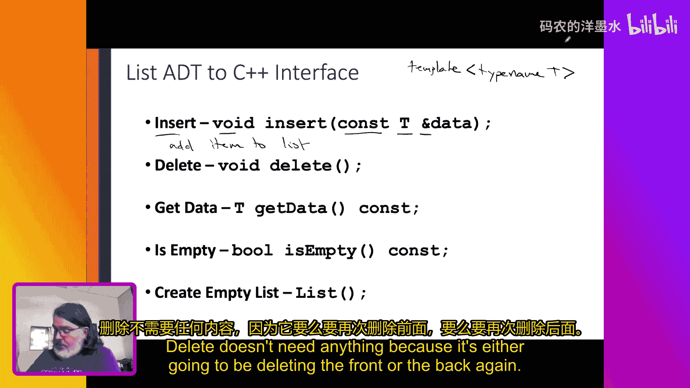

Fromrome list。Get data is going to get the element at the front。It's going to return。

A copy of that data。And it's const， right， because we don't want looking at the data in our list to modify。

 so get the data。Do you know。Again， is empty Here。 we're going to check if the list is empty。True。

 if。Empty。False。Otherwise。And again， it has a con。I don't care is remove front or back is the question that I don't care to。

 it's one or the other。 if we were really going to implement this， we would absolutely name it。😡。

Okay。嗯。And then finally create an empty list。Empty list。Okay。So。

When we be talking about time complexity in this lecture。

 not really lists are fairly straightforward and I would expect you to be able to analyze the time complexity of the kinds of lists we're talking about in this lecture。

 we will be talking about time complexity of some lists。😡，So。Let's go on and talk。

About list implementation。So that was our abstract data type。For the list。

I think that with the tools we know now。I have two ways that I could implement a list。

 Does anyone have a suggestion。Of how I might implement a list。So linked， in a array。

 we got the two of them immediately。 We could have linked memory。Memory。And as an array。

Those are the two fundamental ways。We can implement a list。

 So today we're going to talk about linked memory， right。

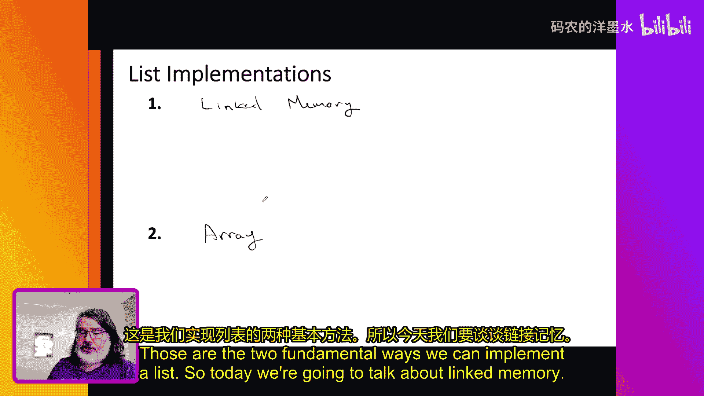

And we're going to draw some pictures and we're also going to talk about some concrete code。

So here is our list。Yes， but somebody had the implement vector。And unfortunately， that's you now。

Right here is our list of data。 We are doing a simplest type of linked memory。

 which is a linked list。We would have something like a head pointer。And then we have list nodes。

 These are list nodes。There are going to be some type of data piece。😡，That is going to hold data。

And it's going to hold a next pointer， right？Okay， here's sort of the way we would draw it abstractly。

And here we might have， you know， list node。嗯。This looks like a char。Data。And。List no。Pointer。Next。

ok。So。That's one way we could think about it。 But we wanted this to be templated， right？

So let's look at a templated version of this。Okay。So we have class， perhaps we better do this。

I wrote public before， but there's another way I could do it。I could do stroke。Instead of using。

The second variable， next。What is this， This is a list node pointer， right？

 We have a list node that contains data。And next node。The next node is。Pointer to a list node。

I hope that explains the what's going on with next here。Okay， so， but instead of。What is thestruct。

 that was what I was getting to。That I want this list node， I'm just going to be using it。

 I don't want to have to write a bunch of getters and setters， right， That seems inconvenient to me。

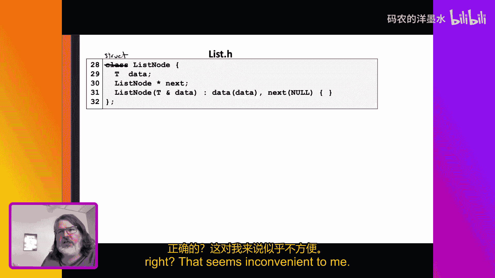

So I could write like I did here， right， I wrote public。And that said。

 everything below this is public and I made my data public。😡。

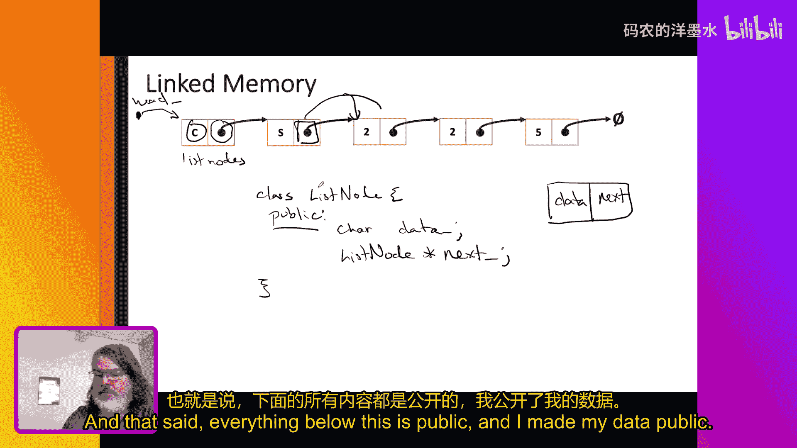

Instead， I use Strt。And in C+ plus。Stt。Is a class。That。Is default。Public。So in a class。

You default to being private。In astruct， you default to being public。 So when do you use astruct。

 when you're just having something very simple and don't want to deal with getters and setrs。

 It's traditional to label themstructs rather than to label them classes and make everything public。

 It's kind of helps。 it makes the code document what's going on。 But the only difference is。

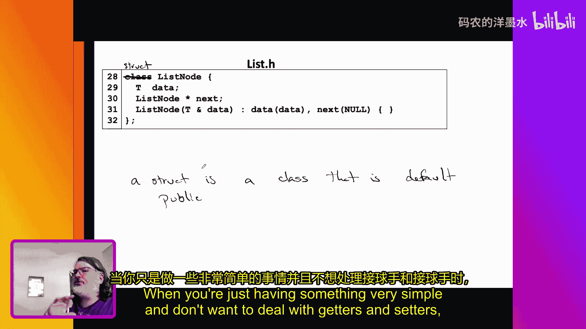

That astruct starts out public。 I could make this private。And then it's private。

RightSo the entire difference between a class and astruct is that astruct default to public and a class defaults to private。

Yep。That's it。So。This。Says class， but it is behaving exactly like astruct。

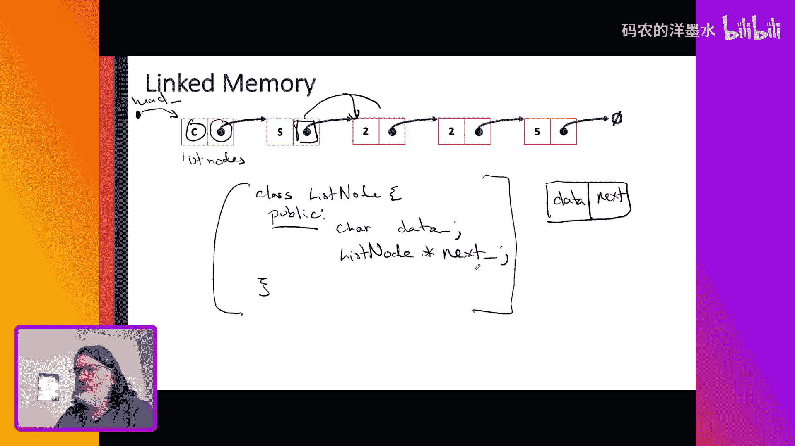

Why not null pointer， because it gets long， We should use null pointer， and that would be preferred。

But so yes， so let's critique some of what's going on here。We have T data。 That seems good。

 We have list node next。 And here we're using data and next， not data underscore and next underscore。

 but we could。 Let's see。 list node，oo， I bet there's something I'd like to fix here。

Perhaps I want to make this cons。 So want to be list node。Canst。Ti。And percent sand。Deide。Kowen。

And then everything else。 And yeah， I agree that。No point here would be better。Again， traditionally。

 this is coding style not function， that is to say the question about why not use Str all the time？😡。

That by traditional style you。How do you access a private member in a class， There's no difference。

Well， that's a constructor to me， right， it is a custom constructor that takes a line 31 is a custom constructor for list node that takes the data and creates a new a list node with data as data and null pointer。

Astruct and a class are exactly the same thing。 Ex。 when I say exactly， I mean。

 everything that is true of a class is true of astruct。

 and everything that is true of a struct is true of a class with the sole exception that in a class。

 the default access type is private and astruct。 The default access type is public。 That's it。

 There is functionally no difference。Okay。In the case of。Oh。Style。Usually。

 we use astruct where you have very few functions and just some data that's expanded in general。

 in something that is used internally by another class。

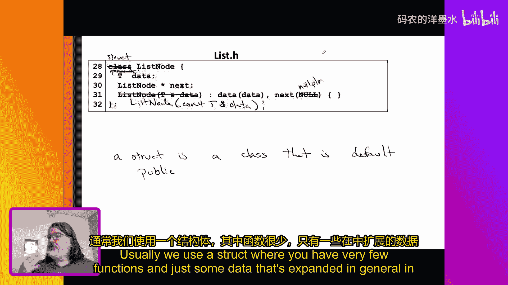

And in general， we use a class when we have significant methods。Okay。So。

I have one question about this。This feels kind of clunky because。This is a list node class。

How do we want to make this work？Our list node， we want to be internal sort of to our list。

 So let's look at our list class。

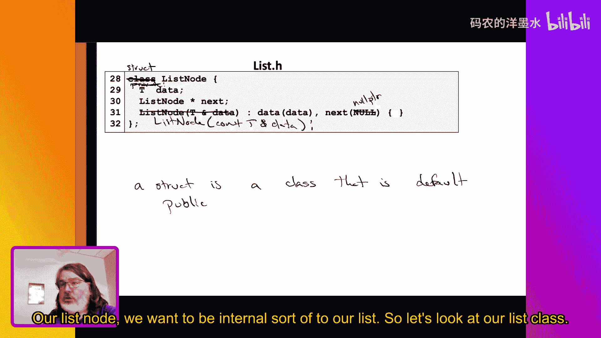

So here is how I'm defining my list class， all my public interfaces here。And。I can dostruct。

And I have templated list。Right。Which has implicitly templated。List node。ok。So let's think。

Can we write。Can we write the code for insert at front。Let's see。

 What do we need to do to insert at front， right？It's declared in our public， right？

But in the HPP file， we need to write the code for it。So let's work through the process。

 How do we add a node。To alert a file at the start。So first。We need to create a new node， right？

And it will be there。And then we need to point that node to the current a of the list。

Which is something like here。And then we need a point head to it。 So I think there's three steps。

Create node。Point。New next。Next。At head。Point。Head。At new。Okay。So that seems pretty straightforward。

 Let's try and write the code。 So first， we need a list node。Pointer。I'm going to call it end node。

Equals。How do I create the new node？Well， I want it to be on the。Heap， right， so I need to use new。

Carry。So I've created End node， which is a pointer to a list node and it points to a newly allocated list node that has the data D。

Okay。Now I want to point it。At the head。All right， so in node。Since it's a pointer。

 I want to use the arrows。😡，Right？I need the arrows operator， and I want to say the next equals。He。

And then。Head。Equals。And。Noode。So our lines here are this。This。And this。The first line。

 we allocate a local pointer。And。Point it to a newly allocated node。In memory。In heap memory。

And that's initialized by the constructor， which we have here。With。The data that is being assigned。

Well。Node next equals head。Means that。Li。Pointter here is now going to point at What's inside the head。

Right， the contents of had is the address of。What is inside the parenthesis D， right。

 which is the D that we are at it， do would be inserting to the list。This is a initializer list。

We've talked about that a couple times。Whereas End node defined right here， list node pointer。

And node。Is a local variable that we defined right there and initialized with。嗯。The list node。No。

 head is still the head。

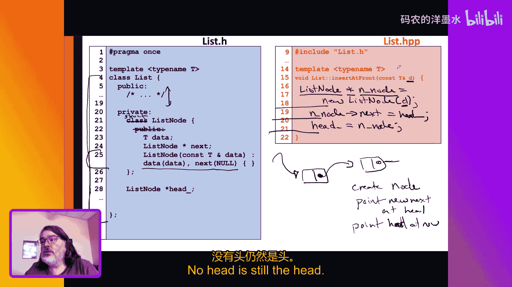

Right。At this point， let's walk through these steps again， so here's the world。

I'm going to write the code。 I'm going to write each step as I'm going to do it。

 So the first thing I'm going to do is I'm going to write the line list node。Pointer。En node。Equals。

Newu。List node。B。Right， this is for insert。Front。Ti。Okay。So there's the first line I wrote。

 what does that do， Well， we create off on the heap sorry in the stack。A pointer that is called。

En node。And we initialized that pointer。Okay。So this is the first line。

 is everybody happy with the first line？😡，We're now going to access the second line。

The second line says。N node。Next。Equals。Head。A box。Right。

So what does that do that says we are going to copy the value from here to where because that' that's this thing is this pointer。

Now we're going to copy that to end node， let's do is it L？So end node here， right？Has end node。Next。

And node， we are following the pointer using the arrows operator and then looking at the next。Field。

Okay。So we're now going to say this。Doesn't point there anymore， it now points here。So this is line1。

Lying2， we've done that。Okay。Line three。We're going to say head。Equals。En node。Okay。

Head equals N node。And we're done。We have inserted。The data into the list。Okay。

So this is the simple case。Now。And nodes on the stack， right？Head is a member variable of the class。

 and Ed node is a local variable to the function。They both are pointing to the head of the list at the end of this。

But as soon as we return from the function， and node goes away。Well。

All of the list nodes are on the heap。This is on the stack。And I don't know where head is。

 because head is a member variable of the list class。What would head next be head。He。

Next would be this address。 right， head Next is this pointer。This is head。Head next， is this。

The only thing I know was on the stack is end node。Enode is not。 I didn't create End node with new。

 Here is End node。Here is new N node points to something on the heap。There are two different pieces。

 This is N node。 This is the thing created by new。Okay。Okay。So。This was a simple one。

 but we'd really like to make our list。Yes， the sea was the head。

 and now whatever we did pass to insert will be the head。C was the first element in the list。

 and now it'll be the second element in the list or。Zeroth and now the first。Okay。

And and someone said drawing pictures made it easier， you know？Professional programmers。

 when dealing with hard code。Draw pictures when doing this sort of stuff。Absolutely。

 that it's not a crutch。 I have seen developers with， you know，20。

30 years of experience draw what they were doing。

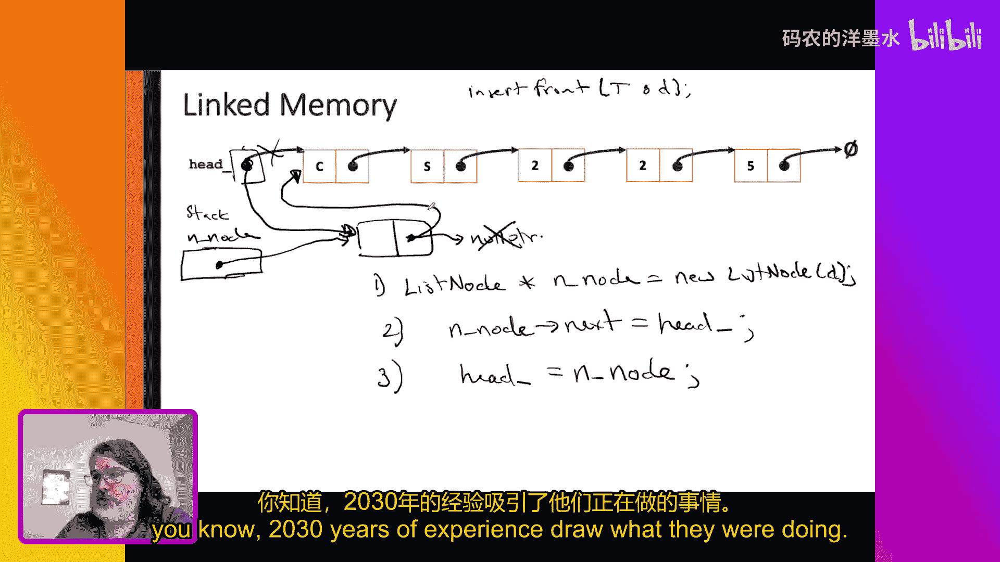

Okay。

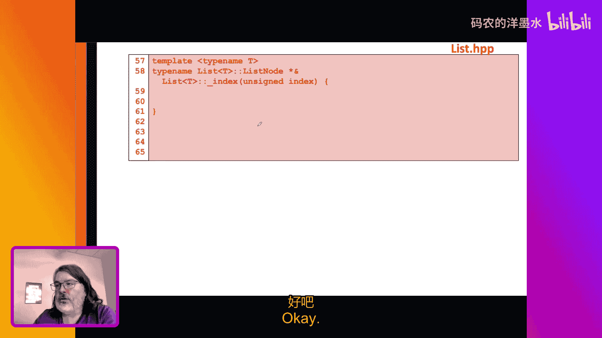

So。What if。I want to。Have a better insert。 Let's work it。 So this was this nice insert。

Now I want to write insert。At index。Right？So I want to write insert at index。

 And the first thing I want to do to write insert at index is I want to figure out how to get。

A pointer。That points at something。So I want to write this function that is going to be a helper function index。

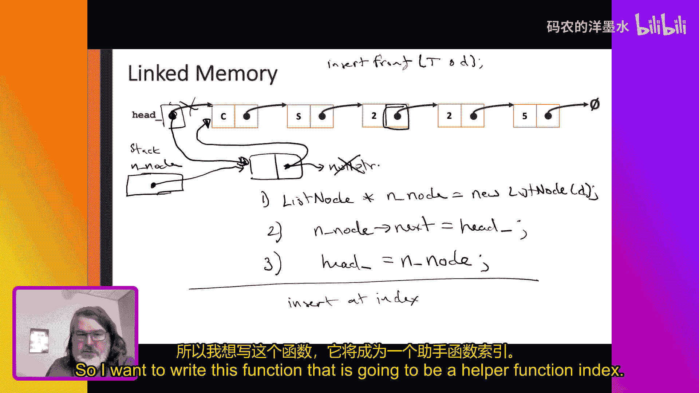

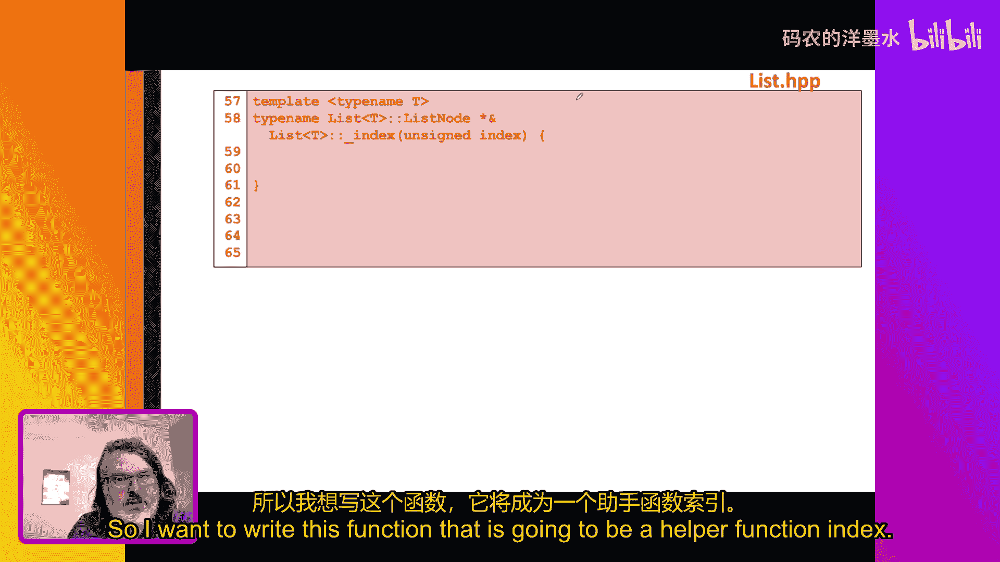

And this is what I want to do with it。I want to allocate no memory。😡，Okay。

Because that might take time， I want to return a pointer that already exists。That。Points to the node。

 So if I ask for index。Of。2。Right。Well， I want to have a this is zero， this is one， this is2。

So what I want to return。Is a pointer that already exists。That points to。2。

 so I want to return this thing。Okay。That if I return that。By reference。I have a very powerful tool。

So let's walk through this。 So I'm going to write the function this way。First of all。

 we have template type name， and there's this extra type name here。 Why is this here。

 If I ever have to scope。A。List。A return type， I need to put type name in front to tell the compiler。

Then I say， I'm going to return。What I'm going return is going to be。 Well， let's read it。

 It's going to be a reference。To a pointer。2。A list node。Right。

A reference to a pointer to a list node， which is a reference to that pointer that already exists。

Okay。

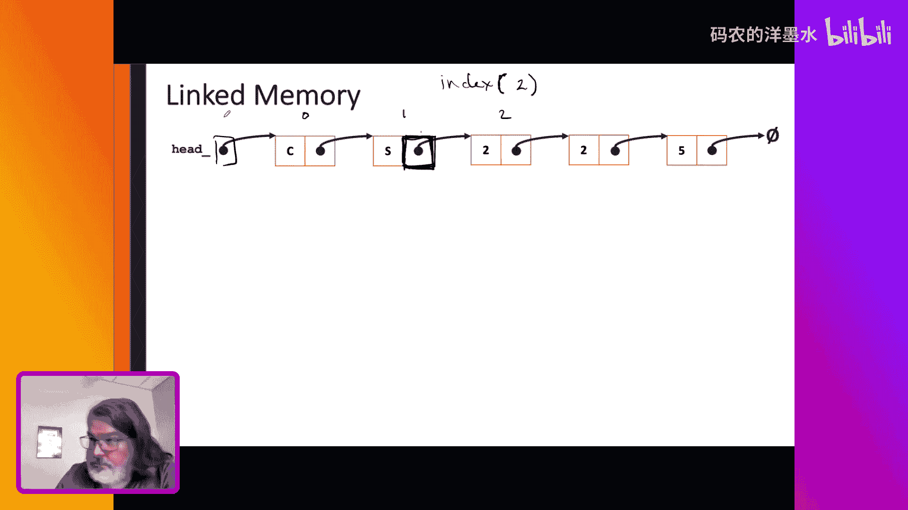

Okay。So。How are we going to do this？Now there's two ways we could do this。Well。

 I want to return a reference to a pointer to a list node that points at the index。

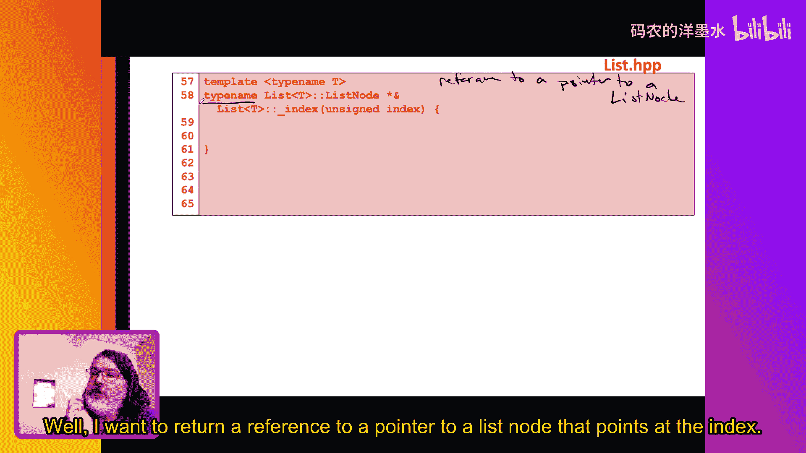

Element。So if I did too， I would want to return a reference to again。The heavily boxed one there。

Okay， so there's two ways we could do this， we could write this recursively or iteratively。

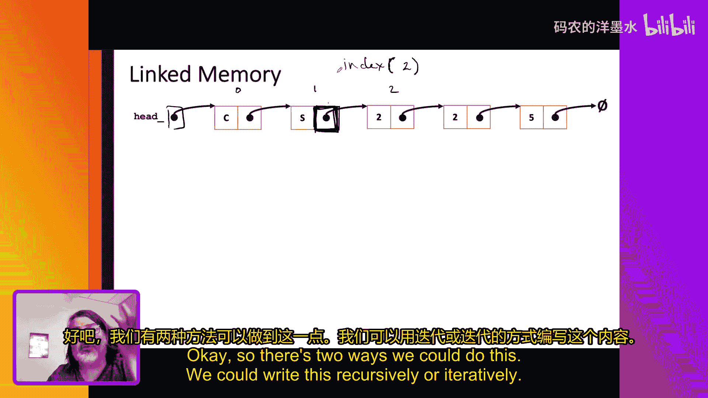

Let's try and write it recursively because we're going to find that getting very comfortable with recursion is really going to help us in a number of things in this class。

 so how do we write this recursively？😡。

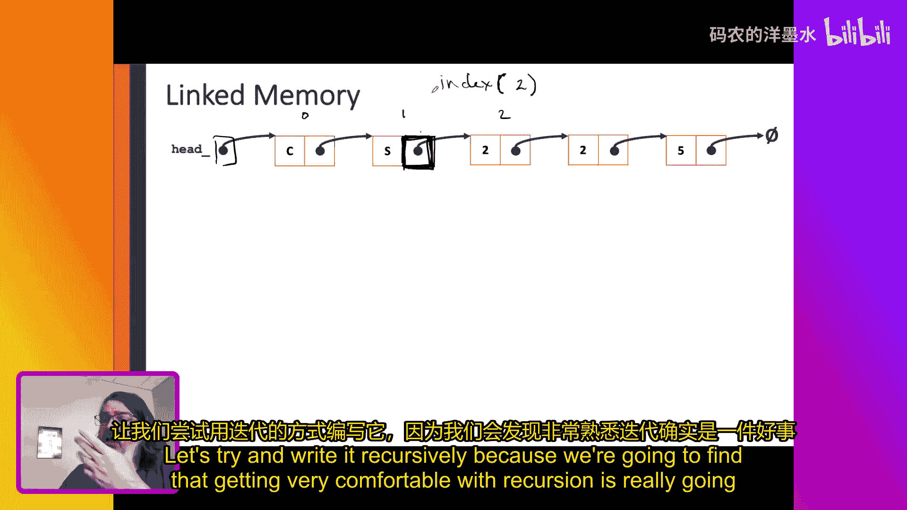

Well， here is my recursion。WeIf we are at zero。We're done。 So our base case is base。Case。At index 0。

Return。Or return head is what I'm going to call it， but not head underscore。

We'll be going back to that in a moment。 I want to walk through the beast。Otherwise。Wise。He。And note。

 it's not head underscore。Equals。Head。Next。Or otherwise。index。It's write it this way。He。Next。Index。

-1。Okay。So right， we look here is the head of the list， and then we look as if this is the head。

And then this is the head so。This is the list。 This is the list。So this is。Bye。I-1。 I-2。Et cea。

We will， we'll get to that。 I'm just trying to。Work through this。Right。

 each time we're going to act as if we're at the head。

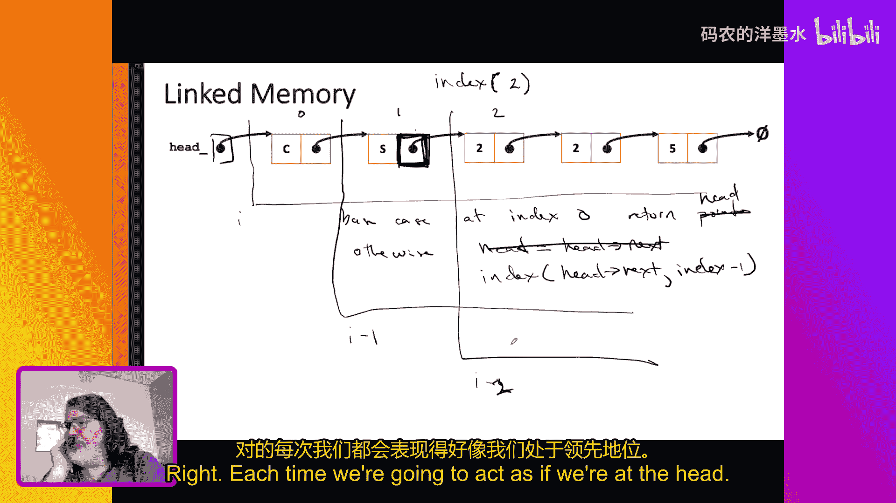

So I haven't written code yet。So let's work through the code。So。First of all。

 in most recursive cases， we need a helper function。 So here's how my help my code is going to work。

 All I have to do is。Or。Return。And I could call it index helper。

 but I'm going to take advantage of some cool feature in C++。Okay。There。

 I've written my whole function， It's awesome。Now， I guess you probably want me to write this helper function。

 right？Well， our two functions are the head of the list。And the。嗯。Index， right。

Our non recursive function doesn't know about the inside of the list。

Our recursive function takes head， which is the head member variable and recurs。😡。

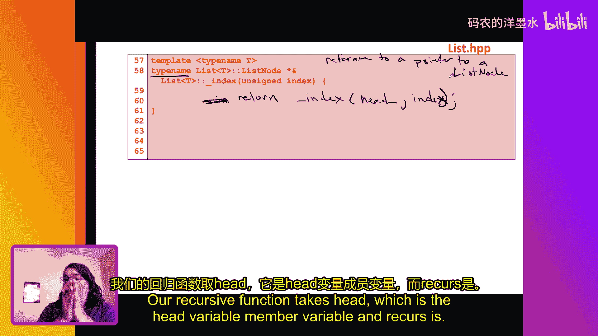

Right we have we are returning a list node reference of a list。That is index。Okay。

So let's try and write this。So here's our helper。It's going to have this same type name list T list node。

 So I'm going to drop some of the syntax。 I have a list node。Pointer by reference。Right。

 is what I'm going to return。I'm dropping all the templating stuff。

This is a reference to a pointer to a list node， a reference to a pointer to a list node。

It's a type declaration。Reference to a pointer to a list node is what we're returning。Okay。

Because what we want to return。

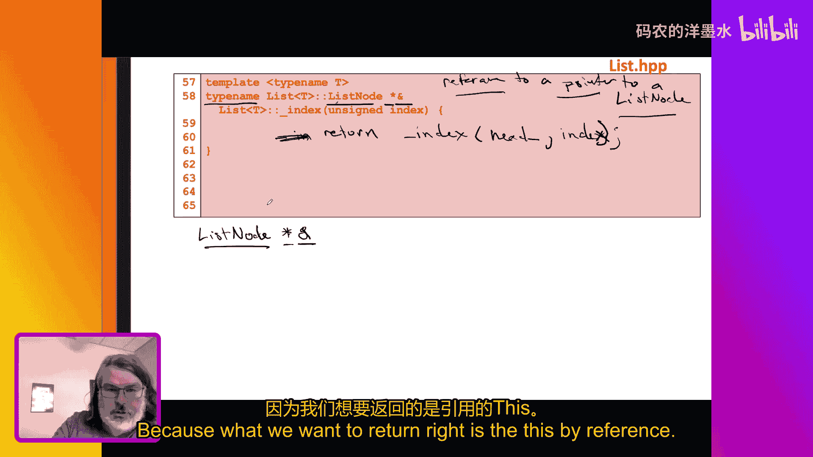

Right， is this by reference？We want to return the object that is a reference to the pointer。

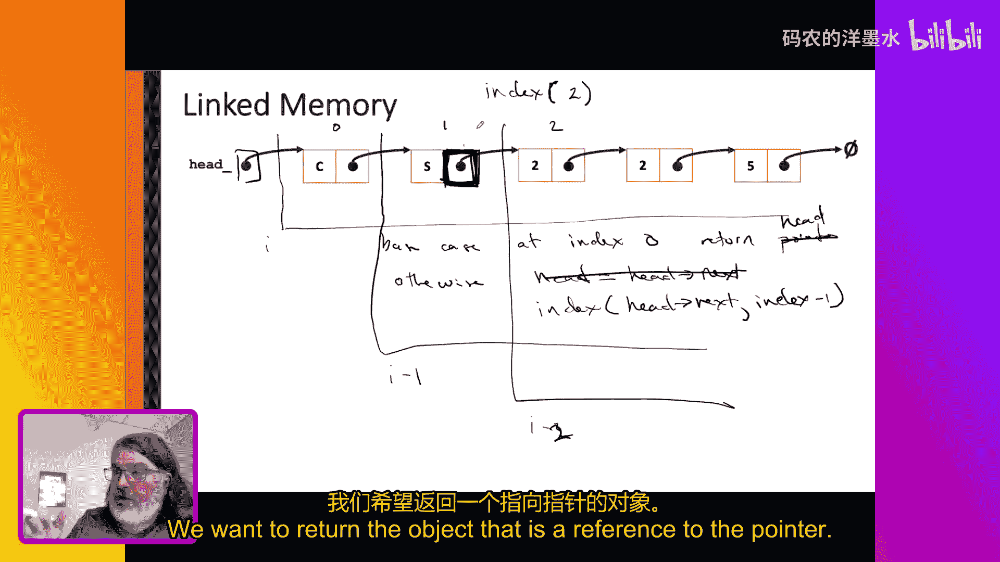

It's a type declaration。Of。Index。Of。List node。Pointer。Reference。I'm going to call this head。

And unign。And I'm going to call it I because I'm lazy。Okay。So。Again。

 we actually need the type name list T， all this scoping stuff。Okay。So how do we write this。

 so we said always first， the base case。Y。I equals equals 0。Head。Sorry。

 that should be here and that should not be。Okay。If I equals equals0。

 we are at the index we want and we return head。

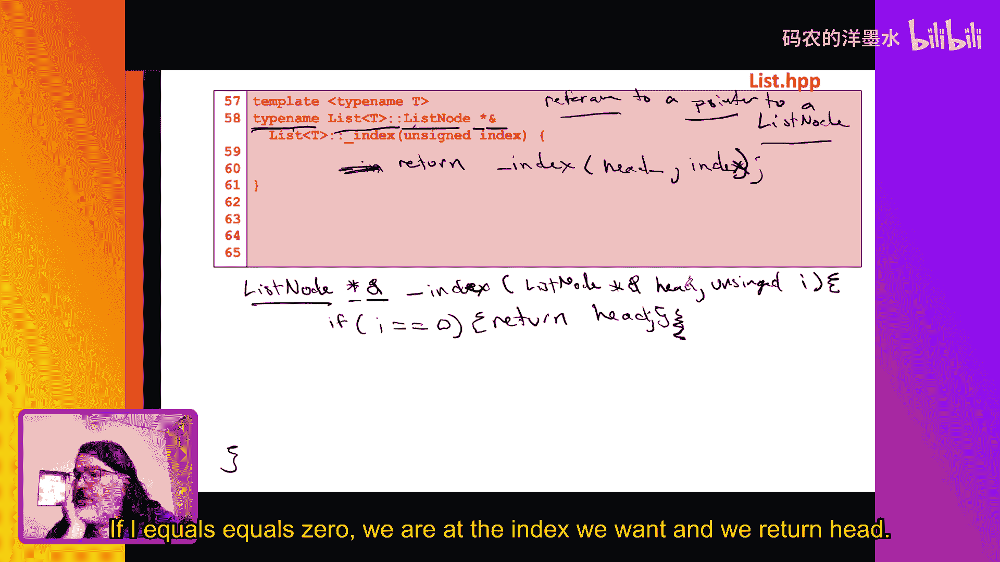

Well， our whole function， right， our class is typed T。

So we need the type name T because this code is temptized。

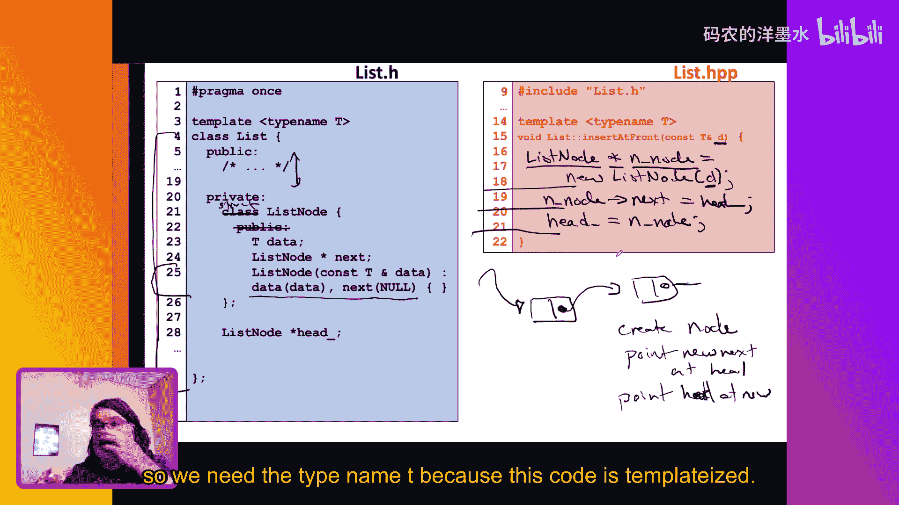

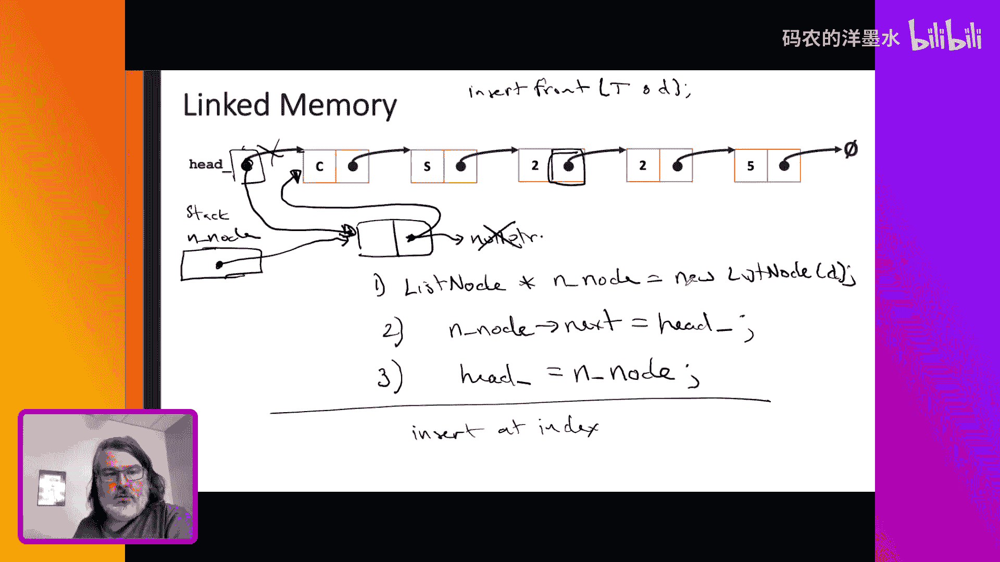

Okay。Otherwise。What do we do。I'm do。Okay， so there's a couple of questions。

 What about if I asked for index 500 of my list of four items， It'll crash。So yeah。

 the line 58 is the return type followed by the name and signature。It is passed in by reference。

 head is a reference to a pointer to a list node。Or why doesn't index need to be passed in by reference。

 I'm not modifying index。

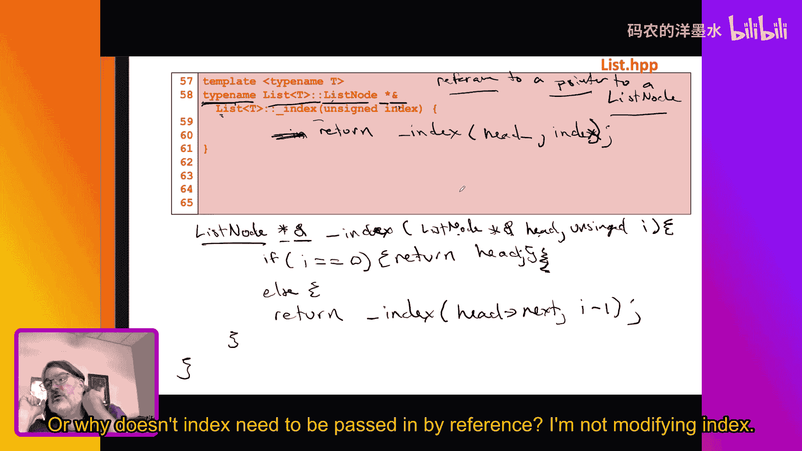

Because。Well， let's think about this， right， here is I here is I， here is I minus1。

 and here is I minus2。 So if index was2， how do I get to the point where this is the one I'm returning。

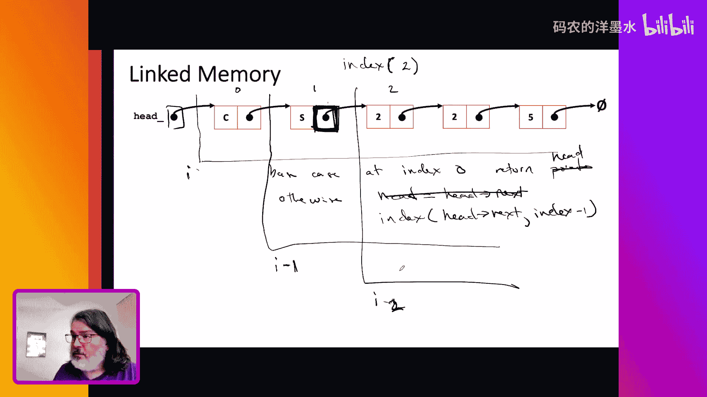

Why do we have to have the second function。 Well， here I need to have head。

 how am I going to tell it what head is， head is a global is a member variable。😡。

Here's a really good question。 How was the naming of the functions work。

 How can our helper function have the same。A name。As。Om。The main function。 Well。

 because in C plus plus。A function's name is its string plus its arguments。

So this is the index function that takes a index。And this is the index function that takes a list node。

 a reference to a list node pointer and an index。

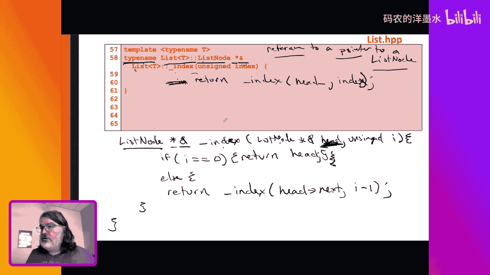

They are two different names， right， overloading。 This is an example of overloading。

 I am overloading the name index。

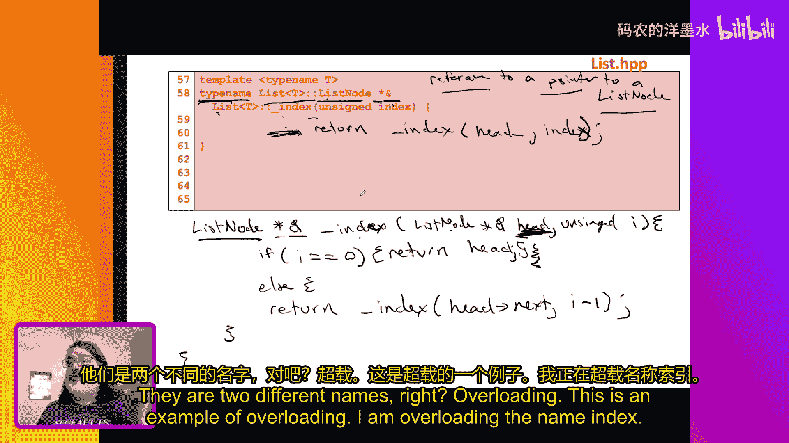

And the compiler can tell which it wants because they have different types。 So it goes， hey。

 this one takes these two types and that one takes that one type。

It is yet another example of function overloading。What does index？What does it return， Well。

 let's walk through it。

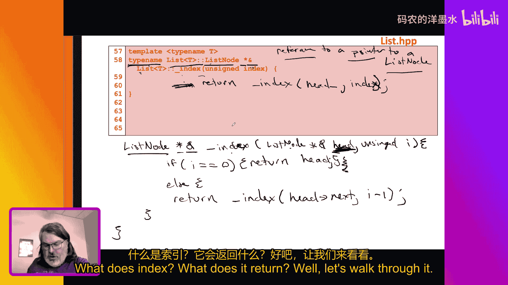

It's exactly so let's walk through this code。We start with2 I equals 2。

 and now we call our helper function with head and。With head， sorry。

We are calling our helper function here。And my keyboard doesn't want to work。 Oh， come on。

You don't wantan to let me have a laser pointer。Apparently， not。

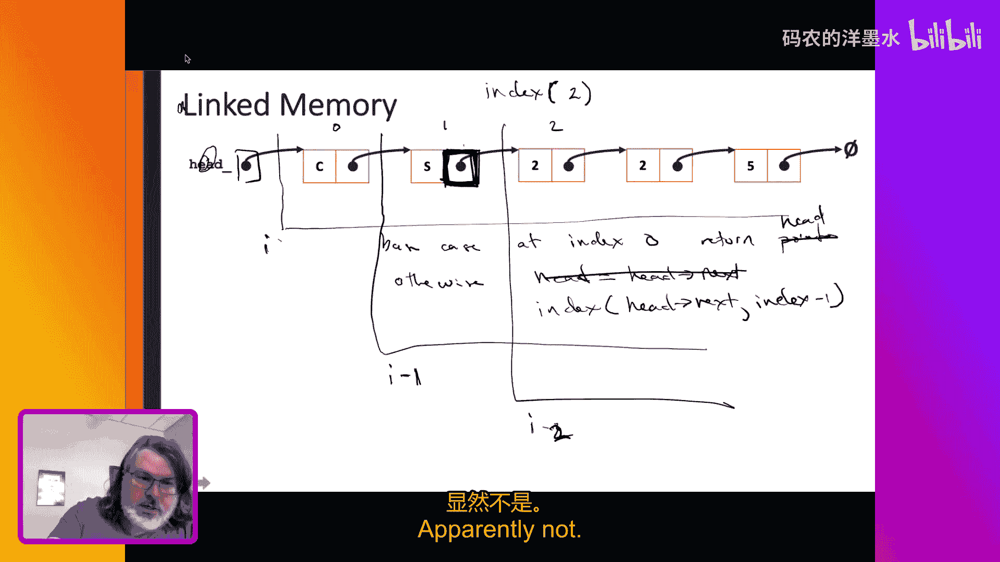

Okay， well， it's decided I can't have a laser pointer。 So we call our function right with head。

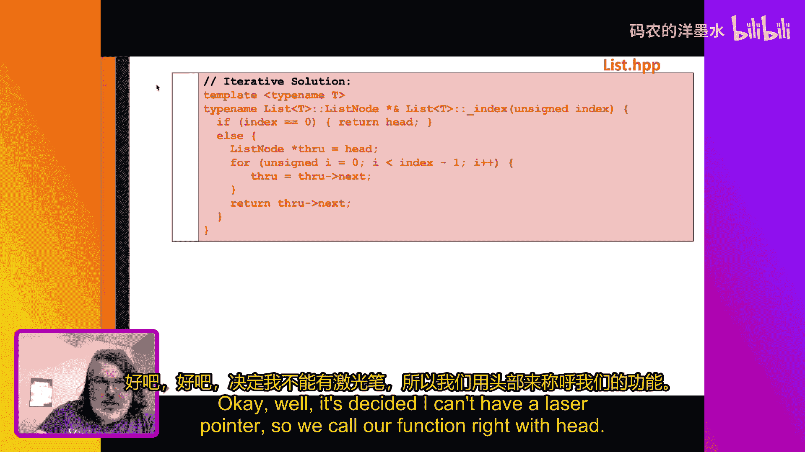

And I know what's doing， okay， hey， I've with head。And two。We call the function I'm audit。

I don't know how loud I get through St， I automatically start trying to lecture and project to you know。

 1404 or ECEB。I'm trying to speak out so I can people in the back can hear me So we're talking with head and two。

Well， head in two。2 is not 0， so we recurse。And now we look at。Om。Here is our new head。

 because it's head next。And here is。I minus-1， so it's one， right？

And then we recurse and we look here。And I -2 is 0。And now we are at zero， having counted down。

 we have moved forward。1， two spaces。 and we return。This。Element， by reference。And we're done。

Exactly， head next is what moves forward the list， right。

 But the recursive way to think about it is here is the original head of the whole list。

 And then we look at I-1 of the list that looks like this。

And then I-2 of the list that looks like this。 And then we would look at I -3 of the list that looks like that。

 and I-4 of the list that looks like that。Okay。Great。This is pretty cool function。

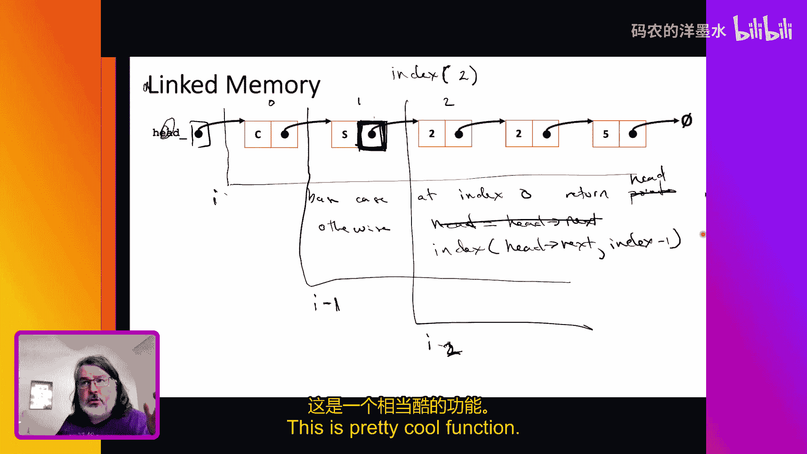

So it was weird to write。For those of you that prefer the iterative method。

 here's the exact same function iterative。This is frankly more likely how it's likely to be written。

 but honestly， I think this idea to me is clearer。

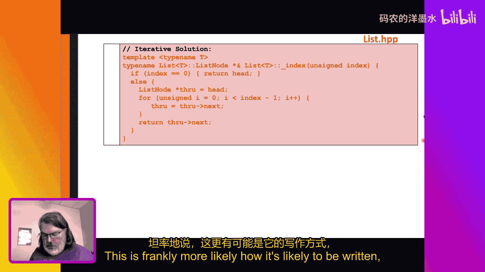

Um， this may be because I've twisted myself into thinking itererate recursively as much as I do。

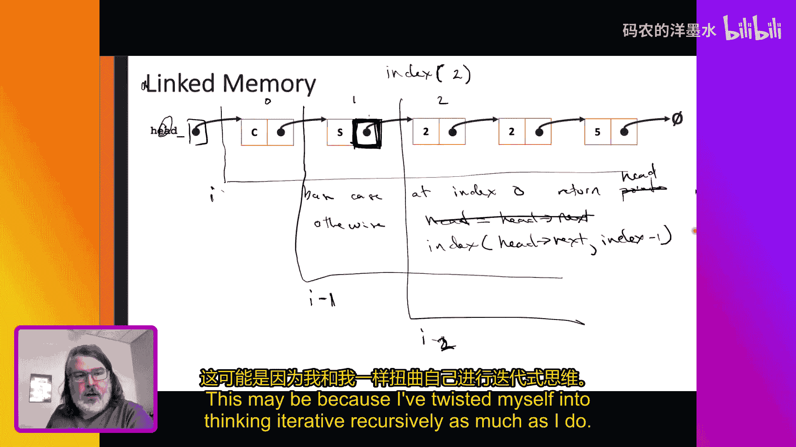

But here's the same thing。 It has some weirdness with that we have to be actually returning this next。

 So it's a little bit more complicated than it seems。

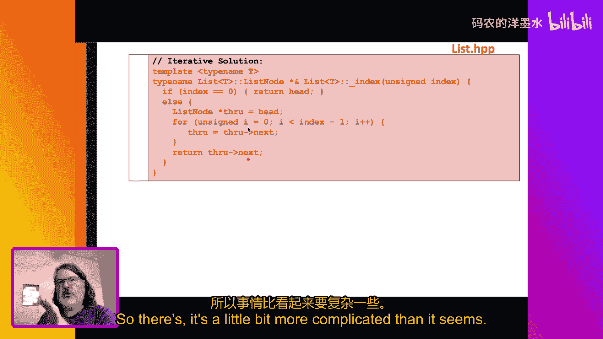

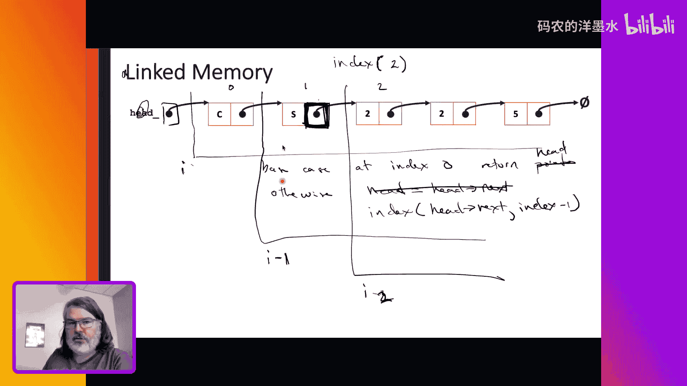

So right here is the recursive version。Who， that's all we've asked。

 All index is supposed to do is return not the pointer， but a reference to the pointer。

So now I'm going to show you why you wanted to do this。

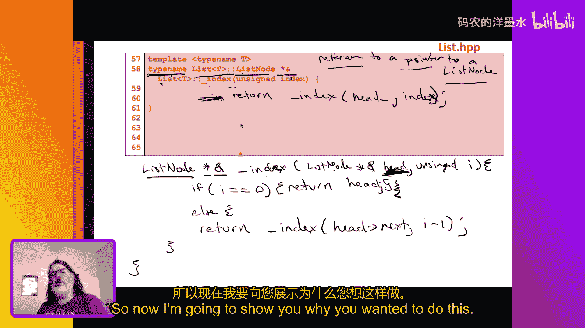

Okay。Let's think about some code。 I want to do insert。Index。Dea。That will insert data at that index。

 okay？So it will insert to the list。 So how do I do that？ Well， just like on head。Right。

 the reference will be a reference to a pointer that is either here or。

One of the node pointers that points to the index we're going to。

 So the first thing we're going to do if we wanted to do insert。2。And we'll insert say act。

So the first thing we need to do just like insert head， right， was create。A list node pointer。

 we're going to have X in it， and it is going to point nowhere。Okay。If I。Call。Index， right？

 So I do index of two。 What do I get。I get this。By reference。So what do I want to do with that？Well。

 what did I do at insertt head。Because if we think of this recursively。

 I am now pretending that index 2 is the head。😡，So I do exactly the same thing I did with Ed。

I point this here。And I point this there。So my code。Other than a call to index。

Is exactly the same as the very simple code。Of insert front。

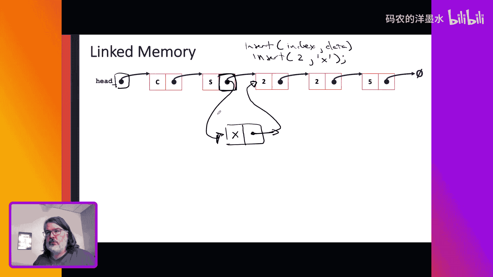

So let's try and write this。

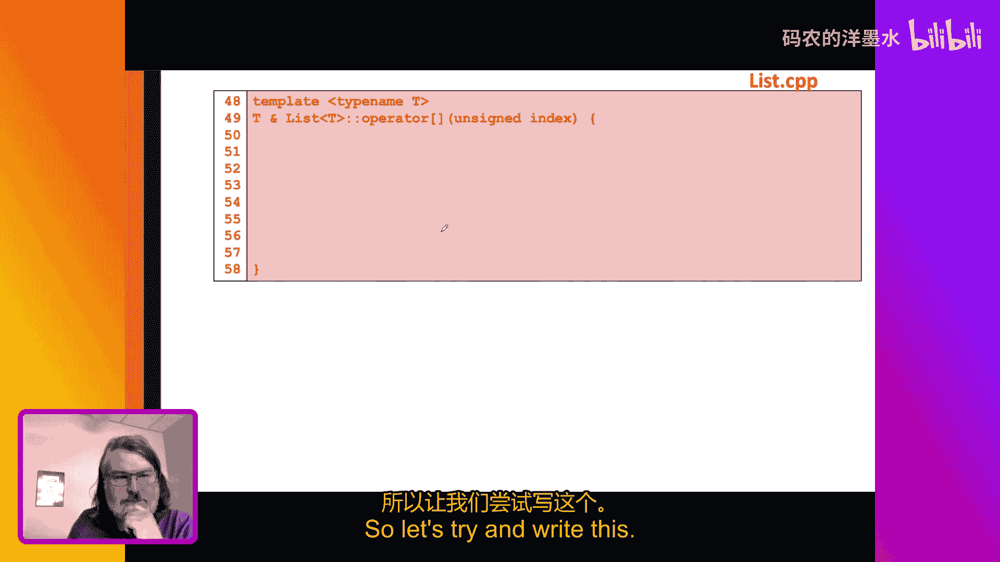

Actually， let's write something so。Let's write something fancier。

It's going to begin in and think through it。I thought I had it。But what if instead。

I want to return it。I thought I was doing the。let's get forward to insert。

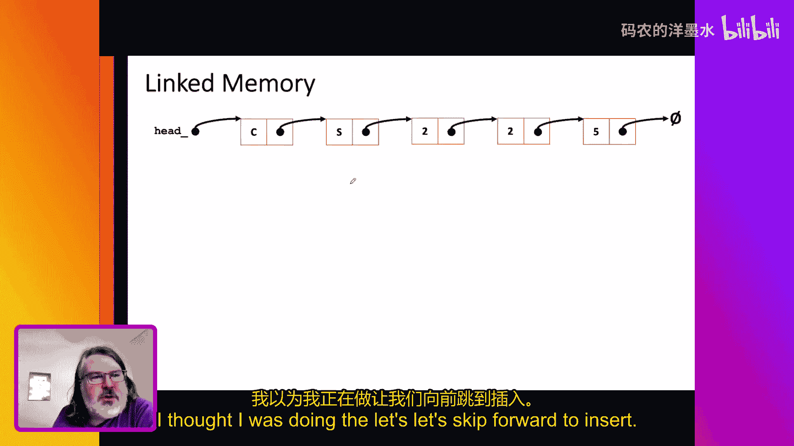

So here's insert， how do we do this？Okay。So first， we want a list node。Pointer。Cap。Okay。Equals new。

List node。Ti。That was our first line。Then， we have list node。Pointer。Head。😔，Is that what I want？

Is that right？And finally， they want。Temp。So。Is that right。

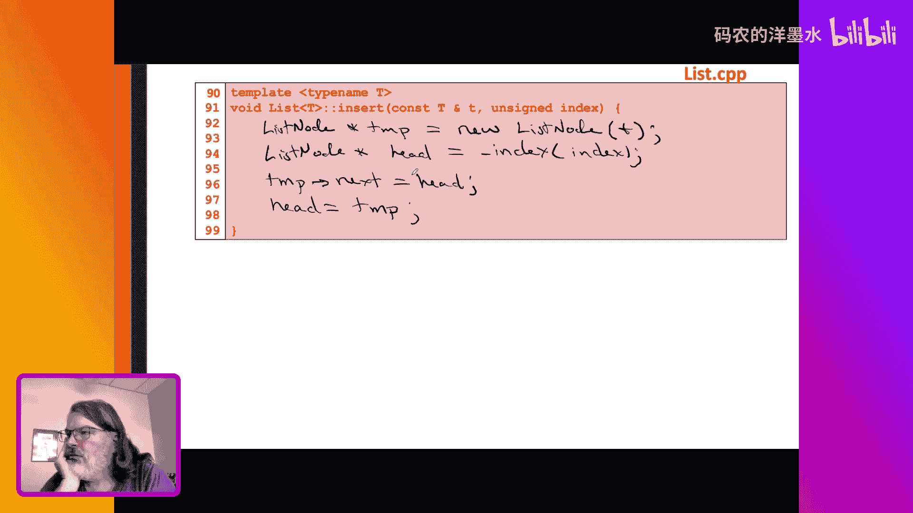

I'm getting the one before it， right？Go back to what I did， I want to insert in spot2， so I want CSX。

Right the。The pointer I return is the pointer。 This is the pointer I would return。If I point it to。

So I I will end up with CSx225 right， I inserted in the second position， zeroth1，2。

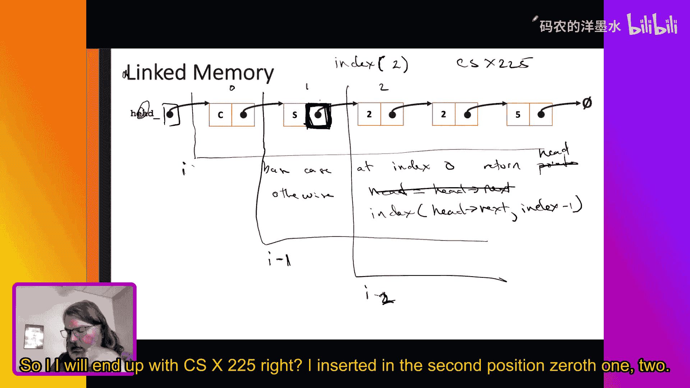

So I think that's not a problem。But is there something wrong with what I did。Yeah。

What's the difference between this？What is the difference between having that ampersand and not？

Index is returning a reference， and the other one would making a new one。

 and we would not modify the list without that ampersand instead of having it go。

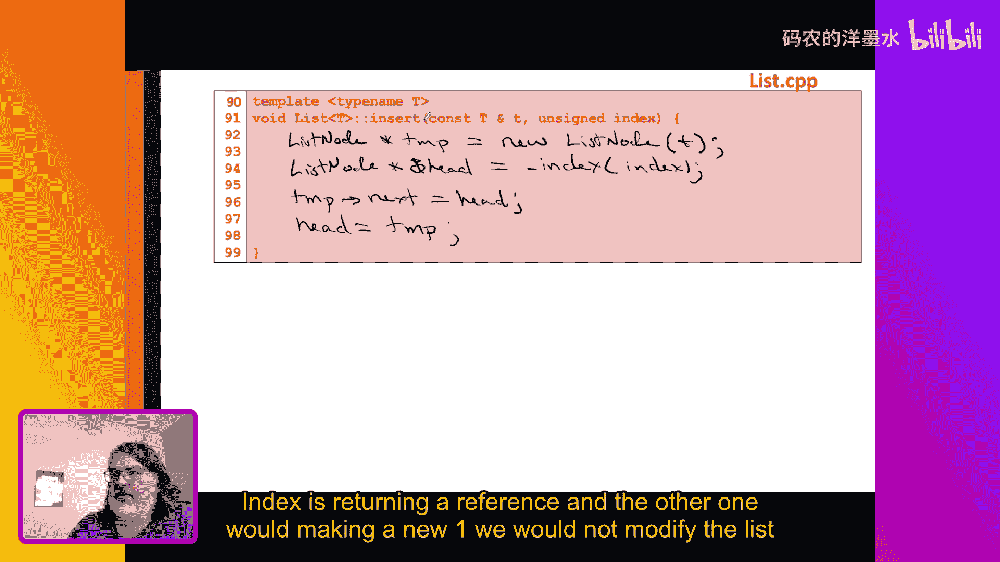

啊。We would end up with this。And then， we would do nothing。Right。

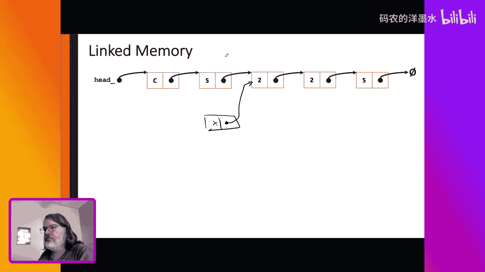

We need a reference to a pointer， not a pointer， and that's it。

There's a ton of stuff going on in this code。It's only four lines。But it is super dense code。

It does a lot。And on Friday， we will go over this some more。But that's what I have for you today。

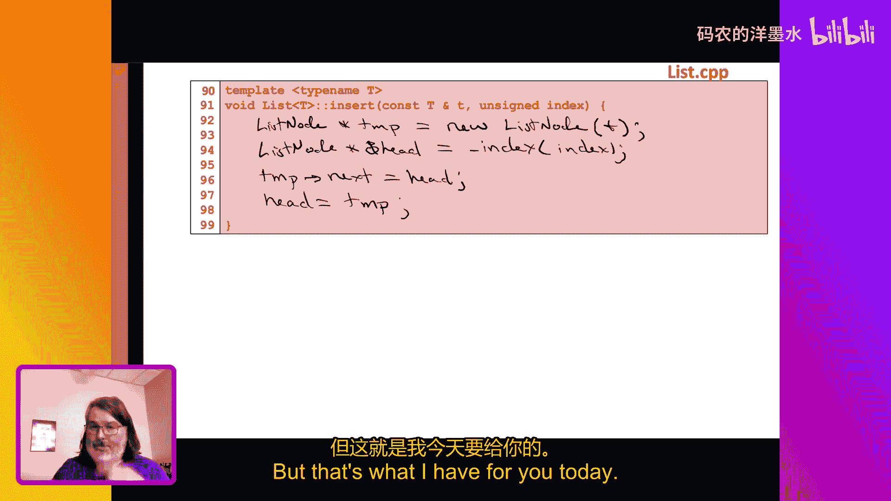