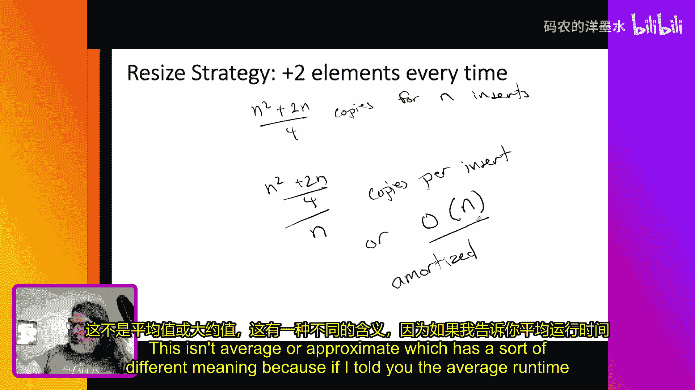
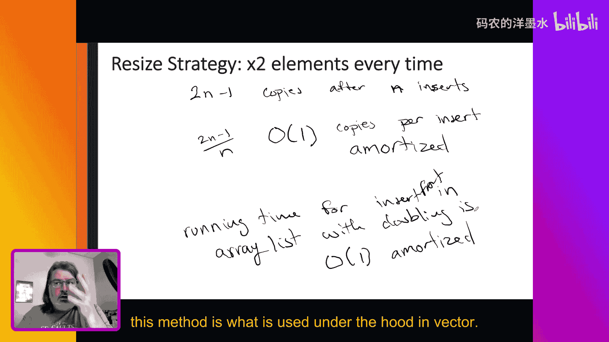
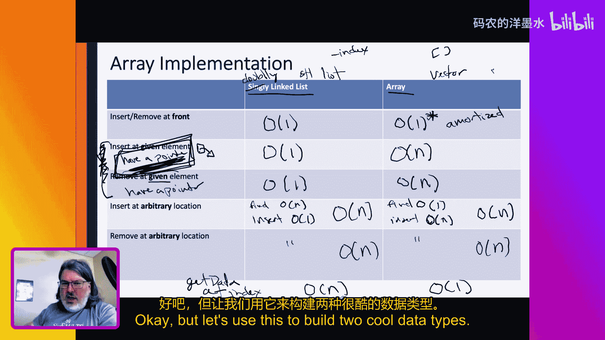
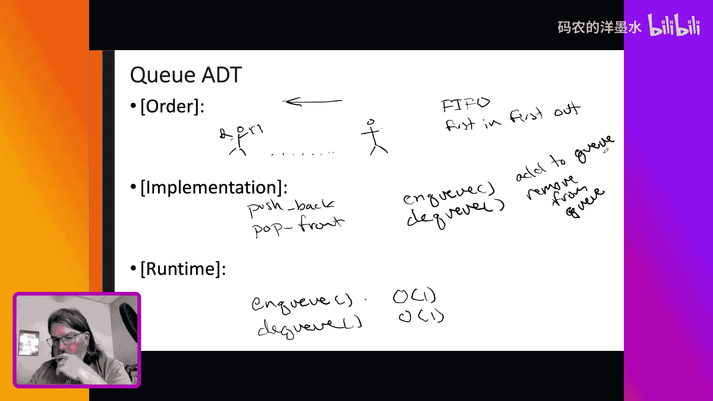
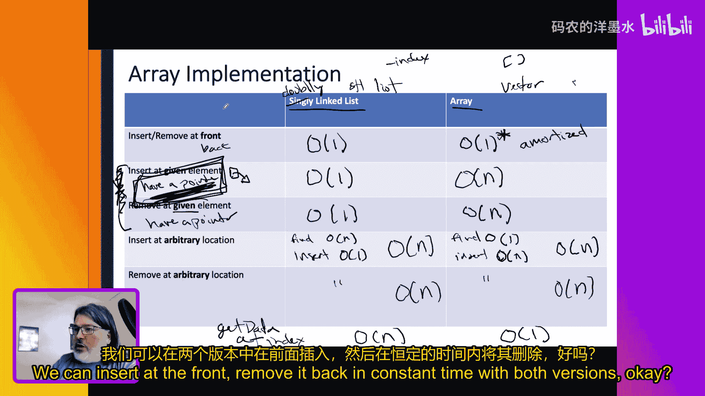
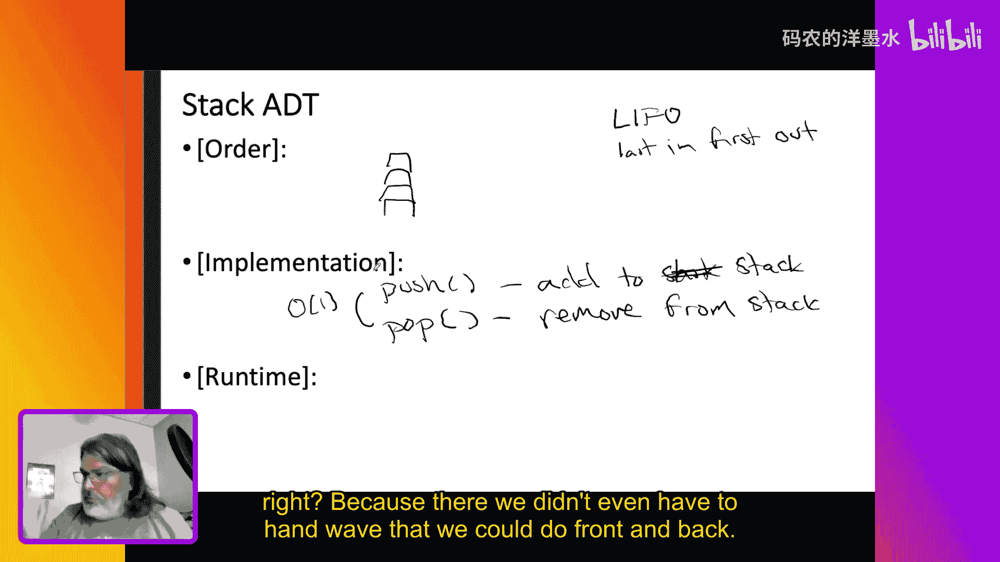
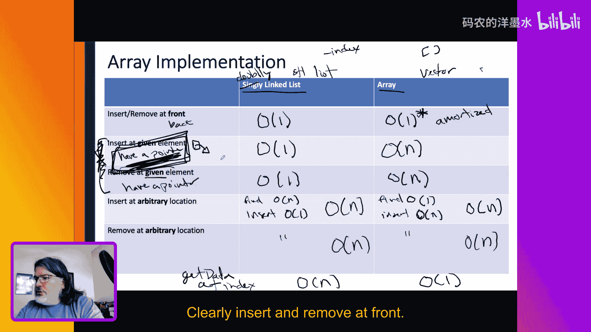
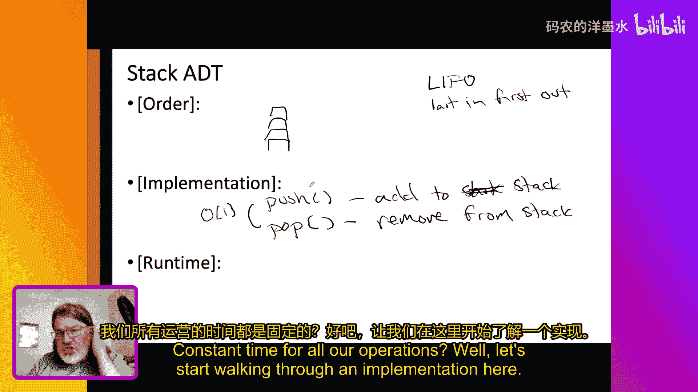
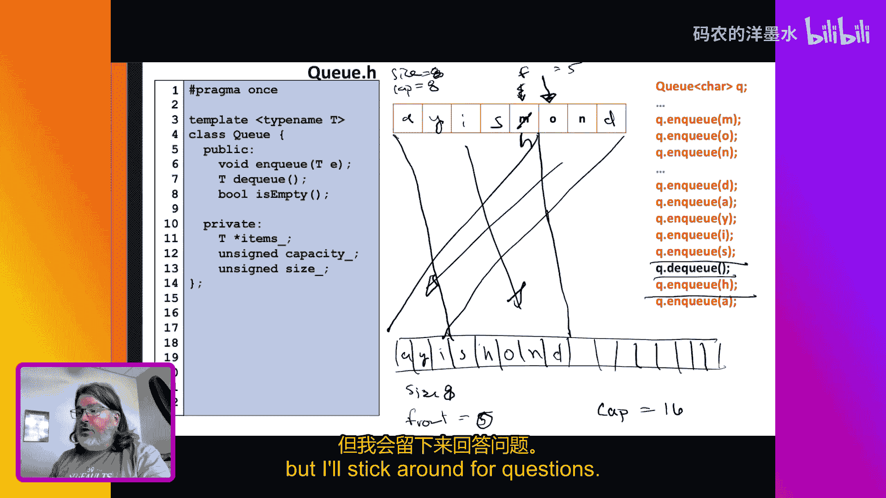

# 【全集】伊利诺伊大学 数据结构与算法 中英字幕 1080P p11 Lecture 11 - 扩容策略 -BV1t9FHzdEYL_p11-

day of the exam。Okay， so MP stickers is due today， but let's cover some material。

So we were talking about the array implementation of。Ls， right？

 And we had specifically gone on to resize strategy， and we had implemented。

 we had gone through the analysis of a resize strategy of， if we're full。What do we do if we're full。

 we will always copy to a new array and extend the size by two。😡。

Right and we went through this by analyzing that in each round， how many copies had， and etc ce。

 and we ended up with that at the end this has n squared plus 2 n。Over four copies。After。And inserts。

And I'm not going to cover the。The details of that again， you can rewatch from Friday。

And then we also said that then we could generate a because we don't really want the total number of copies。

 we want the number of copies per insert。Right， and we said if there were n squared plus。Qiuan。

All over four copies total。For。And inserts。We could say。N squared plus 2 n over 4， divided by n。

Copyies。P。Insert。W。Big O of N。So if we choose a retriide strategy。Of。嗯。In。Of inserting to each time。

It。Costs and time。 So that means insert it back or insert it F is got a running time of N amortized。

So what do we mean by amortized， this is the first news piece that I'm covering today。

Because I didn't talk about it， I used the idea。Amorize says that instead of guaranteeing that the run time of every step takes a certain amount of time。

 we are going to say that across end steps， it takes。The amortize time， times and steps。

So this is a precise measurement， this isn't average or approximate。

 which has a sort of different meaning because if I told you that average runtime was7。

 certainly over a large enough steps that would right if the average runtime was N over a large enough steps set of steps。

 we'd get n but amortized says after n steps we have n squared time。

 so it's a precise lower bound not a approximation。

But it doesn't say what an individual step takes。Okay。So let's try our other strategy。

 the other resize strategy we had was doubling。So， in this case。If we run out of space and need more。

 we will double， so at the first time we will make one copy， make the array from one to two。

The next time we will make two copies， make the array from two to4。Then we will need four copies。

And make the array to eight and eight copies， right？So again。

We're going to do this analysis by thinking of the rounds first。And so in this case。

 we are going to number the rounds starting at zero。So the zero th， we make one copy。Then two。

 then four， and then eight。So。What is an expression that covers this。Y to the。R not N， right。

 because it's in rounds。0，1，2，3。 So yes， two to the R。 I like that。 but， you know。

 we're two to the rounds。We'll go over amized again when we see it in this analysis so okay。

2 co to the R copies per round。 So again， we have our summation from K equals0 to。Our。Of。2 to the K。

Right。So once again， we get a large thing and we pull out our handy dandy knowledge and remember that this will be 2 times 2 to the R minus1。

Plus one。Okay， this looks much worse， doesn't it？It looks terrible。 We we had。

 we had a squared this time， and we have an exponential。

We had a squared last time and we have an exponential list time。But again。

 we want to think of this in terms of copies per N。 and I see someone has jumped ahead。

 and we can say that what。At a around， right， if we have done n things， we are what？

2 to the R is equal to n。So。And all right， so R equals。Log in。

And we plug this in and we manage to get down to2 to the n minus1。Total。Copy。If we plug in。

 log in and simplify。Two times 2 to the。Log n minus1 plus one。2 to the end。Total copies for。

And inserts。Okay。LN in classical math is specifically log based E， and this will be log 2。

 though you'll find that CS people are really sloppy and will write any log they want。To。Ming。Okay。

So carrying this over， what do we got， We have2 to the n minus-1 copies。At after。And insert。

And we want to。Change this。To again， be copies per insert。And。

Do we have a precise number of copies per insert？ Well， on the first insert， we did one copy。

On the second insert， we did two copies，3 total。 That's is looking bad。 On the third insert。

 we did zero copies。On the fourth insert we did four copies， on the fifth insert， we did zero copies。

 six insert， we did zero copies， seven insert， we did zero copies， eight insert， we did eight copies。

Well， our list， right， has things in it， if I did see。And then I copy C down， and I do S。

 and I copy C S down， and then I do2。And then I do2， and then I copy CS22。That I do  five。

 So I've now inserted five times， right。The round is each time I have to do a copy， the insert is。😡。

Whenever I put something in the list， right， I'm adding to the back and I do 22，5 x。

 I've done another insert， but I have not made a copy， right。

 I haven't had to allocate a new buffer and make a copy。 So okay。So two minus one inserts。After in。

Inserts。Okay。So。If I divide by n， I get 2 to the n -1 all over n is big O of one。Copies。Per。Insert。

Haort。Right。That's pretty huge。Because。So what is amortized， Amortized is saying that。

For any individual copy， we do in expectation。That time。

 So you can think of it from a sort of probabilistic standpoint。

 but it's not quite that because it also says that。If we did end copies。

We did the amortized cost times n explicitly， whereas as probabilistic says in expectation。

 we do that， but the actual number can vary。What all that varies in amortized is on the first insert。

 so insert one。One， we could do zero copies。Then insert two。One copy。Insert3。Zero copies。Right。

 insert。4。Zero copies。Insert。5， we do。4 copies。Insert6， we do zero，  seven， we do0，8， we do zero。9。

 we do 8。So every insert can have a very different and after insert。嗯。17。

 we're going to do 16 copies， right to be able to do insertt 17。

So the time it takes to run and the individual step varies greatly。😡，We did。Right， we have list。

Push back。C。Yes。Insert 3，1，2，3 is zero。 yes， three should be two copies， You're right。Or no，3。 Yeah。

3 should be two copies。Because we had to allocate a new array。

A copy is so we have an array of size one。We can fit one thing in it。

 but you try and put the second thing in it。 We allocate a new array and copy the old array to the new array。

Right。Then when it fills up， we allocate a new array that is twice as large and copy the old array to the new array。

So the copies are copying from the old to the new。Right to insert this five。

 I had to copy my old array of four things。Into my new array of eight things and then insert the five。

Okay。Okay。So if we do doubling， this is pretty efficient， right。

 because our best running time for insert。Is constant， and we are adding constant overhead。So。

 running time。For insert。In array。Lists。With doubling。Is。Or insert front。Let's say。Amortized。Okay。

So that's pretty cool。We can have this contiguous array。And we can just keep inserting to it。

 and we have now a dynamic array， right instead of having an array be a fixed size。

 which is what we can do with new， we have a dynamic array。 and in fact。

 this method is what is used under the hood in vector。

Okay。So。Let's compare our two implementations。 We have a singlely linked list and we have an array list。

Right？So if we use a singlely linked list。Well， let's walk through all of it。

 if we use a singlely linked list， insert or remove at the front。 It's easy， right。

 you just muck with a little pointer you it was head T equals new node， T equals head head equals T。

 we're done， right。😡，Order 1， there was a fixed set of instructions In sort remove at front with the array。

Again， let's see。 We just showed that memory allocation we can deal with so we get again01。

 but we have a star here， right and the star here is that we are amortized。Okay。

Insert at a given element well。Let's be clear what we mean by given。Have。A pointer。So right。

 when we did insert。With index， remember how he wrote that function。Inex。That returned a pointer。

Okay， let's talk about the amortized again because we should get this down。It's。

 I don't know the runtime for a single operation。But I know precisely the run time for n operations with average。

 I don't know this run time for a single operation， but I haven't a guess at it。

 And for a large number， my guess becomes better。But in amortized。I know that if I do N operations。

From the start， it will take exactly n times the amortized run time or less。I get a precise bound。

Okay。Okay， inserted a given element。So。We have order N with a singly linked list。

 right if you've got a pointer that you can muck with。That points to the right place。I can。Think of。

Constant。If I've already got index。If I already have index。

If I went back and looked at my linked list code after I called index， what did I do， I went index。

No temp equals new node。New node equals indexd next。Or sorry new node equals。Index。Oh sorry。

 new node next equals index count。I cannot say these things I can write them New node next equals index。

Index equals new node。It looks like constant to me， I do three operations。Yes。

 but I'm saying we already have that pointer。You're absolutely right， the runtime of index is N。

If I give you a pointer into the list。You don't have to， well。

 because it turns out in many applications， this happens that you will have a pointer into the list。

 so it's constant time。Okay。Now， with an array， we don't have to find the location。

 but what's the run time to insert in the middle？We can play the amortized trick for allocating new memory if necessary。

But is that enough？Yeah， I think it's order in why。What is making an order in？Right。😡，With a。嗯。

With the case of a。Aray， I have to have contiguous memory。

 so you could always be getting something in the middle。

 So I will all right with the front and the back， I could just do it。

But I'm going to have to shift something， so order in。

And I don't need to amortize because the end subsumes that。Okay。Remove it a given element。 So again。

 when we say given， we mean have pointer。With a linked list。We again， get constant。And with remove。

 I now have a hole。And I have to shift the elements again。So order in。So in this funny case。

 a linked list has an advantage that if I'm going to have pointers into my linked list。😡。

My linked list can be in this special case。Which does come up？

What about insert at an arbitrary location？No， and we'll go over the details that of how we can do it。

 but the simple one was imagine that we were inserting at the front， we fill our array backwards。

So yeah， so this is order n and it's because it has to do two things。

 it has to do find which takes order n time and insert。😡，Takes constant time。So total is order and。

Right。And with。A array we can do find how quickly， Well， we can do find。In what time。

 how do I find the fourth element in an array？😡，How much time does that take？Constant， right。

 it's just， you know， square bracket。But we already knew that insert even with the pointer。

 so insert。Is。In。So， order in。Okay。So。Same。Thing applies here。And this version of the chart。Ms。

The linked list looked really good， right？But if we want one last operation。If we want get。Daide。At。

We want to get the data at a location index。Well， that's fine， so here it is order N。

And here it is order one。Right。So which is better？Well。😮，Depends。That。

Having contiguous memory is really nice。But the running time for insert front。

Depends on amortization， which could be a problem。But。The linked list， it's more constants。What。

How often do you have a pointer into the middle of the list？

 So is this special case important to you or not。I don't know。Vectctor is this。STL list。Is that。Well。

Doubly。The vector is a array list。Okay。So this is pretty cool。We have some nice data structure here。

Um。That is why we suggested it。It was not an attempt to trick you to suggest using vector。嗯。

Inserted a given element assumes you have a pointer to that element or a pointer to the pointer to that element。

You don't have to find it。Insert at an arbitrary location， or insert at an index。

It ends up that there are so the suggestion is if you have the data nicely sorted and you want to just access it an array is ideal。

 that's certainly true that if your data is all organized from the data structures we've seen。

 the array provides the best access if your only operation or your dominant operation is going to be to access data rather than to increase or shrink an array is clearly a wonderful data structure。

A linked list is。More capable of handling dynamicynamism in contexts that an array cannot。

 which is why in operating systems it gets used down in the guts。 Well。

 you might think runtime matters the fact that insert and remove at front are constant is really important。

 because I have possibly a fixed amount of time before I have to handle some piece of hardware。

Where it's amortized。Across the long run time is fine。

 but if I have to get that packet off the network and I'm waiting as I'm doubling my array。

 that might take too much time。The other issue is that a linked list。

Can cope with memory That is not contiguous。If I want an array a certain size。

 I have to have that much contiguous memory， and that again。

 is not always possible in an operating system context， but as a user in general。

 an array is going to an array based solution is going to be better。For most cases。

You would then get into questions of cash， which on modern hardware is really important and you will see when you do 241。

 240 or ECE 391， you will get some talk about how caching works。

But what we want to do still today is talk about two really cool data structures。

An array is just a chunk of memory。 A vector has methods on it。And does things for you。

A vector is an array implementation of the list。Abstract data type。

Hash on the MP is a hash function that tries to summarize a larger data structure。Right。

 a vector is dynamic and resizable an array。Well， it's not immutable， but it is a fixed size。

Imutable would mean you couldn't change the contents either。Yes， at this point。

 you probably never should use an array unless you are declaring a fixed size array。😡，Okay。

But let's use this to build two cool data types。First， we have the Q。What is a cu？It is。

Like when waiting to get your COVID test， here you are at the front， you get your little tube。

And you're here。Going， yay， I get to spit in the tube and I have a funnel or a straw。

 we can't tell at the moment。You have the queue and office hours and I'm at the front。

 but perhaps you're back here。Someone else comes up to the queue and they have to wait for everybody。

So it is PIO。People talk about。Or first。In first。Out。Okay。How is it implemented？Well。

We can implement it。Is。Has what it has pushback。Pop front。Which are usually called N Q。And Dq。

And what's the running time for these going to be Well， if we use an array。Constant。

If we use a linked list， constant。Constant time。N Q and D Q。Awesome。😊。

We now have a data structure where all of the operations you can do on it are constant time。😡。

Add to Q。Remove。From you。So， NQ is to。Add to the queue。Decu is to remove。And that's it。

Well， let's see Iner remove at front， Const。Insert， remove it back。Is also constant。

It's not an arbitrary location。It is a very specified location。We can insert at the front。

 remove it back in constant time with both versions， okay。

All constant。What about。Our next one， the stack。 We've been using a stack everywhere。

 What's its order， well。Boxes and boxes and boxes and boxes， and you handle the top， right？

So it is instead of PIO。Abstract data type is ADT。LO。Last asked in。First out。

And we've been using this a lot。Right？We use this all the time。 Anytime you make a function call。

 it's actually using this data structure。What are the pieces we have P。Add to。Stnack。Pop。Remove。

And this is much clearer， right？The stack。Is clearly。Constant time for both of them。

Right， because there we didn't even have to hand wave that we could do front and back。Clearly。

 insert and remove at front。

It works。So we now have two data structures。That are。Constant time for all of their operations。

Constant time for all their operations。 Well， let's start walking through an implementation here。

So。If I showed you this Q header file。What can you tell me about it。What type of implementation is？

This。Of the queue。It's using an array list， so an array or an array。Aray list。List。

And how is the data stored？Here's our key thing is。In an array。Pointed to。Let's say at。Items。Right？

It is templated。So we have these Ts。Right。And then we have two more variables。😡，嗯。

This particular implementation of Q。So not the Q abstract idea。

 This particular cu is being written using a C style array。 And I want to do this， in part。

 to defend。How this kind of manipulation works。So。If I was using a C style array。

 a actual array to C plus plus array as opposed to a vector。How do I make this work because？

With the stack right there。T， star。Items。Is how we have defined that it's an array。Right。

 with an array， we would do。Something like equals you。Tii。Fitian。Make our space for 10。Okay。

But let's try and use it and then we have capacity， which is max space。And size， which is currently。

Number。Yinq。Okay。So。What I've got here is this chunk of memory that is items。

And I want to try and work through the details of how to actually use this。😡。

To show you that my argument that you can do this in constant time and still use all the space works。

So， let's see。So at the beginning， we're going to start out with capacity is0，1，2，3，4， sorry。One。

 two， three， four， five， six， seven，8 eight， right？And our size is zero。And this is items。Right。

Everybody happy with how the data structures started initialized。

 We've just run our default constructor， and we have created。This chunk。嗯。So let's start in queuing。

 So the first thing we want to do。 and we're going to assume the queue runs this way。

 So this is front。And back。The first thing we're going to do is in Q3。Okay。Well。

 I'm going to put that in the front， right？The queue can resize using the exact same resizing when it is full。

 we will resize it。 We'll talk about that。So we do in Q3。And then size goes up by one。Right。e。

How did I figure out where to put that So in queue right looks like it is going to have how where do I in queue。

 I appear to be inqueing at。😡，Items。Square bracket。Size。Everyone happy with that so far。

And then we increase size。 So this is my expression for where to in queue。So far。

 I'm not sure this is the whole expression。But we do in Q 8， then we in Q4。Okay。And then we DQ。

So in Q4， we are now size is3。And now I want a Dque。 Well， I Dque at the front， right？

So I remove three。In return it。So this is in queue。At。Dq。😔，so far， this is okay。Then I incuate 7。

 well， size is now2。It size doesn't seem to work。I better revise my in queue。Let's see。

 So what is the expression of where I should put 7， We have。Size。We're going to bigger up here。

 size equals。At the moment，2， capacity， and I'm going to write this short， just to make it fit。

 is still 8。嗯。嗯。Items plus size。What's items。I did not move the elements over because if I did that。

 I wouldn't have constant running time， would I？Capacity plus size。I think I need one more variable。

😡，I could， but if I move items over， that's going to cost a bunch of stuff。

When you DQ you return the element or you don't， it depends。In our case。

 our DQ would be returning three， so this is returnsturn 3。But I think I need a front。

 so I'm going to have， again， unsigned。Front。So we Dque at front。And then increase it。

So we now have front。So now I have three variables。Start front I like front， so front is now at one。

So where do I in queue is now should be items。Front。Plus， size。Okay， that seems to work， right？

We decrease cap whenever we Dque， we move front whenever we deque。

 we increase or we don't decrease cap cap， we just keep。Cap is not changing。

 We decrease size whenever we deque。We oh， you want to decrease cap。 I'm not going to decrease cap。

 We'll figure out why。So okay， then I in Q 7。 So 7 is going to go at 3，0，1，2，3。

 so that goes where it should。DQ boom， boom， so that's taken size is now one front is now three。

I did the two D cus， right， so chunk chunk， chunk， we're down to here。 So now I in Q 2。Wen。Wen。3。5。

It's the memory allocations there。We can only increase by one small。

 so let's see now at this point we are at five， oh no， we filled up。

 we don't know where to put the next thing。But we Dq。Okay， so there's now four things in。

 so our size is four。 our front is 0，1，2，3。Oh， sorry is。Is 4。We have four things in。

 and our front is it for。So far it works， but now we're going to N Q 9。は。How do we N Q 9？Modullo。

 yeah， we want to do instead of front plus size， we have a new expression， which is items。Fronance。

Plus， size。Magelo campt。So we in Q9 here。Does。Front work。 Well， so then front。Is whenever we insert。

 we insert it front。Increase front modo。Size we have a circular buffer。 Yeah。

 this is a really useful tool。Okay。So。We have this expression， and we have front。

Is also going to be modo。 So we're going to keep front ends。 Well， if I have more than8 things。

 I'm going to have a problem。 So let's look at that question。So。Now， we have ined some stuff。

 This is front。Size is three。Right？And。Capacity is eight。Okay。So we do MON D， we got the ramp。A one。

I F。DQ we're still okay。H。Okay， so now we are down to here。 right。

 These were all using the same thing。 The Dq we saw H we saw。 So where are we at。 Our capacity is 8。

 Our size is。eight。And front is now pointing here。So， 0，1，2，3，4。So now we need to get bigger。Well。

 we know what to do， right， we're going to allocate a new buffer。This is going to have 16。

Right and then we copy it， right？So we change capacity。Will equal 16。Fron。Equals5 and size equals。9。

Let's see， So we do AY， I S。H。O and D， when we copy our size is 8， I guess。 and now we do our insert。

Yeah， so this copy method isn't going to work。 we， we do need a copy。And they were exactly right。

 We want to change the front to 0 and copy it。 So we want to copy。This to here。And this chunk。There。

And then we want size to be eight and front to be zero， and we're all done。

So we copy from the front until it's all into the new one。

 and so we want afterture we reallocate front to be back to zero。😡，And I have shown you。How to get。

Both a circular queue working and how to get constant time amortized with。啊。Insert from。

After the copy， you're going to set front to0 and you're going to copy for you're going to copy as if you were decoqueing。

 right， So you will copy。Going through。 And then。Copy it down。

So you do the eight copies from front rather than from the zeroth index of the array， and yeah。

 it's just a for loop。Shouldn't you want everything after front to be at the end of capacity。

 so you're essentially doing a for loop of DQs， though you probably wouldn't implement it that way。

I'm not sure I understand that I'm going to this ist it for information。

 but I'll stick around for questions。

