# 【全集】伊利诺伊大学 数据结构与算法 中英字幕 1080P p12 Lecture 12 - 迭代器与树的入门 -BV1t9FHzdEYL_p12-

Start the material for today。So today we're going to cover。Iterators。And then， trees， so。

It's showed up。Has it。I don't see it yet。On the other hand， it's hard to say it's also why the great。

 I'm glad it's there for your machine， It's not on mine the the lab so。

 but they are re released today。So what are iterators？

Itterators are a really important concept in C++。嗯。That helps us access a data set。

So suppose we want to look through every element of our data structure and here we have a array。

A linked list。And a hypercube。So。How would we access all of the elements， right？

 We want to go through。 We want to access all of them。One at a time。In some order。Right。

So let's think about how we would go about this。And the idea of an iterator is to provide you one interface to let you do things like this。

So you don't have to know the different ways to access them。Because， otherwise。

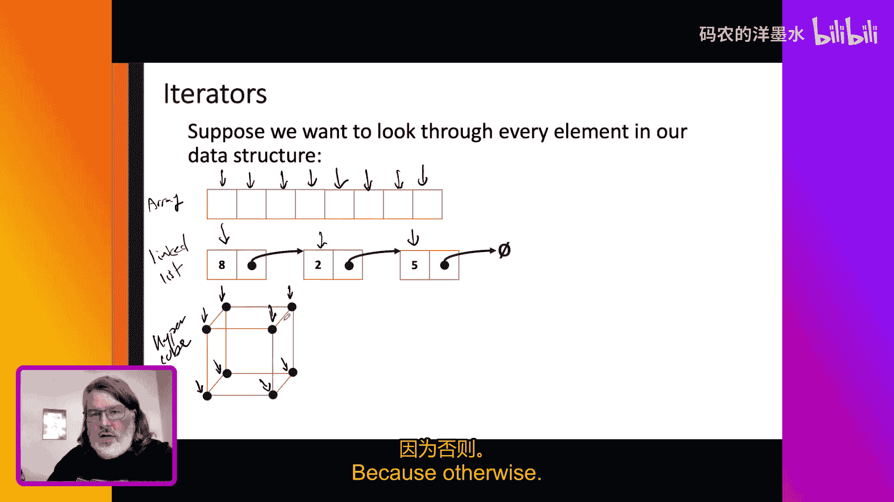

How do I get the location in a linked list， right？ We have a list node。Pointer is our data。

And we'll call it something like the current data will be cur。Right。

So it is a pointer to a list node， we have cur here。Our current location in then would be cur arrows。

 data。Right， to access the data。Let's make that a little bit more readable。Arrows， data。

Right to access the data element of。P。So in index to access this element， we would have index。

 which is presumably a size T。Or a unsigned。Right。And to access the data， we would have data。

Square brackets index。Right。Yeah， the slides also are lagging， and I apologize。

And to access our hyperCbe。Current location， we're going to call it as something like X， Y， Z。

So how are you going to access it， I don't know。 we're going to do data。X。Why。Z， maybe。Right。

So this is a lot of different things you need to know。 How do we find。Next， if we have current。

If we have current， how do we find next in our link list？What would be。The operation。Knects。

 that sounds good。Cur equals。Ker。Next。Right？Yeah。And， you know。

 whether we had next underlined or not and some of this stuff。Sure。

 probably cur should have been underlined。 Next should have been underlined， et cetera。

What about with an array， how do we get to the next one？Next element in our array。Yeah， plus， plus。

 So something like index。Plus， plus。How do we get to the next element if we are looking at。X， Y。

 Z in our hypercube。Oh， you can。But there's lots of different questions and it's not obvious， right？

That。Hard， let's say， because I'm not going to worry about it because。Well， I mean， there is next。

 Let's say we choose。 This is the order we proceed through our hypercube， right。

There has to be an order that we can do it。And there are ways we could accomplish this。

 but it's ugly， right， the code is complicated。So an iterator says， well。What if I just wanted to。

Did we ever cover what a hypercube is， you should have seen it probably in like 173。

 but a hypercube is a recursive structure that is a point in one dimension and in or it is two hypercubes of dimension might a hypercube of dimension。

Cube。哦。Dimension。0 is a point。A hypercu。HC of。Dimenssion。D is2。

Pyper cubes of D minus-1 connected at each thing。So。Doesn't really matter at this point。

 The point here is not that you can solve it， but that。It would be hard。

 And yet you would like to possibly access。Well， I mean， so it's there is。0，1。2。3。Right。This is0，1，2。

3。4 would be two cubes with every point connected。Again。

 I don't want to go into this because the whole point is as aum。As a programmer。

 I don't really care necessarily。 I just want to get all the data， right。

 I just wanted a way to get all the data points stored in this hyper cubebe out of it， right。

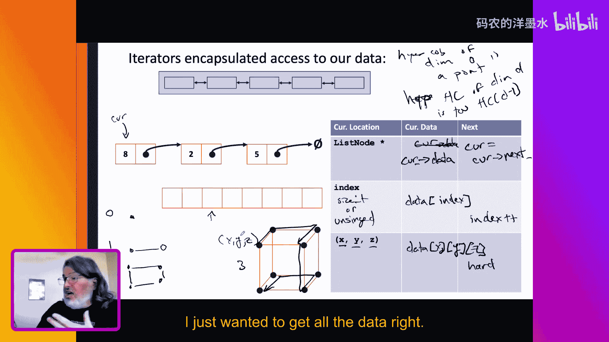

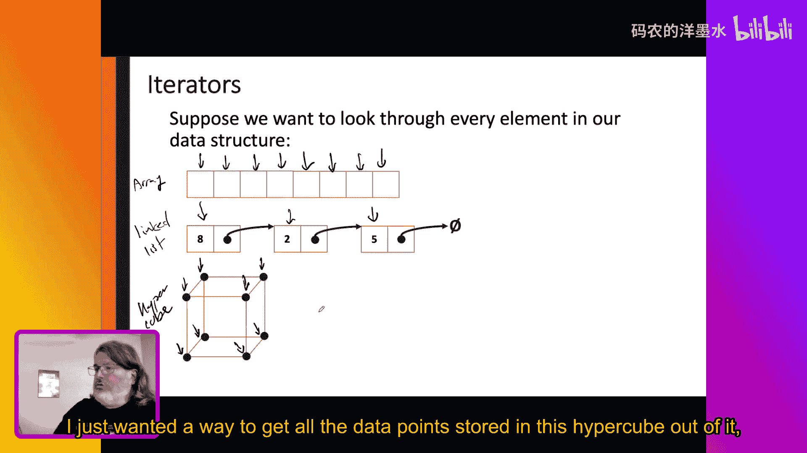

And how do I do it， Well， I don't know。 But an iterator says， let's use the same interface。

No matter what the underlying data structure is to iterate through all the data in my data structure。

Okay。So whatever my data structure is， I'm going to use my iterator interface instead。

So how do we get it？The iterator says， you know， some way of start at the start。

 go to the end and you're done。

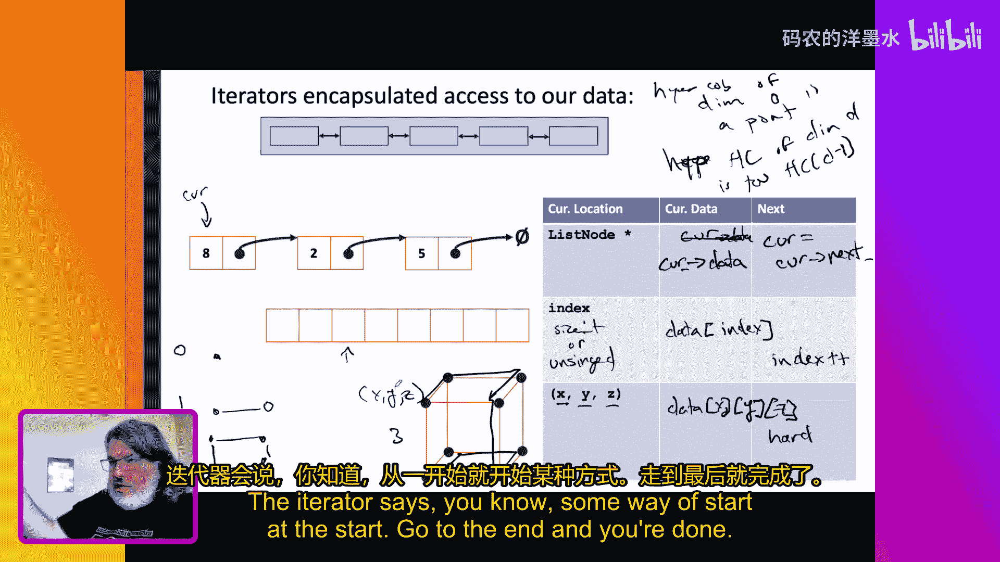

Okay。So let's first talk about what has to be done。That。V。

Class that is providing an iterator interface has to provide two functions。

 it must provide two things。In the class。 So if I am the person who wrote the hypercube class and I want to allow you to use iterator to access it。

 I need to provide two functions。 One is iterator。Begin。Which is going to return。An iterator。2。

The first。Element。In data structure。Right， makes sense。So we give it the beginning。

And the other thing we have to do is。Iterator。End。And this one's a little bit tricky。

 It is going to return。An iterator， I know that was the shocking part， right？To one past。The end。Of。

The data structure。Does each data structure have its own custom iterator absolutely？

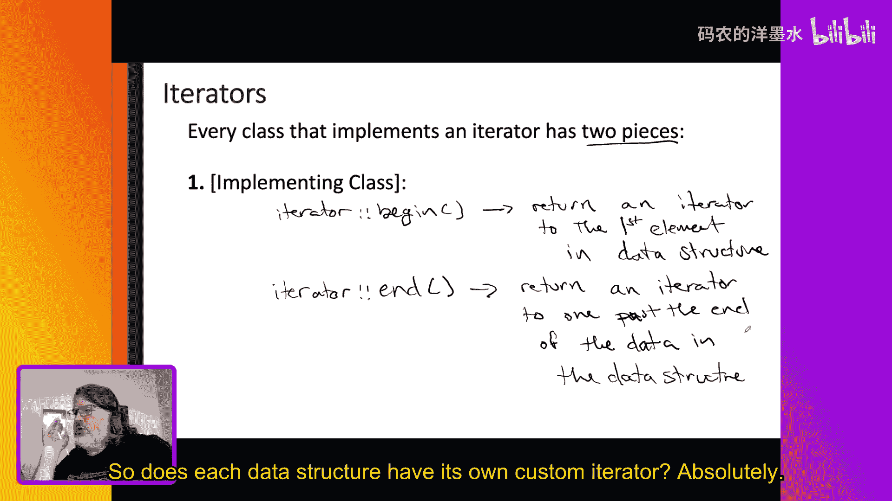

Each data structure has to have its own iterator because that's the whole thing is it's encapsulating how to move a route around a data structure。

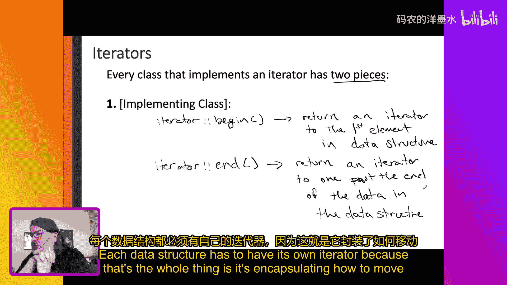

What about how much it is iterated by， We'll get to that。So。

But let's talk about this one past the end。 So what does that mean。Well。If we think of a array。

This will begin， will be here。And end。Will be there。Begin and end。So why。Yeah。

 it's the size of the race。 So it actually makes sense to have end defined there。

How about if we think of a linked list， right？He。m let's do this over。Im going have head pointer。

Begin is right， going to be。Is going to point at the head。And end。Is going to point at null。Yeah。

So the end is how we know how to terminate the recursion， well， if we chose to do it recursively。

 but it would also be how to terminate the loop right if you think of a standard for loop， right？

So if I was writing without an iterator a for loop， I would do something like4。I equals 0 to。

 I is less than size。I plus plus， right？And。That's very similar to what I would end up with is for。

My iterator will talk a little equals begin。I is， as it turns out。Not equal to end。Plus， plus I。Yeah。

So if this is the interface I want to use。😡，How do I， What else do I need。

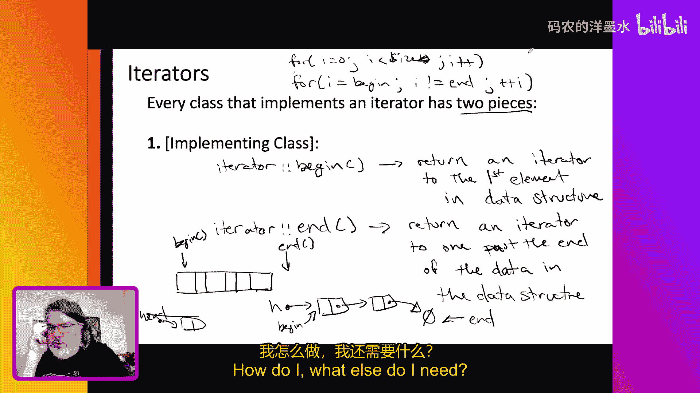

So。Y plus plus I instead of I plus plus because actually， despite the fact that almost everybody。

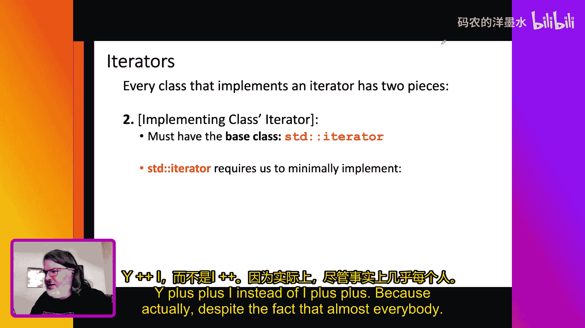

Uses。I plus plus。Plus， plus I is probably what you want more often。So an itertor。So is an iterator？

A pointer， an iterator is。An encapsization。 It's hiding what's internally to it。

 It can be anything whoever writes the iterator decides what they need， right， And if we go back。

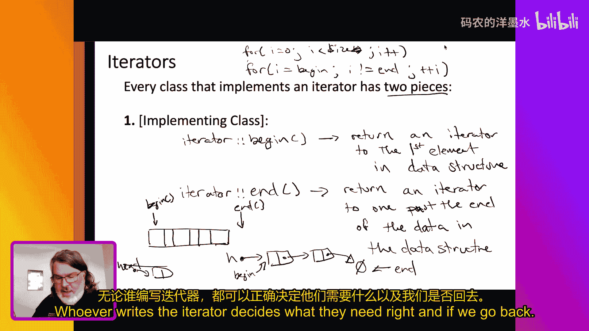

If we go back， we saw that here we had。Here we had a pointer， right。That this is a pointer。

 This is a sized tier or an unsigned。 This is some strange structure。

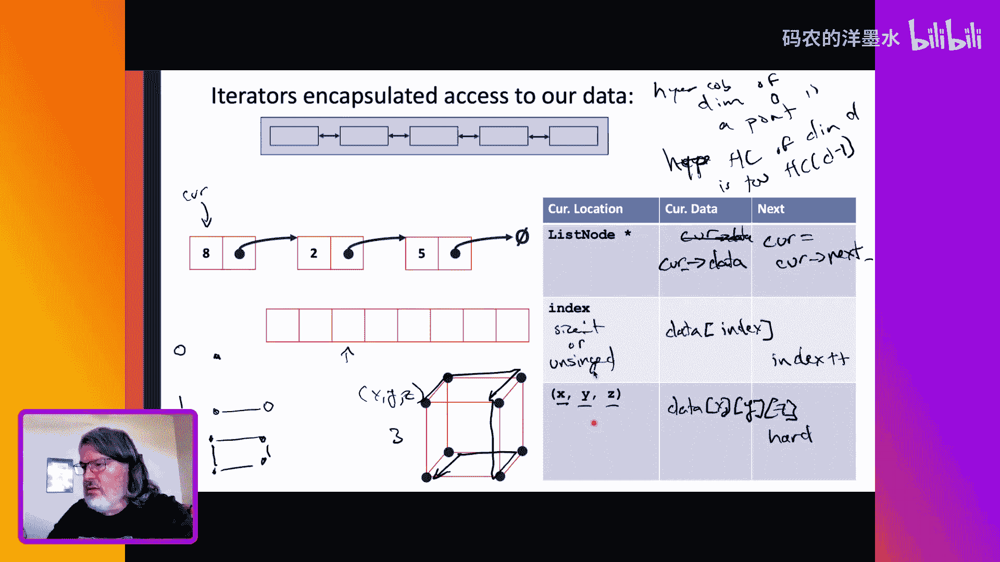

How do I initialize I for the second loop by a call to begin。And a call to end。

So let's work through this。we'll talk more about the。The detail and what。

Whoever wrote the data structure needs to implement an iterator。

Because they're the only one that knows how the data structure works， right？

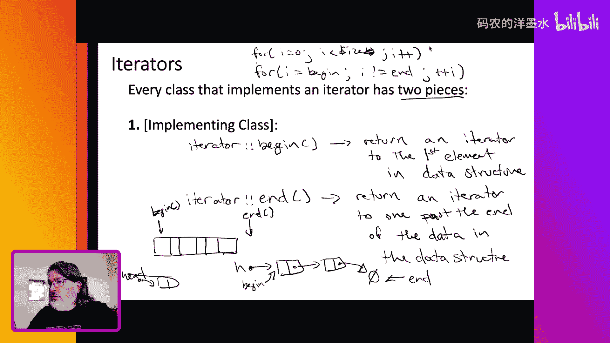

It starts。 well， what is zero of my linked list。Could you tell me what zero is。嗯。Zero is here， right？

Right， so what an iterator does is it hides all of those questions， that's the whole beauty of it。

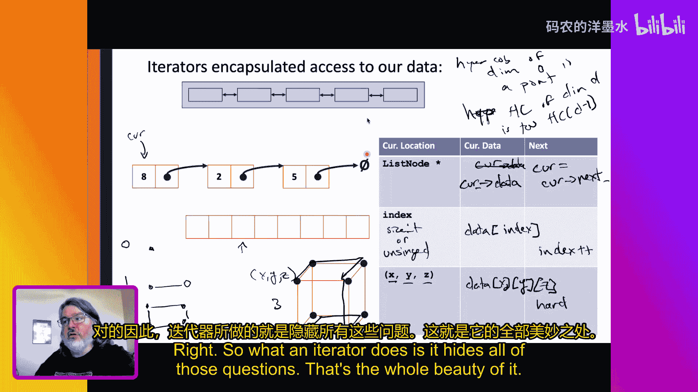

Okay， so it has your data structure provides begin an end。

 which is the start of your data structure and one past the end of your data structure。😡。

Now let's look about what you have to when you wrote your data structure。

 you also had to write the iterator class and what does that look like well。

It comes from standard iterator， and standard iterator is essentially an interface。

 and it requires us to implement three things， well。It has to do operator。Plus， plus。

And specifically， it has to do operator plus plus， which is pre increment。Right so plus plus。

Or plus plus。Iterator。Is the one that is required。Do I have to include a library to implement an iterator。

 no， it's convenient to inherit from standard iterator because that tells the system about its type。

😡，No， because。

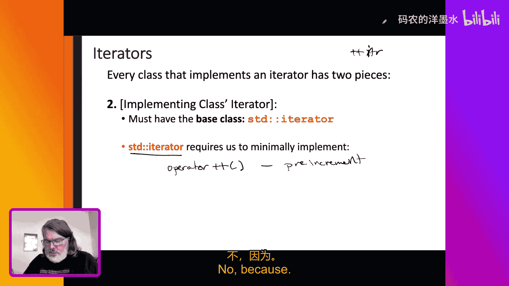

Did I did I in my for loop， did I pre increment before I did anything？

Compilr can't create the default iterator。 You have to create the iterator。

 You don't have an iterator interface unless you write one。

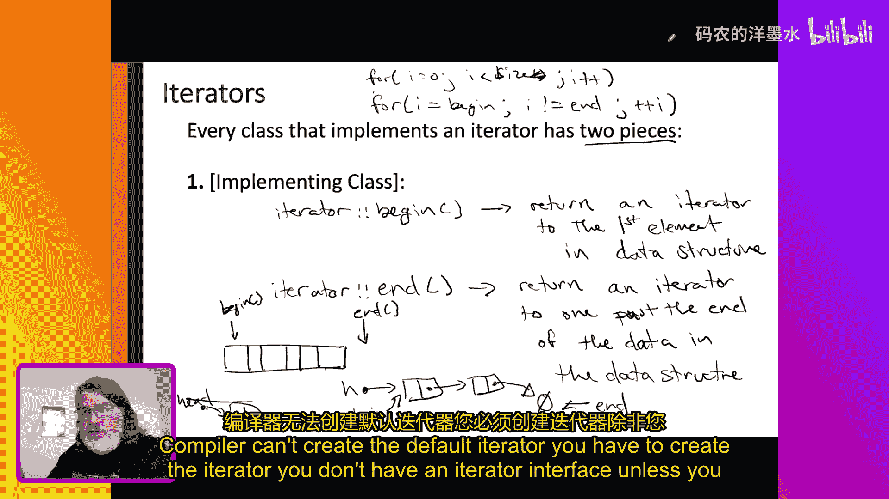

How could it know how your data is organized and how you're supposed to access it？It doesn't。Right。

It's not magical。What type is an iterator， It's an iterator。It can inherit from standard in narrator。

Which will help the compiler in some ways。 Itll do will show you that the compiler will do some cool stuff for。

Is there an iterator in other languages， I don't know。You want to make your tree a dynamic array。

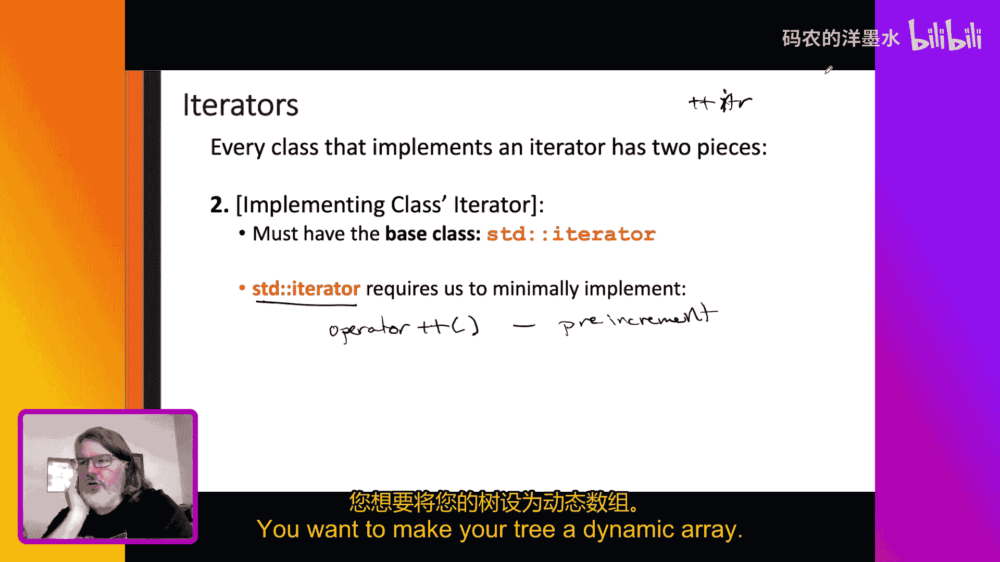

How do I turn my hypercube into a dynamic array？The whole idea of the iterator is I am going that somebody is going to write complicated data structures and they're going to provide a way to access them that is simple。

😡。

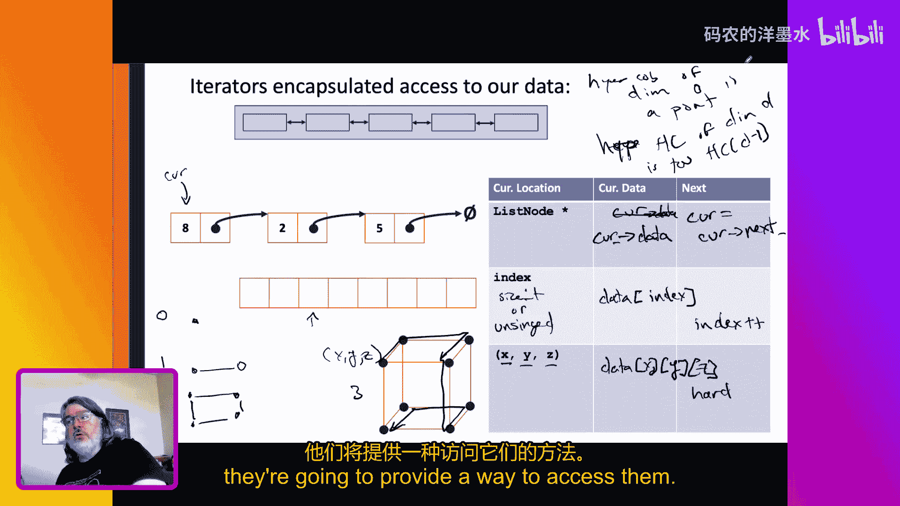

This is the way。 and what we're talking about this now is because you are going to provide them。

In most of the remaining assignments。So operator plus plus what does pre increment mean。

 it means increment the value and return it。There is also post increment。 So right。

 let's talk about this because people tend to write like X plus plus。

But they have a different meaning。So x， So plus plus x is。And。Wen。To back。And return。Okay。ま。

Get an eraser。Really try and avoid this because it's the only thing that I have to do by clicking on a mouse on a thing that doesn't work halflf upon。

Because。So that's plus plus X， which is pre increment。And then。X plus plus is。Save。X。And。1 to x。6。

Return。Saved。X。So for example。Plus， plus x。Is going to print what？Okay。What about if we did。

What is it going to print now？Yeah， it's going to print five， but the value of x is now6。

And there are some really funny times where this is helpful。But。It can be very confusing。

 The one that is required is to increment the iterator and return its value。So。Right。

 so this becomes an issue when it used in line。 When you use it on own its own。

 it doesn't really matter。 technicalnically， it's making the compiler do some extra work because it actually has to write all the code to save a copy of X。

 And then later on， it realize as well， no one needed this。😡，But that's actually extra work。

So it's a good habit since usually you actually mean pre increment。

 that's most often where we use it。 We just really want to increment it by one， and we don't care。

 It is a good habit to get used to doing plus plus I instead of。诶い。Better is a stretch， right。

 It's probably really what you mean。And I've struggled with this because again。

 I also came from a world where you almost always saw the plus plus following。Anyways。

I' don't think there's a clear answer。 And again， the compiler will do almost all this for you。

 but in the case of iterators， we're only required to implement pre increment。

 We could implement post increment。So the pre incrementalcrement operator says。Go to next。Next。Daa。

A woman。Okay。So what else do we have， We have operator。Not equal。Compare。Iterators。

So the only thing that was required was that you say these two things are not equal。

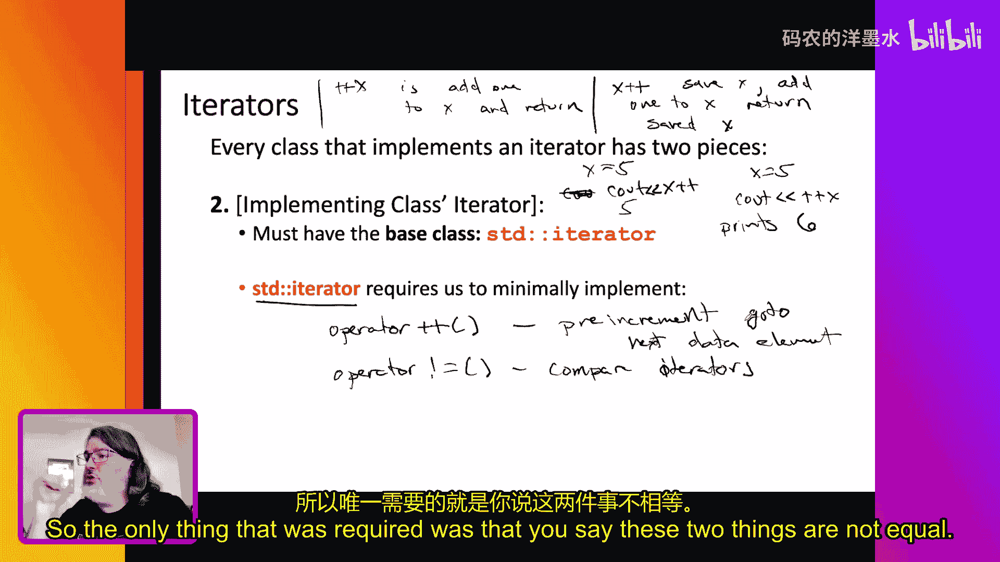

And if we saw how the loop would work， right， where we're checking if we as we keep going through the loop as long as we're not at the end。

 that makes sense。

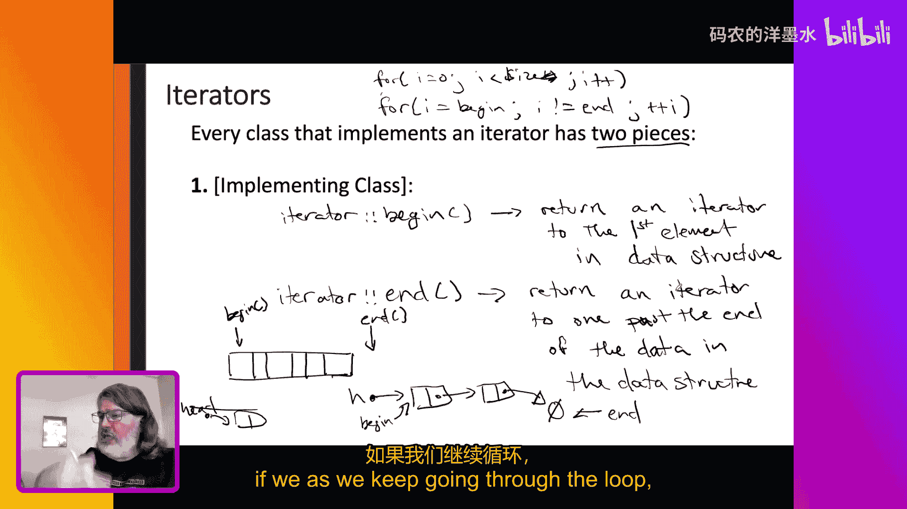

哪里锅。And the last thing we need is。Star。An operator star returns the data。

The compiler will not automatically generate not equal from equal。

It will not automatically generate equal from not equal because there exist data types where not not equal isn't equal。

well， that is the operator pre increment。 You want to see operator post increment。It's really hoy。

There it is。You stick an int in it。It doesn't actually exist。 It's still a unary operator。

And that's what it is。It's just some gibberish they came up with， essentially。Why，hy plus plus。

 I mean， pre increment and post increments both exist。

The only ones you have to implement are these three。Those three are required。No， I'd still see。

 right？C++ is still C， we can write C programs。Okay。So let's think about this。When it says implement。

 that means we have to write the methods that do these things， yes。

 that whoever is implementing a iterator interface must write these methods。😡，Pre increment is plus。

 plus x。Pri。Okay。So if your class has these two and your iterator has these three。

 you have a iterator interface。😡，Okay。It's not required。 This is the minimal piece that's required。

Again。Weve sort of seen it and we'll see a little bit more。It's actually operator int， not size T。

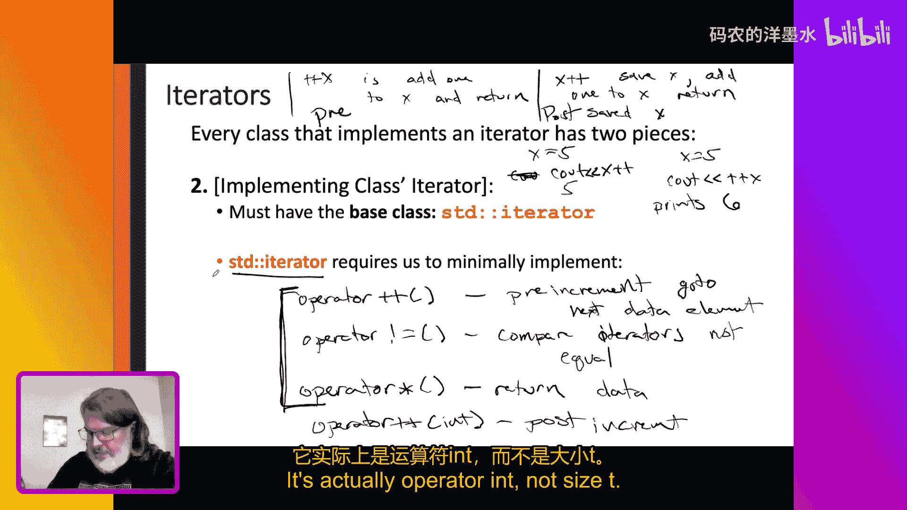

Okay。So。Let's start trying to write our iterator interface。😡，What is begin going do？

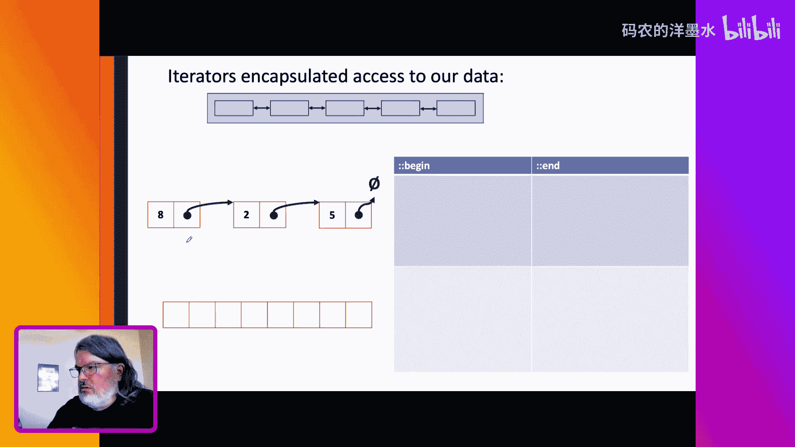

Begin and end are required， they're required in the data structure， right？

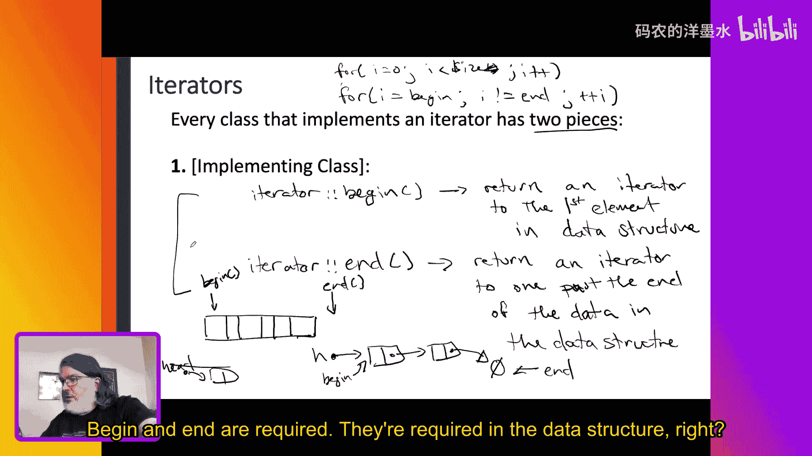

Beginning end were required by the data structure because the data structure。

 but an operator doesn't know its beginning。

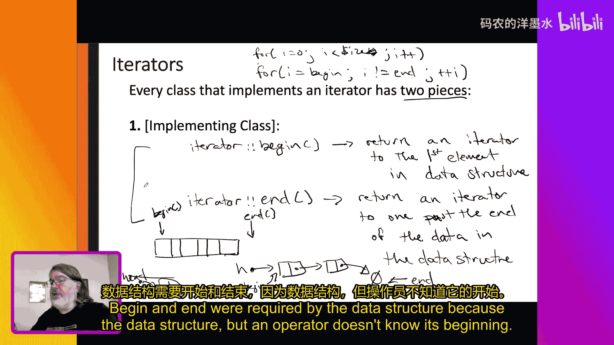

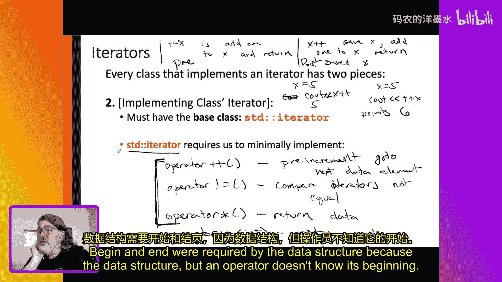

A data structure knows its beginning。So let's try and implement begin。😡，Let's see。

We're going to have an iterator that's going to have a private member value that is presumably a pointer。

 right， a list node pointer。 So begin is going to be return。Ti。Constructed out of head。Right。

On a linked list， it's going to be head， right？And let's just make this simpler， which is。

What's end going to be？An iterator constructed out of no pointer， yeah。

We've written two functions for MP L。That's it。 How about here， what am I going to return？

How is this useful for a linked list？I don't know。 You have a linked list。

 Are you a doubly linked list or not， Are you a。Why is return before the iterator head constructor？

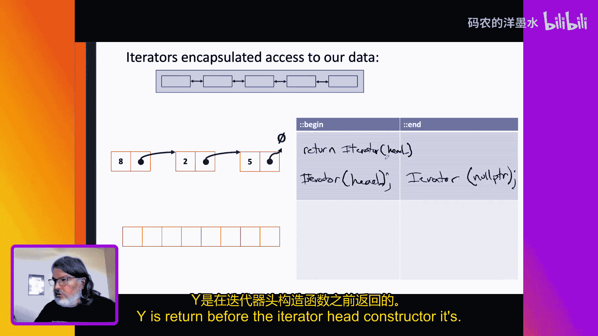

This is one line， right。I decided I would leave the return off when writing it because I don't have enough space。

 right？

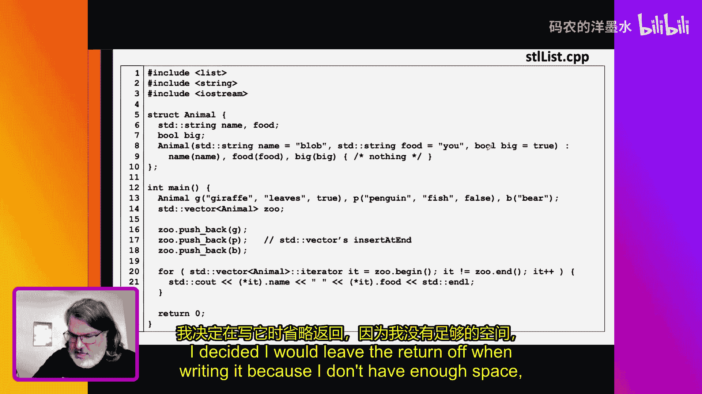

So there is the actual code is returnturn iterator constructor head。 I don't need to give it a name。

 I'm just returning it。No， we will have written the constructor。

 But do you think you could write the constructor， What's the constructor going to do。

 It's going to take a。List node pointer and store it in its local list node pointer member。Right？

So I bet my constructor will look like deterator。4。My linked list will be list node。Pointer。I。Coen。哦。

Pinter。By。Where。There it is what I would write in my iterator class for the constructor， right？

Does that look good to everybody？The iterator is a class of its own， right？

It's a initial value initialization list， right， it's an initializer list。That。

This is a list node constructor。That takes a one argument， which is a list node pointer I。

 and it uses that argument to value initialize its private member variable pointer。

When I implement a data structure。I implement an iterator interface to implement that iterator interface。

 I need to implement my iterator。😡，And I need to implement。The interface。Begin and end。

My iterator is almost certainly going to be a public member variable of member class。Of my class。

And we'll look at that in a moment。So here we're going to have what？

So here the iterator will be iterator。zeroero seems good to me， right？And。Iterator。Ss。

So we return those two。Right because we have zero and size。Begin。

Size is the number of values in my list， right？ So if I have。1，2，3，4，5，6，7，8 things in my list。

My size is 8。And this is the 0th，1，2，3，4，5，6，7th index。 And this is the 8 index。

 just like it was in any array。 There's nothing special about my array。Okay。If I access end。

It'll be out of bounds also if I access and with a pointer， won't it。

So it seems to me that since end is defined to be one past the end of your data structure。

 you probably don't ever want to access that， do you。Okay。

So let's look at some code and we're going to use iterators。

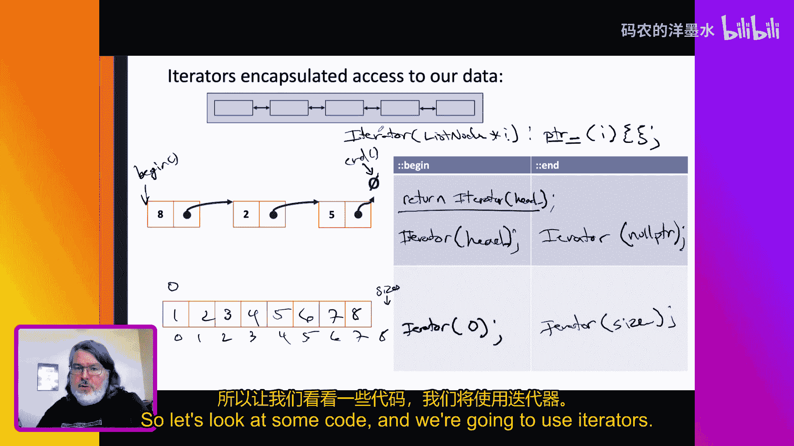

First， here is some code。 Let's let's see， can we read all of this， So we're including lists。

Which is the STL implementation of lists。Or some missed。String and IOSt right。

 IOSt is output string is to allow strings and we've defined our class animals because we like animals。

And animals consist of three member values。String。There are two strings， which are the name。

 the name of the animal and food。 What does the animal eat。

And then a booleion of whether the animal is big。And the next thing we see is the constructor。

The constructor for animal takes wow， there's a bunch of weirdness going on。 So this portion here。

 right， start。Value。Start initializer list。so we initialize name with name， food with food。

 big with big。Okay。But we also say this stuff， we have these equals。 so these are default。Vals。

And the default value of the name of an animal is it's a blob。The default food is you。

So that might be unfortunate for us。 And the default size is big is true。So let's see。

Now we're going to create some animals， we create G， which is a giraffe。

 it eats leaves and it's true， so here's our giraffe。And's got some treaty here at E the leaves。

Our pretty giraffe。What is big， it's a boolean， it's true。What else does it mean？

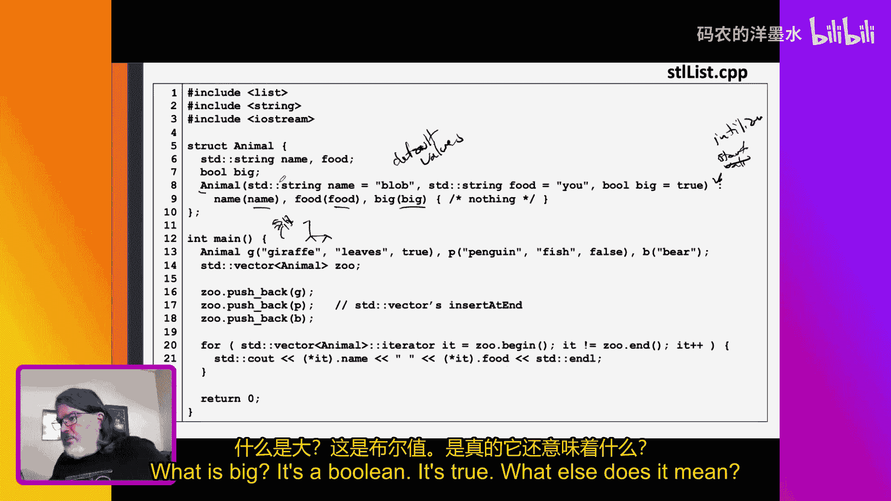

The value initializer list is a convenient way to write constructors that don't do anything else。

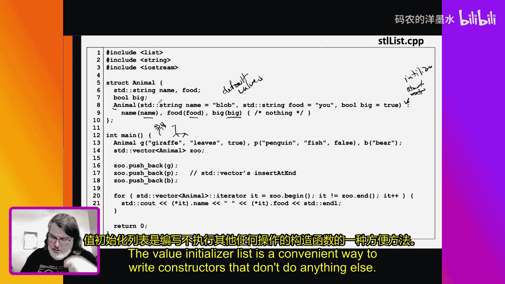

Um，Also， in the case ofum some things， it has the added bonus that it takes place before the start of the function。

That it remember with references， we had to use a value initializer list。

 and if we want to pass an argument to an included derived type。

 we had to use a value initializer list。Ah， well， let's see。What happens with penguin。

 Penguin we're giving it all？There's， is this both a parameterized and a default constructor。

 You're right。 It is a default constructor， isn't it， right， If I created an animal A。

 what would it be。Animal A。 and I just gave it nothing。I gave it the default constructor。

 A would be a blob。It would eat people。And it would be big。

It would be the blob coming to eat us as an old 1950s。Movie。We'll get to that。Penguins。

 we have our penguin here。 Here's our penguin。It eats fish。M。F。Im gonna eat you。 little fishy。And。

It is not big。Well， I'm writing through line 13， right， there。

 This is declaring an animal G and initializing it with a constructor。

 This is declaring an animal P and initializing it with this constructor。

This is declaring an animal bee， we get a bear。And it is big。 and it eats me。哈哈。So。

It is not true for constructors， but here we have default values， so。If we leave them all。

 it would be all of them would be set。Forbe。Does that mean that food and big parameters just take the values from the constructor So right with bear。

 we give it an argument that replaces the default。 And here it says， well。

 you didn't give me an argument for food， so I will take the default。

 which is you and you didn't give me an argument for true， so I will take the default that is big。

How do you construct an animal with defaults for name and food， But a custom dual big。 Well。

 I would have。Q， which would be perhaps a questing beast。Oh， you want defaults for no， Okay。

 So the answer is， can I leave the first two blank， No that the way defaults work in。

C++ is you must have all of the parameters up into the one that you leave blank。

So I could give it a name and a food and not give it a size。

 I could give it a name and not give it a food or a size， or I could not give it anything。

 but I cannot give it a size。😡，Am so。Okay。You can't。

You have to give them all of them up until the one you stop。Yes， with Anim， as I wrote it here。

 I both have a default constructor because it will take the default for all three and a custom constructor。

Okay。So then I declare a standard vector， which is a kind of list。

If there is a second constructor with just one argument， what would be called？

You would have a problem that the compiler would have to figure out which one。

And there are issues with that。There's a lot of verbiage to read。

 So if you have constructors that look the same， it's hard to tell what the compiler is going to do。

So here we're declaring an empty vector that is our zoo。We do zoo pushback G。

 so we put a giraffe in our zoo。Or as you know， has a giraffe。In our zoo。

 and then we put our penguin in our zoo。And finally， we put our bear in our zoo。Okay。Then four。

Here is the most formal， most verbose way to use the iterator interface， so for。Standard vector。

 animal iterator。 So the iterator we're getting。Is the iterator that belongs to the vector class templaized over animal in standard。

 right， So scope resolution operator， scope resolution operator， template parameter。

And we are initializing it to the begin。And then we say， well， it is not。Equal to end。

We'll get to that。Iterator plus plus。 And here we are using post increment because we're bad。

 we should be probably using plus plus I as it turns out。

 standard vector implements both post increment and pre increment。

And so we're going to run through this， and we're going to print the name is a。Name is a giraffe。

Eats leaves。嗯。Then end。 and then it's going to print penguin。Fish。And bear。And。You。

The only required one is the pre increment would be no actual difference。

Would we need a different iterator for a standard vector int and a standard vector animal。

 absolutely？And we're doing star because the way we access data in an iterator is by accessing by using the star operator。

😡，The actual implementation in vector is long， but and I'm not going to dig through it。 You can。

 You've got the code。How does it print bear， I mean， the name of。It is bear， right。

 that's what the bear has。

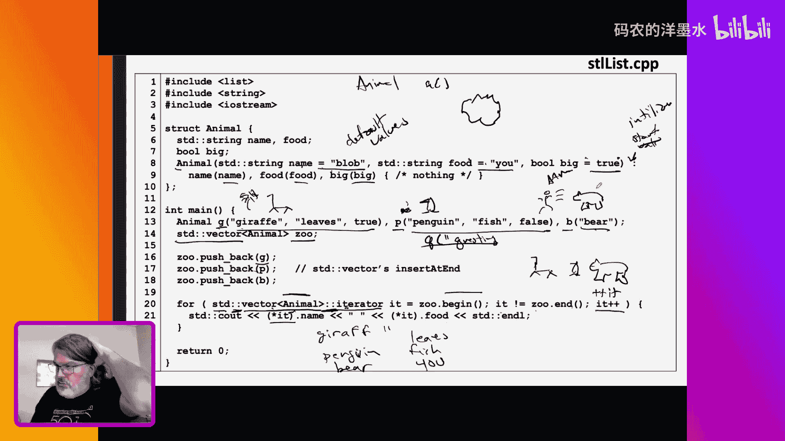

And is not at the end， right？ And is， how did we define end。

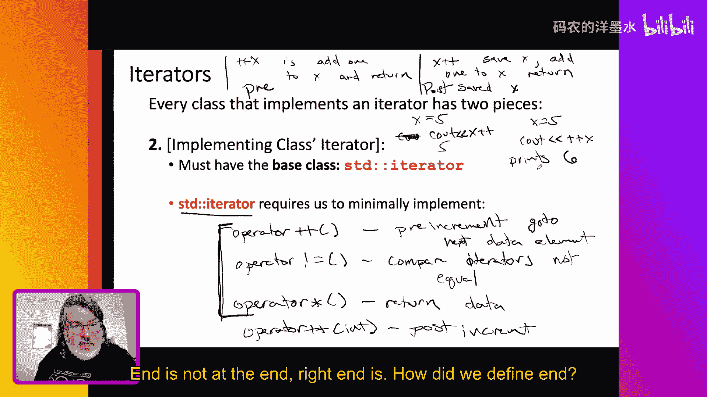

Returns the iterator to one past the end。And is here or here。

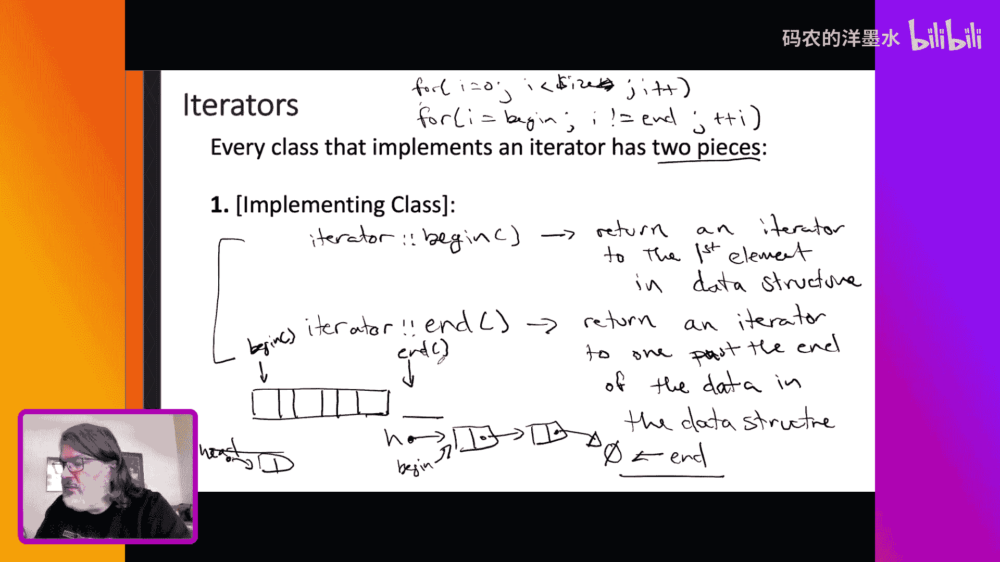

What would it print， it would say if you did see out with no star， it would probably tell you no。

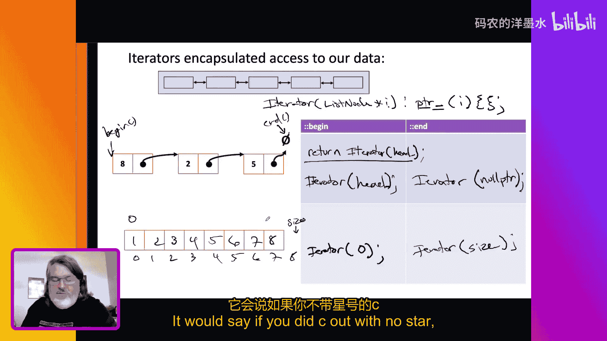

A correspondingorresing operator for arrows， arrows on stream for。

Iterator of standard vector of animals。Can you do arrows？As it turns out， you can do arrows on。

The version in the STL， but it's not required to be supported。

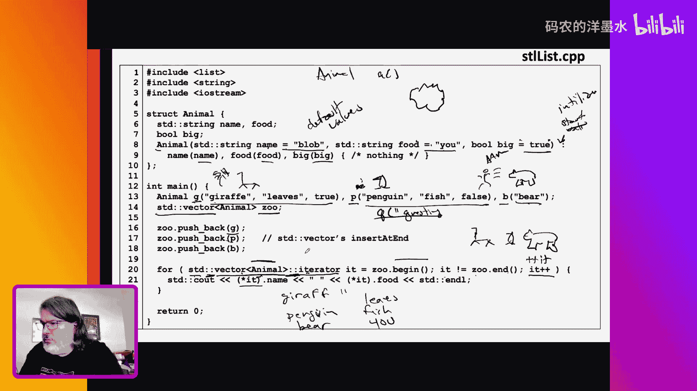

Well， how are you going to iterateerate through the so what integer marks what in my hypercube？

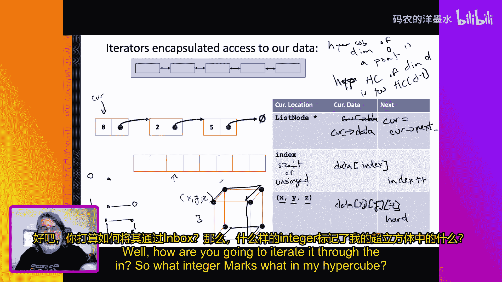

Could you tell me。What is my mapping of an integer to a hypercube。

And what is my function that maps from an iterator to。诶。A treeree。Well。

 this is the question that our iterator is solving。

 is it is providing one interface that works whether you have a hypercue or a tree or a map or a hash map or a whatever。

That's that's the thing it's solving， is it easy to think about it for an array， sure？

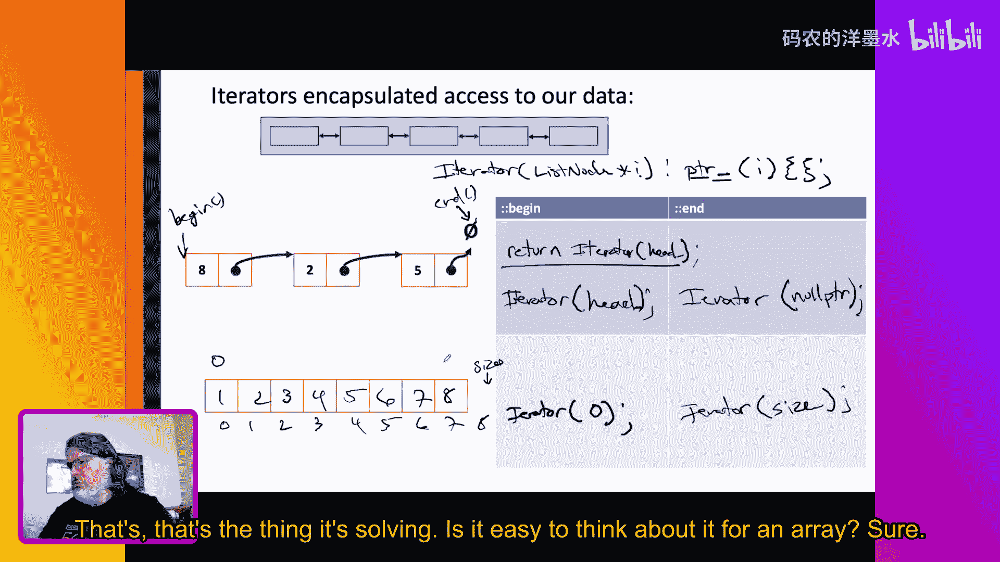

Okay， so this is a little bit clunky。 Can we make this easier。Well， here's the code。

That I am most likely to write。What's different， Well， lines 1 through 19 haven't changed。

Line 20 has changed。And here， instead of writing， because， you know。

 I don't really like typing standard colon colon vector。😡，Angle brace， animal， close angle brace。

 Col， colon iterator， I T， I think。Autto。Auto seems nice。

Otto says the type of the next variable is defined by how you initialize it。So that seems cool。

 So auto begin zoo begin。 This seems pretty clear what it's doing。We start at the beginning。

 We go until we have reached the end， and we increment。So。

I like this because I have most often needed to write code where I need to do things other than just print。

😡，But there's one more version we could use。There's this one。So again。

 lines 1 through 19 are the same， and the program does the same thing。And here。

We are doing a range based for， or a range 4。And we write。

We say that we have a constant reference to an animal。From zoo。

And we are going to go through this loop。On each element。As it turns out you could do one more。

 which is instead of this， you could write auto。You say this version doesn't have anything to do with an iterator。

 It actually does because do you know what the compiler does when it sees this？When it sees this。

 it turns it。Into that。It actually turns it into this and then it turns it into that。

So to be able to on your data structure， do this。😡，Uses。Iterator。Interface。

What's the purpose of these loops， it's just to show you a very simple example of how I can use an iterator interface to get through everything。

😡。

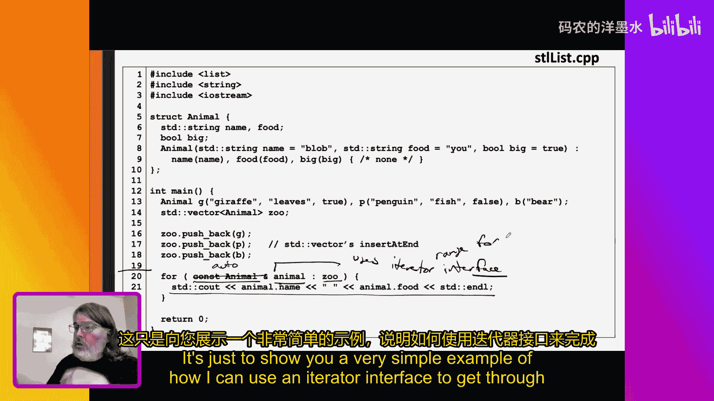

And I will show one last thing。 I'm sorry。 I'm a little over time， but I want to show the last bit。

 So here we were doing this。 okay， that had to be cons。

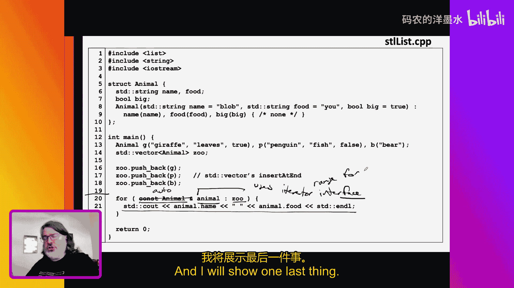

But。Well。It turns out there is also a data structure in the standard called an unordered set。

And here I have an unordered set of strings to animals， and do you know how I get at it。

 I do the loop and go through。And， in fact。Everything in the S T L implements an iter interface。

 Can I do constants auto， You can， I believe， do constants auto。

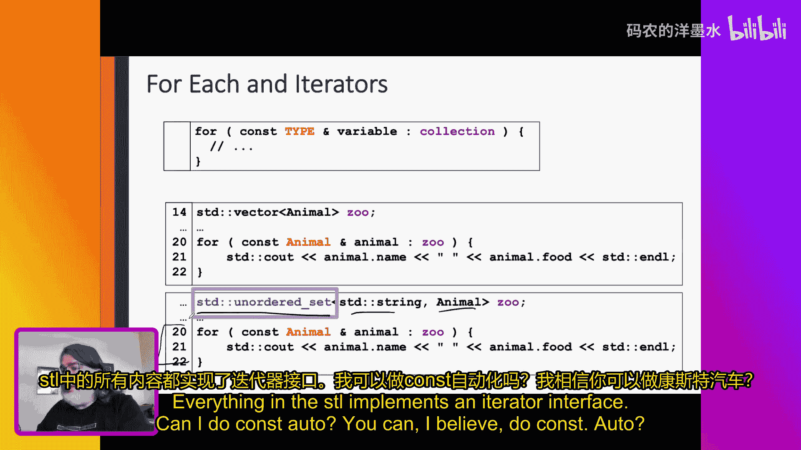

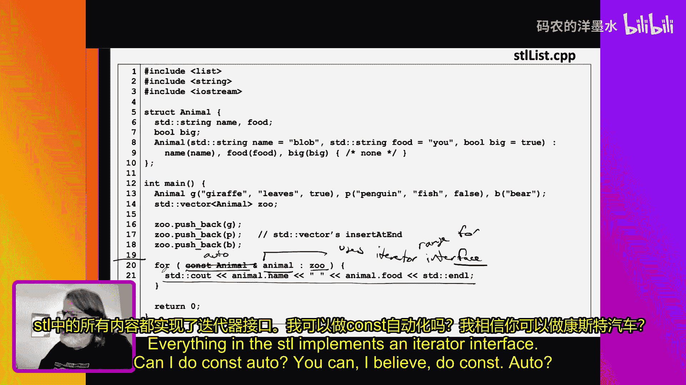

I don't care。Yep。But the iterator interface will still go through all the elements in them。

Auto allows you to determine the type of a variable by how you initialize it。😡。

Stickers grades will go on Moodle， you know， on Sunday。

 but your grades are available to you right now on your repo。And honestly。

 you should get used to looking at。いep。It is exactly the same thing。

 and I could look up and go for instead of the STL。

 I could be looking at Bo tree and do the same thing。So that's what I've got。

 I'll keep answering questions for a while， though。

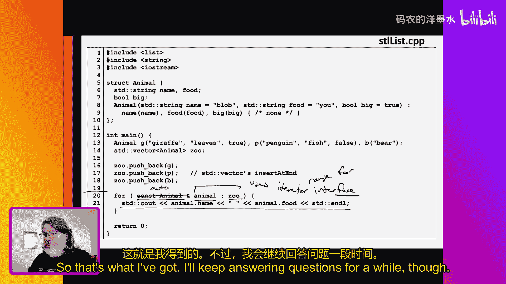