# 【全集】伊利诺伊大学 数据结构与算法 中英字幕 1080P p13 Lecture 13 - 树 -BV1t9FHzdEYL_p13-

So today we're going to start talking about trees。And you should all have seen trees already。

 So we're going to go through this fairly quickly at the start until we start working into the guts of。

嗯。Actually， implementation。So first， what are trees and Donald Canth。

 who is in many ways one of the real fathers of computer science？As a。

Science said that trees are the most important nonlinear data structure in computer science。

 and people might argue now that hash maps have kind of taken that over， but I don't think so。

 I think that when you really reason about how trees are and how important they are as a concept in computer science。

That trees are amazing。 What's the most important linear structure。 I don't know what Canth says。

 but I would say the array。

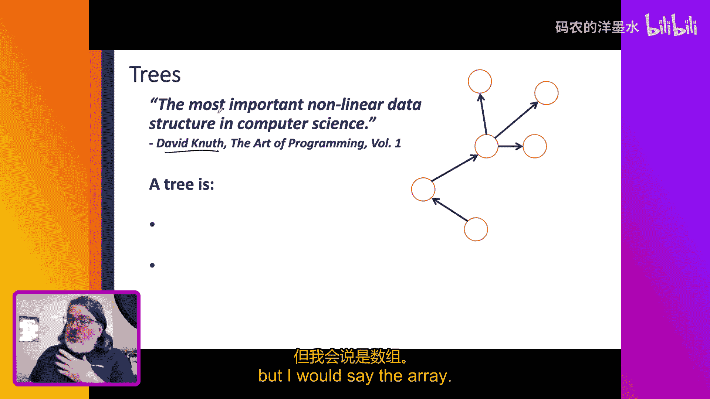

Um because it is the fundamental structure that we actually use to build essentially everything else。

 including trees。So what is a tree？A tree is an acyclic graph。And that's all that。A。

Theory person is going to say it is， but in this class。This class。

We are almost always going to be talking about a rooted tree。In fact， when we talk about a tree。

 except for in the context， at the very end of the course is a subgraph of a graph。

 we are always going to be talking about rooted trees。So a rooted tree。

Is like what we have drawn here with this being the root。Right。

It can be drawn with arrows to show the direction， but similarly。

 we could draw a rooted tree often just like this， without bothering to have arrows。

So a rooted tree is a tree that has a singular node identified as the root。Noe。

 you can do this with any tree because， well， I think we all would agree that this node would be the obvious root of this tree。

If I instead were to choose， say this node here。My really badly drawn star。It's still a rooted tree。

 And we would just then look at the direction of children as being these ways。

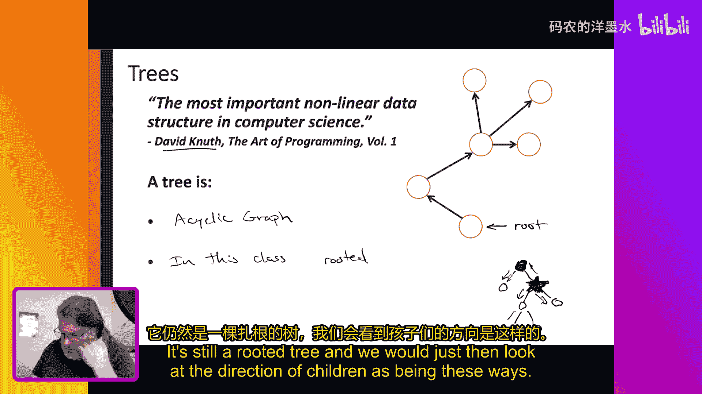

So you can always turn an unrooted tree into a rooted tree by simply picking any point and kind of conceptually shaking it until the tree falls into the standard form。

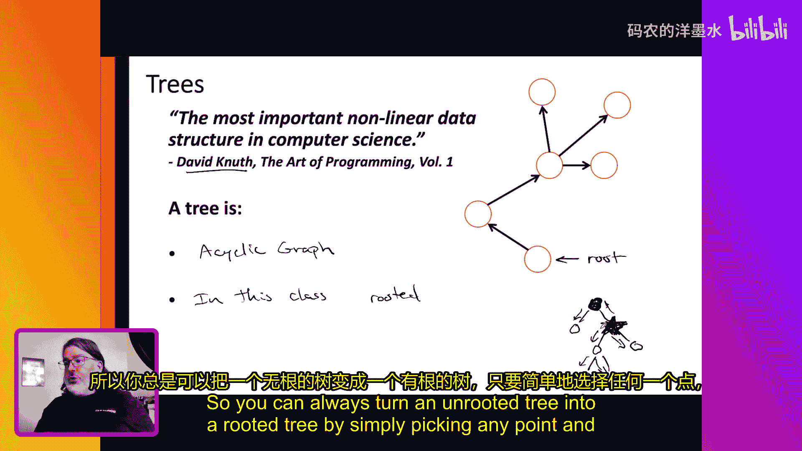

So in this course we're not just going to deal with rooted trees。

 most of the time we're actually going to deal with a smaller set of even binary trees。

 but not always。😡。

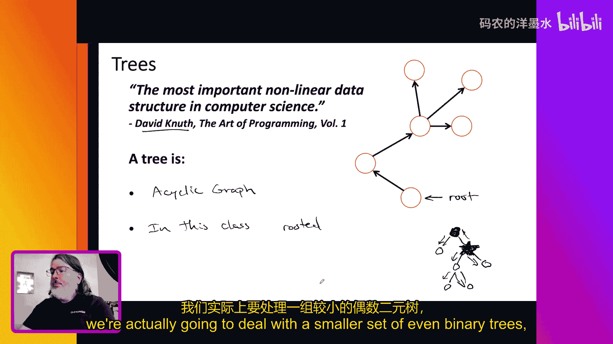

But so let's define a binary tree。 and we're going to do this from a fairly formal mathematical way。

Right， if you have an unrooted， so any node can be considered a root。 If you have an unrooted tree。

 you could choose any node and label at the root。 and now you have a rooted tree。Okay。

So binary tree T。Is what？ I mean， conceptually， we know what a binary treaty is， but let's。Let's see。

 it is either a tree。Is equal to。A root。Ps。Tel。And T。Or what。I like that definition as well。

 a directed acyclic graph where in any node has it most two edges leaving it。

 though leaving gets tricky in the concept of a directed acyclic just R。

Just are I see where you're coming from。But I don't like just R。I'm going to use。

 It's going to otherwise equal。The empty set。And here is why。Because if I do just R。

 then this becomes problematic， right？I can have R and R， but how do I cut things off。

 It's a little bit tricky， So why do I say a binary tree can be just an empty tree？😡。

Let's think about this， for a moment。Because this is going to inform a lot of how we define things that in theory courses。

 they might not quite define it the same way。So it ends at some point。 Sure。

 if it ends at some point， though we could have tried to define a leaf and use a de leaf。

 we absolutely need a base case。But。What is the smallest tree that we're ever going to see as a data structure？

What's going to happen when we construct our empty tree， right？ We do tree T。

It's not going to have a root， Is it， right， It's just going to be empty。 We want to be able。

 We had an empty array， right， We had an empty list。 It's just a pointer， probably。Yeah。

 so in this class， because of implementation details。

 we need to think about a tree that has no nodes。Okay。So a tree that has no nodes is an empty tree。

Okay。And we're going to write it like this。With this definition。

 I could try to formally write down what we had。 And let's see we'd start out with something like this。

 and we would have C comma。 and then we'd have， let's see S comma。A comma， empty， empty。Coma。

To comma。Comma， empty。Mmi。5 comma empty。Empty。Can I get it all in。

 And that's going to close the one that is。2， closing the one that is S。Comma。Oops。

 and I ran out of space。Okay。So。Dat do do。I couldn't quite squeeze that last node in。

But so this is the way we would sort of， in a sense， formally write this down。

We don't really like that， though。 So in general， when talking about trees。

 I'm not going to write this mess。I'm gonna to write stuff like this。I'm going to draw a picture。

Okay。Okay。Let's talk about tree properties then。Okay。Let's see。

The height of the longest path from root to leaf is our how we have defined height。

 the height of tea。 So given this is T。What is the height？A tree is a sandwich。3，4。3。4our。😡，Okay。

 so let's see。The path to the farthest node here is going to be one step。Two steps。3 steps。

Someone saying the height of the null tree is zero。Hm， let's think about this a moment。

A path is a number of edges。 Yeah， that I agree with completely。 If a path is a number of edges。

 we get three。So the height of T is。Well。What is height look like， right？

 This looks like a recursive thing。 A height of T is going to be the max。Of。Wen。Plus， the max of。

height。Of T L。Hit。Of tea。Or。Does that look good？Right。

 the height of a tree is one more than the height of its left subtree or its height of its right subre。

 whichever is taller。And since this is a recursive formula。Height。Of the null tree equals。-1。So。

We have chosen to define it this way， which is a little bit weird。 But the thing is。

 it's going to work out very nicely。 Our height comes out very cleanly， right。

 We have the height of the is the max of the left or the right plus one， which makes perfect sense。

 right？ The height of this is。-1，-1。 The height of this is0。 The height of this is。

0 and 0 and one and2 and 0 and 3。Y minus1 well because。What is the height of this？

Right here is our tree。That is going to be our tree that has no children， right， It's a root with。

A null。 and a null。Well， the height of that should be。0。And since we can have a legal binary tree。

 right？That is just that。If we want to use the definition of that the height is the max of the T L plus T R plus1。

This is0。 This is -1。It's -1 by definition， but writes， this thing is 0。

So I'll make this a little bit easier to read by clickboard。But you plus one。

 that shouldn't that be zero， right， Yeah， so the height of the tree with a node with no children。

 with only null children。Is going to be zero。Which is also what we're going to call a leaf， right。

 that you'd seen before that the height of a leaf is0。Okay。So this height definition。😡。

Pretty much is what people see normally。It's a nice， recursive definition。

This will bother some people， but。Just get used to it because once you start talking about empty trees。

You end up with some weird stuff， but again， as I say。

 we're going to see that this works out very cleanly in a lot of proofs we do。Well。

 then what's the height of this？If I start out with zero， this is zero。

 let's see max of left and right is zero is0 is zero if we don't add one。

 the height of the tree is just going to be zero， right？If we if we got rid of this plus one。

 the height of our tree is zero。Of all trees。Or it's whatever the height of our base case is。

Could you have chosen to define height of zero is0， height of T0，0 is also zero， you could have。

But you'll find as we start doing proofs later， that that would actually make our work more difficult。

That the height of a tree with no children， with no nodes is0。Why is the left side 0， Well。

 recursively， if， if the height of this is。If the height of these are0， right of the negative of the。

A0。Well，0， the max of 0 and 0 is。0。Is zero。 If we got rid of plus one， everything would just be0。

Right？This is the only way we generate height is this plus one。It does， Okay。

 so here's our definition and the height of a tree with no nodes is negative one。

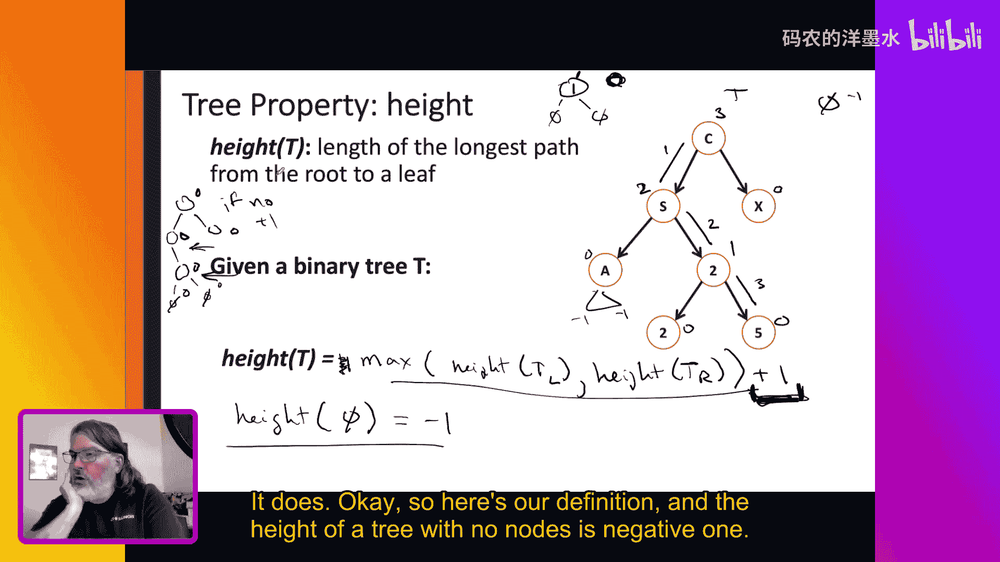

Let's talk about some other properties that trees can have and see if we can define them formally。

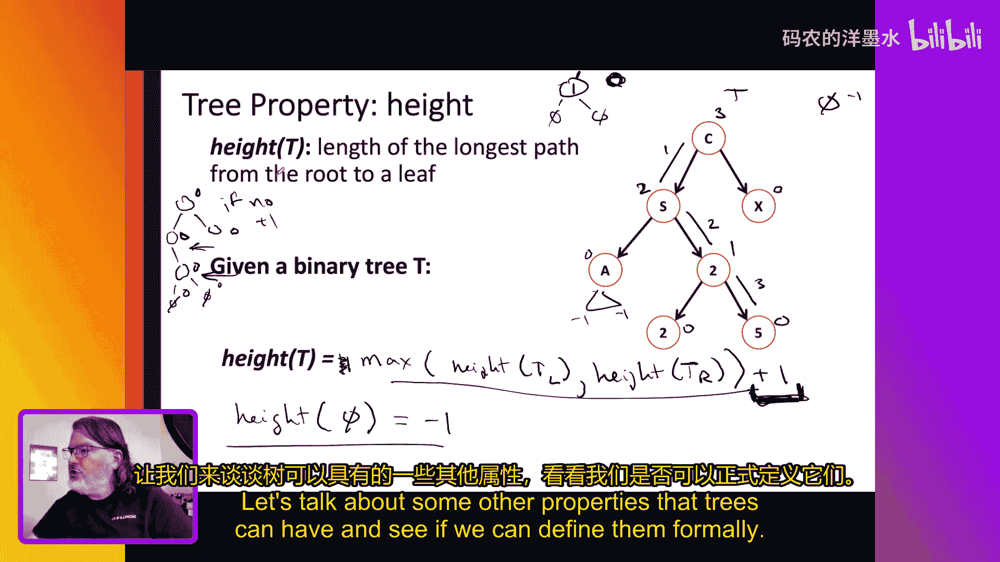

So。A full tree。 What makes a full tree in a， in this case， a full binary tree。

Because all the trees we're talking about today are binary。Let's see。

 Can anybody give me one of the two conditions。Each node has two leaves。 Well。

 I'm going to claim that this is a full tree。And the nodes A2 and X do not have two leaves。

 Each node has two or zero leaves， okay。I agree with that。 How do we write this recursively？

KNoll is full， I like that。A full tree is either equal to null。Awesome。😊，Right？Or。

A full tree is equal to。A root， plus。T， L and T， R。Where。Either。T L。T R， are both。Noll or both。

Not no。Okay。A tree with only a root is a full tree， absolutely。Definitely a full tree。Yeah。

 let's write them as this way。Yep。What does a non full tree look like？If I got rid of this。

I would then have a non full tree， right？F is a full tree。Okay。So fools kind of nice。

 but it's a weird property。 It's actually the 1 I have the hardest time remembering myself。

 It doesn't come up very often， And it's just kind of funny。

What we've got next is a property that is really， really nice， doesn't come up very often。

 but is nice。Okay， so the question here is， if a pointer points to null。

 does it not point to an address？ So like， could you check if an address exists to see if a tree is full so。

If a pointer points to no。And this is a concrete implementation question。 And today。

 we're really doing the theoretical version。 But if a pointer points at null。

 you can compare that pointer to null。And if it's null， it is not a legal address。 In fact。

 the most important definition of null is that null pointer is never a legal address。

 It also turns out that null pointer also always compares equal to 0。

 which is kind of funny because there have been architectures where 0 is a legal address。

But null pointer always compares equal to0， and null pointer is not a legal address is the formal definition of null pointer in null。

Okay。Tree property。We're going to do another one。 that's going to do perfect。

 So we've seen the recursive definitions that are fairly straightforward。

This one's a little bit different because this one is recursive。

But it's going to be defined in terms of height。So here we're going to want to say。

 let pH be a perfect tree of height H。And。We're gonna have a base case that P of height H minus of。

Of height -1 is going to equal to。The null。Okay。Or。Pi。😔，Of height H is going to be equal to。A root。

Plus， P of H。-1 and P。Of H-1。So a perfect tree of height H。Is。A tree。A binary tree where either。

H is  -1， and then it's。Has no nodes， and that is a perfect tree。

 or it is a perfect tree of height is a root with two perfect trees of height H minus1。

So what does that mean？I kind of went around it the other way， this time。

But this here is a perfect tree。We have either anempties。Could draw them in here。Right。

A perfect tree。Is cool because it has the most possible nodes A tree of that height can have。

 It says a level K has two to the K nodes。 Let's see。 A level 0 has one， a level。😊。

2 or level one has。2。Oh， I see level K has two to the K notes。 I agree。

The notes the same type all have the same amount of leaves。 That's true。

 All children must have the same height。 I like that property。

 But right so here we have our perfect trees。These are P of height 0， P 0。P 0。P 0。Then， we get P。1。

P1， and finally。P2。Does it have to be binary in this class。

 we're always going to be talking about binary trees unless we explicitly don't。

 you absolutely could define a carrie tree of a perfect carrie tree would have be composed of a root and K children all who are perfect carrie trees。

😡，Of height。A。H -1。So。We're only going to care about the binary definition。

 but it's a very clear extension to talk about a non binary definition， right， a KR definition。

I like that the height of the left subtree equals the height of the right subtree。

 that's another useful thing， though some of those are not enough。

 some of those are properties that are true， but are not enough to define it。

 So perfect trees are really cool and we would love for all of our data structures that are trees to be perfect trees right they're kind of nice。

😊，Okay。What about a complete tree。

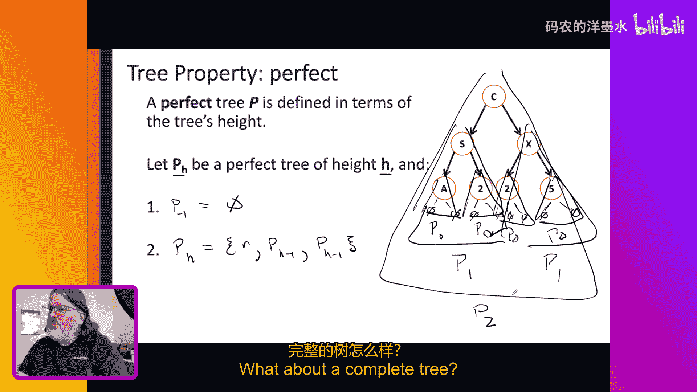

Do you remember a complete tree？So a complete tree is a kind of funny definition。

 and you may have heard a slightly different definition。You may have heard one that had。

Did not have this part。This pushed to the left。Right， so a perfect a complete tree is a perfect tree。

Other than the last level of the tree。And in this class， and in a very large number of contexts。

 we're going to say that in fact， it also has。All of the children on the last level are in the leftmost spot that they can be。

Okay。So this is a complete tree， right？For all levels k in 0 to h minus1， k has2 to the K nodes。

 much like we were having proposed in our perfect tree。And4 level H。

All the nodes it has are pushed to the left。 Why does it have to be pushed to the left。 Well。

 we're going to find out that it allows us to do some things that are convenient。U。

 but it is just a common definition of complete tree。

You're going to have to wait about a month to see the case where it really works out helpfully to have them be required to be pushed to the left。

He'll give you a preview。In that， imagine if you were going to try to store this tree。In an array。

Well， if I think of it as。Pushed to the left， it would be kind of a contiguous array。

 Whereas if I let them be scattered about， my array is not contiguous。So if we add a node。

Add it to the left， yeah， so to add and maintain we would have to be doing something like this。Right。

Okay， and it's just the definition。As I said， why are any of these de someone is this just to be convenient。

 Well， here's the thing。The only reason mathematicians in computer science defineying any of this。

Is to be convenient because there' are things we want to talk about。

And we find that defining complete， including push to the left。

 which is really standard in the context of computer science is tremendously convenient。That's it。

If it wasn't convenient， we just wouldn't bother to define it。

 But let's see if we can have a more formal feeling definition。

 One of these recursive definitions we've been doing。

 And the advantage of this here is not so much that it's useful。

In that our push to the left definition really works quite nicely。

 but it shows us some more thinking about recursive definitions so。

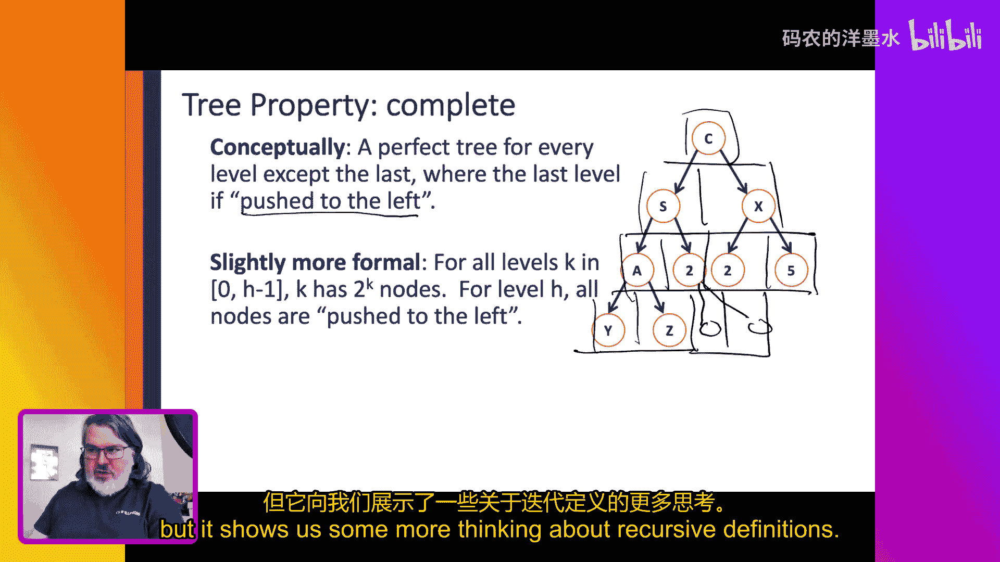

A complete tree of He sea。Is either right the empty tree？Zi。Or。It is a tree of height H。

 or H is greater than0。Euro。It's not true greater than or equal to 0 I should have had。

Where it is a root with a left and a right subt。Sui。TL here， let's look at our example。

And let's try and think， what is the tightest thing？We can call。T L。It's a complete tree of what？

Okay， so this is， we like complete and。Perfect。So the height of the left is。H-1。

And what's the height to the right？It is pushed to the left。Right。The last row in C。

 the tree rooted at C is pushed the left， the last row in the tree rooted it S is pushed to the left。

 the last row in the tree rooted it A is pushed to the left。A P of H minus2。Okay。Oh。

 in an empty tree， I saw I see。 you're saying that the last row is not pushed to the left。 Well。

 in an empty tree， there is no left or right。 So it is both as pushed to the left as it can be and not at all pushed to the left。

 And we chose empty tree to be pushed to the left。 So we decided that a complete tree with nothing is a complete tree。

And to have this recursive definition， it has to work that way。Ah。

 so someone says is so perfect trees are considered complete well。I think they are， right。

 if every position is filled， that's as pushed to the left as it can be。

So I would say it is in which case the other condition we need is that if L is perfect。

This is a perfect tree。Of height，-1。And then this is a perfect tree of height minus1。

So a complete tree is either complete a root with a complete tree of height minus1 on the left and a perfect tree with height minus2 on the right。

 or it is a root with a perfect tree and a perfect tree。How would it be perfect？Well。

Do you agree that this is a complete tree I have just drawn？It is a perfect tree of height zero。

And then at the bottom row， everything is as pushed to the left as it can be。

 So that is a perfect tree of height -1 and a perfect tree of height -1。Ah。

 what about a perfect tree and a complete tree？Will that work？Let's see。

So can we make the definition work， Is this work， We have a perfect tree。

 Do we agree that this is a complete tree。Yeah。Do you not like this one？So this is a complete tree。

Well，I would agree that everything is pushed left。 This is a perfect tree。 Oh， and this is a。

That's a perfect tree。But it's also what。Let's see。You have a perfect tree and a complete tree。

But it do is a complete tree。Can be a complete tree。哦。But this one works， right？This is still okay。

 right， because this is a perfect tree。This is a complete tree of height 2。This is a。Tree of。

 a perfect tree of height0 and a complete tree of height 1。So I still worked。

This why is T L perfect in this case。Get an eraser I've made things a little bit messy。

Not in this case。The big tree。 Why is T。 L perfect， It's not。It's complete。This is complete。

But what about this， we're still trying to work out this other case。

Does this need to be completely perfect？Is the question。A complete tree of height-1。

 and a perfect tree of height -2 is fine， which gets the big tree。But what about and。

 and it works for this。 But what about this thing。What if I put that？That still works。

 But now if I'm looking at this。Yeah。Anything that's perfect is also complete， right？

Anything that is perfect is complete。How could I just add one node because I'm making a different example？

So I was saying that if I added a node that was the most pushed to the left node。I needed to。

Consider this case。no a。Full binary tree can only have a0 or2。C is complete， and P is perfect。Okay。

So here's what we end up with is a definition that if the left tree is complete。

The right tree must be perfect if height -2。What is the difference between full and complete？ Well。

 complete is perfect up until the last layer on the last layer is all the node shifted to the left。

A full tree。 every node has0 or2。

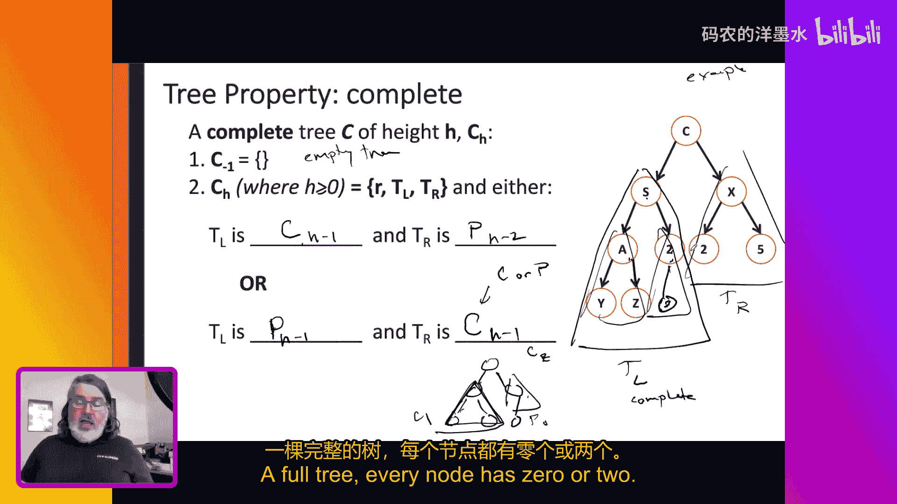

Children， right。

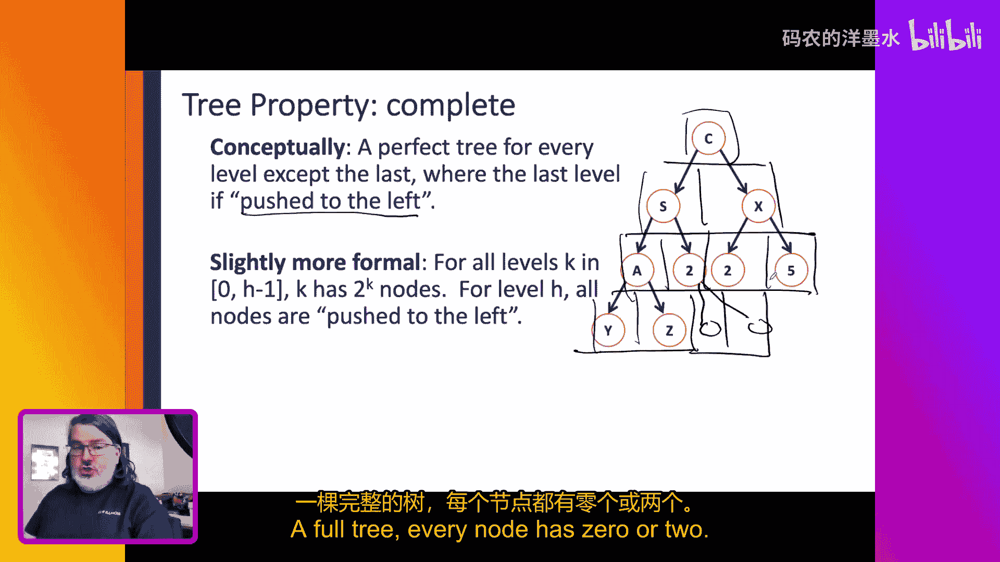

A。あちて。Erase a bit here， right？Easese my scratching things out。Is this a complete tree？

This is a full tree I've got here。But is it complete？That's the difference。Yes。

 there can be an odd number of leaves in a complete tree， absolutely。

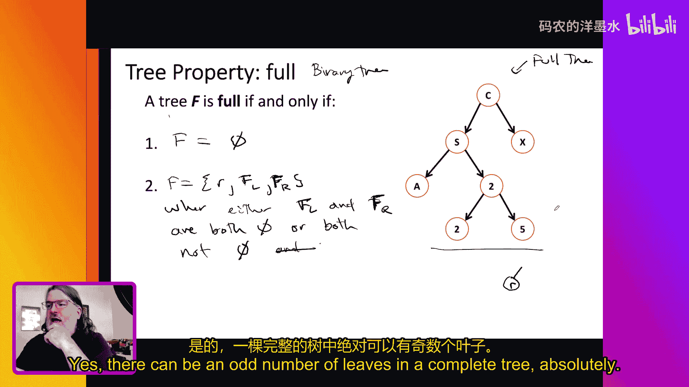

Absolutely， in fact， there can be any number of leaves。In a complete tree。Well。

 that's a good question。Can a complete tree be， Can， can a complete tree be not full？ Yes。

 I just drew one。Right。Here is a complete， in fact， there is the。

Smallest tree I can come up with that is complete and not full。In fact， hence our question。

That we were coming up to you've run ahead， is every full tree complete？Nou。This。Or sorry。

 I every full tree complete。Y。This is a。Full tree。But， not complete。

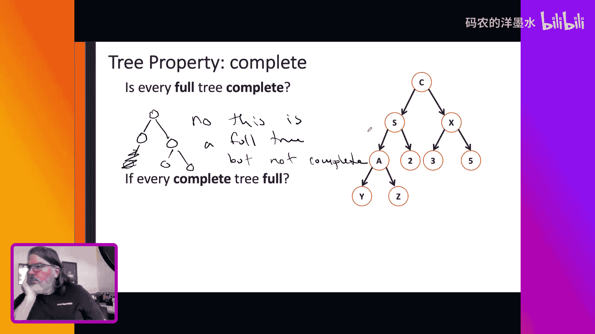

Right。What is exactly the definition of a perfect tree， We did that。

 A perfect tree is either is defined as a perfect tree of height by heights。

 A perfect tree of height H is a root plus a perfect tree of height H -1 and a perfect tree of height H -1 or an empty tree。

 That is the exact definition of a perfect tree。

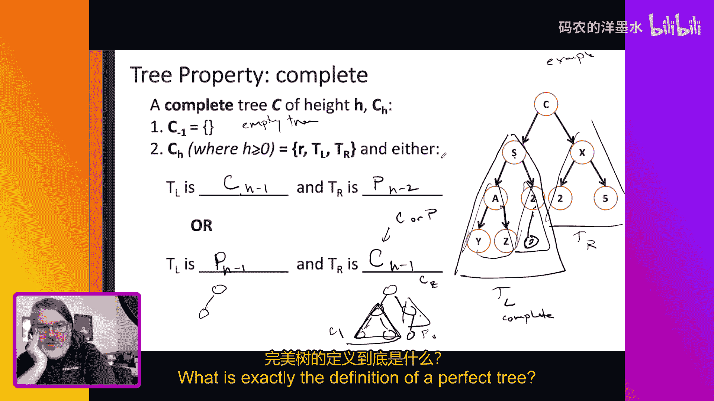

So it is a tree that at every level has the maximum number of leaves possible。

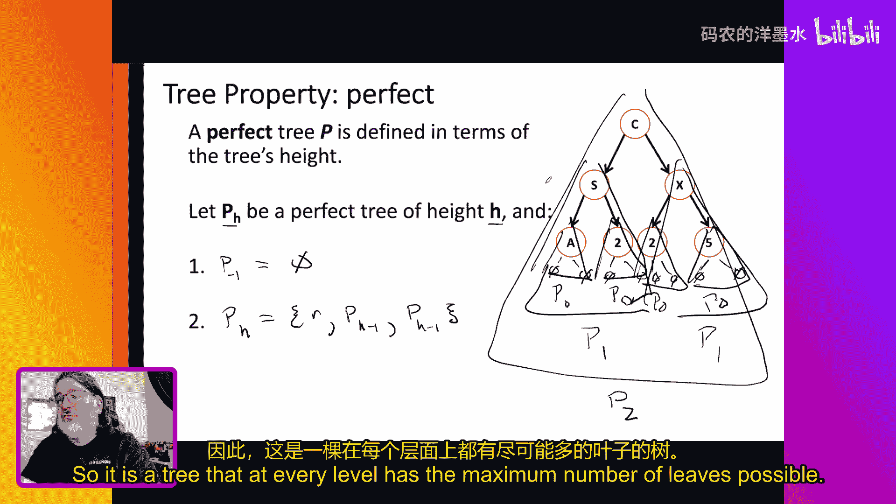

Is， if is。Is every complete tree full。No。Complete。Ci。But， not full。

So complete and full are quite different in that you can have complete trees that are not full and you can have full trees that are not complete。

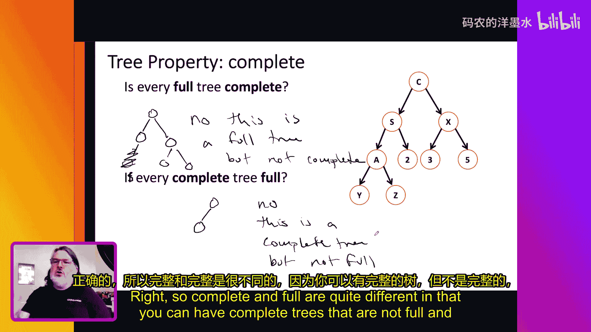

Is every perfect tree complete？Yes， I agree。Our is every perfect tree full。Yes。

All perfect trees are full and complete。All full and complete。But。😡。

Complete trees are not necessarily perfect and full trees are not necessarily perfect。

Is there a tree that is neither full nor complete nor perfect， sure。

That is a tree that is neither full nor complete nor perfect。

Complete says that it is perfect up until the last level， and the last level is pushed left。

White does a perfect tree have to be full。Because a perfect tree has the property that comes out of its definition that。

At every level， it has all of its children。Why is it not complete， not pushed left。

How can a perfect tree be be be complete， A perfect tree is complete because there's no left to push it to。

 right？ I'm perfect and complete， because。All the nodes are pushed as left as they can because at every level。

 all the nodes exist。Right。Perfect。Complete。Complete trees are also full right， no， not necessarily。

 right？Couldn't you treat the example of there being none of them as the same tree。

As being complete but not full， I'm not sure I understand what you're asking。Right， in a sense。

 if you were riding along the tree and you were writing it as the zeroth，1，2，3，4，5，6，7，8。

 a tree is complete if they're all there。What about a full tree。

Complete in full does not imply perfect， That is correct。Under our definition of complete。

And our definition of full it is not。The case that being complete and full makes you perfect。

 For example， the one in orange is complete and full， but not perfect。

I don't understand how pushing to the left is adding nodes。

 all you're saying is that all the nodes have to be added to the left before they're added anywhere else in a sense。

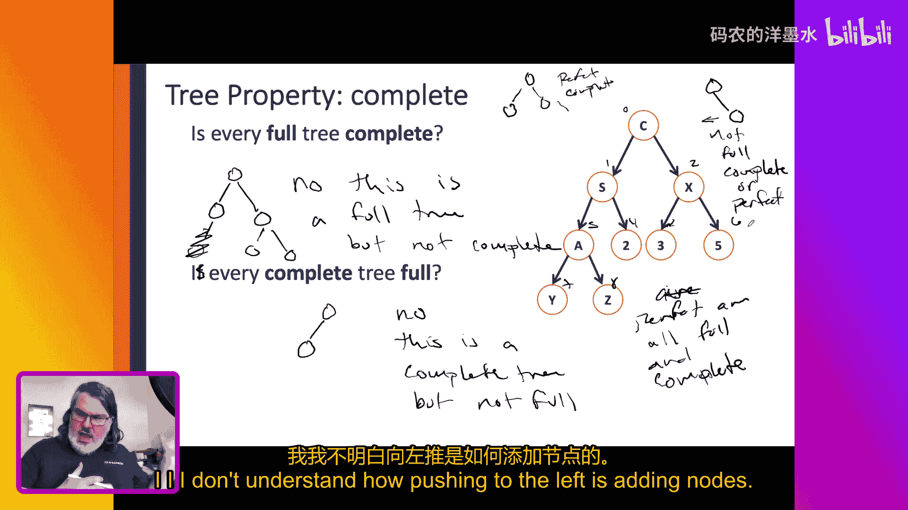

Right。As long as all the bottom level nodes are leftmost and everything above it is perfect。

 it's complete。

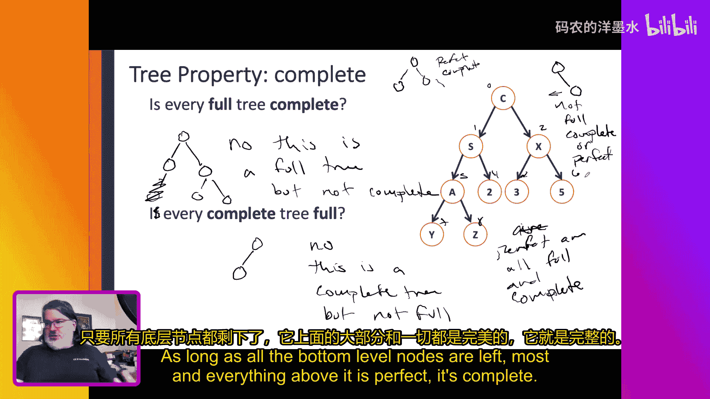

The tree I drew that is complete。But， not full。Well， if it's not full， it's not perfect， right？Right。

 I mean。How you get there， there's two different things。

 how do we convert a tree I don't really care， you know， just pick them up and do whatever。

Full means it has to have both a left and a right or neither yep。Okay。

So let's talk now a little bit more about what is a tree。

 what is the most primary thing we have to have in our tree ADT。

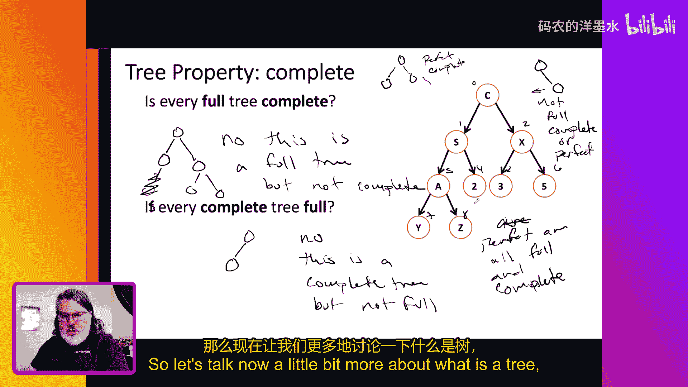

A tree must have。Insert。It must have removed。And it must have traverse。So add to tree。

Remove from tree。Examine。All nodes。Yinchi。kei。Traverse we'll cover a little bit later。

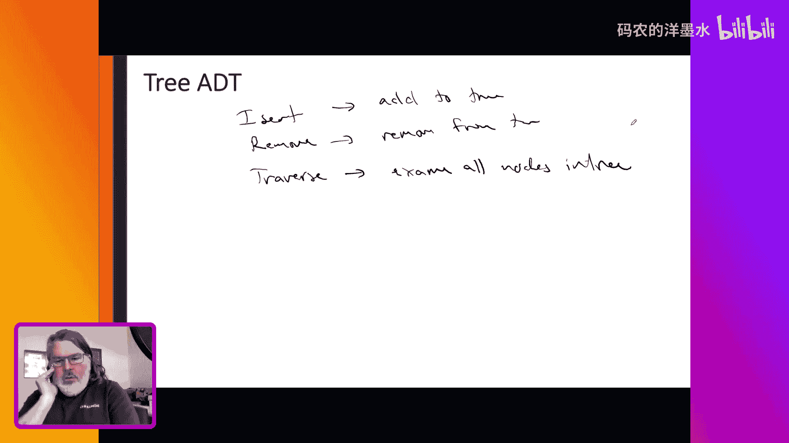

Let's skip this chunk。Because there's one thing I want to do。So a binary tree。

You're absolutely welcome to watch。 It is a class。 A binary tree is going to have what。Right。

 it's going to have much like we saw with a list inside。 it's going to have like a struct。Treode。

Right， it's going to take。Tee data。And a tree node。Pointer。Left entryno。Pointer， right。And finally。

 we have tree node。Pointer root。So。This looks a whole lot， like。Om。What you see with a linked list。

I don't want to make this stuff private。The whole tree node is private to the class。Right？

The user of of a tree doesn't know about how tree node works。 It's all internally。

 just like a linked list note， right。So。Let's now see a formal drawing of our tree。

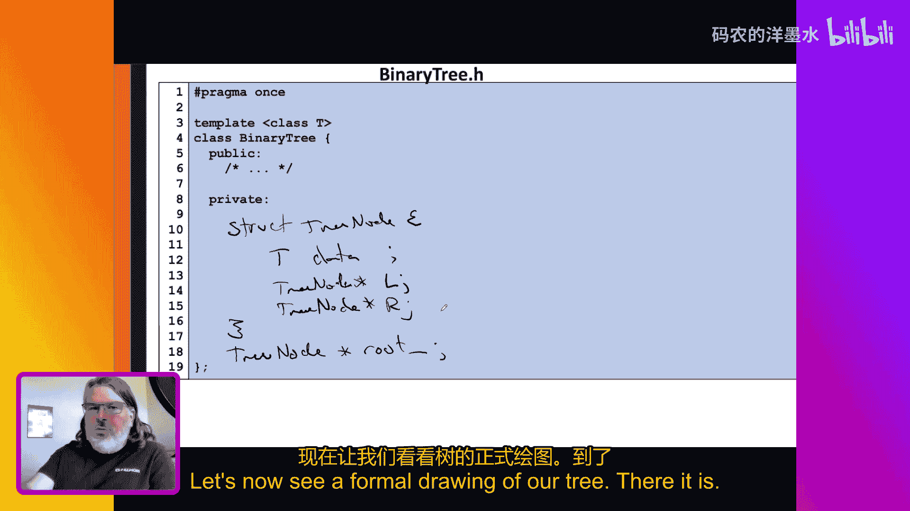

There it is。Here is that tree we've been using as an example so often。With。Root。Hong。

That seems like a really annoying drawing to make as we're going to spend a whole lot of time talking about trees。

So。Think that these two drawings are the same thing。 Any time I draw this。What I mean is that。

And that's it。That's all I've got。I wanted to show you sort of the actual detail drawing。

 but realize that we're going to use the left。 Enjoy your weekend。I'll stick around for questions。

 though。

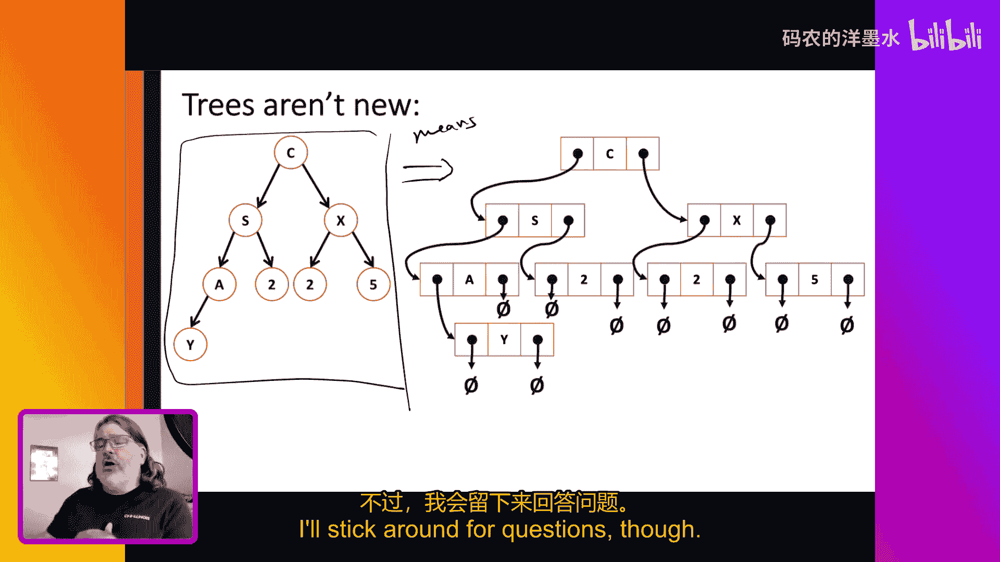